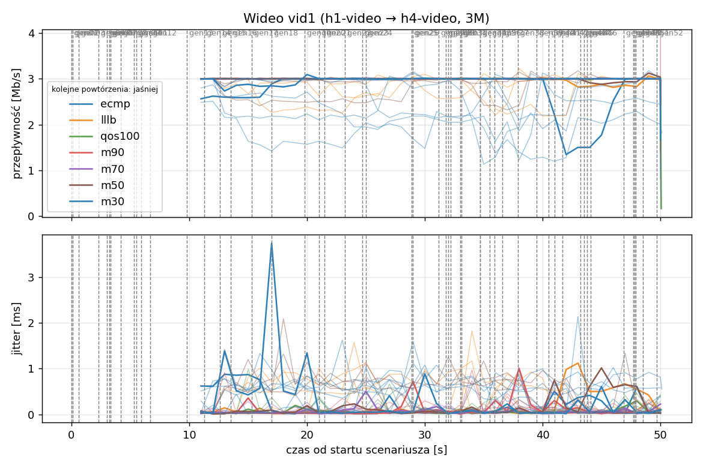
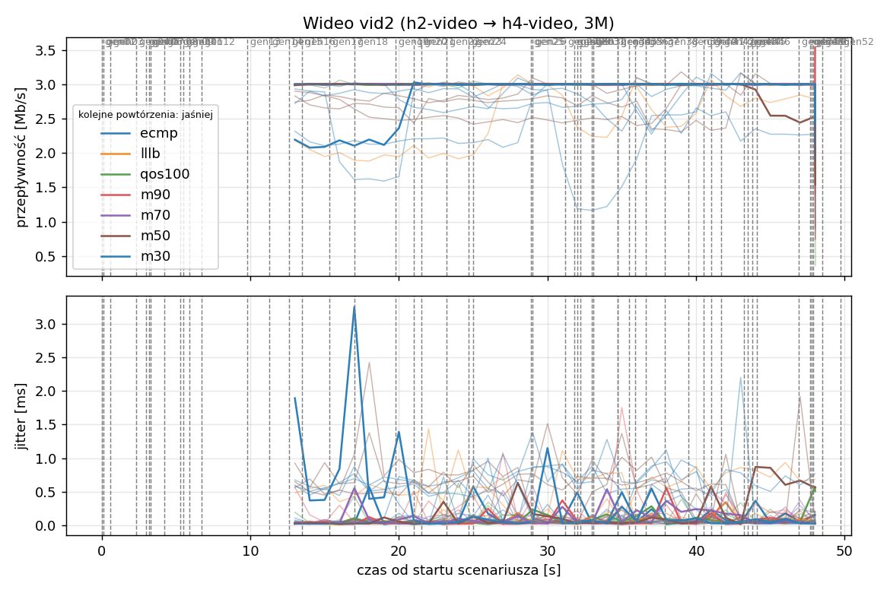
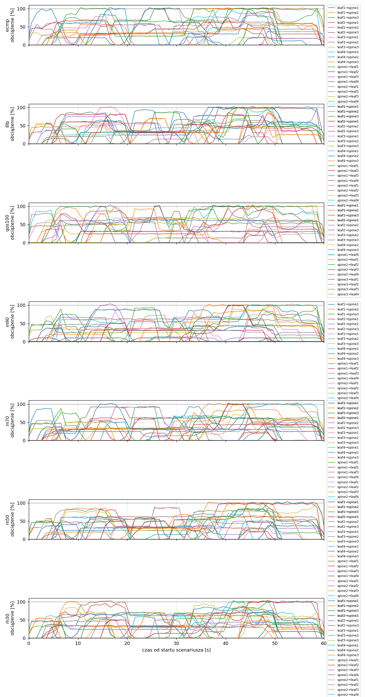
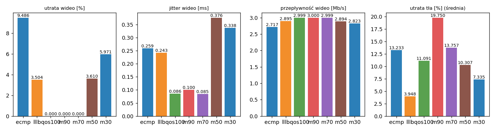

# Raport: clos-full

Katalog: `results/clos-full/20261102_053107`

## 1. Scenariusz

- Topologia: `sdn` (frr: `clos-frr.clab.yml`, sdn: `clos-sdn.clab.yml`)
- Warianty: **ecmp** (FRR, bez kontrolera), **lllb** (POLICY=lllb), **qos100** (LAYERS=1, POLICY=qos, RESERVE_PCT=100), **m90** (LAYERS=1, POLICY=qos, RESERVE_PCT=90), **m70** (LAYERS=1, POLICY=qos, RESERVE_PCT=70), **m50** (LAYERS=1, POLICY=qos, RESERVE_PCT=50), **m30** (LAYERS=1, POLICY=qos, RESERVE_PCT=30)
- Czas testu: 60 s, warmup (pomijany w statystykach, liczony od startu każdego przepływu): 5 s, powtórzeń: 5, seed: 42
- Wykonane przebiegi: ecmp/rep1, ecmp/rep2, ecmp/rep3, ecmp/rep4, ecmp/rep5, lllb/rep1, lllb/rep2, lllb/rep3, lllb/rep4, lllb/rep5, qos100/rep1, qos100/rep2, qos100/rep3, qos100/rep4, qos100/rep5, m90/rep1, m90/rep2, m90/rep3, m90/rep4, m90/rep5, m70/rep1, m70/rep2, m70/rep3, m70/rep4, m70/rep5, m50/rep1, m50/rep2, m50/rep3, m50/rep4, m50/rep5, m30/rep1, m30/rep2, m30/rep3, m30/rep4, m30/rep5

Harmonogram losowego tła różni się między powtórzeniami (seed + nr powtórzenia, wspólny dla wariantów); poniżej powtórzenie 1.

| id | klasa | źródło → cel | proto | zadana [Mb/s] | DSCP | start–koniec [s] |
|---|---|---|---|---|---|---|
| gen01 | background | h2-bg1 → h3-bg2 | udp | 4.49 | – | 0–7 |
| gen02 | background | h4-bg2 → h3-bg1 | udp | 3.16 | – | 0.1–5.1 |
| gen03 | background | h4-bg1 → h2-bg2 | udp | 5.25 | – | 0.6–5.6 |
| gen04 | background | h4-bg1 → h1-bg2 | udp | 3.56 | – | 2.3–7.3 |
| gen05 | background | h4-bg1 → h3-bg1 | udp | 2.36 | – | 3–60 |
| gen06 | background | h1-bg2 → h2-bg1 | udp | 1.93 | – | 3.2–16.2 |
| gen07 | background | h2-bg1 → h3-bg1 | udp | 1.39 | – | 3.3–8.3 |
| gen08 | background | h1-bg1 → h2-bg1 | udp | 3.29 | – | 4.2–32.2 |
| gen09 | background | h3-bg2 → h2-bg1 | udp | 4.51 | – | 5.3–16.3 |
| gen10 | background | h1-bg2 → h3-bg1 | udp | 3.96 | – | 5.5–10.5 |
| gen11 | background | h2-bg1 → h4-bg2 | udp | 5.85 | – | 5.9–19.9 |
| gen12 | background | h1-bg2 → h3-bg1 | udp | 4.90 | – | 6.7–16.7 |
| gen13 | background | h4-bg1 → h1-bg1 | udp | 3.07 | – | 9.8–19.8 |
| vid1 | video | h1-video → h4-video | udp | 3.00 | 46 | 10–50 |
| gen14 | background | h3-bg2 → h1-bg2 | udp | 5.37 | – | 11.3–27.3 |
| vid2 | video | h2-video → h4-video | udp | 3.00 | 46 | 12–48 |
| gen15 | background | h3-bg1 → h1-bg1 | udp | 3.12 | – | 12.6–30.6 |
| gen16 | background | h2-bg1 → h1-bg1 | udp | 4.96 | – | 13.5–18.5 |
| gen17 | background | h2-bg1 → h4-bg2 | udp | 4.86 | – | 15.3–20.3 |
| gen18 | background | h3-bg2 → h1-bg1 | udp | 3.49 | – | 17–36 |
| gen19 | background | h4-bg2 → h2-bg1 | udp | 2.93 | – | 19.8–48.8 |
| gen20 | background | h1-bg2 → h4-bg2 | udp | 5.68 | – | 21–26 |
| gen21 | background | h4-bg1 → h2-bg1 | udp | 3.04 | – | 21.5–35.5 |
| gen22 | background | h4-bg1 → h2-bg1 | udp | 3.69 | – | 23.2–28.2 |
| gen23 | background | h2-bg2 → h4-bg2 | udp | 1.26 | – | 24.7–44.7 |
| gen24 | background | h3-bg1 → h1-bg2 | udp | 4.88 | – | 25–31 |
| gen25 | background | h4-bg1 → h1-bg2 | udp | 3.51 | – | 28.9–33.9 |
| gen26 | background | h1-bg1 → h4-bg1 | udp | 5.23 | – | 29–59 |
| gen27 | background | h1-bg2 → h4-bg1 | udp | 2.10 | – | 31.2–37.2 |
| gen28 | background | h4-bg1 → h1-bg2 | udp | 1.54 | – | 31.8–36.8 |
| gen29 | background | h4-bg1 → h1-bg2 | udp | 1.53 | – | 32–39 |
| gen30 | background | h1-bg2 → h3-bg1 | udp | 3.69 | – | 32.2–38.2 |
| gen31 | background | h2-bg1 → h4-bg2 | udp | 2.18 | – | 33–38 |
| gen32 | background | h4-bg2 → h3-bg2 | udp | 5.19 | – | 33.1–59.1 |
| gen33 | background | h4-bg2 → h3-bg2 | udp | 2.60 | – | 34.7–40.7 |
| gen34 | background | h2-bg2 → h3-bg2 | udp | 1.75 | – | 34.7–59.7 |
| gen35 | background | h4-bg2 → h2-bg1 | udp | 5.89 | – | 35.5–54.5 |
| gen36 | background | h4-bg2 → h3-bg1 | udp | 4.62 | – | 35.9–49.9 |
| gen37 | background | h1-bg2 → h2-bg2 | udp | 4.50 | – | 36.6–50.6 |
| gen38 | background | h2-bg1 → h4-bg1 | udp | 4.23 | – | 37.9–58.9 |
| gen39 | background | h1-bg2 → h4-bg2 | udp | 5.93 | – | 39.5–44.5 |
| gen40 | background | h1-bg1 → h3-bg1 | udp | 5.99 | – | 40.5–45.5 |
| gen41 | background | h1-bg2 → h3-bg1 | udp | 4.47 | – | 41–50 |
| gen42 | background | h1-bg2 → h3-bg1 | udp | 2.82 | – | 41.7–48.7 |
| gen43 | background | h4-bg2 → h2-bg1 | udp | 4.98 | – | 43.2–49.2 |
| gen44 | background | h4-bg2 → h1-bg2 | udp | 5.97 | – | 43.5–50.5 |
| gen45 | background | h3-bg1 → h4-bg1 | udp | 5.74 | – | 43.8–58.8 |
| gen46 | background | h2-bg1 → h1-bg2 | udp | 1.89 | – | 44.1–49.1 |
| gen47 | background | h2-bg2 → h3-bg1 | udp | 2.94 | – | 46.9–59.9 |
| gen48 | background | h3-bg1 → h1-bg1 | udp | 3.58 | – | 47.7–59.7 |
| gen49 | background | h4-bg1 → h2-bg1 | udp | 5.93 | – | 47.8–57.8 |
| gen50 | background | h4-bg1 → h1-bg1 | udp | 3.20 | – | 47.9–54.9 |
| gen51 | background | h4-bg2 → h3-bg1 | udp | 1.53 | – | 48.5–59.5 |
| gen52 | background | h4-bg2 → h2-bg2 | udp | 2.44 | – | 49.7–59.7 |

## 2. Wideo: QoS według wariantu

Wartości: średnia ± odchylenie standardowe z powtórzeń.

| przepływ | wariant | przepływność [Mb/s] | jitter [ms] | utrata [%] | RTT mediana [ms] | RTT p95 [ms] |
|---|---|---|---|---|---|---|
| vid1 | ecmp | 2.55 ± 0.50 | 0.331 ± 0.280 | 15.10 ± 16.63 | 0.291 ± 0.559 | 60.295 ± 41.776 |
| vid1 | lllb | 2.89 ± 0.13 | 0.295 ± 0.153 | 3.71 ± 4.31 | 34.853 ± 31.794 | 82.911 ± 52.863 |
| vid1 | qos100 | 3.00 ± 0.00 | 0.087 ± 0.016 | 0.00 ± 0.00 | 0.031 ± 0.002 | 0.060 ± 0.009 |
| vid1 | m90 | 3.00 ± 0.00 | 0.093 ± 0.031 | 0.00 ± 0.00 | 0.030 ± 0.001 | 0.054 ± 0.004 |
| vid1 | m70 | 3.00 ± 0.00 | 0.085 ± 0.009 | 0.00 ± 0.00 | 0.028 ± 0.002 | 0.051 ± 0.005 |
| vid1 | m50 | 2.94 ± 0.08 | 0.364 ± 0.192 | 2.06 ± 2.54 | 23.220 ± 31.750 | 59.060 ± 0.607 |
| vid1 | m30 | 2.82 ± 0.19 | 0.343 ± 0.070 | 6.07 ± 6.36 | 13.442 ± 25.362 | 64.420 ± 11.226 |
| vid2 | ecmp | 2.88 ± 0.14 | 0.187 ± 0.096 | 3.87 ± 4.81 | 23.520 ± 32.162 | 82.924 ± 64.356 |
| vid2 | lllb | 2.90 ± 0.18 | 0.191 ± 0.188 | 3.30 ± 5.84 | 1.874 ± 4.115 | 59.449 ± 42.057 |
| vid2 | qos100 | 3.00 ± 0.00 | 0.085 ± 0.010 | 0.00 ± 0.00 | 0.030 ± 0.002 | 0.055 ± 0.006 |
| vid2 | m90 | 3.00 ± 0.00 | 0.107 ± 0.050 | 0.00 ± 0.00 | 0.029 ± 0.002 | 0.054 ± 0.007 |
| vid2 | m70 | 3.00 ± 0.00 | 0.085 ± 0.020 | 0.00 ± 0.00 | 0.029 ± 0.000 | 0.050 ± 0.003 |
| vid2 | m50 | 2.85 ± 0.15 | 0.388 ± 0.165 | 5.16 ± 5.15 | 23.279 ± 31.833 | 59.400 ± 0.158 |
| vid2 | m30 | 2.83 ± 0.10 | 0.332 ± 0.128 | 5.87 ± 3.28 | 11.688 ± 26.057 | 71.780 ± 17.503 |

RTT z `ping` co 0,1 s między hostami wideo (osobny przepływ ICMP z tym samym DSCP - w SDN może iść inną ścieżką niż strumień UDP).

## 3. Ruch tła

Agregat tła w obrębie powtórzenia, potem średnia ± odchylenie standardowe po powtórzeniach (utrata = Σ utraconych / Σ wysłanych datagramów; dostarczone = Σ przepływności / Σ zadanych; przepływy trwające nie dłużej niż warmup pominięte).

| wariant | strumieni tła / powt. | dostarczone / zadane [%] | jitter [ms] | utrata [%] |
|---|---|---|---|---|
| ecmp | 40 | 87.7 ± 5.7 | 0.285 ± 0.062 | 13.23 ± 6.06 |
| lllb | 40 | 95.3 ± 3.9 | 0.183 ± 0.068 | 3.95 ± 3.29 |
| qos100 | 40 | 88.0 ± 5.3 | 0.337 ± 0.085 | 11.09 ± 4.54 |
| m90 | 40 | 78.4 ± 8.2 | 0.270 ± 0.098 | 19.75 ± 4.68 |
| m70 | 40 | 84.2 ± 6.1 | 0.219 ± 0.076 | 13.76 ± 3.89 |
| m50 | 40 | 89.4 ± 4.5 | 0.235 ± 0.111 | 10.31 ± 3.54 |
| m30 | 40 | 92.5 ± 4.3 | 0.198 ± 0.035 | 7.34 ± 4.18 |

## 4. Obciążenie łączy fabricu

Średnia i maksimum z próbek co 1 s w oknie 0–60 s; MLU = maksymalne obciążenie łącza; drops = pakiety odrzucone przez `tbf` na wyjściu łącza.

| wariant | rep | średnie obciążenie łączy [%] | MLU [%] | łącza > 90% | drops tbf | CPU VM śr./maks. [%] |
|---|---|---|---|---|---|---|
| ecmp | 1 | 32.0 | 104.3 | 12/24 | 29326 | 22 / 32 |
| ecmp | 2 | 36.8 | 104.0 | 14/24 | 41951 | 22 / 34 |
| ecmp | 3 | 45.2 | 105.2 | 17/24 | 59247 | 26 / 33 |
| ecmp | 4 | 33.9 | 102.8 | 11/24 | 8706 | 20 / 31 |
| ecmp | 5 | 36.8 | 104.4 | 12/24 | 24934 | 21 / 30 |
| lllb | 1 | 34.3 | 102.8 | 11/24 | 14061 | 26 / 47 |
| lllb | 2 | 42.0 | 104.1 | 18/24 | 8853 | 29 / 51 |
| lllb | 3 | 49.9 | 105.8 | 16/24 | 26865 | 30 / 50 |
| lllb | 4 | 34.6 | 102.9 | 7/24 | 799 | 26 / 44 |
| lllb | 5 | 38.7 | 102.7 | 13/24 | 6751 | 27 / 45 |
| qos100 | 1 | 32.9 | 104.5 | 13/24 | 23696 | 26 / 46 |
| qos100 | 2 | 38.8 | 103.4 | 14/24 | 33248 | 29 / 56 |
| qos100 | 3 | 45.8 | 103.6 | 15/24 | 56383 | 31 / 49 |
| qos100 | 4 | 33.2 | 102.8 | 13/24 | 10565 | 26 / 45 |
| qos100 | 5 | 36.6 | 103.8 | 13/24 | 21869 | 27 / 44 |
| m90 | 1 | 30.2 | 104.0 | 10/24 | 18028 | 26 / 44 |
| m90 | 2 | 36.0 | 103.8 | 14/24 | 21274 | 29 / 53 |
| m90 | 3 | 40.8 | 104.4 | 11/24 | 43466 | 30 / 48 |
| m90 | 4 | 30.0 | 105.6 | 14/24 | 4138 | 26 / 44 |
| m90 | 5 | 34.3 | 103.5 | 11/24 | 18967 | 27 / 44 |
| m70 | 1 | 31.6 | 103.5 | 10/24 | 15420 | 26 / 45 |
| m70 | 2 | 38.5 | 104.7 | 13/24 | 18993 | 28 / 49 |
| m70 | 3 | 44.5 | 104.0 | 13/24 | 32442 | 30 / 45 |
| m70 | 4 | 31.1 | 103.5 | 10/24 | 2173 | 26 / 43 |
| m70 | 5 | 36.1 | 103.7 | 11/24 | 11340 | 27 / 46 |
| m50 | 1 | 32.6 | 103.6 | 6/24 | 14660 | 28 / 46 |
| m50 | 2 | 39.6 | 103.6 | 15/24 | 10055 | 28 / 48 |
| m50 | 3 | 46.8 | 103.7 | 11/24 | 18743 | 30 / 48 |
| m50 | 4 | 33.1 | 101.9 | 9/24 | 4840 | 26 / 44 |
| m50 | 5 | 36.5 | 105.8 | 11/24 | 13176 | 35 / 81 |
| m30 | 1 | 32.9 | 103.4 | 9/24 | 11192 | 28 / 51 |
| m30 | 2 | 40.5 | 103.7 | 17/24 | 11853 | 29 / 51 |
| m30 | 3 | 49.4 | 105.4 | 14/24 | 24477 | 30 / 52 |
| m30 | 4 | 34.0 | 104.0 | 11/24 | 4292 | 26 / 44 |
| m30 | 5 | 38.0 | 102.4 | 12/24 | 7190 | 27 / 48 |

Łącza z obciążeniem > 10% (maksimum [%] / drops, powtórzenie 1):

| łącze | ecmp | lllb | qos100 | m90 | m70 | m50 | m30 |
|---|---|---|---|---|---|---|---|
| leaf1→spine1 | 22 / 0 | 103 / 0 | 32 / 0 | 43 / 0 | 63 / 0 | 84 / 0 | 80 / 0 |
| leaf1→spine2 | 102 / 1752 | 103 / 310 | 104 / 5760 | 102 / 0 | 101 / 620 | 102 / 273 | 101 / 310 |
| leaf1→spine3 | 103 / 4318 | 100 / 730 | 93 / 0 | 101 / 269 | 101 / 264 | 85 / 0 | 103 / 2425 |
| leaf2→spine1 | 64 / 0 | 62 / 0 | 32 / 0 | 32 / 0 | 62 / 0 | 84 / 0 | 96 / 0 |
| leaf2→spine2 | 104 / 355 | 52 / 0 | 105 / 433 | 104 / 433 | 51 / 0 | 63 / 0 | 54 / 0 |
| leaf2→spine3 | 53 / 0 | 81 / 0 | 53 / 0 | 76 / 0 | 52 / 0 | 63 / 0 | 50 / 0 |
| leaf3→spine1 | 103 / 824 | 87 / 0 | 0 / 0 | 10 / 0 | 31 / 0 | 52 / 0 | 72 / 0 |
| leaf3→spine2 | 57 / 0 | 60 / 0 | 81 / 0 | 61 / 0 | 93 / 0 | 89 / 0 | 53 / 0 |
| leaf3→spine3 | 61 / 0 | 33 / 0 | 99 / 51 | 89 / 0 | 38 / 0 | 58 / 0 | 61 / 0 |
| leaf4→spine1 | 102 / 450 | 103 / 6559 | 0 / 0 | 10 / 0 | 31 / 0 | 52 / 0 | 73 / 0 |
| leaf4→spine2 | 102 / 530 | 102 / 5340 | 103 / 10843 | 101 / 1281 | 103 / 2103 | 104 / 8496 | 102 / 4723 |
| leaf4→spine3 | 102 / 18441 | 101 / 565 | 103 / 3940 | 103 / 14316 | 102 / 10180 | 102 / 5449 | 102 / 591 |
| spine1→leaf1 | 101 / 621 | 88 / 0 | 0 / 0 | 10 / 0 | 30 / 0 | 52 / 0 | 71 / 0 |
| spine1→leaf2 | 67 / 0 | 86 / 0 | 0 / 0 | 10 / 0 | 31 / 0 | 51 / 0 | 71 / 0 |
| spine1→leaf3 | 66 / 0 | 98 / 0 | 0 / 0 | 10 / 0 | 31 / 0 | 51 / 0 | 67 / 0 |
| spine1→leaf4 | 67 / 0 | 100 / 0 | 64 / 0 | 64 / 0 | 92 / 0 | 101 / 390 | 103 / 1445 |
| spine2→leaf1 | 57 / 0 | 102 / 222 | 100 / 157 | 85 / 0 | 94 / 0 | 87 / 0 | 52 / 0 |
| spine2→leaf2 | 103 / 825 | 65 / 0 | 102 / 263 | 67 / 0 | 63 / 0 | 84 / 0 | 68 / 0 |
| spine2→leaf3 | 41 / 0 | 102 / 335 | 102 / 0 | 89 / 0 | 73 / 0 | 102 / 52 | 95 / 0 |
| spine2→leaf4 | 101 / 0 | 98 / 0 | 96 / 0 | 102 / 1729 | 102 / 1668 | 71 / 0 | 102 / 171 |
| spine3→leaf1 | 84 / 0 | 65 / 0 | 103 / 0 | 90 / 0 | 102 / 585 | 57 / 0 | 74 / 0 |
| spine3→leaf2 | 61 / 0 | 70 / 0 | 71 / 0 | 99 / 0 | 87 / 0 | 66 / 0 | 70 / 0 |
| spine3→leaf3 | 102 / 1210 | 78 / 0 | 102 / 526 | 95 / 0 | 88 / 0 | 84 / 0 | 85 / 0 |
| spine3→leaf4 | 93 / 0 | 86 / 0 | 102 / 1723 | 101 / 0 | 103 / 0 | 100 / 0 | 103 / 1527 |

## 5. Ścieżki wybrane przez kontroler (powtórzenie 1)

Z logu kontrolera (linie `Flow`), dopasowane po piątce przepływu; ✓ = reguły widoczne w `dump-flows` na tych samych przełącznikach.

| przepływ | ecmp | lllb | qos100 | m90 | m70 | m50 | m30 |
|---|---|---|---|---|---|---|---|
| gen01 | ECMP (hash L4), nieobserwowana bezpośrednio | leaf2 -> spine2 -> leaf3 ✓ (loads 5% 0% 0%) | leaf2 -> spine3 -> leaf3 ✓ (loads 0% 5% 0%) | leaf2 -> spine3 -> leaf3 ✓ (loads 0% 5% 0%) | leaf2 -> spine3 -> leaf3 ✓ (loads 0% 5% 0%) | leaf2 -> spine3 -> leaf3 ✓ (loads 0% 5% 0%) | leaf2 -> spine3 -> leaf3 ✓ (loads 0% 5% 0%) |
| gen02 | ECMP (hash L4), nieobserwowana bezpośrednio | leaf4 -> spine1 -> leaf3 ✓ (loads 5% 5% 5%) | leaf4 -> spine3 -> leaf3 ✓ (loads 0% 10% 5%) | leaf4 -> spine2 -> leaf3 ✓ (loads 5% 5% 5%) | leaf4 -> spine2 -> leaf3 ✓ (loads 5% 0% 0%) | leaf4 -> spine2 -> leaf3 ✓ (loads 5% 5% 5%) | leaf4 -> spine2 -> leaf3 ✓ (loads 5% 5% 5%) |
| gen03 | ECMP (hash L4), nieobserwowana bezpośrednio | leaf4 -> spine3 -> leaf2 ✓ (loads 12% 5% 0%) | leaf4 -> spine3 -> leaf2 ✓ (loads 0% 10% 5%) | leaf4 -> spine1 -> leaf2 ✓ (loads 0% 1% 5%) | leaf4 -> spine2 -> leaf2 ✓ (loads 5% 5% 5%) | leaf4 -> spine1 -> leaf2 ✓ (loads 0% 13% 5%) | leaf4 -> spine3 -> leaf2 ✓ (loads 5% 10% 5%) |
| gen04 | ECMP (hash L4), nieobserwowana bezpośrednio | leaf4 -> spine2 -> leaf1 ✓ (loads 33% 5% 47%) | leaf4 -> spine2 -> leaf1 ✓ (loads 0% 5% 86%) | leaf4 -> spine3 -> leaf1 ✓ (loads 10% 33% 5%) | leaf4 -> spine3 -> leaf1 ✓ (loads 5% 87% 0%) | leaf4 -> spine3 -> leaf1 ✓ (loads 47% 33% 5%) | leaf4 -> spine1 -> leaf1 ✓ (loads 5% 33% 54%) |
| gen05 | ECMP (hash L4), nieobserwowana bezpośrednio | leaf4 -> spine1 -> leaf3 ✓ (loads 38% 46% 54%) | leaf4 -> spine2 -> leaf3 ✓ (loads 0% 31% 87%) | leaf4 -> spine2 -> leaf3 ✓ (loads 10% 38% 46%) | leaf4 -> spine1 -> leaf3 ✓ (loads 10% 87% 46%) | leaf4 -> spine2 -> leaf3 ✓ (loads 50% 37% 46%) | leaf4 -> spine1 -> leaf3 ✓ (loads 31% 33% 54%) |
| gen06 | ECMP (hash L4), nieobserwowana bezpośrednio | leaf1 -> spine2 -> leaf2 ✓ (loads 5% 0% 54%) | leaf1 -> spine2 -> leaf2 ✓ (loads 0% 5% 54%) | leaf1 -> spine2 -> leaf2 ✓ (loads 10% 0% 5%) | leaf1 -> spine1 -> leaf2 ✓ (loads 0% 54% 5%) | leaf1 -> spine3 -> leaf2 ✓ (loads 50% 5% 0%) | leaf1 -> spine2 -> leaf2 ✓ (loads 5% 0% 54%) |
| gen07 | ECMP (hash L4), nieobserwowana bezpośrednio | leaf2 -> spine3 -> leaf3 ✓ (loads 43% 46% 10%) | leaf2 -> spine2 -> leaf3 ✓ (loads 0% 15% 79%) | leaf2 -> spine2 -> leaf3 ✓ (loads 10% 34% 46%) | leaf2 -> spine1 -> leaf3 ✓ (loads 10% 32% 46%) | leaf2 -> spine1 -> leaf3 ✓ (loads 10% 42% 46%) | leaf2 -> spine1 -> leaf3 ✓ (loads 15% 33% 46%) |
| gen08 | ECMP (hash L4), nieobserwowana bezpośrednio | leaf1 -> spine1 -> leaf2 ✓ (loads 5% 5% 54%) | leaf1 -> spine2 -> leaf2 ✓ (loads 0% 21% 54%) | leaf1 -> spine3 -> leaf2 ✓ (loads 10% 18% 5%) | leaf1 -> spine3 -> leaf2 ✓ (loads 17% 54% 5%) | leaf1 -> spine2 -> leaf2 ✓ (loads 50% 5% 7%) | leaf1 -> spine1 -> leaf2 ✓ (loads 5% 15% 54%) |
| gen09 | ECMP (hash L4), nieobserwowana bezpośrednio | leaf3 -> spine1 -> leaf2 ✓ (loads 15% 20% 54%) | leaf3 -> spine2 -> leaf2 ✓ (loads 0% 52% 54%) | leaf3 -> spine2 -> leaf2 ✓ (loads 15% 20% 32%) | leaf3 -> spine1 -> leaf2 ✓ (loads 25% 54% 30%) | leaf3 -> spine2 -> leaf2 ✓ (loads 50% 16% 20%) | leaf3 -> spine2 -> leaf2 ✓ (loads 27% 25% 54%) |
| gen10 | ECMP (hash L4), nieobserwowana bezpośrednio | leaf1 -> spine3 -> leaf3 ✓ (loads 44% 46% 19%) | leaf1 -> spine2 -> leaf3 ✓ (loads 0% 53% 79%) | leaf1 -> spine3 -> leaf3 ✓ (loads 10% 70% 51%) | leaf1 -> spine3 -> leaf3 ✓ (loads 30% 47% 46%) | leaf1 -> spine1 -> leaf3 ✓ (loads 29% 57% 46%) | leaf1 -> spine2 -> leaf3 ✓ (loads 44% 42% 46%) |
| gen11 | ECMP (hash L4), nieobserwowana bezpośrednio | leaf2 -> spine1 -> leaf4 ✓ (loads 5% 46% 14%) | leaf2 -> spine2 -> leaf4 ✓ (loads 0% 29% 46%) | leaf2 -> spine2 -> leaf4 ✓ (loads 10% 19% 46%) | leaf2 -> spine1 -> leaf4 ✓ (loads 14% 15% 46%) | leaf2 -> spine2 -> leaf4 ✓ (loads 14% 5% 46%) | leaf2 -> spine1 -> leaf4 ✓ (loads 14% 15% 46%) |
| gen12 | ECMP (hash L4), nieobserwowana bezpośrednio | leaf1 -> spine1 -> leaf3 ✓ (loads 39% 46% 55%) | leaf1 -> spine3 -> leaf3 ✓ (loads 0% 75% 55%) | leaf1 -> spine1 -> leaf3 ✓ (loads 5% 39% 72%) | leaf1 -> spine2 -> leaf3 ✓ (loads 30% 6% 70%) | leaf1 -> spine2 -> leaf3 ✓ (loads 50% 39% 46%) | leaf1 -> spine2 -> leaf3 ✓ (loads 43% 40% 46%) |
| gen13 | ECMP (hash L4), nieobserwowana bezpośrednio | leaf4 -> spine3 -> leaf1 ✓ (loads 24% 5% 0%) | leaf4 -> spine3 -> leaf1 ✓ (loads 0% 24% 5%) | leaf4 -> spine1 -> leaf1 ✓ (loads 0% 24% 5%) | leaf4 -> spine3 -> leaf1 ✓ (loads 24% 5% 0%) | leaf4 -> spine1 -> leaf1 ✓ (loads 0% 24% 5%) | leaf4 -> spine3 -> leaf1 ✓ (loads 24% 5% 0%) |
| vid1 | ECMP (hash L4), nieobserwowana bezpośrednio | leaf1 -> spine2 -> leaf4 ✓ (loads 84% 35% 41%) | leaf1 -> spine1 -> leaf4 ✓ (loads 0% 96% 66%) | leaf1 -> spine1 -> leaf4 ✓ (loads 10% 75% 75%) | leaf1 -> spine1 -> leaf4 ✓ (loads 34% 60% 75%) | leaf1 -> spine1 -> leaf4 ✓ (loads 41% 84% 35%) | leaf1 -> spine1 -> leaf4 ✓ (loads 60% 100% 5%) |
| gen14 | ECMP (hash L4), nieobserwowana bezpośrednio | leaf3 -> spine2 -> leaf1 ✓ (loads 46% 10% 22%) | leaf3 -> spine3 -> leaf1 ✓ (loads 0% 46% 37%) | leaf3 -> spine3 -> leaf1 ✓ (loads 10% 47% 5%) | leaf3 -> spine2 -> leaf1 ✓ (loads 30% 5% 32%) | leaf3 -> spine3 -> leaf1 ✓ (loads 28% 47% 5%) | leaf3 -> spine1 -> leaf1 ✓ (loads 5% 46% 32%) |
| vid2 | ECMP (hash L4), nieobserwowana bezpośrednio | leaf2 -> spine3 -> leaf4 ✓ (loads 60% 31% 5%) | leaf2 -> spine1 -> leaf4 ✓ (loads 31% 60% 5%) | leaf2 -> spine1 -> leaf4 ✓ (loads 31% 60% 5%) | leaf2 -> spine1 -> leaf4 ✓ (loads 61% 5% 0%) | leaf2 -> spine1 -> leaf4 ✓ (loads 31% 60% 5%) | leaf2 -> spine1 -> leaf4 ✓ (loads 90% 5% 0%) |
| gen15 | ECMP (hash L4), nieobserwowana bezpośrednio | leaf3 -> spine3 -> leaf1 ✓ (loads 46% 55% 37%) | leaf3 -> spine2 -> leaf1 ✓ (loads 0% 52% 72%) | leaf3 -> spine3 -> leaf1 ✓ (loads 10% 51% 47%) | leaf3 -> spine3 -> leaf1 ✓ (loads 30% 44% 37%) | leaf3 -> spine1 -> leaf1 ✓ (loads 37% 46% 55%) | leaf3 -> spine3 -> leaf1 ✓ (loads 39% 46% 37%) |
| gen16 | ECMP (hash L4), nieobserwowana bezpośrednio | leaf2 -> spine2 -> leaf1 ✓ (loads 60% 55% 60%) | leaf2 -> spine2 -> leaf1 ✓ (loads 28% 65% 87%) | leaf2 -> spine2 -> leaf1 ✓ (loads 36% 60% 73%) | leaf2 -> spine3 -> leaf1 ✓ (loads 61% 55% 53%) | leaf2 -> spine1 -> leaf1 ✓ (loads 47% 60% 55%) | leaf2 -> spine2 -> leaf1 ✓ (loads 90% 5% 45%) |
| gen17 | ECMP (hash L4), nieobserwowana bezpośrednio | leaf2 -> spine3 -> leaf4 ✓ (loads 60% 50% 36%) | leaf2 -> spine3 -> leaf4 ✓ (loads 62% 100% 5%) | leaf2 -> spine3 -> leaf4 ✓ (loads 62% 100% 5%) | leaf2 -> spine2 -> leaf4 ✓ (loads 92% 5% 51%) | leaf2 -> spine3 -> leaf4 ✓ (loads 81% 60% 5%) | leaf2 -> spine3 -> leaf4 ✓ (loads 100% 51% 5%) |
| gen18 | ECMP (hash L4), nieobserwowana bezpośrednio | leaf3 -> spine1 -> leaf1 ✓ (loads 42% 100% 64%) | leaf3 -> spine2 -> leaf1 ✓ (loads 0% 85% 97%) | leaf3 -> spine2 -> leaf1 ✓ (loads 10% 53% 93%) | leaf3 -> spine2 -> leaf1 ✓ (loads 30% 65% 100%) | leaf3 -> spine2 -> leaf1 ✓ (loads 50% 40% 55%) | leaf3 -> spine1 -> leaf1 ✓ (loads 53% 56% 64%) |
| gen19 | ECMP (hash L4), nieobserwowana bezpośrednio | leaf4 -> spine2 -> leaf2 ✓ (loads 34% 5% 32%) | leaf4 -> spine2 -> leaf2 ✓ (loads 0% 34% 37%) | leaf4 -> spine2 -> leaf2 ✓ (loads 10% 29% 34%) | leaf4 -> spine2 -> leaf2 ✓ (loads 24% 5% 34%) | leaf4 -> spine3 -> leaf2 ✓ (loads 32% 34% 5%) | leaf4 -> spine2 -> leaf2 ✓ (loads 34% 5% 32%) |
| gen20 | ECMP (hash L4), nieobserwowana bezpośrednio | leaf1 -> spine1 -> leaf4 ✓ (loads 34% 36% 71%) | leaf1 -> spine2 -> leaf4 ✓ (loads 62% 52% 55%) | leaf1 -> spine3 -> leaf4 ✓ (loads 62% 50% 50%) | leaf1 -> spine3 -> leaf4 ✓ (loads 86% 50% 39%) | leaf1 -> spine3 -> leaf4 ✓ (loads 62% 39% 38%) | leaf1 -> spine2 -> leaf4 ✓ (loads 100% 5% 50%) |
| gen21 | ECMP (hash L4), nieobserwowana bezpośrednio | leaf4 -> spine3 -> leaf2 ✓ (loads 34% 22% 15%) | leaf4 -> spine3 -> leaf2 ✓ (loads 0% 64% 5%) | leaf4 -> spine1 -> leaf2 ✓ (loads 5% 54% 34%) | leaf4 -> spine2 -> leaf2 ✓ (loads 29% 30% 34%) | leaf4 -> spine1 -> leaf2 ✓ (loads 18% 34% 23%) | leaf4 -> spine3 -> leaf2 ✓ (loads 34% 30% 5%) |
| gen22 | ECMP (hash L4), nieobserwowana bezpośrednio | leaf4 -> spine3 -> leaf2 ✓ (loads 34% 35% 31%) | leaf4 -> spine3 -> leaf2 ✓ (loads 0% 64% 36%) | leaf4 -> spine3 -> leaf2 ✓ (loads 10% 54% 39%) | leaf4 -> spine1 -> leaf2 ✓ (loads 29% 61% 34%) | leaf4 -> spine1 -> leaf2 ✓ (loads 31% 34% 35%) | leaf4 -> spine3 -> leaf2 ✓ (loads 34% 35% 31%) |
| gen23 | ECMP (hash L4), nieobserwowana bezpośrednio | leaf2 -> spine2 -> leaf4 ✓ (loads 58% 31% 36%) | leaf2 -> spine3 -> leaf4 ✓ (loads 62% 59% 5%) | leaf2 -> spine2 -> leaf4 ✓ (loads 62% 5% 59%) | leaf2 -> spine2 -> leaf4 ✓ (loads 62% 5% 58%) | leaf2 -> spine2 -> leaf4 ✓ (loads 62% 5% 58%) | leaf2 -> spine3 -> leaf4 ✓ (loads 62% 58% 5%) |
| gen24 | ECMP (hash L4), nieobserwowana bezpośrednio | leaf3 -> spine1 -> leaf1 ✓ (loads 36% 55% 37%) | leaf3 -> spine3 -> leaf1 ✓ (loads 0% 68% 60%) | leaf3 -> spine1 -> leaf1 ✓ (loads 5% 36% 87%) | leaf3 -> spine1 -> leaf1 ✓ (loads 5% 91% 32%) | leaf3 -> spine2 -> leaf1 ✓ (loads 37% 36% 55%) | leaf3 -> spine2 -> leaf1 ✓ (loads 70% 5% 32%) |
| gen25 | ECMP (hash L4), nieobserwowana bezpośrednio | leaf4 -> spine2 -> leaf1 ✓ (loads 86% 35% 61%) | leaf4 -> spine3 -> leaf1 ✓ (loads 0% 73% 69%) | leaf4 -> spine3 -> leaf1 ✓ (loads 10% 54% 45%) | leaf4 -> spine3 -> leaf1 ✓ (loads 30% 62% 37%) | leaf4 -> spine3 -> leaf1 ✓ (loads 44% 86% 35%) | leaf4 -> spine1 -> leaf1 ✓ (loads 50% 50% 69%) |
| gen26 | ECMP (hash L4), nieobserwowana bezpośrednio | leaf1 -> spine1 -> leaf4 ✓ (loads 39% 44% 41%) | leaf1 -> spine3 -> leaf4 ✓ (loads 62% 34% 28%) | leaf1 -> spine2 -> leaf4 ✓ (loads 62% 28% 34%) | leaf1 -> spine2 -> leaf4 ✓ (loads 62% 28% 34%) | leaf1 -> spine3 -> leaf4 ✓ (loads 62% 34% 15%) | leaf1 -> spine3 -> leaf4 ✓ (loads 65% 15% 13%) |
| gen27 | ECMP (hash L4), nieobserwowana bezpośrednio | leaf1 -> spine3 -> leaf4 ✓ (loads 88% 44% 36%) | leaf1 -> spine2 -> leaf4 ✓ (loads 62% 39% 67%) | leaf1 -> spine3 -> leaf4 ✓ (loads 62% 67% 39%) | leaf1 -> spine3 -> leaf4 ✓ (loads 62% 67% 39%) | leaf1 -> spine2 -> leaf4 ✓ (loads 62% 39% 54%) | leaf1 -> spine2 -> leaf4 ✓ (loads 65% 5% 67%) |
| gen28 | ECMP (hash L4), nieobserwowana bezpośrednio | leaf4 -> spine3 -> leaf1 ✓ (loads 61% 66% 36%) | leaf4 -> spine2 -> leaf1 ✓ (loads 0% 70% 85%) | leaf4 -> spine2 -> leaf1 ✓ (loads 10% 59% 60%) | leaf4 -> spine2 -> leaf1 ✓ (loads 33% 61% 62%) | leaf4 -> spine1 -> leaf1 ✓ (loads 36% 60% 66%) | leaf4 -> spine3 -> leaf1 ✓ (loads 69% 48% 46%) |
| gen29 | ECMP (hash L4), nieobserwowana bezpośrednio | leaf4 -> spine3 -> leaf1 ✓ (loads 61% 66% 46%) | leaf4 -> spine2 -> leaf1 ✓ (loads 0% 80% 85%) | leaf4 -> spine2 -> leaf1 ✓ (loads 10% 64% 65%) | leaf4 -> spine2 -> leaf1 ✓ (loads 33% 66% 67%) | leaf4 -> spine1 -> leaf1 ✓ (loads 46% 60% 66%) | leaf4 -> spine3 -> leaf1 ✓ (loads 69% 53% 51%) |
| gen30 | ECMP (hash L4), nieobserwowana bezpośrednio | leaf1 -> spine3 -> leaf3 ✓ (loads 88% 36% 27%) | leaf1 -> spine3 -> leaf3 ✓ (loads 31% 58% 54%) | leaf1 -> spine1 -> leaf3 ✓ (loads 36% 54% 55%) | leaf1 -> spine1 -> leaf3 ✓ (loads 36% 54% 54%) | leaf1 -> spine1 -> leaf3 ✓ (loads 36% 57% 59%) | leaf1 -> spine2 -> leaf3 ✓ (loads 64% 23% 54%) |
| gen31 | ECMP (hash L4), nieobserwowana bezpośrednio | leaf2 -> spine2 -> leaf4 ✓ (loads 54% 49% 53%) | leaf2 -> spine2 -> leaf4 ✓ (loads 62% 24% 67%) | leaf2 -> spine3 -> leaf4 ✓ (loads 62% 67% 26%) | leaf2 -> spine3 -> leaf4 ✓ (loads 62% 67% 25%) | leaf2 -> spine2 -> leaf4 ✓ (loads 62% 40% 54%) | leaf2 -> spine2 -> leaf4 ✓ (loads 62% 23% 67%) |
| gen32 | ECMP (hash L4), nieobserwowana bezpośrednio | leaf4 -> spine1 -> leaf3 ✓ (loads 39% 67% 50%) | leaf4 -> spine3 -> leaf3 ✓ (loads 0% 86% 73%) | leaf4 -> spine3 -> leaf3 ✓ (loads 10% 63% 51%) | leaf4 -> spine3 -> leaf3 ✓ (loads 30% 93% 36%) | leaf4 -> spine2 -> leaf3 ✓ (loads 45% 39% 66%) | leaf4 -> spine2 -> leaf3 ✓ (loads 61% 37% 63%) |
| gen33 | ECMP (hash L4), nieobserwowana bezpośrednio | leaf4 -> spine2 -> leaf3 ✓ (loads 78% 49% 63%) | leaf4 -> spine2 -> leaf3 ✓ (loads 0% 91% 99%) | leaf4 -> spine3 -> leaf3 ✓ (loads 10% 86% 85%) | leaf4 -> spine3 -> leaf3 ✓ (loads 30% 93% 84%) | leaf4 -> spine3 -> leaf3 ✓ (loads 50% 78% 48%) | leaf4 -> spine1 -> leaf3 ✓ (loads 60% 86% 63%) |
| gen34 | ECMP (hash L4), nieobserwowana bezpośrednio | leaf2 -> spine3 -> leaf3 ✓ (loads 78% 40% 38%) | leaf2 -> spine2 -> leaf3 ✓ (loads 31% 39% 81%) | leaf2 -> spine2 -> leaf3 ✓ (loads 31% 29% 63%) | leaf2 -> spine2 -> leaf3 ✓ (loads 31% 18% 60%) | leaf2 -> spine3 -> leaf3 ✓ (loads 38% 78% 5%) | leaf2 -> spine3 -> leaf3 ✓ (loads 31% 86% 18%) |
| gen35 | ECMP (hash L4), nieobserwowana bezpośrednio | leaf4 -> spine2 -> leaf2 ✓ (loads 78% 59% 63%) | leaf4 -> spine2 -> leaf2 ✓ (loads 0% 92% 93%) | leaf4 -> spine3 -> leaf2 ✓ (loads 10% 86% 76%) | leaf4 -> spine3 -> leaf2 ✓ (loads 30% 93% 65%) | leaf4 -> spine3 -> leaf2 ✓ (loads 50% 78% 63%) | leaf4 -> spine1 -> leaf2 ✓ (loads 42% 84% 63%) |
| gen36 | ECMP (hash L4), nieobserwowana bezpośrednio | leaf4 -> spine2 -> leaf3 ✓ (loads 78% 58% 62%) | leaf4 -> spine3 -> leaf3 ✓ (loads 0% 100% 92%) | leaf4 -> spine3 -> leaf3 ✓ (loads 10% 86% 86%) | leaf4 -> spine3 -> leaf3 ✓ (loads 30% 93% 80%) | leaf4 -> spine3 -> leaf3 ✓ (loads 49% 78% 61%) | leaf4 -> spine1 -> leaf3 ✓ (loads 52% 92% 63%) |
| gen37 | ECMP (hash L4), nieobserwowana bezpośrednio | leaf1 -> spine1 -> leaf2 ✓ (loads 59% 78% 60%) | leaf1 -> spine2 -> leaf2 ✓ (loads 31% 45% 92%) | leaf1 -> spine3 -> leaf2 ✓ (loads 41% 54% 35%) | leaf1 -> spine3 -> leaf2 ✓ (loads 61% 54% 33%) | leaf1 -> spine2 -> leaf2 ✓ (loads 69% 27% 70%) | leaf1 -> spine1 -> leaf2 ✓ (loads 41% 60% 54%) |
| gen38 | ECMP (hash L4), nieobserwowana bezpośrednio | leaf2 -> spine1 -> leaf4 ✓ (loads 54% 66% 54%) | leaf2 -> spine2 -> leaf4 ✓ (loads 62% 49% 67%) | leaf2 -> spine3 -> leaf4 ✓ (loads 62% 67% 49%) | leaf2 -> spine3 -> leaf4 ✓ (loads 62% 67% 49%) | leaf2 -> spine3 -> leaf4 ✓ (loads 62% 55% 54%) | leaf2 -> spine2 -> leaf4 ✓ (loads 62% 49% 67%) |
| gen39 | ECMP (hash L4), nieobserwowana bezpośrednio | leaf1 -> spine3 -> leaf4 ✓ (loads 100% 56% 36%) | leaf1 -> spine2 -> leaf4 ✓ (loads 62% 51% 67%) | leaf1 -> spine3 -> leaf4 ✓ (loads 62% 67% 52%) | leaf1 -> spine3 -> leaf4 ✓ (loads 62% 67% 51%) | leaf1 -> spine2 -> leaf4 ✓ (loads 62% 51% 83%) | leaf1 -> spine2 -> leaf4 ✓ (loads 77% 49% 67%) |
| gen40 | ECMP (hash L4), nieobserwowana bezpośrednio | leaf1 -> spine3 -> leaf3 ✓ (loads 100% 43% 23%) | leaf1 -> spine2 -> leaf3 ✓ (loads 31% 76% 100%) | leaf1 -> spine1 -> leaf3 ✓ (loads 36% 54% 83%) | leaf1 -> spine2 -> leaf3 ✓ (loads 36% 54% 81%) | leaf1 -> spine1 -> leaf3 ✓ (loads 36% 78% 64%) | leaf1 -> spine3 -> leaf3 ✓ (loads 77% 58% 54%) |
| gen41 | ECMP (hash L4), nieobserwowana bezpośrednio | leaf1 -> spine2 -> leaf3 ✓ (loads 97% 49% 62%) | leaf1 -> spine2 -> leaf3 ✓ (loads 31% 100% 100%) | leaf1 -> spine2 -> leaf3 ✓ (loads 41% 59% 83%) | leaf1 -> spine1 -> leaf3 ✓ (loads 31% 83% 100%) | leaf1 -> spine1 -> leaf3 ✓ (loads 40% 100% 63%) | leaf1 -> spine3 -> leaf3 ✓ (loads 77% 63% 59%) |
| gen42 | ECMP (hash L4), nieobserwowana bezpośrednio | leaf1 -> spine2 -> leaf3 ✓ (loads 100% 65% 101%) | leaf1 -> spine2 -> leaf3 ✓ (loads 31% 105% 105%) | leaf1 -> spine1 -> leaf3 ✓ (loads 43% 60% 99%) | leaf1 -> spine1 -> leaf3 ✓ (loads 49% 100% 100%) | leaf1 -> spine3 -> leaf3 ✓ (loads 79% 99% 62%) | leaf1 -> spine2 -> leaf3 ✓ (loads 76% 66% 79%) |
| gen43 | ECMP (hash L4), nieobserwowana bezpośrednio | leaf4 -> spine3 -> leaf2 ✓ (loads 78% 100% 5%) | leaf4 -> spine3 -> leaf2 ✓ (loads 0% 105% 100%) | leaf4 -> spine1 -> leaf2 ✓ (loads 5% 55% 100%) | leaf4 -> spine1 -> leaf2 ✓ (loads 29% 30% 100%) | leaf4 -> spine1 -> leaf2 ✓ (loads 5% 78% 100%) | leaf4 -> spine3 -> leaf2 ✓ (loads 70% 84% 5%) |
| gen44 | ECMP (hash L4), nieobserwowana bezpośrednio | leaf4 -> spine3 -> leaf1 ✓ (loads 78% 100% 17%) | leaf4 -> spine2 -> leaf1 ✓ (loads 0% 110% 110%) | leaf4 -> spine2 -> leaf1 ✓ (loads 10% 60% 100%) | leaf4 -> spine2 -> leaf1 ✓ (loads 34% 35% 100%) | leaf4 -> spine1 -> leaf1 ✓ (loads 15% 78% 100%) | leaf4 -> spine3 -> leaf1 ✓ (loads 70% 84% 15%) |
| gen45 | ECMP (hash L4), nieobserwowana bezpośrednio | leaf3 -> spine2 -> leaf4 ✓ (loads 97% 47% 85%) | leaf3 -> spine3 -> leaf4 ✓ (loads 62% 79% 77%) | leaf3 -> spine2 -> leaf4 ✓ (loads 72% 77% 104%) | leaf3 -> spine2 -> leaf4 ✓ (loads 72% 71% 104%) | leaf3 -> spine1 -> leaf4 ✓ (loads 67% 69% 98%) | leaf3 -> spine3 -> leaf4 ✓ (loads 72% 100% 63%) |
| gen46 | ECMP (hash L4), nieobserwowana bezpośrednio | leaf2 -> spine2 -> leaf1 ✓ (loads 44% 18% 49%) | leaf2 -> spine3 -> leaf1 ✓ (loads 31% 62% 18%) | leaf2 -> spine2 -> leaf1 ✓ (loads 41% 36% 44%) | leaf2 -> spine1 -> leaf1 ✓ (loads 31% 31% 43%) | leaf2 -> spine2 -> leaf1 ✓ (loads 31% 18% 62%) | leaf2 -> spine3 -> leaf1 ✓ (loads 36% 44% 31%) |
| gen47 | ECMP (hash L4), nieobserwowana bezpośrednio | leaf2 -> spine3 -> leaf3 ✓ (loads 78% 100% 54%) | leaf2 -> spine3 -> leaf3 ✓ (loads 31% 100% 72%) | leaf2 -> spine3 -> leaf3 ✓ (loads 31% 85% 67%) | leaf2 -> spine2 -> leaf3 ✓ (loads 50% 45% 61%) | leaf2 -> spine2 -> leaf3 ✓ (loads 51% 78% 82%) | leaf2 -> spine1 -> leaf3 ✓ (loads 41% 82% 73%) |
| gen48 | ECMP (hash L4), nieobserwowana bezpośrednio | leaf3 -> spine1 -> leaf1 ✓ (loads 5% 59% 52%) | leaf3 -> spine2 -> leaf1 ✓ (loads 0% 41% 59%) | leaf3 -> spine1 -> leaf1 ✓ (loads 0% 73% 5%) | leaf3 -> spine3 -> leaf1 ✓ (loads 20% 61% 5%) | leaf3 -> spine3 -> leaf1 ✓ (loads 50% 19% 5%) | leaf3 -> spine1 -> leaf1 ✓ (loads 0% 5% 71%) |
| gen49 | ECMP (hash L4), nieobserwowana bezpośrednio | leaf4 -> spine1 -> leaf2 ✓ (loads 83% 100% 100%) | leaf4 -> spine2 -> leaf2 ✓ (loads 0% 105% 105%) | leaf4 -> spine3 -> leaf2 ✓ (loads 10% 100% 100%) | leaf4 -> spine2 -> leaf2 ✓ (loads 30% 97% 100%) | leaf4 -> spine2 -> leaf2 ✓ (loads 50% 83% 100%) | leaf4 -> spine2 -> leaf2 ✓ (loads 70% 89% 100%) |
| gen50 | ECMP (hash L4), nieobserwowana bezpośrednio | leaf4 -> spine1 -> leaf1 ✓ (loads 93% 100% 100%) | leaf4 -> spine3 -> leaf1 ✓ (loads 0% 105% 100%) | leaf4 -> spine2 -> leaf1 ✓ (loads 10% 105% 105%) | leaf4 -> spine2 -> leaf1 ✓ (loads 30% 96% 100%) | leaf4 -> spine2 -> leaf1 ✓ (loads 50% 93% 100%) | leaf4 -> spine2 -> leaf1 ✓ (loads 70% 99% 100%) |
| gen51 | ECMP (hash L4), nieobserwowana bezpośrednio | leaf4 -> spine1 -> leaf3 ✓ (loads 95% 100% 100%) | leaf4 -> spine2 -> leaf3 ✓ (loads 0% 110% 110%) | leaf4 -> spine3 -> leaf3 ✓ (loads 10% 105% 105%) | leaf4 -> spine2 -> leaf3 ✓ (loads 30% 101% 105%) | leaf4 -> spine2 -> leaf3 ✓ (loads 50% 96% 100%) | leaf4 -> spine2 -> leaf3 ✓ (loads 70% 94% 100%) |
| gen52 | ECMP (hash L4), nieobserwowana bezpośrednio | leaf4 -> spine3 -> leaf2 ✓ (loads 100% 100% 98%) | leaf4 -> spine3 -> leaf2 ✓ (loads 0% 100% 100%) | leaf4 -> spine2 -> leaf2 ✓ (loads 10% 100% 105%) | leaf4 -> spine3 -> leaf2 ✓ (loads 25% 100% 100%) | leaf4 -> spine2 -> leaf2 ✓ (loads 50% 100% 104%) | leaf4 -> spine3 -> leaf2 ✓ (loads 70% 105% 100%) |

## 6. Wnioski

<!-- WNIOSKI:START -->
_Do uzupełnienia: krótkie wnioski wyłącznie na podstawie liczb z sekcji 2–5._
<!-- WNIOSKI:END -->

## 7. Wiarygodność pomiaru

- ecmp rep1, gen02: przepływ krótszy niż warmup - statystyki z całości
- ecmp rep1, gen04: przepływ krótszy niż warmup - statystyki z całości
- ecmp rep1, gen07: przepływ krótszy niż warmup - statystyki z całości
- ecmp rep1, gen10: przepływ krótszy niż warmup - statystyki z całości
- ecmp rep1, gen22: przepływ krótszy niż warmup - statystyki z całości
- ecmp rep1, gen25: przepływ krótszy niż warmup - statystyki z całości
- ecmp rep1, gen28: przepływ krótszy niż warmup - statystyki z całości
- ecmp rep2, gen02: przepływ krótszy niż warmup - statystyki z całości
- ecmp rep2, gen05: przepływ krótszy niż warmup - statystyki z całości
- ecmp rep2, gen07: przepływ krótszy niż warmup - statystyki z całości
- ecmp rep2, gen22: klient: unable to read from stream socket: Resource temporarily unavailable
- ecmp rep2, gen22: BRAK WYNIKU - przepływ odrzucony z tabel
- ecmp rep2, gen43: przepływ krótszy niż warmup - statystyki z całości
- ecmp rep2, gen51: przepływ krótszy niż warmup - statystyki z całości
- ecmp rep2, gen57: klient: unable to read from stream socket: Resource temporarily unavailable
- ecmp rep3, gen02: przepływ krótszy niż warmup - statystyki z całości
- ecmp rep3, gen03: przepływ krótszy niż warmup - statystyki z całości
- ecmp rep3, gen10: przepływ krótszy niż warmup - statystyki z całości
- ecmp rep3, gen11: przepływ krótszy niż warmup - statystyki z całości
- ecmp rep3, gen15: przepływ krótszy niż warmup - statystyki z całości
- ecmp rep3, gen24: klient: unable to read from stream socket: Resource temporarily unavailable
- ecmp rep3, gen39: przepływ krótszy niż warmup - statystyki z całości
- ecmp rep3, gen42: przepływ krótszy niż warmup - statystyki z całości
- ecmp rep3, gen50: przepływ krótszy niż warmup - statystyki z całości
- ecmp rep3, gen58: przepływ krótszy niż warmup - statystyki z całości
- ecmp rep4, gen22: przepływ krótszy niż warmup - statystyki z całości
- ecmp rep4, gen25: przepływ krótszy niż warmup - statystyki z całości
- ecmp rep4, gen29: przepływ krótszy niż warmup - statystyki z całości
- ecmp rep4, gen36: przepływ krótszy niż warmup - statystyki z całości
- ecmp rep4, gen41: przepływ krótszy niż warmup - statystyki z całości
- ecmp rep4, gen45: przepływ krótszy niż warmup - statystyki z całości
- ecmp rep4, gen46: przepływ krótszy niż warmup - statystyki z całości
- ecmp rep5, gen02: przepływ krótszy niż warmup - statystyki z całości
- ecmp rep5, gen15: przepływ krótszy niż warmup - statystyki z całości
- ecmp rep5, gen21: przepływ krótszy niż warmup - statystyki z całości
- ecmp rep5, gen25: przepływ krótszy niż warmup - statystyki z całości
- ecmp rep5, gen35: przepływ krótszy niż warmup - statystyki z całości
- ecmp rep5, gen46: przepływ krótszy niż warmup - statystyki z całości
- lllb rep1, gen02: przepływ krótszy niż warmup - statystyki z całości
- lllb rep1, gen04: przepływ krótszy niż warmup - statystyki z całości
- lllb rep1, gen07: przepływ krótszy niż warmup - statystyki z całości
- lllb rep1, gen10: przepływ krótszy niż warmup - statystyki z całości
- lllb rep1, gen17: przepływ krótszy niż warmup - statystyki z całości
- lllb rep1, gen28: przepływ krótszy niż warmup - statystyki z całości
- lllb rep2, gen02: przepływ krótszy niż warmup - statystyki z całości
- lllb rep2, gen07: przepływ krótszy niż warmup - statystyki z całości
- lllb rep2, gen12: przepływ krótszy niż warmup - statystyki z całości
- lllb rep2, gen24: przepływ krótszy niż warmup - statystyki z całości
- lllb rep2, gen31: przepływ krótszy niż warmup - statystyki z całości
- lllb rep2, gen42: przepływ krótszy niż warmup - statystyki z całości
- lllb rep2, gen45: przepływ krótszy niż warmup - statystyki z całości
- lllb rep2, gen51: przepływ krótszy niż warmup - statystyki z całości
- lllb rep3, gen02: przepływ krótszy niż warmup - statystyki z całości
- lllb rep3, gen03: przepływ krótszy niż warmup - statystyki z całości
- lllb rep3, gen09: przepływ krótszy niż warmup - statystyki z całości
- lllb rep3, gen10: przepływ krótszy niż warmup - statystyki z całości
- lllb rep3, gen11: przepływ krótszy niż warmup - statystyki z całości
- lllb rep3, gen13: przepływ krótszy niż warmup - statystyki z całości
- lllb rep3, gen15: przepływ krótszy niż warmup - statystyki z całości
- lllb rep3, gen30: przepływ krótszy niż warmup - statystyki z całości
- lllb rep3, gen38: przepływ krótszy niż warmup - statystyki z całości
- lllb rep3, gen50: przepływ krótszy niż warmup - statystyki z całości
- lllb rep4, gen22: przepływ krótszy niż warmup - statystyki z całości
- lllb rep4, gen28: przepływ krótszy niż warmup - statystyki z całości
- lllb rep4, gen29: przepływ krótszy niż warmup - statystyki z całości
- lllb rep4, gen41: przepływ krótszy niż warmup - statystyki z całości
- lllb rep4, gen45: przepływ krótszy niż warmup - statystyki z całości
- lllb rep4, gen49: przepływ krótszy niż warmup - statystyki z całości
- lllb rep5, gen02: przepływ krótszy niż warmup - statystyki z całości
- lllb rep5, gen14: przepływ krótszy niż warmup - statystyki z całości
- lllb rep5, gen35: przepływ krótszy niż warmup - statystyki z całości
- lllb rep5, gen46: przepływ krótszy niż warmup - statystyki z całości
- qos100 rep1, gen02: przepływ krótszy niż warmup - statystyki z całości
- qos100 rep1, gen04: przepływ krótszy niż warmup - statystyki z całości
- qos100 rep1, gen07: przepływ krótszy niż warmup - statystyki z całości
- qos100 rep1, gen17: przepływ krótszy niż warmup - statystyki z całości
- qos100 rep1, gen22: przepływ krótszy niż warmup - statystyki z całości
- qos100 rep1, gen46: przepływ krótszy niż warmup - statystyki z całości
- qos100 rep2, gen02: przepływ krótszy niż warmup - statystyki z całości
- qos100 rep2, gen12: przepływ krótszy niż warmup - statystyki z całości
- qos100 rep3, gen02: przepływ krótszy niż warmup - statystyki z całości
- qos100 rep3, gen03: przepływ krótszy niż warmup - statystyki z całości
- qos100 rep3, gen11: przepływ krótszy niż warmup - statystyki z całości
- qos100 rep3, gen13: przepływ krótszy niż warmup - statystyki z całości
- qos100 rep3, gen30: przepływ krótszy niż warmup - statystyki z całości
- qos100 rep3, gen50: przepływ krótszy niż warmup - statystyki z całości
- qos100 rep4, gen22: przepływ krótszy niż warmup - statystyki z całości
- qos100 rep4, gen41: przepływ krótszy niż warmup - statystyki z całości
- qos100 rep4, gen45: przepływ krótszy niż warmup - statystyki z całości
- qos100 rep5, gen15: przepływ krótszy niż warmup - statystyki z całości
- qos100 rep5, gen21: przepływ krótszy niż warmup - statystyki z całości
- m90 rep1, gen02: przepływ krótszy niż warmup - statystyki z całości
- m90 rep1, gen03: przepływ krótszy niż warmup - statystyki z całości
- m90 rep1, gen07: przepływ krótszy niż warmup - statystyki z całości
- m90 rep1, gen16: przepływ krótszy niż warmup - statystyki z całości
- m90 rep1, gen17: przepływ krótszy niż warmup - statystyki z całości
- m90 rep1, gen22: przepływ krótszy niż warmup - statystyki z całości
- m90 rep1, gen28: przepływ krótszy niż warmup - statystyki z całości
- m90 rep1, gen40: przepływ krótszy niż warmup - statystyki z całości
- m90 rep2, gen07: przepływ krótszy niż warmup - statystyki z całości
- m90 rep2, gen24: przepływ krótszy niż warmup - statystyki z całości
- m90 rep2, gen27: przepływ krótszy niż warmup - statystyki z całości
- m90 rep2, gen31: przepływ krótszy niż warmup - statystyki z całości
- m90 rep2, gen36: przepływ krótszy niż warmup - statystyki z całości
- m90 rep2, gen45: przepływ krótszy niż warmup - statystyki z całości
- m90 rep2, gen58: przepływ krótszy niż warmup - statystyki z całości
- m90 rep3, gen01: przepływ krótszy niż warmup - statystyki z całości
- m90 rep3, gen02: przepływ krótszy niż warmup - statystyki z całości
- m90 rep3, gen03: przepływ krótszy niż warmup - statystyki z całości
- m90 rep3, gen11: przepływ krótszy niż warmup - statystyki z całości
- m90 rep3, gen13: przepływ krótszy niż warmup - statystyki z całości
- m90 rep3, gen15: przepływ krótszy niż warmup - statystyki z całości
- m90 rep3, gen38: przepływ krótszy niż warmup - statystyki z całości
- m90 rep3, gen42: przepływ krótszy niż warmup - statystyki z całości
- m90 rep4, gen22: przepływ krótszy niż warmup - statystyki z całości
- m90 rep4, gen29: przepływ krótszy niż warmup - statystyki z całości
- m90 rep4, gen40: przepływ krótszy niż warmup - statystyki z całości
- m90 rep4, gen45: przepływ krótszy niż warmup - statystyki z całości
- m90 rep4, gen49: przepływ krótszy niż warmup - statystyki z całości
- m90 rep5, gen02: przepływ krótszy niż warmup - statystyki z całości
- m90 rep5, gen14: przepływ krótszy niż warmup - statystyki z całości
- m90 rep5, gen21: przepływ krótszy niż warmup - statystyki z całości
- m90 rep5, gen46: przepływ krótszy niż warmup - statystyki z całości
- m70 rep1, gen02: przepływ krótszy niż warmup - statystyki z całości
- m70 rep1, gen04: przepływ krótszy niż warmup - statystyki z całości
- m70 rep1, gen07: przepływ krótszy niż warmup - statystyki z całości
- m70 rep1, gen17: przepływ krótszy niż warmup - statystyki z całości
- m70 rep1, gen22: przepływ krótszy niż warmup - statystyki z całości
- m70 rep1, gen28: przepływ krótszy niż warmup - statystyki z całości
- m70 rep2, gen12: przepływ krótszy niż warmup - statystyki z całości
- m70 rep2, gen24: przepływ krótszy niż warmup - statystyki z całości
- m70 rep2, gen27: przepływ krótszy niż warmup - statystyki z całości
- m70 rep2, gen45: przepływ krótszy niż warmup - statystyki z całości
- m70 rep2, gen51: przepływ krótszy niż warmup - statystyki z całości
- m70 rep3, gen01: przepływ krótszy niż warmup - statystyki z całości
- m70 rep3, gen02: przepływ krótszy niż warmup - statystyki z całości
- m70 rep3, gen03: przepływ krótszy niż warmup - statystyki z całości
- m70 rep3, gen11: przepływ krótszy niż warmup - statystyki z całości
- m70 rep3, gen13: przepływ krótszy niż warmup - statystyki z całości
- m70 rep3, gen15: przepływ krótszy niż warmup - statystyki z całości
- m70 rep3, gen18: przepływ krótszy niż warmup - statystyki z całości
- m70 rep3, gen30: przepływ krótszy niż warmup - statystyki z całości
- m70 rep3, gen38: przepływ krótszy niż warmup - statystyki z całości
- m70 rep3, gen50: przepływ krótszy niż warmup - statystyki z całości
- m70 rep3, gen58: przepływ krótszy niż warmup - statystyki z całości
- m70 rep4, gen25: przepływ krótszy niż warmup - statystyki z całości
- m70 rep4, gen28: przepływ krótszy niż warmup - statystyki z całości
- m70 rep4, gen45: przepływ krótszy niż warmup - statystyki z całości
- m70 rep4, gen49: przepływ krótszy niż warmup - statystyki z całości
- m70 rep5, gen52: przepływ krótszy niż warmup - statystyki z całości
- m50 rep1, gen02: przepływ krótszy niż warmup - statystyki z całości
- m50 rep1, gen07: przepływ krótszy niż warmup - statystyki z całości
- m50 rep1, gen16: przepływ krótszy niż warmup - statystyki z całości
- m50 rep1, gen22: przepływ krótszy niż warmup - statystyki z całości
- m50 rep1, gen28: przepływ krótszy niż warmup - statystyki z całości
- m50 rep1, gen40: przepływ krótszy niż warmup - statystyki z całości
- m50 rep1, gen46: przepływ krótszy niż warmup - statystyki z całości
- m50 rep2, gen02: przepływ krótszy niż warmup - statystyki z całości
- m50 rep2, gen05: przepływ krótszy niż warmup - statystyki z całości
- m50 rep2, gen12: przepływ krótszy niż warmup - statystyki z całości
- m50 rep2, gen24: przepływ krótszy niż warmup - statystyki z całości
- m50 rep2, gen31: przepływ krótszy niż warmup - statystyki z całości
- m50 rep2, gen54: przepływ krótszy niż warmup - statystyki z całości
- m50 rep3, gen02: przepływ krótszy niż warmup - statystyki z całości
- m50 rep3, gen03: przepływ krótszy niż warmup - statystyki z całości
- m50 rep3, gen09: przepływ krótszy niż warmup - statystyki z całości
- m50 rep3, gen11: przepływ krótszy niż warmup - statystyki z całości
- m50 rep3, gen13: przepływ krótszy niż warmup - statystyki z całości
- m50 rep3, gen15: przepływ krótszy niż warmup - statystyki z całości
- m50 rep3, gen30: przepływ krótszy niż warmup - statystyki z całości
- m50 rep3, gen33: przepływ krótszy niż warmup - statystyki z całości
- m50 rep3, gen38: przepływ krótszy niż warmup - statystyki z całości
- m50 rep3, gen50: przepływ krótszy niż warmup - statystyki z całości
- m50 rep4, gen10: przepływ krótszy niż warmup - statystyki z całości
- m50 rep4, gen22: przepływ krótszy niż warmup - statystyki z całości
- m50 rep4, gen28: przepływ krótszy niż warmup - statystyki z całości
- m50 rep4, gen29: przepływ krótszy niż warmup - statystyki z całości
- m50 rep4, gen31: przepływ krótszy niż warmup - statystyki z całości
- m50 rep4, gen45: przepływ krótszy niż warmup - statystyki z całości
- m50 rep5, gen02: przepływ krótszy niż warmup - statystyki z całości
- m50 rep5, gen25: przepływ krótszy niż warmup - statystyki z całości
- m50 rep5, gen54: przepływ krótszy niż warmup - statystyki z całości
- m30 rep1, gen02: przepływ krótszy niż warmup - statystyki z całości
- m30 rep1, gen03: przepływ krótszy niż warmup - statystyki z całości
- m30 rep1, gen07: przepływ krótszy niż warmup - statystyki z całości
- m30 rep1, gen17: przepływ krótszy niż warmup - statystyki z całości
- m30 rep1, gen22: przepływ krótszy niż warmup - statystyki z całości
- m30 rep1, gen28: przepływ krótszy niż warmup - statystyki z całości
- m30 rep1, gen40: przepływ krótszy niż warmup - statystyki z całości
- m30 rep2, gen02: przepływ krótszy niż warmup - statystyki z całości
- m30 rep2, gen05: przepływ krótszy niż warmup - statystyki z całości
- m30 rep2, gen07: przepływ krótszy niż warmup - statystyki z całości
- m30 rep2, gen12: przepływ krótszy niż warmup - statystyki z całości
- m30 rep2, gen24: przepływ krótszy niż warmup - statystyki z całości
- m30 rep2, gen27: przepływ krótszy niż warmup - statystyki z całości
- m30 rep2, gen29: przepływ krótszy niż warmup - statystyki z całości
- m30 rep2, gen36: przepływ krótszy niż warmup - statystyki z całości
- m30 rep2, gen51: przepływ krótszy niż warmup - statystyki z całości
- m30 rep3, gen02: przepływ krótszy niż warmup - statystyki z całości
- m30 rep3, gen03: przepływ krótszy niż warmup - statystyki z całości
- m30 rep3, gen09: przepływ krótszy niż warmup - statystyki z całości
- m30 rep3, gen11: przepływ krótszy niż warmup - statystyki z całości
- m30 rep3, gen13: przepływ krótszy niż warmup - statystyki z całości
- m30 rep3, gen15: przepływ krótszy niż warmup - statystyki z całości
- m30 rep3, gen30: przepływ krótszy niż warmup - statystyki z całości
- m30 rep3, gen38: przepływ krótszy niż warmup - statystyki z całości
- m30 rep3, gen50: przepływ krótszy niż warmup - statystyki z całości
- m30 rep4, gen25: przepływ krótszy niż warmup - statystyki z całości
- m30 rep4, gen29: przepływ krótszy niż warmup - statystyki z całości
- m30 rep4, gen45: przepływ krótszy niż warmup - statystyki z całości
- m30 rep4, gen49: przepływ krótszy niż warmup - statystyki z całości
- m30 rep5, gen14: przepływ krótszy niż warmup - statystyki z całości
- m30 rep5, gen42: przepływ krótszy niż warmup - statystyki z całości
- m30 rep5, gen46: przepływ krótszy niż warmup - statystyki z całości
- m30 rep5, gen51: przepływ krótszy niż warmup - statystyki z całości
- m30 rep5, gen52: przepływ krótszy niż warmup - statystyki z całości
