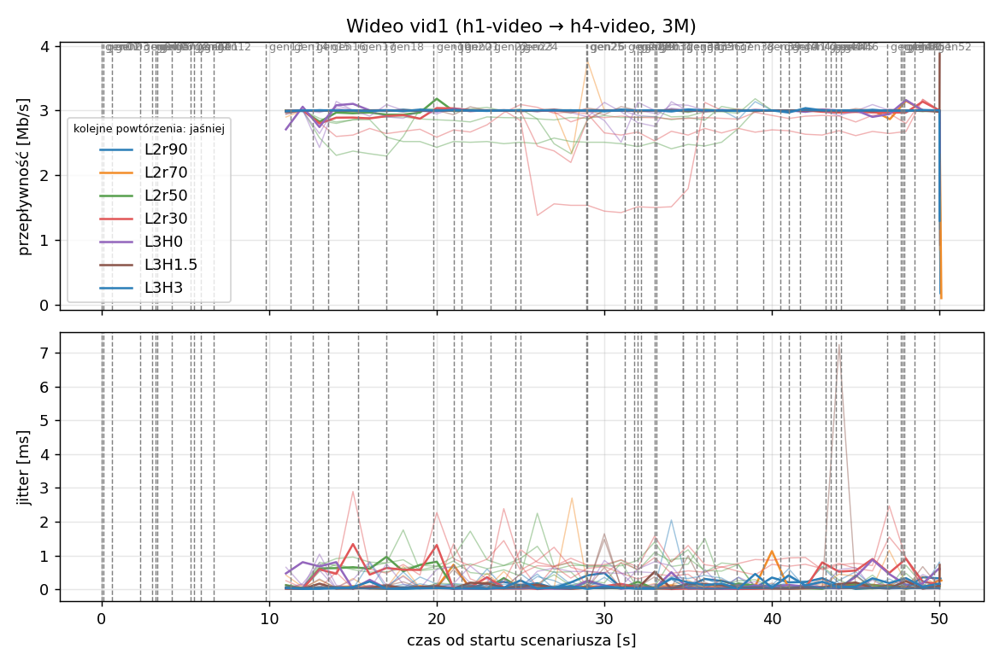
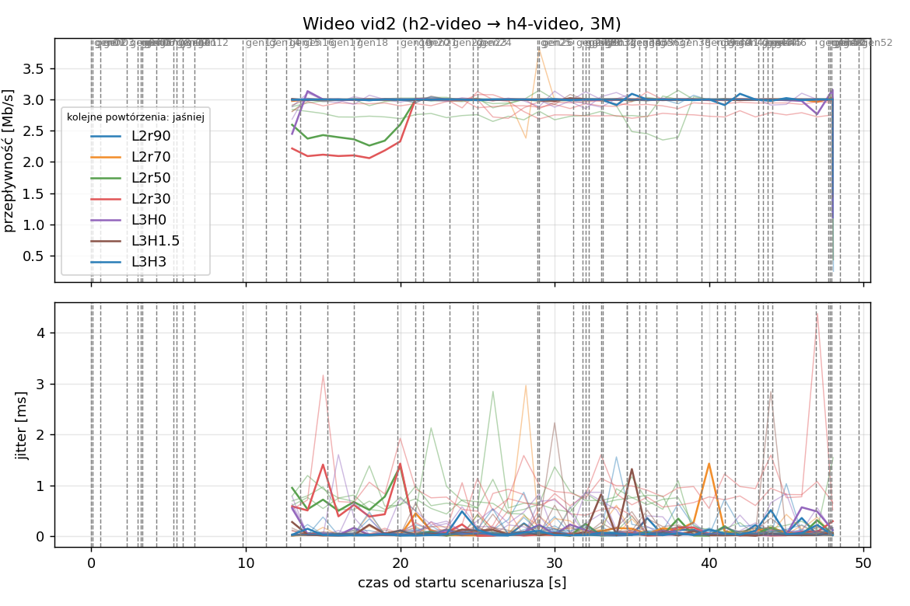
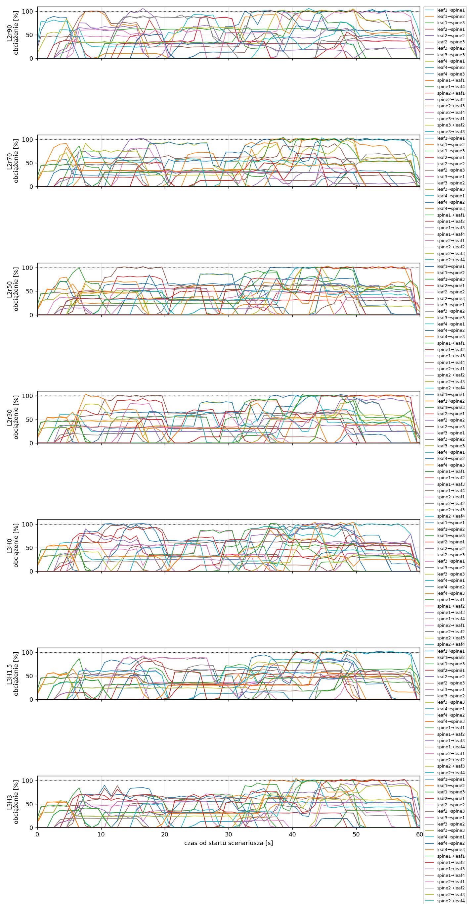
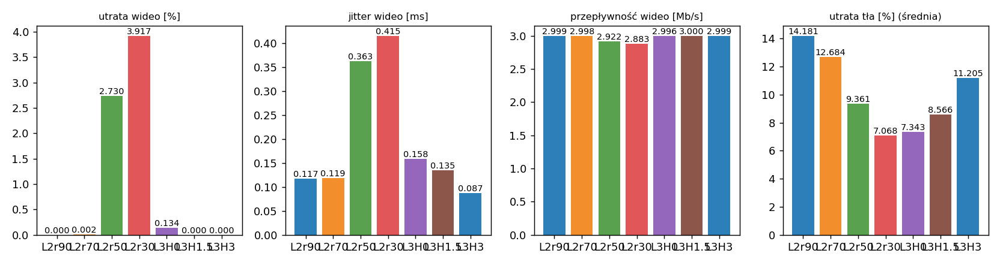

# Raport: clos-layers

Katalog: `results/clos-layers/20261102_062444`

## 1. Scenariusz

- Topologia: `sdn` (sdn: `clos-sdn.clab.yml`)
- Warianty: **L2r90** (LAYERS=2, POLICY=qos, RESERVE_PCT=90), **L2r70** (LAYERS=2, POLICY=qos, RESERVE_PCT=70), **L2r50** (LAYERS=2, POLICY=qos, RESERVE_PCT=50), **L2r30** (LAYERS=2, POLICY=qos, RESERVE_PCT=30), **L3H0** (HEADROOM_MBPS=0, LAYERS=3, POLICY=qos, RESERVE_PCT=70), **L3H1.5** (HEADROOM_MBPS=1.5, LAYERS=3, POLICY=qos, RESERVE_PCT=70), **L3H3** (HEADROOM_MBPS=3, LAYERS=3, POLICY=qos, RESERVE_PCT=70)
- Czas testu: 60 s, warmup (pomijany w statystykach, liczony od startu każdego przepływu): 5 s, powtórzeń: 5, seed: 42
- Wykonane przebiegi: L2r90/rep1, L2r90/rep2, L2r90/rep3, L2r90/rep4, L2r90/rep5, L2r70/rep1, L2r70/rep2, L2r70/rep3, L2r70/rep4, L2r70/rep5, L2r50/rep1, L2r50/rep2, L2r50/rep3, L2r50/rep4, L2r50/rep5, L2r30/rep1, L2r30/rep2, L2r30/rep3, L2r30/rep4, L2r30/rep5, L3H0/rep1, L3H0/rep2, L3H0/rep3, L3H0/rep4, L3H0/rep5, L3H1.5/rep1, L3H1.5/rep2, L3H1.5/rep3, L3H1.5/rep4, L3H1.5/rep5, L3H3/rep1, L3H3/rep2, L3H3/rep3, L3H3/rep4, L3H3/rep5

Harmonogram losowego tła różni się między powtórzeniami (seed + nr powtórzenia, wspólny dla wariantów); poniżej powtórzenie 1.

| id | klasa | źródło → cel | proto | zadana [Mb/s] | DSCP | start–koniec [s] |
|---|---|---|---|---|---|---|
| gen01 | background | h2-bg1 → h3-bg2 | udp | 4.49 | – | 0–7 |
| gen02 | background | h4-bg2 → h3-bg1 | udp | 3.16 | – | 0.1–5.1 |
| gen03 | background | h4-bg1 → h2-bg2 | udp | 5.25 | – | 0.6–5.6 |
| gen04 | background | h4-bg1 → h1-bg2 | udp | 3.56 | – | 2.3–7.3 |
| gen05 | background | h4-bg1 → h3-bg1 | udp | 2.36 | – | 3–60 |
| gen06 | background | h1-bg2 → h2-bg1 | udp | 1.93 | – | 3.2–16.2 |
| gen07 | background | h2-bg1 → h3-bg1 | udp | 1.39 | – | 3.3–8.3 |
| gen08 | background | h1-bg1 → h2-bg1 | udp | 3.29 | – | 4.2–32.2 |
| gen09 | background | h3-bg2 → h2-bg1 | udp | 4.51 | – | 5.3–16.3 |
| gen10 | background | h1-bg2 → h3-bg1 | udp | 3.96 | – | 5.5–10.5 |
| gen11 | background | h2-bg1 → h4-bg2 | udp | 5.85 | – | 5.9–19.9 |
| gen12 | background | h1-bg2 → h3-bg1 | udp | 4.90 | – | 6.7–16.7 |
| gen13 | background | h4-bg1 → h1-bg1 | udp | 3.07 | – | 9.8–19.8 |
| vid1 | video | h1-video → h4-video | udp | 3.00 | 46 | 10–50 |
| gen14 | background | h3-bg2 → h1-bg2 | udp | 5.37 | – | 11.3–27.3 |
| vid2 | video | h2-video → h4-video | udp | 3.00 | 46 | 12–48 |
| gen15 | background | h3-bg1 → h1-bg1 | udp | 3.12 | – | 12.6–30.6 |
| gen16 | background | h2-bg1 → h1-bg1 | udp | 4.96 | – | 13.5–18.5 |
| gen17 | background | h2-bg1 → h4-bg2 | udp | 4.86 | – | 15.3–20.3 |
| gen18 | background | h3-bg2 → h1-bg1 | udp | 3.49 | – | 17–36 |
| gen19 | background | h4-bg2 → h2-bg1 | udp | 2.93 | – | 19.8–48.8 |
| gen20 | background | h1-bg2 → h4-bg2 | udp | 5.68 | – | 21–26 |
| gen21 | background | h4-bg1 → h2-bg1 | udp | 3.04 | – | 21.5–35.5 |
| gen22 | background | h4-bg1 → h2-bg1 | udp | 3.69 | – | 23.2–28.2 |
| gen23 | background | h2-bg2 → h4-bg2 | udp | 1.26 | – | 24.7–44.7 |
| gen24 | background | h3-bg1 → h1-bg2 | udp | 4.88 | – | 25–31 |
| gen25 | background | h4-bg1 → h1-bg2 | udp | 3.51 | – | 28.9–33.9 |
| gen26 | background | h1-bg1 → h4-bg1 | udp | 5.23 | – | 29–59 |
| gen27 | background | h1-bg2 → h4-bg1 | udp | 2.10 | – | 31.2–37.2 |
| gen28 | background | h4-bg1 → h1-bg2 | udp | 1.54 | – | 31.8–36.8 |
| gen29 | background | h4-bg1 → h1-bg2 | udp | 1.53 | – | 32–39 |
| gen30 | background | h1-bg2 → h3-bg1 | udp | 3.69 | – | 32.2–38.2 |
| gen31 | background | h2-bg1 → h4-bg2 | udp | 2.18 | – | 33–38 |
| gen32 | background | h4-bg2 → h3-bg2 | udp | 5.19 | – | 33.1–59.1 |
| gen33 | background | h4-bg2 → h3-bg2 | udp | 2.60 | – | 34.7–40.7 |
| gen34 | background | h2-bg2 → h3-bg2 | udp | 1.75 | – | 34.7–59.7 |
| gen35 | background | h4-bg2 → h2-bg1 | udp | 5.89 | – | 35.5–54.5 |
| gen36 | background | h4-bg2 → h3-bg1 | udp | 4.62 | – | 35.9–49.9 |
| gen37 | background | h1-bg2 → h2-bg2 | udp | 4.50 | – | 36.6–50.6 |
| gen38 | background | h2-bg1 → h4-bg1 | udp | 4.23 | – | 37.9–58.9 |
| gen39 | background | h1-bg2 → h4-bg2 | udp | 5.93 | – | 39.5–44.5 |
| gen40 | background | h1-bg1 → h3-bg1 | udp | 5.99 | – | 40.5–45.5 |
| gen41 | background | h1-bg2 → h3-bg1 | udp | 4.47 | – | 41–50 |
| gen42 | background | h1-bg2 → h3-bg1 | udp | 2.82 | – | 41.7–48.7 |
| gen43 | background | h4-bg2 → h2-bg1 | udp | 4.98 | – | 43.2–49.2 |
| gen44 | background | h4-bg2 → h1-bg2 | udp | 5.97 | – | 43.5–50.5 |
| gen45 | background | h3-bg1 → h4-bg1 | udp | 5.74 | – | 43.8–58.8 |
| gen46 | background | h2-bg1 → h1-bg2 | udp | 1.89 | – | 44.1–49.1 |
| gen47 | background | h2-bg2 → h3-bg1 | udp | 2.94 | – | 46.9–59.9 |
| gen48 | background | h3-bg1 → h1-bg1 | udp | 3.58 | – | 47.7–59.7 |
| gen49 | background | h4-bg1 → h2-bg1 | udp | 5.93 | – | 47.8–57.8 |
| gen50 | background | h4-bg1 → h1-bg1 | udp | 3.20 | – | 47.9–54.9 |
| gen51 | background | h4-bg2 → h3-bg1 | udp | 1.53 | – | 48.5–59.5 |
| gen52 | background | h4-bg2 → h2-bg2 | udp | 2.44 | – | 49.7–59.7 |

## 2. Wideo: QoS według wariantu

Wartości: średnia ± odchylenie standardowe z powtórzeń.

| przepływ | wariant | przepływność [Mb/s] | jitter [ms] | utrata [%] | RTT mediana [ms] | RTT p95 [ms] |
|---|---|---|---|---|---|---|
| vid1 | L2r90 | 3.00 ± 0.00 | 0.132 ± 0.048 | 0.00 ± 0.00 | 0.030 ± 0.002 | 0.062 ± 0.008 |
| vid1 | L2r70 | 3.00 ± 0.00 | 0.117 ± 0.023 | 0.00 ± 0.00 | 0.031 ± 0.002 | 0.081 ± 0.026 |
| vid1 | L2r50 | 2.91 ± 0.13 | 0.362 ± 0.212 | 3.29 ± 4.28 | 23.301 ± 31.858 | 59.240 ± 0.288 |
| vid1 | L2r30 | 2.84 ± 0.17 | 0.408 ± 0.292 | 5.47 ± 5.78 | 23.140 ± 31.643 | 59.240 ± 0.483 |
| vid1 | L3H0 | 2.99 ± 0.01 | 0.154 ± 0.055 | 0.20 ± 0.31 | 0.030 ± 0.002 | 33.455 ± 20.500 |
| vid1 | L3H1.5 | 3.00 ± 0.00 | 0.144 ± 0.084 | 0.00 ± 0.00 | 0.030 ± 0.002 | 0.073 ± 0.028 |
| vid1 | L3H3 | 3.00 ± 0.00 | 0.095 ± 0.042 | 0.00 ± 0.00 | 0.030 ± 0.001 | 0.058 ± 0.007 |
| vid2 | L2r90 | 3.00 ± 0.00 | 0.103 ± 0.023 | 0.00 ± 0.00 | 0.030 ± 0.002 | 0.062 ± 0.012 |
| vid2 | L2r70 | 3.00 ± 0.00 | 0.121 ± 0.024 | 0.00 ± 0.01 | 0.031 ± 0.002 | 0.082 ± 0.023 |
| vid2 | L2r50 | 2.94 ± 0.07 | 0.363 ± 0.224 | 2.17 ± 2.16 | 23.300 ± 31.859 | 59.140 ± 0.410 |
| vid2 | L2r30 | 2.93 ± 0.06 | 0.422 ± 0.350 | 2.36 ± 1.90 | 23.219 ± 31.751 | 59.240 ± 0.270 |
| vid2 | L3H0 | 3.00 ± 0.00 | 0.163 ± 0.069 | 0.06 ± 0.07 | 0.031 ± 0.001 | 32.451 ± 22.444 |
| vid2 | L3H1.5 | 3.00 ± 0.00 | 0.126 ± 0.021 | 0.00 ± 0.00 | 0.030 ± 0.001 | 0.080 ± 0.024 |
| vid2 | L3H3 | 3.00 ± 0.00 | 0.079 ± 0.024 | 0.00 ± 0.00 | 0.030 ± 0.002 | 0.061 ± 0.007 |

RTT z `ping` co 0,1 s między hostami wideo (osobny przepływ ICMP z tym samym DSCP - w SDN może iść inną ścieżką niż strumień UDP).

## 3. Ruch tła

Agregat tła w obrębie powtórzenia, potem średnia ± odchylenie standardowe po powtórzeniach (utrata = Σ utraconych / Σ wysłanych datagramów; dostarczone = Σ przepływności / Σ zadanych; przepływy trwające nie dłużej niż warmup pominięte).

| wariant | strumieni tła / powt. | dostarczone / zadane [%] | jitter [ms] | utrata [%] |
|---|---|---|---|---|
| L2r90 | 40 | 86.6 ± 3.9 | 0.325 ± 0.070 | 14.18 ± 4.72 |
| L2r70 | 40 | 86.6 ± 5.3 | 0.324 ± 0.162 | 12.68 ± 4.92 |
| L2r50 | 40 | 90.3 ± 5.6 | 0.244 ± 0.101 | 9.36 ± 4.96 |
| L2r30 | 40 | 92.2 ± 3.5 | 0.218 ± 0.122 | 7.07 ± 2.47 |
| L3H0 | 40 | 92.3 ± 5.7 | 0.183 ± 0.083 | 7.34 ± 4.55 |
| L3H1.5 | 40 | 91.9 ± 4.8 | 0.186 ± 0.100 | 8.57 ± 3.88 |
| L3H3 | 40 | 88.5 ± 4.4 | 0.189 ± 0.092 | 11.20 ± 4.82 |

## 4. Obciążenie łączy fabricu

Średnia i maksimum z próbek co 1 s w oknie 0–60 s; MLU = maksymalne obciążenie łącza; drops = pakiety odrzucone przez `tbf` na wyjściu łącza.

| wariant | rep | średnie obciążenie łączy [%] | MLU [%] | łącza > 90% | drops tbf | CPU VM śr./maks. [%] |
|---|---|---|---|---|---|---|
| L2r90 | 1 | 32.6 | 105.8 | 10/24 | 24800 | 28 / 49 |
| L2r90 | 2 | 37.9 | 104.4 | 14/24 | 20186 | 29 / 50 |
| L2r90 | 3 | 44.8 | 104.5 | 15/24 | 48963 | 31 / 55 |
| L2r90 | 4 | 31.8 | 106.2 | 14/24 | 7716 | 31 / 83 |
| L2r90 | 5 | 36.4 | 102.4 | 10/24 | 24083 | 28 / 46 |
| L2r70 | 1 | 32.5 | 104.3 | 11/24 | 10736 | 33 / 63 |
| L2r70 | 2 | 37.6 | 110.6 | 14/24 | 28124 | 36 / 93 |
| L2r70 | 3 | 45.3 | 107.3 | 12/24 | 47548 | 36 / 75 |
| L2r70 | 4 | 32.5 | 104.8 | 9/24 | 8142 | 27 / 45 |
| L2r70 | 5 | 36.8 | 102.8 | 12/24 | 14620 | 30 / 72 |
| L2r50 | 1 | 33.4 | 103.3 | 9/24 | 16718 | 27 / 49 |
| L2r50 | 2 | 40.3 | 105.0 | 14/24 | 17845 | 29 / 50 |
| L2r50 | 3 | 46.4 | 108.3 | 13/24 | 34289 | 39 / 66 |
| L2r50 | 4 | 33.6 | 102.7 | 10/24 | 2122 | 27 / 47 |
| L2r50 | 5 | 37.1 | 105.4 | 13/24 | 12955 | 30 / 45 |
| L2r30 | 1 | 33.6 | 103.9 | 13/24 | 15639 | 27 / 46 |
| L2r30 | 2 | 41.4 | 105.0 | 16/24 | 11926 | 30 / 59 |
| L2r30 | 3 | 49.1 | 111.3 | 15/24 | 28701 | 38 / 73 |
| L2r30 | 4 | 33.3 | 103.1 | 9/24 | 686 | 27 / 44 |
| L2r30 | 5 | 37.4 | 103.5 | 10/24 | 9788 | 27 / 44 |
| L3H0 | 1 | 34.0 | 104.1 | 14/24 | 5350 | 27 / 52 |
| L3H0 | 2 | 40.8 | 102.9 | 17/24 | 14939 | 29 / 57 |
| L3H0 | 3 | 48.7 | 112.3 | 15/24 | 32798 | 32 / 55 |
| L3H0 | 4 | 34.5 | 103.4 | 8/24 | 260 | 26 / 44 |
| L3H0 | 5 | 38.2 | 102.3 | 12/24 | 5473 | 27 / 42 |
| L3H1.5 | 1 | 33.9 | 104.0 | 8/24 | 8387 | 28 / 52 |
| L3H1.5 | 2 | 40.6 | 104.2 | 15/24 | 4734 | 30 / 52 |
| L3H1.5 | 3 | 47.8 | 104.4 | 13/24 | 34956 | 31 / 48 |
| L3H1.5 | 4 | 34.2 | 102.1 | 9/24 | 330 | 26 / 45 |
| L3H1.5 | 5 | 36.9 | 103.4 | 9/24 | 15470 | 27 / 45 |
| L3H3 | 1 | 33.2 | 104.6 | 10/24 | 14067 | 30 / 88 |
| L3H3 | 2 | 39.8 | 104.8 | 13/24 | 14192 | 31 / 53 |
| L3H3 | 3 | 46.5 | 106.5 | 10/24 | 34622 | 30 / 47 |
| L3H3 | 4 | 33.3 | 103.4 | 6/24 | 935 | 27 / 45 |
| L3H3 | 5 | 36.9 | 102.9 | 7/24 | 10041 | 28 / 44 |

Łącza z obciążeniem > 10% (maksimum [%] / drops, powtórzenie 1):

| łącze | L2r90 | L2r70 | L2r50 | L2r30 | L3H0 | L3H1.5 | L3H3 |
|---|---|---|---|---|---|---|---|
| leaf1→spine1 | 32 / 0 | 63 / 0 | 79 / 0 | 102 / 3 | 101 / 53 | 85 / 0 | 90 / 0 |
| leaf1→spine2 | 103 / 2603 | 103 / 1738 | 101 / 737 | 104 / 323 | 104 / 730 | 55 / 0 | 105 / 895 |
| leaf1→spine3 | 100 / 734 | 103 / 288 | 103 / 1722 | 103 / 2358 | 95 / 0 | 102 / 605 | 102 / 2367 |
| leaf2→spine1 | 33 / 0 | 63 / 0 | 82 / 0 | 94 / 0 | 94 / 0 | 82 / 0 | 81 / 0 |
| leaf2→spine2 | 106 / 449 | 102 / 433 | 77 / 0 | 95 / 0 | 64 / 0 | 63 / 0 | 94 / 0 |
| leaf2→spine3 | 53 / 0 | 51 / 0 | 52 / 0 | 52 / 0 | 53 / 0 | 54 / 0 | 52 / 0 |
| leaf3→spine1 | 0 / 0 | 31 / 0 | 33 / 0 | 57 / 0 | 88 / 0 | 38 / 0 | 72 / 0 |
| leaf3→spine2 | 89 / 0 | 80 / 0 | 57 / 0 | 38 / 0 | 57 / 0 | 90 / 0 | 57 / 0 |
| leaf3→spine3 | 92 / 0 | 95 / 0 | 88 / 0 | 87 / 0 | 33 / 0 | 51 / 0 | 61 / 0 |
| leaf4→spine1 | 11 / 0 | 31 / 0 | 52 / 0 | 72 / 0 | 104 / 0 | 87 / 0 | 71 / 0 |
| leaf4→spine2 | 106 / 8006 | 103 / 6483 | 103 / 4449 | 103 / 4775 | 97 / 0 | 102 / 4934 | 102 / 2696 |
| leaf4→spine3 | 104 / 7817 | 104 / 536 | 103 / 7136 | 102 / 4444 | 104 / 3670 | 103 / 2425 | 103 / 6276 |
| spine1→leaf1 | 10 / 0 | 31 / 0 | 51 / 0 | 56 / 0 | 87 / 0 | 74 / 0 | 71 / 0 |
| spine1→leaf2 | 0 / 0 | 31 / 0 | 51 / 0 | 72 / 0 | 82 / 0 | 62 / 0 | 71 / 0 |
| spine1→leaf3 | 0 / 0 | 31 / 0 | 51 / 0 | 52 / 0 | 102 / 0 | 86 / 0 | 55 / 0 |
| spine1→leaf4 | 64 / 0 | 91 / 0 | 102 / 754 | 102 / 1437 | 98 / 119 | 88 / 0 | 89 / 0 |
| spine2→leaf1 | 88 / 0 | 82 / 0 | 57 / 0 | 84 / 0 | 57 / 0 | 93 / 0 | 70 / 0 |
| spine2→leaf2 | 70 / 0 | 70 / 0 | 66 / 0 | 90 / 0 | 95 / 0 | 96 / 0 | 88 / 0 |
| spine2→leaf3 | 103 / 4248 | 99 / 0 | 101 / 243 | 91 / 0 | 80 / 0 | 79 / 0 | 94 / 0 |
| spine2→leaf4 | 102 / 0 | 104 / 1258 | 101 / 319 | 101 / 152 | 98 / 0 | 104 / 423 | 102 / 300 |
| spine3→leaf1 | 90 / 0 | 94 / 0 | 87 / 0 | 88 / 0 | 101 / 591 | 81 / 0 | 85 / 0 |
| spine3→leaf2 | 105 / 909 | 83 / 0 | 70 / 0 | 66 / 0 | 55 / 0 | 65 / 0 | 101 / 0 |
| spine3→leaf3 | 81 / 0 | 104 / 0 | 100 / 97 | 101 / 658 | 101 / 187 | 87 / 0 | 101 / 45 |
| spine3→leaf4 | 89 / 34 | 70 / 0 | 102 / 1261 | 101 / 1489 | 91 / 0 | 101 / 0 | 103 / 1488 |

## 5. Ścieżki wybrane przez kontroler (powtórzenie 1)

Z logu kontrolera (linie `Flow`), dopasowane po piątce przepływu; ✓ = reguły widoczne w `dump-flows` na tych samych przełącznikach.

| przepływ | L2r90 | L2r70 | L2r50 | L2r30 | L3H0 | L3H1.5 | L3H3 |
|---|---|---|---|---|---|---|---|
| gen01 | leaf2 -> spine3 -> leaf3 ✓ (loads 0% 20% 0%) | leaf2 -> spine3 -> leaf3 ✓ (loads 0% 20% 0%) | leaf2 -> spine3 -> leaf3 ✓ (loads 0% 20% 0%) | leaf2 -> spine3 -> leaf3 ✓ (loads 0% 20% 0%) | leaf2 -> spine3 -> leaf3 ✓ (loads 0% 20% 0%) | leaf2 -> spine3 -> leaf3 ✓ (loads 0% 20% 0%) | leaf2 -> spine3 -> leaf3 ✓ (loads 0% 20% 0%) |
| gen02 | leaf4 -> spine3 -> leaf3 ✓ (loads 0% 40% 20%) | leaf4 -> spine2 -> leaf3 ✓ (loads 20% 20% 20%) | leaf4 -> spine2 -> leaf3 ✓ (loads 20% 20% 20%) | leaf4 -> spine2 -> leaf3 ✓ (loads 20% 20% 20%) | leaf4 -> spine2 -> leaf3 ✓ (loads 20% 20% 20%) | leaf4 -> spine2 -> leaf3 ✓ (loads 20% 20% 20%) | leaf4 -> spine2 -> leaf3 ✓ (loads 20% 20% 20%) |
| gen03 | leaf4 -> spine3 -> leaf2 ✓ (loads 0% 40% 20%) | leaf4 -> spine3 -> leaf2 ✓ (loads 20% 40% 20%) | leaf4 -> spine3 -> leaf2 ✓ (loads 20% 40% 20%) | leaf4 -> spine3 -> leaf2 ✓ (loads 20% 40% 20%) | leaf4 -> spine3 -> leaf2 ✓ (loads 20% 40% 20%) | leaf4 -> spine3 -> leaf2 ✓ (loads 20% 40% 20%) | leaf4 -> spine3 -> leaf2 ✓ (loads 20% 40% 20%) |
| gen04 | leaf4 -> spine2 -> leaf1 ✓ (loads 0% 58% 127%) | leaf4 -> spine3 -> leaf1 ✓ (loads 20% 90% 74%) | leaf4 -> spine2 -> leaf1 ✓ (loads 38% 73% 74%) | leaf4 -> spine1 -> leaf1 ✓ (loads 38% 73% 74%) | leaf4 -> spine1 -> leaf1 ✓ (loads 38% 73% 74%) | leaf4 -> spine1 -> leaf1 ✓ (loads 38% 72% 74%) | leaf4 -> spine1 -> leaf1 ✓ (loads 38% 73% 74%) |
| gen05 | leaf4 -> spine2 -> leaf3 ✓ (loads 0% 99% 107%) | leaf4 -> spine2 -> leaf3 ✓ (loads 18% 70% 92%) | leaf4 -> spine3 -> leaf3 ✓ (loads 35% 91% 74%) | leaf4 -> spine1 -> leaf3 ✓ (loads 65% 70% 74%) | leaf4 -> spine1 -> leaf3 ✓ (loads 54% 69% 74%) | leaf4 -> spine2 -> leaf3 ✓ (loads 53% 49% 54%) | leaf4 -> spine2 -> leaf3 ✓ (loads 67% 52% 74%) |
| gen06 | leaf1 -> spine2 -> leaf2 ✓ (loads 0% 35% 54%) | leaf1 -> spine1 -> leaf2 ✓ (loads 0% 17% 54%) | leaf1 -> spine2 -> leaf2 ✓ (loads 18% 17% 54%) | leaf1 -> spine2 -> leaf2 ✓ (loads 18% 17% 54%) | leaf1 -> spine2 -> leaf2 ✓ (loads 18% 16% 54%) | leaf1 -> spine2 -> leaf2 ✓ (loads 18% 16% 54%) | leaf1 -> spine2 -> leaf2 ✓ (loads 18% 16% 54%) |
| gen07 | leaf2 -> spine2 -> leaf3 ✓ (loads 0% 51% 79%) | leaf2 -> spine2 -> leaf3 ✓ (loads 18% 51% 64%) | leaf2 -> spine2 -> leaf3 ✓ (loads 34% 33% 63%) | leaf2 -> spine1 -> leaf3 ✓ (loads 34% 50% 46%) | leaf2 -> spine1 -> leaf3 ✓ (loads 32% 49% 46%) | leaf2 -> spine1 -> leaf3 ✓ (loads 16% 65% 46%) | leaf2 -> spine1 -> leaf3 ✓ (loads 32% 49% 46%) |
| gen08 | leaf1 -> spine3 -> leaf2 ✓ (loads 0% 83% 69%) | leaf1 -> spine3 -> leaf2 ✓ (loads 34% 67% 54%) | leaf1 -> spine1 -> leaf2 ✓ (loads 33% 64% 54%) | leaf1 -> spine1 -> leaf2 ✓ (loads 33% 68% 54%) | leaf1 -> spine1 -> leaf2 ✓ (loads 33% 60% 54%) | leaf1 -> spine2 -> leaf2 ✓ (loads 48% 44% 54%) | leaf1 -> spine1 -> leaf2 ✓ (loads 33% 58% 54%) |
| gen09 | leaf3 -> spine2 -> leaf2 ✓ (loads 0% 99% 111%) | leaf3 -> spine2 -> leaf2 ✓ (loads 37% 78% 99%) | leaf3 -> spine3 -> leaf2 ✓ (loads 69% 71% 66%) | leaf3 -> spine3 -> leaf2 ✓ (loads 77% 71% 66%) | leaf3 -> spine1 -> leaf2 ✓ (loads 65% 68% 67%) | leaf3 -> spine3 -> leaf2 ✓ (loads 61% 87% 54%) | leaf3 -> spine1 -> leaf2 ✓ (loads 62% 68% 67%) |
| gen10 | leaf1 -> spine2 -> leaf3 ✓ (loads 0% 106% 113%) | leaf1 -> spine3 -> leaf3 ✓ (loads 37% 106% 86%) | leaf1 -> spine3 -> leaf3 ✓ (loads 52% 88% 88%) | leaf1 -> spine2 -> leaf3 ✓ (loads 90% 62% 70%) | leaf1 -> spine2 -> leaf3 ✓ (loads 87% 61% 72%) | leaf1 -> spine3 -> leaf3 ✓ (loads 73% 90% 59%) | leaf1 -> spine3 -> leaf3 ✓ (loads 63% 85% 71%) |
| gen11 | leaf2 -> spine2 -> leaf4 ✓ (loads 0% 26% 99%) | leaf2 -> spine2 -> leaf4 ✓ (loads 23% 44% 58%) | leaf2 -> spine1 -> leaf4 ✓ (loads 22% 27% 76%) | leaf2 -> spine1 -> leaf4 ✓ (loads 26% 27% 73%) | leaf2 -> spine1 -> leaf4 ✓ (loads 24% 28% 74%) | leaf2 -> spine2 -> leaf4 ✓ (loads 40% 25% 62%) | leaf2 -> spine1 -> leaf4 ✓ (loads 25% 27% 74%) |
| gen12 | leaf1 -> spine2 -> leaf3 ✓ (loads 0% 81% 84%) | leaf1 -> spine2 -> leaf3 ✓ (loads 20% 49% 105%) | leaf1 -> spine2 -> leaf3 ✓ (loads 49% 59% 95%) | leaf1 -> spine2 -> leaf3 ✓ (loads 60% 55% 70%) | leaf1 -> spine1 -> leaf3 ✓ (loads 49% 58% 72%) | leaf1 -> spine1 -> leaf3 ✓ (loads 50% 69% 83%) | leaf1 -> spine1 -> leaf3 ✓ (loads 34% 45% 124%) |
| gen13 | leaf4 -> spine1 -> leaf1 ✓ (loads 0% 24% 7%) | leaf4 -> spine1 -> leaf1 ✓ (loads 0% 24% 7%) | leaf4 -> spine1 -> leaf1 ✓ (loads 0% 6% 24%) | leaf4 -> spine3 -> leaf1 ✓ (loads 24% 6% 0%) | leaf4 -> spine3 -> leaf1 ✓ (loads 24% 5% 0%) | leaf4 -> spine1 -> leaf1 ✓ (loads 0% 24% 7%) | leaf4 -> spine1 -> leaf1 ✓ (loads 0% 24% 6%) |
| vid1 | leaf1 -> spine1 -> leaf4 ✓ (loads 7% 100% 47%) | leaf1 -> spine1 -> leaf4 ✓ (loads 27% 74% 75%) | leaf1 -> spine1 -> leaf4 ✓ (loads 50% 70% 60%) | leaf1 -> spine1 -> leaf4 ✓ (loads 59% 100% 19%) | leaf1 -> spine1 -> leaf4 ✓ (loads 84% 61% 21%) | leaf1 -> spine1 -> leaf4 ✓ (loads 57% 60% 54%) | leaf1 -> spine1 -> leaf4 ✓ (loads 70% 39% 41%) |
| gen14 | leaf3 -> spine3 -> leaf1 ✓ (loads 17% 46% 27%) | leaf3 -> spine3 -> leaf1 ✓ (loads 44% 46% 20%) | leaf3 -> spine2 -> leaf1 ✓ (loads 45% 19% 47%) | leaf3 -> spine1 -> leaf1 ✓ (loads 6% 13% 47%) | leaf3 -> spine2 -> leaf1 ✓ (loads 46% 19% 45%) | leaf3 -> spine2 -> leaf1 ✓ (loads 43% 7% 47%) | leaf3 -> spine2 -> leaf1 ✓ (loads 46% 7% 13%) |
| vid2 | leaf2 -> spine1 -> leaf4 ✓ (loads 68% 60% 19%) | leaf2 -> spine1 -> leaf4 ✓ (loads 68% 74% 6%) | leaf2 -> spine1 -> leaf4 ✓ (loads 111% 6% 19%) | leaf2 -> spine1 -> leaf4 ✓ (loads 121% 6% 19%) | leaf2 -> spine1 -> leaf4 ✓ (loads 121% 5% 21%) | leaf2 -> spine1 -> leaf4 ✓ (loads 68% 60% 19%) | leaf2 -> spine1 -> leaf4 ✓ (loads 98% 19% 6%) |
| gen15 | leaf3 -> spine3 -> leaf1 ✓ (loads 10% 53% 52%) | leaf3 -> spine2 -> leaf1 ✓ (loads 30% 52% 56%) | leaf3 -> spine1 -> leaf1 ✓ (loads 37% 44% 46%) | leaf3 -> spine2 -> leaf1 ✓ (loads 55% 5% 46%) | leaf3 -> spine3 -> leaf1 ✓ (loads 46% 40% 37%) | leaf3 -> spine2 -> leaf1 ✓ (loads 44% 40% 46%) | leaf3 -> spine3 -> leaf1 ✓ (loads 47% 37% 6%) |
| gen16 | leaf2 -> spine2 -> leaf1 ✓ (loads 59% 66% 87%) | leaf2 -> spine2 -> leaf1 ✓ (loads 61% 66% 67%) | leaf2 -> spine3 -> leaf1 ✓ (loads 105% 67% 6%) | leaf2 -> spine2 -> leaf1 ✓ (loads 121% 31% 32%) | leaf2 -> spine3 -> leaf1 ✓ (loads 114% 68% 55%) | leaf2 -> spine3 -> leaf1 ✓ (loads 52% 80% 12%) | leaf2 -> spine3 -> leaf1 ✓ (loads 110% 70% 21%) |
| gen17 | leaf2 -> spine3 -> leaf4 ✓ (loads 62% 110% 7%) | leaf2 -> spine3 -> leaf4 ✓ (loads 62% 112% 7%) | leaf2 -> spine2 -> leaf4 ✓ (loads 100% 7% 62%) | leaf2 -> spine3 -> leaf4 ✓ (loads 99% 61% 7%) | leaf2 -> spine2 -> leaf4 ✓ (loads 95% 7% 64%) | leaf2 -> spine1 -> leaf4 ✓ (loads 62% 67% 64%) | leaf2 -> spine2 -> leaf4 ✓ (loads 68% 6% 65%) |
| gen18 | leaf3 -> spine2 -> leaf1 ✓ (loads 10% 57% 95%) | leaf3 -> spine3 -> leaf1 ✓ (loads 30% 81% 71%) | leaf3 -> spine3 -> leaf1 ✓ (loads 50% 65% 60%) | leaf3 -> spine3 -> leaf1 ✓ (loads 54% 83% 54%) | leaf3 -> spine1 -> leaf1 ✓ (loads 33% 63% 100%) | leaf3 -> spine1 -> leaf1 ✓ (loads 39% 88% 58%) | leaf3 -> spine1 -> leaf1 ✓ (loads 40% 63% 83%) |
| gen19 | leaf4 -> spine2 -> leaf2 ✓ (loads 10% 32% 34%) | leaf4 -> spine2 -> leaf2 ✓ (loads 30% 31% 34%) | leaf4 -> spine2 -> leaf2 ✓ (loads 34% 8% 24%) | leaf4 -> spine2 -> leaf2 ✓ (loads 34% 8% 32%) | leaf4 -> spine2 -> leaf2 ✓ (loads 34% 9% 32%) | leaf4 -> spine3 -> leaf2 ✓ (loads 32% 34% 15%) | leaf4 -> spine3 -> leaf2 ✓ (loads 32% 24% 7%) |
| gen20 | leaf1 -> spine2 -> leaf4 ✓ (loads 70% 7% 34%) | leaf1 -> spine2 -> leaf4 ✓ (loads 69% 55% 64%) | leaf1 -> spine3 -> leaf4 ✓ (loads 69% 27% 23%) | leaf1 -> spine2 -> leaf4 ✓ (loads 99% 30% 50%) | leaf1 -> spine2 -> leaf4 ✓ (loads 65% 25% 32%) | leaf1 -> spine3 -> leaf4 ✓ (loads 71% 34% 31%) | leaf1 -> spine3 -> leaf4 ✓ (loads 65% 30% 28%) |
| gen21 | leaf4 -> spine3 -> leaf2 ✓ (loads 7% 77% 49%) | leaf4 -> spine1 -> leaf2 ✓ (loads 6% 82% 41%) | leaf4 -> spine1 -> leaf2 ✓ (loads 34% 54% 37%) | leaf4 -> spine3 -> leaf2 ✓ (loads 34% 68% 6%) | leaf4 -> spine3 -> leaf2 ✓ (loads 34% 54% 16%) | leaf4 -> spine1 -> leaf2 ✓ (loads 22% 34% 60%) | leaf4 -> spine2 -> leaf2 ✓ (loads 34% 31% 47%) |
| gen22 | leaf4 -> spine2 -> leaf2 ✓ (loads 7% 68% 79%) | leaf4 -> spine3 -> leaf2 ✓ (loads 42% 68% 41%) | leaf4 -> spine3 -> leaf2 ✓ (loads 56% 37% 36%) | leaf4 -> spine1 -> leaf2 ✓ (loads 41% 45% 43%) | leaf4 -> spine1 -> leaf2 ✓ (loads 34% 36% 54%) | leaf4 -> spine2 -> leaf2 ✓ (loads 60% 34% 36%) | leaf4 -> spine1 -> leaf2 ✓ (loads 34% 70% 36%) |
| gen23 | leaf2 -> spine3 -> leaf4 ✓ (loads 62% 58% 20%) | leaf2 -> spine3 -> leaf4 ✓ (loads 62% 58% 21%) | leaf2 -> spine2 -> leaf4 ✓ (loads 62% 20% 58%) | leaf2 -> spine3 -> leaf4 ✓ (loads 62% 59% 20%) | leaf2 -> spine3 -> leaf4 ✓ (loads 62% 58% 20%) | leaf2 -> spine2 -> leaf4 ✓ (loads 61% 19% 58%) | leaf2 -> spine2 -> leaf4 ✓ (loads 62% 19% 58%) |
| gen24 | leaf3 -> spine2 -> leaf1 ✓ (loads 7% 36% 87%) | leaf3 -> spine1 -> leaf1 ✓ (loads 8% 32% 91%) | leaf3 -> spine3 -> leaf1 ✓ (loads 39% 55% 36%) | leaf3 -> spine3 -> leaf1 ✓ (loads 55% 38% 36%) | leaf3 -> spine1 -> leaf1 ✓ (loads 36% 55% 40%) | leaf3 -> spine3 -> leaf1 ✓ (loads 36% 88% 7%) | leaf3 -> spine1 -> leaf1 ✓ (loads 36% 55% 39%) |
| gen25 | leaf4 -> spine3 -> leaf1 ✓ (loads 6% 93% 54%) | leaf4 -> spine3 -> leaf1 ✓ (loads 30% 54% 50%) | leaf4 -> spine2 -> leaf1 ✓ (loads 39% 37% 86%) | leaf4 -> spine2 -> leaf1 ✓ (loads 62% 48% 86%) | leaf4 -> spine2 -> leaf1 ✓ (loads 86% 37% 40%) | leaf4 -> spine1 -> leaf1 ✓ (loads 44% 46% 50%) | leaf4 -> spine3 -> leaf1 ✓ (loads 70% 56% 44%) |
| gen26 | leaf1 -> spine2 -> leaf4 ✓ (loads 62% 26% 34%) | leaf1 -> spine2 -> leaf4 ✓ (loads 62% 31% 34%) | leaf1 -> spine3 -> leaf4 ✓ (loads 64% 20% 14%) | leaf1 -> spine3 -> leaf4 ✓ (loads 65% 24% 20%) | leaf1 -> spine3 -> leaf4 ✓ (loads 65% 21% 20%) | leaf1 -> spine3 -> leaf4 ✓ (loads 62% 34% 26%) | leaf1 -> spine3 -> leaf4 ✓ (loads 65% 19% 18%) |
| gen27 | leaf1 -> spine3 -> leaf4 ✓ (loads 62% 79% 42%) | leaf1 -> spine3 -> leaf4 ✓ (loads 62% 83% 43%) | leaf1 -> spine2 -> leaf4 ✓ (loads 65% 28% 75%) | leaf1 -> spine2 -> leaf4 ✓ (loads 65% 32% 82%) | leaf1 -> spine2 -> leaf4 ✓ (loads 65% 28% 80%) | leaf1 -> spine2 -> leaf4 ✓ (loads 62% 42% 79%) | leaf1 -> spine2 -> leaf4 ✓ (loads 65% 27% 73%) |
| gen28 | leaf4 -> spine3 -> leaf1 ✓ (loads 9% 101% 76%) | leaf4 -> spine2 -> leaf1 ✓ (loads 30% 72% 81%) | leaf4 -> spine2 -> leaf1 ✓ (loads 39% 74% 94%) | leaf4 -> spine1 -> leaf1 ✓ (loads 50% 66% 85%) | leaf4 -> spine3 -> leaf1 ✓ (loads 86% 66% 57%) | leaf4 -> spine2 -> leaf1 ✓ (loads 72% 47% 58%) | leaf4 -> spine1 -> leaf1 ✓ (loads 55% 71% 66%) |
| gen29 | leaf4 -> spine3 -> leaf1 ✓ (loads 9% 101% 93%) | leaf4 -> spine2 -> leaf1 ✓ (loads 30% 81% 90%) | leaf4 -> spine3 -> leaf1 ✓ (loads 39% 83% 59%) | leaf4 -> spine2 -> leaf1 ✓ (loads 68% 66% 85%) | leaf4 -> spine1 -> leaf1 ✓ (loads 55% 66% 64%) | leaf4 -> spine3 -> leaf1 ✓ (loads 72% 48% 47%) | leaf4 -> spine2 -> leaf1 ✓ (loads 63% 71% 75%) |
| gen30 | leaf1 -> spine2 -> leaf3 ✓ (loads 39% 80% 86%) | leaf1 -> spine2 -> leaf3 ✓ (loads 56% 71% 91%) | leaf1 -> spine3 -> leaf3 ✓ (loads 65% 70% 63%) | leaf1 -> spine3 -> leaf3 ✓ (loads 65% 79% 62%) | leaf1 -> spine3 -> leaf3 ✓ (loads 65% 70% 62%) | leaf1 -> spine1 -> leaf3 ✓ (loads 54% 70% 71%) | leaf1 -> spine3 -> leaf3 ✓ (loads 60% 67% 62%) |
| gen31 | leaf2 -> spine3 -> leaf4 ✓ (loads 71% 71% 65%) | leaf2 -> spine3 -> leaf4 ✓ (loads 71% 71% 70%) | leaf2 -> spine3 -> leaf4 ✓ (loads 69% 74% 63%) | leaf2 -> spine3 -> leaf4 ✓ (loads 70% 71% 67%) | leaf2 -> spine3 -> leaf4 ✓ (loads 69% 72% 67%) | leaf2 -> spine2 -> leaf4 ✓ (loads 71% 65% 71%) | leaf2 -> spine3 -> leaf4 ✓ (loads 69% 75% 62%) |
| gen32 | leaf4 -> spine2 -> leaf3 ✓ (loads 9% 88% 133%) | leaf4 -> spine3 -> leaf3 ✓ (loads 30% 99% 78%) | leaf4 -> spine1 -> leaf3 ✓ (loads 46% 97% 77%) | leaf4 -> spine3 -> leaf3 ✓ (loads 83% 91% 59%) | leaf4 -> spine1 -> leaf3 ✓ (loads 68% 73% 80%) | leaf4 -> spine2 -> leaf3 ✓ (loads 75% 71% 76%) | leaf4 -> spine1 -> leaf3 ✓ (loads 54% 90% 75%) |
| gen33 | leaf4 -> spine3 -> leaf3 ✓ (loads 6% 130% 94%) | leaf4 -> spine2 -> leaf3 ✓ (loads 30% 92% 112%) | leaf4 -> spine3 -> leaf3 ✓ (loads 60% 82% 69%) | leaf4 -> spine1 -> leaf3 ✓ (loads 45% 75% 113%) | leaf4 -> spine3 -> leaf3 ✓ (loads 98% 73% 54%) | leaf4 -> spine3 -> leaf3 ✓ (loads 71% 88% 59%) | leaf4 -> spine2 -> leaf3 ✓ (loads 75% 71% 73%) |
| gen34 | leaf2 -> spine3 -> leaf3 ✓ (loads 40% 112% 50%) | leaf2 -> spine1 -> leaf3 ✓ (loads 37% 75% 69%) | leaf2 -> spine2 -> leaf3 ✓ (loads 47% 19% 69%) | leaf2 -> spine2 -> leaf3 ✓ (loads 39% 5% 102%) | leaf2 -> spine2 -> leaf3 ✓ (loads 69% 14% 38%) | leaf2 -> spine3 -> leaf3 ✓ (loads 37% 65% 27%) | leaf2 -> spine2 -> leaf3 ✓ (loads 44% 37% 45%) |
| gen35 | leaf4 -> spine3 -> leaf2 ✓ (loads 6% 132% 84%) | leaf4 -> spine1 -> leaf2 ✓ (loads 35% 107% 77%) | leaf4 -> spine2 -> leaf2 ✓ (loads 64% 60% 72%) | leaf4 -> spine2 -> leaf2 ✓ (loads 62% 58% 116%) | leaf4 -> spine2 -> leaf2 ✓ (loads 113% 50% 62%) | leaf4 -> spine1 -> leaf2 ✓ (loads 56% 108% 69%) | leaf4 -> spine3 -> leaf2 ✓ (loads 97% 78% 51%) |
| gen36 | leaf4 -> spine2 -> leaf3 ✓ (loads 6% 99% 127%) | leaf4 -> spine3 -> leaf3 ✓ (loads 41% 107% 64%) | leaf4 -> spine2 -> leaf3 ✓ (loads 50% 96% 102%) | leaf4 -> spine2 -> leaf3 ✓ (loads 68% 64% 92%) | leaf4 -> spine3 -> leaf3 ✓ (loads 94% 79% 78%) | leaf4 -> spine1 -> leaf3 ✓ (loads 67% 94% 86%) | leaf4 -> spine3 -> leaf3 ✓ (loads 76% 98% 72%) |
| gen37 | leaf1 -> spine3 -> leaf2 ✓ (loads 31% 92% 75%) | leaf1 -> spine3 -> leaf2 ✓ (loads 40% 92% 29%) | leaf1 -> spine1 -> leaf2 ✓ (loads 42% 73% 92%) | leaf1 -> spine1 -> leaf2 ✓ (loads 39% 78% 92%) | leaf1 -> spine1 -> leaf2 ✓ (loads 37% 79% 92%) | leaf1 -> spine2 -> leaf2 ✓ (loads 75% 28% 54%) | leaf1 -> spine2 -> leaf2 ✓ (loads 37% 36% 92%) |
| gen38 | leaf2 -> spine2 -> leaf4 ✓ (loads 62% 74% 75%) | leaf2 -> spine1 -> leaf4 ✓ (loads 67% 72% 67%) | leaf2 -> spine2 -> leaf4 ✓ (loads 73% 57% 76%) | leaf2 -> spine2 -> leaf4 ✓ (loads 62% 58% 89%) | leaf2 -> spine2 -> leaf4 ✓ (loads 68% 48% 89%) | leaf2 -> spine2 -> leaf4 ✓ (loads 68% 64% 68%) | leaf2 -> spine2 -> leaf4 ✓ (loads 62% 63% 76%) |
| gen39 | leaf1 -> spine3 -> leaf4 ✓ (loads 62% 103% 52%) | leaf1 -> spine3 -> leaf4 ✓ (loads 93% 61% 53%) | leaf1 -> spine2 -> leaf4 ✓ (loads 77% 67% 71%) | leaf1 -> spine2 -> leaf4 ✓ (loads 77% 62% 67%) | leaf1 -> spine2 -> leaf4 ✓ (loads 77% 61% 72%) | leaf1 -> spine3 -> leaf4 ✓ (loads 62% 73% 61%) | leaf1 -> spine2 -> leaf4 ✓ (loads 62% 66% 72%) |
| gen40 | leaf1 -> spine2 -> leaf3 ✓ (loads 37% 83% 88%) | leaf1 -> spine1 -> leaf3 ✓ (loads 37% 54% 98%) | leaf1 -> spine2 -> leaf3 ✓ (loads 77% 59% 60%) | leaf1 -> spine3 -> leaf3 ✓ (loads 77% 60% 54%) | leaf1 -> spine2 -> leaf3 ✓ (loads 76% 38% 74%) | leaf1 -> spine1 -> leaf3 ✓ (loads 42% 78% 83%) | leaf1 -> spine3 -> leaf3 ✓ (loads 61% 72% 54%) |
| gen41 | leaf1 -> spine2 -> leaf3 ✓ (loads 37% 99% 117%) | leaf1 -> spine2 -> leaf3 ✓ (loads 49% 54% 98%) | leaf1 -> spine3 -> leaf3 ✓ (loads 77% 94% 65%) | leaf1 -> spine3 -> leaf3 ✓ (loads 77% 66% 60%) | leaf1 -> spine1 -> leaf3 ✓ (loads 78% 99% 79%) | leaf1 -> spine1 -> leaf3 ✓ (loads 74% 78% 113%) | leaf1 -> spine3 -> leaf3 ✓ (loads 69% 113% 73%) |
| gen42 | leaf1 -> spine3 -> leaf3 ✓ (loads 37% 118% 106%) | leaf1 -> spine2 -> leaf3 ✓ (loads 70% 75% 114%) | leaf1 -> spine3 -> leaf3 ✓ (loads 77% 94% 76%) | leaf1 -> spine1 -> leaf3 ✓ (loads 83% 87% 94%) | leaf1 -> spine1 -> leaf3 ✓ (loads 85% 99% 86%) | leaf1 -> spine1 -> leaf3 ✓ (loads 81% 85% 113%) | leaf1 -> spine2 -> leaf3 ✓ (loads 68% 112% 121%) |
| gen43 | leaf4 -> spine3 -> leaf2 ✓ (loads 7% 100% 100%) | leaf4 -> spine2 -> leaf2 ✓ (loads 30% 63% 100%) | leaf4 -> spine3 -> leaf2 ✓ (loads 49% 99% 34%) | leaf4 -> spine1 -> leaf2 ✓ (loads 50% 100% 54%) | leaf4 -> spine3 -> leaf2 ✓ (loads 78% 91% 55%) | leaf4 -> spine3 -> leaf2 ✓ (loads 85% 78% 37%) | leaf4 -> spine2 -> leaf2 ✓ (loads 54% 46% 100%) |
| gen44 | leaf4 -> spine3 -> leaf1 ✓ (loads 7% 100% 74%) | leaf4 -> spine2 -> leaf1 ✓ (loads 30% 80% 100%) | leaf4 -> spine3 -> leaf1 ✓ (loads 49% 109% 63%) | leaf4 -> spine1 -> leaf1 ✓ (loads 44% 100% 54%) | leaf4 -> spine3 -> leaf1 ✓ (loads 78% 91% 69%) | leaf4 -> spine3 -> leaf1 ✓ (loads 85% 78% 52%) | leaf4 -> spine2 -> leaf1 ✓ (loads 63% 84% 100%) |
| gen45 | leaf3 -> spine3 -> leaf4 ✓ (loads 69% 86% 85%) | leaf3 -> spine2 -> leaf4 ✓ (loads 86% 67% 85%) | leaf3 -> spine3 -> leaf4 ✓ (loads 72% 109% 62%) | leaf3 -> spine3 -> leaf4 ✓ (loads 68% 106% 67%) | leaf3 -> spine1 -> leaf4 ✓ (loads 77% 93% 89%) | leaf3 -> spine2 -> leaf4 ✓ (loads 76% 78% 98%) | leaf3 -> spine3 -> leaf4 ✓ (loads 62% 108% 58%) |
| gen46 | leaf2 -> spine2 -> leaf1 ✓ (loads 38% 44% 49%) | leaf2 -> spine3 -> leaf1 ✓ (loads 61% 33% 21%) | leaf2 -> spine3 -> leaf1 ✓ (loads 31% 74% 30%) | leaf2 -> spine1 -> leaf1 ✓ (loads 31% 62% 32%) | leaf2 -> spine1 -> leaf1 ✓ (loads 38% 62% 43%) | leaf2 -> spine1 -> leaf1 ✓ (loads 38% 64% 43%) | leaf2 -> spine3 -> leaf1 ✓ (loads 31% 74% 25%) |
| gen47 | leaf2 -> spine3 -> leaf3 ✓ (loads 39% 100% 47%) | leaf2 -> spine2 -> leaf3 ✓ (loads 61% 81% 100%) | leaf2 -> spine3 -> leaf3 ✓ (loads 50% 88% 80%) | leaf2 -> spine2 -> leaf3 ✓ (loads 69% 62% 100%) | leaf2 -> spine3 -> leaf3 ✓ (loads 98% 62% 38%) | leaf2 -> spine3 -> leaf3 ✓ (loads 84% 78% 29%) | leaf2 -> spine2 -> leaf3 ✓ (loads 63% 62% 83%) |
| gen48 | leaf3 -> spine2 -> leaf1 ✓ (loads 8% 28% 59%) | leaf3 -> spine1 -> leaf1 ✓ (loads 10% 69% 19%) | leaf3 -> spine2 -> leaf1 ✓ (loads 10% 10% 70%) | leaf3 -> spine2 -> leaf1 ✓ (loads 54% 19% 69%) | leaf3 -> spine2 -> leaf1 ✓ (loads 58% 9% 38%) | leaf3 -> spine1 -> leaf1 ✓ (loads 30% 59% 45%) | leaf3 -> spine1 -> leaf1 ✓ (loads 30% 47% 59%) |
| gen49 | leaf4 -> spine3 -> leaf2 ✓ (loads 9% 118% 109%) | leaf4 -> spine2 -> leaf2 ✓ (loads 30% 110% 118%) | leaf4 -> spine3 -> leaf2 ✓ (loads 49% 110% 110%) | leaf4 -> spine3 -> leaf2 ✓ (loads 70% 100% 63%) | leaf4 -> spine1 -> leaf2 ✓ (loads 86% 91% 100%) | leaf4 -> spine2 -> leaf2 ✓ (loads 85% 89% 100%) | leaf4 -> spine3 -> leaf2 ✓ (loads 63% 100% 100%) |
| gen50 | leaf4 -> spine3 -> leaf1 ✓ (loads 9% 107% 99%) | leaf4 -> spine3 -> leaf1 ✓ (loads 34% 123% 118%) | leaf4 -> spine3 -> leaf1 ✓ (loads 49% 120% 120%) | leaf4 -> spine3 -> leaf1 ✓ (loads 70% 100% 81%) | leaf4 -> spine3 -> leaf1 ✓ (loads 97% 102% 100%) | leaf4 -> spine3 -> leaf1 ✓ (loads 85% 111% 111%) | leaf4 -> spine2 -> leaf1 ✓ (loads 63% 110% 119%) |
| gen51 | leaf4 -> spine2 -> leaf3 ✓ (loads 9% 130% 134%) | leaf4 -> spine2 -> leaf3 ✓ (loads 30% 137% 146%) | leaf4 -> spine3 -> leaf3 ✓ (loads 49% 130% 130%) | leaf4 -> spine3 -> leaf3 ✓ (loads 70% 124% 115%) | leaf4 -> spine2 -> leaf3 ✓ (loads 99% 113% 123%) | leaf4 -> spine3 -> leaf3 ✓ (loads 83% 142% 131%) | leaf4 -> spine2 -> leaf3 ✓ (loads 74% 120% 129%) |
| gen52 | leaf4 -> spine2 -> leaf2 ✓ (loads 0% 133% 145%) | leaf4 -> spine2 -> leaf2 ✓ (loads 30% 151% 159%) | leaf4 -> spine3 -> leaf2 ✓ (loads 50% 152% 141%) | leaf4 -> spine2 -> leaf2 ✓ (loads 70% 132% 157%) | leaf4 -> spine3 -> leaf2 ✓ (loads 118% 138% 134%) | leaf4 -> spine2 -> leaf2 ✓ (loads 85% 134% 145%) | leaf4 -> spine2 -> leaf2 ✓ (loads 74% 130% 139%) |

## 6. Wnioski

<!-- WNIOSKI:START -->
_Do uzupełnienia: krótkie wnioski wyłącznie na podstawie liczb z sekcji 2–5._
<!-- WNIOSKI:END -->

## 7. Wiarygodność pomiaru

- L2r90 rep1, gen02: przepływ krótszy niż warmup - statystyki z całości
- L2r90 rep1, gen04: przepływ krótszy niż warmup - statystyki z całości
- L2r90 rep1, gen17: przepływ krótszy niż warmup - statystyki z całości
- L2r90 rep1, gen28: przepływ krótszy niż warmup - statystyki z całości
- L2r90 rep2, gen12: przepływ krótszy niż warmup - statystyki z całości
- L2r90 rep2, gen20: przepływ krótszy niż warmup - statystyki z całości
- L2r90 rep2, gen31: przepływ krótszy niż warmup - statystyki z całości
- L2r90 rep2, gen51: przepływ krótszy niż warmup - statystyki z całości
- L2r90 rep3, gen02: przepływ krótszy niż warmup - statystyki z całości
- L2r90 rep3, gen03: przepływ krótszy niż warmup - statystyki z całości
- L2r90 rep3, gen09: przepływ krótszy niż warmup - statystyki z całości
- L2r90 rep3, gen13: przepływ krótszy niż warmup - statystyki z całości
- L2r90 rep3, gen15: przepływ krótszy niż warmup - statystyki z całości
- L2r90 rep3, gen38: przepływ krótszy niż warmup - statystyki z całości
- L2r90 rep4, gen22: przepływ krótszy niż warmup - statystyki z całości
- L2r90 rep4, gen31: przepływ krótszy niż warmup - statystyki z całości
- L2r90 rep4, gen45: przepływ krótszy niż warmup - statystyki z całości
- L2r90 rep5, gen02: przepływ krótszy niż warmup - statystyki z całości
- L2r90 rep5, gen03: przepływ krótszy niż warmup - statystyki z całości
- L2r90 rep5, gen14: przepływ krótszy niż warmup - statystyki z całości
- L2r90 rep5, gen30: przepływ krótszy niż warmup - statystyki z całości
- L2r70 rep1, gen02: przepływ krótszy niż warmup - statystyki z całości
- L2r70 rep1, gen07: przepływ krótszy niż warmup - statystyki z całości
- L2r70 rep1, gen17: przepływ krótszy niż warmup - statystyki z całości
- L2r70 rep1, gen31: przepływ krótszy niż warmup - statystyki z całości
- L2r70 rep1, gen40: przepływ krótszy niż warmup - statystyki z całości
- L2r70 rep2, gen02: przepływ krótszy niż warmup - statystyki z całości
- L2r70 rep2, gen07: przepływ krótszy niż warmup - statystyki z całości
- L2r70 rep2, gen27: przepływ krótszy niż warmup - statystyki z całości
- L2r70 rep2, gen45: przepływ krótszy niż warmup - statystyki z całości
- L2r70 rep2, gen51: przepływ krótszy niż warmup - statystyki z całości
- L2r70 rep2: CPU maszyny do 93% (średnio 36%) - możliwy wpływ na pomiary
- L2r70 rep3, gen01: przepływ krótszy niż warmup - statystyki z całości
- L2r70 rep3, gen02: przepływ krótszy niż warmup - statystyki z całości
- L2r70 rep3, gen03: przepływ krótszy niż warmup - statystyki z całości
- L2r70 rep3, gen09: przepływ krótszy niż warmup - statystyki z całości
- L2r70 rep3, gen11: przepływ krótszy niż warmup - statystyki z całości
- L2r70 rep3, gen13: przepływ krótszy niż warmup - statystyki z całości
- L2r70 rep3, gen15: przepływ krótszy niż warmup - statystyki z całości
- L2r70 rep3, gen30: przepływ krótszy niż warmup - statystyki z całości
- L2r70 rep3, gen38: przepływ krótszy niż warmup - statystyki z całości
- L2r70 rep3, gen42: przepływ krótszy niż warmup - statystyki z całości
- L2r70 rep4, gen10: przepływ krótszy niż warmup - statystyki z całości
- L2r70 rep4, gen22: przepływ krótszy niż warmup - statystyki z całości
- L2r70 rep4, gen29: przepływ krótszy niż warmup - statystyki z całości
- L2r70 rep4, gen40: przepływ krótszy niż warmup - statystyki z całości
- L2r70 rep4, gen45: przepływ krótszy niż warmup - statystyki z całości
- L2r70 rep5, gen02: przepływ krótszy niż warmup - statystyki z całości
- L2r70 rep5, gen03: przepływ krótszy niż warmup - statystyki z całości
- L2r70 rep5, gen46: przepływ krótszy niż warmup - statystyki z całości
- L2r50 rep1, gen02: przepływ krótszy niż warmup - statystyki z całości
- L2r50 rep1, gen07: przepływ krótszy niż warmup - statystyki z całości
- L2r50 rep1, gen25: przepływ krótszy niż warmup - statystyki z całości
- L2r50 rep1, gen28: przepływ krótszy niż warmup - statystyki z całości
- L2r50 rep2, gen05: przepływ krótszy niż warmup - statystyki z całości
- L2r50 rep2, gen07: przepływ krótszy niż warmup - statystyki z całości
- L2r50 rep2, gen12: przepływ krótszy niż warmup - statystyki z całości
- L2r50 rep2, gen27: przepływ krótszy niż warmup - statystyki z całości
- L2r50 rep2, gen43: przepływ krótszy niż warmup - statystyki z całości
- L2r50 rep2, gen51: przepływ krótszy niż warmup - statystyki z całości
- L2r50 rep3, gen01: przepływ krótszy niż warmup - statystyki z całości
- L2r50 rep3, gen02: przepływ krótszy niż warmup - statystyki z całości
- L2r50 rep3, gen03: przepływ krótszy niż warmup - statystyki z całości
- L2r50 rep3, gen09: przepływ krótszy niż warmup - statystyki z całości
- L2r50 rep3, gen11: przepływ krótszy niż warmup - statystyki z całości
- L2r50 rep3, gen15: przepływ krótszy niż warmup - statystyki z całości
- L2r50 rep3, gen30: przepływ krótszy niż warmup - statystyki z całości
- L2r50 rep3, gen38: przepływ krótszy niż warmup - statystyki z całości
- L2r50 rep4, gen22: przepływ krótszy niż warmup - statystyki z całości
- L2r50 rep4, gen29: przepływ krótszy niż warmup - statystyki z całości
- L2r50 rep4, gen45: przepływ krótszy niż warmup - statystyki z całości
- L2r50 rep5, gen51: przepływ krótszy niż warmup - statystyki z całości
- L2r50 rep5, gen52: przepływ krótszy niż warmup - statystyki z całości
- L2r30 rep1, gen02: przepływ krótszy niż warmup - statystyki z całości
- L2r30 rep1, gen03: przepływ krótszy niż warmup - statystyki z całości
- L2r30 rep1, gen04: przepływ krótszy niż warmup - statystyki z całości
- L2r30 rep1, gen07: przepływ krótszy niż warmup - statystyki z całości
- L2r30 rep1, gen16: przepływ krótszy niż warmup - statystyki z całości
- L2r30 rep1, gen22: przepływ krótszy niż warmup - statystyki z całości
- L2r30 rep1, gen28: przepływ krótszy niż warmup - statystyki z całości
- L2r30 rep1, gen46: przepływ krótszy niż warmup - statystyki z całości
- L2r30 rep2, gen02: przepływ krótszy niż warmup - statystyki z całości
- L2r30 rep2, gen12: przepływ krótszy niż warmup - statystyki z całości
- L2r30 rep2, gen24: przepływ krótszy niż warmup - statystyki z całości
- L2r30 rep2, gen51: przepływ krótszy niż warmup - statystyki z całości
- L2r30 rep2, gen54: przepływ krótszy niż warmup - statystyki z całości
- L2r30 rep2, gen58: przepływ krótszy niż warmup - statystyki z całości
- L2r30 rep3, gen01: przepływ krótszy niż warmup - statystyki z całości
- L2r30 rep3, gen02: przepływ krótszy niż warmup - statystyki z całości
- L2r30 rep3, gen03: przepływ krótszy niż warmup - statystyki z całości
- L2r30 rep3, gen11: przepływ krótszy niż warmup - statystyki z całości
- L2r30 rep3, gen13: przepływ krótszy niż warmup - statystyki z całości
- L2r30 rep3, gen15: przepływ krótszy niż warmup - statystyki z całości
- L2r30 rep3, gen33: przepływ krótszy niż warmup - statystyki z całości
- L2r30 rep3, gen38: przepływ krótszy niż warmup - statystyki z całości
- L2r30 rep3, gen50: przepływ krótszy niż warmup - statystyki z całości
- L2r30 rep4, gen22: przepływ krótszy niż warmup - statystyki z całości
- L2r30 rep4, gen29: przepływ krótszy niż warmup - statystyki z całości
- L2r30 rep4, gen45: przepływ krótszy niż warmup - statystyki z całości
- L2r30 rep5, gen02: przepływ krótszy niż warmup - statystyki z całości
- L2r30 rep5, gen21: przepływ krótszy niż warmup - statystyki z całości
- L2r30 rep5, gen30: przepływ krótszy niż warmup - statystyki z całości
- L2r30 rep5, gen42: przepływ krótszy niż warmup - statystyki z całości
- L2r30 rep5, gen51: przepływ krótszy niż warmup - statystyki z całości
- L2r30 rep5, gen52: przepływ krótszy niż warmup - statystyki z całości
- L2r30 rep5, gen54: przepływ krótszy niż warmup - statystyki z całości
- L3H0 rep1, gen02: przepływ krótszy niż warmup - statystyki z całości
- L3H0 rep1, gen03: przepływ krótszy niż warmup - statystyki z całości
- L3H0 rep1, gen04: przepływ krótszy niż warmup - statystyki z całości
- L3H0 rep1, gen07: przepływ krótszy niż warmup - statystyki z całości
- L3H0 rep1, gen28: przepływ krótszy niż warmup - statystyki z całości
- L3H0 rep1, gen31: przepływ krótszy niż warmup - statystyki z całości
- L3H0 rep1, gen46: przepływ krótszy niż warmup - statystyki z całości
- L3H0 rep2, gen05: przepływ krótszy niż warmup - statystyki z całości
- L3H0 rep2, gen12: przepływ krótszy niż warmup - statystyki z całości
- L3H0 rep2, gen45: przepływ krótszy niż warmup - statystyki z całości
- L3H0 rep2, gen51: przepływ krótszy niż warmup - statystyki z całości
- L3H0 rep3, gen01: przepływ krótszy niż warmup - statystyki z całości
- L3H0 rep3, gen02: przepływ krótszy niż warmup - statystyki z całości
- L3H0 rep3, gen03: przepływ krótszy niż warmup - statystyki z całości
- L3H0 rep3, gen11: przepływ krótszy niż warmup - statystyki z całości
- L3H0 rep3, gen13: przepływ krótszy niż warmup - statystyki z całości
- L3H0 rep3, gen15: przepływ krótszy niż warmup - statystyki z całości
- L3H0 rep3, gen38: przepływ krótszy niż warmup - statystyki z całości
- L3H0 rep3, gen39: przepływ krótszy niż warmup - statystyki z całości
- L3H0 rep4, gen22: przepływ krótszy niż warmup - statystyki z całości
- L3H0 rep4, gen25: przepływ krótszy niż warmup - statystyki z całości
- L3H0 rep4, gen31: przepływ krótszy niż warmup - statystyki z całości
- L3H0 rep4, gen45: przepływ krótszy niż warmup - statystyki z całości
- L3H0 rep5, gen02: przepływ krótszy niż warmup - statystyki z całości
- L3H0 rep5, gen25: przepływ krótszy niż warmup - statystyki z całości
- L3H0 rep5, gen42: przepływ krótszy niż warmup - statystyki z całości
- L3H0 rep5, gen52: przepływ krótszy niż warmup - statystyki z całości
- L3H1.5 rep1, gen02: przepływ krótszy niż warmup - statystyki z całości
- L3H1.5 rep1, gen04: przepływ krótszy niż warmup - statystyki z całości
- L3H1.5 rep1, gen07: przepływ krótszy niż warmup - statystyki z całości
- L3H1.5 rep1, gen10: przepływ krótszy niż warmup - statystyki z całości
- L3H1.5 rep1, gen16: przepływ krótszy niż warmup - statystyki z całości
- L3H1.5 rep1, gen17: przepływ krótszy niż warmup - statystyki z całości
- L3H1.5 rep1, gen28: przepływ krótszy niż warmup - statystyki z całości
- L3H1.5 rep1, gen31: przepływ krótszy niż warmup - statystyki z całości
- L3H1.5 rep1, gen46: przepływ krótszy niż warmup - statystyki z całości
- L3H1.5 rep2, gen02: przepływ krótszy niż warmup - statystyki z całości
- L3H1.5 rep2, gen12: przepływ krótszy niż warmup - statystyki z całości
- L3H1.5 rep2, gen23: przepływ krótszy niż warmup - statystyki z całości
- L3H1.5 rep2, gen24: przepływ krótszy niż warmup - statystyki z całości
- L3H1.5 rep2, gen27: przepływ krótszy niż warmup - statystyki z całości
- L3H1.5 rep2, gen29: przepływ krótszy niż warmup - statystyki z całości
- L3H1.5 rep2, gen31: przepływ krótszy niż warmup - statystyki z całości
- L3H1.5 rep2, gen45: przepływ krótszy niż warmup - statystyki z całości
- L3H1.5 rep2, gen51: przepływ krótszy niż warmup - statystyki z całości
- L3H1.5 rep2, gen54: przepływ krótszy niż warmup - statystyki z całości
- L3H1.5 rep3, gen02: przepływ krótszy niż warmup - statystyki z całości
- L3H1.5 rep3, gen03: przepływ krótszy niż warmup - statystyki z całości
- L3H1.5 rep3, gen09: przepływ krótszy niż warmup - statystyki z całości
- L3H1.5 rep3, gen11: przepływ krótszy niż warmup - statystyki z całości
- L3H1.5 rep3, gen13: przepływ krótszy niż warmup - statystyki z całości
- L3H1.5 rep3, gen15: przepływ krótszy niż warmup - statystyki z całości
- L3H1.5 rep3, gen30: przepływ krótszy niż warmup - statystyki z całości
- L3H1.5 rep3, gen38: przepływ krótszy niż warmup - statystyki z całości
- L3H1.5 rep3, gen50: przepływ krótszy niż warmup - statystyki z całości
- L3H1.5 rep4, gen22: przepływ krótszy niż warmup - statystyki z całości
- L3H1.5 rep4, gen28: przepływ krótszy niż warmup - statystyki z całości
- L3H1.5 rep4, gen45: przepływ krótszy niż warmup - statystyki z całości
- L3H1.5 rep4, gen49: przepływ krótszy niż warmup - statystyki z całości
- L3H1.5 rep5, gen02: przepływ krótszy niż warmup - statystyki z całości
- L3H1.5 rep5, gen14: przepływ krótszy niż warmup - statystyki z całości
- L3H1.5 rep5, gen25: przepływ krótszy niż warmup - statystyki z całości
- L3H1.5 rep5, gen42: przepływ krótszy niż warmup - statystyki z całości
- L3H1.5 rep5, gen52: przepływ krótszy niż warmup - statystyki z całości
- L3H3 rep1, gen02: przepływ krótszy niż warmup - statystyki z całości
- L3H3 rep1, gen03: przepływ krótszy niż warmup - statystyki z całości
- L3H3 rep1, gen07: przepływ krótszy niż warmup - statystyki z całości
- L3H3 rep1, gen10: przepływ krótszy niż warmup - statystyki z całości
- L3H3 rep1, gen17: przepływ krótszy niż warmup - statystyki z całości
- L3H3 rep1, gen28: przepływ krótszy niż warmup - statystyki z całości
- L3H3 rep1, gen46: przepływ krótszy niż warmup - statystyki z całości
- L3H3 rep1: CPU maszyny do 88% (średnio 30%) - możliwy wpływ na pomiary
- L3H3 rep2, gen05: przepływ krótszy niż warmup - statystyki z całości
- L3H3 rep2, gen12: przepływ krótszy niż warmup - statystyki z całości
- L3H3 rep2, gen24: przepływ krótszy niż warmup - statystyki z całości
- L3H3 rep2, gen27: przepływ krótszy niż warmup - statystyki z całości
- L3H3 rep2, gen43: przepływ krótszy niż warmup - statystyki z całości
- L3H3 rep3, gen02: przepływ krótszy niż warmup - statystyki z całości
- L3H3 rep3, gen03: przepływ krótszy niż warmup - statystyki z całości
- L3H3 rep3, gen11: przepływ krótszy niż warmup - statystyki z całości
- L3H3 rep3, gen13: przepływ krótszy niż warmup - statystyki z całości
- L3H3 rep3, gen15: przepływ krótszy niż warmup - statystyki z całości
- L3H3 rep3, gen18: przepływ krótszy niż warmup - statystyki z całości
- L3H3 rep3, gen30: przepływ krótszy niż warmup - statystyki z całości
- L3H3 rep3, gen38: przepływ krótszy niż warmup - statystyki z całości
- L3H3 rep3, gen50: przepływ krótszy niż warmup - statystyki z całości
- L3H3 rep3, gen58: przepływ krótszy niż warmup - statystyki z całości
- L3H3 rep4, gen22: przepływ krótszy niż warmup - statystyki z całości
- L3H3 rep4, gen31: przepływ krótszy niż warmup - statystyki z całości
- L3H3 rep4, gen45: przepływ krótszy niż warmup - statystyki z całości
- L3H3 rep5, gen02: przepływ krótszy niż warmup - statystyki z całości
- L3H3 rep5, gen14: przepływ krótszy niż warmup - statystyki z całości
- L3H3 rep5, gen51: przepływ krótszy niż warmup - statystyki z całości
- L3H3 rep5, gen52: przepływ krótszy niż warmup - statystyki z całości
- L3H3 rep5, gen54: przepływ krótszy niż warmup - statystyki z całości
