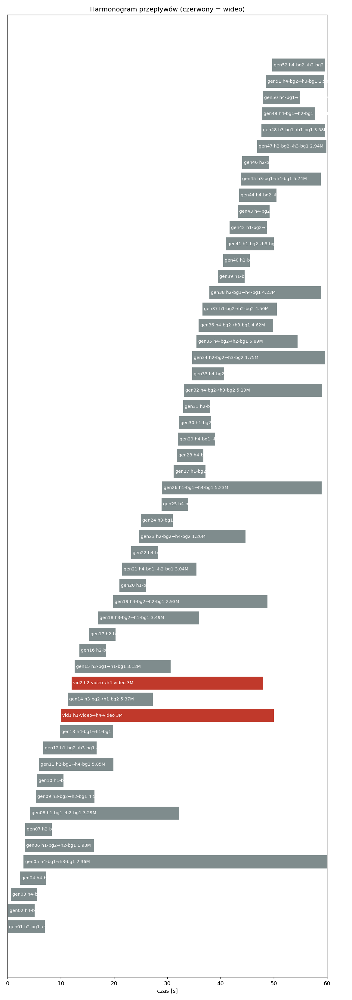
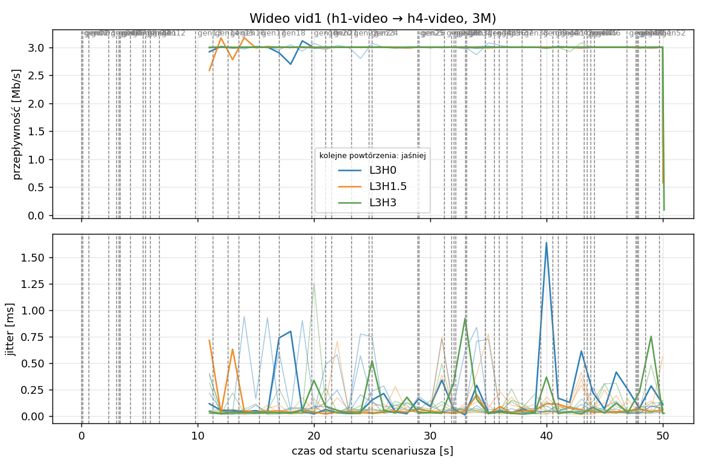
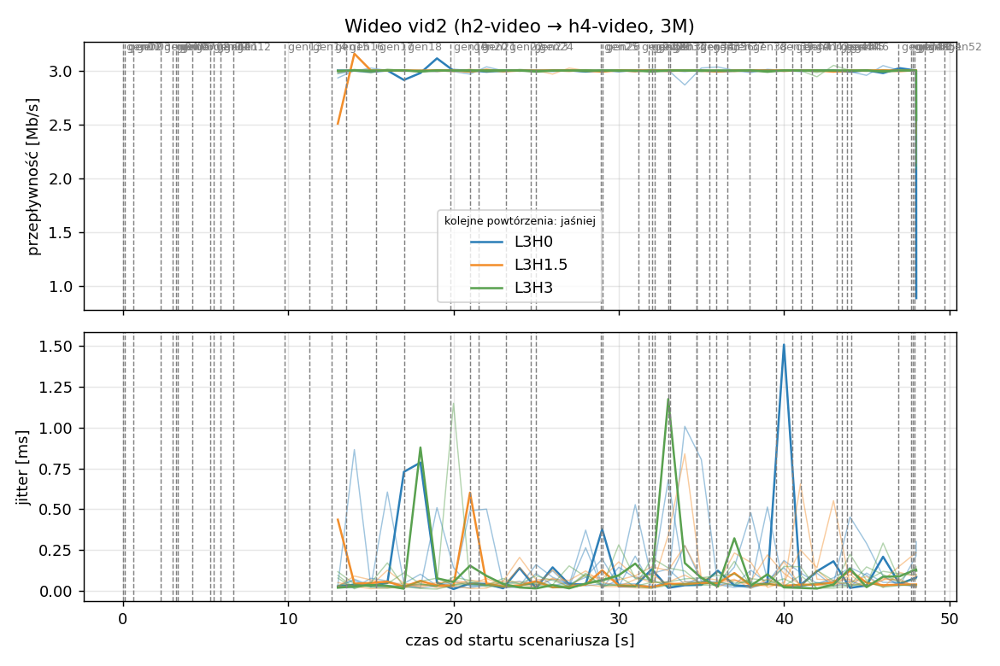
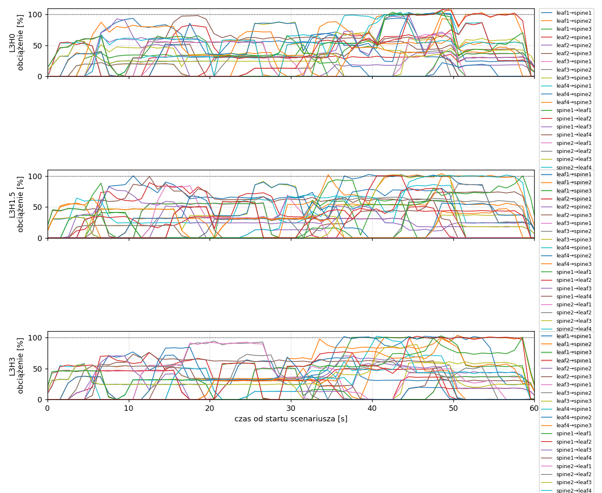
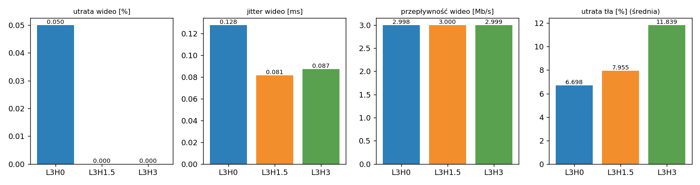

# Raport: layers-clos-l3

Katalog: `results/layers-clos-l3/20261102_045356`

## 1. Scenariusz

- Topologia: `sdn` (sdn: `clos-sdn.clab.yml`)
- Warianty: **L3H0** (HEADROOM_MBPS=0, LAYERS=3, POLICY=qos, RESERVE_PCT=70), **L3H1.5** (HEADROOM_MBPS=1.5, LAYERS=3, POLICY=qos, RESERVE_PCT=70), **L3H3** (HEADROOM_MBPS=3, LAYERS=3, POLICY=qos, RESERVE_PCT=70)
- Czas testu: 60 s, warmup (pomijany w statystykach, liczony od startu każdego przepływu): 5 s, powtórzeń: 5, seed: 42
- Wykonane przebiegi: L3H0/rep1, L3H0/rep2, L3H0/rep3, L3H0/rep4, L3H0/rep5, L3H1.5/rep1, L3H1.5/rep2, L3H1.5/rep3, L3H1.5/rep4, L3H1.5/rep5, L3H3/rep1, L3H3/rep2, L3H3/rep3, L3H3/rep4, L3H3/rep5

Harmonogram losowego tła różni się między powtórzeniami (seed + nr powtórzenia, wspólny dla wariantów); poniżej powtórzenie 1.

| id | klasa | źródło → cel | proto | zadana [Mb/s] | DSCP | start–koniec [s] |
|---|---|---|---|---|---|---|
| gen01 | background | h2-bg1 → h3-bg2 | udp | 4.49 | – | 0–7 |
| gen02 | background | h4-bg2 → h3-bg1 | udp | 3.16 | – | 0.1–5.1 |
| gen03 | background | h4-bg1 → h2-bg2 | udp | 5.25 | – | 0.6–5.6 |
| gen04 | background | h4-bg1 → h1-bg2 | udp | 3.56 | – | 2.3–7.3 |
| gen05 | background | h4-bg1 → h3-bg1 | udp | 2.36 | – | 3–60 |
| gen06 | background | h1-bg2 → h2-bg1 | udp | 1.93 | – | 3.2–16.2 |
| gen07 | background | h2-bg1 → h3-bg1 | udp | 1.39 | – | 3.3–8.3 |
| gen08 | background | h1-bg1 → h2-bg1 | udp | 3.29 | – | 4.2–32.2 |
| gen09 | background | h3-bg2 → h2-bg1 | udp | 4.51 | – | 5.3–16.3 |
| gen10 | background | h1-bg2 → h3-bg1 | udp | 3.96 | – | 5.5–10.5 |
| gen11 | background | h2-bg1 → h4-bg2 | udp | 5.85 | – | 5.9–19.9 |
| gen12 | background | h1-bg2 → h3-bg1 | udp | 4.90 | – | 6.7–16.7 |
| gen13 | background | h4-bg1 → h1-bg1 | udp | 3.07 | – | 9.8–19.8 |
| vid1 | video | h1-video → h4-video | udp | 3.00 | 46 | 10–50 |
| gen14 | background | h3-bg2 → h1-bg2 | udp | 5.37 | – | 11.3–27.3 |
| vid2 | video | h2-video → h4-video | udp | 3.00 | 46 | 12–48 |
| gen15 | background | h3-bg1 → h1-bg1 | udp | 3.12 | – | 12.6–30.6 |
| gen16 | background | h2-bg1 → h1-bg1 | udp | 4.96 | – | 13.5–18.5 |
| gen17 | background | h2-bg1 → h4-bg2 | udp | 4.86 | – | 15.3–20.3 |
| gen18 | background | h3-bg2 → h1-bg1 | udp | 3.49 | – | 17–36 |
| gen19 | background | h4-bg2 → h2-bg1 | udp | 2.93 | – | 19.8–48.8 |
| gen20 | background | h1-bg2 → h4-bg2 | udp | 5.68 | – | 21–26 |
| gen21 | background | h4-bg1 → h2-bg1 | udp | 3.04 | – | 21.5–35.5 |
| gen22 | background | h4-bg1 → h2-bg1 | udp | 3.69 | – | 23.2–28.2 |
| gen23 | background | h2-bg2 → h4-bg2 | udp | 1.26 | – | 24.7–44.7 |
| gen24 | background | h3-bg1 → h1-bg2 | udp | 4.88 | – | 25–31 |
| gen25 | background | h4-bg1 → h1-bg2 | udp | 3.51 | – | 28.9–33.9 |
| gen26 | background | h1-bg1 → h4-bg1 | udp | 5.23 | – | 29–59 |
| gen27 | background | h1-bg2 → h4-bg1 | udp | 2.10 | – | 31.2–37.2 |
| gen28 | background | h4-bg1 → h1-bg2 | udp | 1.54 | – | 31.8–36.8 |
| gen29 | background | h4-bg1 → h1-bg2 | udp | 1.53 | – | 32–39 |
| gen30 | background | h1-bg2 → h3-bg1 | udp | 3.69 | – | 32.2–38.2 |
| gen31 | background | h2-bg1 → h4-bg2 | udp | 2.18 | – | 33–38 |
| gen32 | background | h4-bg2 → h3-bg2 | udp | 5.19 | – | 33.1–59.1 |
| gen33 | background | h4-bg2 → h3-bg2 | udp | 2.60 | – | 34.7–40.7 |
| gen34 | background | h2-bg2 → h3-bg2 | udp | 1.75 | – | 34.7–59.7 |
| gen35 | background | h4-bg2 → h2-bg1 | udp | 5.89 | – | 35.5–54.5 |
| gen36 | background | h4-bg2 → h3-bg1 | udp | 4.62 | – | 35.9–49.9 |
| gen37 | background | h1-bg2 → h2-bg2 | udp | 4.50 | – | 36.6–50.6 |
| gen38 | background | h2-bg1 → h4-bg1 | udp | 4.23 | – | 37.9–58.9 |
| gen39 | background | h1-bg2 → h4-bg2 | udp | 5.93 | – | 39.5–44.5 |
| gen40 | background | h1-bg1 → h3-bg1 | udp | 5.99 | – | 40.5–45.5 |
| gen41 | background | h1-bg2 → h3-bg1 | udp | 4.47 | – | 41–50 |
| gen42 | background | h1-bg2 → h3-bg1 | udp | 2.82 | – | 41.7–48.7 |
| gen43 | background | h4-bg2 → h2-bg1 | udp | 4.98 | – | 43.2–49.2 |
| gen44 | background | h4-bg2 → h1-bg2 | udp | 5.97 | – | 43.5–50.5 |
| gen45 | background | h3-bg1 → h4-bg1 | udp | 5.74 | – | 43.8–58.8 |
| gen46 | background | h2-bg1 → h1-bg2 | udp | 1.89 | – | 44.1–49.1 |
| gen47 | background | h2-bg2 → h3-bg1 | udp | 2.94 | – | 46.9–59.9 |
| gen48 | background | h3-bg1 → h1-bg1 | udp | 3.58 | – | 47.7–59.7 |
| gen49 | background | h4-bg1 → h2-bg1 | udp | 5.93 | – | 47.8–57.8 |
| gen50 | background | h4-bg1 → h1-bg1 | udp | 3.20 | – | 47.9–54.9 |
| gen51 | background | h4-bg2 → h3-bg1 | udp | 1.53 | – | 48.5–59.5 |
| gen52 | background | h4-bg2 → h2-bg2 | udp | 2.44 | – | 49.7–59.7 |

## 2. Wideo: QoS według wariantu

Wartości: średnia ± odchylenie standardowe z powtórzeń.

| przepływ | wariant | przepływność [Mb/s] | jitter [ms] | utrata [%] | RTT mediana [ms] | RTT p95 [ms] |
|---|---|---|---|---|---|---|
| vid1 | L3H0 | 3.00 ± 0.00 | 0.139 ± 0.063 | 0.08 ± 0.12 | 0.032 ± 0.002 | 11.838 ± 15.645 |
| vid1 | L3H1.5 | 3.00 ± 0.00 | 0.082 ± 0.024 | 0.00 ± 0.00 | 0.030 ± 0.000 | 0.056 ± 0.006 |
| vid1 | L3H3 | 3.00 ± 0.00 | 0.090 ± 0.028 | 0.00 ± 0.00 | 0.031 ± 0.001 | 0.054 ± 0.004 |
| vid2 | L3H0 | 3.00 ± 0.00 | 0.116 ± 0.047 | 0.02 ± 0.04 | 0.031 ± 0.002 | 6.488 ± 6.097 |
| vid2 | L3H1.5 | 3.00 ± 0.00 | 0.081 ± 0.012 | 0.00 ± 0.00 | 0.029 ± 0.003 | 0.055 ± 0.010 |
| vid2 | L3H3 | 3.00 ± 0.00 | 0.084 ± 0.032 | 0.00 ± 0.00 | 0.030 ± 0.001 | 0.053 ± 0.001 |

RTT z `ping` co 0,1 s między hostami wideo (osobny przepływ ICMP z tym samym DSCP - w SDN może iść inną ścieżką niż strumień UDP).

## 3. Ruch tła

Agregat tła w obrębie powtórzenia, potem średnia ± odchylenie standardowe po powtórzeniach (utrata = Σ utraconych / Σ wysłanych datagramów; dostarczone = Σ przepływności / Σ zadanych; przepływy trwające nie dłużej niż warmup pominięte).

| wariant | strumieni tła / powt. | dostarczone / zadane [%] | jitter [ms] | utrata [%] |
|---|---|---|---|---|
| L3H0 | 40 | 93.0 ± 4.1 | 0.212 ± 0.064 | 6.70 ± 3.23 |
| L3H1.5 | 40 | 90.8 ± 5.5 | 0.200 ± 0.073 | 7.96 ± 5.70 |
| L3H3 | 40 | 89.3 ± 5.4 | 0.217 ± 0.091 | 11.84 ± 3.73 |

## 4. Obciążenie łączy fabricu

Średnia i maksimum z próbek co 1 s w oknie 0–60 s; MLU = maksymalne obciążenie łącza; drops = pakiety odrzucone przez `tbf` na wyjściu łącza.

| wariant | rep | średnie obciążenie łączy [%] | MLU [%] | łącza > 90% | drops tbf | CPU VM śr./maks. [%] |
|---|---|---|---|---|---|---|
| L3H0 | 1 | 34.1 | 110.3 | 12/24 | 9318 | 38 / 94 |
| L3H0 | 2 | 40.7 | 103.9 | 17/24 | 13186 | 26 / 45 |
| L3H0 | 3 | 49.3 | 105.5 | 17/24 | 25702 | 30 / 57 |
| L3H0 | 4 | 34.0 | 103.6 | 9/24 | 4801 | 25 / 45 |
| L3H0 | 5 | 38.1 | 102.5 | 13/24 | 10212 | 26 / 44 |
| L3H1.5 | 1 | 33.2 | 103.8 | 11/24 | 15730 | 28 / 66 |
| L3H1.5 | 2 | 41.0 | 103.4 | 15/24 | 13723 | 27 / 47 |
| L3H1.5 | 3 | 47.6 | 105.2 | 14/24 | 34696 | 26 / 43 |
| L3H1.5 | 4 | 34.3 | 102.6 | 10/24 | 1152 | 24 / 41 |
| L3H1.5 | 5 | 38.0 | 102.3 | 11/24 | 10436 | 24 / 41 |
| L3H3 | 1 | 33.1 | 103.6 | 10/24 | 14718 | 25 / 46 |
| L3H3 | 2 | 39.6 | 104.3 | 15/24 | 21165 | 27 / 47 |
| L3H3 | 3 | 46.7 | 104.0 | 12/24 | 37039 | 26 / 43 |
| L3H3 | 4 | 33.9 | 102.5 | 9/24 | 729 | 26 / 46 |
| L3H3 | 5 | 36.9 | 102.4 | 7/24 | 8968 | 24 / 40 |

Łącza z obciążeniem > 10% (maksimum [%] / drops, powtórzenie 1):

| łącze | L3H0 | L3H1.5 | L3H3 |
|---|---|---|---|
| leaf1→spine1 | 94 / 23 | 100 / 69 | 77 / 0 |
| leaf1→spine2 | 102 / 652 | 104 / 4136 | 101 / 2079 |
| leaf1→spine3 | 103 / 1245 | 62 / 0 | 103 / 1762 |
| leaf2→spine1 | 83 / 0 | 89 / 0 | 76 / 0 |
| leaf2→spine2 | 65 / 0 | 52 / 0 | 58 / 0 |
| leaf2→spine3 | 65 / 0 | 75 / 0 | 52 / 0 |
| leaf3→spine1 | 42 / 0 | 57 / 0 | 51 / 0 |
| leaf3→spine2 | 57 / 0 | 60 / 0 | 94 / 0 |
| leaf3→spine3 | 88 / 0 | 91 / 0 | 61 / 0 |
| leaf4→spine1 | 103 / 0 | 86 / 0 | 72 / 0 |
| leaf4→spine2 | 103 / 1719 | 102 / 4375 | 104 / 4949 |
| leaf4→spine3 | 110 / 4445 | 102 / 4433 | 104 / 4509 |
| spine1→leaf1 | 66 / 0 | 61 / 0 | 52 / 0 |
| spine1→leaf2 | 87 / 0 | 81 / 0 | 56 / 0 |
| spine1→leaf3 | 99 / 0 | 82 / 0 | 71 / 0 |
| spine1→leaf4 | 98 / 40 | 99 / 58 | 76 / 0 |
| spine2→leaf1 | 69 / 0 | 84 / 0 | 93 / 0 |
| spine2→leaf2 | 42 / 0 | 87 / 0 | 73 / 0 |
| spine2→leaf3 | 72 / 0 | 102 / 1341 | 89 / 60 |
| spine2→leaf4 | 104 / 0 | 102 / 1174 | 102 / 147 |
| spine3→leaf1 | 88 / 0 | 90 / 0 | 85 / 0 |
| spine3→leaf2 | 93 / 0 | 64 / 0 | 99 / 0 |
| spine3→leaf3 | 106 / 768 | 100 / 0 | 100 / 0 |
| spine3→leaf4 | 108 / 426 | 101 / 144 | 102 / 1212 |

## 5. Ścieżki wybrane przez kontroler (powtórzenie 1)

Z logu kontrolera (linie `Flow`), dopasowane po piątce przepływu; ✓ = reguły widoczne w `dump-flows` na tych samych przełącznikach.

| przepływ | L3H0 | L3H1.5 | L3H3 |
|---|---|---|---|
| gen01 | leaf2 -> spine3 -> leaf3 ✓ (loads 0% 20% 0%) | leaf2 -> spine3 -> leaf3 ✓ (loads 0% 20% 0%) | leaf2 -> spine3 -> leaf3 ✓ (loads 0% 20% 0%) |
| gen02 | leaf4 -> spine2 -> leaf3 ✓ (loads 20% 20% 20%) | leaf4 -> spine2 -> leaf3 ✓ (loads 20% 20% 20%) | leaf4 -> spine2 -> leaf3 ✓ (loads 20% 20% 20%) |
| gen03 | leaf4 -> spine1 -> leaf2 ✓ (loads 20% 28% 40%) | leaf4 -> spine3 -> leaf2 ✓ (loads 20% 40% 20%) | leaf4 -> spine1 -> leaf2 ✓ (loads 20% 28% 40%) |
| gen04 | leaf4 -> spine3 -> leaf1 ✓ (loads 82% 53% 39%) | leaf4 -> spine1 -> leaf1 ✓ (loads 38% 73% 74%) | leaf4 -> spine3 -> leaf1 ✓ (loads 79% 53% 39%) |
| gen05 | leaf4 -> spine2 -> leaf3 ✓ (loads 74% 49% 71%) | leaf4 -> spine1 -> leaf3 ✓ (loads 60% 70% 74%) | leaf4 -> spine2 -> leaf3 ✓ (loads 74% 50% 59%) |
| gen06 | leaf1 -> spine2 -> leaf2 ✓ (loads 74% 17% 37%) | leaf1 -> spine2 -> leaf2 ✓ (loads 18% 17% 54%) | leaf1 -> spine2 -> leaf2 ✓ (loads 54% 17% 37%) |
| gen07 | leaf2 -> spine3 -> leaf3 ✓ (loads 57% 66% 46%) | leaf2 -> spine1 -> leaf3 ✓ (loads 34% 50% 46%) | leaf2 -> spine1 -> leaf3 ✓ (loads 35% 67% 46%) |
| gen08 | leaf1 -> spine3 -> leaf2 ✓ (loads 54% 60% 53%) | leaf1 -> spine1 -> leaf2 ✓ (loads 49% 49% 54%) | leaf1 -> spine2 -> leaf2 ✓ (loads 54% 38% 52%) |
| gen09 | leaf3 -> spine3 -> leaf2 ✓ (loads 65% 70% 64%) | leaf3 -> spine3 -> leaf2 ✓ (loads 89% 66% 54%) | leaf3 -> spine1 -> leaf2 ✓ (loads 54% 75% 63%) |
| gen10 | leaf1 -> spine1 -> leaf3 ✓ (loads 54% 90% 77%) | leaf1 -> spine3 -> leaf3 ✓ (loads 90% 66% 58%) | leaf1 -> spine1 -> leaf3 ✓ (loads 59% 104% 71%) |
| gen11 | leaf2 -> spine2 -> leaf4 ✓ (loads 56% 11% 61%) | leaf2 -> spine1 -> leaf4 ✓ (loads 26% 27% 73%) | leaf2 -> spine1 -> leaf4 ✓ (loads 25% 31% 71%) |
| gen12 | leaf1 -> spine1 -> leaf3 ✓ (loads 58% 59% 65%) | leaf1 -> spine1 -> leaf3 ✓ (loads 39% 43% 89%) | leaf1 -> spine1 -> leaf3 ✓ (loads 70% 77% 71%) |
| gen13 | leaf4 -> spine1 -> leaf1 ✓ (loads 0% 24% 6%) | leaf4 -> spine3 -> leaf1 ✓ (loads 24% 8% 0%) | leaf4 -> spine1 -> leaf1 ✓ (loads 0% 24% 7%) |
| vid1 | leaf1 -> spine1 -> leaf4 ✓ (loads 91% 60% 52%) | leaf1 -> spine1 -> leaf4 ✓ (loads 84% 42% 41%) | leaf1 -> spine1 -> leaf4 ✓ (loads 70% 54% 20%) |
| gen14 | leaf3 -> spine2 -> leaf1 ✓ (loads 41% 7% 46%) | leaf3 -> spine1 -> leaf1 ✓ (loads 6% 15% 47%) | leaf3 -> spine2 -> leaf1 ✓ (loads 46% 6% 14%) |
| vid2 | leaf2 -> spine1 -> leaf4 ✓ (loads 62% 60% 23%) | leaf2 -> spine1 -> leaf4 ✓ (loads 115% 22% 6%) | leaf2 -> spine1 -> leaf4 ✓ (loads 98% 6% 20%) |
| gen15 | leaf3 -> spine1 -> leaf1 ✓ (loads 34% 36% 46%) | leaf3 -> spine2 -> leaf1 ✓ (loads 49% 6% 46%) | leaf3 -> spine3 -> leaf1 ✓ (loads 46% 68% 6%) |
| gen16 | leaf2 -> spine3 -> leaf1 ✓ (loads 50% 69% 12%) | leaf2 -> spine2 -> leaf1 ✓ (loads 120% 30% 32%) | leaf2 -> spine3 -> leaf1 ✓ (loads 98% 68% 43%) |
| gen17 | leaf2 -> spine1 -> leaf4 ✓ (loads 62% 67% 64%) | leaf2 -> spine3 -> leaf4 ✓ (loads 90% 62% 8%) | leaf2 -> spine2 -> leaf4 ✓ (loads 68% 6% 56%) |
| gen18 | leaf3 -> spine3 -> leaf1 ✓ (loads 64% 64% 58%) | leaf3 -> spine3 -> leaf1 ✓ (loads 55% 83% 49%) | leaf3 -> spine2 -> leaf1 ✓ (loads 53% 64% 83%) |
| gen19 | leaf4 -> spine1 -> leaf2 ✓ (loads 32% 32% 34%) | leaf4 -> spine2 -> leaf2 ✓ (loads 34% 8% 32%) | leaf4 -> spine3 -> leaf2 ✓ (loads 32% 34% 8%) |
| gen20 | leaf1 -> spine2 -> leaf4 ✓ (loads 80% 18% 34%) | leaf1 -> spine3 -> leaf4 ✓ (loads 65% 23% 22%) | leaf1 -> spine3 -> leaf4 ✓ (loads 64% 47% 30%) |
| gen21 | leaf4 -> spine2 -> leaf2 ✓ (loads 45% 40% 41%) | leaf4 -> spine3 -> leaf2 ✓ (loads 34% 53% 19%) | leaf4 -> spine1 -> leaf2 ✓ (loads 18% 34% 54%) |
| gen22 | leaf4 -> spine3 -> leaf2 ✓ (loads 44% 62% 41%) | leaf4 -> spine1 -> leaf2 ✓ (loads 34% 37% 56%) | leaf4 -> spine2 -> leaf2 ✓ (loads 52% 34% 36%) |
| gen23 | leaf2 -> spine3 -> leaf4 ✓ (loads 62% 58% 21%) | leaf2 -> spine2 -> leaf4 ✓ (loads 62% 21% 59%) | leaf2 -> spine2 -> leaf4 ✓ (loads 62% 17% 58%) |
| gen24 | leaf3 -> spine3 -> leaf1 ✓ (loads 41% 55% 36%) | leaf3 -> spine3 -> leaf1 ✓ (loads 55% 40% 36%) | leaf3 -> spine1 -> leaf1 ✓ (loads 7% 91% 32%) |
| gen25 | leaf4 -> spine1 -> leaf1 ✓ (loads 47% 56% 86%) | leaf4 -> spine2 -> leaf1 ✓ (loads 60% 50% 86%) | leaf4 -> spine3 -> leaf1 ✓ (loads 50% 55% 47%) |
| gen26 | leaf1 -> spine2 -> leaf4 ✓ (loads 62% 29% 34%) | leaf1 -> spine2 -> leaf4 ✓ (loads 65% 22% 26%) | leaf1 -> spine3 -> leaf4 ✓ (loads 62% 34% 22%) |
| gen27 | leaf1 -> spine3 -> leaf4 ✓ (loads 62% 82% 43%) | leaf1 -> spine3 -> leaf4 ✓ (loads 65% 85% 34%) | leaf1 -> spine2 -> leaf4 ✓ (loads 62% 41% 83%) |
| gen28 | leaf4 -> spine3 -> leaf1 ✓ (loads 67% 73% 61%) | leaf4 -> spine1 -> leaf1 ✓ (loads 50% 66% 86%) | leaf4 -> spine1 -> leaf1 ✓ (loads 43% 57% 66%) |
| gen29 | leaf4 -> spine3 -> leaf1 ✓ (loads 75% 73% 70%) | leaf4 -> spine3 -> leaf1 ✓ (loads 70% 66% 37%) | leaf4 -> spine2 -> leaf1 ✓ (loads 51% 65% 66%) |
| gen30 | leaf1 -> spine1 -> leaf3 ✓ (loads 64% 71% 72%) | leaf1 -> spine3 -> leaf3 ✓ (loads 65% 72% 67%) | leaf1 -> spine1 -> leaf3 ✓ (loads 46% 68% 71%) |
| gen31 | leaf2 -> spine3 -> leaf4 ✓ (loads 71% 71% 67%) | leaf2 -> spine3 -> leaf4 ✓ (loads 69% 76% 64%) | leaf2 -> spine3 -> leaf4 ✓ (loads 62% 73% 70%) |
| gen32 | leaf4 -> spine3 -> leaf3 ✓ (loads 75% 73% 72%) | leaf4 -> spine3 -> leaf3 ✓ (loads 83% 73% 70%) | leaf4 -> spine3 -> leaf3 ✓ (loads 73% 68% 66%) |
| gen33 | leaf4 -> spine2 -> leaf3 ✓ (loads 66% 62% 92%) | leaf4 -> spine1 -> leaf3 ✓ (loads 46% 70% 93%) | leaf4 -> spine2 -> leaf3 ✓ (loads 62% 54% 105%) |
| gen34 | leaf2 -> spine2 -> leaf3 ✓ (loads 55% 38% 47%) | leaf2 -> spine2 -> leaf3 ✓ (loads 38% 19% 70%) | leaf2 -> spine1 -> leaf3 ✓ (loads 44% 45% 59%) |
| gen35 | leaf4 -> spine1 -> leaf2 ✓ (loads 52% 70% 112%) | leaf4 -> spine2 -> leaf2 ✓ (loads 60% 50% 121%) | leaf4 -> spine2 -> leaf2 ✓ (loads 62% 87% 91%) |
| gen36 | leaf4 -> spine1 -> leaf3 ✓ (loads 72% 96% 85%) | leaf4 -> spine2 -> leaf3 ✓ (loads 60% 57% 107%) | leaf4 -> spine1 -> leaf3 ✓ (loads 62% 87% 91%) |
| gen37 | leaf1 -> spine3 -> leaf2 ✓ (loads 69% 54% 34%) | leaf1 -> spine1 -> leaf2 ✓ (loads 37% 78% 60%) | leaf1 -> spine3 -> leaf2 ✓ (loads 67% 66% 61%) |
| gen38 | leaf2 -> spine3 -> leaf4 ✓ (loads 76% 69% 58%) | leaf2 -> spine3 -> leaf4 ✓ (loads 69% 80% 63%) | leaf2 -> spine2 -> leaf4 ✓ (loads 62% 65% 84%) |
| gen39 | leaf1 -> spine2 -> leaf4 ✓ (loads 62% 61% 70%) | leaf1 -> spine3 -> leaf4 ✓ (loads 77% 67% 62%) | leaf1 -> spine2 -> leaf4 ✓ (loads 62% 73% 100%) |
| gen40 | leaf1 -> spine1 -> leaf3 ✓ (loads 39% 76% 53%) | leaf1 -> spine2 -> leaf3 ✓ (loads 77% 54% 58%) | leaf1 -> spine2 -> leaf3 ✓ (loads 66% 75% 100%) |
| gen41 | leaf1 -> spine3 -> leaf3 ✓ (loads 59% 107% 54%) | leaf1 -> spine2 -> leaf3 ✓ (loads 77% 82% 83%) | leaf1 -> spine2 -> leaf3 ✓ (loads 66% 87% 100%) |
| gen42 | leaf1 -> spine3 -> leaf3 ✓ (loads 66% 107% 61%) | leaf1 -> spine2 -> leaf3 ✓ (loads 77% 89% 89%) | leaf1 -> spine3 -> leaf3 ✓ (loads 66% 135% 107%) |
| gen43 | leaf4 -> spine2 -> leaf2 ✓ (loads 100% 32% 53%) | leaf4 -> spine1 -> leaf2 ✓ (loads 53% 100% 53%) | leaf4 -> spine1 -> leaf2 ✓ (loads 54% 85% 84%) |
| gen44 | leaf4 -> spine2 -> leaf1 ✓ (loads 100% 47% 53%) | leaf4 -> spine1 -> leaf1 ✓ (loads 46% 100% 53%) | leaf4 -> spine2 -> leaf1 ✓ (loads 65% 85% 92%) |
| gen45 | leaf3 -> spine3 -> leaf4 ✓ (loads 78% 107% 71%) | leaf3 -> spine2 -> leaf4 ✓ (loads 69% 64% 107%) | leaf3 -> spine3 -> leaf4 ✓ (loads 71% 102% 65%) |
| gen46 | leaf2 -> spine2 -> leaf1 ✓ (loads 38% 26% 64%) | leaf2 -> spine1 -> leaf1 ✓ (loads 39% 45% 44%) | leaf2 -> spine3 -> leaf1 ✓ (loads 49% 57% 25%) |
| gen47 | leaf2 -> spine1 -> leaf3 ✓ (loads 39% 48% 99%) | leaf2 -> spine3 -> leaf3 ✓ (loads 59% 100% 53%) | leaf2 -> spine3 -> leaf3 ✓ (loads 61% 74% 73%) |
| gen48 | leaf3 -> spine1 -> leaf1 ✓ (loads 11% 63% 59%) | leaf3 -> spine3 -> leaf1 ✓ (loads 59% 59% 27%) | leaf3 -> spine1 -> leaf1 ✓ (loads 20% 44% 59%) |
| gen49 | leaf4 -> spine3 -> leaf2 ✓ (loads 100% 100% 64%) | leaf4 -> spine3 -> leaf2 ✓ (loads 85% 100% 64%) | leaf4 -> spine3 -> leaf2 ✓ (loads 70% 100% 94%) |
| gen50 | leaf4 -> spine3 -> leaf1 ✓ (loads 100% 100% 86%) | leaf4 -> spine3 -> leaf1 ✓ (loads 85% 100% 84%) | leaf4 -> spine2 -> leaf1 ✓ (loads 70% 110% 125%) |
| gen51 | leaf4 -> spine3 -> leaf3 ✓ (loads 100% 111% 108%) | leaf4 -> spine3 -> leaf3 ✓ (loads 85% 120% 114%) | leaf4 -> spine3 -> leaf3 ✓ (loads 70% 130% 125%) |
| gen52 | leaf4 -> spine1 -> leaf2 ✓ (loads 108% 120% 166%) | leaf4 -> spine2 -> leaf2 ✓ (loads 85% 132% 161%) | leaf4 -> spine3 -> leaf2 ✓ (loads 64% 150% 138%) |

## 6. Wnioski

<!-- WNIOSKI:START -->
_Do uzupełnienia: krótkie wnioski wyłącznie na podstawie liczb z sekcji 2–5._
<!-- WNIOSKI:END -->

## 7. Wiarygodność pomiaru

- L3H0 rep1, gen04: przepływ krótszy niż warmup - statystyki z całości
- L3H0 rep1, gen07: przepływ krótszy niż warmup - statystyki z całości
- L3H0 rep1, gen17: przepływ krótszy niż warmup - statystyki z całości
- L3H0 rep1, gen22: przepływ krótszy niż warmup - statystyki z całości
- L3H0 rep1, gen25: przepływ krótszy niż warmup - statystyki z całości
- L3H0 rep1, gen28: przepływ krótszy niż warmup - statystyki z całości
- L3H0 rep1: CPU maszyny do 94% (średnio 38%) - możliwy wpływ na pomiary
- L3H0 rep2, gen02: przepływ krótszy niż warmup - statystyki z całości
- L3H0 rep2, gen12: przepływ krótszy niż warmup - statystyki z całości
- L3H0 rep2, gen18: przepływ krótszy niż warmup - statystyki z całości
- L3H0 rep2, gen23: przepływ krótszy niż warmup - statystyki z całości
- L3H0 rep2, gen24: przepływ krótszy niż warmup - statystyki z całości
- L3H0 rep2, gen27: przepływ krótszy niż warmup - statystyki z całości
- L3H0 rep2, gen29: przepływ krótszy niż warmup - statystyki z całości
- L3H0 rep2, gen45: przepływ krótszy niż warmup - statystyki z całości
- L3H0 rep2, gen51: przepływ krótszy niż warmup - statystyki z całości
- L3H0 rep3, gen01: przepływ krótszy niż warmup - statystyki z całości
- L3H0 rep3, gen02: przepływ krótszy niż warmup - statystyki z całości
- L3H0 rep3, gen03: przepływ krótszy niż warmup - statystyki z całości
- L3H0 rep3, gen11: przepływ krótszy niż warmup - statystyki z całości
- L3H0 rep3, gen13: przepływ krótszy niż warmup - statystyki z całości
- L3H0 rep3, gen15: przepływ krótszy niż warmup - statystyki z całości
- L3H0 rep3, gen30: przepływ krótszy niż warmup - statystyki z całości
- L3H0 rep3, gen38: przepływ krótszy niż warmup - statystyki z całości
- L3H0 rep3, gen50: przepływ krótszy niż warmup - statystyki z całości
- L3H0 rep3, gen58: przepływ krótszy niż warmup - statystyki z całości
- L3H0 rep4, gen22: przepływ krótszy niż warmup - statystyki z całości
- L3H0 rep4, gen29: przepływ krótszy niż warmup - statystyki z całości
- L3H0 rep4, gen31: przepływ krótszy niż warmup - statystyki z całości
- L3H0 rep4, gen40: przepływ krótszy niż warmup - statystyki z całości
- L3H0 rep4, gen45: przepływ krótszy niż warmup - statystyki z całości
- L3H0 rep4, gen49: przepływ krótszy niż warmup - statystyki z całości
- L3H0 rep5, gen21: przepływ krótszy niż warmup - statystyki z całości
- L3H0 rep5, gen25: przepływ krótszy niż warmup - statystyki z całości
- L3H0 rep5, gen46: przepływ krótszy niż warmup - statystyki z całości
- L3H1.5 rep1, gen03: przepływ krótszy niż warmup - statystyki z całości
- L3H1.5 rep1, gen07: przepływ krótszy niż warmup - statystyki z całości
- L3H1.5 rep1, gen28: przepływ krótszy niż warmup - statystyki z całości
- L3H1.5 rep1, gen46: przepływ krótszy niż warmup - statystyki z całości
- L3H1.5 rep2, gen02: przepływ krótszy niż warmup - statystyki z całości
- L3H1.5 rep2, gen12: przepływ krótszy niż warmup - statystyki z całości
- L3H1.5 rep2, gen27: przepływ krótszy niż warmup - statystyki z całości
- L3H1.5 rep2, gen43: przepływ krótszy niż warmup - statystyki z całości
- L3H1.5 rep2, gen51: przepływ krótszy niż warmup - statystyki z całości
- L3H1.5 rep2, gen54: przepływ krótszy niż warmup - statystyki z całości
- L3H1.5 rep3, gen02: przepływ krótszy niż warmup - statystyki z całości
- L3H1.5 rep3, gen03: przepływ krótszy niż warmup - statystyki z całości
- L3H1.5 rep3, gen11: przepływ krótszy niż warmup - statystyki z całości
- L3H1.5 rep3, gen15: przepływ krótszy niż warmup - statystyki z całości
- L3H1.5 rep3, gen30: przepływ krótszy niż warmup - statystyki z całości
- L3H1.5 rep3, gen38: przepływ krótszy niż warmup - statystyki z całości
- L3H1.5 rep3, gen45: klient: unable to receive results: No such file or directory
- L3H1.5 rep3, gen45: serwer: error - unable to receive results: Bad file descriptor
- L3H1.5 rep3, gen50: przepływ krótszy niż warmup - statystyki z całości
- L3H1.5 rep4, gen22: przepływ krótszy niż warmup - statystyki z całości
- L3H1.5 rep4, gen36: przepływ krótszy niż warmup - statystyki z całości
- L3H1.5 rep4, gen41: przepływ krótszy niż warmup - statystyki z całości
- L3H1.5 rep4, gen45: przepływ krótszy niż warmup - statystyki z całości
- L3H1.5 rep5, gen02: przepływ krótszy niż warmup - statystyki z całości
- L3H1.5 rep5, gen14: przepływ krótszy niż warmup - statystyki z całości
- L3H3 rep1, gen02: przepływ krótszy niż warmup - statystyki z całości
- L3H3 rep1, gen07: przepływ krótszy niż warmup - statystyki z całości
- L3H3 rep1, gen22: przepływ krótszy niż warmup - statystyki z całości
- L3H3 rep1, gen28: przepływ krótszy niż warmup - statystyki z całości
- L3H3 rep1, gen46: przepływ krótszy niż warmup - statystyki z całości
- L3H3 rep2, gen12: przepływ krótszy niż warmup - statystyki z całości
- L3H3 rep2, gen27: przepływ krótszy niż warmup - statystyki z całości
- L3H3 rep2, gen31: przepływ krótszy niż warmup - statystyki z całości
- L3H3 rep2, gen58: przepływ krótszy niż warmup - statystyki z całości
- L3H3 rep3, gen01: przepływ krótszy niż warmup - statystyki z całości
- L3H3 rep3, gen02: przepływ krótszy niż warmup - statystyki z całości
- L3H3 rep3, gen03: przepływ krótszy niż warmup - statystyki z całości
- L3H3 rep3, gen09: przepływ krótszy niż warmup - statystyki z całości
- L3H3 rep3, gen11: przepływ krótszy niż warmup - statystyki z całości
- L3H3 rep3, gen13: przepływ krótszy niż warmup - statystyki z całości
- L3H3 rep3, gen15: przepływ krótszy niż warmup - statystyki z całości
- L3H3 rep3, gen30: przepływ krótszy niż warmup - statystyki z całości
- L3H3 rep3, gen38: przepływ krótszy niż warmup - statystyki z całości
- L3H3 rep3, gen58: przepływ krótszy niż warmup - statystyki z całości
- L3H3 rep4, gen22: przepływ krótszy niż warmup - statystyki z całości
- L3H3 rep4, gen29: przepływ krótszy niż warmup - statystyki z całości
- L3H3 rep4, gen45: przepływ krótszy niż warmup - statystyki z całości
- L3H3 rep5, gen03: przepływ krótszy niż warmup - statystyki z całości
- L3H3 rep5, gen21: przepływ krótszy niż warmup - statystyki z całości
- L3H3 rep5, gen42: przepływ krótszy niż warmup - statystyki z całości
- L3H3 rep5, gen51: przepływ krótszy niż warmup - statystyki z całości
- L3H3 rep5, gen52: przepływ krótszy niż warmup - statystyki z całości
- L3H3 rep5, gen54: przepływ krótszy niż warmup - statystyki z całości
