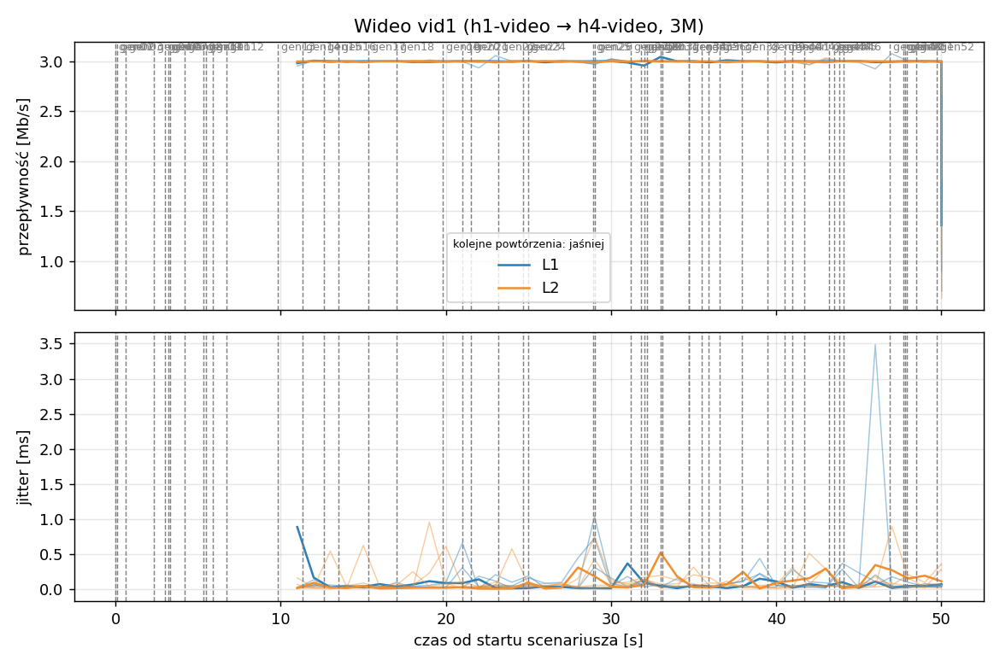
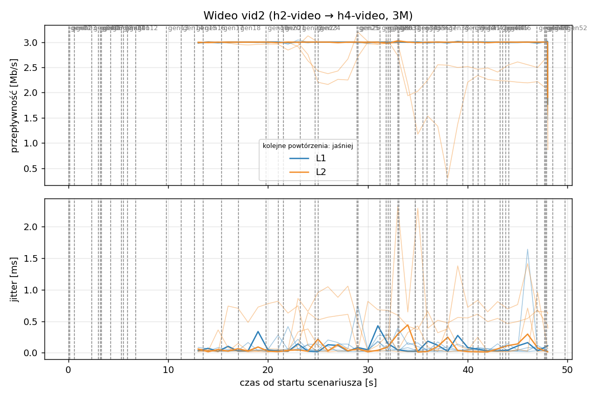
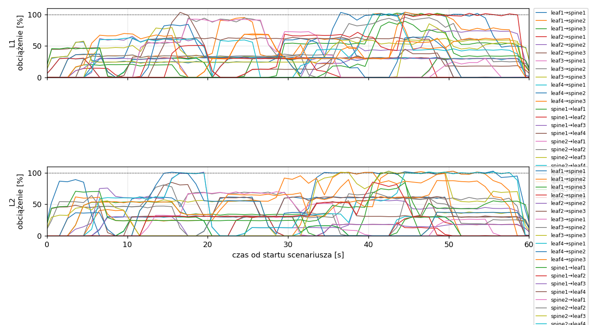
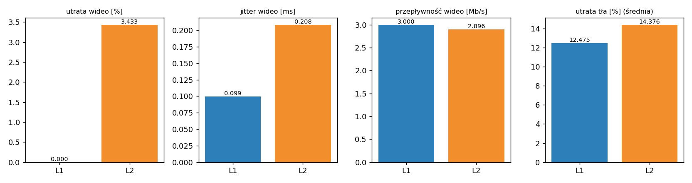

# Raport: layers-clos

Katalog: `results/layers-clos/20261102_032921`

## 1. Scenariusz

- Topologia: `sdn` (sdn: `clos-sdn.clab.yml`)
- Warianty: **L1** (LAYERS=1, POLICY=qos, RESERVE_PCT=70), **L2** (LAYERS=2, POLICY=qos, RESERVE_PCT=70)
- Czas testu: 60 s, warmup (pomijany w statystykach, liczony od startu każdego przepływu): 5 s, powtórzeń: 5, seed: 42
- Wykonane przebiegi: L1/rep1, L1/rep2, L1/rep3, L1/rep4, L1/rep5, L2/rep1, L2/rep2, L2/rep3, L2/rep4, L2/rep5

Harmonogram losowego tła różni się między powtórzeniami (seed + nr powtórzenia, wspólny dla wariantów); poniżej powtórzenie 1.

| id | klasa | źródło → cel | proto | zadana [Mb/s] | DSCP | start–koniec [s] |
|---|---|---|---|---|---|---|
| gen01 | background | h2-bg1 → h3-bg2 | udp | 4.49 | – | 0–7 |
| gen02 | background | h4-bg2 → h3-bg1 | udp | 3.16 | – | 0.1–5.1 |
| gen03 | background | h4-bg1 → h2-bg2 | udp | 5.25 | – | 0.6–5.6 |
| gen04 | background | h4-bg1 → h1-bg2 | udp | 3.56 | – | 2.3–7.3 |
| gen05 | background | h4-bg1 → h3-bg1 | udp | 2.36 | – | 3–60 |
| gen06 | background | h1-bg2 → h2-bg1 | udp | 1.93 | – | 3.2–16.2 |
| gen07 | background | h2-bg1 → h3-bg1 | udp | 1.39 | – | 3.3–8.3 |
| gen08 | background | h1-bg1 → h2-bg1 | udp | 3.29 | – | 4.2–32.2 |
| gen09 | background | h3-bg2 → h2-bg1 | udp | 4.51 | – | 5.3–16.3 |
| gen10 | background | h1-bg2 → h3-bg1 | udp | 3.96 | – | 5.5–10.5 |
| gen11 | background | h2-bg1 → h4-bg2 | udp | 5.85 | – | 5.9–19.9 |
| gen12 | background | h1-bg2 → h3-bg1 | udp | 4.90 | – | 6.7–16.7 |
| gen13 | background | h4-bg1 → h1-bg1 | udp | 3.07 | – | 9.8–19.8 |
| vid1 | video | h1-video → h4-video | udp | 3.00 | 46 | 10–50 |
| gen14 | background | h3-bg2 → h1-bg2 | udp | 5.37 | – | 11.3–27.3 |
| vid2 | video | h2-video → h4-video | udp | 3.00 | 46 | 12–48 |
| gen15 | background | h3-bg1 → h1-bg1 | udp | 3.12 | – | 12.6–30.6 |
| gen16 | background | h2-bg1 → h1-bg1 | udp | 4.96 | – | 13.5–18.5 |
| gen17 | background | h2-bg1 → h4-bg2 | udp | 4.86 | – | 15.3–20.3 |
| gen18 | background | h3-bg2 → h1-bg1 | udp | 3.49 | – | 17–36 |
| gen19 | background | h4-bg2 → h2-bg1 | udp | 2.93 | – | 19.8–48.8 |
| gen20 | background | h1-bg2 → h4-bg2 | udp | 5.68 | – | 21–26 |
| gen21 | background | h4-bg1 → h2-bg1 | udp | 3.04 | – | 21.5–35.5 |
| gen22 | background | h4-bg1 → h2-bg1 | udp | 3.69 | – | 23.2–28.2 |
| gen23 | background | h2-bg2 → h4-bg2 | udp | 1.26 | – | 24.7–44.7 |
| gen24 | background | h3-bg1 → h1-bg2 | udp | 4.88 | – | 25–31 |
| gen25 | background | h4-bg1 → h1-bg2 | udp | 3.51 | – | 28.9–33.9 |
| gen26 | background | h1-bg1 → h4-bg1 | udp | 5.23 | – | 29–59 |
| gen27 | background | h1-bg2 → h4-bg1 | udp | 2.10 | – | 31.2–37.2 |
| gen28 | background | h4-bg1 → h1-bg2 | udp | 1.54 | – | 31.8–36.8 |
| gen29 | background | h4-bg1 → h1-bg2 | udp | 1.53 | – | 32–39 |
| gen30 | background | h1-bg2 → h3-bg1 | udp | 3.69 | – | 32.2–38.2 |
| gen31 | background | h2-bg1 → h4-bg2 | udp | 2.18 | – | 33–38 |
| gen32 | background | h4-bg2 → h3-bg2 | udp | 5.19 | – | 33.1–59.1 |
| gen33 | background | h4-bg2 → h3-bg2 | udp | 2.60 | – | 34.7–40.7 |
| gen34 | background | h2-bg2 → h3-bg2 | udp | 1.75 | – | 34.7–59.7 |
| gen35 | background | h4-bg2 → h2-bg1 | udp | 5.89 | – | 35.5–54.5 |
| gen36 | background | h4-bg2 → h3-bg1 | udp | 4.62 | – | 35.9–49.9 |
| gen37 | background | h1-bg2 → h2-bg2 | udp | 4.50 | – | 36.6–50.6 |
| gen38 | background | h2-bg1 → h4-bg1 | udp | 4.23 | – | 37.9–58.9 |
| gen39 | background | h1-bg2 → h4-bg2 | udp | 5.93 | – | 39.5–44.5 |
| gen40 | background | h1-bg1 → h3-bg1 | udp | 5.99 | – | 40.5–45.5 |
| gen41 | background | h1-bg2 → h3-bg1 | udp | 4.47 | – | 41–50 |
| gen42 | background | h1-bg2 → h3-bg1 | udp | 2.82 | – | 41.7–48.7 |
| gen43 | background | h4-bg2 → h2-bg1 | udp | 4.98 | – | 43.2–49.2 |
| gen44 | background | h4-bg2 → h1-bg2 | udp | 5.97 | – | 43.5–50.5 |
| gen45 | background | h3-bg1 → h4-bg1 | udp | 5.74 | – | 43.8–58.8 |
| gen46 | background | h2-bg1 → h1-bg2 | udp | 1.89 | – | 44.1–49.1 |
| gen47 | background | h2-bg2 → h3-bg1 | udp | 2.94 | – | 46.9–59.9 |
| gen48 | background | h3-bg1 → h1-bg1 | udp | 3.58 | – | 47.7–59.7 |
| gen49 | background | h4-bg1 → h2-bg1 | udp | 5.93 | – | 47.8–57.8 |
| gen50 | background | h4-bg1 → h1-bg1 | udp | 3.20 | – | 47.9–54.9 |
| gen51 | background | h4-bg2 → h3-bg1 | udp | 1.53 | – | 48.5–59.5 |
| gen52 | background | h4-bg2 → h2-bg2 | udp | 2.44 | – | 49.7–59.7 |

## 2. Wideo: QoS według wariantu

Wartości: średnia ± odchylenie standardowe z powtórzeń.

| przepływ | wariant | przepływność [Mb/s] | jitter [ms] | utrata [%] | RTT mediana [ms] | RTT p95 [ms] |
|---|---|---|---|---|---|---|
| vid1 | L1 | 3.00 ± 0.00 | 0.108 ± 0.042 | 0.00 ± 0.00 | 0.029 ± 0.002 | 0.055 ± 0.011 |
| vid1 | L2 | 3.00 ± 0.00 | 0.109 ± 0.014 | 0.00 ± 0.00 | 21.024 ± 46.944 | 23.844 ± 53.194 |
| vid2 | L1 | 3.00 ± 0.00 | 0.091 ± 0.022 | 0.00 ± 0.00 | 0.030 ± 0.001 | 0.057 ± 0.012 |
| vid2 | L2 | 2.79 ± 0.25 | 0.307 ± 0.253 | 6.87 ± 8.14 | 0.029 ± 0.003 | 23.646 ± 52.745 |

RTT z `ping` co 0,1 s między hostami wideo (osobny przepływ ICMP z tym samym DSCP - w SDN może iść inną ścieżką niż strumień UDP).

## 3. Ruch tła

Agregat tła w obrębie powtórzenia, potem średnia ± odchylenie standardowe po powtórzeniach (utrata = Σ utraconych / Σ wysłanych datagramów; dostarczone = Σ przepływności / Σ zadanych; przepływy trwające nie dłużej niż warmup pominięte).

| wariant | strumieni tła / powt. | dostarczone / zadane [%] | jitter [ms] | utrata [%] |
|---|---|---|---|---|
| L1 | 40 | 86.6 ± 3.7 | 0.223 ± 0.101 | 12.48 ± 4.71 |
| L2 | 40 | 85.1 ± 4.1 | 0.258 ± 0.069 | 14.38 ± 4.65 |

## 4. Obciążenie łączy fabricu

Średnia i maksimum z próbek co 1 s w oknie 0–60 s; MLU = maksymalne obciążenie łącza; drops = pakiety odrzucone przez `tbf` na wyjściu łącza.

| wariant | rep | średnie obciążenie łączy [%] | MLU [%] | łącza > 90% | drops tbf | CPU VM śr./maks. [%] |
|---|---|---|---|---|---|---|
| L1 | 1 | 31.9 | 103.6 | 10/24 | 15747 | 30 / 78 |
| L1 | 2 | 38.7 | 104.1 | 15/24 | 15877 | 27 / 49 |
| L1 | 3 | 45.0 | 103.9 | 12/24 | 29752 | 30 / 50 |
| L1 | 4 | 32.0 | 103.2 | 10/24 | 1325 | 24 / 42 |
| L1 | 5 | 36.1 | 104.0 | 12/24 | 8679 | 25 / 42 |
| L2 | 1 | 31.9 | 102.8 | 8/24 | 14766 | 26 / 48 |
| L2 | 2 | 38.6 | 106.9 | 14/24 | 24517 | 27 / 49 |
| L2 | 3 | 44.5 | 104.0 | 14/24 | 34101 | 28 / 46 |
| L2 | 4 | 32.2 | 104.4 | 12/24 | 3729 | 24 / 42 |
| L2 | 5 | 33.9 | 104.5 | 11/24 | 22191 | 26 / 42 |

Łącza z obciążeniem > 10% (maksimum [%] / drops, powtórzenie 1):

| łącze | L1 | L2 |
|---|---|---|
| leaf1→spine1 | 62 / 0 | 62 / 0 |
| leaf1→spine2 | 102 / 263 | 102 / 1243 |
| leaf1→spine3 | 102 / 4115 | 100 / 732 |
| leaf2→spine1 | 32 / 0 | 31 / 0 |
| leaf2→spine2 | 77 / 0 | 101 / 355 |
| leaf2→spine3 | 103 / 0 | 85 / 0 |
| leaf3→spine1 | 31 / 0 | 30 / 0 |
| leaf3→spine2 | 94 / 0 | 81 / 0 |
| leaf3→spine3 | 79 / 0 | 57 / 0 |
| leaf4→spine1 | 31 / 0 | 31 / 0 |
| leaf4→spine2 | 104 / 7278 | 103 / 5787 |
| leaf4→spine3 | 104 / 2879 | 103 / 3111 |
| spine1→leaf1 | 31 / 0 | 31 / 0 |
| spine1→leaf2 | 31 / 0 | 31 / 0 |
| spine1→leaf3 | 31 / 0 | 30 / 0 |
| spine1→leaf4 | 64 / 0 | 63 / 0 |
| spine2→leaf1 | 92 / 0 | 70 / 0 |
| spine2→leaf2 | 95 / 0 | 69 / 0 |
| spine2→leaf3 | 85 / 0 | 102 / 2919 |
| spine2→leaf4 | 101 / 0 | 101 / 400 |
| spine3→leaf1 | 84 / 0 | 101 / 219 |
| spine3→leaf2 | 70 / 0 | 88 / 0 |
| spine3→leaf3 | 89 / 0 | 85 / 0 |
| spine3→leaf4 | 102 / 1212 | 85 / 0 |

## 5. Ścieżki wybrane przez kontroler (powtórzenie 1)

Z logu kontrolera (linie `Flow`), dopasowane po piątce przepływu; ✓ = reguły widoczne w `dump-flows` na tych samych przełącznikach.

| przepływ | L1 | L2 |
|---|---|---|
| gen01 | leaf2 -> spine3 -> leaf3 ✓ (loads 0% 5% 0%) | leaf2 -> spine3 -> leaf3 ✓ (loads 0% 20% 0%) |
| gen02 | leaf4 -> spine2 -> leaf3 ✓ (loads 5% 5% 5%) | leaf4 -> spine2 -> leaf3 ✓ (loads 20% 20% 20%) |
| gen03 | leaf4 -> spine1 -> leaf2 ✓ (loads 0% 2% 5%) | leaf4 -> spine2 -> leaf2 ✓ (loads 20% 33% 40%) |
| gen04 | leaf4 -> spine3 -> leaf1 ✓ (loads 30% 33% 5%) | leaf4 -> spine3 -> leaf1 ✓ (loads 20% 124% 38%) |
| gen05 | leaf4 -> spine2 -> leaf3 ✓ (loads 30% 38% 46%) | leaf4 -> spine3 -> leaf3 ✓ (loads 17% 107% 66%) |
| gen06 | leaf1 -> spine3 -> leaf2 ✓ (loads 30% 5% 0%) | leaf1 -> spine3 -> leaf2 ✓ (loads 17% 54% 37%) |
| gen07 | leaf2 -> spine1 -> leaf3 ✓ (loads 10% 35% 46%) | leaf2 -> spine2 -> leaf3 ✓ (loads 17% 50% 63%) |
| gen08 | leaf1 -> spine2 -> leaf2 ✓ (loads 30% 0% 19%) | leaf1 -> spine3 -> leaf2 ✓ (loads 17% 69% 61%) |
| gen09 | leaf3 -> spine3 -> leaf2 ✓ (loads 30% 34% 25%) | leaf3 -> spine2 -> leaf2 ✓ (loads 29% 69% 98%) |
| gen10 | leaf1 -> spine1 -> leaf3 ✓ (loads 29% 54% 46%) | leaf1 -> spine2 -> leaf3 ✓ (loads 29% 93% 99%) |
| gen11 | leaf2 -> spine2 -> leaf4 ✓ (loads 24% 5% 46%) | leaf2 -> spine2 -> leaf4 ✓ (loads 23% 45% 69%) |
| gen12 | leaf1 -> spine1 -> leaf3 ✓ (loads 31% 34% 46%) | leaf1 -> spine1 -> leaf3 ✓ (loads 21% 79% 82%) |
| gen13 | leaf4 -> spine1 -> leaf1 ✓ (loads 0% 24% 5%) | leaf4 -> spine1 -> leaf1 ✓ (loads 0% 5% 24%) |
| vid1 | leaf1 -> spine1 -> leaf4 ✓ (loads 30% 60% 35%) | leaf1 -> spine1 -> leaf4 ✓ (loads 30% 66% 65%) |
| gen14 | leaf3 -> spine2 -> leaf1 ✓ (loads 33% 5% 46%) | leaf3 -> spine3 -> leaf1 ✓ (loads 64% 46% 6%) |
| vid2 | leaf2 -> spine1 -> leaf4 ✓ (loads 36% 60% 5%) | leaf2 -> spine3 -> leaf4 ✓ (loads 91% 66% 17%) |
| gen15 | leaf3 -> spine3 -> leaf1 ✓ (loads 35% 48% 47%) | leaf3 -> spine2 -> leaf1 ✓ (loads 60% 53% 67%) |
| gen16 | leaf2 -> spine3 -> leaf1 ✓ (loads 31% 60% 25%) | leaf2 -> spine3 -> leaf1 ✓ (loads 60% 67% 67%) |
| gen17 | leaf2 -> spine3 -> leaf4 ✓ (loads 62% 60% 56%) | leaf2 -> spine2 -> leaf4 ✓ (loads 69% 67% 89%) |
| gen18 | leaf3 -> spine2 -> leaf1 ✓ (loads 30% 65% 83%) | leaf3 -> spine2 -> leaf1 ✓ (loads 30% 77% 100%) |
| gen19 | leaf4 -> spine3 -> leaf2 ✓ (loads 30% 34% 5%) | leaf4 -> spine2 -> leaf2 ✓ (loads 30% 8% 34%) |
| gen20 | leaf1 -> spine2 -> leaf4 ✓ (loads 62% 46% 50%) | leaf1 -> spine1 -> leaf4 ✓ (loads 47% 60% 47%) |
| gen21 | leaf4 -> spine1 -> leaf2 ✓ (loads 5% 34% 30%) | leaf4 -> spine3 -> leaf2 ✓ (loads 15% 55% 41%) |
| gen22 | leaf4 -> spine3 -> leaf2 ✓ (loads 30% 34% 30%) | leaf4 -> spine1 -> leaf2 ✓ (loads 13% 30% 80%) |
| gen23 | leaf2 -> spine3 -> leaf4 ✓ (loads 62% 59% 5%) | leaf2 -> spine2 -> leaf4 ✓ (loads 61% 19% 31%) |
| gen24 | leaf3 -> spine1 -> leaf1 ✓ (loads 5% 91% 32%) | leaf3 -> spine1 -> leaf1 ✓ (loads 8% 68% 55%) |
| gen25 | leaf4 -> spine2 -> leaf1 ✓ (loads 30% 48% 68%) | leaf4 -> spine3 -> leaf1 ✓ (loads 30% 68% 63%) |
| gen26 | leaf1 -> spine3 -> leaf4 ✓ (loads 62% 34% 28%) | leaf1 -> spine1 -> leaf4 ✓ (loads 31% 35% 34%) |
| gen27 | leaf1 -> spine2 -> leaf4 ✓ (loads 62% 39% 67%) | leaf1 -> spine2 -> leaf4 ✓ (loads 68% 35% 41%) |
| gen28 | leaf4 -> spine3 -> leaf1 ✓ (loads 28% 72% 35%) | leaf4 -> spine1 -> leaf1 ✓ (loads 22% 52% 92%) |
| gen29 | leaf4 -> spine3 -> leaf1 ✓ (loads 28% 72% 45%) | leaf4 -> spine2 -> leaf1 ✓ (loads 30% 59% 92%) |
| gen30 | leaf1 -> spine1 -> leaf3 ✓ (loads 36% 54% 54%) | leaf1 -> spine2 -> leaf3 ✓ (loads 61% 53% 56%) |
| gen31 | leaf2 -> spine2 -> leaf4 ✓ (loads 62% 27% 67%) | leaf2 -> spine3 -> leaf4 ✓ (loads 61% 65% 53%) |
| gen32 | leaf4 -> spine1 -> leaf3 ✓ (loads 35% 60% 50%) | leaf4 -> spine2 -> leaf3 ✓ (loads 42% 74% 91%) |
| gen33 | leaf4 -> spine2 -> leaf3 ✓ (loads 30% 54% 62%) | leaf4 -> spine3 -> leaf3 ✓ (loads 31% 114% 75%) |
| gen34 | leaf2 -> spine3 -> leaf3 ✓ (loads 31% 34% 18%) | leaf2 -> spine1 -> leaf3 ✓ (loads 6% 114% 76%) |
| gen35 | leaf4 -> spine2 -> leaf2 ✓ (loads 30% 44% 62%) | leaf4 -> spine3 -> leaf2 ✓ (loads 31% 114% 87%) |
| gen36 | leaf4 -> spine2 -> leaf3 ✓ (loads 30% 59% 62%) | leaf4 -> spine2 -> leaf3 ✓ (loads 36% 99% 113%) |
| gen37 | leaf1 -> spine2 -> leaf2 ✓ (loads 61% 44% 54%) | leaf1 -> spine2 -> leaf2 ✓ (loads 61% 68% 73%) |
| gen38 | leaf2 -> spine2 -> leaf4 ✓ (loads 62% 49% 67%) | leaf2 -> spine2 -> leaf4 ✓ (loads 61% 50% 69%) |
| gen39 | leaf1 -> spine2 -> leaf4 ✓ (loads 65% 56% 71%) | leaf1 -> spine3 -> leaf4 ✓ (loads 61% 71% 50%) |
| gen40 | leaf1 -> spine3 -> leaf3 ✓ (loads 36% 89% 54%) | leaf1 -> spine3 -> leaf3 ✓ (loads 61% 74% 52%) |
| gen41 | leaf1 -> spine3 -> leaf3 ✓ (loads 36% 89% 64%) | leaf1 -> spine2 -> leaf3 ✓ (loads 61% 85% 91%) |
| gen42 | leaf1 -> spine3 -> leaf3 ✓ (loads 36% 100% 90%) | leaf1 -> spine2 -> leaf3 ✓ (loads 61% 111% 125%) |
| gen43 | leaf4 -> spine3 -> leaf2 ✓ (loads 30% 100% 35%) | leaf4 -> spine1 -> leaf2 ✓ (loads 6% 100% 85%) |
| gen44 | leaf4 -> spine3 -> leaf1 ✓ (loads 30% 100% 38%) | leaf4 -> spine1 -> leaf1 ✓ (loads 30% 100% 85%) |
| gen45 | leaf3 -> spine3 -> leaf4 ✓ (loads 72% 99% 48%) | leaf3 -> spine2 -> leaf4 ✓ (loads 61% 76% 93%) |
| gen46 | leaf2 -> spine3 -> leaf1 ✓ (loads 36% 44% 31%) | leaf2 -> spine1 -> leaf1 ✓ (loads 26% 68% 31%) |
| gen47 | leaf2 -> spine2 -> leaf3 ✓ (loads 31% 58% 79%) | leaf2 -> spine3 -> leaf3 ✓ (loads 30% 100% 48%) |
| gen48 | leaf3 -> spine1 -> leaf1 ✓ (loads 0% 5% 64%) | leaf3 -> spine3 -> leaf1 ✓ (loads 30% 69% 10%) |
| gen49 | leaf4 -> spine3 -> leaf2 ✓ (loads 30% 100% 100%) | leaf4 -> spine3 -> leaf2 ✓ (loads 30% 100% 95%) |
| gen50 | leaf4 -> spine2 -> leaf1 ✓ (loads 30% 100% 105%) | leaf4 -> spine2 -> leaf1 ✓ (loads 30% 110% 114%) |
| gen51 | leaf4 -> spine3 -> leaf3 ✓ (loads 30% 110% 110%) | leaf4 -> spine2 -> leaf3 ✓ (loads 30% 119% 136%) |
| gen52 | leaf4 -> spine2 -> leaf2 ✓ (loads 29% 100% 104%) | leaf4 -> spine2 -> leaf2 ✓ (loads 30% 143% 148%) |

## 6. Wnioski

<!-- WNIOSKI:START -->
_Do uzupełnienia: krótkie wnioski wyłącznie na podstawie liczb z sekcji 2–5._
<!-- WNIOSKI:END -->

## 7. Wiarygodność pomiaru

- L1 rep1, gen02: przepływ krótszy niż warmup - statystyki z całości
- L1 rep1, gen03: przepływ krótszy niż warmup - statystyki z całości
- L1 rep1, gen07: przepływ krótszy niż warmup - statystyki z całości
- L1 rep1, gen10: przepływ krótszy niż warmup - statystyki z całości
- L1 rep1, gen17: przepływ krótszy niż warmup - statystyki z całości
- L1 rep1, gen28: przepływ krótszy niż warmup - statystyki z całości
- L1 rep1, gen31: przepływ krótszy niż warmup - statystyki z całości
- L1 rep1, gen40: przepływ krótszy niż warmup - statystyki z całości
- L1 rep1, gen46: przepływ krótszy niż warmup - statystyki z całości
- L1 rep2, gen05: przepływ krótszy niż warmup - statystyki z całości
- L1 rep2, gen12: przepływ krótszy niż warmup - statystyki z całości
- L1 rep2, gen18: przepływ krótszy niż warmup - statystyki z całości
- L1 rep2, gen24: przepływ krótszy niż warmup - statystyki z całości
- L1 rep2, gen27: przepływ krótszy niż warmup - statystyki z całości
- L1 rep2, gen45: przepływ krótszy niż warmup - statystyki z całości
- L1 rep2, gen51: przepływ krótszy niż warmup - statystyki z całości
- L1 rep3, gen02: przepływ krótszy niż warmup - statystyki z całości
- L1 rep3, gen03: przepływ krótszy niż warmup - statystyki z całości
- L1 rep3, gen10: przepływ krótszy niż warmup - statystyki z całości
- L1 rep3, gen11: przepływ krótszy niż warmup - statystyki z całości
- L1 rep3, gen15: przepływ krótszy niż warmup - statystyki z całości
- L1 rep3, gen30: przepływ krótszy niż warmup - statystyki z całości
- L1 rep3, gen38: przepływ krótszy niż warmup - statystyki z całości
- L1 rep3, gen58: przepływ krótszy niż warmup - statystyki z całości
- L1 rep4, gen10: przepływ krótszy niż warmup - statystyki z całości
- L1 rep4, gen29: przepływ krótszy niż warmup - statystyki z całości
- L1 rep4, gen31: przepływ krótszy niż warmup - statystyki z całości
- L1 rep4, gen45: przepływ krótszy niż warmup - statystyki z całości
- L1 rep4, gen49: przepływ krótszy niż warmup - statystyki z całości
- L1 rep5, gen03: przepływ krótszy niż warmup - statystyki z całości
- L1 rep5, gen14: przepływ krótszy niż warmup - statystyki z całości
- L1 rep5, gen30: przepływ krótszy niż warmup - statystyki z całości
- L1 rep5, gen42: przepływ krótszy niż warmup - statystyki z całości
- L1 rep5, gen52: przepływ krótszy niż warmup - statystyki z całości
- L2 rep1, gen02: przepływ krótszy niż warmup - statystyki z całości
- L2 rep1, gen03: przepływ krótszy niż warmup - statystyki z całości
- L2 rep1, gen07: przepływ krótszy niż warmup - statystyki z całości
- L2 rep1, gen17: przepływ krótszy niż warmup - statystyki z całości
- L2 rep1, gen28: przepływ krótszy niż warmup - statystyki z całości
- L2 rep2, gen07: przepływ krótszy niż warmup - statystyki z całości
- L2 rep2, gen12: przepływ krótszy niż warmup - statystyki z całości
- L2 rep2, gen18: przepływ krótszy niż warmup - statystyki z całości
- L2 rep2, gen27: przepływ krótszy niż warmup - statystyki z całości
- L2 rep2, gen31: przepływ krótszy niż warmup - statystyki z całości
- L2 rep2, gen45: przepływ krótszy niż warmup - statystyki z całości
- L2 rep2, gen51: przepływ krótszy niż warmup - statystyki z całości
- L2 rep3, gen01: przepływ krótszy niż warmup - statystyki z całości
- L2 rep3, gen02: przepływ krótszy niż warmup - statystyki z całości
- L2 rep3, gen03: przepływ krótszy niż warmup - statystyki z całości
- L2 rep3, gen11: przepływ krótszy niż warmup - statystyki z całości
- L2 rep3, gen13: przepływ krótszy niż warmup - statystyki z całości
- L2 rep3, gen15: przepływ krótszy niż warmup - statystyki z całości
- L2 rep3, gen30: przepływ krótszy niż warmup - statystyki z całości
- L2 rep3, gen35: klient: unable to read from stream socket: Resource temporarily unavailable
- L2 rep3, gen38: przepływ krótszy niż warmup - statystyki z całości
- L2 rep4, gen22: przepływ krótszy niż warmup - statystyki z całości
- L2 rep4, gen25: przepływ krótszy niż warmup - statystyki z całości
- L2 rep4, gen36: przepływ krótszy niż warmup - statystyki z całości
- L2 rep4, gen41: przepływ krótszy niż warmup - statystyki z całości
- L2 rep4, gen45: przepływ krótszy niż warmup - statystyki z całości
- L2 rep5, gen02: przepływ krótszy niż warmup - statystyki z całości
- L2 rep5, gen03: przepływ krótszy niż warmup - statystyki z całości
- L2 rep5, gen14: przepływ krótszy niż warmup - statystyki z całości
- L2 rep5, gen25: przepływ krótszy niż warmup - statystyki z całości
- L2 rep5, gen42: przepływ krótszy niż warmup - statystyki z całości
- L2 rep5, gen46: przepływ krótszy niż warmup - statystyki z całości
