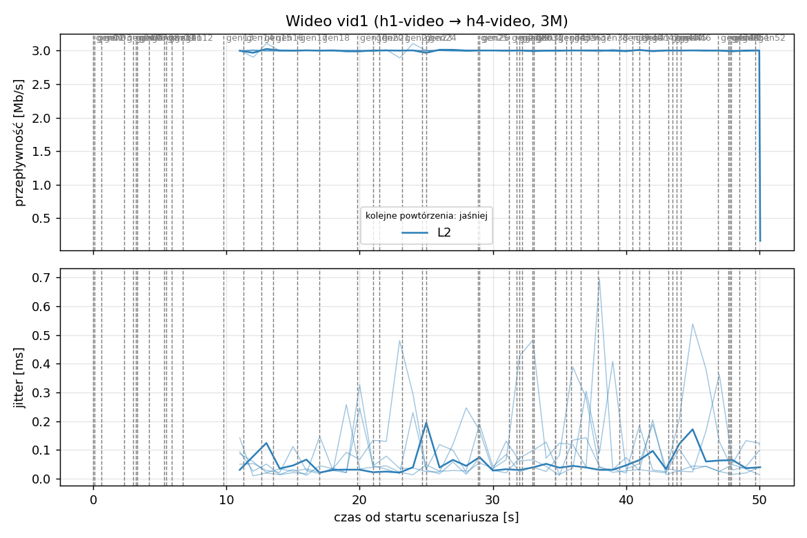
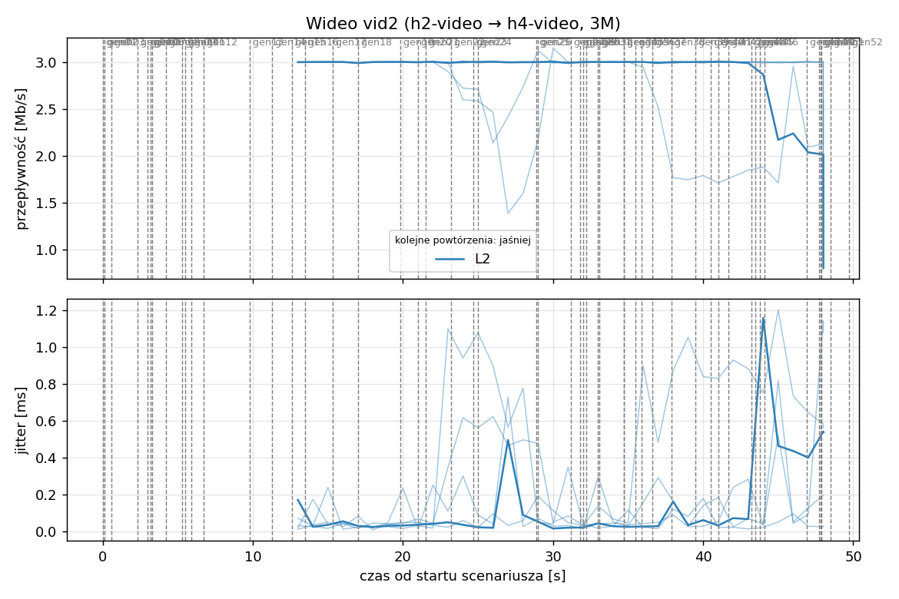
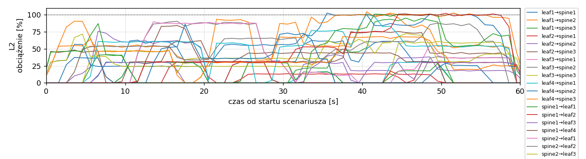
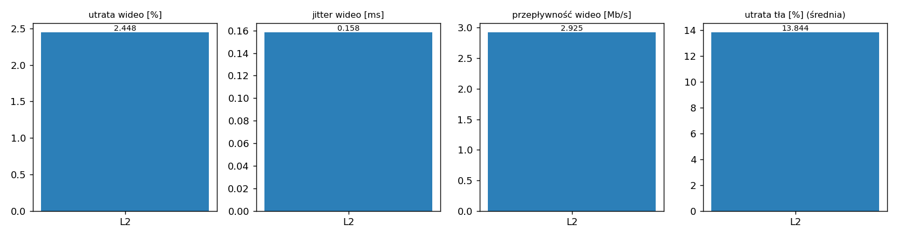

# Raport: layers-clos

Katalog: `results/layers-clos/20261102_034956`

## 1. Scenariusz

- Topologia: `sdn` (sdn: `clos-sdn.clab.yml`)
- Warianty: **L2** (LAYERS=2, POLICY=qos, RESERVE_PCT=70)
- Czas testu: 60 s, warmup (pomijany w statystykach, liczony od startu każdego przepływu): 5 s, powtórzeń: 5, seed: 42
- Wykonane przebiegi: L2/rep1, L2/rep2, L2/rep3, L2/rep4, L2/rep5

Harmonogram losowego tła różni się między powtórzeniami (seed + nr powtórzenia, wspólny dla wariantów); poniżej powtórzenie 1.

| id | klasa | źródło → cel | proto | zadana [Mb/s] | DSCP | start–koniec [s] |
|---|---|---|---|---|---|---|
| gen01 | background | h2-bg1 → h3-bg2 | udp | 4.49 | – | 0–7 |
| gen02 | background | h4-bg2 → h3-bg1 | udp | 3.16 | – | 0.1–5.1 |
| gen03 | background | h4-bg1 → h2-bg2 | udp | 5.25 | – | 0.6–5.6 |
| gen04 | background | h4-bg1 → h1-bg2 | udp | 3.56 | – | 2.3–7.3 |
| gen05 | background | h4-bg1 → h3-bg1 | udp | 2.36 | – | 3–60 |
| gen06 | background | h1-bg2 → h2-bg1 | udp | 1.93 | – | 3.2–16.2 |
| gen07 | background | h2-bg1 → h3-bg1 | udp | 1.39 | – | 3.3–8.3 |
| gen08 | background | h1-bg1 → h2-bg1 | udp | 3.29 | – | 4.2–32.2 |
| gen09 | background | h3-bg2 → h2-bg1 | udp | 4.51 | – | 5.3–16.3 |
| gen10 | background | h1-bg2 → h3-bg1 | udp | 3.96 | – | 5.5–10.5 |
| gen11 | background | h2-bg1 → h4-bg2 | udp | 5.85 | – | 5.9–19.9 |
| gen12 | background | h1-bg2 → h3-bg1 | udp | 4.90 | – | 6.7–16.7 |
| gen13 | background | h4-bg1 → h1-bg1 | udp | 3.07 | – | 9.8–19.8 |
| vid1 | video | h1-video → h4-video | udp | 3.00 | 46 | 10–50 |
| gen14 | background | h3-bg2 → h1-bg2 | udp | 5.37 | – | 11.3–27.3 |
| vid2 | video | h2-video → h4-video | udp | 3.00 | 46 | 12–48 |
| gen15 | background | h3-bg1 → h1-bg1 | udp | 3.12 | – | 12.6–30.6 |
| gen16 | background | h2-bg1 → h1-bg1 | udp | 4.96 | – | 13.5–18.5 |
| gen17 | background | h2-bg1 → h4-bg2 | udp | 4.86 | – | 15.3–20.3 |
| gen18 | background | h3-bg2 → h1-bg1 | udp | 3.49 | – | 17–36 |
| gen19 | background | h4-bg2 → h2-bg1 | udp | 2.93 | – | 19.8–48.8 |
| gen20 | background | h1-bg2 → h4-bg2 | udp | 5.68 | – | 21–26 |
| gen21 | background | h4-bg1 → h2-bg1 | udp | 3.04 | – | 21.5–35.5 |
| gen22 | background | h4-bg1 → h2-bg1 | udp | 3.69 | – | 23.2–28.2 |
| gen23 | background | h2-bg2 → h4-bg2 | udp | 1.26 | – | 24.7–44.7 |
| gen24 | background | h3-bg1 → h1-bg2 | udp | 4.88 | – | 25–31 |
| gen25 | background | h4-bg1 → h1-bg2 | udp | 3.51 | – | 28.9–33.9 |
| gen26 | background | h1-bg1 → h4-bg1 | udp | 5.23 | – | 29–59 |
| gen27 | background | h1-bg2 → h4-bg1 | udp | 2.10 | – | 31.2–37.2 |
| gen28 | background | h4-bg1 → h1-bg2 | udp | 1.54 | – | 31.8–36.8 |
| gen29 | background | h4-bg1 → h1-bg2 | udp | 1.53 | – | 32–39 |
| gen30 | background | h1-bg2 → h3-bg1 | udp | 3.69 | – | 32.2–38.2 |
| gen31 | background | h2-bg1 → h4-bg2 | udp | 2.18 | – | 33–38 |
| gen32 | background | h4-bg2 → h3-bg2 | udp | 5.19 | – | 33.1–59.1 |
| gen33 | background | h4-bg2 → h3-bg2 | udp | 2.60 | – | 34.7–40.7 |
| gen34 | background | h2-bg2 → h3-bg2 | udp | 1.75 | – | 34.7–59.7 |
| gen35 | background | h4-bg2 → h2-bg1 | udp | 5.89 | – | 35.5–54.5 |
| gen36 | background | h4-bg2 → h3-bg1 | udp | 4.62 | – | 35.9–49.9 |
| gen37 | background | h1-bg2 → h2-bg2 | udp | 4.50 | – | 36.6–50.6 |
| gen38 | background | h2-bg1 → h4-bg1 | udp | 4.23 | – | 37.9–58.9 |
| gen39 | background | h1-bg2 → h4-bg2 | udp | 5.93 | – | 39.5–44.5 |
| gen40 | background | h1-bg1 → h3-bg1 | udp | 5.99 | – | 40.5–45.5 |
| gen41 | background | h1-bg2 → h3-bg1 | udp | 4.47 | – | 41–50 |
| gen42 | background | h1-bg2 → h3-bg1 | udp | 2.82 | – | 41.7–48.7 |
| gen43 | background | h4-bg2 → h2-bg1 | udp | 4.98 | – | 43.2–49.2 |
| gen44 | background | h4-bg2 → h1-bg2 | udp | 5.97 | – | 43.5–50.5 |
| gen45 | background | h3-bg1 → h4-bg1 | udp | 5.74 | – | 43.8–58.8 |
| gen46 | background | h2-bg1 → h1-bg2 | udp | 1.89 | – | 44.1–49.1 |
| gen47 | background | h2-bg2 → h3-bg1 | udp | 2.94 | – | 46.9–59.9 |
| gen48 | background | h3-bg1 → h1-bg1 | udp | 3.58 | – | 47.7–59.7 |
| gen49 | background | h4-bg1 → h2-bg1 | udp | 5.93 | – | 47.8–57.8 |
| gen50 | background | h4-bg1 → h1-bg1 | udp | 3.20 | – | 47.9–54.9 |
| gen51 | background | h4-bg2 → h3-bg1 | udp | 1.53 | – | 48.5–59.5 |
| gen52 | background | h4-bg2 → h2-bg2 | udp | 2.44 | – | 49.7–59.7 |

## 2. Wideo: QoS według wariantu

Wartości: średnia ± odchylenie standardowe z powtórzeń.

| przepływ | wariant | przepływność [Mb/s] | jitter [ms] | utrata [%] | RTT mediana [ms] | RTT p95 [ms] |
|---|---|---|---|---|---|---|
| vid1 | L2 | 3.00 ± 0.00 | 0.087 ± 0.042 | 0.00 ± 0.00 | 0.029 ± 0.001 | 0.050 ± 0.005 |
| vid2 | L2 | 2.85 ± 0.23 | 0.230 ± 0.150 | 4.90 ± 7.65 | 0.029 ± 0.005 | 23.640 ± 52.749 |

RTT z `ping` co 0,1 s między hostami wideo (osobny przepływ ICMP z tym samym DSCP - w SDN może iść inną ścieżką niż strumień UDP).

## 3. Ruch tła

Agregat tła w obrębie powtórzenia, potem średnia ± odchylenie standardowe po powtórzeniach (utrata = Σ utraconych / Σ wysłanych datagramów; dostarczone = Σ przepływności / Σ zadanych; przepływy trwające nie dłużej niż warmup pominięte).

| wariant | strumieni tła / powt. | dostarczone / zadane [%] | jitter [ms] | utrata [%] |
|---|---|---|---|---|
| L2 | 40 | 86.3 ± 2.8 | 0.229 ± 0.083 | 13.84 ± 6.50 |

## 4. Obciążenie łączy fabricu

Średnia i maksimum z próbek co 1 s w oknie 0–60 s; MLU = maksymalne obciążenie łącza; drops = pakiety odrzucone przez `tbf` na wyjściu łącza.

| wariant | rep | średnie obciążenie łączy [%] | MLU [%] | łącza > 90% | drops tbf | CPU VM śr./maks. [%] |
|---|---|---|---|---|---|---|
| L2 | 1 | 32.9 | 104.5 | 8/24 | 13393 | 25 / 43 |
| L2 | 2 | 39.3 | 103.8 | 14/24 | 18303 | 27 / 52 |
| L2 | 3 | 44.4 | 104.7 | 13/24 | 43928 | 29 / 47 |
| L2 | 4 | 31.9 | 102.6 | 9/24 | 3812 | 25 / 42 |
| L2 | 5 | 33.8 | 102.9 | 11/24 | 10954 | 25 / 41 |

Łącza z obciążeniem > 10% (maksimum [%] / drops, powtórzenie 1):

| łącze | L2 |
|---|---|
| leaf1→spine1 | 63 / 0 |
| leaf1→spine2 | 104 / 1237 |
| leaf1→spine3 | 95 / 0 |
| leaf2→spine1 | 31 / 0 |
| leaf2→spine2 | 76 / 0 |
| leaf2→spine3 | 84 / 0 |
| leaf3→spine1 | 31 / 0 |
| leaf3→spine2 | 90 / 0 |
| leaf3→spine3 | 61 / 0 |
| leaf4→spine1 | 31 / 0 |
| leaf4→spine2 | 102 / 3603 |
| leaf4→spine3 | 103 / 5273 |
| spine1→leaf1 | 31 / 0 |
| spine1→leaf2 | 31 / 0 |
| spine1→leaf3 | 31 / 0 |
| spine1→leaf4 | 62 / 0 |
| spine2→leaf1 | 90 / 0 |
| spine2→leaf2 | 88 / 0 |
| spine2→leaf3 | 72 / 0 |
| spine2→leaf4 | 101 / 0 |
| spine3→leaf1 | 86 / 0 |
| spine3→leaf2 | 68 / 0 |
| spine3→leaf3 | 101 / 1854 |
| spine3→leaf4 | 102 / 1426 |

## 5. Ścieżki wybrane przez kontroler (powtórzenie 1)

Z logu kontrolera (linie `Flow`), dopasowane po piątce przepływu; ✓ = reguły widoczne w `dump-flows` na tych samych przełącznikach.

| przepływ | L2 |
|---|---|
| gen01 | leaf2 -> spine3 -> leaf3 ✓ (loads 0% 20% 0%) |
| gen02 | leaf4 -> spine2 -> leaf3 ✓ (loads 20% 20% 20%) |
| gen03 | leaf4 -> spine3 -> leaf2 ✓ (loads 20% 40% 20%) |
| gen04 | leaf4 -> spine3 -> leaf1 ✓ (loads 20% 90% 74%) |
| gen05 | leaf4 -> spine2 -> leaf3 ✓ (loads 16% 70% 102%) |
| gen06 | leaf1 -> spine2 -> leaf2 ✓ (loads 16% 0% 54%) |
| gen07 | leaf2 -> spine2 -> leaf3 ✓ (loads 16% 49% 62%) |
| gen08 | leaf1 -> spine2 -> leaf2 ✓ (loads 16% 56% 70%) |
| gen09 | leaf3 -> spine3 -> leaf2 ✓ (loads 29% 98% 70%) |
| gen10 | leaf1 -> spine3 -> leaf3 ✓ (loads 29% 104% 87%) |
| gen11 | leaf2 -> spine2 -> leaf4 ✓ (loads 23% 45% 59%) |
| gen12 | leaf1 -> spine1 -> leaf3 ✓ (loads 21% 54% 124%) |
| gen13 | leaf4 -> spine1 -> leaf1 ✓ (loads 0% 24% 7%) |
| vid1 | leaf1 -> spine1 -> leaf4 ✓ (loads 30% 60% 62%) |
| gen14 | leaf3 -> spine2 -> leaf1 ✓ (loads 69% 7% 47%) |
| vid2 | leaf2 -> spine3 -> leaf4 ✓ (loads 91% 60% 27%) |
| gen15 | leaf3 -> spine2 -> leaf1 ✓ (loads 60% 36% 47%) |
| gen16 | leaf2 -> spine3 -> leaf1 ✓ (loads 60% 80% 61%) |
| gen17 | leaf2 -> spine1 -> leaf4 ✓ (loads 61% 67% 95%) |
| gen18 | leaf3 -> spine3 -> leaf1 ✓ (loads 30% 87% 66%) |
| gen19 | leaf4 -> spine3 -> leaf2 ✓ (loads 30% 34% 7%) |
| gen20 | leaf1 -> spine2 -> leaf4 ✓ (loads 52% 41% 51%) |
| gen21 | leaf4 -> spine2 -> leaf2 ✓ (loads 19% 41% 45%) |
| gen22 | leaf4 -> spine1 -> leaf2 ✓ (loads 20% 78% 30%) |
| gen23 | leaf2 -> spine1 -> leaf4 ✓ (loads 37% 58% 43%) |
| gen24 | leaf3 -> spine1 -> leaf1 ✓ (loads 6% 87% 36%) |
| gen25 | leaf4 -> spine3 -> leaf1 ✓ (loads 30% 56% 50%) |
| gen26 | leaf1 -> spine2 -> leaf4 ✓ (loads 44% 40% 44%) |
| gen27 | leaf1 -> spine3 -> leaf4 ✓ (loads 52% 101% 44%) |
| gen28 | leaf4 -> spine1 -> leaf1 ✓ (loads 19% 72% 72%) |
| gen29 | leaf4 -> spine2 -> leaf1 ✓ (loads 26% 72% 79%) |
| gen30 | leaf1 -> spine1 -> leaf3 ✓ (loads 46% 88% 52%) |
| gen31 | leaf2 -> spine2 -> leaf4 ✓ (loads 59% 61% 81%) |
| gen32 | leaf4 -> spine3 -> leaf3 ✓ (loads 41% 89% 80%) |
| gen33 | leaf4 -> spine2 -> leaf3 ✓ (loads 30% 78% 108%) |
| gen34 | leaf2 -> spine2 -> leaf3 ✓ (loads 30% 44% 68%) |
| gen35 | leaf4 -> spine2 -> leaf2 ✓ (loads 30% 91% 108%) |
| gen36 | leaf4 -> spine3 -> leaf3 ✓ (loads 36% 131% 84%) |
| gen37 | leaf1 -> spine3 -> leaf2 ✓ (loads 61% 54% 36%) |
| gen38 | leaf2 -> spine3 -> leaf4 ✓ (loads 44% 83% 75%) |
| gen39 | leaf1 -> spine2 -> leaf4 ✓ (loads 54% 62% 74%) |
| gen40 | leaf1 -> spine1 -> leaf3 ✓ (loads 43% 68% 79%) |
| gen41 | leaf1 -> spine3 -> leaf3 ✓ (loads 60% 107% 80%) |
| gen42 | leaf1 -> spine2 -> leaf3 ✓ (loads 85% 107% 109%) |
| gen43 | leaf4 -> spine1 -> leaf2 ✓ (loads 7% 85% 100%) |
| gen44 | leaf4 -> spine1 -> leaf1 ✓ (loads 20% 85% 100%) |
| gen45 | leaf3 -> spine3 -> leaf4 ✓ (loads 57% 90% 89%) |
| gen46 | leaf2 -> spine2 -> leaf1 ✓ (loads 26% 26% 74%) |
| gen47 | leaf2 -> spine1 -> leaf3 ✓ (loads 9% 71% 100%) |
| gen48 | leaf3 -> spine2 -> leaf1 ✓ (loads 28% 19% 68%) |
| gen49 | leaf4 -> spine2 -> leaf2 ✓ (loads 30% 95% 100%) |
| gen50 | leaf4 -> spine3 -> leaf1 ✓ (loads 30% 116% 110%) |
| gen51 | leaf4 -> spine3 -> leaf3 ✓ (loads 57% 140% 133%) |
| gen52 | leaf4 -> spine3 -> leaf2 ✓ (loads 30% 163% 157%) |

## 6. Wnioski

<!-- WNIOSKI:START -->
_Do uzupełnienia: krótkie wnioski wyłącznie na podstawie liczb z sekcji 2–5._
<!-- WNIOSKI:END -->

## 7. Wiarygodność pomiaru

- L2 rep1, gen02: przepływ krótszy niż warmup - statystyki z całości
- L2 rep1, gen03: przepływ krótszy niż warmup - statystyki z całości
- L2 rep1, gen04: przepływ krótszy niż warmup - statystyki z całości
- L2 rep1, gen07: przepływ krótszy niż warmup - statystyki z całości
- L2 rep1, gen10: przepływ krótszy niż warmup - statystyki z całości
- L2 rep1, gen17: przepływ krótszy niż warmup - statystyki z całości
- L2 rep1, gen22: przepływ krótszy niż warmup - statystyki z całości
- L2 rep1, gen28: przepływ krótszy niż warmup - statystyki z całości
- L2 rep1, gen31: przepływ krótszy niż warmup - statystyki z całości
- L2 rep1, gen39: przepływ krótszy niż warmup - statystyki z całości
- L2 rep1, gen40: przepływ krótszy niż warmup - statystyki z całości
- L2 rep2, gen12: przepływ krótszy niż warmup - statystyki z całości
- L2 rep2, gen18: przepływ krótszy niż warmup - statystyki z całości
- L2 rep2, gen27: przepływ krótszy niż warmup - statystyki z całości
- L2 rep2, gen43: przepływ krótszy niż warmup - statystyki z całości
- L2 rep2, gen51: przepływ krótszy niż warmup - statystyki z całości
- L2 rep2, gen54: przepływ krótszy niż warmup - statystyki z całości
- L2 rep3, gen01: przepływ krótszy niż warmup - statystyki z całości
- L2 rep3, gen02: przepływ krótszy niż warmup - statystyki z całości
- L2 rep3, gen03: przepływ krótszy niż warmup - statystyki z całości
- L2 rep3, gen09: przepływ krótszy niż warmup - statystyki z całości
- L2 rep3, gen11: przepływ krótszy niż warmup - statystyki z całości
- L2 rep3, gen15: przepływ krótszy niż warmup - statystyki z całości
- L2 rep3, gen30: przepływ krótszy niż warmup - statystyki z całości
- L2 rep3, gen38: przepływ krótszy niż warmup - statystyki z całości
- L2 rep4, gen22: przepływ krótszy niż warmup - statystyki z całości
- L2 rep4, gen25: przepływ krótszy niż warmup - statystyki z całości
- L2 rep4, gen29: przepływ krótszy niż warmup - statystyki z całości
- L2 rep4, gen36: przepływ krótszy niż warmup - statystyki z całości
- L2 rep4, gen45: przepływ krótszy niż warmup - statystyki z całości
- L2 rep4, gen49: przepływ krótszy niż warmup - statystyki z całości
- L2 rep5, gen02: przepływ krótszy niż warmup - statystyki z całości
- L2 rep5, gen14: przepływ krótszy niż warmup - statystyki z całości
- L2 rep5, gen46: przepływ krótszy niż warmup - statystyki z całości
- L2 rep5, gen55: przepływ krótszy niż warmup - statystyki z całości
