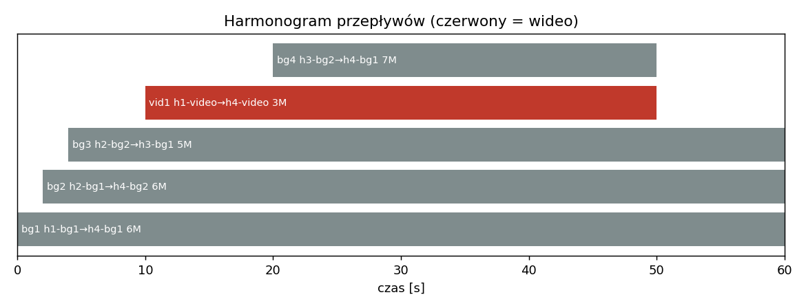
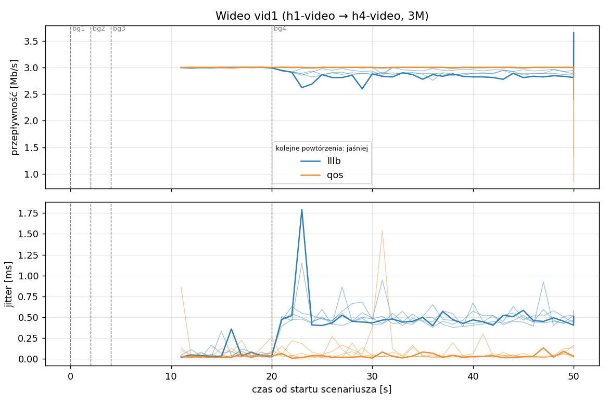
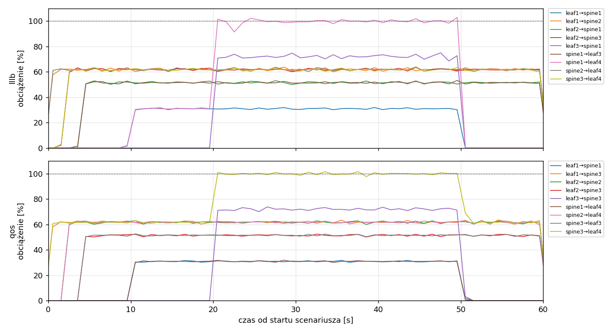
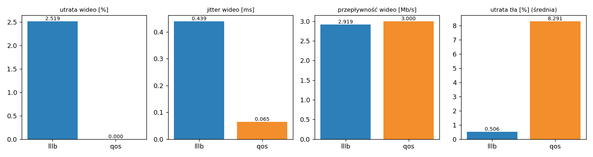

# Raport: lllb-vs-qos-basic

Katalog: `results/lllb-vs-qos-basic/20261030_210233`

## 1. Scenariusz

- Topologia: `sdn` (sdn: `sdn.clab.yaml`)
- Warianty: **lllb** (POLICY=lllb), **qos** (POLICY=qos)
- Czas testu: 60 s, warmup (pomijany w statystykach, liczony od startu każdego przepływu): 5 s, powtórzeń: 5, seed: 42
- Wykonane przebiegi: lllb/rep1, lllb/rep2, lllb/rep3, lllb/rep4, lllb/rep5, qos/rep1, qos/rep2, qos/rep3, qos/rep4, qos/rep5

| id | klasa | źródło → cel | proto | zadana [Mb/s] | DSCP | start–koniec [s] |
|---|---|---|---|---|---|---|
| bg1 | background | h1-bg1 → h4-bg1 | udp | 6.00 | – | 0–60 |
| bg2 | background | h2-bg1 → h4-bg2 | udp | 6.00 | – | 2–60 |
| bg3 | background | h2-bg2 → h3-bg1 | udp | 5.00 | – | 4–60 |
| vid1 | video | h1-video → h4-video | udp | 3.00 | 46 | 10–50 |
| bg4 | background | h3-bg2 → h4-bg1 | udp | 7.00 | – | 20–50 |

## 2. Wideo: QoS według wariantu

Wartości: średnia ± odchylenie standardowe z powtórzeń.

| przepływ | wariant | przepływność [Mb/s] | jitter [ms] | utrata [%] | RTT mediana [ms] | RTT p95 [ms] |
|---|---|---|---|---|---|---|
| vid1 | lllb | 2.92 ± 0.05 | 0.439 ± 0.022 | 2.52 ± 1.78 | 58.300 ± 0.000 | 59.500 ± 0.000 |
| vid1 | qos | 3.00 ± 0.00 | 0.065 ± 0.030 | 0.00 ± 0.00 | 0.031 ± 0.001 | 0.055 ± 0.009 |

RTT z `ping` co 0,1 s między hostami wideo (osobny przepływ ICMP z tym samym DSCP - w SDN może iść inną ścieżką niż strumień UDP).

## 3. Ruch tła

Agregat tła w obrębie powtórzenia, potem średnia ± odchylenie standardowe po powtórzeniach (utrata = Σ utraconych / Σ wysłanych datagramów; dostarczone = Σ przepływności / Σ zadanych; przepływy trwające nie dłużej niż warmup pominięte).

| wariant | strumieni tła / powt. | dostarczone / zadane [%] | jitter [ms] | utrata [%] |
|---|---|---|---|---|
| lllb | 4 | 99.1 ± 0.3 | 0.185 ± 0.006 | 0.51 ± 0.15 |
| qos | 4 | 88.9 ± 0.2 | 0.258 ± 0.009 | 8.29 ± 0.07 |

## 4. Obciążenie łączy fabricu

Średnia i maksimum z próbek co 1 s w oknie 0–60 s; MLU = maksymalne obciążenie łącza; drops = pakiety odrzucone przez `tbf` na wyjściu łącza.

| wariant | rep | średnie obciążenie łączy [%] | MLU [%] | łącza > 90% | drops tbf | CPU VM śr./maks. [%] |
|---|---|---|---|---|---|---|
| lllb | 1 | 18.8 | 102.8 | 1/24 | 855 | 15 / 58 |
| lllb | 2 | 18.8 | 101.9 | 1/24 | 772 | 12 / 19 |
| lllb | 3 | 18.8 | 101.6 | 1/24 | 780 | 13 / 35 |
| lllb | 4 | 18.8 | 103.0 | 1/24 | 741 | 12 / 19 |
| lllb | 5 | 18.8 | 101.6 | 1/24 | 759 | 13 / 45 |
| qos | 1 | 18.2 | 101.6 | 1/24 | 8757 | 13 / 22 |
| qos | 2 | 18.1 | 102.0 | 1/24 | 8852 | 15 / 33 |
| qos | 3 | 18.2 | 101.9 | 1/24 | 8757 | 12 / 20 |
| qos | 4 | 18.2 | 101.2 | 1/24 | 8793 | 12 / 27 |
| qos | 5 | 18.2 | 101.1 | 1/24 | 8773 | 12 / 23 |

Łącza z obciążeniem > 10% (maksimum [%] / drops, powtórzenie 1):

| łącze | lllb | qos |
|---|---|---|
| leaf1→spine1 | 32 / 0 | 32 / 0 |
| leaf1→spine2 | 64 / 0 | 0 / 0 |
| leaf1→spine3 | 0 / 0 | 64 / 0 |
| leaf2→spine1 | 53 / 0 | 0 / 0 |
| leaf2→spine2 | 0 / 0 | 63 / 0 |
| leaf2→spine3 | 63 / 0 | 52 / 0 |
| leaf3→spine1 | 75 / 10 | 0 / 0 |
| leaf3→spine2 | 0 / 0 | 0 / 0 |
| leaf3→spine3 | 0 / 0 | 74 / 0 |
| spine1→leaf3 | 53 / 0 | 0 / 0 |
| spine1→leaf4 | 103 / 845 | 32 / 0 |
| spine2→leaf3 | 0 / 0 | 0 / 0 |
| spine2→leaf4 | 63 / 0 | 63 / 0 |
| spine3→leaf3 | 0 / 0 | 53 / 0 |
| spine3→leaf4 | 64 / 0 | 102 / 8757 |

## 5. Ścieżki wybrane przez kontroler (powtórzenie 1)

Z logu kontrolera (linie `Flow`), dopasowane po piątce przepływu; ✓ = reguły widoczne w `dump-flows` na tych samych przełącznikach.

| przepływ | lllb | qos |
|---|---|---|
| bg1 | leaf1 -> spine2 -> leaf4 ✓ (loads 5% 0% 0%) | leaf1 -> spine3 -> leaf4 ✓ (loads 0% 5% 0%) |
| bg2 | leaf2 -> spine3 -> leaf4 ✓ (loads 5% 62% 0%) | leaf2 -> spine2 -> leaf4 ✓ (loads 0% 5% 62%) |
| bg3 | leaf2 -> spine1 -> leaf3 ✓ (loads 0% 5% 62%) | leaf2 -> spine3 -> leaf3 ✓ (loads 0% 62% 5%) |
| vid1 | leaf1 -> spine1 -> leaf4 ✓ (loads 5% 62% 62%) | leaf1 -> spine1 -> leaf4 ✓ (loads 0% 62% 67%) |
| bg4 | leaf3 -> spine1 -> leaf4 ✓ (loads 36% 62% 62%) | leaf3 -> spine3 -> leaf4 ✓ (loads 31% 67% 62%) |

## 6. Wnioski

<!-- WNIOSKI:START -->
1. **Wideo (sekcja 2): QoS całkowicie usuwa straty i skraca opóźnienie.** QoS: 0,00 ± 0,00% strat
   w 5/5 powtórzeń, jitter 0,065 ± 0,030 ms, 3,00 Mb/s; LLLB: 2,52 ± 1,78% strat, jitter
   0,439 ± 0,022 ms, 2,92 ± 0,05 Mb/s. RTT mediana: QoS 0,031 ms (p95 0,055 ms), LLLB 58,3 ms
   (p95 59,5 ms). W QoS ping (DSCP 46) idzie tą samą rezerwową ścieżką co wideo (spine1), w LLLB
   przez zapełnioną kolejkę `tbf` na spine1→leaf4.
2. **Przyczyna jest widoczna w ścieżkach (sekcja 5).** W LLLB bg4 (7 Mb/s, t = 20 s) trafia
   na spine1, czyli na łącze z wideo (loads 36% / 62% / 62%): spine1→leaf4 osiąga 103%
   i odrzuca 845 pakietów (rep. 1). W QoS wideo zajmuje spine1 (maks. 32%, 0 odrzuceń),
   a bg4 jako best-effort dostaje spine2 lub spine3.
3. **Cena: ruch tła traci znacznie więcej (sekcja 3).** Utrata tła: QoS 8,29 ± 0,07%, LLLB
   0,51 ± 0,15%; dostarczone/zadane: 88,9% vs 99,1%; jitter tła 0,258 vs 0,185 ms. Odrzucenia
   na `tbf` na przebieg: QoS 8757–8852, LLLB 741–855 (ok. 11 razy więcej).
4. **Skąd strata tła w QoS.** Best-effort ma do dyspozycji tylko spine2 i spine3. bg1, bg2 i bg4
   (6 + 6 + 7 Mb/s) muszą się zmieścić na dwóch łączach spine→leaf4, więc bg4 (7 Mb/s) trafia
   w każdym powtórzeniu na łącze z innym strumieniem 6 Mb/s (bg1 na spine3 w 5/5, bg4 na spine3
   w 4/5, na spine2 w 1/5) i oba łącza przekraczają 10 Mb/s. Jednocześnie spine1→leaf4 (rezerwa)
   ma maksymalnie 32% obciążenia, czyli ok. 7 Mb/s tej ścieżki nie jest wykorzystywane.
5. **Wniosek:** QoS przesuwa straty z klasy wideo na best-effort. Całkowita liczba odrzuceń
   rośnie ok. 11-krotnie, bo rezerwa nie jest „work-conserving” (best-effort nie może użyć
   wolnej części ścieżki rezerwowej, dopóki pozostałe nie osiągną 90%). Wideo jest chronione
   w 100% przebiegów, kosztem ok. 10 punktów procentowych strat tła.
6. **Zastrzeżenie dotyczące wiarygodności statystyki.** Scenariusz jest deterministyczny
   (te same przepływy i czasy w każdym powtórzeniu), więc małe odchylenia (np. ± 0,07%) opisują
   szum pomiarowy, a nie zmienność układu ruchu; wynik dotyczy tego jednego układu.
<!-- WNIOSKI:END -->

## 7. Wiarygodność pomiaru

- Brak zastrzeżeń wykrytych automatycznie.
