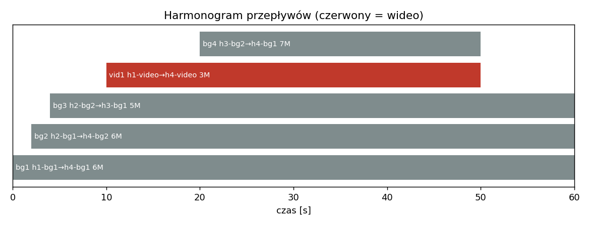
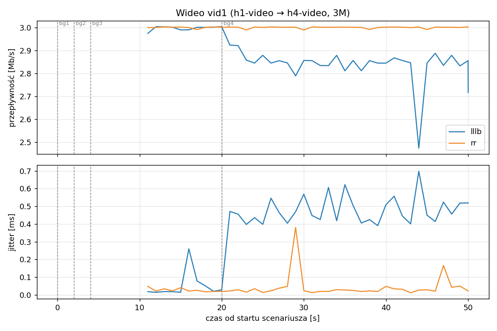
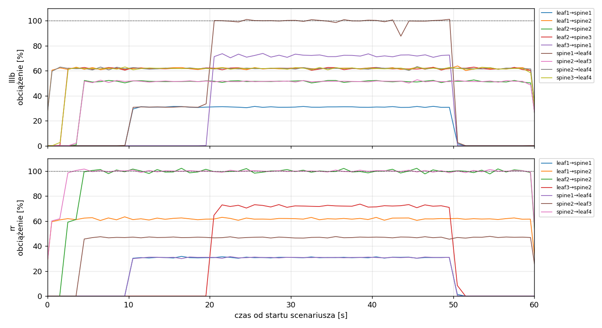
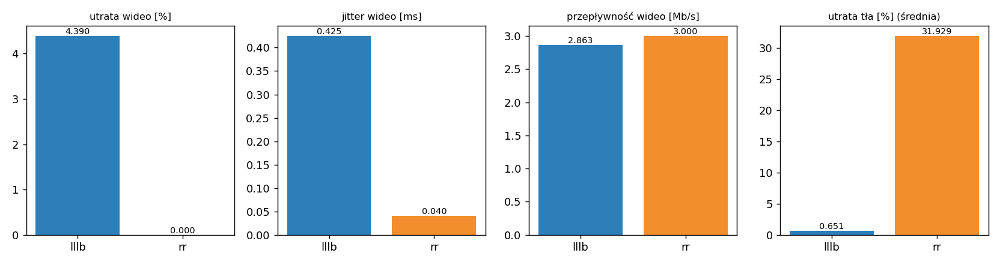

# Raport: lllb-vs-rr-basic

Katalog: `results/lllb-vs-rr-basic/20261030_172542`

## 1. Scenariusz

- Topologia: `sdn` (sdn: `sdn.clab.yaml`)
- Warianty: **lllb** (POLICY=lllb), **rr** (POLICY=rr)
- Czas testu: 60 s, warmup (pomijany w statystykach, liczony od startu każdego przepływu): 5 s, powtórzeń: 1, seed: 42
- Wykonane przebiegi: lllb/rep1, rr/rep1

| id | klasa | źródło → cel | proto | zadana [Mb/s] | DSCP | start–koniec [s] |
|---|---|---|---|---|---|---|
| bg1 | background | h1-bg1 → h4-bg1 | udp | 6.00 | – | 0–60 |
| bg2 | background | h2-bg1 → h4-bg2 | udp | 6.00 | – | 2–60 |
| bg3 | background | h2-bg2 → h3-bg1 | udp | 5.00 | – | 4–60 |
| vid1 | video | h1-video → h4-video | udp | 3.00 | 46 | 10–50 |
| bg4 | background | h3-bg2 → h4-bg1 | udp | 7.00 | – | 20–50 |

## 2. Wideo: QoS według wariantu

| przepływ | wariant | przepływność [Mb/s] | jitter [ms] | utrata [%] | RTT mediana [ms] | RTT p95 [ms] |
|---|---|---|---|---|---|---|
| vid1 | lllb | 2.86 | 0.425 | 4.39 | 58.300 | 59.500 |
| vid1 | rr | 3.00 | 0.040 | 0.00 | 59.300 | 59.500 |

RTT z `ping` co 0,1 s między hostami wideo (osobny przepływ ICMP z tym samym DSCP - w SDN może iść inną ścieżką niż strumień UDP).

## 3. Ruch tła

| przepływ | wariant | przepływność [Mb/s] | jitter [ms] | utrata [%] |
|---|---|---|---|---|
| bg1 | lllb | 6.00 | 0.035 | 0.00 |
| bg1 | rr | 4.02 | 0.537 | 32.99 |
| bg2 | lllb | 6.00 | 0.041 | 0.00 |
| bg2 | rr | 3.47 | 0.577 | 42.18 |
| bg3 | lllb | 5.00 | 0.034 | 0.00 |
| bg3 | rr | 4.56 | 0.430 | 8.81 |
| bg4 | lllb | 6.82 | 0.590 | 2.60 |
| bg4 | rr | 3.94 | 0.512 | 43.73 |

## 4. Obciążenie łączy fabricu

Średnia i maksimum z próbek co 1 s w oknie 0–60 s; MLU = maksymalne obciążenie łącza; drops = pakiety odrzucone przez `tbf` na wyjściu łącza.

| wariant | rep | średnie obciążenie łączy [%] | MLU [%] | łącza > 90% | drops tbf | CPU VM śr./maks. [%] |
|---|---|---|---|---|---|---|
| lllb | 1 | 18.8 | 101.1 | 1/24 | 858 | 11 / 35 |
| rr | 1 | 15.7 | 102.3 | 2/24 | 32756 | 10 / 19 |

Łącza z obciążeniem > 10% (maksimum [%] / drops, powtórzenie 1):

| łącze | lllb | rr |
|---|---|---|
| leaf1→spine1 | 32 / 0 | 32 / 0 |
| leaf1→spine2 | 64 / 0 | 63 / 0 |
| leaf2→spine2 | 53 / 0 | 102 / 6411 |
| leaf2→spine3 | 63 / 0 | 0 / 0 |
| leaf3→spine1 | 74 / 8 | 0 / 0 |
| leaf3→spine2 | 0 / 0 | 74 / 0 |
| spine1→leaf4 | 101 / 850 | 32 / 0 |
| spine2→leaf3 | 53 / 0 | 48 / 0 |
| spine2→leaf4 | 63 / 0 | 102 / 26345 |
| spine3→leaf4 | 63 / 0 | 0 / 0 |

## 5. Ścieżki wybrane przez kontroler

Z logu kontrolera (linie `Flow`), dopasowane po piątce przepływu; ✓ = reguły widoczne w `dump-flows` na tych samych przełącznikach.

| przepływ | lllb | rr |
|---|---|---|
| bg1 | leaf1 -> spine2 -> leaf4 ✓ (loads 5% 0% 0%) | leaf1 -> spine2 -> leaf4 ✓ (loads 0% 0% 0%) |
| bg2 | leaf2 -> spine3 -> leaf4 ✓ (loads 5% 62% 0%) | leaf2 -> spine2 -> leaf4 ✓ (loads 0% 62% 0%) |
| bg3 | leaf2 -> spine2 -> leaf3 ✓ (loads 5% 0% 62%) | leaf2 -> spine2 -> leaf3 ✓ (loads 0% 62% 0%) |
| vid1 | leaf1 -> spine1 -> leaf4 ✓ (loads 5% 62% 62%) | leaf1 -> spine1 -> leaf4 ✓ (loads 0% 100% 0%) |
| bg4 | leaf3 -> spine1 -> leaf4 ✓ (loads 36% 62% 62%) | leaf3 -> spine2 -> leaf4 ✓ (loads 31% 100% 0%) |

## 6. Wnioski

<!-- WNIOSKI:START -->
1. **Wideo (sekcja 2): lepszy wynik ma RR, ale z powodu miejsca na ścieżce, a nie algorytmu.**
   RR: 0,00% strat, jitter 0,040 ms; LLLB: 4,39% strat, jitter 0,425 ms. W obu wariantach
   wideo trafiło na spine1 (sekcja 5). W LLLB ten spine dostał w t = 20 s strumień bg4 (7 Mb/s):
   spine1→leaf4 osiągnął 101% i odrzucił 850 pakietów na `tbf` (sekcja 4), co dotknęło
   wideo (4,39%) i bg4 (2,60%). W RR spine1→leaf4 miał maksymalnie 32% (bg4 poszedł na
   spine2), więc wideo nie traciło pakietów.
2. **Ruch tła (sekcja 3): LLLB zachował praktycznie całe pasmo, RR nie.** Straty RR: bg1 32,99%,
   bg2 42,18%, bg3 8,81%, bg4 43,73%; LLLB: 0,00% / 0,00% / 0,00% / 2,60%. Przyczyna w RR:
   bg1 i bg2 (po 6 Mb/s) trafiły na to samo łącze spine2→leaf4 (102%, 26 345 drops), a bg2 i
   bg3 na leaf2→spine2 (102%, 6 411 drops). Suma odrzuceń na `tbf`: RR 32 756, LLLB 858
   (sekcja 4), czyli ok. 38 razy mniej w LLLB.
3. **Rozkład obciążenia (sekcja 4): LLLB ma wyższe średnie obciążenie łączy (18,8% vs 15,7%) przy
   podobnym MLU (101,1% vs 102,3%),** a w RR dwa łącza przekroczyły 90% (LLLB: jedno).
4. **Przyczyna 4,39% strat wideo w LLLB wynika z konstrukcji scenariusza.** Do bg4 w chwili
   startu (loads spine1/2/3 = 36% / 62% / 62%) kontroler wybrał spine1, czyli ścieżkę o
   najmniejszym obciążeniu wąskiego gardła. Łącze to niosło już wideo 3 Mb/s, więc po
   dodaniu 7 Mb/s (z nagłówkami ok. 7,2 Mb/s) suma przekroczyła 10 Mb/s. Pozostałe dwie
   ścieżki były obciążone po 62% (6 Mb/s), więc dodanie bg4 dałoby tam ok. 13 Mb/s.
   Wybór LLLB był więc najlepszym dostępnym dla bg4 przy znanej kolejności przepływów, ale
   nie chroni wideo, bo nie rozróżnia klas ruchu (loads w sekcji 5 nie zawierają DSCP).
5. **RTT (sekcja 2) nie jest porównywalne między wariantami.** Obie mediany to ok. 59 ms, co
   odpowiada zapełnionej kolejce `tbf` (`latency 50ms`) na przeciążonym łączu. Ping to osobny
   przepływ ICMP i w RR poszedł inną ścieżką niż wideo UDP (leaf1→spine2, łącze przeciążone
   do 100%; wideo UDP: spine1), więc 59 ms nie opisuje drogi wideo. W LLLB żądanie ICMP szło tą
   samą ścieżką co wideo (leaf1→spine1→leaf4, spine1→leaf4 przeciążone).
<!-- WNIOSKI:END -->

## 7. Wiarygodność pomiaru

- Brak zastrzeżeń wykrytych automatycznie.
- **Jedno powtórzenie na wariant: brak miary rozrzutu.** Różnice w wideo (4,39% vs 0,00%) wynikają
  z jednej kolejności startów strumieni; wniosek 1 dotyczy tego przebiegu, nie ogólnej własności
  algorytmów. Do pracy potrzeba co najmniej 5 powtórzeń.
- Pasmo wideo i bg4 w LLLB mieszczą się w limicie tylko w przybliżeniu: ramka UDP ma 1442 B przy
  datagramie 1400 B (narzut ok. 3%), więc 10 Mb/s po stronie iperf3 to ok. 10,3 Mb/s na łączu.
- Ping ICMP jest osobnym przepływem i w SDN zużywa krok RR oraz rezerwację LLLB; jego ścieżka
  może się różnić od ścieżki wideo (patrz wniosek 5).
