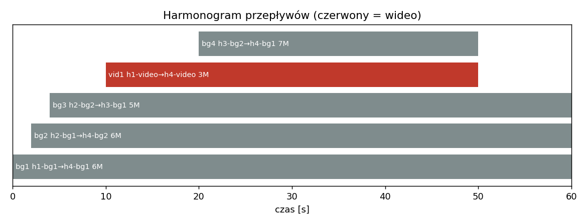
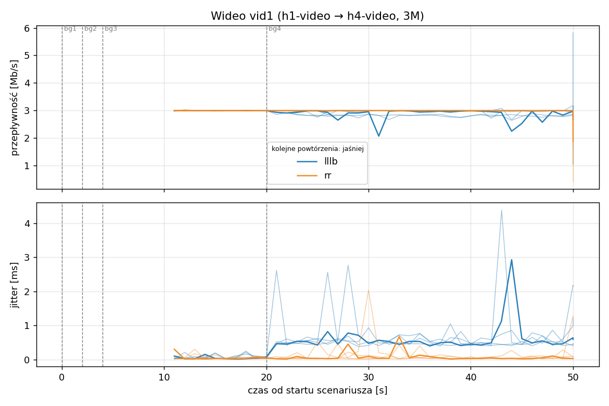
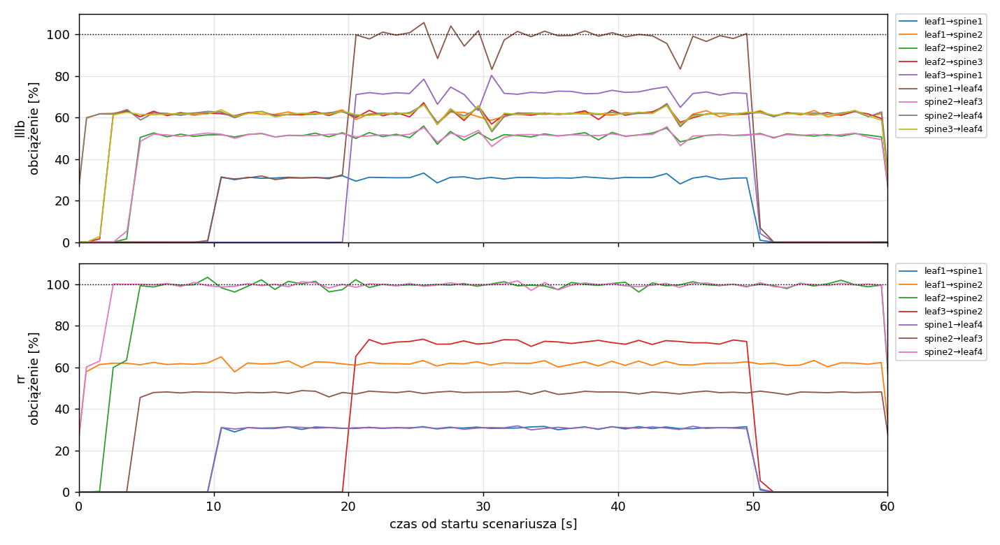
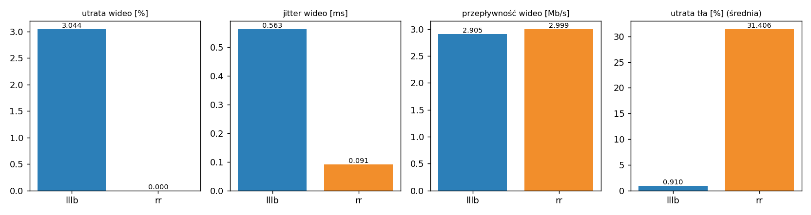

# Raport: lllb-vs-rr-basic

Katalog: `results/lllb-vs-rr-basic/20261030_173716`

## 1. Scenariusz

- Topologia: `sdn` (sdn: `sdn.clab.yaml`)
- Warianty: **lllb** (POLICY=lllb), **rr** (POLICY=rr)
- Czas testu: 60 s, warmup (pomijany w statystykach, liczony od startu każdego przepływu): 5 s, powtórzeń: 5, seed: 42
- Wykonane przebiegi: lllb/rep1, lllb/rep2, lllb/rep3, lllb/rep4, lllb/rep5, rr/rep1, rr/rep2, rr/rep3, rr/rep4, rr/rep5

| id | klasa | źródło → cel | proto | zadana [Mb/s] | DSCP | start–koniec [s] |
|---|---|---|---|---|---|---|
| bg1 | background | h1-bg1 → h4-bg1 | udp | 6.00 | – | 0–60 |
| bg2 | background | h2-bg1 → h4-bg2 | udp | 6.00 | – | 2–60 |
| bg3 | background | h2-bg2 → h3-bg1 | udp | 5.00 | – | 4–60 |
| vid1 | video | h1-video → h4-video | udp | 3.00 | 46 | 10–50 |
| bg4 | background | h3-bg2 → h4-bg1 | udp | 7.00 | – | 20–50 |

## 2. Wideo: QoS według wariantu

Wartości: średnia ± odchylenie standardowe z powtórzeń.

| przepływ | wariant | przepływność [Mb/s] | jitter [ms] | utrata [%] | RTT mediana [ms] | RTT p95 [ms] |
|---|---|---|---|---|---|---|
| vid1 | lllb | 2.90 ± 0.06 | 0.563 ± 0.084 | 3.04 ± 2.10 | 58.300 ± 0.000 | 59.560 ± 0.195 |
| vid1 | rr | 3.00 ± 0.00 | 0.091 ± 0.032 | 0.00 ± 0.00 | 59.260 ± 0.055 | 59.540 ± 0.089 |

RTT z `ping` co 0,1 s między hostami wideo (osobny przepływ ICMP z tym samym DSCP - w SDN może iść inną ścieżką niż strumień UDP).

## 3. Ruch tła

| przepływ | wariant | przepływność [Mb/s] | jitter [ms] | utrata [%] |
|---|---|---|---|---|
| bg1 | lllb | 6.00 ± 0.01 | 0.089 ± 0.042 | 0.07 ± 0.11 |
| bg1 | rr | 4.17 ± 0.23 | 0.649 ± 0.078 | 30.50 ± 3.88 |
| bg2 | lllb | 6.00 ± 0.00 | 0.117 ± 0.084 | 0.03 ± 0.04 |
| bg2 | rr | 3.35 ± 0.24 | 0.799 ± 0.129 | 44.15 ± 3.96 |
| bg3 | lllb | 5.00 ± 0.00 | 0.088 ± 0.034 | 0.01 ± 0.03 |
| bg3 | rr | 4.68 ± 0.03 | 0.474 ± 0.071 | 6.34 ± 0.66 |
| bg4 | lllb | 6.75 ± 0.09 | 0.692 ± 0.148 | 3.53 ± 1.28 |
| bg4 | rr | 3.88 ± 0.21 | 0.622 ± 0.122 | 44.63 ± 2.95 |

## 4. Obciążenie łączy fabricu

Średnia i maksimum z próbek co 1 s w oknie 0–60 s; MLU = maksymalne obciążenie łącza; drops = pakiety odrzucone przez `tbf` na wyjściu łącza.

| wariant | rep | średnie obciążenie łączy [%] | MLU [%] | łącza > 90% | drops tbf | CPU VM śr./maks. [%] |
|---|---|---|---|---|---|---|
| lllb | 1 | 18.7 | 105.7 | 1/24 | 1205 | 14 / 54 |
| lllb | 2 | 18.8 | 101.5 | 1/24 | 789 | 11 / 18 |
| lllb | 3 | 18.7 | 103.3 | 1/24 | 949 | 13 / 40 |
| lllb | 4 | 18.8 | 104.1 | 1/24 | 835 | 14 / 34 |
| lllb | 5 | 18.8 | 102.8 | 1/24 | 841 | 12 / 24 |
| rr | 1 | 15.7 | 103.4 | 2/24 | 32399 | 12 / 21 |
| rr | 2 | 15.8 | 104.8 | 2/24 | 31946 | 11 / 20 |
| rr | 3 | 15.7 | 112.4 | 2/24 | 32302 | 13 / 34 |
| rr | 4 | 15.7 | 103.3 | 2/24 | 32593 | 13 / 37 |
| rr | 5 | 15.8 | 102.4 | 2/24 | 32124 | 11 / 25 |

Łącza z obciążeniem > 10% (maksimum [%] / drops, powtórzenie 1):

| łącze | lllb | rr |
|---|---|---|
| leaf1→spine1 | 33 / 0 | 32 / 0 |
| leaf1→spine2 | 66 / 33 | 65 / 0 |
| leaf2→spine2 | 56 / 15 | 103 / 6535 |
| leaf2→spine3 | 67 / 17 | 0 / 0 |
| leaf3→spine1 | 80 / 33 | 0 / 0 |
| leaf3→spine2 | 0 / 0 | 74 / 0 |
| spine1→leaf4 | 106 / 1107 | 32 / 0 |
| spine2→leaf3 | 56 / 0 | 49 / 0 |
| spine2→leaf4 | 67 / 0 | 102 / 25864 |
| spine3→leaf4 | 66 / 0 | 0 / 0 |

## 5. Ścieżki wybrane przez kontroler

Z logu kontrolera (linie `Flow`), dopasowane po piątce przepływu; ✓ = reguły widoczne w `dump-flows` na tych samych przełącznikach.

| przepływ | lllb | rr |
|---|---|---|
| bg1 | leaf1 -> spine2 -> leaf4 ✓ (loads 5% 0% 0%) | leaf1 -> spine2 -> leaf4 ✓ (loads 0% 0% 0%) |
| bg2 | leaf2 -> spine3 -> leaf4 ✓ (loads 5% 62% 0%) | leaf2 -> spine2 -> leaf4 ✓ (loads 0% 62% 0%) |
| bg3 | leaf2 -> spine2 -> leaf3 ✓ (loads 5% 0% 62%) | leaf2 -> spine2 -> leaf3 ✓ (loads 0% 62% 0%) |
| vid1 | leaf1 -> spine1 -> leaf4 ✓ (loads 5% 62% 62%) | leaf1 -> spine1 -> leaf4 ✓ (loads 0% 100% 0%) |
| bg4 | leaf3 -> spine1 -> leaf4 ✓ (loads 36% 62% 62%) | leaf3 -> spine2 -> leaf4 ✓ (loads 31% 97% 0%) |

## 6. Wnioski

<!-- WNIOSKI:START -->
1. **Wideo (sekcja 2): w tym scenariuszu RR ochronił wideo, LLLB nie.** RR: 0,00% strat w 5/5
   powtórzeń, jitter 0,091 ± 0,032 ms. LLLB: 3,04 ± 2,10% strat (zakres 0,55–4,96% w
   poszczególnych powtórzeniach), jitter 0,563 ± 0,084 ms, przepustowość 2,90 ± 0,06 Mb/s.
2. **Przyczyna jest stała i widoczna w danych.** Kontroler wybierał te same ścieżki w 5/5
   powtórzeń każdego wariantu (flows.csv). Wideo poszło w obu wariantach przez spine1; w LLLB
   do tego samego łącza trafił bg4 (loads spine1/2/3 = 36% / 62% / 62%, wybrany spine1), więc
   spine1→leaf4 osiągnęło maksymalnie 106% i odrzuciło 1107 pakietów na `tbf` (rep. 1).
   W RR bg4 poszedł na spine2, a spine1→leaf4 miał maksymalnie 32%.
3. **Ruch tła (sekcja 3): LLLB zachowuje pasmo, RR traci je masowo.** Straty bg1/bg2/bg3/bg4:
   LLLB 0,07 / 0,03 / 0,01 / 3,53%; RR 30,50 / 44,15 / 6,34 / 44,63%. Pasmo bg2 w RR spadło
   do 3,35 ± 0,24 Mb/s przy zadanych 6 Mb/s.
4. **Obciążenie łączy (sekcja 4):** suma odrzuceń na `tbf` w przebiegu: RR 31 946–32 593,
   LLLB 789–1205 (ok. 27–40 razy mniej). Średnie obciążenie łączy: LLLB 18,7–18,8%, RR
   15,7–15,8%, czyli LLLB wykorzystuje więcej pasma fabricu do przesłania większej ilości
   danych. MLU w obu wariantach 101–112%. W RR dwa łącza przekraczają 90% w każdym
   powtórzeniu (spine2→leaf4: bg1 + bg2 = 12 Mb/s oraz leaf2→spine2: bg2 + bg3), w LLLB jedno
   (spine1→leaf4).
5. **Ocena wariantów zależy od celu.** Dla całego ruchu LLLB jest wyraźnie lepszy (27–40 razy
   mniej odrzuceń na `tbf`, straty tła poniżej 0,1% oprócz bg4). Dla klasy wideo w tym scenariuszu lepszy jest RR, ale
   zawdzięcza to układowi (bg4 poszedł na inny spine), a nie rozpoznaniu klasy ruchu: kontroler
   w obu wariantach nie czyta DSCP. W LLLB straty wideo powstały, bo wideo i bg4 dzieliły łącze.
6. **RTT (59 ms w RR, 58 ms w LLLB, odch. ≤ 0,06 ms) nie rozróżnia wariantów.** Wartość
   odpowiada zapełnionej kolejce `tbf` (`latency 50ms`) na przeciążonym łączu, a ping to osobny
   przepływ ICMP, który może iść inną ścieżką niż wideo UDP.
<!-- WNIOSKI:END -->

## 7. Wiarygodność pomiaru

- Brak zastrzeżeń wykrytych automatycznie.
- **Powtórzenia nie badają zmienności decyzji kontrolera.** Scenariusz jest deterministyczny
  (stałe starty, bez losowości): ścieżki były identyczne w 5/5 powtórzeń obu wariantów, więc
  odchylenie standardowe opisuje tylko szum pomiarowy i fazę kolejki `tbf`, a nie rozrzut
  wyborów algorytmu. Wniosek o wyższości RR dla wideo dotyczy tego jednego układu przepływów.
  Uogólnienie wymaga scenariuszy z losową kolejnością i czasem startu (`generator`).
- Tabela łączy w sekcji 4 dotyczy tylko powtórzenia 1 (wartości `loads` w sekcji 5 też pochodzą
  z jednego powtórzenia); wybrane ścieżki były w pozostałych powtórzeniach identyczne.
