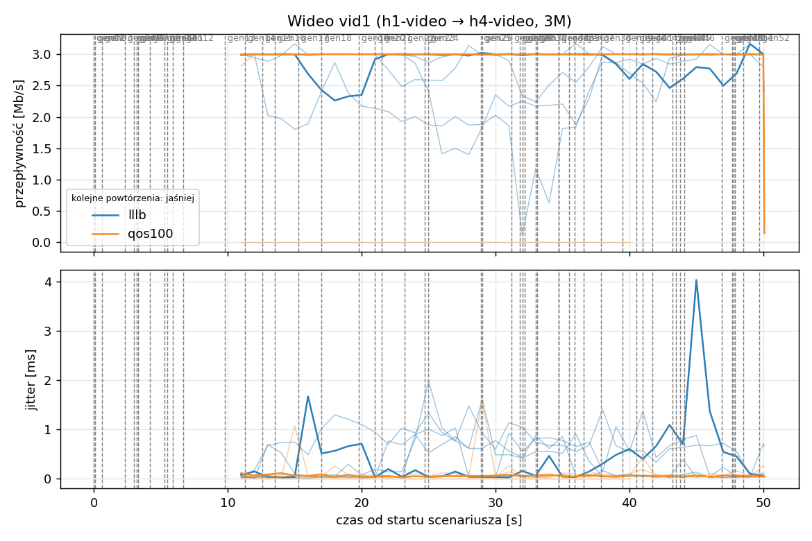
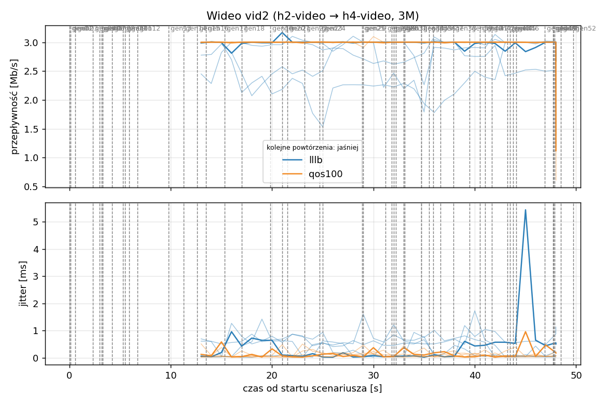
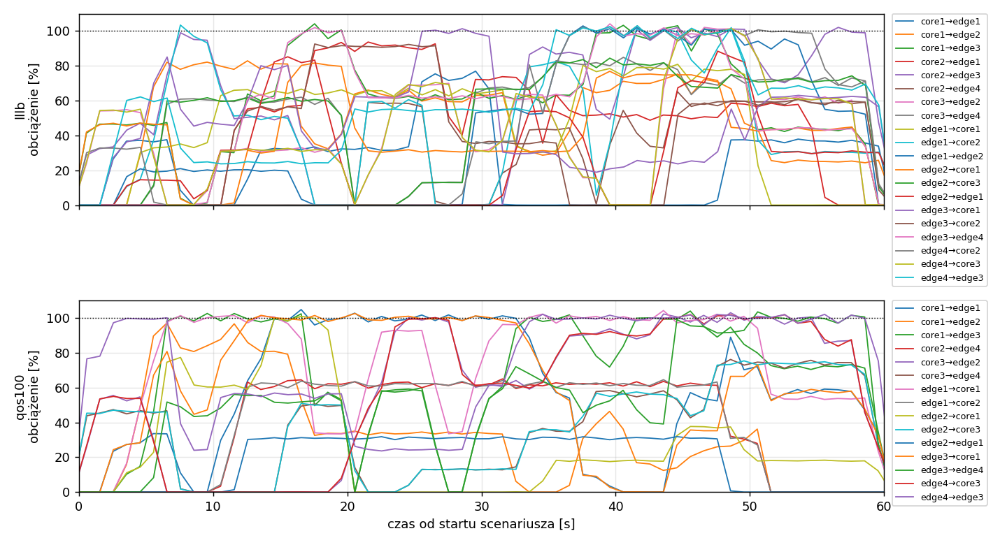
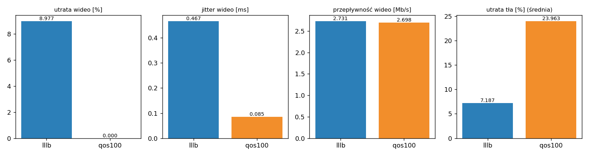

# Raport: mesh-lllb-vs-qos

Katalog: `results/mesh-lllb-vs-qos/20261101_220240`

## 1. Scenariusz

- Topologia: `mesh` (sdn: `mesh-sdn.clab.yml`)
- Warianty: **lllb** (POLICY=lllb), **qos100** (POLICY=qos, RESERVE_PCT=100)
- Czas testu: 60 s, warmup (pomijany w statystykach, liczony od startu każdego przepływu): 5 s, powtórzeń: 5, seed: 42
- Wykonane przebiegi: lllb/rep1, lllb/rep2, lllb/rep3, lllb/rep4, lllb/rep5, qos100/rep1, qos100/rep2, qos100/rep3, qos100/rep4, qos100/rep5

Harmonogram losowego tła różni się między powtórzeniami (seed + nr powtórzenia, wspólny dla wariantów); poniżej powtórzenie 1.

| id | klasa | źródło → cel | proto | zadana [Mb/s] | DSCP | start–koniec [s] |
|---|---|---|---|---|---|---|
| gen01 | background | h2-bg1 → h3-bg2 | udp | 4.49 | – | 0–7 |
| gen02 | background | h4-bg2 → h3-bg1 | udp | 3.16 | – | 0.1–5.1 |
| gen03 | background | h4-bg1 → h2-bg2 | udp | 5.25 | – | 0.6–5.6 |
| gen04 | background | h4-bg1 → h1-bg2 | udp | 3.56 | – | 2.3–7.3 |
| gen05 | background | h4-bg1 → h3-bg1 | udp | 2.36 | – | 3–60 |
| gen06 | background | h1-bg2 → h2-bg1 | udp | 1.93 | – | 3.2–16.2 |
| gen07 | background | h2-bg1 → h3-bg1 | udp | 1.39 | – | 3.3–8.3 |
| gen08 | background | h1-bg1 → h2-bg1 | udp | 3.29 | – | 4.2–32.2 |
| gen09 | background | h3-bg2 → h2-bg1 | udp | 4.51 | – | 5.3–16.3 |
| gen10 | background | h1-bg2 → h3-bg1 | udp | 3.96 | – | 5.5–10.5 |
| gen11 | background | h2-bg1 → h4-bg2 | udp | 5.85 | – | 5.9–19.9 |
| gen12 | background | h1-bg2 → h3-bg1 | udp | 4.90 | – | 6.7–16.7 |
| gen13 | background | h4-bg1 → h1-bg1 | udp | 3.07 | – | 9.8–19.8 |
| vid1 | video | h1-video → h4-video | udp | 3.00 | 46 | 10–50 |
| gen14 | background | h3-bg2 → h1-bg2 | udp | 5.37 | – | 11.3–27.3 |
| vid2 | video | h2-video → h4-video | udp | 3.00 | 46 | 12–48 |
| gen15 | background | h3-bg1 → h1-bg1 | udp | 3.12 | – | 12.6–30.6 |
| gen16 | background | h2-bg1 → h1-bg1 | udp | 4.96 | – | 13.5–18.5 |
| gen17 | background | h2-bg1 → h4-bg2 | udp | 4.86 | – | 15.3–20.3 |
| gen18 | background | h3-bg2 → h1-bg1 | udp | 3.49 | – | 17–36 |
| gen19 | background | h4-bg2 → h2-bg1 | udp | 2.93 | – | 19.8–48.8 |
| gen20 | background | h1-bg2 → h4-bg2 | udp | 5.68 | – | 21–26 |
| gen21 | background | h4-bg1 → h2-bg1 | udp | 3.04 | – | 21.5–35.5 |
| gen22 | background | h4-bg1 → h2-bg1 | udp | 3.69 | – | 23.2–28.2 |
| gen23 | background | h2-bg2 → h4-bg2 | udp | 1.26 | – | 24.7–44.7 |
| gen24 | background | h3-bg1 → h1-bg2 | udp | 4.88 | – | 25–31 |
| gen25 | background | h4-bg1 → h1-bg2 | udp | 3.51 | – | 28.9–33.9 |
| gen26 | background | h1-bg1 → h4-bg1 | udp | 5.23 | – | 29–59 |
| gen27 | background | h1-bg2 → h4-bg1 | udp | 2.10 | – | 31.2–37.2 |
| gen28 | background | h4-bg1 → h1-bg2 | udp | 1.54 | – | 31.8–36.8 |
| gen29 | background | h4-bg1 → h1-bg2 | udp | 1.53 | – | 32–39 |
| gen30 | background | h1-bg2 → h3-bg1 | udp | 3.69 | – | 32.2–38.2 |
| gen31 | background | h2-bg1 → h4-bg2 | udp | 2.18 | – | 33–38 |
| gen32 | background | h4-bg2 → h3-bg2 | udp | 5.19 | – | 33.1–59.1 |
| gen33 | background | h4-bg2 → h3-bg2 | udp | 2.60 | – | 34.7–40.7 |
| gen34 | background | h2-bg2 → h3-bg2 | udp | 1.75 | – | 34.7–59.7 |
| gen35 | background | h4-bg2 → h2-bg1 | udp | 5.89 | – | 35.5–54.5 |
| gen36 | background | h4-bg2 → h3-bg1 | udp | 4.62 | – | 35.9–49.9 |
| gen37 | background | h1-bg2 → h2-bg2 | udp | 4.50 | – | 36.6–50.6 |
| gen38 | background | h2-bg1 → h4-bg1 | udp | 4.23 | – | 37.9–58.9 |
| gen39 | background | h1-bg2 → h4-bg2 | udp | 5.93 | – | 39.5–44.5 |
| gen40 | background | h1-bg1 → h3-bg1 | udp | 5.99 | – | 40.5–45.5 |
| gen41 | background | h1-bg2 → h3-bg1 | udp | 4.47 | – | 41–50 |
| gen42 | background | h1-bg2 → h3-bg1 | udp | 2.82 | – | 41.7–48.7 |
| gen43 | background | h4-bg2 → h2-bg1 | udp | 4.98 | – | 43.2–49.2 |
| gen44 | background | h4-bg2 → h1-bg2 | udp | 5.97 | – | 43.5–50.5 |
| gen45 | background | h3-bg1 → h4-bg1 | udp | 5.74 | – | 43.8–58.8 |
| gen46 | background | h2-bg1 → h1-bg2 | udp | 1.89 | – | 44.1–49.1 |
| gen47 | background | h2-bg2 → h3-bg1 | udp | 2.94 | – | 46.9–59.9 |
| gen48 | background | h3-bg1 → h1-bg1 | udp | 3.58 | – | 47.7–59.7 |
| gen49 | background | h4-bg1 → h2-bg1 | udp | 5.93 | – | 47.8–57.8 |
| gen50 | background | h4-bg1 → h1-bg1 | udp | 3.20 | – | 47.9–54.9 |
| gen51 | background | h4-bg2 → h3-bg1 | udp | 1.53 | – | 48.5–59.5 |
| gen52 | background | h4-bg2 → h2-bg2 | udp | 2.44 | – | 49.7–59.7 |

## 2. Wideo: QoS według wariantu

Wartości: średnia ± odchylenie standardowe z powtórzeń.

| przepływ | wariant | przepływność [Mb/s] | jitter [ms] | utrata [%] | RTT mediana [ms] | RTT p95 [ms] |
|---|---|---|---|---|---|---|
| vid1 | lllb | 2.71 ± 0.27 | 0.480 ± 0.182 | 9.77 ± 9.12 | 53.050 ± 12.060 | 127.000 ± 28.098 |
| vid1 | qos100 | 2.40 ± 1.34 | 0.059 ± 0.039 | 0.00 ± 0.00 | 0.032 ± 0.003 | 0.063 ± 0.015 |
| vid2 | lllb | 2.76 ± 0.26 | 0.453 ± 0.081 | 8.18 ± 8.66 | 45.616 ± 49.043 | 128.058 ± 83.528 |
| vid2 | qos100 | 3.00 ± 0.00 | 0.111 ± 0.040 | 0.00 ± 0.00 | 0.034 ± 0.002 | 0.073 ± 0.019 |

RTT z `ping` co 0,1 s między hostami wideo (osobny przepływ ICMP z tym samym DSCP - w SDN może iść inną ścieżką niż strumień UDP).

## 3. Ruch tła

Agregat tła w obrębie powtórzenia, potem średnia ± odchylenie standardowe po powtórzeniach (utrata = Σ utraconych / Σ wysłanych datagramów; dostarczone = Σ przepływności / Σ zadanych; przepływy trwające nie dłużej niż warmup pominięte).

| wariant | strumieni tła / powt. | dostarczone / zadane [%] | jitter [ms] | utrata [%] |
|---|---|---|---|---|
| lllb | 40 | 92.7 ± 3.0 | 0.280 ± 0.077 | 7.19 ± 2.59 |
| qos100 | 40 | 75.4 ± 8.4 | 0.467 ± 0.093 | 23.96 ± 10.98 |

## 4. Obciążenie łączy fabricu

Średnia i maksimum z próbek co 1 s w oknie 0–60 s; MLU = maksymalne obciążenie łącza; drops = pakiety odrzucone przez `tbf` na wyjściu łącza.

| wariant | rep | średnie obciążenie łączy [%] | MLU [%] | łącza > 90% | drops tbf | CPU VM śr./maks. [%] |
|---|---|---|---|---|---|---|
| lllb | 1 | 38.4 | 104.2 | 12/24 | 17123 | 30 / 60 |
| lllb | 2 | 41.7 | 104.1 | 18/24 | 24228 | 28 / 53 |
| lllb | 3 | 48.6 | 105.3 | 17/24 | 35952 | 32 / 50 |
| lllb | 4 | 36.5 | 103.4 | 15/24 | 7839 | 24 / 40 |
| lllb | 5 | 40.3 | 104.0 | 16/24 | 14317 | 25 / 41 |
| qos100 | 1 | 31.1 | 104.9 | 10/24 | 44377 | 28 / 53 |
| qos100 | 2 | 32.0 | 105.9 | 11/24 | 80493 | 31 / 63 |
| qos100 | 3 | 39.9 | 104.3 | 9/24 | 112310 | 29 / 46 |
| qos100 | 4 | 31.2 | 104.0 | 10/24 | 36062 | 24 / 40 |
| qos100 | 5 | 32.8 | 104.0 | 9/24 | 33022 | 25 / 40 |

Łącza z obciążeniem > 10% (maksimum [%] / drops, powtórzenie 1):

| łącze | lllb | qos100 |
|---|---|---|
| core1→core3 | 0 / 0 | 0 / 0 |
| core1→edge1 | 77 / 0 | 105 / 1367 |
| core1→edge2 | 83 / 0 | 97 / 0 |
| core1→edge3 | 104 / 973 | 104 / 1708 |
| core2→edge1 | 94 / 0 | 0 / 0 |
| core2→edge3 | 102 / 2035 | 0 / 0 |
| core2→edge4 | 65 / 0 | 65 / 0 |
| core3→edge2 | 102 / 0 | 103 / 0 |
| core3→edge4 | 85 / 0 | 76 / 0 |
| edge1→core1 | 81 / 0 | 104 / 13429 |
| edge1→core2 | 103 / 3049 | 65 / 0 |
| edge1→edge2 | 103 / 599 | 0 / 0 |
| edge2→core1 | 82 / 0 | 101 / 448 |
| edge2→core3 | 84 / 0 | 75 / 0 |
| edge2→edge1 | 88 / 0 | 32 / 0 |
| edge3→core1 | 101 / 546 | 103 / 7006 |
| edge3→core2 | 93 / 0 | 0 / 0 |
| edge3→edge4 | 104 / 0 | 104 / 952 |
| edge4→core2 | 103 / 5001 | 0 / 0 |
| edge4→core3 | 101 / 1529 | 102 / 4370 |
| edge4→edge3 | 103 / 3391 | 102 / 15097 |

## 5. Ścieżki wybrane przez kontroler (powtórzenie 1)

Z logu kontrolera (linie `Flow`), dopasowane po piątce przepływu; ✓ = reguły widoczne w `dump-flows` na tych samych przełącznikach.

| przepływ | lllb | qos100 |
|---|---|---|
| gen01 | edge2 -> core1 -> edge3 ✓ (loads 5% 5% 5% 5%) | edge2 -> core3 -> edge4 -> edge3 ✓ (loads 5% 5% 0% 0%) |
| gen02 | edge4 -> core2 -> edge3 ✓ (loads 5% 0%) | edge4 -> edge3 ✓ (loads 10% 0%) |
| gen03 | edge4 -> core3 -> edge2 ✓ (loads 5% 10% 5% 5%) | edge4 -> core3 -> edge2 ✓ (loads 10% 15% 0% 10%) |
| gen04 | edge4 -> edge3 -> core1 -> edge1 ✓ (loads 33% 5% 5% 54%) | edge4 -> edge3 -> core1 -> edge1 ✓ (loads 0% 84% 84% 54%) |
| gen05 | edge4 -> edge3 ✓ (loads 15% 33%) | edge4 -> edge3 ✓ (loads 91% 0%) |
| gen06 | edge1 -> edge2 ✓ (loads 0% 5%) | edge1 -> core1 -> edge2 ✓ (loads 0% 5%) |
| gen07 | edge2 -> edge1 -> core2 -> edge3 ✓ (loads 46% 46% 32% 33%) | edge2 -> core1 -> edge3 ✓ (loads 15% 10% 0% 96%) |
| gen08 | edge1 -> core1 -> edge2 ✓ (loads 16% 5%) | edge1 -> core1 -> edge2 ✓ (loads 0% 13%) |
| gen09 | edge3 -> core1 -> edge2 ✓ (loads 42% 54% 42% 54%) | edge3 -> core1 -> edge2 ✓ (loads 39% 54% 32% 54%) |
| gen10 | edge1 -> core2 -> edge3 ✓ (loads 56% 52% 56% 61%) | edge1 -> core1 -> edge3 ✓ (loads 39% 0% 29% 100%) |
| gen11 | edge2 -> core3 -> edge4 ✓ (loads 5% 24% 56% 51%) | edge2 -> core1 -> edge3 -> edge4 ✓ (loads 46% 0% 24% 46%) |
| gen12 | edge1 -> core2 -> edge3 ✓ (loads 46% 45% 46% 61%) | edge1 -> core1 -> edge3 ✓ (loads 99% 0% 93% 100%) |
| gen13 | edge4 -> core3 -> edge2 -> edge1 ✓ (loads 5% 47% 24% 3%) | edge4 -> edge3 -> core1 -> edge1 ✓ (loads 0% 51% 29% 0%) |
| vid1 | edge1 -> core1 -> edge3 -> edge4 ✓ (loads 99% 60% 49% 60%) | edge1 -> core2 -> edge4 ✓ (loads 0% 0% 100% 100%) |
| gen14 | edge3 -> core2 -> edge1 ✓ (loads 46% 5% 31% 80%) | edge3 -> core1 -> edge1 ✓ (loads 78% 0% 54% 98%) |
| vid2 | edge2 -> core1 -> edge3 -> edge4 ✓ (loads 60% 68% 46% 60%) | edge2 -> edge1 -> core2 -> edge4 ✓ (loads 5% 21% 105% 60%) |
| gen15 | edge3 -> core1 -> edge1 ✓ (loads 46% 48% 48% 80%) | edge3 -> core1 -> edge1 ✓ (loads 97% 5% 56% 97%) |
| gen16 | edge2 -> edge1 ✓ (loads 32% 36%) | edge2 -> core1 -> edge1 ✓ (loads 31% 65%) |
| gen17 | edge2 -> core1 -> edge3 -> edge4 ✓ (loads 65% 83% 62% 65%) | edge2 -> core3 -> edge4 ✓ (loads 5% 62% 100% 95%) |
| gen18 | edge3 -> core2 -> edge1 ✓ (loads 83% 60% 92% 83%) | edge3 -> core1 -> edge1 ✓ (loads 100% 0% 55% 100%) |
| gen19 | edge4 -> edge3 -> core1 -> edge2 ✓ (loads 37% 34% 91% 37%) | edge4 -> core3 -> edge2 ✓ (loads 5% 100% 0% 5%) |
| gen20 | edge1 -> core2 -> edge4 ✓ (loads 5% 50% 100% 65%) | edge1 -> core1 -> edge3 -> edge4 ✓ (loads 62% 34% 39% 39%) |
| gen21 | edge4 -> core3 -> edge2 ✓ (loads 5% 64% 91% 5%) | edge4 -> core3 -> edge2 ✓ (loads 30% 110% 0% 30%) |
| gen22 | edge4 -> core3 -> edge2 ✓ (loads 36% 64% 91% 36%) | edge4 -> core3 -> edge2 ✓ (loads 66% 100% 0% 66%) |
| gen23 | edge2 -> core3 -> edge4 ✓ (loads 5% 59% 62% 31%) | edge2 -> core3 -> edge4 ✓ (loads 5% 62% 59% 5%) |
| gen24 | edge3 -> core1 -> edge1 ✓ (loads 72% 91% 91% 72%) | edge3 -> core1 -> edge1 ✓ (loads 100% 0% 59% 100%) |
| gen25 | edge4 -> core2 -> edge1 ✓ (loads 53% 100% 55% 69%) | edge4 -> edge3 -> core1 -> edge1 ✓ (loads 0% 110% 34% 83%) |
| gen26 | edge1 -> edge2 -> core3 -> edge4 ✓ (loads 15% 13% 65% 65%) | edge1 -> core1 -> edge3 -> edge4 ✓ (loads 62% 13% 44% 44%) |
| gen27 | edge1 -> core2 -> edge4 ✓ (loads 5% 67% 65% 67%) | edge1 -> core1 -> edge3 -> edge4 ✓ (loads 62% 13% 98% 98%) |
| gen28 | edge4 -> core3 -> edge2 -> edge1 ✓ (loads 72% 94% 72% 46%) | edge4 -> edge3 -> core1 -> edge1 ✓ (loads 0% 110% 70% 61%) |
| gen29 | edge4 -> core3 -> edge2 -> edge1 ✓ (loads 72% 94% 72% 56%) | edge4 -> edge3 -> core1 -> edge1 ✓ (loads 0% 125% 75% 61%) |
| gen30 | edge1 -> core2 -> edge3 ✓ (loads 65% 24% 62% 54%) | edge1 -> core1 -> edge3 ✓ (loads 118% 62% 79% 80%) |
| gen31 | edge2 -> edge1 -> core2 -> edge4 ✓ (loads 67% 34% 62% 67%) | edge2 -> core3 -> edge4 ✓ (loads 18% 62% 80% 18%) |
| gen32 | edge4 -> core2 -> edge3 ✓ (loads 54% 41%) | edge4 -> edge3 ✓ (loads 75% 0%) |
| gen33 | edge4 -> edge3 ✓ (loads 59% 89%) | edge4 -> edge3 ✓ (loads 105% 0%) |
| gen34 | edge2 -> core3 -> edge4 -> edge3 ✓ (loads 67% 67% 89% 67%) | edge2 -> core1 -> edge3 ✓ (loads 105% 105% 62% 105%) |
| gen35 | edge4 -> core2 -> edge1 -> edge2 ✓ (loads 63% 72% 59% 63%) | edge4 -> core3 -> edge2 ✓ (loads 76% 110% 0% 76%) |
| gen36 | edge4 -> edge3 ✓ (loads 77% 92%) | edge4 -> edge3 ✓ (loads 105% 0%) |
| gen37 | edge1 -> core1 -> edge2 ✓ (loads 83% 36%) | edge1 -> core1 -> edge2 ✓ (loads 0% 100%) |
| gen38 | edge2 -> core1 -> edge3 -> edge4 ✓ (loads 81% 82% 67% 81%) | edge2 -> core3 -> edge4 ✓ (loads 40% 62% 97% 40%) |
| gen39 | edge1 -> core2 -> edge4 ✓ (loads 9% 100% 100% 81%) | edge1 -> core1 -> edge3 -> edge4 ✓ (loads 62% 57% 100% 100%) |
| gen40 | edge1 -> core2 -> edge3 ✓ (loads 100% 53% 100% 100%) | edge1 -> core1 -> edge3 ✓ (loads 100% 62% 73% 100%) |
| gen41 | edge1 -> core2 -> edge3 ✓ (loads 100% 85% 100% 100%) | edge1 -> core1 -> edge3 ✓ (loads 110% 62% 83% 100%) |
| gen42 | edge1 -> core2 -> edge3 ✓ (loads 100% 95% 100% 100%) | edge1 -> core1 -> edge3 ✓ (loads 105% 62% 104% 100%) |
| gen43 | edge4 -> core3 -> edge2 ✓ (loads 5% 96% 96% 96%) | edge4 -> core3 -> edge2 ✓ (loads 96% 100% 0% 96%) |
| gen44 | edge4 -> core3 -> edge2 -> edge1 ✓ (loads 96% 96% 96% 15%) | edge4 -> edge3 -> core1 -> edge1 ✓ (loads 0% 110% 110% 96%) |
| gen45 | edge3 -> core2 -> edge4 ✓ (loads 100% 34%) | edge3 -> edge4 ✓ (loads 45% 62%) |
| gen46 | edge2 -> edge1 ✓ (loads 37% 75%) | edge2 -> core1 -> edge1 ✓ (loads 31% 23%) |
| gen47 | edge2 -> edge1 -> core2 -> edge3 ✓ (loads 100% 100% 100% 100%) | edge2 -> core3 -> edge4 -> edge3 ✓ (loads 105% 105% 62% 100%) |
| gen48 | edge3 -> core1 -> edge1 ✓ (loads 35% 59% 105% 77%) | edge3 -> core1 -> edge1 ✓ (loads 57% 0% 91% 43%) |
| gen49 | edge4 -> core3 -> edge2 ✓ (loads 105% 105% 105% 105%) | edge4 -> core3 -> edge2 ✓ (loads 105% 110% 0% 105%) |
| gen50 | edge4 -> core2 -> edge1 ✓ (loads 105% 110% 110% 110%) | edge4 -> edge3 -> core1 -> edge1 ✓ (loads 0% 105% 105% 100%) |
| gen51 | edge4 -> core2 -> edge3 ✓ (loads 105% 100%) | edge4 -> edge3 ✓ (loads 100% 0%) |
| gen52 | edge4 -> edge3 -> core1 -> edge2 ✓ (loads 100% 82% 100% 100%) | edge4 -> core3 -> edge2 ✓ (loads 100% 110% 0% 100%) |

## 6. Wnioski

<!-- WNIOSKI:START -->
Rezerwa wideo wyznaczona automatycznie z topologii: drzewo o korzeniu core2 (łącza core2–edge1,
core2–edge3, core2–edge4, edge1–edge2). Wideo vid1 idzie `edge1 → core2 → edge4`, vid2 `edge2 → edge1 →
core2 → edge4` (tranzyt przez edge1). Utrata wideo liczona jako średnia z dostępnych strumieni.

1. **Wideo (sekcja 2): pełna rezerwa chroni wideo również w mesh.** qos100: 0,00% strat w każdym
   z 9 zmierzonych strumieni (vid1 w powtórzeniu 4 bez wyniku — błąd iperf3 „unable to read from stream
   socket”), jitter 0,085 ms, RTT p95 0,06 ms. LLLB: 8,98 ± 7,50% (zakres 0,49–24,47% w strumieniach,
   ani jedno powtórzenie bez strat), jitter 0,467 ms, RTT p95 119 ms.
2. **Cena dla ruchu tła jest w mesh wyraźnie wyższa niż w Clos.** Utrata tła: qos100 23,96 ± 10,98%,
   LLLB 7,19 ± 2,59% (3,3 raza więcej). W Clos przy tym samym scenariuszu było 12,52% vs 4,45% (2,8 raza).
   Odrzucenia na `tbf`: qos100 306 264, LLLB 99 459 (3,1 raza; w Clos 2,3 raza). Średnie obciążenie
   łączy: qos100 33,4%, LLLB 41,1% — rezerwa wypiera tło z sieci zamiast je przenieść.
3. **Rezerwa jest szczelna.** Z 276 przepływów best-effort w qos100 żaden nie dotyka łączy rezerwy
   (w LLLB 140 z 276), a średnia długość ścieżek best-effort jest taka sama (2,11 hopa).
4. **Przyczyna wyższych strat tła jest strukturalna.** W qos100 wszystkie 5 najgorszych łączy pod
   względem odrzuceń leży poza rezerwą: edge1→core1 (126 005 z 306 264), edge4→edge3 (51 554),
   core1→edge1, edge3→core1, edge2→core1. Drzewo z korzeniem core2 zajmuje dwa z trzech łączy fabric
   przełącznika edge1 (do core2 i do edge2, który przyłącza się przez edge1), więc cały best-effort
   z trzech hostów edge1 mieści się w jednym łączu edge1→core1 (10 Mb/s). W Clos każdy leaf ma
   2 wolne łącza z 3, a w mesh przy każdym z trzech możliwych korzeni jeden przełącznik brzegowy
   zostaje z jednym wolnym łączem.
5. **Możliwa poprawa (niezmierzona):** wybór rodzica w drzewie z pierwszeństwem węzłów tranzytowych
   (zamiast mniejszego dpid) daje w mesh 2 wolne łącza fabric na każdy przełącznik brzegowy, kosztem
   dłuższych ścieżek wideo (suma wydłużeń 6 → 10 hopów, maks. 1 → 2).
6. **Wniosek:** ta sama rezerwa i ten sam kontroler chronią wideo w obu topologiach, ale koszt dla
   tła zależy od topologii: w mesh jest większy, bo rezerwa zabiera większą część pojemności
   przełączników brzegowych.
<!-- WNIOSKI:END -->

## 7. Wiarygodność pomiaru

**Uwagi autora analizy (ręczne):**
- 8 przepływów w wariancie qos100 nie ma raportu odbiorcy (7 best-effort w powtórzeniach 2, 3, 4 i 5 oraz vid1
  w powt. 4; w lllb nie ma takich przypadków): błąd odczytu wyniku przez kanał sterujący TCP iperf3. Kanał nie ma DSCP, więc jest best-effort i prawdopodobnie ginie
  w przeciążeniu łączy poza rezerwą (dla wideo — w przeciążeniu uplinku, gdzie kanał TCP wideo idzie jak best-effort);
  nie zbadano tego. Przepływy bez raportu są pominięte w tabelach, więc utrata tła w qos100 może być lekko zaniżona.
- Maks. CPU maszyny: lllb 60%, qos100 63% — poniżej progu ostrzeżenia. Lab FRR nie działał.
- Jedna rezerwa (korzeń core2) i jeden zestaw losowych tła na powtórzenie; n = 5, bez testu istotności.
- Tabela łączy w sekcji 4 i ścieżki w sekcji 5 dotyczą powtórzenia 1.

- lllb rep1, gen02: przepływ krótszy niż warmup - statystyki z całości
- lllb rep1, gen04: przepływ krótszy niż warmup - statystyki z całości
- lllb rep1, gen10: przepływ krótszy niż warmup - statystyki z całości
- lllb rep1, gen28: przepływ krótszy niż warmup - statystyki z całości
- lllb rep1, gen46: przepływ krótszy niż warmup - statystyki z całości
- lllb rep2, gen02: przepływ krótszy niż warmup - statystyki z całości
- lllb rep2, gen07: przepływ krótszy niż warmup - statystyki z całości
- lllb rep2, gen12: przepływ krótszy niż warmup - statystyki z całości
- lllb rep2, gen24: przepływ krótszy niż warmup - statystyki z całości
- lllb rep2, gen36: przepływ krótszy niż warmup - statystyki z całości
- lllb rep2, gen43: przepływ krótszy niż warmup - statystyki z całości
- lllb rep3, gen01: przepływ krótszy niż warmup - statystyki z całości
- lllb rep3, gen02: przepływ krótszy niż warmup - statystyki z całości
- lllb rep3, gen03: przepływ krótszy niż warmup - statystyki z całości
- lllb rep3, gen11: przepływ krótszy niż warmup - statystyki z całości
- lllb rep3, gen13: przepływ krótszy niż warmup - statystyki z całości
- lllb rep3, gen15: przepływ krótszy niż warmup - statystyki z całości
- lllb rep3, gen30: przepływ krótszy niż warmup - statystyki z całości
- lllb rep3, gen38: przepływ krótszy niż warmup - statystyki z całości
- lllb rep4, gen28: przepływ krótszy niż warmup - statystyki z całości
- lllb rep4, gen45: przepływ krótszy niż warmup - statystyki z całości
- lllb rep5, gen02: przepływ krótszy niż warmup - statystyki z całości
- lllb rep5, gen03: przepływ krótszy niż warmup - statystyki z całości
- lllb rep5, gen14: przepływ krótszy niż warmup - statystyki z całości
- lllb rep5, gen15: przepływ krótszy niż warmup - statystyki z całości
- qos100 rep1, gen22: przepływ krótszy niż warmup - statystyki z całości
- qos100 rep2, gen02: przepływ krótszy niż warmup - statystyki z całości
- qos100 rep2, gen04: klient: unable to receive results: No such file or directory
- qos100 rep2, gen04: serwer: error - unable to receive results: Bad file descriptor
- qos100 rep2, gen21: klient: unable to receive results: No such file or directory
- qos100 rep2, gen45: przepływ krótszy niż warmup - statystyki z całości
- qos100 rep3, gen01: przepływ krótszy niż warmup - statystyki z całości
- qos100 rep3, gen02: przepływ krótszy niż warmup - statystyki z całości
- qos100 rep3, gen03: przepływ krótszy niż warmup - statystyki z całości
- qos100 rep3, gen05: klient: unable to receive results: No such file or directory
- qos100 rep3, gen09: przepływ krótszy niż warmup - statystyki z całości
- qos100 rep3, gen11: przepływ krótszy niż warmup - statystyki z całości
- qos100 rep3, gen12: klient: unable to receive results: No such file or directory
- qos100 rep3, gen27: klient: unable to receive results: No such file or directory
- qos100 rep4, vid1: klient: unable to read from stream socket: Resource temporarily unavailable
- qos100 rep4, gen28: przepływ krótszy niż warmup - statystyki z całości
- qos100 rep4, gen44: klient: unable to receive results: No such file or directory
- qos100 rep5, gen14: przepływ krótszy niż warmup - statystyki z całości
- qos100 rep5, gen28: klient: unable to receive results: No such file or directory
- qos100 rep5, gen28: serwer: error - unable to receive results: Bad file descriptor
