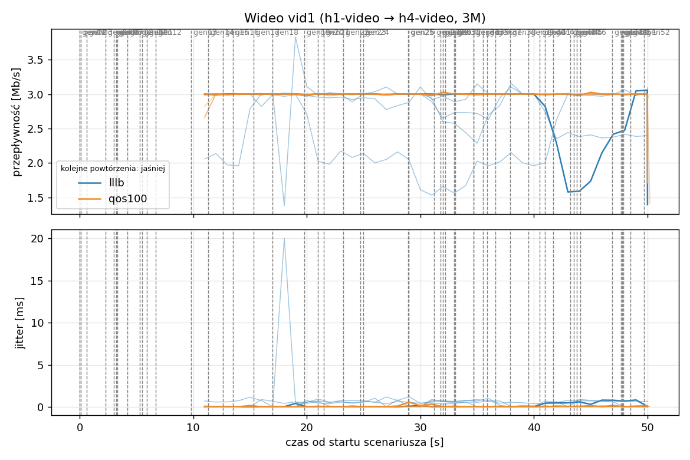
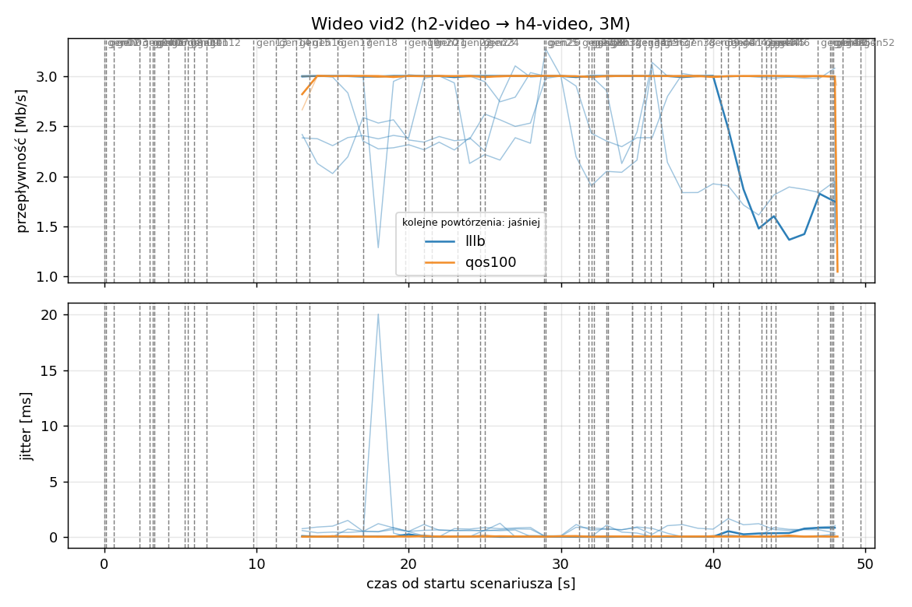
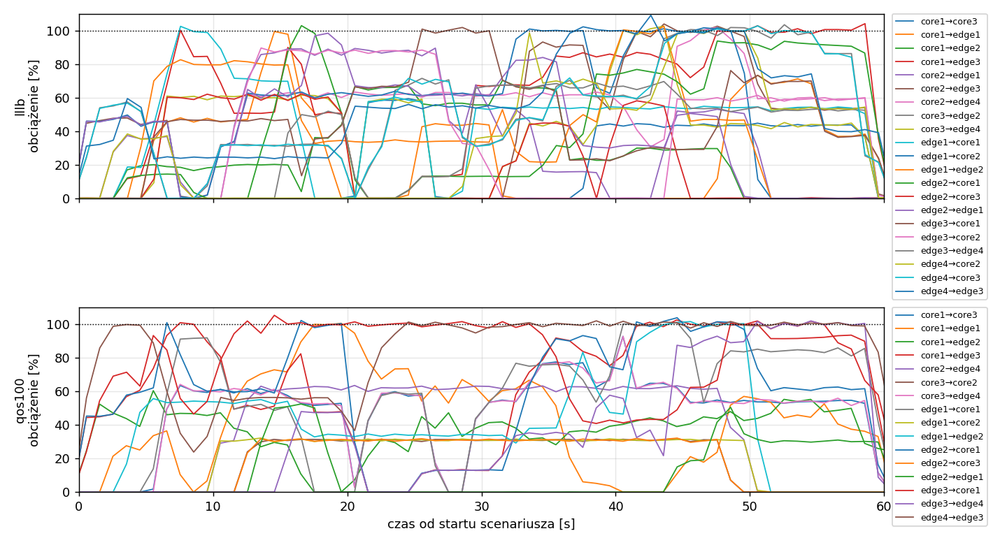
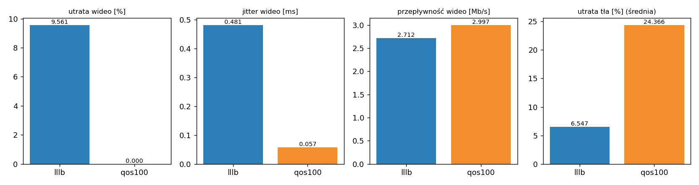

# Raport: mesh-lllb-vs-qos

Katalog: `results/mesh-lllb-vs-qos/20261101_223056`

## 1. Scenariusz

- Topologia: `mesh` (sdn: `mesh-sdn.clab.yml`)
- Warianty: **lllb** (POLICY=lllb), **qos100** (POLICY=qos, RESERVE_PCT=100)
- Czas testu: 60 s, warmup (pomijany w statystykach, liczony od startu każdego przepływu): 5 s, powtórzeń: 5, seed: 42
- Wykonane przebiegi: lllb/rep1, lllb/rep2, lllb/rep3, lllb/rep4, lllb/rep5, qos100/rep1, qos100/rep2, qos100/rep3, qos100/rep4, qos100/rep5

Harmonogram losowego tła różni się między powtórzeniami (seed + nr powtórzenia, wspólny dla wariantów); poniżej powtórzenie 1.

| id | klasa | źródło → cel | proto | zadana [Mb/s] | DSCP | start–koniec [s] |
|---|---|---|---|---|---|---|
| gen01 | background | h2-bg1 → h3-bg2 | udp | 4.49 | – | 0–7 |
| gen02 | background | h4-bg2 → h3-bg1 | udp | 3.16 | – | 0.1–5.1 |
| gen03 | background | h4-bg1 → h2-bg2 | udp | 5.25 | – | 0.6–5.6 |
| gen04 | background | h4-bg1 → h1-bg2 | udp | 3.56 | – | 2.3–7.3 |
| gen05 | background | h4-bg1 → h3-bg1 | udp | 2.36 | – | 3–60 |
| gen06 | background | h1-bg2 → h2-bg1 | udp | 1.93 | – | 3.2–16.2 |
| gen07 | background | h2-bg1 → h3-bg1 | udp | 1.39 | – | 3.3–8.3 |
| gen08 | background | h1-bg1 → h2-bg1 | udp | 3.29 | – | 4.2–32.2 |
| gen09 | background | h3-bg2 → h2-bg1 | udp | 4.51 | – | 5.3–16.3 |
| gen10 | background | h1-bg2 → h3-bg1 | udp | 3.96 | – | 5.5–10.5 |
| gen11 | background | h2-bg1 → h4-bg2 | udp | 5.85 | – | 5.9–19.9 |
| gen12 | background | h1-bg2 → h3-bg1 | udp | 4.90 | – | 6.7–16.7 |
| gen13 | background | h4-bg1 → h1-bg1 | udp | 3.07 | – | 9.8–19.8 |
| vid1 | video | h1-video → h4-video | udp | 3.00 | 46 | 10–50 |
| gen14 | background | h3-bg2 → h1-bg2 | udp | 5.37 | – | 11.3–27.3 |
| vid2 | video | h2-video → h4-video | udp | 3.00 | 46 | 12–48 |
| gen15 | background | h3-bg1 → h1-bg1 | udp | 3.12 | – | 12.6–30.6 |
| gen16 | background | h2-bg1 → h1-bg1 | udp | 4.96 | – | 13.5–18.5 |
| gen17 | background | h2-bg1 → h4-bg2 | udp | 4.86 | – | 15.3–20.3 |
| gen18 | background | h3-bg2 → h1-bg1 | udp | 3.49 | – | 17–36 |
| gen19 | background | h4-bg2 → h2-bg1 | udp | 2.93 | – | 19.8–48.8 |
| gen20 | background | h1-bg2 → h4-bg2 | udp | 5.68 | – | 21–26 |
| gen21 | background | h4-bg1 → h2-bg1 | udp | 3.04 | – | 21.5–35.5 |
| gen22 | background | h4-bg1 → h2-bg1 | udp | 3.69 | – | 23.2–28.2 |
| gen23 | background | h2-bg2 → h4-bg2 | udp | 1.26 | – | 24.7–44.7 |
| gen24 | background | h3-bg1 → h1-bg2 | udp | 4.88 | – | 25–31 |
| gen25 | background | h4-bg1 → h1-bg2 | udp | 3.51 | – | 28.9–33.9 |
| gen26 | background | h1-bg1 → h4-bg1 | udp | 5.23 | – | 29–59 |
| gen27 | background | h1-bg2 → h4-bg1 | udp | 2.10 | – | 31.2–37.2 |
| gen28 | background | h4-bg1 → h1-bg2 | udp | 1.54 | – | 31.8–36.8 |
| gen29 | background | h4-bg1 → h1-bg2 | udp | 1.53 | – | 32–39 |
| gen30 | background | h1-bg2 → h3-bg1 | udp | 3.69 | – | 32.2–38.2 |
| gen31 | background | h2-bg1 → h4-bg2 | udp | 2.18 | – | 33–38 |
| gen32 | background | h4-bg2 → h3-bg2 | udp | 5.19 | – | 33.1–59.1 |
| gen33 | background | h4-bg2 → h3-bg2 | udp | 2.60 | – | 34.7–40.7 |
| gen34 | background | h2-bg2 → h3-bg2 | udp | 1.75 | – | 34.7–59.7 |
| gen35 | background | h4-bg2 → h2-bg1 | udp | 5.89 | – | 35.5–54.5 |
| gen36 | background | h4-bg2 → h3-bg1 | udp | 4.62 | – | 35.9–49.9 |
| gen37 | background | h1-bg2 → h2-bg2 | udp | 4.50 | – | 36.6–50.6 |
| gen38 | background | h2-bg1 → h4-bg1 | udp | 4.23 | – | 37.9–58.9 |
| gen39 | background | h1-bg2 → h4-bg2 | udp | 5.93 | – | 39.5–44.5 |
| gen40 | background | h1-bg1 → h3-bg1 | udp | 5.99 | – | 40.5–45.5 |
| gen41 | background | h1-bg2 → h3-bg1 | udp | 4.47 | – | 41–50 |
| gen42 | background | h1-bg2 → h3-bg1 | udp | 2.82 | – | 41.7–48.7 |
| gen43 | background | h4-bg2 → h2-bg1 | udp | 4.98 | – | 43.2–49.2 |
| gen44 | background | h4-bg2 → h1-bg2 | udp | 5.97 | – | 43.5–50.5 |
| gen45 | background | h3-bg1 → h4-bg1 | udp | 5.74 | – | 43.8–58.8 |
| gen46 | background | h2-bg1 → h1-bg2 | udp | 1.89 | – | 44.1–49.1 |
| gen47 | background | h2-bg2 → h3-bg1 | udp | 2.94 | – | 46.9–59.9 |
| gen48 | background | h3-bg1 → h1-bg1 | udp | 3.58 | – | 47.7–59.7 |
| gen49 | background | h4-bg1 → h2-bg1 | udp | 5.93 | – | 47.8–57.8 |
| gen50 | background | h4-bg1 → h1-bg1 | udp | 3.20 | – | 47.9–54.9 |
| gen51 | background | h4-bg2 → h3-bg1 | udp | 1.53 | – | 48.5–59.5 |
| gen52 | background | h4-bg2 → h2-bg2 | udp | 2.44 | – | 49.7–59.7 |

## 2. Wideo: QoS według wariantu

Wartości: średnia ± odchylenie standardowe z powtórzeń.

| przepływ | wariant | przepływność [Mb/s] | jitter [ms] | utrata [%] | RTT mediana [ms] | RTT p95 [ms] |
|---|---|---|---|---|---|---|
| vid1 | lllb | 2.76 ± 0.25 | 0.464 ± 0.300 | 7.84 ± 8.38 | 23.473 ± 32.090 | 102.840 ± 42.875 |
| vid1 | qos100 | 3.00 ± 0.00 | 0.060 ± 0.012 | 0.00 ± 0.00 | 0.030 ± 0.001 | 0.055 ± 0.005 |
| vid2 | lllb | 2.66 ± 0.25 | 0.498 ± 0.286 | 11.29 ± 8.29 | 38.654 ± 49.824 | 101.320 ± 41.226 |
| vid2 | qos100 | 3.00 ± 0.01 | 0.054 ± 0.008 | 0.00 ± 0.00 | 0.030 ± 0.002 | 0.062 ± 0.006 |

RTT z `ping` co 0,1 s między hostami wideo (osobny przepływ ICMP z tym samym DSCP - w SDN może iść inną ścieżką niż strumień UDP).

## 3. Ruch tła

Agregat tła w obrębie powtórzenia, potem średnia ± odchylenie standardowe po powtórzeniach (utrata = Σ utraconych / Σ wysłanych datagramów; dostarczone = Σ przepływności / Σ zadanych; przepływy trwające nie dłużej niż warmup pominięte).

| wariant | strumieni tła / powt. | dostarczone / zadane [%] | jitter [ms] | utrata [%] |
|---|---|---|---|---|
| lllb | 40 | 93.4 ± 3.4 | 0.297 ± 0.086 | 6.55 ± 3.87 |
| qos100 | 40 | 73.7 ± 6.6 | 0.462 ± 0.050 | 24.37 ± 5.30 |

## 4. Obciążenie łączy fabricu

Średnia i maksimum z próbek co 1 s w oknie 0–60 s; MLU = maksymalne obciążenie łącza; drops = pakiety odrzucone przez `tbf` na wyjściu łącza.

| wariant | rep | średnie obciążenie łączy [%] | MLU [%] | łącza > 90% | drops tbf | CPU VM śr./maks. [%] |
|---|---|---|---|---|---|---|
| lllb | 1 | 37.1 | 109.0 | 15/24 | 12490 | 26 / 68 |
| lllb | 2 | 40.8 | 104.3 | 16/24 | 21807 | 26 / 47 |
| lllb | 3 | 45.4 | 104.4 | 15/24 | 41156 | 28 / 46 |
| lllb | 4 | 39.2 | 104.3 | 19/24 | 8615 | 25 / 42 |
| lllb | 5 | 38.6 | 103.8 | 16/24 | 13199 | 27 / 74 |
| qos100 | 1 | 29.9 | 105.3 | 10/24 | 61693 | 24 / 52 |
| qos100 | 2 | 34.0 | 104.0 | 9/24 | 56486 | 25 / 46 |
| qos100 | 3 | 38.6 | 103.9 | 10/24 | 94776 | 27 / 43 |
| qos100 | 4 | 29.9 | 104.8 | 8/24 | 41896 | 25 / 49 |
| qos100 | 5 | 32.0 | 103.6 | 10/24 | 44964 | 24 / 41 |

Łącza z obciążeniem > 10% (maksimum [%] / drops, powtórzenie 1):

| łącze | lllb | qos100 |
|---|---|---|
| core1→core3 | 59 / 0 | 93 / 0 |
| core1→edge1 | 99 / 0 | 101 / 0 |
| core1→edge2 | 70 / 0 | 60 / 0 |
| core1→edge3 | 104 / 173 | 102 / 2512 |
| core2→edge1 | 89 / 0 | 0 / 0 |
| core2→edge3 | 104 / 842 | 0 / 0 |
| core2→edge4 | 102 / 48 | 63 / 0 |
| core3→core2 | 0 / 0 | 32 / 0 |
| core3→edge2 | 103 / 0 | 0 / 0 |
| core3→edge4 | 103 / 0 | 93 / 0 |
| edge1→core1 | 102 / 308 | 101 / 2882 |
| edge1→core2 | 102 / 4392 | 32 / 0 |
| edge1→edge2 | 103 / 263 | 102 / 1243 |
| edge2→core1 | 103 / 0 | 104 / 2503 |
| edge2→core3 | 62 / 0 | 32 / 0 |
| edge2→edge1 | 98 / 0 | 52 / 0 |
| edge3→core1 | 102 / 795 | 105 / 13872 |
| edge3→core2 | 90 / 0 | 0 / 0 |
| edge3→edge4 | 70 / 0 | 102 / 178 |
| edge4→core2 | 102 / 861 | 0 / 0 |
| edge4→core3 | 103 / 3216 | 0 / 0 |
| edge4→edge3 | 109 / 1592 | 102 / 38503 |

## 5. Ścieżki wybrane przez kontroler (powtórzenie 1)

Z logu kontrolera (linie `Flow`), dopasowane po piątce przepływu; ✓ = reguły widoczne w `dump-flows` na tych samych przełącznikach.

| przepływ | lllb | qos100 |
|---|---|---|
| gen01 | edge2 -> edge1 -> core2 -> edge3 ✓ (loads 5% 5% 0% 0%) | edge2 -> core1 -> edge3 ✓ (loads 5% 5% 0% 0%) |
| gen02 | edge4 -> edge3 ✓ (loads 5% 5%) | edge4 -> edge3 ✓ (loads 5% 0%) |
| gen03 | edge4 -> core3 -> edge2 ✓ (loads 5% 10% 5% 5%) | edge4 -> edge3 -> core1 -> edge2 ✓ (loads 0% 15% 5% 0%) |
| gen04 | edge4 -> core2 -> edge1 ✓ (loads 5% 32% 32% 54%) | edge4 -> edge3 -> core1 -> edge1 ✓ (loads 0% 92% 92% 0%) |
| gen05 | edge4 -> edge3 ✓ (loads 38% 46%) | edge4 -> edge3 ✓ (loads 100% 0%) |
| gen06 | edge1 -> core1 -> edge2 ✓ (loads 5% 0%) | edge1 -> edge2 ✓ (loads 5% 49%) |
| gen07 | edge2 -> core1 -> edge3 ✓ (loads 15% 46% 46% 43%) | edge2 -> core1 -> edge3 ✓ (loads 51% 51% 15% 100%) |
| gen08 | edge1 -> edge2 ✓ (loads 5% 13%) | edge1 -> edge2 ✓ (loads 19% 44%) |
| gen09 | edge3 -> core1 -> edge1 -> edge2 ✓ (loads 24% 53% 21% 53%) | edge3 -> core1 -> edge2 ✓ (loads 69% 0% 69% 69%) |
| gen10 | edge1 -> core1 -> edge3 ✓ (loads 29% 46% 29% 55%) | edge1 -> core1 -> edge3 ✓ (loads 76% 0% 76% 100%) |
| gen11 | edge2 -> core3 -> edge4 ✓ (loads 5% 47% 32% 14%) | edge2 -> core1 -> core3 -> edge4 ✓ (loads 5% 0% 66% 66%) |
| gen12 | edge1 -> core1 -> edge3 ✓ (loads 40% 47% 60% 46%) | edge1 -> core1 -> edge3 ✓ (loads 71% 0% 71% 105%) |
| gen13 | edge4 -> core3 -> edge2 -> edge1 ✓ (loads 5% 47% 24% 0%) | edge4 -> edge3 -> core1 -> edge1 ✓ (loads 0% 51% 29% 0%) |
| vid1 | edge1 -> core2 -> edge4 ✓ (loads 5% 80% 100% 100%) | edge1 -> core2 -> edge4 ✓ (loads 0% 65% 96% 96%) |
| gen14 | edge3 -> core2 -> edge1 ✓ (loads 47% 10% 10% 47%) | edge3 -> core1 -> edge1 ✓ (loads 83% 5% 5% 83%) |
| vid2 | edge2 -> edge1 -> core2 -> edge4 ✓ (loads 60% 37% 50% 60%) | edge2 -> core3 -> core2 -> edge4 ✓ (loads 60% 31% 65% 65%) |
| gen15 | edge3 -> core2 -> edge1 ✓ (loads 47% 37% 37% 47%) | edge3 -> core1 -> edge1 ✓ (loads 107% 0% 5% 107%) |
| gen16 | edge2 -> core1 -> edge1 ✓ (loads 58% 52%) | edge2 -> edge1 ✓ (loads 5% 64%) |
| gen17 | edge2 -> core1 -> edge3 -> edge4 ✓ (loads 60% 62% 56% 60%) | edge2 -> core1 -> edge3 -> edge4 ✓ (loads 60% 62% 65% 65%) |
| gen18 | edge3 -> core1 -> edge2 -> edge1 ✓ (loads 71% 88% 88% 68%) | edge3 -> core1 -> edge1 ✓ (loads 105% 0% 47% 105%) |
| gen19 | edge4 -> edge3 -> core1 -> edge2 ✓ (loads 37% 36% 88% 37%) | edge4 -> edge3 -> core1 -> edge2 ✓ (loads 0% 105% 34% 0%) |
| gen20 | edge1 -> core1 -> core3 -> edge4 ✓ (loads 62% 34% 21% 7%) | edge1 -> core1 -> core3 -> edge4 ✓ (loads 62% 34% 35% 14%) |
| gen21 | edge4 -> core3 -> edge2 ✓ (loads 10% 71% 87% 10%) | edge4 -> edge3 -> core1 -> edge2 ✓ (loads 0% 115% 34% 0%) |
| gen22 | edge4 -> core3 -> edge2 ✓ (loads 36% 66% 87% 36%) | edge4 -> edge3 -> core1 -> edge2 ✓ (loads 0% 105% 34% 0%) |
| gen23 | edge2 -> core1 -> edge3 -> edge4 ✓ (loads 59% 67% 5% 59%) | edge2 -> core1 -> edge3 -> edge4 ✓ (loads 59% 62% 0% 59%) |
| gen24 | edge3 -> core1 -> edge1 ✓ (loads 71% 88% 88% 71%) | edge3 -> core1 -> edge1 ✓ (loads 110% 0% 5% 110%) |
| gen25 | edge4 -> core2 -> edge1 ✓ (loads 37% 100% 55% 61%) | edge4 -> edge3 -> core1 -> edge1 ✓ (loads 0% 110% 109% 0%) |
| gen26 | edge1 -> core1 -> edge3 -> edge4 ✓ (loads 62% 34% 15% 15%) | edge1 -> core1 -> core3 -> edge4 ✓ (loads 62% 34% 13% 10%) |
| gen27 | edge1 -> edge2 -> core3 -> edge4 ✓ (loads 62% 39% 67% 54%) | edge1 -> core1 -> edge3 -> edge4 ✓ (loads 62% 54% 59% 59%) |
| gen28 | edge4 -> core3 -> edge2 -> edge1 ✓ (loads 69% 100% 69% 66%) | edge4 -> edge3 -> core1 -> edge1 ✓ (loads 0% 105% 105% 0%) |
| gen29 | edge4 -> core2 -> edge1 ✓ (loads 41% 76% 55% 70%) | edge4 -> edge3 -> core1 -> edge1 ✓ (loads 0% 120% 110% 5%) |
| gen30 | edge1 -> core2 -> edge3 ✓ (loads 67% 67% 67% 67%) | edge1 -> edge2 -> core1 -> edge3 ✓ (loads 69% 31% 44% 110%) |
| gen31 | edge2 -> core3 -> edge4 ✓ (loads 27% 89% 67% 27%) | edge2 -> core1 -> core3 -> edge4 ✓ (loads 54% 62% 58% 54%) |
| gen32 | edge4 -> core2 -> edge3 ✓ (loads 60% 55%) | edge4 -> edge3 ✓ (loads 110% 0%) |
| gen33 | edge4 -> edge3 ✓ (loads 65% 91%) | edge4 -> edge3 ✓ (loads 105% 0%) |
| gen34 | edge2 -> core1 -> edge3 ✓ (loads 67% 83% 100% 70%) | edge2 -> core1 -> edge3 ✓ (loads 78% 78% 31% 105%) |
| gen35 | edge4 -> core3 -> edge2 ✓ (loads 52% 66% 73% 73%) | edge4 -> edge3 -> core1 -> edge2 ✓ (loads 0% 100% 38% 0%) |
| gen36 | edge4 -> edge3 ✓ (loads 86% 92%) | edge4 -> edge3 ✓ (loads 105% 0%) |
| gen37 | edge1 -> edge2 ✓ (loads 27% 66%) | edge1 -> edge2 ✓ (loads 43% 81%) |
| gen38 | edge2 -> core1 -> core3 -> edge4 ✓ (loads 49% 100% 85% 31%) | edge2 -> core1 -> edge3 -> edge4 ✓ (loads 76% 62% 91% 91%) |
| gen39 | edge1 -> edge2 -> core3 -> edge4 ✓ (loads 73% 51% 85% 54%) | edge1 -> core1 -> core3 -> edge4 ✓ (loads 62% 71% 81% 71%) |
| gen40 | edge1 -> core2 -> edge3 ✓ (loads 85% 67% 85% 100%) | edge1 -> core1 -> edge3 ✓ (loads 80% 31% 80% 100%) |
| gen41 | edge1 -> core2 -> edge3 ✓ (loads 85% 83% 100% 100%) | edge1 -> edge2 -> core1 -> edge3 ✓ (loads 100% 31% 84% 100%) |
| gen42 | edge1 -> core2 -> edge3 ✓ (loads 90% 88% 100% 100%) | edge1 -> edge2 -> core1 -> edge3 ✓ (loads 100% 31% 100% 100%) |
| gen43 | edge4 -> core3 -> edge2 ✓ (loads 66% 100% 100% 66%) | edge4 -> edge3 -> core1 -> edge2 ✓ (loads 0% 100% 100% 0%) |
| gen44 | edge4 -> core2 -> edge1 ✓ (loads 59% 100% 100% 71%) | edge4 -> edge3 -> core1 -> edge1 ✓ (loads 0% 105% 105% 10%) |
| gen45 | edge3 -> core2 -> edge4 ✓ (loads 67% 33%) | edge3 -> edge4 ✓ (loads 22% 62%) |
| gen46 | edge2 -> edge1 ✓ (loads 36% 75%) | edge2 -> edge1 ✓ (loads 5% 100%) |
| gen47 | edge2 -> core1 -> edge3 ✓ (loads 77% 77% 100% 100%) | edge2 -> edge1 -> core1 -> edge3 ✓ (loads 100% 100% 31% 100%) |
| gen48 | edge3 -> core1 -> edge1 ✓ (loads 34% 59% 100% 50%) | edge3 -> core1 -> edge1 ✓ (loads 83% 0% 93% 83%) |
| gen49 | edge4 -> core3 -> edge2 ✓ (loads 100% 100% 100% 100%) | edge4 -> edge3 -> core1 -> edge2 ✓ (loads 0% 100% 100% 0%) |
| gen50 | edge4 -> edge3 -> core1 -> edge1 ✓ (loads 105% 100% 100% 105%) | edge4 -> edge3 -> core1 -> edge1 ✓ (loads 0% 100% 100% 50%) |
| gen51 | edge4 -> edge3 ✓ (loads 100% 100%) | edge4 -> edge3 ✓ (loads 105% 0%) |
| gen52 | edge4 -> core3 -> edge2 ✓ (loads 100% 105% 105% 105%) | edge4 -> edge3 -> core1 -> edge2 ✓ (loads 0% 100% 44% 0%) |

## 6. Wnioski

<!-- WNIOSKI:START -->
Powtórzenie serii `20261101_220240` z poprawionym wyborem rodziców w drzewie rezerwy (węzły tranzytowe
przed brzegowymi): korzeń core2, 5 łączy (core2–edge1, core2–edge3, core2–edge4, core2–core3, core3–edge2),
po 2 wolne łącza fabric na każdy przełącznik brzegowy. Te same układy ruchu tła (seed 43–47).
vid1 idzie `edge1 → core2 → edge4`, vid2 `edge2 → core3 → core2 → edge4`.

1. **Wideo bez zmian:** qos100 0,00% strat w 10/10 strumieni (poprzednio 9/9 zmierzonych), jitter
   0,057 ms, RTT p95 0,06 ms; LLLB 9,56 ± 7,99% strat, jitter 0,481 ms, RTT p95 117 ms. Dłuższa
   ścieżka vid2 (3 hopy przez core3 i core2) nie pogorszyła wideo.
2. **Hipoteza „wąskie gardło edge1 tłumaczy koszt tła” nie została potwierdzona.** Utrata tła w qos100:
   24,37 ± 5,30% (poprzednio 23,96 ± 10,98%); LLLB 6,55 ± 3,87% (poprzednio 7,19 ± 2,59%). Różnice
   qos100 nowe − stare per powtórzenie: +10,5 / −11,9 / −8,0 / +4,2 / +7,3 pp (średnio +0,4 pp), bez
   stałego kierunku. Łączna liczba odrzuceń na `tbf` qos100: 299 815 (poprzednio 306 264).
3. **Wąskie gardło przesunęło się, a nie zniknęło.** Najgorsze łącza w qos100: poprzednio edge1→core1 126 005,
   teraz edge4→edge3 105 125, edge3→core1 71 432, edge1→core1 47 017, edge2→core1 34 694. Rezerwa zajmuje
   5 z 12 łączy (poprzednio 4), więc best-effort ma 7 łączy zamiast 8, a przełączniki edge3/edge4
   mają do reszty sieci tylko po jednym łączu poza rezerwą (core1–edge3, core3–edge4).
4. **Szczelność rezerwy bez zmian:** 0 z 276 przepływów best-effort dotyka łączy rezerwy (LLLB: 131 z 276),
   średnia długość ścieżek best-effort 2,13 hopa (LLLB 2,08).
5. **Wniosek:** wybór rodziców w drzewie zmienia rozkład strat tła między łączami, ale nie ich łączny poziom.
   Koszt pełnej rezerwy w mesh (ok. 24% strat tła wobec 6,5–7,2% w LLLB, czyli 3,4–3,7 raza) wynika z
   braku pojemności poza rezerwą w tej topologii, a nie z konkretnego kształtu drzewa.
<!-- WNIOSKI:END -->

## 7. Wiarygodność pomiaru

**Uwagi autora analizy (ręczne):**
- Porównanie z `20261101_220240` jest parowane (te same ziarna tła w powtórzeniach), ale n = 5 i rozrzut
  między powtórzeniami (12,9–37,5% w jednym wariancie) jest większy niż różnica średnich.
- Błędy odbioru wyniku przez kanał sterujący TCP iperf3 wystąpiły tylko w qos100 (11 komunikatów w
  powtórzeniach 1, 2 i 5, w tym po jednym dla vid1 w powt. 1 i vid2 w powt. 5; w lllb brak), jak w serii
  poprzedniej (tam 8 przepływów). Przepływy bez raportu odbiorcy są pomijane w tabelach, więc utrata tła
  w qos100 może być lekko zaniżona.

- lllb rep1, gen02: przepływ krótszy niż warmup - statystyki z całości
- lllb rep1, gen04: przepływ krótszy niż warmup - statystyki z całości
- lllb rep1, gen07: przepływ krótszy niż warmup - statystyki z całości
- lllb rep1, gen17: przepływ krótszy niż warmup - statystyki z całości
- lllb rep1, gen28: przepływ krótszy niż warmup - statystyki z całości
- lllb rep1, gen46: przepływ krótszy niż warmup - statystyki z całości
- lllb rep2, gen02: przepływ krótszy niż warmup - statystyki z całości
- lllb rep2, gen05: przepływ krótszy niż warmup - statystyki z całości
- lllb rep2, gen12: przepływ krótszy niż warmup - statystyki z całości
- lllb rep2, gen24: przepływ krótszy niż warmup - statystyki z całości
- lllb rep2, gen36: przepływ krótszy niż warmup - statystyki z całości
- lllb rep3, gen02: przepływ krótszy niż warmup - statystyki z całości
- lllb rep3, gen03: przepływ krótszy niż warmup - statystyki z całości
- lllb rep3, gen09: przepływ krótszy niż warmup - statystyki z całości
- lllb rep3, gen11: przepływ krótszy niż warmup - statystyki z całości
- lllb rep3, gen13: przepływ krótszy niż warmup - statystyki z całości
- lllb rep3, gen15: przepływ krótszy niż warmup - statystyki z całości
- lllb rep3, gen30: przepływ krótszy niż warmup - statystyki z całości
- lllb rep3, gen38: przepływ krótszy niż warmup - statystyki z całości
- lllb rep4, gen45: przepływ krótszy niż warmup - statystyki z całości
- lllb rep5, gen02: przepływ krótszy niż warmup - statystyki z całości
- lllb rep5, gen15: przepływ krótszy niż warmup - statystyki z całości
- lllb rep5, gen25: przepływ krótszy niż warmup - statystyki z całości
- lllb rep5, gen35: przepływ krótszy niż warmup - statystyki z całości
- qos100 rep1, gen04: przepływ krótszy niż warmup - statystyki z całości
- qos100 rep1, vid1: klient: unable to receive results: No such file or directory
- qos100 rep1, gen16: przepływ krótszy niż warmup - statystyki z całości
- qos100 rep1, gen33: klient: unable to receive results: No such file or directory
- qos100 rep1, gen33: serwer: error - unable to receive results: Bad file descriptor
- qos100 rep1, gen44: klient: unable to receive results: No such file or directory
- qos100 rep1, gen44: serwer: error - unable to receive results: Bad file descriptor
- qos100 rep2, gen02: przepływ krótszy niż warmup - statystyki z całości
- qos100 rep2, gen12: przepływ krótszy niż warmup - statystyki z całości
- qos100 rep2, gen21: klient: unable to receive results: No such file or directory
- qos100 rep2, gen30: klient: unable to receive results: No such file or directory
- qos100 rep2, gen30: serwer: error - unable to receive results: Bad file descriptor
- qos100 rep2, gen31: przepływ krótszy niż warmup - statystyki z całości
- qos100 rep2, gen36: przepływ krótszy niż warmup - statystyki z całości
- qos100 rep3, gen02: przepływ krótszy niż warmup - statystyki z całości
- qos100 rep3, gen03: przepływ krótszy niż warmup - statystyki z całości
- qos100 rep4, gen22: przepływ krótszy niż warmup - statystyki z całości
- qos100 rep4, gen45: przepływ krótszy niż warmup - statystyki z całości
- qos100 rep5, gen02: przepływ krótszy niż warmup - statystyki z całości
- qos100 rep5, gen16: klient: unable to receive results: No such file or directory
- qos100 rep5, gen16: serwer: error - unable to receive results: Bad file descriptor
- qos100 rep5, vid2: klient: unable to receive results: No such file or directory
