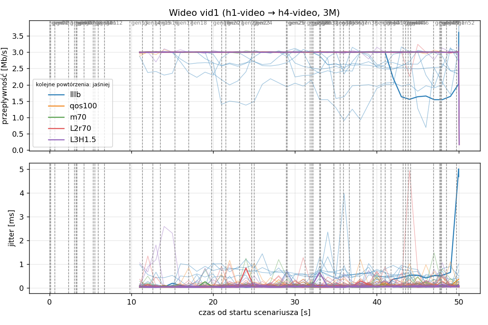
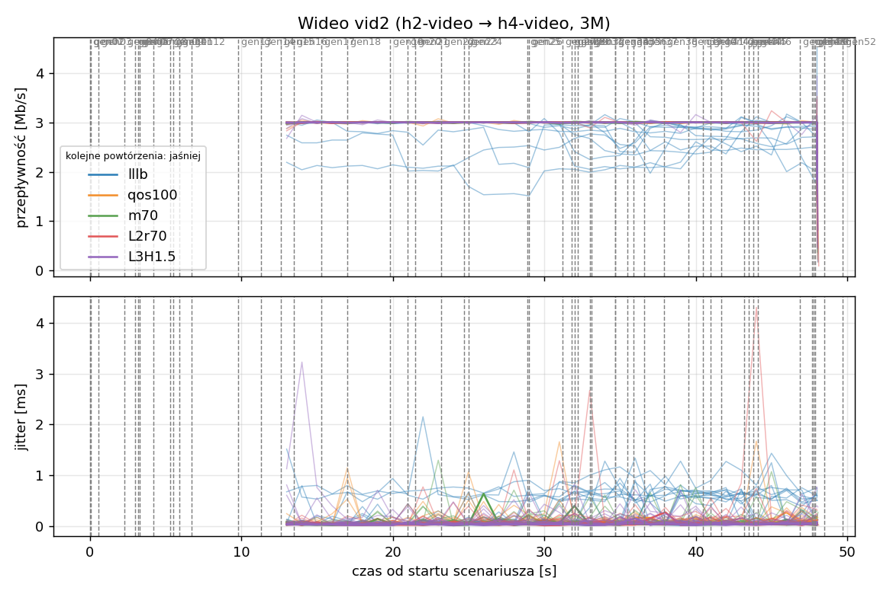
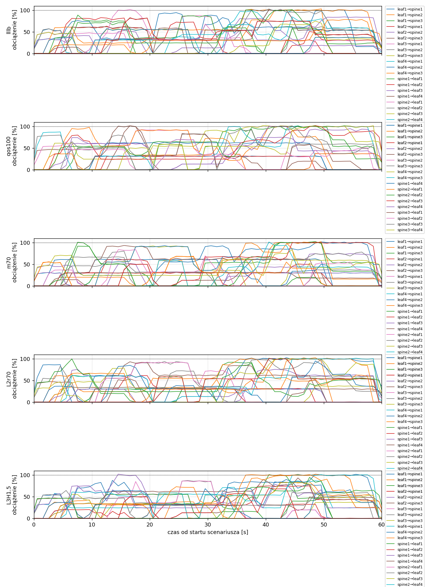
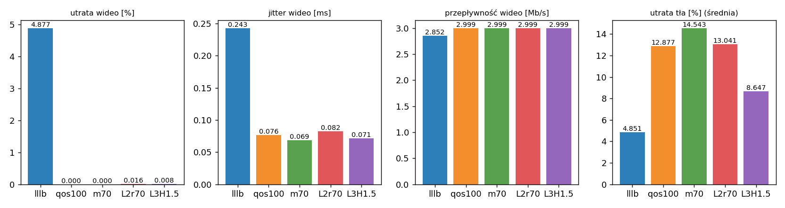

# Raport: clos-sdn

Katalog: `results/official/clos-sdn/20261104_235910`

## 1. Scenariusz

- Topologia: `clos` (sdn: `clos-sdn.clab.yml`)
- Warianty: **lllb** (POLICY=lllb), **qos100** (LAYERS=1, POLICY=qos, RESERVE_PCT=100), **m70** (LAYERS=1, POLICY=qos, RESERVE_PCT=70), **L2r70** (LAYERS=2, POLICY=qos, RESERVE_PCT=70), **L3H1.5** (HEADROOM_MBPS=1.5, LAYERS=3, POLICY=qos, RESERVE_PCT=70)
- Czas testu: 60 s, warmup (pomijany w statystykach, liczony od startu każdego przepływu): 5 s, powtórzeń: 20, seed: 42
- Wykonane przebiegi: lllb/rep1, lllb/rep10, lllb/rep11, lllb/rep12, lllb/rep13, lllb/rep14, lllb/rep15, lllb/rep16, lllb/rep17, lllb/rep18, lllb/rep19, lllb/rep2, lllb/rep20, lllb/rep3, lllb/rep4, lllb/rep5, lllb/rep6, lllb/rep7, lllb/rep8, lllb/rep9, qos100/rep1, qos100/rep10, qos100/rep11, qos100/rep12, qos100/rep13, qos100/rep14, qos100/rep15, qos100/rep16, qos100/rep17, qos100/rep18, qos100/rep19, qos100/rep2, qos100/rep20, qos100/rep3, qos100/rep4, qos100/rep5, qos100/rep6, qos100/rep7, qos100/rep8, qos100/rep9, m70/rep1, m70/rep10, m70/rep11, m70/rep12, m70/rep13, m70/rep14, m70/rep15, m70/rep16, m70/rep17, m70/rep18, m70/rep19, m70/rep2, m70/rep20, m70/rep3, m70/rep4, m70/rep5, m70/rep6, m70/rep7, m70/rep8, m70/rep9, L2r70/rep1, L2r70/rep10, L2r70/rep11, L2r70/rep12, L2r70/rep13, L2r70/rep14, L2r70/rep15, L2r70/rep16, L2r70/rep17, L2r70/rep18, L2r70/rep19, L2r70/rep2, L2r70/rep20, L2r70/rep3, L2r70/rep4, L2r70/rep5, L2r70/rep6, L2r70/rep7, L2r70/rep8, L2r70/rep9, L3H1.5/rep1, L3H1.5/rep10, L3H1.5/rep11, L3H1.5/rep12, L3H1.5/rep13, L3H1.5/rep14, L3H1.5/rep15, L3H1.5/rep16, L3H1.5/rep17, L3H1.5/rep18, L3H1.5/rep19, L3H1.5/rep2, L3H1.5/rep20, L3H1.5/rep3, L3H1.5/rep4, L3H1.5/rep5, L3H1.5/rep6, L3H1.5/rep7, L3H1.5/rep8, L3H1.5/rep9

Harmonogram losowego tła różni się między powtórzeniami (seed + nr powtórzenia, wspólny dla wariantów); poniżej powtórzenie 1.

| id | klasa | źródło → cel | proto | zadana [Mb/s] | DSCP | start–koniec [s] |
|---|---|---|---|---|---|---|
| gen01 | background | h2-bg1 → h3-bg2 | udp | 4.49 | – | 0–7 |
| gen02 | background | h4-bg2 → h3-bg1 | udp | 3.16 | – | 0.1–5.1 |
| gen03 | background | h4-bg1 → h2-bg2 | udp | 5.25 | – | 0.6–5.6 |
| gen04 | background | h4-bg1 → h1-bg2 | udp | 3.56 | – | 2.3–7.3 |
| gen05 | background | h4-bg1 → h3-bg1 | udp | 2.36 | – | 3–60 |
| gen06 | background | h1-bg2 → h2-bg1 | udp | 1.93 | – | 3.2–16.2 |
| gen07 | background | h2-bg1 → h3-bg1 | udp | 1.39 | – | 3.3–8.3 |
| gen08 | background | h1-bg1 → h2-bg1 | udp | 3.29 | – | 4.2–32.2 |
| gen09 | background | h3-bg2 → h2-bg1 | udp | 4.51 | – | 5.3–16.3 |
| gen10 | background | h1-bg2 → h3-bg1 | udp | 3.96 | – | 5.5–10.5 |
| gen11 | background | h2-bg1 → h4-bg2 | udp | 5.85 | – | 5.9–19.9 |
| gen12 | background | h1-bg2 → h3-bg1 | udp | 4.90 | – | 6.7–16.7 |
| gen13 | background | h4-bg1 → h1-bg1 | udp | 3.07 | – | 9.8–19.8 |
| vid1 | video | h1-video → h4-video | udp | 3.00 | 46 | 10–50 |
| gen14 | background | h3-bg2 → h1-bg2 | udp | 5.37 | – | 11.3–27.3 |
| vid2 | video | h2-video → h4-video | udp | 3.00 | 46 | 12–48 |
| gen15 | background | h3-bg1 → h1-bg1 | udp | 3.12 | – | 12.6–30.6 |
| gen16 | background | h2-bg1 → h1-bg1 | udp | 4.96 | – | 13.5–18.5 |
| gen17 | background | h2-bg1 → h4-bg2 | udp | 4.86 | – | 15.3–20.3 |
| gen18 | background | h3-bg2 → h1-bg1 | udp | 3.49 | – | 17–36 |
| gen19 | background | h4-bg2 → h2-bg1 | udp | 2.93 | – | 19.8–48.8 |
| gen20 | background | h1-bg2 → h4-bg2 | udp | 5.68 | – | 21–26 |
| gen21 | background | h4-bg1 → h2-bg1 | udp | 3.04 | – | 21.5–35.5 |
| gen22 | background | h4-bg1 → h2-bg1 | udp | 3.69 | – | 23.2–28.2 |
| gen23 | background | h2-bg2 → h4-bg2 | udp | 1.26 | – | 24.7–44.7 |
| gen24 | background | h3-bg1 → h1-bg2 | udp | 4.88 | – | 25–31 |
| gen25 | background | h4-bg1 → h1-bg2 | udp | 3.51 | – | 28.9–33.9 |
| gen26 | background | h1-bg1 → h4-bg1 | udp | 5.23 | – | 29–59 |
| gen27 | background | h1-bg2 → h4-bg1 | udp | 2.10 | – | 31.2–37.2 |
| gen28 | background | h4-bg1 → h1-bg2 | udp | 1.54 | – | 31.8–36.8 |
| gen29 | background | h4-bg1 → h1-bg2 | udp | 1.53 | – | 32–39 |
| gen30 | background | h1-bg2 → h3-bg1 | udp | 3.69 | – | 32.2–38.2 |
| gen31 | background | h2-bg1 → h4-bg2 | udp | 2.18 | – | 33–38 |
| gen32 | background | h4-bg2 → h3-bg2 | udp | 5.19 | – | 33.1–59.1 |
| gen33 | background | h4-bg2 → h3-bg2 | udp | 2.60 | – | 34.7–40.7 |
| gen34 | background | h2-bg2 → h3-bg2 | udp | 1.75 | – | 34.7–59.7 |
| gen35 | background | h4-bg2 → h2-bg1 | udp | 5.89 | – | 35.5–54.5 |
| gen36 | background | h4-bg2 → h3-bg1 | udp | 4.62 | – | 35.9–49.9 |
| gen37 | background | h1-bg2 → h2-bg2 | udp | 4.50 | – | 36.6–50.6 |
| gen38 | background | h2-bg1 → h4-bg1 | udp | 4.23 | – | 37.9–58.9 |
| gen39 | background | h1-bg2 → h4-bg2 | udp | 5.93 | – | 39.5–44.5 |
| gen40 | background | h1-bg1 → h3-bg1 | udp | 5.99 | – | 40.5–45.5 |
| gen41 | background | h1-bg2 → h3-bg1 | udp | 4.47 | – | 41–50 |
| gen42 | background | h1-bg2 → h3-bg1 | udp | 2.82 | – | 41.7–48.7 |
| gen43 | background | h4-bg2 → h2-bg1 | udp | 4.98 | – | 43.2–49.2 |
| gen44 | background | h4-bg2 → h1-bg2 | udp | 5.97 | – | 43.5–50.5 |
| gen45 | background | h3-bg1 → h4-bg1 | udp | 5.74 | – | 43.8–58.8 |
| gen46 | background | h2-bg1 → h1-bg2 | udp | 1.89 | – | 44.1–49.1 |
| gen47 | background | h2-bg2 → h3-bg1 | udp | 2.94 | – | 46.9–59.9 |
| gen48 | background | h3-bg1 → h1-bg1 | udp | 3.58 | – | 47.7–59.7 |
| gen49 | background | h4-bg1 → h2-bg1 | udp | 5.93 | – | 47.8–57.8 |
| gen50 | background | h4-bg1 → h1-bg1 | udp | 3.20 | – | 47.9–54.9 |
| gen51 | background | h4-bg2 → h3-bg1 | udp | 1.53 | – | 48.5–59.5 |
| gen52 | background | h4-bg2 → h2-bg2 | udp | 2.44 | – | 49.7–59.7 |

## 2. Wideo: QoS według wariantu

Wartości: średnia ± odchylenie standardowe z powtórzeń.

| przepływ | wariant | przepływność [Mb/s] | jitter [ms] | utrata [%] | RTT mediana [ms] | RTT p95 [ms] |
|---|---|---|---|---|---|---|
| vid1 | lllb | 2.85 ± 0.21 | 0.216 ± 0.130 | 5.13 ± 6.86 | 8.820 ± 21.456 | 65.138 ± 42.322 |
| vid1 | qos100 | 3.00 ± 0.00 | 0.079 ± 0.028 | 0.00 ± 0.00 | 0.030 ± 0.002 | 0.056 ± 0.018 |
| vid1 | m70 | 3.00 ± 0.00 | 0.066 ± 0.022 | 0.00 ± 0.00 | 0.029 ± 0.002 | 0.049 ± 0.005 |
| vid1 | L2r70 | 3.00 ± 0.00 | 0.084 ± 0.050 | 0.03 ± 0.11 | 0.029 ± 0.002 | 0.269 ± 0.961 |
| vid1 | L3H1.5 | 3.00 ± 0.00 | 0.068 ± 0.027 | 0.01 ± 0.04 | 0.028 ± 0.003 | 1.279 ± 5.489 |
| vid2 | lllb | 2.86 ± 0.20 | 0.270 ± 0.203 | 4.63 ± 6.63 | 25.463 ± 38.967 | 68.953 ± 48.562 |
| vid2 | qos100 | 3.00 ± 0.00 | 0.073 ± 0.033 | 0.00 ± 0.00 | 0.027 ± 0.003 | 0.054 ± 0.014 |
| vid2 | m70 | 3.00 ± 0.00 | 0.071 ± 0.025 | 0.00 ± 0.00 | 0.025 ± 0.003 | 0.047 ± 0.004 |
| vid2 | L2r70 | 3.00 ± 0.00 | 0.081 ± 0.061 | 0.01 ± 0.04 | 0.027 ± 0.003 | 0.467 ± 1.823 |
| vid2 | L3H1.5 | 3.00 ± 0.00 | 0.074 ± 0.034 | 0.01 ± 0.04 | 0.387 ± 1.611 | 4.392 ± 14.337 |

RTT z `ping` co 0,1 s między hostami wideo (osobny przepływ ICMP z tym samym DSCP - w SDN może iść inną ścieżką niż strumień UDP).

## 3. Ruch tła

Agregat tła w obrębie powtórzenia, potem średnia ± odchylenie standardowe po powtórzeniach (utrata = Σ utraconych / Σ wysłanych datagramów; dostarczone = Σ przepływności / Σ zadanych; przepływy trwające nie dłużej niż warmup pominięte).

| wariant | strumieni tła / powt. | dostarczone / zadane [%] | jitter [ms] | utrata [%] |
|---|---|---|---|---|
| lllb | 38 | 95.3 ± 2.8 | 0.200 ± 0.071 | 4.85 ± 3.10 |
| qos100 | 38 | 87.5 ± 5.3 | 0.351 ± 0.108 | 12.88 ± 6.07 |
| m70 | 38 | 85.1 ± 5.4 | 0.196 ± 0.075 | 14.54 ± 5.64 |
| L2r70 | 38 | 87.1 ± 3.8 | 0.258 ± 0.118 | 13.04 ± 4.13 |
| L3H1.5 | 38 | 91.6 ± 3.9 | 0.199 ± 0.099 | 8.65 ± 4.35 |

## 4. Obciążenie łączy fabricu

Średnia i maksimum z próbek co 1 s w oknie 0–60 s; MLU = maksymalne obciążenie łącza; drops = pakiety odrzucone przez `tbf` na wyjściu łącza.

| wariant | rep | średnie obciążenie łączy [%] | MLU [%] | łącza > 90% | drops tbf | CPU VM śr./maks. [%] |
|---|---|---|---|---|---|---|
| lllb | 1 | 34.7 | 103.1 | 9/24 | 12017 | 16 / 29 |
| lllb | 2 | 41.5 | 103.2 | 16/24 | 16742 | 16 / 31 |
| lllb | 3 | 49.6 | 108.3 | 15/24 | 31224 | 20 / 30 |
| lllb | 4 | 34.6 | 101.7 | 11/24 | 1648 | 16 / 51 |
| lllb | 5 | 38.6 | 102.8 | 11/24 | 7953 | 15 / 29 |
| lllb | 6 | 30.0 | 101.8 | 8/24 | 2721 | 14 / 24 |
| lllb | 7 | 39.0 | 102.3 | 12/24 | 6360 | 15 / 30 |
| lllb | 8 | 36.1 | 104.0 | 17/24 | 4601 | 15 / 30 |
| lllb | 9 | 36.7 | 102.8 | 13/24 | 21935 | 15 / 25 |
| lllb | 10 | 41.5 | 103.0 | 15/24 | 9647 | 16 / 31 |
| lllb | 11 | 39.3 | 102.4 | 14/24 | 21135 | 16 / 28 |
| lllb | 12 | 28.6 | 101.8 | 5/24 | 549 | 14 / 24 |
| lllb | 13 | 38.3 | 103.0 | 12/24 | 13779 | 16 / 26 |
| lllb | 14 | 39.4 | 102.9 | 15/24 | 12658 | 16 / 29 |
| lllb | 15 | 43.5 | 104.0 | 12/24 | 28229 | 17 / 28 |
| lllb | 16 | 35.6 | 103.1 | 14/24 | 13113 | 17 / 27 |
| lllb | 17 | 42.0 | 102.4 | 16/24 | 11663 | 18 / 38 |
| lllb | 18 | 32.9 | 102.1 | 11/24 | 5328 | 14 / 23 |
| lllb | 19 | 39.6 | 102.8 | 12/24 | 19437 | 15 / 26 |
| lllb | 20 | 42.8 | 103.1 | 21/24 | 21110 | 16 / 31 |
| qos100 | 1 | 32.9 | 102.1 | 14/24 | 23758 | 16 / 30 |
| qos100 | 2 | 38.9 | 104.6 | 15/24 | 32372 | 16 / 32 |
| qos100 | 3 | 43.8 | 107.1 | 15/24 | 71134 | 22 / 46 |
| qos100 | 4 | 32.9 | 102.5 | 13/24 | 13220 | 15 / 25 |
| qos100 | 5 | 36.6 | 102.2 | 12/24 | 21438 | 15 / 26 |
| qos100 | 6 | 29.1 | 101.8 | 9/24 | 11038 | 14 / 25 |
| qos100 | 7 | 36.5 | 102.6 | 14/24 | 27066 | 16 / 30 |
| qos100 | 8 | 34.3 | 102.7 | 13/24 | 19644 | 15 / 36 |
| qos100 | 9 | 32.1 | 104.5 | 9/24 | 51694 | 15 / 24 |
| qos100 | 10 | 38.4 | 102.6 | 16/24 | 32851 | 16 / 30 |
| qos100 | 11 | 34.6 | 110.1 | 13/24 | 51991 | 21 / 54 |
| qos100 | 12 | 28.2 | 101.9 | 9/24 | 3678 | 14 / 24 |
| qos100 | 13 | 37.3 | 104.3 | 13/24 | 25269 | 16 / 27 |
| qos100 | 14 | 36.8 | 103.0 | 15/24 | 28076 | 16 / 29 |
| qos100 | 15 | 39.4 | 102.8 | 13/24 | 58252 | 17 / 28 |
| qos100 | 16 | 34.4 | 108.3 | 14/24 | 21965 | 18 / 38 |
| qos100 | 17 | 40.9 | 103.2 | 15/24 | 21740 | 17 / 27 |
| qos100 | 18 | 31.4 | 101.7 | 12/24 | 15718 | 14 / 23 |
| qos100 | 19 | 37.0 | 103.2 | 12/24 | 36206 | 15 / 25 |
| qos100 | 20 | 39.8 | 103.8 | 15/24 | 44564 | 17 / 32 |
| m70 | 1 | 32.0 | 102.4 | 10/24 | 14390 | 15 / 31 |
| m70 | 2 | 38.7 | 102.8 | 13/24 | 13311 | 17 / 31 |
| m70 | 3 | 43.7 | 102.9 | 14/24 | 34200 | 18 / 27 |
| m70 | 4 | 32.0 | 101.6 | 12/24 | 1138 | 14 / 24 |
| m70 | 5 | 36.1 | 102.2 | 10/24 | 8874 | 15 / 25 |
| m70 | 6 | 28.3 | 102.2 | 9/24 | 2695 | 14 / 24 |
| m70 | 7 | 35.7 | 103.9 | 10/24 | 10996 | 15 / 25 |
| m70 | 8 | 32.7 | 102.5 | 13/24 | 5272 | 15 / 31 |
| m70 | 9 | 32.1 | 103.1 | 7/24 | 36908 | 14 / 23 |
| m70 | 10 | 38.7 | 102.1 | 14/24 | 11991 | 16 / 32 |
| m70 | 11 | 34.8 | 102.8 | 13/24 | 31731 | 15 / 27 |
| m70 | 12 | 27.6 | 101.5 | 6/24 | 3335 | 14 / 24 |
| m70 | 13 | 34.6 | 102.7 | 14/24 | 17889 | 15 / 26 |
| m70 | 14 | 36.6 | 102.5 | 15/24 | 15167 | 16 / 28 |
| m70 | 15 | 39.2 | 106.0 | 10/24 | 33340 | 18 / 50 |
| m70 | 16 | 32.2 | 102.6 | 12/24 | 4292 | 17 / 26 |
| m70 | 17 | 38.9 | 102.1 | 11/24 | 10447 | 16 / 24 |
| m70 | 18 | 28.9 | 102.7 | 9/24 | 7435 | 13 / 24 |
| m70 | 19 | 34.7 | 102.4 | 8/24 | 28624 | 15 / 23 |
| m70 | 20 | 39.7 | 102.7 | 16/24 | 32440 | 17 / 36 |
| L2r70 | 1 | 33.0 | 102.7 | 13/24 | 16893 | 15 / 26 |
| L2r70 | 2 | 39.5 | 104.2 | 14/24 | 15751 | 17 / 34 |
| L2r70 | 3 | 46.8 | 103.3 | 14/24 | 33777 | 17 / 27 |
| L2r70 | 4 | 32.5 | 102.8 | 9/24 | 5949 | 14 / 23 |
| L2r70 | 5 | 37.0 | 102.6 | 12/24 | 16163 | 15 / 24 |
| L2r70 | 6 | 27.4 | 102.1 | 9/24 | 6513 | 14 / 23 |
| L2r70 | 7 | 36.1 | 102.1 | 12/24 | 16065 | 15 / 26 |
| L2r70 | 8 | 33.3 | 102.8 | 10/24 | 7151 | 16 / 34 |
| L2r70 | 9 | 32.5 | 102.2 | 7/24 | 39030 | 14 / 23 |
| L2r70 | 10 | 39.6 | 102.6 | 16/24 | 20097 | 17 / 32 |
| L2r70 | 11 | 35.8 | 103.6 | 14/24 | 41449 | 16 / 30 |
| L2r70 | 12 | 26.5 | 102.3 | 7/24 | 3326 | 13 / 26 |
| L2r70 | 13 | 36.2 | 102.4 | 13/24 | 14853 | 15 / 25 |
| L2r70 | 14 | 37.8 | 102.2 | 16/24 | 12838 | 16 / 30 |
| L2r70 | 15 | 40.2 | 111.7 | 11/24 | 43683 | 22 / 62 |
| L2r70 | 16 | 34.6 | 102.4 | 11/24 | 11180 | 18 / 27 |
| L2r70 | 17 | 39.0 | 104.4 | 12/24 | 23476 | 21 / 95 |
| L2r70 | 18 | 29.9 | 102.3 | 12/24 | 10581 | 14 / 25 |
| L2r70 | 19 | 36.5 | 102.5 | 11/24 | 23699 | 15 / 26 |
| L2r70 | 20 | 39.7 | 103.4 | 16/24 | 27077 | 16 / 33 |
| L3H1.5 | 1 | 34.1 | 102.1 | 8/24 | 8010 | 15 / 26 |
| L3H1.5 | 2 | 41.0 | 101.8 | 13/24 | 7583 | 17 / 31 |
| L3H1.5 | 3 | 48.0 | 101.9 | 10/24 | 30505 | 18 / 29 |
| L3H1.5 | 4 | 34.1 | 102.3 | 7/24 | 563 | 14 / 24 |
| L3H1.5 | 5 | 37.7 | 101.7 | 10/24 | 10361 | 15 / 24 |
| L3H1.5 | 6 | 29.4 | 101.4 | 4/24 | 2955 | 14 / 24 |
| L3H1.5 | 7 | 37.7 | 102.8 | 13/24 | 11355 | 15 / 25 |
| L3H1.5 | 8 | 35.2 | 103.2 | 12/24 | 10378 | 15 / 31 |
| L3H1.5 | 9 | 35.9 | 103.1 | 9/24 | 23553 | 15 / 23 |
| L3H1.5 | 10 | 40.5 | 103.1 | 15/24 | 10847 | 16 / 34 |
| L3H1.5 | 11 | 38.5 | 102.6 | 12/24 | 23898 | 16 / 29 |
| L3H1.5 | 12 | 28.3 | 102.7 | 6/24 | 509 | 14 / 26 |
| L3H1.5 | 13 | 37.6 | 101.7 | 11/24 | 14919 | 15 / 25 |
| L3H1.5 | 14 | 37.9 | 102.5 | 12/24 | 20479 | 16 / 29 |
| L3H1.5 | 15 | 41.6 | 110.0 | 13/24 | 32362 | 20 / 46 |
| L3H1.5 | 16 | 35.5 | 102.6 | 7/24 | 2353 | 16 / 25 |
| L3H1.5 | 17 | 41.0 | 105.1 | 12/24 | 18217 | 20 / 47 |
| L3H1.5 | 18 | 31.7 | 101.6 | 8/24 | 7984 | 15 / 26 |
| L3H1.5 | 19 | 39.5 | 102.9 | 9/24 | 12524 | 15 / 26 |
| L3H1.5 | 20 | 42.0 | 102.7 | 14/24 | 21385 | 17 / 32 |

Łącza z obciążeniem > 10% (maksimum [%] / drops, powtórzenie 1):

| łącze | lllb | qos100 | m70 | L2r70 | L3H1.5 |
|---|---|---|---|---|---|
| leaf1→spine1 | 101 / 589 | 32 / 0 | 63 / 0 | 62 / 0 | 90 / 0 |
| leaf1→spine2 | 103 / 3537 | 100 / 732 | 101 / 732 | 103 / 3459 | 84 / 0 |
| leaf1→spine3 | 74 / 0 | 102 / 2088 | 102 / 1714 | 102 / 590 | 101 / 274 |
| leaf2→spine1 | 63 / 0 | 32 / 0 | 62 / 0 | 64 / 0 | 75 / 0 |
| leaf2→spine2 | 54 / 0 | 95 / 0 | 75 / 0 | 76 / 0 | 102 / 433 |
| leaf2→spine3 | 82 / 0 | 102 / 0 | 51 / 0 | 54 / 0 | 54 / 0 |
| leaf3→spine1 | 88 / 0 | 0 / 0 | 31 / 0 | 30 / 0 | 56 / 0 |
| leaf3→spine2 | 62 / 0 | 93 / 0 | 80 / 0 | 94 / 0 | 87 / 0 |
| leaf3→spine3 | 57 / 0 | 83 / 0 | 92 / 0 | 79 / 0 | 37 / 0 |
| leaf4→spine1 | 101 / 3424 | 0 / 0 | 31 / 0 | 31 / 0 | 87 / 0 |
| leaf4→spine2 | 101 / 452 | 102 / 9574 | 102 / 5854 | 103 / 3796 | 102 / 1480 |
| leaf4→spine3 | 102 / 1734 | 102 / 7997 | 102 / 4406 | 102 / 5920 | 102 / 4190 |
| spine1→leaf1 | 88 / 0 | 0 / 0 | 31 / 0 | 30 / 0 | 57 / 0 |
| spine1→leaf2 | 83 / 0 | 0 / 0 | 31 / 0 | 31 / 0 | 33 / 0 |
| spine1→leaf3 | 84 / 0 | 0 / 0 | 31 / 0 | 31 / 0 | 79 / 0 |
| spine1→leaf4 | 101 / 0 | 63 / 0 | 93 / 0 | 93 / 0 | 94 / 0 |
| spine2→leaf1 | 101 / 598 | 93 / 0 | 84 / 0 | 92 / 0 | 87 / 0 |
| spine2→leaf2 | 103 / 224 | 102 / 73 | 78 / 0 | 98 / 0 | 65 / 0 |
| spine2→leaf3 | 75 / 0 | 102 / 540 | 84 / 0 | 101 / 2636 | 83 / 0 |
| spine2→leaf4 | 85 / 0 | 101 / 324 | 102 / 0 | 102 / 384 | 101 / 1633 |
| spine3→leaf1 | 58 / 0 | 102 / 576 | 93 / 0 | 95 / 0 | 69 / 0 |
| spine3→leaf2 | 79 / 0 | 70 / 0 | 69 / 0 | 67 / 0 | 101 / 0 |
| spine3→leaf3 | 101 / 1459 | 101 / 333 | 101 / 441 | 100 / 108 | 95 / 0 |
| spine3→leaf4 | 83 / 0 | 102 / 1521 | 101 / 1243 | 101 / 0 | 70 / 0 |

## 5. Ścieżki wybrane przez kontroler (powtórzenie 1)

Z logu kontrolera (linie `Flow`), dopasowane po piątce przepływu; ✓ = reguły widoczne w `dump-flows` na tych samych przełącznikach.

| przepływ | lllb | qos100 | m70 | L2r70 | L3H1.5 |
|---|---|---|---|---|---|
| gen01 | leaf2 -> spine2 -> leaf3 ✓ (loads 5% 0% 0%) | leaf2 -> spine3 -> leaf3 ✓ (loads 0% 0% 0%) | leaf2 -> spine2 -> leaf3 ✓ (loads 5% 5% 5%) | leaf2 -> spine3 -> leaf3 ✓ (loads 0% 20% 0%) | leaf2 -> spine3 -> leaf3 ✓ (loads 0% 20% 0%) |
| gen02 | leaf4 -> spine1 -> leaf3 ✓ (loads 5% 5% 5%) | leaf4 -> spine3 -> leaf3 ✓ (loads 0% 5% 5%) | leaf4 -> spine1 -> leaf3 ✓ (loads 0% 5% 5%) | leaf4 -> spine2 -> leaf3 ✓ (loads 20% 20% 20%) | leaf4 -> spine1 -> leaf3 ✓ (loads 20% 20% 21%) |
| gen03 | leaf4 -> spine2 -> leaf2 ✓ (loads 10% 5% 5%) | leaf4 -> spine3 -> leaf2 ✓ (loads 0% 10% 5%) | leaf4 -> spine3 -> leaf2 ✓ (loads 5% 10% 5%) | leaf4 -> spine2 -> leaf2 ✓ (loads 20% 20% 40%) | leaf4 -> spine2 -> leaf2 ✓ (loads 40% 20% 40%) |
| gen04 | leaf4 -> spine3 -> leaf1 ✓ (loads 32% 54% 5%) | leaf4 -> spine2 -> leaf1 ✓ (loads 0% 5% 87%) | leaf4 -> spine2 -> leaf1 ✓ (loads 30% 5% 54%) | leaf4 -> spine3 -> leaf1 ✓ (loads 20% 127% 37%) | leaf4 -> spine3 -> leaf1 ✓ (loads 73% 74% 38%) |
| gen05 | leaf4 -> spine3 -> leaf3 ✓ (loads 33% 54% 25%) | leaf4 -> spine2 -> leaf3 ✓ (loads 0% 15% 87%) | leaf4 -> spine2 -> leaf3 ✓ (loads 30% 51% 54%) | leaf4 -> spine3 -> leaf3 ✓ (loads 17% 107% 54%) | leaf4 -> spine1 -> leaf3 ✓ (loads 50% 74% 56%) |
| gen06 | leaf1 -> spine3 -> leaf2 ✓ (loads 5% 54% 0%) | leaf1 -> spine2 -> leaf2 ✓ (loads 0% 5% 54%) | leaf1 -> spine2 -> leaf2 ✓ (loads 5% 0% 54%) | leaf1 -> spine3 -> leaf2 ✓ (loads 16% 54% 34%) | leaf1 -> spine1 -> leaf2 ✓ (loads 16% 54% 18%) |
| gen07 | leaf2 -> spine3 -> leaf3 ✓ (loads 33% 46% 15%) | leaf2 -> spine2 -> leaf3 ✓ (loads 0% 15% 79%) | leaf2 -> spine3 -> leaf3 ✓ (loads 30% 56% 10%) | leaf2 -> spine2 -> leaf3 ✓ (loads 17% 48% 65%) | leaf2 -> spine2 -> leaf3 ✓ (loads 70% 32% 46%) |
| gen08 | leaf1 -> spine1 -> leaf2 ✓ (loads 5% 54% 12%) | leaf1 -> spine2 -> leaf2 ✓ (loads 0% 23% 54%) | leaf1 -> spine1 -> leaf2 ✓ (loads 5% 15% 54%) | leaf1 -> spine2 -> leaf2 ✓ (loads 29% 54% 68%) | leaf1 -> spine3 -> leaf2 ✓ (loads 50% 54% 46%) |
| gen09 | leaf3 -> spine1 -> leaf2 ✓ (loads 22% 54% 25%) | leaf3 -> spine3 -> leaf2 ✓ (loads 0% 55% 54%) | leaf3 -> spine2 -> leaf2 ✓ (loads 26% 25% 54%) | leaf3 -> spine3 -> leaf2 ✓ (loads 29% 99% 77%) | leaf3 -> spine2 -> leaf2 ✓ (loads 64% 54% 91%) |
| gen10 | leaf1 -> spine1 -> leaf3 ✓ (loads 42% 46% 44%) | leaf1 -> spine2 -> leaf3 ✓ (loads 0% 55% 79%) | leaf1 -> spine3 -> leaf3 ✓ (loads 30% 71% 29%) | leaf1 -> spine3 -> leaf3 ✓ (loads 29% 99% 98%) | leaf1 -> spine2 -> leaf3 ✓ (loads 92% 58% 69%) |
| gen11 | leaf2 -> spine1 -> leaf4 ✓ (loads 5% 46% 14%) | leaf2 -> spine2 -> leaf4 ✓ (loads 0% 29% 46%) | leaf2 -> spine1 -> leaf4 ✓ (loads 5% 46% 24%) | leaf2 -> spine2 -> leaf4 ✓ (loads 24% 38% 57%) | leaf2 -> spine2 -> leaf4 ✓ (loads 28% 26% 69%) |
| gen12 | leaf1 -> spine3 -> leaf3 ✓ (loads 48% 46% 44%) | leaf1 -> spine3 -> leaf3 ✓ (loads 0% 78% 53%) | leaf1 -> spine3 -> leaf3 ✓ (loads 30% 71% 43%) | leaf1 -> spine1 -> leaf3 ✓ (loads 9% 44% 110%) | leaf1 -> spine1 -> leaf3 ✓ (loads 34% 62% 69%) |
| gen13 | leaf4 -> spine2 -> leaf1 ✓ (loads 5% 0% 24%) | leaf4 -> spine3 -> leaf1 ✓ (loads 0% 24% 5%) | leaf4 -> spine1 -> leaf1 ✓ (loads 0% 24% 5%) | leaf4 -> spine1 -> leaf1 ✓ (loads 0% 7% 24%) | leaf4 -> spine3 -> leaf1 ✓ (loads 24% 6% 0%) |
| vid1 | leaf1 -> spine2 -> leaf4 ✓ (loads 75% 5% 70%) | leaf1 -> spine1 -> leaf4 ✓ (loads 0% 95% 65%) | leaf1 -> spine1 -> leaf4 ✓ (loads 30% 35% 91%) | leaf1 -> spine1 -> leaf4 ✓ (loads 30% 75% 68%) | leaf1 -> spine1 -> leaf4 ✓ (loads 70% 60% 52%) |
| gen14 | leaf3 -> spine3 -> leaf1 ✓ (loads 46% 32% 5%) | leaf3 -> spine2 -> leaf1 ✓ (loads 0% 5% 47%) | leaf3 -> spine3 -> leaf1 ✓ (loads 30% 46% 5%) | leaf3 -> spine2 -> leaf1 ✓ (loads 45% 20% 47%) | leaf3 -> spine1 -> leaf1 ✓ (loads 6% 47% 44%) |
| vid2 | leaf2 -> spine3 -> leaf4 ✓ (loads 60% 31% 5%) | leaf2 -> spine1 -> leaf4 ✓ (loads 31% 60% 5%) | leaf2 -> spine1 -> leaf4 ✓ (loads 61% 5% 0%) | leaf2 -> spine1 -> leaf4 ✓ (loads 61% 75% 13%) | leaf2 -> spine1 -> leaf4 ✓ (loads 61% 60% 24%) |
| gen15 | leaf3 -> spine2 -> leaf1 ✓ (loads 47% 32% 36%) | leaf3 -> spine3 -> leaf1 ✓ (loads 0% 49% 46%) | leaf3 -> spine2 -> leaf1 ✓ (loads 30% 46% 48%) | leaf3 -> spine3 -> leaf1 ✓ (loads 30% 58% 51%) | leaf3 -> spine3 -> leaf1 ✓ (loads 57% 46% 37%) |
| gen16 | leaf2 -> spine2 -> leaf1 ✓ (loads 60% 45% 55%) | leaf2 -> spine3 -> leaf1 ✓ (loads 31% 60% 53%) | leaf2 -> spine2 -> leaf1 ✓ (loads 61% 21% 55%) | leaf2 -> spine3 -> leaf1 ✓ (loads 61% 67% 33%) | leaf2 -> spine2 -> leaf1 ✓ (loads 66% 60% 65%) |
| gen17 | leaf2 -> spine3 -> leaf4 ✓ (loads 60% 51% 36%) | leaf2 -> spine3 -> leaf4 ✓ (loads 62% 60% 56%) | leaf2 -> spine3 -> leaf4 ✓ (loads 92% 51% 5%) | leaf2 -> spine1 -> leaf4 ✓ (loads 62% 68% 64%) | leaf2 -> spine3 -> leaf4 ✓ (loads 62% 106% 13%) |
| gen18 | leaf3 -> spine1 -> leaf1 ✓ (loads 26% 100% 55%) | leaf3 -> spine2 -> leaf1 ✓ (loads 0% 65% 100%) | leaf3 -> spine3 -> leaf1 ✓ (loads 30% 83% 65%) | leaf3 -> spine2 -> leaf1 ✓ (loads 30% 70% 83%) | leaf3 -> spine2 -> leaf1 ✓ (loads 63% 56% 64%) |
| gen19 | leaf4 -> spine3 -> leaf2 ✓ (loads 34% 32% 29%) | leaf4 -> spine2 -> leaf2 ✓ (loads 0% 34% 37%) | leaf4 -> spine3 -> leaf2 ✓ (loads 30% 24% 5%) | leaf4 -> spine3 -> leaf2 ✓ (loads 30% 34% 32%) | leaf4 -> spine2 -> leaf2 ✓ (loads 24% 9% 34%) |
| gen20 | leaf1 -> spine1 -> leaf4 ✓ (loads 34% 36% 53%) | leaf1 -> spine3 -> leaf4 ✓ (loads 62% 53% 50%) | leaf1 -> spine2 -> leaf4 ✓ (loads 86% 5% 50%) | leaf1 -> spine3 -> leaf4 ✓ (loads 92% 46% 31%) | leaf1 -> spine2 -> leaf4 ✓ (loads 70% 54% 67%) |
| gen21 | leaf4 -> spine2 -> leaf2 ✓ (loads 34% 10% 55%) | leaf4 -> spine3 -> leaf2 ✓ (loads 0% 64% 5%) | leaf4 -> spine2 -> leaf2 ✓ (loads 30% 29% 30%) | leaf4 -> spine1 -> leaf2 ✓ (loads 7% 42% 86%) | leaf4 -> spine1 -> leaf2 ✓ (loads 31% 72% 34%) |
| gen22 | leaf4 -> spine1 -> leaf2 ✓ (loads 34% 36% 55%) | leaf4 -> spine3 -> leaf2 ✓ (loads 0% 64% 36%) | leaf4 -> spine3 -> leaf2 ✓ (loads 35% 56% 30%) | leaf4 -> spine2 -> leaf2 ✓ (loads 44% 41% 70%) | leaf4 -> spine3 -> leaf2 ✓ (loads 69% 46% 41%) |
| gen23 | leaf2 -> spine2 -> leaf4 ✓ (loads 58% 31% 36%) | leaf2 -> spine2 -> leaf4 ✓ (loads 62% 5% 58%) | leaf2 -> spine3 -> leaf4 ✓ (loads 62% 59% 5%) | leaf2 -> spine2 -> leaf4 ✓ (loads 62% 23% 59%) | leaf2 -> spine3 -> leaf4 ✓ (loads 62% 58% 20%) |
| gen24 | leaf3 -> spine1 -> leaf1 ✓ (loads 36% 37% 55%) | leaf3 -> spine3 -> leaf1 ✓ (loads 0% 91% 37%) | leaf3 -> spine1 -> leaf1 ✓ (loads 5% 32% 91%) | leaf3 -> spine1 -> leaf1 ✓ (loads 8% 91% 32%) | leaf3 -> spine2 -> leaf1 ✓ (loads 54% 36% 39%) |
| gen25 | leaf4 -> spine2 -> leaf1 ✓ (loads 86% 37% 55%) | leaf4 -> spine2 -> leaf1 ✓ (loads 0% 59% 83%) | leaf4 -> spine2 -> leaf1 ✓ (loads 30% 60% 68%) | leaf4 -> spine2 -> leaf1 ✓ (loads 30% 51% 54%) | leaf4 -> spine3 -> leaf1 ✓ (loads 56% 86% 48%) |
| gen26 | leaf1 -> spine1 -> leaf4 ✓ (loads 39% 44% 41%) | leaf1 -> spine3 -> leaf4 ✓ (loads 62% 34% 15%) | leaf1 -> spine3 -> leaf4 ✓ (loads 62% 15% 13%) | leaf1 -> spine3 -> leaf4 ✓ (loads 62% 34% 31%) | leaf1 -> spine2 -> leaf4 ✓ (loads 62% 31% 34%) |
| gen27 | leaf1 -> spine3 -> leaf4 ✓ (loads 88% 44% 36%) | leaf1 -> spine2 -> leaf4 ✓ (loads 62% 39% 54%) | leaf1 -> spine2 -> leaf4 ✓ (loads 62% 5% 67%) | leaf1 -> spine2 -> leaf4 ✓ (loads 62% 43% 84%) | leaf1 -> spine3 -> leaf4 ✓ (loads 62% 84% 43%) |
| gen28 | leaf4 -> spine2 -> leaf1 ✓ (loads 86% 67% 70%) | leaf4 -> spine3 -> leaf1 ✓ (loads 0% 91% 76%) | leaf4 -> spine3 -> leaf1 ✓ (loads 32% 92% 46%) | leaf4 -> spine3 -> leaf1 ✓ (loads 30% 82% 73%) | leaf4 -> spine3 -> leaf1 ✓ (loads 74% 80% 60%) |
| gen29 | leaf4 -> spine1 -> leaf1 ✓ (loads 48% 69% 55%) | leaf4 -> spine3 -> leaf1 ✓ (loads 0% 91% 86%) | leaf4 -> spine3 -> leaf1 ✓ (loads 32% 92% 56%) | leaf4 -> spine3 -> leaf1 ✓ (loads 30% 91% 83%) | leaf4 -> spine1 -> leaf1 ✓ (loads 74% 80% 79%) |
| gen30 | leaf1 -> spine3 -> leaf3 ✓ (loads 88% 36% 29%) | leaf1 -> spine3 -> leaf3 ✓ (loads 31% 59% 54%) | leaf1 -> spine2 -> leaf3 ✓ (loads 61% 29% 54%) | leaf1 -> spine3 -> leaf3 ✓ (loads 57% 93% 63%) | leaf1 -> spine1 -> leaf3 ✓ (loads 57% 63% 92%) |
| gen31 | leaf2 -> spine2 -> leaf4 ✓ (loads 54% 49% 53%) | leaf2 -> spine2 -> leaf4 ✓ (loads 62% 38% 54%) | leaf2 -> spine2 -> leaf4 ✓ (loads 62% 25% 67%) | leaf2 -> spine1 -> leaf4 ✓ (loads 72% 72% 72%) | leaf2 -> spine3 -> leaf4 ✓ (loads 71% 71% 71%) |
| gen32 | leaf4 -> spine1 -> leaf3 ✓ (loads 29% 83% 55%) | leaf4 -> spine3 -> leaf3 ✓ (loads 0% 90% 54%) | leaf4 -> spine1 -> leaf3 ✓ (loads 5% 92% 62%) | leaf4 -> spine2 -> leaf3 ✓ (loads 30% 80% 101%) | leaf4 -> spine2 -> leaf3 ✓ (loads 86% 55% 70%) |
| gen33 | leaf4 -> spine1 -> leaf3 ✓ (loads 62% 83% 62%) | leaf4 -> spine2 -> leaf3 ✓ (loads 0% 88% 100%) | leaf4 -> spine1 -> leaf3 ✓ (loads 35% 85% 62%) | leaf4 -> spine3 -> leaf3 ✓ (loads 30% 114% 92%) | leaf4 -> spine3 -> leaf3 ✓ (loads 71% 117% 51%) |
| gen34 | leaf2 -> spine2 -> leaf3 ✓ (loads 51% 37% 62%) | leaf2 -> spine2 -> leaf3 ✓ (loads 31% 40% 84%) | leaf2 -> spine3 -> leaf3 ✓ (loads 35% 62% 18%) | leaf2 -> spine2 -> leaf3 ✓ (loads 70% 70% 81%) | leaf2 -> spine3 -> leaf3 ✓ (loads 62% 70% 51%) |
| gen35 | leaf4 -> spine2 -> leaf2 ✓ (loads 74% 54% 55%) | leaf4 -> spine2 -> leaf2 ✓ (loads 0% 71% 100%) | leaf4 -> spine2 -> leaf2 ✓ (loads 30% 61% 62%) | leaf4 -> spine2 -> leaf2 ✓ (loads 30% 92% 106%) | leaf4 -> spine3 -> leaf2 ✓ (loads 72% 117% 48%) |
| gen36 | leaf4 -> spine3 -> leaf3 ✓ (loads 96% 63% 62%) | leaf4 -> spine2 -> leaf3 ✓ (loads 0% 86% 100%) | leaf4 -> spine3 -> leaf3 ✓ (loads 30% 71% 67%) | leaf4 -> spine1 -> leaf3 ✓ (loads 35% 69% 106%) | leaf4 -> spine3 -> leaf3 ✓ (loads 72% 84% 63%) |
| gen37 | leaf1 -> spine2 -> leaf2 ✓ (loads 54% 47% 60%) | leaf1 -> spine2 -> leaf2 ✓ (loads 31% 58% 92%) | leaf1 -> spine1 -> leaf2 ✓ (loads 36% 60% 54%) | leaf1 -> spine2 -> leaf2 ✓ (loads 44% 52% 92%) | leaf1 -> spine3 -> leaf2 ✓ (loads 69% 67% 65%) |
| gen38 | leaf2 -> spine3 -> leaf4 ✓ (loads 54% 66% 43%) | leaf2 -> spine2 -> leaf4 ✓ (loads 62% 57% 59%) | leaf2 -> spine2 -> leaf4 ✓ (loads 62% 49% 67%) | leaf2 -> spine2 -> leaf4 ✓ (loads 84% 48% 59%) | leaf2 -> spine1 -> leaf4 ✓ (loads 67% 70% 68%) |
| gen39 | leaf1 -> spine1 -> leaf4 ✓ (loads 59% 77% 71%) | leaf1 -> spine2 -> leaf4 ✓ (loads 62% 57% 62%) | leaf1 -> spine2 -> leaf4 ✓ (loads 62% 49% 67%) | leaf1 -> spine3 -> leaf4 ✓ (loads 62% 72% 61%) | leaf1 -> spine3 -> leaf4 ✓ (loads 81% 54% 53%) |
| gen40 | leaf1 -> spine3 -> leaf3 ✓ (loads 80% 78% 75%) | leaf1 -> spine3 -> leaf3 ✓ (loads 31% 81% 59%) | leaf1 -> spine2 -> leaf3 ✓ (loads 61% 43% 66%) | leaf1 -> spine2 -> leaf3 ✓ (loads 31% 72% 95%) | leaf1 -> spine1 -> leaf3 ✓ (loads 37% 54% 96%) |
| gen41 | leaf1 -> spine2 -> leaf3 ✓ (loads 100% 82% 83%) | leaf1 -> spine3 -> leaf3 ✓ (loads 31% 100% 89%) | leaf1 -> spine3 -> leaf3 ✓ (loads 61% 86% 66%) | leaf1 -> spine2 -> leaf3 ✓ (loads 31% 107% 112%) | leaf1 -> spine1 -> leaf3 ✓ (loads 48% 54% 96%) |
| gen42 | leaf1 -> spine2 -> leaf3 ✓ (loads 100% 87% 88%) | leaf1 -> spine2 -> leaf3 ✓ (loads 31% 100% 100%) | leaf1 -> spine3 -> leaf3 ✓ (loads 61% 100% 98%) | leaf1 -> spine2 -> leaf3 ✓ (loads 31% 113% 118%) | leaf1 -> spine2 -> leaf3 ✓ (loads 86% 61% 114%) |
| gen43 | leaf4 -> spine1 -> leaf2 ✓ (loads 59% 100% 100%) | leaf4 -> spine3 -> leaf2 ✓ (loads 0% 100% 58%) | leaf4 -> spine3 -> leaf2 ✓ (loads 30% 85% 83%) | leaf4 -> spine3 -> leaf2 ✓ (loads 30% 100% 61%) | leaf4 -> spine1 -> leaf2 ✓ (loads 33% 84% 100%) |
| gen44 | leaf4 -> spine1 -> leaf1 ✓ (loads 64% 66% 100%) | leaf4 -> spine3 -> leaf1 ✓ (loads 0% 100% 73%) | leaf4 -> spine3 -> leaf1 ✓ (loads 30% 90% 88%) | leaf4 -> spine3 -> leaf1 ✓ (loads 30% 100% 74%) | leaf4 -> spine1 -> leaf1 ✓ (loads 51% 84% 100%) |
| gen45 | leaf3 -> spine2 -> leaf4 ✓ (loads 100% 45% 85%) | leaf3 -> spine3 -> leaf4 ✓ (loads 62% 105% 56%) | leaf3 -> spine3 -> leaf4 ✓ (loads 72% 98% 68%) | leaf3 -> spine2 -> leaf4 ✓ (loads 88% 63% 100%) | leaf3 -> spine2 -> leaf4 ✓ (loads 78% 80% 86%) |
| gen46 | leaf2 -> spine1 -> leaf1 ✓ (loads 19% 31% 75%) | leaf2 -> spine3 -> leaf1 ✓ (loads 31% 75% 3%) | leaf2 -> spine1 -> leaf1 ✓ (loads 31% 44% 31%) | leaf2 -> spine3 -> leaf1 ✓ (loads 44% 75% 26%) | leaf2 -> spine2 -> leaf1 ✓ (loads 75% 27% 31%) |
| gen47 | leaf2 -> spine1 -> leaf3 ✓ (loads 36% 66% 75%) | leaf2 -> spine2 -> leaf3 ✓ (loads 31% 91% 96%) | leaf2 -> spine2 -> leaf3 ✓ (loads 50% 53% 100%) | leaf2 -> spine3 -> leaf3 ✓ (loads 31% 100% 28%) | leaf2 -> spine3 -> leaf3 ✓ (loads 74% 82% 72%) |
| gen48 | leaf3 -> spine3 -> leaf1 ✓ (loads 58% 59% 10%) | leaf3 -> spine2 -> leaf1 ✓ (loads 0% 5% 59%) | leaf3 -> spine2 -> leaf1 ✓ (loads 20% 5% 59%) | leaf3 -> spine3 -> leaf1 ✓ (loads 27% 59% 57%) | leaf3 -> spine3 -> leaf1 ✓ (loads 39% 59% 10%) |
| gen49 | leaf4 -> spine3 -> leaf2 ✓ (loads 100% 102% 100%) | leaf4 -> spine3 -> leaf2 ✓ (loads 0% 103% 102%) | leaf4 -> spine2 -> leaf2 ✓ (loads 30% 90% 100%) | leaf4 -> spine3 -> leaf2 ✓ (loads 30% 109% 109%) | leaf4 -> spine2 -> leaf2 ✓ (loads 85% 93% 100%) |
| gen50 | leaf4 -> spine2 -> leaf1 ✓ (loads 100% 66% 100%) | leaf4 -> spine3 -> leaf1 ✓ (loads 0% 100% 100%) | leaf4 -> spine2 -> leaf1 ✓ (loads 30% 100% 100%) | leaf4 -> spine3 -> leaf1 ✓ (loads 30% 119% 119%) | leaf4 -> spine3 -> leaf1 ✓ (loads 85% 113% 110%) |
| gen51 | leaf4 -> spine2 -> leaf3 ✓ (loads 100% 81% 100%) | leaf4 -> spine2 -> leaf3 ✓ (loads 0% 100% 100%) | leaf4 -> spine3 -> leaf3 ✓ (loads 30% 101% 100%) | leaf4 -> spine2 -> leaf3 ✓ (loads 30% 131% 140%) | leaf4 -> spine3 -> leaf3 ✓ (loads 85% 133% 133%) |
| gen52 | leaf4 -> spine3 -> leaf2 ✓ (loads 99% 101% 99%) | leaf4 -> spine2 -> leaf2 ✓ (loads 0% 100% 100%) | leaf4 -> spine2 -> leaf2 ✓ (loads 30% 100% 100%) | leaf4 -> spine2 -> leaf2 ✓ (loads 22% 133% 143%) | leaf4 -> spine3 -> leaf2 ✓ (loads 85% 156% 146%) |

## 6. Wnioski

<!-- WNIOSKI:START -->
_Do uzupełnienia: krótkie wnioski wyłącznie na podstawie liczb z sekcji 2–5._
<!-- WNIOSKI:END -->

## 7. Wiarygodność pomiaru

- lllb rep1, gen02: przepływ krótszy niż warmup - statystyki z całości
- lllb rep1, gen07: przepływ krótszy niż warmup - statystyki z całości
- lllb rep1, gen20: przepływ krótszy niż warmup - statystyki z całości
- lllb rep1, gen22: przepływ krótszy niż warmup - statystyki z całości
- lllb rep1, gen28: przepływ krótszy niż warmup - statystyki z całości
- lllb rep1, gen46: przepływ krótszy niż warmup - statystyki z całości
- lllb rep10, gen02: przepływ krótszy niż warmup - statystyki z całości
- lllb rep10, gen04: przepływ krótszy niż warmup - statystyki z całości
- lllb rep10, gen09: przepływ krótszy niż warmup - statystyki z całości
- lllb rep10, gen10: przepływ krótszy niż warmup - statystyki z całości
- lllb rep10, gen17: przepływ krótszy niż warmup - statystyki z całości
- lllb rep10, gen24: przepływ krótszy niż warmup - statystyki z całości
- lllb rep10, gen31: przepływ krótszy niż warmup - statystyki z całości
- lllb rep10, gen41: przepływ krótszy niż warmup - statystyki z całości
- lllb rep10, gen47: przepływ krótszy niż warmup - statystyki z całości
- lllb rep10, gen48: przepływ krótszy niż warmup - statystyki z całości
- lllb rep11, gen13: przepływ krótszy niż warmup - statystyki z całości
- lllb rep11, gen19: przepływ krótszy niż warmup - statystyki z całości
- lllb rep11, gen20: przepływ krótszy niż warmup - statystyki z całości
- lllb rep11, gen54: przepływ krótszy niż warmup - statystyki z całości
- lllb rep12, gen03: przepływ krótszy niż warmup - statystyki z całości
- lllb rep12, gen04: przepływ krótszy niż warmup - statystyki z całości
- lllb rep12, gen07: przepływ krótszy niż warmup - statystyki z całości
- lllb rep12, gen33: przepływ krótszy niż warmup - statystyki z całości
- lllb rep12, gen34: przepływ krótszy niż warmup - statystyki z całości
- lllb rep12, gen41: przepływ krótszy niż warmup - statystyki z całości
- lllb rep13, gen14: przepływ krótszy niż warmup - statystyki z całości
- lllb rep13, gen19: przepływ krótszy niż warmup - statystyki z całości
- lllb rep13, gen32: przepływ krótszy niż warmup - statystyki z całości
- lllb rep13, gen41: przepływ krótszy niż warmup - statystyki z całości
- lllb rep13, gen42: przepływ krótszy niż warmup - statystyki z całości
- lllb rep13, gen43: przepływ krótszy niż warmup - statystyki z całości
- lllb rep13, gen54: przepływ krótszy niż warmup - statystyki z całości
- lllb rep14, gen13: przepływ krótszy niż warmup - statystyki z całości
- lllb rep14, gen17: przepływ krótszy niż warmup - statystyki z całości
- lllb rep14, gen20: przepływ krótszy niż warmup - statystyki z całości
- lllb rep14, gen35: przepływ krótszy niż warmup - statystyki z całości
- lllb rep14, gen36: przepływ krótszy niż warmup - statystyki z całości
- lllb rep14, gen41: przepływ krótszy niż warmup - statystyki z całości
- lllb rep14, gen50: przepływ krótszy niż warmup - statystyki z całości
- lllb rep14, gen53: przepływ krótszy niż warmup - statystyki z całości
- lllb rep15, gen09: przepływ krótszy niż warmup - statystyki z całości
- lllb rep15, gen28: przepływ krótszy niż warmup - statystyki z całości
- lllb rep15, gen47: przepływ krótszy niż warmup - statystyki z całości
- lllb rep16, gen06: przepływ krótszy niż warmup - statystyki z całości
- lllb rep16, gen11: przepływ krótszy niż warmup - statystyki z całości
- lllb rep16, gen15: przepływ krótszy niż warmup - statystyki z całości
- lllb rep16, gen19: przepływ krótszy niż warmup - statystyki z całości
- lllb rep16, gen22: przepływ krótszy niż warmup - statystyki z całości
- lllb rep16, gen29: przepływ krótszy niż warmup - statystyki z całości
- lllb rep16, gen35: przepływ krótszy niż warmup - statystyki z całości
- lllb rep16, gen38: przepływ krótszy niż warmup - statystyki z całości
- lllb rep16, gen41: przepływ krótszy niż warmup - statystyki z całości
- lllb rep16, gen44: przepływ krótszy niż warmup - statystyki z całości
- lllb rep17, gen05: przepływ krótszy niż warmup - statystyki z całości
- lllb rep17, gen06: przepływ krótszy niż warmup - statystyki z całości
- lllb rep17, gen15: przepływ krótszy niż warmup - statystyki z całości
- lllb rep17, gen24: przepływ krótszy niż warmup - statystyki z całości
- lllb rep17, gen25: przepływ krótszy niż warmup - statystyki z całości
- lllb rep17, gen33: przepływ krótszy niż warmup - statystyki z całości
- lllb rep17, gen46: przepływ krótszy niż warmup - statystyki z całości
- lllb rep17, gen51: przepływ krótszy niż warmup - statystyki z całości
- lllb rep17, gen55: przepływ krótszy niż warmup - statystyki z całości
- lllb rep18, gen01: przepływ krótszy niż warmup - statystyki z całości
- lllb rep18, gen32: przepływ krótszy niż warmup - statystyki z całości
- lllb rep18, gen34: przepływ krótszy niż warmup - statystyki z całości
- lllb rep19, gen02: przepływ krótszy niż warmup - statystyki z całości
- lllb rep19, gen04: przepływ krótszy niż warmup - statystyki z całości
- lllb rep19, gen19: przepływ krótszy niż warmup - statystyki z całości
- lllb rep19, gen21: przepływ krótszy niż warmup - statystyki z całości
- lllb rep19, gen29: przepływ krótszy niż warmup - statystyki z całości
- lllb rep19, gen45: przepływ krótszy niż warmup - statystyki z całości
- lllb rep19, gen50: przepływ krótszy niż warmup - statystyki z całości
- lllb rep2, gen02: przepływ krótszy niż warmup - statystyki z całości
- lllb rep2, gen12: przepływ krótszy niż warmup - statystyki z całości
- lllb rep2, gen27: przepływ krótszy niż warmup - statystyki z całości
- lllb rep2, gen31: przepływ krótszy niż warmup - statystyki z całości
- lllb rep2, gen51: przepływ krótszy niż warmup - statystyki z całości
- lllb rep2, gen54: przepływ krótszy niż warmup - statystyki z całości
- lllb rep20, gen09: przepływ krótszy niż warmup - statystyki z całości
- lllb rep20, gen11: przepływ krótszy niż warmup - statystyki z całości
- lllb rep20, gen12: przepływ krótszy niż warmup - statystyki z całości
- lllb rep20, gen15: przepływ krótszy niż warmup - statystyki z całości
- lllb rep20, gen29: przepływ krótszy niż warmup - statystyki z całości
- lllb rep20, gen44: przepływ krótszy niż warmup - statystyki z całości
- lllb rep20, gen52: przepływ krótszy niż warmup - statystyki z całości
- lllb rep3, gen02: przepływ krótszy niż warmup - statystyki z całości
- lllb rep3, gen03: przepływ krótszy niż warmup - statystyki z całości
- lllb rep3, gen11: przepływ krótszy niż warmup - statystyki z całości
- lllb rep3, gen30: przepływ krótszy niż warmup - statystyki z całości
- lllb rep3, gen34: klient: unable to receive results: No such file or directory
- lllb rep3, gen34: serwer: error - unable to receive results: Bad file descriptor
- lllb rep3, gen38: przepływ krótszy niż warmup - statystyki z całości
- lllb rep4, gen10: przepływ krótszy niż warmup - statystyki z całości
- lllb rep4, gen22: przepływ krótszy niż warmup - statystyki z całości
- lllb rep4, gen29: przepływ krótszy niż warmup - statystyki z całości
- lllb rep4, gen31: przepływ krótszy niż warmup - statystyki z całości
- lllb rep4, gen45: przepływ krótszy niż warmup - statystyki z całości
- lllb rep5, gen02: przepływ krótszy niż warmup - statystyki z całości
- lllb rep5, gen14: przepływ krótszy niż warmup - statystyki z całości
- lllb rep5, gen21: przepływ krótszy niż warmup - statystyki z całości
- lllb rep5, gen35: przepływ krótszy niż warmup - statystyki z całości
- lllb rep5, gen42: przepływ krótszy niż warmup - statystyki z całości
- lllb rep5, gen51: przepływ krótszy niż warmup - statystyki z całości
- lllb rep5, gen52: przepływ krótszy niż warmup - statystyki z całości
- lllb rep5, gen54: przepływ krótszy niż warmup - statystyki z całości
- lllb rep6, gen04: przepływ krótszy niż warmup - statystyki z całości
- lllb rep6, gen05: przepływ krótszy niż warmup - statystyki z całości
- lllb rep6, gen10: przepływ krótszy niż warmup - statystyki z całości
- lllb rep6, gen15: przepływ krótszy niż warmup - statystyki z całości
- lllb rep6, gen28: przepływ krótszy niż warmup - statystyki z całości
- lllb rep6, gen29: przepływ krótszy niż warmup - statystyki z całości
- lllb rep6, gen38: przepływ krótszy niż warmup - statystyki z całości
- lllb rep7, gen02: przepływ krótszy niż warmup - statystyki z całości
- lllb rep7, gen03: przepływ krótszy niż warmup - statystyki z całości
- lllb rep7, gen11: przepływ krótszy niż warmup - statystyki z całości
- lllb rep7, gen23: przepływ krótszy niż warmup - statystyki z całości
- lllb rep7, gen24: przepływ krótszy niż warmup - statystyki z całości
- lllb rep7, gen34: przepływ krótszy niż warmup - statystyki z całości
- lllb rep7, gen48: przepływ krótszy niż warmup - statystyki z całości
- lllb rep7, gen49: przepływ krótszy niż warmup - statystyki z całości
- lllb rep7, gen50: przepływ krótszy niż warmup - statystyki z całości
- lllb rep8, gen12: przepływ krótszy niż warmup - statystyki z całości
- lllb rep8, gen28: przepływ krótszy niż warmup - statystyki z całości
- lllb rep8, gen33: przepływ krótszy niż warmup - statystyki z całości
- lllb rep8, gen34: przepływ krótszy niż warmup - statystyki z całości
- lllb rep8, gen36: przepływ krótszy niż warmup - statystyki z całości
- lllb rep8, gen37: przepływ krótszy niż warmup - statystyki z całości
- lllb rep9, gen04: przepływ krótszy niż warmup - statystyki z całości
- lllb rep9, gen39: przepływ krótszy niż warmup - statystyki z całości
- qos100 rep1, gen02: przepływ krótszy niż warmup - statystyki z całości
- qos100 rep1, gen04: przepływ krótszy niż warmup - statystyki z całości
- qos100 rep1, gen07: przepływ krótszy niż warmup - statystyki z całości
- qos100 rep1, gen17: przepływ krótszy niż warmup - statystyki z całości
- qos100 rep1, gen22: przepływ krótszy niż warmup - statystyki z całości
- qos100 rep1, gen28: przepływ krótszy niż warmup - statystyki z całości
- qos100 rep10, gen02: przepływ krótszy niż warmup - statystyki z całości
- qos100 rep10, gen04: przepływ krótszy niż warmup - statystyki z całości
- qos100 rep10, gen17: przepływ krótszy niż warmup - statystyki z całości
- qos100 rep10, gen48: przepływ krótszy niż warmup - statystyki z całości
- qos100 rep11, gen13: przepływ krótszy niż warmup - statystyki z całości
- qos100 rep12, gen03: przepływ krótszy niż warmup - statystyki z całości
- qos100 rep12, gen04: przepływ krótszy niż warmup - statystyki z całości
- qos100 rep12, gen07: przepływ krótszy niż warmup - statystyki z całości
- qos100 rep12, gen25: przepływ krótszy niż warmup - statystyki z całości
- qos100 rep12, gen33: przepływ krótszy niż warmup - statystyki z całości
- qos100 rep12, gen34: przepływ krótszy niż warmup - statystyki z całości
- qos100 rep12, gen35: przepływ krótszy niż warmup - statystyki z całości
- qos100 rep13, gen19: przepływ krótszy niż warmup - statystyki z całości
- qos100 rep13, gen32: przepływ krótszy niż warmup - statystyki z całości
- qos100 rep13, gen42: przepływ krótszy niż warmup - statystyki z całości
- qos100 rep14, gen17: przepływ krótszy niż warmup - statystyki z całości
- qos100 rep14, gen41: przepływ krótszy niż warmup - statystyki z całości
- qos100 rep14, gen51: przepływ krótszy niż warmup - statystyki z całości
- qos100 rep14, gen52: przepływ krótszy niż warmup - statystyki z całości
- qos100 rep15, gen09: przepływ krótszy niż warmup - statystyki z całości
- qos100 rep15, gen45: przepływ krótszy niż warmup - statystyki z całości
- qos100 rep16, gen11: przepływ krótszy niż warmup - statystyki z całości
- qos100 rep16, gen15: przepływ krótszy niż warmup - statystyki z całości
- qos100 rep16, gen19: przepływ krótszy niż warmup - statystyki z całości
- qos100 rep16, gen41: przepływ krótszy niż warmup - statystyki z całości
- qos100 rep17, gen01: przepływ krótszy niż warmup - statystyki z całości
- qos100 rep17, gen05: przepływ krótszy niż warmup - statystyki z całości
- qos100 rep17, gen06: przepływ krótszy niż warmup - statystyki z całości
- qos100 rep17, gen08: przepływ krótszy niż warmup - statystyki z całości
- qos100 rep17, gen09: przepływ krótszy niż warmup - statystyki z całości
- qos100 rep17, gen24: przepływ krótszy niż warmup - statystyki z całości
- qos100 rep17, gen25: przepływ krótszy niż warmup - statystyki z całości
- qos100 rep17, gen51: przepływ krótszy niż warmup - statystyki z całości
- qos100 rep17, gen57: przepływ krótszy niż warmup - statystyki z całości
- qos100 rep18, gen18: klient: unable to receive results: No such file or directory
- qos100 rep18, gen18: serwer: error - unable to receive results: Bad file descriptor
- qos100 rep18, gen32: przepływ krótszy niż warmup - statystyki z całości
- qos100 rep19, gen02: przepływ krótszy niż warmup - statystyki z całości
- qos100 rep19, gen16: przepływ krótszy niż warmup - statystyki z całości
- qos100 rep19, gen19: przepływ krótszy niż warmup - statystyki z całości
- qos100 rep19, gen27: klient: unable to receive results: No such file or directory
- qos100 rep19, gen27: serwer: error - unable to receive results: Bad file descriptor
- qos100 rep19, gen29: klient: unable to receive results: No such file or directory
- qos100 rep2, gen02: przepływ krótszy niż warmup - statystyki z całości
- qos100 rep2, gen12: przepływ krótszy niż warmup - statystyki z całości
- qos100 rep2, gen27: przepływ krótszy niż warmup - statystyki z całości
- qos100 rep20, gen09: przepływ krótszy niż warmup - statystyki z całości
- qos100 rep20, gen12: przepływ krótszy niż warmup - statystyki z całości
- qos100 rep20, gen15: przepływ krótszy niż warmup - statystyki z całości
- qos100 rep20, gen27: klient: unable to receive results: No such file or directory
- qos100 rep20, gen27: serwer: error - unable to receive results: Bad file descriptor
- qos100 rep20, gen55: przepływ krótszy niż warmup - statystyki z całości
- qos100 rep3, gen02: przepływ krótszy niż warmup - statystyki z całości
- qos100 rep3, gen03: przepływ krótszy niż warmup - statystyki z całości
- qos100 rep3, gen10: przepływ krótszy niż warmup - statystyki z całości
- qos100 rep3, gen11: przepływ krótszy niż warmup - statystyki z całości
- qos100 rep3, gen15: przepływ krótszy niż warmup - statystyki z całości
- qos100 rep3, gen30: przepływ krótszy niż warmup - statystyki z całości
- qos100 rep3, gen38: przepływ krótszy niż warmup - statystyki z całości
- qos100 rep3, gen39: przepływ krótszy niż warmup - statystyki z całości
- qos100 rep3, gen45: klient: unable to receive results: No such file or directory
- qos100 rep3, gen45: serwer: error - unable to receive results: Bad file descriptor
- qos100 rep4, gen22: przepływ krótszy niż warmup - statystyki z całości
- qos100 rep4, gen31: przepływ krótszy niż warmup - statystyki z całości
- qos100 rep4, gen36: przepływ krótszy niż warmup - statystyki z całości
- qos100 rep4, gen45: przepływ krótszy niż warmup - statystyki z całości
- qos100 rep5, gen02: przepływ krótszy niż warmup - statystyki z całości
- qos100 rep6, gen04: przepływ krótszy niż warmup - statystyki z całości
- qos100 rep6, gen05: przepływ krótszy niż warmup - statystyki z całości
- qos100 rep6, gen07: przepływ krótszy niż warmup - statystyki z całości
- qos100 rep6, gen10: przepływ krótszy niż warmup - statystyki z całości
- qos100 rep6, gen21: przepływ krótszy niż warmup - statystyki z całości
- qos100 rep6, gen38: przepływ krótszy niż warmup - statystyki z całości
- qos100 rep7, gen02: przepływ krótszy niż warmup - statystyki z całości
- qos100 rep7, gen03: przepływ krótszy niż warmup - statystyki z całości
- qos100 rep7, gen23: przepływ krótszy niż warmup - statystyki z całości
- qos100 rep7, gen36: przepływ krótszy niż warmup - statystyki z całości
- qos100 rep7, gen43: przepływ krótszy niż warmup - statystyki z całości
- qos100 rep8, gen12: przepływ krótszy niż warmup - statystyki z całości
- qos100 rep8, gen16: przepływ krótszy niż warmup - statystyki z całości
- qos100 rep8, gen27: przepływ krótszy niż warmup - statystyki z całości
- qos100 rep8, gen28: przepływ krótszy niż warmup - statystyki z całości
- qos100 rep8, gen33: przepływ krótszy niż warmup - statystyki z całości
- qos100 rep8, gen36: przepływ krótszy niż warmup - statystyki z całości
- qos100 rep8, gen40: przepływ krótszy niż warmup - statystyki z całości
- qos100 rep9, gen04: przepływ krótszy niż warmup - statystyki z całości
- qos100 rep9, gen28: przepływ krótszy niż warmup - statystyki z całości
- m70 rep1, gen02: przepływ krótszy niż warmup - statystyki z całości
- m70 rep1, gen04: przepływ krótszy niż warmup - statystyki z całości
- m70 rep1, gen16: przepływ krótszy niż warmup - statystyki z całości
- m70 rep1, gen20: przepływ krótszy niż warmup - statystyki z całości
- m70 rep1, gen22: przepływ krótszy niż warmup - statystyki z całości
- m70 rep10, gen04: przepływ krótszy niż warmup - statystyki z całości
- m70 rep10, gen09: przepływ krótszy niż warmup - statystyki z całości
- m70 rep10, gen31: przepływ krótszy niż warmup - statystyki z całości
- m70 rep10, gen36: przepływ krótszy niż warmup - statystyki z całości
- m70 rep10, gen44: przepływ krótszy niż warmup - statystyki z całości
- m70 rep10, gen47: przepływ krótszy niż warmup - statystyki z całości
- m70 rep10, gen48: przepływ krótszy niż warmup - statystyki z całości
- m70 rep10, gen57: przepływ krótszy niż warmup - statystyki z całości
- m70 rep11, gen13: przepływ krótszy niż warmup - statystyki z całości
- m70 rep11, gen19: przepływ krótszy niż warmup - statystyki z całości
- m70 rep11, gen20: przepływ krótszy niż warmup - statystyki z całości
- m70 rep11, gen32: przepływ krótszy niż warmup - statystyki z całości
- m70 rep11, gen53: przepływ krótszy niż warmup - statystyki z całości
- m70 rep12, gen03: przepływ krótszy niż warmup - statystyki z całości
- m70 rep12, gen04: przepływ krótszy niż warmup - statystyki z całości
- m70 rep12, gen07: przepływ krótszy niż warmup - statystyki z całości
- m70 rep12, gen34: przepływ krótszy niż warmup - statystyki z całości
- m70 rep13, gen02: przepływ krótszy niż warmup - statystyki z całości
- m70 rep13, gen06: przepływ krótszy niż warmup - statystyki z całości
- m70 rep13, gen13: przepływ krótszy niż warmup - statystyki z całości
- m70 rep13, gen14: przepływ krótszy niż warmup - statystyki z całości
- m70 rep13, gen24: przepływ krótszy niż warmup - statystyki z całości
- m70 rep13, gen41: przepływ krótszy niż warmup - statystyki z całości
- m70 rep13, gen42: przepływ krótszy niż warmup - statystyki z całości
- m70 rep13, gen46: przepływ krótszy niż warmup - statystyki z całości
- m70 rep13, gen53: przepływ krótszy niż warmup - statystyki z całości
- m70 rep14, gen02: przepływ krótszy niż warmup - statystyki z całości
- m70 rep14, gen17: przepływ krótszy niż warmup - statystyki z całości
- m70 rep14, gen25: przepływ krótszy niż warmup - statystyki z całości
- m70 rep14, gen41: przepływ krótszy niż warmup - statystyki z całości
- m70 rep14, gen51: przepływ krótszy niż warmup - statystyki z całości
- m70 rep15, gen09: przepływ krótszy niż warmup - statystyki z całości
- m70 rep15, gen43: przepływ krótszy niż warmup - statystyki z całości
- m70 rep15, gen45: przepływ krótszy niż warmup - statystyki z całości
- m70 rep15, gen47: przepływ krótszy niż warmup - statystyki z całości
- m70 rep16, gen11: przepływ krótszy niż warmup - statystyki z całości
- m70 rep16, gen19: przepływ krótszy niż warmup - statystyki z całości
- m70 rep16, gen35: przepływ krótszy niż warmup - statystyki z całości
- m70 rep16, gen38: przepływ krótszy niż warmup - statystyki z całości
- m70 rep16, gen40: przepływ krótszy niż warmup - statystyki z całości
- m70 rep16, gen41: przepływ krótszy niż warmup - statystyki z całości
- m70 rep16, gen44: przepływ krótszy niż warmup - statystyki z całości
- m70 rep17, gen05: przepływ krótszy niż warmup - statystyki z całości
- m70 rep17, gen06: przepływ krótszy niż warmup - statystyki z całości
- m70 rep17, gen08: przepływ krótszy niż warmup - statystyki z całości
- m70 rep17, gen09: przepływ krótszy niż warmup - statystyki z całości
- m70 rep17, gen22: przepływ krótszy niż warmup - statystyki z całości
- m70 rep17, gen24: przepływ krótszy niż warmup - statystyki z całości
- m70 rep17, gen25: przepływ krótszy niż warmup - statystyki z całości
- m70 rep17, gen33: przepływ krótszy niż warmup - statystyki z całości
- m70 rep17, gen49: przepływ krótszy niż warmup - statystyki z całości
- m70 rep17, gen51: przepływ krótszy niż warmup - statystyki z całości
- m70 rep17, gen55: przepływ krótszy niż warmup - statystyki z całości
- m70 rep17, gen57: przepływ krótszy niż warmup - statystyki z całości
- m70 rep18, gen04: przepływ krótszy niż warmup - statystyki z całości
- m70 rep18, gen17: przepływ krótszy niż warmup - statystyki z całości
- m70 rep18, gen32: przepływ krótszy niż warmup - statystyki z całości
- m70 rep18, gen34: przepływ krótszy niż warmup - statystyki z całości
- m70 rep19, gen02: przepływ krótszy niż warmup - statystyki z całości
- m70 rep19, gen04: przepływ krótszy niż warmup - statystyki z całości
- m70 rep19, gen14: przepływ krótszy niż warmup - statystyki z całości
- m70 rep19, gen19: przepływ krótszy niż warmup - statystyki z całości
- m70 rep19, gen21: przepływ krótszy niż warmup - statystyki z całości
- m70 rep19, gen43: przepływ krótszy niż warmup - statystyki z całości
- m70 rep19, gen45: przepływ krótszy niż warmup - statystyki z całości
- m70 rep19, gen50: przepływ krótszy niż warmup - statystyki z całości
- m70 rep2, gen02: przepływ krótszy niż warmup - statystyki z całości
- m70 rep2, gen05: przepływ krótszy niż warmup - statystyki z całości
- m70 rep2, gen07: przepływ krótszy niż warmup - statystyki z całości
- m70 rep2, gen12: przepływ krótszy niż warmup - statystyki z całości
- m70 rep2, gen27: przepływ krótszy niż warmup - statystyki z całości
- m70 rep2, gen51: przepływ krótszy niż warmup - statystyki z całości
- m70 rep20, gen09: przepływ krótszy niż warmup - statystyki z całości
- m70 rep20, gen15: przepływ krótszy niż warmup - statystyki z całości
- m70 rep20, gen49: przepływ krótszy niż warmup - statystyki z całości
- m70 rep20, gen50: przepływ krótszy niż warmup - statystyki z całości
- m70 rep3, gen01: przepływ krótszy niż warmup - statystyki z całości
- m70 rep3, gen02: przepływ krótszy niż warmup - statystyki z całości
- m70 rep3, gen03: przepływ krótszy niż warmup - statystyki z całości
- m70 rep3, gen09: przepływ krótszy niż warmup - statystyki z całości
- m70 rep3, gen11: przepływ krótszy niż warmup - statystyki z całości
- m70 rep3, gen13: przepływ krótszy niż warmup - statystyki z całości
- m70 rep3, gen15: przepływ krótszy niż warmup - statystyki z całości
- m70 rep3, gen18: przepływ krótszy niż warmup - statystyki z całości
- m70 rep3, gen30: przepływ krótszy niż warmup - statystyki z całości
- m70 rep3, gen38: przepływ krótszy niż warmup - statystyki z całości
- m70 rep4, gen22: przepływ krótszy niż warmup - statystyki z całości
- m70 rep4, gen28: przepływ krótszy niż warmup - statystyki z całości
- m70 rep4, gen29: przepływ krótszy niż warmup - statystyki z całości
- m70 rep4, gen31: przepływ krótszy niż warmup - statystyki z całości
- m70 rep4, gen40: przepływ krótszy niż warmup - statystyki z całości
- m70 rep4, gen41: przepływ krótszy niż warmup - statystyki z całości
- m70 rep4, gen45: przepływ krótszy niż warmup - statystyki z całości
- m70 rep5, gen02: przepływ krótszy niż warmup - statystyki z całości
- m70 rep5, gen14: przepływ krótszy niż warmup - statystyki z całości
- m70 rep5, gen30: przepływ krótszy niż warmup - statystyki z całości
- m70 rep5, gen51: przepływ krótszy niż warmup - statystyki z całości
- m70 rep5, gen52: przepływ krótszy niż warmup - statystyki z całości
- m70 rep6, gen04: przepływ krótszy niż warmup - statystyki z całości
- m70 rep6, gen05: przepływ krótszy niż warmup - statystyki z całości
- m70 rep6, gen07: przepływ krótszy niż warmup - statystyki z całości
- m70 rep6, gen10: przepływ krótszy niż warmup - statystyki z całości
- m70 rep6, gen15: przepływ krótszy niż warmup - statystyki z całości
- m70 rep6, gen29: przepływ krótszy niż warmup - statystyki z całości
- m70 rep6, gen38: przepływ krótszy niż warmup - statystyki z całości
- m70 rep6, gen41: przepływ krótszy niż warmup - statystyki z całości
- m70 rep7, gen03: przepływ krótszy niż warmup - statystyki z całości
- m70 rep7, gen28: przepływ krótszy niż warmup - statystyki z całości
- m70 rep7, gen43: przepływ krótszy niż warmup - statystyki z całości
- m70 rep7, gen47: przepływ krótszy niż warmup - statystyki z całości
- m70 rep7, gen49: przepływ krótszy niż warmup - statystyki z całości
- m70 rep7, gen50: przepływ krótszy niż warmup - statystyki z całości
- m70 rep8, gen12: przepływ krótszy niż warmup - statystyki z całości
- m70 rep8, gen16: przepływ krótszy niż warmup - statystyki z całości
- m70 rep8, gen27: przepływ krótszy niż warmup - statystyki z całości
- m70 rep8, gen33: przepływ krótszy niż warmup - statystyki z całości
- m70 rep8, gen36: przepływ krótszy niż warmup - statystyki z całości
- m70 rep8, gen37: przepływ krótszy niż warmup - statystyki z całości
- m70 rep8, gen47: przepływ krótszy niż warmup - statystyki z całości
- m70 rep9, gen04: przepływ krótszy niż warmup - statystyki z całości
- m70 rep9, gen28: przepływ krótszy niż warmup - statystyki z całości
- m70 rep9, gen35: przepływ krótszy niż warmup - statystyki z całości
- m70 rep9, gen39: przepływ krótszy niż warmup - statystyki z całości
- L2r70 rep1, gen02: przepływ krótszy niż warmup - statystyki z całości
- L2r70 rep1, gen03: przepływ krótszy niż warmup - statystyki z całości
- L2r70 rep1, gen04: przepływ krótszy niż warmup - statystyki z całości
- L2r70 rep1, gen07: przepływ krótszy niż warmup - statystyki z całości
- L2r70 rep1, gen16: przepływ krótszy niż warmup - statystyki z całości
- L2r70 rep1, gen22: przepływ krótszy niż warmup - statystyki z całości
- L2r70 rep1, gen25: przepływ krótszy niż warmup - statystyki z całości
- L2r70 rep1, gen46: przepływ krótszy niż warmup - statystyki z całości
- L2r70 rep10, gen04: przepływ krótszy niż warmup - statystyki z całości
- L2r70 rep10, gen09: przepływ krótszy niż warmup - statystyki z całości
- L2r70 rep10, gen10: przepływ krótszy niż warmup - statystyki z całości
- L2r70 rep10, gen17: przepływ krótszy niż warmup - statystyki z całości
- L2r70 rep10, gen36: przepływ krótszy niż warmup - statystyki z całości
- L2r70 rep11, gen13: przepływ krótszy niż warmup - statystyki z całości
- L2r70 rep11, gen19: przepływ krótszy niż warmup - statystyki z całości
- L2r70 rep11, gen32: przepływ krótszy niż warmup - statystyki z całości
- L2r70 rep11, gen45: przepływ krótszy niż warmup - statystyki z całości
- L2r70 rep11, gen53: przepływ krótszy niż warmup - statystyki z całości
- L2r70 rep11, gen54: przepływ krótszy niż warmup - statystyki z całości
- L2r70 rep12, gen03: przepływ krótszy niż warmup - statystyki z całości
- L2r70 rep12, gen04: przepływ krótszy niż warmup - statystyki z całości
- L2r70 rep12, gen07: przepływ krótszy niż warmup - statystyki z całości
- L2r70 rep12, gen33: przepływ krótszy niż warmup - statystyki z całości
- L2r70 rep12, gen34: przepływ krótszy niż warmup - statystyki z całości
- L2r70 rep13, gen13: przepływ krótszy niż warmup - statystyki z całości
- L2r70 rep13, gen14: przepływ krótszy niż warmup - statystyki z całości
- L2r70 rep13, gen41: przepływ krótszy niż warmup - statystyki z całości
- L2r70 rep14, gen03: przepływ krótszy niż warmup - statystyki z całości
- L2r70 rep14, gen05: przepływ krótszy niż warmup - statystyki z całości
- L2r70 rep14, gen17: przepływ krótszy niż warmup - statystyki z całości
- L2r70 rep14, gen41: przepływ krótszy niż warmup - statystyki z całości
- L2r70 rep14, gen51: przepływ krótszy niż warmup - statystyki z całości
- L2r70 rep15, gen17: przepływ krótszy niż warmup - statystyki z całości
- L2r70 rep15, gen28: przepływ krótszy niż warmup - statystyki z całości
- L2r70 rep16, gen11: przepływ krótszy niż warmup - statystyki z całości
- L2r70 rep16, gen15: przepływ krótszy niż warmup - statystyki z całości
- L2r70 rep16, gen19: przepływ krótszy niż warmup - statystyki z całości
- L2r70 rep16, gen35: przepływ krótszy niż warmup - statystyki z całości
- L2r70 rep16, gen41: przepływ krótszy niż warmup - statystyki z całości
- L2r70 rep16, gen44: przepływ krótszy niż warmup - statystyki z całości
- L2r70 rep17, gen01: przepływ krótszy niż warmup - statystyki z całości
- L2r70 rep17, gen06: przepływ krótszy niż warmup - statystyki z całości
- L2r70 rep17, gen08: przepływ krótszy niż warmup - statystyki z całości
- L2r70 rep17, gen09: przepływ krótszy niż warmup - statystyki z całości
- L2r70 rep17, gen15: przepływ krótszy niż warmup - statystyki z całości
- L2r70 rep17, gen22: przepływ krótszy niż warmup - statystyki z całości
- L2r70 rep17, gen24: przepływ krótszy niż warmup - statystyki z całości
- L2r70 rep17, gen25: przepływ krótszy niż warmup - statystyki z całości
- L2r70 rep17, gen33: przepływ krótszy niż warmup - statystyki z całości
- L2r70 rep17, gen36: przepływ krótszy niż warmup - statystyki z całości
- L2r70 rep17, gen49: przepływ krótszy niż warmup - statystyki z całości
- L2r70 rep17: CPU maszyny do 95% (średnio 21%) - możliwy wpływ na pomiary
- L2r70 rep18, gen04: przepływ krótszy niż warmup - statystyki z całości
- L2r70 rep18, gen17: przepływ krótszy niż warmup - statystyki z całości
- L2r70 rep18, gen32: przepływ krótszy niż warmup - statystyki z całości
- L2r70 rep19, gen02: przepływ krótszy niż warmup - statystyki z całości
- L2r70 rep19, gen04: przepływ krótszy niż warmup - statystyki z całości
- L2r70 rep19, gen12: przepływ krótszy niż warmup - statystyki z całości
- L2r70 rep19, gen14: przepływ krótszy niż warmup - statystyki z całości
- L2r70 rep19, gen19: przepływ krótszy niż warmup - statystyki z całości
- L2r70 rep2, gen12: przepływ krótszy niż warmup - statystyki z całości
- L2r70 rep2, gen18: przepływ krótszy niż warmup - statystyki z całości
- L2r70 rep2, gen27: przepływ krótszy niż warmup - statystyki z całości
- L2r70 rep2, gen43: przepływ krótszy niż warmup - statystyki z całości
- L2r70 rep2, gen51: przepływ krótszy niż warmup - statystyki z całości
- L2r70 rep20, gen09: przepływ krótszy niż warmup - statystyki z całości
- L2r70 rep20, gen11: przepływ krótszy niż warmup - statystyki z całości
- L2r70 rep20, gen15: przepływ krótszy niż warmup - statystyki z całości
- L2r70 rep3, gen01: przepływ krótszy niż warmup - statystyki z całości
- L2r70 rep3, gen02: przepływ krótszy niż warmup - statystyki z całości
- L2r70 rep3, gen03: przepływ krótszy niż warmup - statystyki z całości
- L2r70 rep3, gen11: przepływ krótszy niż warmup - statystyki z całości
- L2r70 rep3, gen15: przepływ krótszy niż warmup - statystyki z całości
- L2r70 rep3, gen30: przepływ krótszy niż warmup - statystyki z całości
- L2r70 rep3, gen38: przepływ krótszy niż warmup - statystyki z całości
- L2r70 rep4, gen22: przepływ krótszy niż warmup - statystyki z całości
- L2r70 rep4, gen25: przepływ krótszy niż warmup - statystyki z całości
- L2r70 rep4, gen31: przepływ krótszy niż warmup - statystyki z całości
- L2r70 rep4, gen36: przepływ krótszy niż warmup - statystyki z całości
- L2r70 rep4, gen45: przepływ krótszy niż warmup - statystyki z całości
- L2r70 rep5, gen21: przepływ krótszy niż warmup - statystyki z całości
- L2r70 rep5, gen25: przepływ krótszy niż warmup - statystyki z całości
- L2r70 rep6, gen04: przepływ krótszy niż warmup - statystyki z całości
- L2r70 rep6, gen10: przepływ krótszy niż warmup - statystyki z całości
- L2r70 rep6, gen28: przepływ krótszy niż warmup - statystyki z całości
- L2r70 rep6, gen29: przepływ krótszy niż warmup - statystyki z całości
- L2r70 rep6, gen38: przepływ krótszy niż warmup - statystyki z całości
- L2r70 rep7, gen03: przepływ krótszy niż warmup - statystyki z całości
- L2r70 rep7, gen11: przepływ krótszy niż warmup - statystyki z całości
- L2r70 rep7, gen23: przepływ krótszy niż warmup - statystyki z całości
- L2r70 rep7, gen24: przepływ krótszy niż warmup - statystyki z całości
- L2r70 rep7, gen28: przepływ krótszy niż warmup - statystyki z całości
- L2r70 rep7, gen34: przepływ krótszy niż warmup - statystyki z całości
- L2r70 rep7, gen42: przepływ krótszy niż warmup - statystyki z całości
- L2r70 rep7, gen48: przepływ krótszy niż warmup - statystyki z całości
- L2r70 rep8, gen12: przepływ krótszy niż warmup - statystyki z całości
- L2r70 rep8, gen22: przepływ krótszy niż warmup - statystyki z całości
- L2r70 rep8, gen33: przepływ krótszy niż warmup - statystyki z całości
- L2r70 rep8, gen36: przepływ krótszy niż warmup - statystyki z całości
- L2r70 rep8, gen37: przepływ krótszy niż warmup - statystyki z całości
- L2r70 rep8, gen47: przepływ krótszy niż warmup - statystyki z całości
- L2r70 rep9, gen04: przepływ krótszy niż warmup - statystyki z całości
- L2r70 rep9, gen39: przepływ krótszy niż warmup - statystyki z całości
- L3H1.5 rep1, gen02: przepływ krótszy niż warmup - statystyki z całości
- L3H1.5 rep1, gen04: przepływ krótszy niż warmup - statystyki z całości
- L3H1.5 rep1, gen07: przepływ krótszy niż warmup - statystyki z całości
- L3H1.5 rep1, gen10: przepływ krótszy niż warmup - statystyki z całości
- L3H1.5 rep1, gen16: przepływ krótszy niż warmup - statystyki z całości
- L3H1.5 rep1, gen17: przepływ krótszy niż warmup - statystyki z całości
- L3H1.5 rep10, gen04: przepływ krótszy niż warmup - statystyki z całości
- L3H1.5 rep10, gen09: przepływ krótszy niż warmup - statystyki z całości
- L3H1.5 rep10, gen10: przepływ krótszy niż warmup - statystyki z całości
- L3H1.5 rep10, gen17: przepływ krótszy niż warmup - statystyki z całości
- L3H1.5 rep10, gen31: przepływ krótszy niż warmup - statystyki z całości
- L3H1.5 rep10, gen36: przepływ krótszy niż warmup - statystyki z całości
- L3H1.5 rep10, gen48: przepływ krótszy niż warmup - statystyki z całości
- L3H1.5 rep11, gen13: przepływ krótszy niż warmup - statystyki z całości
- L3H1.5 rep11, gen19: przepływ krótszy niż warmup - statystyki z całości
- L3H1.5 rep11, gen20: przepływ krótszy niż warmup - statystyki z całości
- L3H1.5 rep11, gen32: przepływ krótszy niż warmup - statystyki z całości
- L3H1.5 rep11, gen45: przepływ krótszy niż warmup - statystyki z całości
- L3H1.5 rep11, gen53: przepływ krótszy niż warmup - statystyki z całości
- L3H1.5 rep11, gen54: przepływ krótszy niż warmup - statystyki z całości
- L3H1.5 rep12, gen03: przepływ krótszy niż warmup - statystyki z całości
- L3H1.5 rep12, gen04: przepływ krótszy niż warmup - statystyki z całości
- L3H1.5 rep12, gen07: przepływ krótszy niż warmup - statystyki z całości
- L3H1.5 rep12, gen33: przepływ krótszy niż warmup - statystyki z całości
- L3H1.5 rep12, gen35: przepływ krótszy niż warmup - statystyki z całości
- L3H1.5 rep13, gen13: przepływ krótszy niż warmup - statystyki z całości
- L3H1.5 rep13, gen14: przepływ krótszy niż warmup - statystyki z całości
- L3H1.5 rep13, gen19: przepływ krótszy niż warmup - statystyki z całości
- L3H1.5 rep13, gen41: przepływ krótszy niż warmup - statystyki z całości
- L3H1.5 rep13, gen43: przepływ krótszy niż warmup - statystyki z całości
- L3H1.5 rep13, gen54: przepływ krótszy niż warmup - statystyki z całości
- L3H1.5 rep14, gen02: przepływ krótszy niż warmup - statystyki z całości
- L3H1.5 rep14, gen17: przepływ krótszy niż warmup - statystyki z całości
- L3H1.5 rep14, gen20: przepływ krótszy niż warmup - statystyki z całości
- L3H1.5 rep14, gen35: przepływ krótszy niż warmup - statystyki z całości
- L3H1.5 rep14, gen36: przepływ krótszy niż warmup - statystyki z całości
- L3H1.5 rep14, gen41: przepływ krótszy niż warmup - statystyki z całości
- L3H1.5 rep14, gen50: przepływ krótszy niż warmup - statystyki z całości
- L3H1.5 rep14, gen51: przepływ krótszy niż warmup - statystyki z całości
- L3H1.5 rep14, gen52: przepływ krótszy niż warmup - statystyki z całości
- L3H1.5 rep14, gen54: przepływ krótszy niż warmup - statystyki z całości
- L3H1.5 rep15, gen09: przepływ krótszy niż warmup - statystyki z całości
- L3H1.5 rep15, gen28: przepływ krótszy niż warmup - statystyki z całości
- L3H1.5 rep15, gen37: przepływ krótszy niż warmup - statystyki z całości
- L3H1.5 rep15, gen43: przepływ krótszy niż warmup - statystyki z całości
- L3H1.5 rep15, gen45: przepływ krótszy niż warmup - statystyki z całości
- L3H1.5 rep16, gen11: przepływ krótszy niż warmup - statystyki z całości
- L3H1.5 rep16, gen15: przepływ krótszy niż warmup - statystyki z całości
- L3H1.5 rep16, gen35: przepływ krótszy niż warmup - statystyki z całości
- L3H1.5 rep16, gen38: przepływ krótszy niż warmup - statystyki z całości
- L3H1.5 rep16, gen41: przepływ krótszy niż warmup - statystyki z całości
- L3H1.5 rep16, gen44: przepływ krótszy niż warmup - statystyki z całości
- L3H1.5 rep17, gen05: przepływ krótszy niż warmup - statystyki z całości
- L3H1.5 rep17, gen06: przepływ krótszy niż warmup - statystyki z całości
- L3H1.5 rep17, gen08: przepływ krótszy niż warmup - statystyki z całości
- L3H1.5 rep17, gen09: przepływ krótszy niż warmup - statystyki z całości
- L3H1.5 rep17, gen24: przepływ krótszy niż warmup - statystyki z całości
- L3H1.5 rep17, gen25: przepływ krótszy niż warmup - statystyki z całości
- L3H1.5 rep17, gen36: przepływ krótszy niż warmup - statystyki z całości
- L3H1.5 rep17, gen46: przepływ krótszy niż warmup - statystyki z całości
- L3H1.5 rep17, gen51: przepływ krótszy niż warmup - statystyki z całości
- L3H1.5 rep17, gen57: przepływ krótszy niż warmup - statystyki z całości
- L3H1.5 rep18, gen01: przepływ krótszy niż warmup - statystyki z całości
- L3H1.5 rep18, gen04: przepływ krótszy niż warmup - statystyki z całości
- L3H1.5 rep18, gen24: przepływ krótszy niż warmup - statystyki z całości
- L3H1.5 rep18, gen31: klient: unable to receive results: No such file or directory
- L3H1.5 rep18, gen31: serwer: error - unable to receive results: Bad file descriptor
- L3H1.5 rep18, gen32: przepływ krótszy niż warmup - statystyki z całości
- L3H1.5 rep18, gen38: przepływ krótszy niż warmup - statystyki z całości
- L3H1.5 rep19, gen01: przepływ krótszy niż warmup - statystyki z całości
- L3H1.5 rep19, gen04: przepływ krótszy niż warmup - statystyki z całości
- L3H1.5 rep19, gen10: przepływ krótszy niż warmup - statystyki z całości
- L3H1.5 rep19, gen14: przepływ krótszy niż warmup - statystyki z całości
- L3H1.5 rep19, gen19: przepływ krótszy niż warmup - statystyki z całości
- L3H1.5 rep19, gen21: przepływ krótszy niż warmup - statystyki z całości
- L3H1.5 rep2, gen02: przepływ krótszy niż warmup - statystyki z całości
- L3H1.5 rep2, gen12: przepływ krótszy niż warmup - statystyki z całości
- L3H1.5 rep2, gen23: przepływ krótszy niż warmup - statystyki z całości
- L3H1.5 rep2, gen27: przepływ krótszy niż warmup - statystyki z całości
- L3H1.5 rep2, gen31: przepływ krótszy niż warmup - statystyki z całości
- L3H1.5 rep2, gen45: przepływ krótszy niż warmup - statystyki z całości
- L3H1.5 rep2, gen51: przepływ krótszy niż warmup - statystyki z całości
- L3H1.5 rep20, gen09: przepływ krótszy niż warmup - statystyki z całości
- L3H1.5 rep20, gen15: przepływ krótszy niż warmup - statystyki z całości
- L3H1.5 rep20, gen29: przepływ krótszy niż warmup - statystyki z całości
- L3H1.5 rep20, gen50: przepływ krótszy niż warmup - statystyki z całości
- L3H1.5 rep3, gen01: przepływ krótszy niż warmup - statystyki z całości
- L3H1.5 rep3, gen02: przepływ krótszy niż warmup - statystyki z całości
- L3H1.5 rep3, gen03: przepływ krótszy niż warmup - statystyki z całości
- L3H1.5 rep3, gen09: przepływ krótszy niż warmup - statystyki z całości
- L3H1.5 rep3, gen11: przepływ krótszy niż warmup - statystyki z całości
- L3H1.5 rep3, gen13: przepływ krótszy niż warmup - statystyki z całości
- L3H1.5 rep3, gen15: przepływ krótszy niż warmup - statystyki z całości
- L3H1.5 rep3, gen18: przepływ krótszy niż warmup - statystyki z całości
- L3H1.5 rep3, gen30: przepływ krótszy niż warmup - statystyki z całości
- L3H1.5 rep3, gen33: przepływ krótszy niż warmup - statystyki z całości
- L3H1.5 rep3, gen38: przepływ krótszy niż warmup - statystyki z całości
- L3H1.5 rep3, gen42: przepływ krótszy niż warmup - statystyki z całości
- L3H1.5 rep3, gen50: przepływ krótszy niż warmup - statystyki z całości
- L3H1.5 rep4, gen22: przepływ krótszy niż warmup - statystyki z całości
- L3H1.5 rep4, gen40: przepływ krótszy niż warmup - statystyki z całości
- L3H1.5 rep4, gen41: przepływ krótszy niż warmup - statystyki z całości
- L3H1.5 rep4, gen45: przepływ krótszy niż warmup - statystyki z całości
- L3H1.5 rep4, gen49: przepływ krótszy niż warmup - statystyki z całości
- L3H1.5 rep5, gen02: przepływ krótszy niż warmup - statystyki z całości
- L3H1.5 rep5, gen14: przepływ krótszy niż warmup - statystyki z całości
- L3H1.5 rep5, gen25: przepływ krótszy niż warmup - statystyki z całości
- L3H1.5 rep5, gen42: przepływ krótszy niż warmup - statystyki z całości
- L3H1.5 rep5, gen52: przepływ krótszy niż warmup - statystyki z całości
- L3H1.5 rep5, gen54: przepływ krótszy niż warmup - statystyki z całości
- L3H1.5 rep5, gen55: przepływ krótszy niż warmup - statystyki z całości
- L3H1.5 rep6, gen04: przepływ krótszy niż warmup - statystyki z całości
- L3H1.5 rep6, gen10: przepływ krótszy niż warmup - statystyki z całości
- L3H1.5 rep6, gen21: przepływ krótszy niż warmup - statystyki z całości
- L3H1.5 rep6, gen28: przepływ krótszy niż warmup - statystyki z całości
- L3H1.5 rep6, gen29: przepływ krótszy niż warmup - statystyki z całości
- L3H1.5 rep6, gen38: przepływ krótszy niż warmup - statystyki z całości
- L3H1.5 rep7, gen11: przepływ krótszy niż warmup - statystyki z całości
- L3H1.5 rep7, gen18: przepływ krótszy niż warmup - statystyki z całości
- L3H1.5 rep7, gen23: przepływ krótszy niż warmup - statystyki z całości
- L3H1.5 rep7, gen24: przepływ krótszy niż warmup - statystyki z całości
- L3H1.5 rep7, gen28: przepływ krótszy niż warmup - statystyki z całości
- L3H1.5 rep7, gen30: przepływ krótszy niż warmup - statystyki z całości
- L3H1.5 rep7, gen34: przepływ krótszy niż warmup - statystyki z całości
- L3H1.5 rep7, gen43: przepływ krótszy niż warmup - statystyki z całości
- L3H1.5 rep7, gen48: przepływ krótszy niż warmup - statystyki z całości
- L3H1.5 rep7, gen49: przepływ krótszy niż warmup - statystyki z całości
- L3H1.5 rep8, gen12: przepływ krótszy niż warmup - statystyki z całości
- L3H1.5 rep8, gen27: przepływ krótszy niż warmup - statystyki z całości
- L3H1.5 rep8, gen28: przepływ krótszy niż warmup - statystyki z całości
- L3H1.5 rep8, gen33: przepływ krótszy niż warmup - statystyki z całości
- L3H1.5 rep8, gen36: przepływ krótszy niż warmup - statystyki z całości
- L3H1.5 rep8, gen37: przepływ krótszy niż warmup - statystyki z całości
- L3H1.5 rep8, gen40: przepływ krótszy niż warmup - statystyki z całości
- L3H1.5 rep8, gen47: przepływ krótszy niż warmup - statystyki z całości
- L3H1.5 rep9, gen04: przepływ krótszy niż warmup - statystyki z całości
- L3H1.5 rep9, gen36: przepływ krótszy niż warmup - statystyki z całości
- L3H1.5 rep9, gen37: przepływ krótszy niż warmup - statystyki z całości
- L3H1.5 rep9, gen39: przepływ krótszy niż warmup - statystyki z całości
