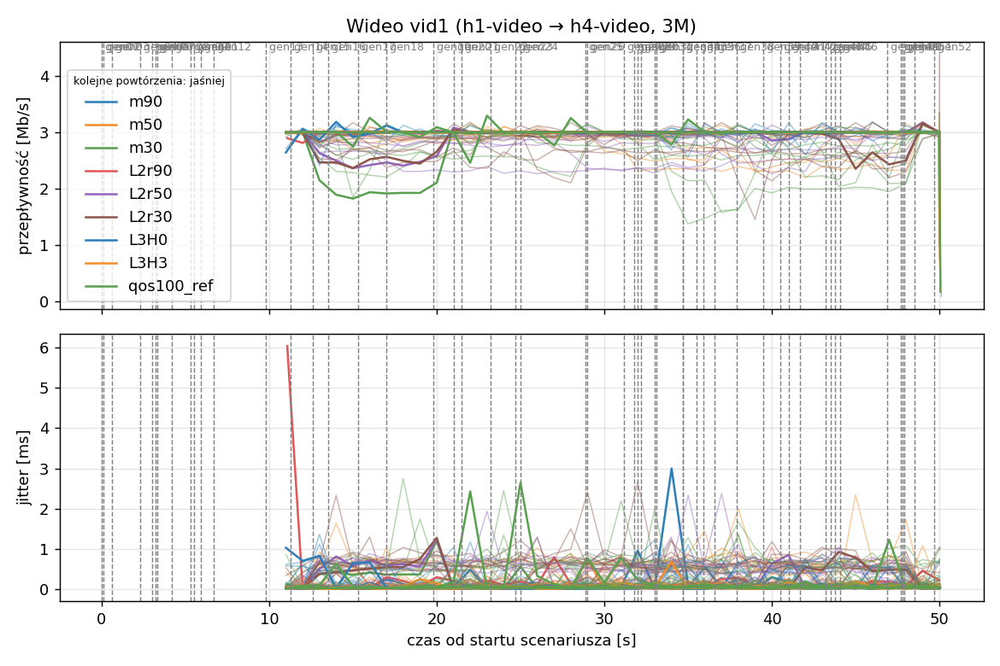
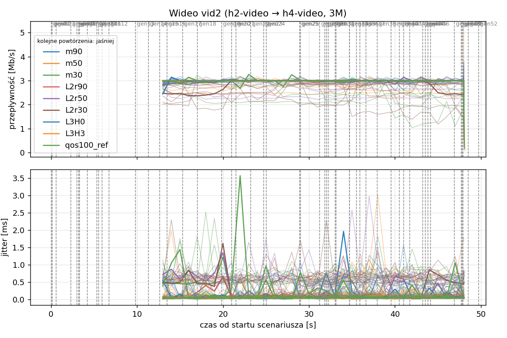
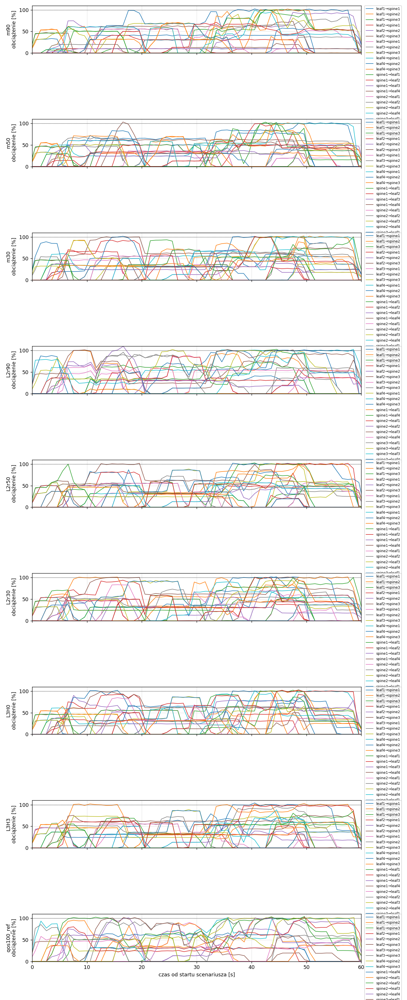
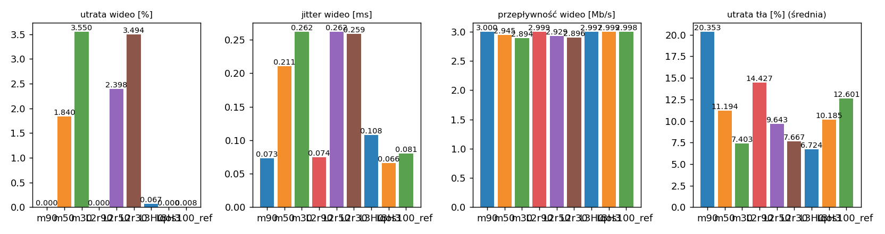

# Raport: clos-sdn

Katalog: `results/official/clos-sdn/20261105_023134`

## 1. Scenariusz

- Topologia: `clos` (sdn: `clos-sdn.clab.yml`)
- Warianty: **m90** (LAYERS=1, POLICY=qos, RESERVE_PCT=90), **m50** (LAYERS=1, POLICY=qos, RESERVE_PCT=50), **m30** (LAYERS=1, POLICY=qos, RESERVE_PCT=30), **L2r90** (LAYERS=2, POLICY=qos, RESERVE_PCT=90), **L2r50** (LAYERS=2, POLICY=qos, RESERVE_PCT=50), **L2r30** (LAYERS=2, POLICY=qos, RESERVE_PCT=30), **L3H0** (HEADROOM_MBPS=0, LAYERS=3, POLICY=qos, RESERVE_PCT=70), **L3H3** (HEADROOM_MBPS=3, LAYERS=3, POLICY=qos, RESERVE_PCT=70), **qos100_ref** (LAYERS=1, POLICY=qos, RESERVE_PCT=100)
- Czas testu: 60 s, warmup (pomijany w statystykach, liczony od startu każdego przepływu): 5 s, powtórzeń: 20, seed: 42
- Wykonane przebiegi: m90/rep1, m90/rep10, m90/rep11, m90/rep12, m90/rep13, m90/rep14, m90/rep15, m90/rep16, m90/rep17, m90/rep18, m90/rep19, m90/rep2, m90/rep20, m90/rep3, m90/rep4, m90/rep5, m90/rep6, m90/rep7, m90/rep8, m90/rep9, m50/rep1, m50/rep10, m50/rep11, m50/rep12, m50/rep13, m50/rep14, m50/rep15, m50/rep16, m50/rep17, m50/rep18, m50/rep19, m50/rep2, m50/rep20, m50/rep3, m50/rep4, m50/rep5, m50/rep6, m50/rep7, m50/rep8, m50/rep9, m30/rep1, m30/rep10, m30/rep11, m30/rep12, m30/rep13, m30/rep14, m30/rep15, m30/rep16, m30/rep17, m30/rep18, m30/rep19, m30/rep2, m30/rep20, m30/rep3, m30/rep4, m30/rep5, m30/rep6, m30/rep7, m30/rep8, m30/rep9, L2r90/rep1, L2r90/rep10, L2r90/rep11, L2r90/rep12, L2r90/rep13, L2r90/rep14, L2r90/rep15, L2r90/rep16, L2r90/rep17, L2r90/rep18, L2r90/rep19, L2r90/rep2, L2r90/rep20, L2r90/rep3, L2r90/rep4, L2r90/rep5, L2r90/rep6, L2r90/rep7, L2r90/rep8, L2r90/rep9, L2r50/rep1, L2r50/rep10, L2r50/rep11, L2r50/rep12, L2r50/rep13, L2r50/rep14, L2r50/rep15, L2r50/rep16, L2r50/rep17, L2r50/rep18, L2r50/rep19, L2r50/rep2, L2r50/rep20, L2r50/rep3, L2r50/rep4, L2r50/rep5, L2r50/rep6, L2r50/rep7, L2r50/rep8, L2r50/rep9, L2r30/rep1, L2r30/rep10, L2r30/rep11, L2r30/rep12, L2r30/rep13, L2r30/rep14, L2r30/rep15, L2r30/rep16, L2r30/rep17, L2r30/rep18, L2r30/rep19, L2r30/rep2, L2r30/rep20, L2r30/rep3, L2r30/rep4, L2r30/rep5, L2r30/rep6, L2r30/rep7, L2r30/rep8, L2r30/rep9, L3H0/rep1, L3H0/rep10, L3H0/rep11, L3H0/rep12, L3H0/rep13, L3H0/rep14, L3H0/rep15, L3H0/rep16, L3H0/rep17, L3H0/rep18, L3H0/rep19, L3H0/rep2, L3H0/rep20, L3H0/rep3, L3H0/rep4, L3H0/rep5, L3H0/rep6, L3H0/rep7, L3H0/rep8, L3H0/rep9, L3H3/rep1, L3H3/rep10, L3H3/rep11, L3H3/rep12, L3H3/rep13, L3H3/rep14, L3H3/rep15, L3H3/rep16, L3H3/rep17, L3H3/rep18, L3H3/rep19, L3H3/rep2, L3H3/rep20, L3H3/rep3, L3H3/rep4, L3H3/rep5, L3H3/rep6, L3H3/rep7, L3H3/rep8, L3H3/rep9, qos100_ref/rep1, qos100_ref/rep10, qos100_ref/rep11, qos100_ref/rep12, qos100_ref/rep13, qos100_ref/rep14, qos100_ref/rep15, qos100_ref/rep16, qos100_ref/rep17, qos100_ref/rep18, qos100_ref/rep19, qos100_ref/rep2, qos100_ref/rep20, qos100_ref/rep3, qos100_ref/rep4, qos100_ref/rep5, qos100_ref/rep6, qos100_ref/rep7, qos100_ref/rep8, qos100_ref/rep9

Harmonogram losowego tła różni się między powtórzeniami (seed + nr powtórzenia, wspólny dla wariantów); poniżej powtórzenie 1.

| id | klasa | źródło → cel | proto | zadana [Mb/s] | DSCP | start–koniec [s] |
|---|---|---|---|---|---|---|
| gen01 | background | h2-bg1 → h3-bg2 | udp | 4.49 | – | 0–7 |
| gen02 | background | h4-bg2 → h3-bg1 | udp | 3.16 | – | 0.1–5.1 |
| gen03 | background | h4-bg1 → h2-bg2 | udp | 5.25 | – | 0.6–5.6 |
| gen04 | background | h4-bg1 → h1-bg2 | udp | 3.56 | – | 2.3–7.3 |
| gen05 | background | h4-bg1 → h3-bg1 | udp | 2.36 | – | 3–60 |
| gen06 | background | h1-bg2 → h2-bg1 | udp | 1.93 | – | 3.2–16.2 |
| gen07 | background | h2-bg1 → h3-bg1 | udp | 1.39 | – | 3.3–8.3 |
| gen08 | background | h1-bg1 → h2-bg1 | udp | 3.29 | – | 4.2–32.2 |
| gen09 | background | h3-bg2 → h2-bg1 | udp | 4.51 | – | 5.3–16.3 |
| gen10 | background | h1-bg2 → h3-bg1 | udp | 3.96 | – | 5.5–10.5 |
| gen11 | background | h2-bg1 → h4-bg2 | udp | 5.85 | – | 5.9–19.9 |
| gen12 | background | h1-bg2 → h3-bg1 | udp | 4.90 | – | 6.7–16.7 |
| gen13 | background | h4-bg1 → h1-bg1 | udp | 3.07 | – | 9.8–19.8 |
| vid1 | video | h1-video → h4-video | udp | 3.00 | 46 | 10–50 |
| gen14 | background | h3-bg2 → h1-bg2 | udp | 5.37 | – | 11.3–27.3 |
| vid2 | video | h2-video → h4-video | udp | 3.00 | 46 | 12–48 |
| gen15 | background | h3-bg1 → h1-bg1 | udp | 3.12 | – | 12.6–30.6 |
| gen16 | background | h2-bg1 → h1-bg1 | udp | 4.96 | – | 13.5–18.5 |
| gen17 | background | h2-bg1 → h4-bg2 | udp | 4.86 | – | 15.3–20.3 |
| gen18 | background | h3-bg2 → h1-bg1 | udp | 3.49 | – | 17–36 |
| gen19 | background | h4-bg2 → h2-bg1 | udp | 2.93 | – | 19.8–48.8 |
| gen20 | background | h1-bg2 → h4-bg2 | udp | 5.68 | – | 21–26 |
| gen21 | background | h4-bg1 → h2-bg1 | udp | 3.04 | – | 21.5–35.5 |
| gen22 | background | h4-bg1 → h2-bg1 | udp | 3.69 | – | 23.2–28.2 |
| gen23 | background | h2-bg2 → h4-bg2 | udp | 1.26 | – | 24.7–44.7 |
| gen24 | background | h3-bg1 → h1-bg2 | udp | 4.88 | – | 25–31 |
| gen25 | background | h4-bg1 → h1-bg2 | udp | 3.51 | – | 28.9–33.9 |
| gen26 | background | h1-bg1 → h4-bg1 | udp | 5.23 | – | 29–59 |
| gen27 | background | h1-bg2 → h4-bg1 | udp | 2.10 | – | 31.2–37.2 |
| gen28 | background | h4-bg1 → h1-bg2 | udp | 1.54 | – | 31.8–36.8 |
| gen29 | background | h4-bg1 → h1-bg2 | udp | 1.53 | – | 32–39 |
| gen30 | background | h1-bg2 → h3-bg1 | udp | 3.69 | – | 32.2–38.2 |
| gen31 | background | h2-bg1 → h4-bg2 | udp | 2.18 | – | 33–38 |
| gen32 | background | h4-bg2 → h3-bg2 | udp | 5.19 | – | 33.1–59.1 |
| gen33 | background | h4-bg2 → h3-bg2 | udp | 2.60 | – | 34.7–40.7 |
| gen34 | background | h2-bg2 → h3-bg2 | udp | 1.75 | – | 34.7–59.7 |
| gen35 | background | h4-bg2 → h2-bg1 | udp | 5.89 | – | 35.5–54.5 |
| gen36 | background | h4-bg2 → h3-bg1 | udp | 4.62 | – | 35.9–49.9 |
| gen37 | background | h1-bg2 → h2-bg2 | udp | 4.50 | – | 36.6–50.6 |
| gen38 | background | h2-bg1 → h4-bg1 | udp | 4.23 | – | 37.9–58.9 |
| gen39 | background | h1-bg2 → h4-bg2 | udp | 5.93 | – | 39.5–44.5 |
| gen40 | background | h1-bg1 → h3-bg1 | udp | 5.99 | – | 40.5–45.5 |
| gen41 | background | h1-bg2 → h3-bg1 | udp | 4.47 | – | 41–50 |
| gen42 | background | h1-bg2 → h3-bg1 | udp | 2.82 | – | 41.7–48.7 |
| gen43 | background | h4-bg2 → h2-bg1 | udp | 4.98 | – | 43.2–49.2 |
| gen44 | background | h4-bg2 → h1-bg2 | udp | 5.97 | – | 43.5–50.5 |
| gen45 | background | h3-bg1 → h4-bg1 | udp | 5.74 | – | 43.8–58.8 |
| gen46 | background | h2-bg1 → h1-bg2 | udp | 1.89 | – | 44.1–49.1 |
| gen47 | background | h2-bg2 → h3-bg1 | udp | 2.94 | – | 46.9–59.9 |
| gen48 | background | h3-bg1 → h1-bg1 | udp | 3.58 | – | 47.7–59.7 |
| gen49 | background | h4-bg1 → h2-bg1 | udp | 5.93 | – | 47.8–57.8 |
| gen50 | background | h4-bg1 → h1-bg1 | udp | 3.20 | – | 47.9–54.9 |
| gen51 | background | h4-bg2 → h3-bg1 | udp | 1.53 | – | 48.5–59.5 |
| gen52 | background | h4-bg2 → h2-bg2 | udp | 2.44 | – | 49.7–59.7 |

## 2. Wideo: QoS według wariantu

Wartości: średnia ± odchylenie standardowe z powtórzeń.

| przepływ | wariant | przepływność [Mb/s] | jitter [ms] | utrata [%] | RTT mediana [ms] | RTT p95 [ms] |
|---|---|---|---|---|---|---|
| vid1 | m90 | 3.00 ± 0.00 | 0.076 ± 0.033 | 0.00 ± 0.00 | 0.031 ± 0.003 | 0.056 ± 0.006 |
| vid1 | m50 | 2.95 ± 0.09 | 0.207 ± 0.177 | 1.54 ± 3.05 | 14.013 ± 24.719 | 34.466 ± 29.163 |
| vid1 | m30 | 2.90 ± 0.12 | 0.252 ± 0.167 | 3.24 ± 4.14 | 16.273 ± 26.013 | 52.069 ± 37.842 |
| vid1 | L2r90 | 3.00 ± 0.00 | 0.074 ± 0.032 | 0.00 ± 0.00 | 0.032 ± 0.003 | 0.058 ± 0.012 |
| vid1 | L2r50 | 2.93 ± 0.10 | 0.250 ± 0.169 | 2.31 ± 3.44 | 19.374 ± 27.292 | 44.438 ± 26.293 |
| vid1 | L2r30 | 2.93 ± 0.09 | 0.263 ± 0.171 | 2.21 ± 3.15 | 20.083 ± 33.081 | 56.196 ± 40.485 |
| vid1 | L3H0 | 3.00 ± 0.00 | 0.095 ± 0.058 | 0.07 ± 0.11 | 0.160 ± 0.574 | 14.923 ± 20.806 |
| vid1 | L3H3 | 3.00 ± 0.00 | 0.067 ± 0.024 | 0.00 ± 0.00 | 0.031 ± 0.002 | 0.054 ± 0.007 |
| vid1 | qos100_ref | 3.00 ± 0.00 | 0.088 ± 0.054 | 0.01 ± 0.05 | 0.032 ± 0.003 | 0.064 ± 0.026 |
| vid2 | m90 | 3.00 ± 0.00 | 0.069 ± 0.026 | 0.00 ± 0.00 | 0.029 ± 0.003 | 0.054 ± 0.006 |
| vid2 | m50 | 2.94 ± 0.12 | 0.215 ± 0.195 | 2.14 ± 4.01 | 15.973 ± 25.713 | 34.682 ± 29.240 |
| vid2 | m30 | 2.88 ± 0.18 | 0.272 ± 0.162 | 3.86 ± 6.00 | 14.046 ± 24.235 | 48.065 ± 31.328 |
| vid2 | L2r90 | 3.00 ± 0.00 | 0.075 ± 0.021 | 0.00 ± 0.00 | 0.030 ± 0.004 | 0.057 ± 0.014 |
| vid2 | L2r50 | 2.93 ± 0.16 | 0.274 ± 0.178 | 2.48 ± 5.48 | 20.351 ± 28.410 | 44.508 ± 26.335 |
| vid2 | L2r30 | 2.86 ± 0.19 | 0.255 ± 0.176 | 4.77 ± 6.47 | 17.467 ± 27.326 | 45.896 ± 25.182 |
| vid2 | L3H0 | 3.00 ± 0.00 | 0.121 ± 0.075 | 0.06 ± 0.15 | 0.239 ± 0.932 | 17.651 ± 19.786 |
| vid2 | L3H3 | 3.00 ± 0.00 | 0.066 ± 0.020 | 0.00 ± 0.00 | 0.028 ± 0.003 | 0.053 ± 0.008 |
| vid2 | qos100_ref | 3.00 ± 0.00 | 0.073 ± 0.054 | 0.00 ± 0.02 | 0.030 ± 0.003 | 0.060 ± 0.027 |

RTT z `ping` co 0,1 s między hostami wideo (osobny przepływ ICMP z tym samym DSCP - w SDN może iść inną ścieżką niż strumień UDP).

## 3. Ruch tła

Agregat tła w obrębie powtórzenia, potem średnia ± odchylenie standardowe po powtórzeniach (utrata = Σ utraconych / Σ wysłanych datagramów; dostarczone = Σ przepływności / Σ zadanych; przepływy trwające nie dłużej niż warmup pominięte).

| wariant | strumieni tła / powt. | dostarczone / zadane [%] | jitter [ms] | utrata [%] |
|---|---|---|---|---|
| m90 | 38 | 79.1 ± 5.1 | 0.225 ± 0.083 | 20.35 ± 5.47 |
| m50 | 38 | 88.8 ± 3.9 | 0.177 ± 0.078 | 11.19 ± 4.29 |
| m30 | 38 | 92.2 ± 3.7 | 0.183 ± 0.066 | 7.40 ± 3.96 |
| L2r90 | 38 | 85.9 ± 4.4 | 0.326 ± 0.102 | 14.43 ± 5.33 |
| L2r50 | 38 | 90.3 ± 4.5 | 0.214 ± 0.081 | 9.64 ± 4.56 |
| L2r30 | 38 | 92.5 ± 3.6 | 0.181 ± 0.078 | 7.67 ± 4.13 |
| L3H0 | 38 | 93.6 ± 3.4 | 0.170 ± 0.057 | 6.72 ± 3.88 |
| L3H3 | 38 | 89.7 ± 3.9 | 0.183 ± 0.064 | 10.19 ± 4.80 |
| qos100_ref | 38 | 87.5 ± 5.7 | 0.335 ± 0.076 | 12.60 ± 6.18 |

## 4. Obciążenie łączy fabricu

Średnia i maksimum z próbek co 1 s w oknie 0–60 s; MLU = maksymalne obciążenie łącza; drops = pakiety odrzucone przez `tbf` na wyjściu łącza.

| wariant | rep | średnie obciążenie łączy [%] | MLU [%] | łącza > 90% | drops tbf | CPU VM śr./maks. [%] |
|---|---|---|---|---|---|---|
| m90 | 1 | 28.5 | 102.3 | 9/24 | 16904 | 16 / 34 |
| m90 | 2 | 35.3 | 104.3 | 14/24 | 14696 | 18 / 33 |
| m90 | 3 | 41.8 | 103.2 | 12/24 | 44701 | 19 / 29 |
| m90 | 4 | 30.1 | 103.2 | 10/24 | 1696 | 16 / 29 |
| m90 | 5 | 32.9 | 102.2 | 10/24 | 18767 | 17 / 28 |
| m90 | 6 | 26.8 | 102.5 | 10/24 | 5155 | 15 / 26 |
| m90 | 7 | 33.1 | 102.8 | 10/24 | 16713 | 16 / 28 |
| m90 | 8 | 31.5 | 101.8 | 11/24 | 2820 | 16 / 37 |
| m90 | 9 | 31.4 | 103.5 | 10/24 | 39480 | 16 / 26 |
| m90 | 10 | 36.0 | 103.4 | 13/24 | 16957 | 17 / 33 |
| m90 | 11 | 32.7 | 103.5 | 11/24 | 39374 | 17 / 30 |
| m90 | 12 | 22.9 | 101.6 | 4/24 | 2842 | 15 / 26 |
| m90 | 13 | 32.9 | 103.8 | 12/24 | 13980 | 17 / 33 |
| m90 | 14 | 34.7 | 102.1 | 15/24 | 13098 | 17 / 30 |
| m90 | 15 | 36.1 | 102.8 | 9/24 | 39893 | 19 / 32 |
| m90 | 16 | 32.5 | 102.9 | 11/24 | 6288 | 16 / 34 |
| m90 | 17 | 36.7 | 102.7 | 11/24 | 9238 | 18 / 52 |
| m90 | 18 | 29.0 | 102.1 | 11/24 | 12810 | 14 / 22 |
| m90 | 19 | 32.8 | 102.5 | 10/24 | 28255 | 15 / 25 |
| m90 | 20 | 38.1 | 103.7 | 13/24 | 24905 | 16 / 30 |
| m50 | 1 | 32.2 | 103.3 | 7/24 | 10910 | 15 / 26 |
| m50 | 2 | 38.8 | 102.9 | 13/24 | 11117 | 18 / 32 |
| m50 | 3 | 47.4 | 103.2 | 13/24 | 26302 | 19 / 31 |
| m50 | 4 | 32.9 | 103.8 | 9/24 | 1132 | 16 / 26 |
| m50 | 5 | 36.6 | 102.6 | 11/24 | 11221 | 17 / 26 |
| m50 | 6 | 29.1 | 101.8 | 6/24 | 3989 | 15 / 27 |
| m50 | 7 | 37.0 | 102.9 | 9/24 | 9192 | 17 / 28 |
| m50 | 8 | 34.3 | 103.7 | 9/24 | 2338 | 16 / 46 |
| m50 | 9 | 33.8 | 102.2 | 10/24 | 34984 | 16 / 25 |
| m50 | 10 | 39.0 | 103.0 | 12/24 | 6822 | 18 / 36 |
| m50 | 11 | 36.3 | 103.3 | 11/24 | 30535 | 17 / 30 |
| m50 | 12 | 27.0 | 101.1 | 4/24 | 2172 | 15 / 28 |
| m50 | 13 | 37.5 | 106.5 | 15/24 | 13337 | 18 / 41 |
| m50 | 14 | 37.3 | 103.5 | 14/24 | 17417 | 18 / 32 |
| m50 | 15 | 41.9 | 104.1 | 13/24 | 23589 | 19 / 32 |
| m50 | 16 | 34.2 | 102.0 | 10/24 | 7661 | 14 / 22 |
| m50 | 17 | 39.6 | 103.1 | 11/24 | 10553 | 15 / 27 |
| m50 | 18 | 31.8 | 102.2 | 9/24 | 6876 | 14 / 22 |
| m50 | 19 | 38.3 | 102.8 | 10/24 | 18117 | 15 / 32 |
| m50 | 20 | 40.1 | 103.3 | 15/24 | 17694 | 16 / 31 |
| m30 | 1 | 33.5 | 102.3 | 11/24 | 15847 | 15 / 27 |
| m30 | 2 | 41.0 | 103.5 | 14/24 | 10014 | 18 / 37 |
| m30 | 3 | 48.7 | 104.8 | 14/24 | 27344 | 19 / 30 |
| m30 | 4 | 34.2 | 101.9 | 8/24 | 2370 | 16 / 27 |
| m30 | 5 | 37.4 | 102.8 | 11/24 | 12798 | 17 / 29 |
| m30 | 6 | 29.8 | 102.7 | 5/24 | 2160 | 15 / 27 |
| m30 | 7 | 37.7 | 102.0 | 12/24 | 10121 | 17 / 28 |
| m30 | 8 | 35.7 | 104.5 | 12/24 | 4532 | 17 / 36 |
| m30 | 9 | 34.6 | 102.8 | 9/24 | 25835 | 17 / 30 |
| m30 | 10 | 40.7 | 103.4 | 13/24 | 7194 | 17 / 33 |
| m30 | 11 | 37.0 | 104.3 | 11/24 | 23818 | 19 / 56 |
| m30 | 12 | 28.0 | 102.7 | 6/24 | 2163 | 15 / 28 |
| m30 | 13 | 38.6 | 103.4 | 10/24 | 9520 | 20 / 51 |
| m30 | 14 | 39.2 | 103.6 | 14/24 | 10193 | 17 / 30 |
| m30 | 15 | 44.1 | 104.4 | 13/24 | 18546 | 19 / 32 |
| m30 | 16 | 35.4 | 102.3 | 8/24 | 7726 | 14 / 37 |
| m30 | 17 | 41.8 | 102.1 | 12/24 | 9203 | 16 / 28 |
| m30 | 18 | 31.6 | 102.3 | 12/24 | 8920 | 13 / 22 |
| m30 | 19 | 39.2 | 102.8 | 11/24 | 12925 | 15 / 25 |
| m30 | 20 | 41.8 | 103.3 | 14/24 | 19471 | 17 / 32 |
| L2r90 | 1 | 32.2 | 109.8 | 12/24 | 23338 | 20 / 41 |
| L2r90 | 2 | 38.7 | 105.7 | 15/24 | 29404 | 18 / 33 |
| L2r90 | 3 | 45.1 | 104.8 | 14/24 | 61036 | 22 / 56 |
| L2r90 | 4 | 32.0 | 103.5 | 15/24 | 9012 | 16 / 26 |
| L2r90 | 5 | 35.1 | 102.7 | 10/24 | 23740 | 17 / 27 |
| L2r90 | 6 | 28.3 | 102.4 | 9/24 | 9454 | 16 / 27 |
| L2r90 | 7 | 34.9 | 103.5 | 13/24 | 19646 | 17 / 31 |
| L2r90 | 8 | 34.2 | 103.1 | 12/24 | 19978 | 17 / 37 |
| L2r90 | 9 | 32.0 | 103.3 | 11/24 | 44590 | 16 / 25 |
| L2r90 | 10 | 38.1 | 102.9 | 15/24 | 34030 | 18 / 34 |
| L2r90 | 11 | 35.2 | 102.7 | 14/24 | 47546 | 16 / 28 |
| L2r90 | 12 | 27.6 | 102.6 | 6/24 | 7779 | 15 / 26 |
| L2r90 | 13 | 36.2 | 103.1 | 15/24 | 16975 | 17 / 28 |
| L2r90 | 14 | 37.4 | 103.3 | 16/24 | 27029 | 17 / 31 |
| L2r90 | 15 | 39.4 | 106.0 | 14/24 | 51218 | 17 / 26 |
| L2r90 | 16 | 34.3 | 102.1 | 12/24 | 18317 | 14 / 23 |
| L2r90 | 17 | 39.7 | 105.4 | 14/24 | 29664 | 18 / 36 |
| L2r90 | 18 | 30.7 | 101.6 | 10/24 | 17053 | 14 / 22 |
| L2r90 | 19 | 36.4 | 102.4 | 13/24 | 39799 | 15 / 25 |
| L2r90 | 20 | 39.4 | 103.6 | 15/24 | 42936 | 16 / 30 |
| L2r50 | 1 | 33.2 | 102.8 | 8/24 | 13136 | 16 / 32 |
| L2r50 | 2 | 40.6 | 103.3 | 14/24 | 14574 | 18 / 34 |
| L2r50 | 3 | 48.1 | 103.6 | 14/24 | 36956 | 20 / 30 |
| L2r50 | 4 | 33.9 | 104.1 | 9/24 | 3369 | 16 / 27 |
| L2r50 | 5 | 35.2 | 102.7 | 10/24 | 16431 | 17 / 27 |
| L2r50 | 6 | 29.2 | 102.8 | 6/24 | 2911 | 16 / 30 |
| L2r50 | 7 | 38.3 | 102.9 | 12/24 | 9445 | 17 / 29 |
| L2r50 | 8 | 35.6 | 102.1 | 9/24 | 2987 | 17 / 42 |
| L2r50 | 9 | 34.3 | 106.2 | 9/24 | 31414 | 17 / 28 |
| L2r50 | 10 | 39.7 | 104.3 | 15/24 | 16459 | 18 / 38 |
| L2r50 | 11 | 36.7 | 102.8 | 13/24 | 33258 | 17 / 36 |
| L2r50 | 12 | 27.7 | 102.1 | 5/24 | 2305 | 15 / 28 |
| L2r50 | 13 | 37.4 | 102.7 | 13/24 | 14874 | 17 / 27 |
| L2r50 | 14 | 38.5 | 102.4 | 14/24 | 11665 | 18 / 36 |
| L2r50 | 15 | 41.5 | 104.2 | 12/24 | 37000 | 18 / 36 |
| L2r50 | 16 | 35.3 | 101.5 | 10/24 | 7284 | 14 / 23 |
| L2r50 | 17 | 39.6 | 103.3 | 14/24 | 10603 | 15 / 26 |
| L2r50 | 18 | 31.6 | 103.0 | 8/24 | 12310 | 14 / 23 |
| L2r50 | 19 | 37.0 | 102.1 | 10/24 | 23614 | 15 / 25 |
| L2r50 | 20 | 41.4 | 104.0 | 16/24 | 28251 | 16 / 36 |
| L2r30 | 1 | 34.1 | 102.4 | 14/24 | 10887 | 16 / 28 |
| L2r30 | 2 | 40.9 | 103.7 | 15/24 | 11206 | 18 / 33 |
| L2r30 | 3 | 48.2 | 103.0 | 15/24 | 34428 | 20 / 32 |
| L2r30 | 4 | 33.6 | 104.8 | 8/24 | 583 | 17 / 31 |
| L2r30 | 5 | 37.5 | 104.0 | 11/24 | 15938 | 17 / 27 |
| L2r30 | 6 | 29.4 | 101.6 | 5/24 | 1832 | 15 / 28 |
| L2r30 | 7 | 37.6 | 103.3 | 7/24 | 11880 | 17 / 28 |
| L2r30 | 8 | 35.3 | 103.7 | 9/24 | 8138 | 17 / 39 |
| L2r30 | 9 | 35.0 | 102.1 | 12/24 | 32686 | 16 / 24 |
| L2r30 | 10 | 40.4 | 103.8 | 15/24 | 10459 | 18 / 38 |
| L2r30 | 11 | 38.7 | 102.7 | 16/24 | 17380 | 17 / 30 |
| L2r30 | 12 | 28.5 | 101.9 | 4/24 | 0 | 15 / 26 |
| L2r30 | 13 | 38.1 | 103.3 | 11/24 | 12888 | 17 / 28 |
| L2r30 | 14 | 38.7 | 102.8 | 18/24 | 15331 | 18 / 32 |
| L2r30 | 15 | 42.3 | 103.1 | 13/24 | 36121 | 17 / 28 |
| L2r30 | 16 | 35.7 | 110.7 | 12/24 | 6321 | 18 / 50 |
| L2r30 | 17 | 42.4 | 102.2 | 11/24 | 6504 | 15 / 28 |
| L2r30 | 18 | 32.2 | 102.9 | 10/24 | 4548 | 13 / 22 |
| L2r30 | 19 | 38.9 | 102.5 | 10/24 | 15120 | 15 / 24 |
| L2r30 | 20 | 41.5 | 103.2 | 16/24 | 32990 | 16 / 30 |
| L3H0 | 1 | 34.2 | 103.4 | 13/24 | 9547 | 16 / 29 |
| L3H0 | 2 | 41.4 | 103.5 | 18/24 | 8098 | 18 / 34 |
| L3H0 | 3 | 49.3 | 103.2 | 17/24 | 23696 | 20 / 32 |
| L3H0 | 4 | 33.8 | 103.0 | 8/24 | 6109 | 16 / 27 |
| L3H0 | 5 | 38.5 | 107.8 | 12/24 | 6932 | 17 / 40 |
| L3H0 | 6 | 29.9 | 102.3 | 9/24 | 2648 | 15 / 25 |
| L3H0 | 7 | 38.8 | 102.1 | 13/24 | 5753 | 17 / 29 |
| L3H0 | 8 | 36.1 | 103.6 | 13/24 | 4502 | 17 / 39 |
| L3H0 | 9 | 35.7 | 103.0 | 13/24 | 22325 | 17 / 26 |
| L3H0 | 10 | 41.6 | 106.1 | 14/24 | 7171 | 29 / 91 |
| L3H0 | 11 | 39.1 | 104.5 | 16/24 | 18895 | 17 / 31 |
| L3H0 | 12 | 28.2 | 102.5 | 8/24 | 2978 | 15 / 25 |
| L3H0 | 13 | 38.4 | 102.3 | 13/24 | 10457 | 17 / 27 |
| L3H0 | 14 | 39.0 | 103.3 | 17/24 | 12769 | 17 / 31 |
| L3H0 | 15 | 42.5 | 103.2 | 14/24 | 30708 | 16 / 27 |
| L3H0 | 16 | 35.9 | 102.3 | 14/24 | 4922 | 14 / 22 |
| L3H0 | 17 | 42.1 | 104.2 | 10/24 | 8994 | 16 / 27 |
| L3H0 | 18 | 31.8 | 103.2 | 11/24 | 8878 | 14 / 24 |
| L3H0 | 19 | 39.7 | 102.1 | 12/24 | 18507 | 15 / 25 |
| L3H0 | 20 | 42.9 | 102.7 | 20/24 | 14170 | 16 / 31 |
| L3H3 | 1 | 33.5 | 104.2 | 5/24 | 10139 | 16 / 33 |
| L3H3 | 2 | 39.6 | 103.2 | 13/24 | 11494 | 18 / 33 |
| L3H3 | 3 | 46.8 | 102.8 | 11/24 | 32530 | 19 / 30 |
| L3H3 | 4 | 33.2 | 102.7 | 9/24 | 5522 | 16 / 28 |
| L3H3 | 5 | 37.8 | 102.5 | 10/24 | 11341 | 17 / 28 |
| L3H3 | 6 | 28.7 | 101.6 | 5/24 | 7300 | 16 / 26 |
| L3H3 | 7 | 38.0 | 103.0 | 10/24 | 7964 | 17 / 32 |
| L3H3 | 8 | 34.4 | 108.8 | 8/24 | 3694 | 17 / 41 |
| L3H3 | 9 | 35.4 | 103.9 | 9/24 | 24685 | 17 / 27 |
| L3H3 | 10 | 40.2 | 102.4 | 12/24 | 11137 | 18 / 36 |
| L3H3 | 11 | 36.7 | 104.6 | 11/24 | 23158 | 17 / 35 |
| L3H3 | 12 | 27.7 | 101.7 | 4/24 | 289 | 15 / 26 |
| L3H3 | 13 | 37.5 | 102.2 | 9/24 | 13680 | 17 / 28 |
| L3H3 | 14 | 38.2 | 104.4 | 12/24 | 15364 | 17 / 33 |
| L3H3 | 15 | 41.1 | 103.0 | 10/24 | 36371 | 16 / 26 |
| L3H3 | 16 | 35.3 | 102.5 | 8/24 | 5069 | 15 / 28 |
| L3H3 | 17 | 41.5 | 103.1 | 11/24 | 16004 | 15 / 26 |
| L3H3 | 18 | 32.1 | 101.8 | 8/24 | 7660 | 14 / 23 |
| L3H3 | 19 | 38.3 | 102.3 | 10/24 | 23867 | 15 / 26 |
| L3H3 | 20 | 40.9 | 102.9 | 14/24 | 20371 | 16 / 33 |
| qos100_ref | 1 | 32.4 | 104.1 | 13/24 | 26317 | 23 / 67 |
| qos100_ref | 2 | 39.6 | 105.6 | 16/24 | 28368 | 19 / 35 |
| qos100_ref | 3 | 45.7 | 104.9 | 14/24 | 58462 | 20 / 32 |
| qos100_ref | 4 | 33.2 | 102.8 | 13/24 | 11214 | 17 / 28 |
| qos100_ref | 5 | 35.9 | 103.4 | 10/24 | 30023 | 17 / 29 |
| qos100_ref | 6 | 29.1 | 103.2 | 10/24 | 10284 | 16 / 28 |
| qos100_ref | 7 | 37.1 | 107.5 | 15/24 | 22087 | 19 / 53 |
| qos100_ref | 8 | 35.1 | 103.8 | 13/24 | 13923 | 17 / 40 |
| qos100_ref | 9 | 32.9 | 102.2 | 11/24 | 47518 | 16 / 24 |
| qos100_ref | 10 | 39.5 | 104.3 | 16/24 | 22886 | 19 / 39 |
| qos100_ref | 11 | 34.8 | 102.7 | 14/24 | 57536 | 17 / 31 |
| qos100_ref | 12 | 28.3 | 102.1 | 12/24 | 3863 | 15 / 30 |
| qos100_ref | 13 | 36.5 | 102.8 | 15/24 | 29169 | 17 / 27 |
| qos100_ref | 14 | 37.5 | 106.6 | 15/24 | 26904 | 18 / 32 |
| qos100_ref | 15 | 39.4 | 102.3 | 13/24 | 61604 | 17 / 28 |
| qos100_ref | 16 | 34.7 | 103.5 | 15/24 | 16622 | 17 / 30 |
| qos100_ref | 17 | 40.1 | 103.8 | 14/24 | 29630 | 16 / 27 |
| qos100_ref | 18 | 31.1 | 102.8 | 10/24 | 17898 | 14 / 24 |
| qos100_ref | 19 | 36.8 | 103.8 | 12/24 | 39042 | 16 / 25 |
| qos100_ref | 20 | 39.3 | 104.3 | 14/24 | 47976 | 17 / 32 |

Łącza z obciążeniem > 10% (maksimum [%] / drops, powtórzenie 1):

| łącze | m90 | m50 | m30 | L2r90 | L2r50 | L2r30 | L3H0 | L3H3 | qos100_ref |
|---|---|---|---|---|---|---|---|---|---|
| leaf1→spine1 | 42 / 0 | 80 / 0 | 70 / 0 | 41 / 0 | 83 / 0 | 102 / 0 | 102 / 56 | 70 / 0 | 35 / 2 |
| leaf1→spine2 | 100 / 747 | 85 / 0 | 102 / 2370 | 100 / 317 | 55 / 0 | 101 / 290 | 101 / 730 | 102 / 554 | 103 / 288 |
| leaf1→spine3 | 101 / 1719 | 103 / 2170 | 100 / 269 | 103 / 2023 | 103 / 1733 | 101 / 264 | 102 / 1702 | 59 / 0 | 104 / 4142 |
| leaf2→spine1 | 41 / 0 | 81 / 0 | 92 / 0 | 34 / 0 | 83 / 0 | 94 / 0 | 93 / 0 | 72 / 0 | 34 / 0 |
| leaf2→spine2 | 94 / 0 | 62 / 0 | 51 / 0 | 110 / 434 | 59 / 0 | 55 / 0 | 63 / 0 | 54 / 0 | 101 / 495 |
| leaf2→spine3 | 51 / 0 | 103 / 0 | 75 / 0 | 94 / 0 | 62 / 0 | 76 / 0 | 51 / 0 | 75 / 0 | 52 / 0 |
| leaf3→spine1 | 11 / 0 | 51 / 0 | 71 / 0 | 0 / 0 | 33 / 0 | 61 / 0 | 57 / 0 | 33 / 0 | 0 / 0 |
| leaf3→spine2 | 57 / 0 | 60 / 0 | 60 / 0 | 89 / 0 | 57 / 0 | 33 / 0 | 38 / 0 | 61 / 0 | 90 / 8 |
| leaf3→spine3 | 70 / 0 | 51 / 0 | 38 / 0 | 91 / 0 | 88 / 0 | 93 / 0 | 88 / 0 | 89 / 0 | 92 / 129 |
| leaf4→spine1 | 11 / 0 | 51 / 0 | 71 / 0 | 11 / 0 | 51 / 0 | 71 / 0 | 103 / 0 | 71 / 0 | 0 / 0 |
| leaf4→spine2 | 102 / 10750 | 102 / 3493 | 102 / 4324 | 103 / 13462 | 102 / 7944 | 102 / 4638 | 103 / 4484 | 104 / 6360 | 102 / 10058 |
| leaf4→spine3 | 102 / 3321 | 101 / 3102 | 102 / 4449 | 101 / 4633 | 102 / 1468 | 102 / 3443 | 103 / 950 | 103 / 3095 | 101 / 7714 |
| spine1→leaf1 | 10 / 0 | 51 / 0 | 72 / 0 | 11 / 0 | 51 / 0 | 60 / 0 | 57 / 0 | 70 / 0 | 0 / 0 |
| spine1→leaf2 | 10 / 0 | 51 / 0 | 67 / 0 | 0 / 0 | 51 / 0 | 55 / 0 | 93 / 0 | 34 / 0 | 0 / 0 |
| spine1→leaf3 | 11 / 0 | 51 / 0 | 71 / 0 | 0 / 0 | 51 / 0 | 70 / 0 | 90 / 0 | 64 / 0 | 0 / 0 |
| spine1→leaf4 | 74 / 0 | 63 / 0 | 102 / 1454 | 73 / 0 | 102 / 803 | 101 / 2177 | 99 / 107 | 64 / 0 | 71 / 27 |
| spine2→leaf1 | 68 / 0 | 37 / 0 | 57 / 0 | 89 / 0 | 63 / 0 | 84 / 0 | 85 / 0 | 56 / 0 | 90 / 0 |
| spine2→leaf2 | 83 / 0 | 68 / 0 | 86 / 0 | 73 / 0 | 73 / 0 | 73 / 0 | 66 / 0 | 96 / 0 | 103 / 140 |
| spine2→leaf3 | 101 / 219 | 83 / 0 | 101 / 927 | 102 / 1485 | 100 / 0 | 94 / 0 | 101 / 233 | 74 / 0 | 103 / 7 |
| spine2→leaf4 | 100 / 6 | 101 / 1636 | 101 / 1464 | 67 / 0 | 58 / 0 | 90 / 0 | 101 / 0 | 88 / 130 | 101 / 516 |
| spine3→leaf1 | 99 / 0 | 83 / 0 | 102 / 590 | 96 / 0 | 87 / 0 | 92 / 0 | 89 / 0 | 87 / 0 | 102 / 1212 |
| spine3→leaf2 | 70 / 0 | 70 / 0 | 89 / 0 | 102 / 603 | 98 / 0 | 93 / 0 | 65 / 0 | 64 / 0 | 72 / 0 |
| spine3→leaf3 | 100 / 142 | 101 / 364 | 100 / 0 | 96 / 0 | 100 / 0 | 100 / 75 | 86 / 0 | 85 / 0 | 101 / 430 |
| spine3→leaf4 | 71 / 0 | 100 / 145 | 101 / 0 | 101 / 381 | 102 / 1188 | 100 / 0 | 102 / 1285 | 99 / 0 | 102 / 1149 |

## 5. Ścieżki wybrane przez kontroler (powtórzenie 1)

Z logu kontrolera (linie `Flow`), dopasowane po piątce przepływu; ✓ = reguły widoczne w `dump-flows` na tych samych przełącznikach.

| przepływ | m90 | m50 | m30 | L2r90 | L2r50 | L2r30 | L3H0 | L3H3 | qos100_ref |
|---|---|---|---|---|---|---|---|---|---|
| gen01 | leaf2 -> spine3 -> leaf3 ✓ (loads 0% 5% 0%) | leaf2 -> spine3 -> leaf3 ✓ (loads 0% 5% 0%) | leaf2 -> spine3 -> leaf3 ✓ (loads 0% 5% 0%) | leaf2 -> spine3 -> leaf3 ✓ (loads 0% 20% 0%) | leaf2 -> spine3 -> leaf3 ✓ (loads 0% 20% 0%) | leaf2 -> spine3 -> leaf3 ✓ (loads 0% 20% 0%) | leaf2 -> spine3 -> leaf3 ✓ (loads 0% 20% 0%) | leaf2 -> spine1 -> leaf3 ✓ (loads 0% 20% 20%) | leaf2 -> spine3 -> leaf3 ✓ (loads 0% 5% 0%) |
| gen02 | leaf4 -> spine2 -> leaf3 ✓ (loads 5% 5% 5%) | leaf4 -> spine2 -> leaf3 ✓ (loads 5% 5% 5%) | leaf4 -> spine2 -> leaf3 ✓ (loads 5% 0% 3%) | leaf4 -> spine3 -> leaf3 ✓ (loads 0% 40% 20%) | leaf4 -> spine2 -> leaf3 ✓ (loads 20% 20% 20%) | leaf4 -> spine2 -> leaf3 ✓ (loads 20% 20% 20%) | leaf4 -> spine2 -> leaf3 ✓ (loads 20% 20% 20%) | leaf4 -> spine2 -> leaf3 ✓ (loads 20% 20% 20%) | leaf4 -> spine3 -> leaf3 ✓ (loads 0% 10% 5%) |
| gen03 | leaf4 -> spine3 -> leaf2 ✓ (loads 5% 10% 5%) | leaf4 -> spine3 -> leaf2 ✓ (loads 5% 10% 5%) | leaf4 -> spine2 -> leaf2 ✓ (loads 5% 5% 5%) | leaf4 -> spine3 -> leaf2 ✓ (loads 0% 40% 20%) | leaf4 -> spine1 -> leaf2 ✓ (loads 20% 32% 40%) | leaf4 -> spine1 -> leaf2 ✓ (loads 20% 32% 40%) | leaf4 -> spine3 -> leaf2 ✓ (loads 20% 40% 20%) | leaf4 -> spine3 -> leaf2 ✓ (loads 20% 40% 20%) | leaf4 -> spine3 -> leaf2 ✓ (loads 0% 10% 5%) |
| gen04 | leaf4 -> spine1 -> leaf1 ✓ (loads 5% 33% 54%) | leaf4 -> spine1 -> leaf1 ✓ (loads 5% 32% 54%) | leaf4 -> spine1 -> leaf1 ✓ (loads 0% 87% 5%) | leaf4 -> spine2 -> leaf1 ✓ (loads 0% 58% 127%) | leaf4 -> spine3 -> leaf1 ✓ (loads 86% 53% 39%) | leaf4 -> spine3 -> leaf1 ✓ (loads 88% 53% 39%) | leaf4 -> spine1 -> leaf1 ✓ (loads 38% 73% 74%) | leaf4 -> spine1 -> leaf1 ✓ (loads 18% 72% 94%) | leaf4 -> spine2 -> leaf1 ✓ (loads 0% 5% 87%) |
| gen05 | leaf4 -> spine1 -> leaf3 ✓ (loads 13% 33% 54%) | leaf4 -> spine1 -> leaf3 ✓ (loads 30% 33% 54%) | leaf4 -> spine1 -> leaf3 ✓ (loads 10% 87% 46%) | leaf4 -> spine2 -> leaf3 ✓ (loads 0% 99% 107%) | leaf4 -> spine2 -> leaf3 ✓ (loads 70% 50% 65%) | leaf4 -> spine3 -> leaf3 ✓ (loads 74% 50% 46%) | leaf4 -> spine1 -> leaf3 ✓ (loads 58% 69% 74%) | leaf4 -> spine2 -> leaf3 ✓ (loads 68% 53% 74%) | leaf4 -> spine2 -> leaf3 ✓ (loads 0% 16% 87%) |
| gen06 | leaf1 -> spine2 -> leaf2 ✓ (loads 5% 0% 54%) | leaf1 -> spine2 -> leaf2 ✓ (loads 5% 0% 54%) | leaf1 -> spine1 -> leaf2 ✓ (loads 0% 54% 5%) | leaf1 -> spine2 -> leaf2 ✓ (loads 0% 35% 54%) | leaf1 -> spine2 -> leaf2 ✓ (loads 50% 17% 37%) | leaf1 -> spine2 -> leaf2 ✓ (loads 54% 17% 37%) | leaf1 -> spine2 -> leaf2 ✓ (loads 18% 17% 54%) | leaf1 -> spine2 -> leaf2 ✓ (loads 36% 16% 54%) | leaf1 -> spine2 -> leaf2 ✓ (loads 0% 5% 54%) |
| gen07 | leaf2 -> spine2 -> leaf3 ✓ (loads 10% 37% 46%) | leaf2 -> spine1 -> leaf3 ✓ (loads 15% 33% 46%) | leaf2 -> spine1 -> leaf3 ✓ (loads 7% 32% 46%) | leaf2 -> spine2 -> leaf3 ✓ (loads 0% 50% 79%) | leaf2 -> spine3 -> leaf3 ✓ (loads 34% 67% 46%) | leaf2 -> spine1 -> leaf3 ✓ (loads 34% 50% 63%) | leaf2 -> spine1 -> leaf3 ✓ (loads 34% 49% 46%) | leaf2 -> spine3 -> leaf3 ✓ (loads 62% 49% 32%) | leaf2 -> spine2 -> leaf3 ✓ (loads 0% 15% 79%) |
| gen08 | leaf1 -> spine1 -> leaf2 ✓ (loads 5% 17% 54%) | leaf1 -> spine1 -> leaf2 ✓ (loads 5% 14% 54%) | leaf1 -> spine3 -> leaf2 ✓ (loads 18% 54% 5%) | leaf1 -> spine3 -> leaf2 ✓ (loads 0% 84% 69%) | leaf1 -> spine2 -> leaf2 ✓ (loads 50% 41% 52%) | leaf1 -> spine2 -> leaf2 ✓ (loads 54% 40% 52%) | leaf1 -> spine1 -> leaf2 ✓ (loads 33% 65% 54%) | leaf1 -> spine2 -> leaf2 ✓ (loads 51% 43% 54%) | leaf1 -> spine2 -> leaf2 ✓ (loads 0% 13% 54%) |
| gen09 | leaf3 -> spine1 -> leaf2 ✓ (loads 14% 20% 54%) | leaf3 -> spine2 -> leaf2 ✓ (loads 26% 25% 54%) | leaf3 -> spine1 -> leaf2 ✓ (loads 25% 54% 30%) | leaf3 -> spine2 -> leaf2 ✓ (loads 0% 98% 111%) | leaf3 -> spine3 -> leaf2 ✓ (loads 50% 80% 62%) | leaf3 -> spine1 -> leaf2 ✓ (loads 54% 79% 62%) | leaf3 -> spine3 -> leaf2 ✓ (loads 70% 71% 66%) | leaf3 -> spine3 -> leaf2 ✓ (loads 60% 86% 54%) | leaf3 -> spine2 -> leaf2 ✓ (loads 0% 39% 54%) |
| gen10 | leaf1 -> spine2 -> leaf3 ✓ (loads 14% 47% 51%) | leaf1 -> spine1 -> leaf3 ✓ (loads 40% 43% 46%) | leaf1 -> spine2 -> leaf3 ✓ (loads 43% 43% 46%) | leaf1 -> spine2 -> leaf3 ✓ (loads 0% 105% 113%) | leaf1 -> spine3 -> leaf3 ✓ (loads 41% 91% 90%) | leaf1 -> spine1 -> leaf3 ✓ (loads 60% 103% 88%) | leaf1 -> spine2 -> leaf3 ✓ (loads 90% 62% 71%) | leaf1 -> spine3 -> leaf3 ✓ (loads 62% 86% 71%) | leaf1 -> spine2 -> leaf3 ✓ (loads 0% 54% 79%) |
| gen11 | leaf2 -> spine2 -> leaf4 ✓ (loads 10% 19% 46%) | leaf2 -> spine2 -> leaf4 ✓ (loads 19% 10% 46%) | leaf2 -> spine1 -> leaf4 ✓ (loads 14% 15% 46%) | leaf2 -> spine2 -> leaf4 ✓ (loads 0% 26% 98%) | leaf2 -> spine1 -> leaf4 ✓ (loads 23% 30% 73%) | leaf2 -> spine1 -> leaf4 ✓ (loads 25% 55% 46%) | leaf2 -> spine1 -> leaf4 ✓ (loads 25% 27% 73%) | leaf2 -> spine3 -> leaf4 ✓ (loads 46% 42% 36%) | leaf2 -> spine2 -> leaf4 ✓ (loads 0% 19% 46%) |
| gen12 | leaf1 -> spine3 -> leaf3 ✓ (loads 10% 47% 46%) | leaf1 -> spine2 -> leaf3 ✓ (loads 43% 25% 46%) | leaf1 -> spine2 -> leaf3 ✓ (loads 38% 30% 46%) | leaf1 -> spine2 -> leaf3 ✓ (loads 0% 83% 83%) | leaf1 -> spine1 -> leaf3 ✓ (loads 34% 54% 125%) | leaf1 -> spine2 -> leaf3 ✓ (loads 76% 62% 71%) | leaf1 -> spine1 -> leaf3 ✓ (loads 39% 58% 71%) | leaf1 -> spine2 -> leaf3 ✓ (loads 56% 54% 60%) | leaf1 -> spine3 -> leaf3 ✓ (loads 0% 95% 51%) |
| gen13 | leaf4 -> spine3 -> leaf1 ✓ (loads 10% 5% 0%) | leaf4 -> spine3 -> leaf1 ✓ (loads 24% 5% 0%) | leaf4 -> spine3 -> leaf1 ✓ (loads 24% 5% 0%) | leaf4 -> spine1 -> leaf1 ✓ (loads 0% 24% 7%) | leaf4 -> spine1 -> leaf1 ✓ (loads 0% 24% 7%) | leaf4 -> spine1 -> leaf1 ✓ (loads 0% 7% 24%) | leaf4 -> spine3 -> leaf1 ✓ (loads 24% 7% 0%) | leaf4 -> spine1 -> leaf1 ✓ (loads 0% 24% 6%) | leaf4 -> spine3 -> leaf1 ✓ (loads 0% 24% 5%) |
| vid1 | leaf1 -> spine1 -> leaf4 ✓ (loads 10% 61% 56%) | leaf1 -> spine1 -> leaf4 ✓ (loads 50% 70% 5%) | leaf1 -> spine1 -> leaf4 ✓ (loads 59% 91% 49%) | leaf1 -> spine1 -> leaf4 ✓ (loads 7% 99% 47%) | leaf1 -> spine1 -> leaf4 ✓ (loads 50% 61% 55%) | leaf1 -> spine1 -> leaf4 ✓ (loads 60% 100% 20%) | leaf1 -> spine1 -> leaf4 ✓ (loads 84% 61% 20%) | leaf1 -> spine1 -> leaf4 ✓ (loads 18% 100% 60%) | leaf1 -> spine1 -> leaf4 ✓ (loads 0% 95% 66%) |
| gen14 | leaf3 -> spine2 -> leaf1 ✓ (loads 10% 5% 32%) | leaf3 -> spine1 -> leaf1 ✓ (loads 10% 47% 32%) | leaf3 -> spine2 -> leaf1 ✓ (loads 46% 5% 32%) | leaf3 -> spine3 -> leaf1 ✓ (loads 17% 43% 26%) | leaf3 -> spine2 -> leaf1 ✓ (loads 37% 8% 47%) | leaf3 -> spine3 -> leaf1 ✓ (loads 46% 13% 6%) | leaf3 -> spine1 -> leaf1 ✓ (loads 6% 14% 47%) | leaf3 -> spine2 -> leaf1 ✓ (loads 42% 6% 47%) | leaf3 -> spine3 -> leaf1 ✓ (loads 5% 46% 31%) |
| vid2 | leaf2 -> spine1 -> leaf4 ✓ (loads 31% 60% 0%) | leaf2 -> spine1 -> leaf4 ✓ (loads 31% 60% 5%) | leaf2 -> spine1 -> leaf4 ✓ (loads 91% 5% 0%) | leaf2 -> spine1 -> leaf4 ✓ (loads 67% 56% 20%) | leaf2 -> spine1 -> leaf4 ✓ (loads 111% 13% 14%) | leaf2 -> spine1 -> leaf4 ✓ (loads 121% 7% 20%) | leaf2 -> spine1 -> leaf4 ✓ (loads 122% 6% 20%) | leaf2 -> spine1 -> leaf4 ✓ (loads 79% 5% 60%) | leaf2 -> spine1 -> leaf4 ✓ (loads 31% 60% 5%) |
| gen15 | leaf3 -> spine3 -> leaf1 ✓ (loads 10% 42% 37%) | leaf3 -> spine1 -> leaf1 ✓ (loads 35% 46% 37%) | leaf3 -> spine3 -> leaf1 ✓ (loads 46% 45% 37%) | leaf3 -> spine3 -> leaf1 ✓ (loads 10% 58% 52%) | leaf3 -> spine1 -> leaf1 ✓ (loads 37% 71% 46%) | leaf3 -> spine2 -> leaf1 ✓ (loads 46% 6% 67%) | leaf3 -> spine2 -> leaf1 ✓ (loads 46% 6% 46%) | leaf3 -> spine1 -> leaf1 ✓ (loads 37% 37% 46%) | leaf3 -> spine3 -> leaf1 ✓ (loads 0% 52% 50%) |
| gen16 | leaf2 -> spine1 -> leaf1 ✓ (loads 35% 60% 46%) | leaf2 -> spine3 -> leaf1 ✓ (loads 50% 60% 37%) | leaf2 -> spine3 -> leaf1 ✓ (loads 91% 55% 53%) | leaf2 -> spine2 -> leaf1 ✓ (loads 61% 65% 90%) | leaf2 -> spine3 -> leaf1 ✓ (loads 95% 71% 5%) | leaf2 -> spine2 -> leaf1 ✓ (loads 104% 19% 67%) | leaf2 -> spine2 -> leaf1 ✓ (loads 116% 27% 32%) | leaf2 -> spine1 -> leaf1 ✓ (loads 59% 68% 60%) | leaf2 -> spine2 -> leaf1 ✓ (loads 23% 65% 87%) |
| gen17 | leaf2 -> spine3 -> leaf4 ✓ (loads 62% 60% 5%) | leaf2 -> spine3 -> leaf4 ✓ (loads 62% 60% 56%) | leaf2 -> spine2 -> leaf4 ✓ (loads 100% 5% 51%) | leaf2 -> spine3 -> leaf4 ✓ (loads 62% 110% 7%) | leaf2 -> spine2 -> leaf4 ✓ (loads 100% 7% 62%) | leaf2 -> spine3 -> leaf4 ✓ (loads 100% 61% 6%) | leaf2 -> spine3 -> leaf4 ✓ (loads 101% 63% 7%) | leaf2 -> spine2 -> leaf4 ✓ (loads 82% 7% 60%) | leaf2 -> spine3 -> leaf4 ✓ (loads 62% 99% 5%) |
| gen18 | leaf3 -> spine3 -> leaf1 ✓ (loads 10% 65% 64%) | leaf3 -> spine2 -> leaf1 ✓ (loads 50% 19% 82%) | leaf3 -> spine1 -> leaf1 ✓ (loads 51% 60% 99%) | leaf3 -> spine2 -> leaf1 ✓ (loads 10% 56% 95%) | leaf3 -> spine3 -> leaf1 ✓ (loads 50% 63% 58%) | leaf3 -> spine3 -> leaf1 ✓ (loads 46% 83% 73%) | leaf3 -> spine3 -> leaf1 ✓ (loads 55% 83% 50%) | leaf3 -> spine3 -> leaf1 ✓ (loads 70% 62% 35%) | leaf3 -> spine2 -> leaf1 ✓ (loads 0% 53% 100%) |
| gen19 | leaf4 -> spine2 -> leaf2 ✓ (loads 10% 5% 32%) | leaf4 -> spine2 -> leaf2 ✓ (loads 34% 5% 32%) | leaf4 -> spine2 -> leaf2 ✓ (loads 24% 5% 34%) | leaf4 -> spine2 -> leaf2 ✓ (loads 10% 32% 34%) | leaf4 -> spine3 -> leaf2 ✓ (loads 32% 34% 7%) | leaf4 -> spine1 -> leaf2 ✓ (loads 32% 34% 33%) | leaf4 -> spine2 -> leaf2 ✓ (loads 34% 9% 32%) | leaf4 -> spine3 -> leaf2 ✓ (loads 32% 34% 7%) | leaf4 -> spine2 -> leaf2 ✓ (loads 0% 34% 37%) |
| gen20 | leaf1 -> spine2 -> leaf4 ✓ (loads 62% 51% 55%) | leaf1 -> spine2 -> leaf4 ✓ (loads 65% 0% 20%) | leaf1 -> spine3 -> leaf4 ✓ (loads 98% 50% 39%) | leaf1 -> spine2 -> leaf4 ✓ (loads 70% 56% 66%) | leaf1 -> spine3 -> leaf4 ✓ (loads 82% 39% 30%) | leaf1 -> spine3 -> leaf4 ✓ (loads 83% 42% 40%) | leaf1 -> spine2 -> leaf4 ✓ (loads 65% 25% 26%) | leaf1 -> spine3 -> leaf4 ✓ (loads 62% 43% 24%) | leaf1 -> spine3 -> leaf4 ✓ (loads 62% 39% 36%) |
| gen21 | leaf4 -> spine3 -> leaf2 ✓ (loads 10% 30% 5%) | leaf4 -> spine3 -> leaf2 ✓ (loads 34% 30% 15%) | leaf4 -> spine1 -> leaf2 ✓ (loads 29% 30% 34%) | leaf4 -> spine3 -> leaf2 ✓ (loads 6% 85% 42%) | leaf4 -> spine1 -> leaf2 ✓ (loads 16% 34% 59%) | leaf4 -> spine3 -> leaf2 ✓ (loads 47% 42% 41%) | leaf4 -> spine3 -> leaf2 ✓ (loads 34% 55% 19%) | leaf4 -> spine1 -> leaf2 ✓ (loads 23% 34% 51%) | leaf4 -> spine3 -> leaf2 ✓ (loads 0% 55% 5%) |
| gen22 | leaf4 -> spine3 -> leaf2 ✓ (loads 10% 35% 31%) | leaf4 -> spine3 -> leaf2 ✓ (loads 34% 35% 31%) | leaf4 -> spine3 -> leaf2 ✓ (loads 56% 35% 34%) | leaf4 -> spine3 -> leaf2 ✓ (loads 6% 76% 71%) | leaf4 -> spine2 -> leaf2 ✓ (loads 46% 39% 45%) | leaf4 -> spine2 -> leaf2 ✓ (loads 45% 41% 63%) | leaf4 -> spine1 -> leaf2 ✓ (loads 34% 36% 57%) | leaf4 -> spine2 -> leaf2 ✓ (loads 60% 34% 36%) | leaf4 -> spine3 -> leaf2 ✓ (loads 0% 78% 24%) |
| gen23 | leaf2 -> spine3 -> leaf4 ✓ (loads 62% 59% 5%) | leaf2 -> spine3 -> leaf4 ✓ (loads 62% 59% 5%) | leaf2 -> spine2 -> leaf4 ✓ (loads 62% 5% 58%) | leaf2 -> spine3 -> leaf4 ✓ (loads 62% 58% 20%) | leaf2 -> spine2 -> leaf4 ✓ (loads 62% 18% 59%) | leaf2 -> spine2 -> leaf4 ✓ (loads 62% 22% 58%) | leaf2 -> spine3 -> leaf4 ✓ (loads 62% 59% 19%) | leaf2 -> spine2 -> leaf4 ✓ (loads 62% 17% 58%) | leaf2 -> spine2 -> leaf4 ✓ (loads 62% 5% 58%) |
| gen24 | leaf3 -> spine1 -> leaf1 ✓ (loads 5% 55% 68%) | leaf3 -> spine3 -> leaf1 ✓ (loads 50% 36% 0%) | leaf3 -> spine1 -> leaf1 ✓ (loads 36% 55% 37%) | leaf3 -> spine2 -> leaf1 ✓ (loads 7% 36% 87%) | leaf3 -> spine3 -> leaf1 ✓ (loads 39% 55% 36%) | leaf3 -> spine1 -> leaf1 ✓ (loads 8% 32% 91%) | leaf3 -> spine3 -> leaf1 ✓ (loads 55% 39% 36%) | leaf3 -> spine3 -> leaf1 ✓ (loads 39% 55% 36%) | leaf3 -> spine2 -> leaf1 ✓ (loads 0% 41% 87%) |
| gen25 | leaf4 -> spine2 -> leaf1 ✓ (loads 10% 35% 69%) | leaf4 -> spine1 -> leaf1 ✓ (loads 37% 41% 69%) | leaf4 -> spine2 -> leaf1 ✓ (loads 70% 35% 38%) | leaf4 -> spine3 -> leaf1 ✓ (loads 7% 86% 69%) | leaf4 -> spine2 -> leaf1 ✓ (loads 45% 50% 86%) | leaf4 -> spine2 -> leaf1 ✓ (loads 50% 49% 56%) | leaf4 -> spine2 -> leaf1 ✓ (loads 63% 48% 86%) | leaf4 -> spine2 -> leaf1 ✓ (loads 48% 41% 86%) | leaf4 -> spine3 -> leaf1 ✓ (loads 0% 86% 59%) |
| gen26 | leaf1 -> spine3 -> leaf4 ✓ (loads 62% 15% 13%) | leaf1 -> spine2 -> leaf4 ✓ (loads 65% 0% 13%) | leaf1 -> spine2 -> leaf4 ✓ (loads 62% 28% 34%) | leaf1 -> spine2 -> leaf4 ✓ (loads 62% 28% 34%) | leaf1 -> spine3 -> leaf4 ✓ (loads 62% 34% 25%) | leaf1 -> spine2 -> leaf4 ✓ (loads 62% 34% 34%) | leaf1 -> spine3 -> leaf4 ✓ (loads 65% 23% 21%) | leaf1 -> spine3 -> leaf4 ✓ (loads 62% 34% 30%) | leaf1 -> spine3 -> leaf4 ✓ (loads 62% 34% 15%) |
| gen27 | leaf1 -> spine2 -> leaf4 ✓ (loads 62% 5% 67%) | leaf1 -> spine3 -> leaf4 ✓ (loads 65% 54% 18%) | leaf1 -> spine3 -> leaf4 ✓ (loads 62% 67% 39%) | leaf1 -> spine3 -> leaf4 ✓ (loads 62% 81% 42%) | leaf1 -> spine2 -> leaf4 ✓ (loads 62% 41% 78%) | leaf1 -> spine3 -> leaf4 ✓ (loads 62% 96% 42%) | leaf1 -> spine2 -> leaf4 ✓ (loads 65% 30% 82%) | leaf1 -> spine2 -> leaf4 ✓ (loads 62% 43% 84%) | leaf1 -> spine2 -> leaf4 ✓ (loads 62% 39% 54%) |
| gen28 | leaf4 -> spine2 -> leaf1 ✓ (loads 10% 66% 68%) | leaf4 -> spine3 -> leaf1 ✓ (loads 50% 51% 50%) | leaf4 -> spine3 -> leaf1 ✓ (loads 66% 66% 30%) | leaf4 -> spine3 -> leaf1 ✓ (loads 8% 97% 76%) | leaf4 -> spine1 -> leaf1 ✓ (loads 38% 75% 60%) | leaf4 -> spine2 -> leaf1 ✓ (loads 47% 39% 64%) | leaf4 -> spine1 -> leaf1 ✓ (loads 48% 66% 86%) | leaf4 -> spine3 -> leaf1 ✓ (loads 58% 60% 50%) | leaf4 -> spine2 -> leaf1 ✓ (loads 0% 60% 67%) |
| gen29 | leaf4 -> spine2 -> leaf1 ✓ (loads 10% 71% 73%) | leaf4 -> spine3 -> leaf1 ✓ (loads 50% 56% 55%) | leaf4 -> spine3 -> leaf1 ✓ (loads 66% 66% 40%) | leaf4 -> spine3 -> leaf1 ✓ (loads 8% 97% 92%) | leaf4 -> spine1 -> leaf1 ✓ (loads 52% 75% 60%) | leaf4 -> spine2 -> leaf1 ✓ (loads 47% 57% 64%) | leaf4 -> spine3 -> leaf1 ✓ (loads 58% 66% 49%) | leaf4 -> spine2 -> leaf1 ✓ (loads 58% 60% 67%) | leaf4 -> spine3 -> leaf1 ✓ (loads 0% 70% 67%) |
| gen30 | leaf1 -> spine2 -> leaf3 ✓ (loads 41% 24% 54%) | leaf1 -> spine3 -> leaf3 ✓ (loads 65% 54% 23%) | leaf1 -> spine1 -> leaf3 ✓ (loads 36% 54% 54%) | leaf1 -> spine2 -> leaf3 ✓ (loads 38% 78% 87%) | leaf1 -> spine1 -> leaf3 ✓ (loads 53% 63% 68%) | leaf1 -> spine1 -> leaf3 ✓ (loads 40% 88% 67%) | leaf1 -> spine3 -> leaf3 ✓ (loads 65% 72% 63%) | leaf1 -> spine1 -> leaf3 ✓ (loads 46% 73% 80%) | leaf1 -> spine3 -> leaf3 ✓ (loads 31% 60% 59%) |
| gen31 | leaf2 -> spine2 -> leaf4 ✓ (loads 62% 24% 67%) | leaf2 -> spine3 -> leaf4 ✓ (loads 62% 54% 36%) | leaf2 -> spine3 -> leaf4 ✓ (loads 62% 67% 25%) | leaf2 -> spine3 -> leaf4 ✓ (loads 69% 70% 66%) | leaf2 -> spine2 -> leaf4 ✓ (loads 69% 64% 68%) | leaf2 -> spine2 -> leaf4 ✓ (loads 71% 67% 73%) | leaf2 -> spine3 -> leaf4 ✓ (loads 69% 71% 67%) | leaf2 -> spine2 -> leaf4 ✓ (loads 62% 69% 80%) | leaf2 -> spine2 -> leaf4 ✓ (loads 62% 40% 54%) |
| gen32 | leaf4 -> spine3 -> leaf3 ✓ (loads 10% 99% 36%) | leaf4 -> spine2 -> leaf3 ✓ (loads 50% 35% 63%) | leaf4 -> spine3 -> leaf3 ✓ (loads 56% 66% 22%) | leaf4 -> spine2 -> leaf3 ✓ (loads 8% 85% 132%) | leaf4 -> spine3 -> leaf3 ✓ (loads 73% 75% 54%) | leaf4 -> spine3 -> leaf3 ✓ (loads 56% 82% 81%) | leaf4 -> spine1 -> leaf3 ✓ (loads 72% 73% 77%) | leaf4 -> spine3 -> leaf3 ✓ (loads 73% 81% 71%) | leaf4 -> spine3 -> leaf3 ✓ (loads 0% 81% 78%) |
| gen33 | leaf4 -> spine3 -> leaf3 ✓ (loads 15% 91% 85%) | leaf4 -> spine1 -> leaf3 ✓ (loads 52% 79% 63%) | leaf4 -> spine1 -> leaf3 ✓ (loads 62% 63% 85%) | leaf4 -> spine3 -> leaf3 ✓ (loads 6% 127% 91%) | leaf4 -> spine2 -> leaf3 ✓ (loads 50% 44% 115%) | leaf4 -> spine2 -> leaf3 ✓ (loads 52% 46% 126%) | leaf4 -> spine3 -> leaf3 ✓ (loads 91% 72% 67%) | leaf4 -> spine1 -> leaf3 ✓ (loads 53% 76% 96%) | leaf4 -> spine2 -> leaf3 ✓ (loads 0% 75% 95%) |
| gen34 | leaf2 -> spine2 -> leaf3 ✓ (loads 36% 38% 54%) | leaf2 -> spine1 -> leaf3 ✓ (loads 36% 48% 38%) | leaf2 -> spine2 -> leaf3 ✓ (loads 67% 18% 53%) | leaf2 -> spine3 -> leaf3 ✓ (loads 38% 112% 48%) | leaf2 -> spine1 -> leaf3 ✓ (loads 38% 65% 69%) | leaf2 -> spine2 -> leaf3 ✓ (loads 52% 44% 88%) | leaf2 -> spine2 -> leaf3 ✓ (loads 75% 6% 57%) | leaf2 -> spine2 -> leaf3 ✓ (loads 47% 45% 49%) | leaf2 -> spine2 -> leaf3 ✓ (loads 31% 40% 85%) |
| gen35 | leaf4 -> spine2 -> leaf2 ✓ (loads 10% 67% 93%) | leaf4 -> spine1 -> leaf2 ✓ (loads 38% 84% 63%) | leaf4 -> spine2 -> leaf2 ✓ (loads 62% 40% 85%) | leaf4 -> spine3 -> leaf2 ✓ (loads 6% 121% 86%) | leaf4 -> spine2 -> leaf2 ✓ (loads 50% 58% 115%) | leaf4 -> spine2 -> leaf2 ✓ (loads 53% 53% 126%) | leaf4 -> spine2 -> leaf2 ✓ (loads 101% 44% 79%) | leaf4 -> spine2 -> leaf2 ✓ (loads 62% 52% 114%) | leaf4 -> spine2 -> leaf2 ✓ (loads 0% 85% 95%) |
| gen36 | leaf4 -> spine2 -> leaf3 ✓ (loads 10% 82% 93%) | leaf4 -> spine3 -> leaf3 ✓ (loads 48% 84% 68%) | leaf4 -> spine2 -> leaf3 ✓ (loads 66% 50% 85%) | leaf4 -> spine2 -> leaf3 ✓ (loads 6% 100% 104%) | leaf4 -> spine2 -> leaf3 ✓ (loads 55% 85% 92%) | leaf4 -> spine2 -> leaf3 ✓ (loads 52% 76% 100%) | leaf4 -> spine2 -> leaf3 ✓ (loads 94% 59% 65%) | leaf4 -> spine2 -> leaf3 ✓ (loads 76% 84% 100%) | leaf4 -> spine2 -> leaf3 ✓ (loads 0% 98% 101%) |
| gen37 | leaf1 -> spine1 -> leaf2 ✓ (loads 36% 60% 54%) | leaf1 -> spine1 -> leaf2 ✓ (loads 36% 59% 60%) | leaf1 -> spine3 -> leaf2 ✓ (loads 69% 61% 27%) | leaf1 -> spine3 -> leaf2 ✓ (loads 31% 92% 76%) | leaf1 -> spine3 -> leaf2 ✓ (loads 69% 82% 70%) | leaf1 -> spine3 -> leaf2 ✓ (loads 69% 67% 27%) | leaf1 -> spine1 -> leaf2 ✓ (loads 37% 78% 92%) | leaf1 -> spine2 -> leaf2 ✓ (loads 67% 58% 60%) | leaf1 -> spine2 -> leaf2 ✓ (loads 31% 38% 89%) |
| gen38 | leaf2 -> spine2 -> leaf4 ✓ (loads 62% 49% 67%) | leaf2 -> spine3 -> leaf4 ✓ (loads 62% 59% 57%) | leaf2 -> spine3 -> leaf4 ✓ (loads 62% 67% 49%) | leaf2 -> spine3 -> leaf4 ✓ (loads 68% 74% 70%) | leaf2 -> spine2 -> leaf4 ✓ (loads 77% 65% 67%) | leaf2 -> spine3 -> leaf4 ✓ (loads 69% 89% 49%) | leaf2 -> spine2 -> leaf4 ✓ (loads 69% 56% 89%) | leaf2 -> spine3 -> leaf4 ✓ (loads 62% 70% 68%) | leaf2 -> spine2 -> leaf4 ✓ (loads 62% 55% 59%) |
| gen39 | leaf1 -> spine2 -> leaf4 ✓ (loads 62% 49% 67%) | leaf1 -> spine3 -> leaf4 ✓ (loads 77% 59% 57%) | leaf1 -> spine3 -> leaf4 ✓ (loads 62% 67% 52%) | leaf1 -> spine1 -> leaf4 ✓ (loads 62% 66% 63%) | leaf1 -> spine1 -> leaf4 ✓ (loads 62% 66% 100%) | leaf1 -> spine3 -> leaf4 ✓ (loads 62% 78% 52%) | leaf1 -> spine2 -> leaf4 ✓ (loads 77% 62% 69%) | leaf1 -> spine2 -> leaf4 ✓ (loads 62% 53% 97%) | leaf1 -> spine2 -> leaf4 ✓ (loads 62% 59% 83%) |
| gen40 | leaf1 -> spine2 -> leaf3 ✓ (loads 41% 57% 80%) | leaf1 -> spine3 -> leaf3 ✓ (loads 77% 54% 53%) | leaf1 -> spine2 -> leaf3 ✓ (loads 56% 54% 82%) | leaf1 -> spine3 -> leaf3 ✓ (loads 43% 84% 52%) | leaf1 -> spine1 -> leaf3 ✓ (loads 49% 59% 100%) | leaf1 -> spine1 -> leaf3 ✓ (loads 39% 68% 78%) | leaf1 -> spine2 -> leaf3 ✓ (loads 78% 54% 59%) | leaf1 -> spine1 -> leaf3 ✓ (loads 38% 75% 54%) | leaf1 -> spine3 -> leaf3 ✓ (loads 31% 68% 59%) |
| gen41 | leaf1 -> spine3 -> leaf3 ✓ (loads 41% 85% 70%) | leaf1 -> spine3 -> leaf3 ✓ (loads 77% 59% 58%) | leaf1 -> spine2 -> leaf3 ✓ (loads 61% 59% 82%) | leaf1 -> spine3 -> leaf3 ✓ (loads 43% 84% 64%) | leaf1 -> spine2 -> leaf3 ✓ (loads 105% 65% 100%) | leaf1 -> spine1 -> leaf3 ✓ (loads 55% 73% 113%) | leaf1 -> spine3 -> leaf3 ✓ (loads 78% 96% 64%) | leaf1 -> spine1 -> leaf3 ✓ (loads 56% 113% 60%) | leaf1 -> spine3 -> leaf3 ✓ (loads 31% 100% 69%) |
| gen42 | leaf1 -> spine3 -> leaf3 ✓ (loads 41% 85% 80%) | leaf1 -> spine2 -> leaf3 ✓ (loads 77% 59% 80%) | leaf1 -> spine1 -> leaf3 ✓ (loads 44% 84% 100%) | leaf1 -> spine2 -> leaf3 ✓ (loads 47% 90% 104%) | leaf1 -> spine3 -> leaf3 ✓ (loads 105% 101% 100%) | leaf1 -> spine2 -> leaf3 ✓ (loads 127% 73% 112%) | leaf1 -> spine3 -> leaf3 ✓ (loads 78% 96% 75%) | leaf1 -> spine1 -> leaf3 ✓ (loads 63% 113% 67%) | leaf1 -> spine3 -> leaf3 ✓ (loads 31% 99% 99%) |
| gen43 | leaf4 -> spine3 -> leaf2 ✓ (loads 10% 100% 58%) | leaf4 -> spine3 -> leaf2 ✓ (loads 50% 84% 53%) | leaf4 -> spine1 -> leaf2 ✓ (loads 29% 100% 53%) | leaf4 -> spine3 -> leaf2 ✓ (loads 7% 100% 90%) | leaf4 -> spine1 -> leaf2 ✓ (loads 8% 100% 84%) | leaf4 -> spine1 -> leaf2 ✓ (loads 36% 100% 78%) | leaf4 -> spine3 -> leaf2 ✓ (loads 78% 100% 7%) | leaf4 -> spine1 -> leaf2 ✓ (loads 8% 100% 84%) | leaf4 -> spine3 -> leaf2 ✓ (loads 0% 98% 58%) |
| gen44 | leaf4 -> spine3 -> leaf1 ✓ (loads 10% 100% 68%) | leaf4 -> spine3 -> leaf1 ✓ (loads 50% 84% 63%) | leaf4 -> spine1 -> leaf1 ✓ (loads 39% 100% 53%) | leaf4 -> spine3 -> leaf1 ✓ (loads 7% 100% 74%) | leaf4 -> spine1 -> leaf1 ✓ (loads 23% 100% 84%) | leaf4 -> spine1 -> leaf1 ✓ (loads 49% 100% 78%) | leaf4 -> spine3 -> leaf1 ✓ (loads 78% 100% 21%) | leaf4 -> spine1 -> leaf1 ✓ (loads 24% 100% 84%) | leaf4 -> spine3 -> leaf1 ✓ (loads 0% 98% 68%) |
| gen45 | leaf3 -> spine1 -> leaf4 ✓ (loads 67% 99% 73%) | leaf3 -> spine2 -> leaf4 ✓ (loads 72% 69% 94%) | leaf3 -> spine2 -> leaf4 ✓ (loads 72% 60% 100%) | leaf3 -> spine3 -> leaf4 ✓ (loads 72% 81% 63%) | leaf3 -> spine3 -> leaf4 ✓ (loads 87% 72% 66%) | leaf3 -> spine1 -> leaf4 ✓ (loads 78% 79% 105%) | leaf3 -> spine3 -> leaf4 ✓ (loads 76% 94% 76%) | leaf3 -> spine2 -> leaf4 ✓ (loads 70% 92% 105%) | leaf3 -> spine3 -> leaf4 ✓ (loads 62% 100% 34%) |
| gen46 | leaf2 -> spine3 -> leaf1 ✓ (loads 31% 62% 13%) | leaf2 -> spine2 -> leaf1 ✓ (loads 49% 5% 57%) | leaf2 -> spine1 -> leaf1 ✓ (loads 36% 41% 44%) | leaf2 -> spine2 -> leaf1 ✓ (loads 31% 21% 74%) | leaf2 -> spine3 -> leaf1 ✓ (loads 49% 57% 24%) | leaf2 -> spine1 -> leaf1 ✓ (loads 37% 47% 44%) | leaf2 -> spine3 -> leaf1 ✓ (loads 39% 62% 39%) | leaf2 -> spine1 -> leaf1 ✓ (loads 39% 47% 44%) | leaf2 -> spine3 -> leaf1 ✓ (loads 31% 75% 5%) |
| gen47 | leaf2 -> spine2 -> leaf3 ✓ (loads 31% 82% 89%) | leaf2 -> spine1 -> leaf3 ✓ (loads 54% 82% 96%) | leaf2 -> spine3 -> leaf3 ✓ (loads 55% 100% 53%) | leaf2 -> spine3 -> leaf3 ✓ (loads 41% 100% 76%) | leaf2 -> spine1 -> leaf3 ✓ (loads 60% 99% 73%) | leaf2 -> spine3 -> leaf3 ✓ (loads 60% 93% 78%) | leaf2 -> spine3 -> leaf3 ✓ (loads 78% 86% 68%) | leaf2 -> spine3 -> leaf3 ✓ (loads 60% 71% 53%) | leaf2 -> spine2 -> leaf3 ✓ (loads 31% 67% 93%) |
| gen48 | leaf3 -> spine2 -> leaf1 ✓ (loads 10% 5% 57%) | leaf3 -> spine1 -> leaf1 ✓ (loads 5% 59% 39%) | leaf3 -> spine3 -> leaf1 ✓ (loads 54% 59% 5%) | leaf3 -> spine2 -> leaf1 ✓ (loads 10% 29% 59%) | leaf3 -> spine2 -> leaf1 ✓ (loads 29% 10% 59%) | leaf3 -> spine3 -> leaf1 ✓ (loads 59% 19% 9%) | leaf3 -> spine2 -> leaf1 ✓ (loads 18% 9% 72%) | leaf3 -> spine3 -> leaf1 ✓ (loads 59% 59% 20%) | leaf3 -> spine2 -> leaf1 ✓ (loads 0% 5% 69%) |
| gen49 | leaf4 -> spine2 -> leaf2 ✓ (loads 10% 105% 105%) | leaf4 -> spine2 -> leaf2 ✓ (loads 50% 89% 100%) | leaf4 -> spine3 -> leaf2 ✓ (loads 70% 100% 58%) | leaf4 -> spine2 -> leaf2 ✓ (loads 10% 110% 110%) | leaf4 -> spine3 -> leaf2 ✓ (loads 50% 100% 94%) | leaf4 -> spine3 -> leaf2 ✓ (loads 70% 100% 88%) | leaf4 -> spine1 -> leaf2 ✓ (loads 87% 100% 100%) | leaf4 -> spine3 -> leaf2 ✓ (loads 70% 100% 95%) | leaf4 -> spine3 -> leaf2 ✓ (loads 0% 113% 108%) |
| gen50 | leaf4 -> spine2 -> leaf1 ✓ (loads 10% 100% 100%) | leaf4 -> spine2 -> leaf1 ✓ (loads 50% 99% 100%) | leaf4 -> spine3 -> leaf1 ✓ (loads 70% 100% 68%) | leaf4 -> spine3 -> leaf1 ✓ (loads 0% 120% 120%) | leaf4 -> spine2 -> leaf1 ✓ (loads 50% 110% 114%) | leaf4 -> spine2 -> leaf1 ✓ (loads 70% 100% 107%) | leaf4 -> spine3 -> leaf1 ✓ (loads 100% 109% 100%) | leaf4 -> spine2 -> leaf1 ✓ (loads 70% 111% 116%) | leaf4 -> spine3 -> leaf1 ✓ (loads 0% 108% 103%) |
| gen51 | leaf4 -> spine2 -> leaf3 ✓ (loads 10% 105% 105%) | leaf4 -> spine3 -> leaf3 ✓ (loads 50% 100% 100%) | leaf4 -> spine3 -> leaf3 ✓ (loads 70% 100% 84%) | leaf4 -> spine2 -> leaf3 ✓ (loads 10% 131% 143%) | leaf4 -> spine2 -> leaf3 ✓ (loads 80% 120% 137%) | leaf4 -> spine2 -> leaf3 ✓ (loads 70% 130% 134%) | leaf4 -> spine2 -> leaf3 ✓ (loads 100% 119% 119%) | leaf4 -> spine2 -> leaf3 ✓ (loads 70% 122% 127%) | leaf4 -> spine2 -> leaf3 ✓ (loads 0% 113% 113%) |
| gen52 | leaf4 -> spine2 -> leaf2 ✓ (loads 10% 100% 103%) | leaf4 -> spine3 -> leaf2 ✓ (loads 50% 105% 105%) | leaf4 -> spine2 -> leaf2 ✓ (loads 69% 96% 100%) | leaf4 -> spine2 -> leaf2 ✓ (loads 0% 143% 155%) | leaf4 -> spine2 -> leaf2 ✓ (loads 50% 145% 151%) | leaf4 -> spine2 -> leaf2 ✓ (loads 67% 140% 149%) | leaf4 -> spine3 -> leaf2 ✓ (loads 118% 139% 129%) | leaf4 -> spine3 -> leaf2 ✓ (loads 65% 165% 154%) | leaf4 -> spine2 -> leaf2 ✓ (loads 0% 100% 100%) |

## 6. Wnioski

<!-- WNIOSKI:START -->
_Do uzupełnienia: krótkie wnioski wyłącznie na podstawie liczb z sekcji 2–5._
<!-- WNIOSKI:END -->

## 7. Wiarygodność pomiaru

- m90 rep1, gen02: przepływ krótszy niż warmup - statystyki z całości
- m90 rep1, gen03: przepływ krótszy niż warmup - statystyki z całości
- m90 rep1, gen04: przepływ krótszy niż warmup - statystyki z całości
- m90 rep1, gen07: przepływ krótszy niż warmup - statystyki z całości
- m90 rep1, gen10: przepływ krótszy niż warmup - statystyki z całości
- m90 rep1, gen16: przepływ krótszy niż warmup - statystyki z całości
- m90 rep1, gen17: przepływ krótszy niż warmup - statystyki z całości
- m90 rep1, gen22: przepływ krótszy niż warmup - statystyki z całości
- m90 rep1, gen25: przepływ krótszy niż warmup - statystyki z całości
- m90 rep1, gen28: przepływ krótszy niż warmup - statystyki z całości
- m90 rep10, gen04: przepływ krótszy niż warmup - statystyki z całości
- m90 rep10, gen09: przepływ krótszy niż warmup - statystyki z całości
- m90 rep10, gen10: przepływ krótszy niż warmup - statystyki z całości
- m90 rep10, gen57: przepływ krótszy niż warmup - statystyki z całości
- m90 rep11, gen17: przepływ krótszy niż warmup - statystyki z całości
- m90 rep11, gen19: przepływ krótszy niż warmup - statystyki z całości
- m90 rep11, gen20: przepływ krótszy niż warmup - statystyki z całości
- m90 rep11, gen31: przepływ krótszy niż warmup - statystyki z całości
- m90 rep11, gen32: przepływ krótszy niż warmup - statystyki z całości
- m90 rep12, gen03: przepływ krótszy niż warmup - statystyki z całości
- m90 rep12, gen04: przepływ krótszy niż warmup - statystyki z całości
- m90 rep12, gen33: przepływ krótszy niż warmup - statystyki z całości
- m90 rep12, gen34: przepływ krótszy niż warmup - statystyki z całości
- m90 rep12, gen35: przepływ krótszy niż warmup - statystyki z całości
- m90 rep13, gen13: przepływ krótszy niż warmup - statystyki z całości
- m90 rep13, gen14: przepływ krótszy niż warmup - statystyki z całości
- m90 rep13, gen19: przepływ krótszy niż warmup - statystyki z całości
- m90 rep13, gen43: przepływ krótszy niż warmup - statystyki z całości
- m90 rep13, gen46: przepływ krótszy niż warmup - statystyki z całości
- m90 rep13, gen47: przepływ krótszy niż warmup - statystyki z całości
- m90 rep13, gen53: przepływ krótszy niż warmup - statystyki z całości
- m90 rep14, gen02: przepływ krótszy niż warmup - statystyki z całości
- m90 rep14, gen05: przepływ krótszy niż warmup - statystyki z całości
- m90 rep14, gen17: przepływ krótszy niż warmup - statystyki z całości
- m90 rep14, gen20: przepływ krótszy niż warmup - statystyki z całości
- m90 rep14, gen35: przepływ krótszy niż warmup - statystyki z całości
- m90 rep14, gen41: przepływ krótszy niż warmup - statystyki z całości
- m90 rep15, gen09: przepływ krótszy niż warmup - statystyki z całości
- m90 rep15, gen17: przepływ krótszy niż warmup - statystyki z całości
- m90 rep16, gen06: przepływ krótszy niż warmup - statystyki z całości
- m90 rep16, gen11: przepływ krótszy niż warmup - statystyki z całości
- m90 rep16, gen15: przepływ krótszy niż warmup - statystyki z całości
- m90 rep16, gen44: przepływ krótszy niż warmup - statystyki z całości
- m90 rep17, gen05: przepływ krótszy niż warmup - statystyki z całości
- m90 rep17, gen06: przepływ krótszy niż warmup - statystyki z całości
- m90 rep17, gen09: przepływ krótszy niż warmup - statystyki z całości
- m90 rep17, gen24: przepływ krótszy niż warmup - statystyki z całości
- m90 rep17, gen25: przepływ krótszy niż warmup - statystyki z całości
- m90 rep17, gen33: przepływ krótszy niż warmup - statystyki z całości
- m90 rep17, gen49: przepływ krótszy niż warmup - statystyki z całości
- m90 rep17, gen51: przepływ krótszy niż warmup - statystyki z całości
- m90 rep18, gen01: przepływ krótszy niż warmup - statystyki z całości
- m90 rep18, gen32: przepływ krótszy niż warmup - statystyki z całości
- m90 rep18, gen33: przepływ krótszy niż warmup - statystyki z całości
- m90 rep18, gen38: przepływ krótszy niż warmup - statystyki z całości
- m90 rep19, gen02: przepływ krótszy niż warmup - statystyki z całości
- m90 rep19, gen04: przepływ krótszy niż warmup - statystyki z całości
- m90 rep19, gen14: przepływ krótszy niż warmup - statystyki z całości
- m90 rep19, gen19: przepływ krótszy niż warmup - statystyki z całości
- m90 rep2, gen02: przepływ krótszy niż warmup - statystyki z całości
- m90 rep2, gen07: przepływ krótszy niż warmup - statystyki z całości
- m90 rep2, gen12: przepływ krótszy niż warmup - statystyki z całości
- m90 rep2, gen27: przepływ krótszy niż warmup - statystyki z całości
- m90 rep2, gen36: przepływ krótszy niż warmup - statystyki z całości
- m90 rep2, gen51: przepływ krótszy niż warmup - statystyki z całości
- m90 rep20, gen03: przepływ krótszy niż warmup - statystyki z całości
- m90 rep20, gen09: przepływ krótszy niż warmup - statystyki z całości
- m90 rep20, gen11: przepływ krótszy niż warmup - statystyki z całości
- m90 rep20, gen12: przepływ krótszy niż warmup - statystyki z całości
- m90 rep20, gen15: przepływ krótszy niż warmup - statystyki z całości
- m90 rep20, gen29: przepływ krótszy niż warmup - statystyki z całości
- m90 rep20, gen31: przepływ krótszy niż warmup - statystyki z całości
- m90 rep20, gen49: przepływ krótszy niż warmup - statystyki z całości
- m90 rep3, gen02: przepływ krótszy niż warmup - statystyki z całości
- m90 rep3, gen03: przepływ krótszy niż warmup - statystyki z całości
- m90 rep3, gen09: przepływ krótszy niż warmup - statystyki z całości
- m90 rep3, gen11: przepływ krótszy niż warmup - statystyki z całości
- m90 rep3, gen13: przepływ krótszy niż warmup - statystyki z całości
- m90 rep3, gen15: przepływ krótszy niż warmup - statystyki z całości
- m90 rep3, gen18: przepływ krótszy niż warmup - statystyki z całości
- m90 rep3, gen30: przepływ krótszy niż warmup - statystyki z całości
- m90 rep3, gen38: przepływ krótszy niż warmup - statystyki z całości
- m90 rep3, gen50: przepływ krótszy niż warmup - statystyki z całości
- m90 rep3, gen58: przepływ krótszy niż warmup - statystyki z całości
- m90 rep4, gen45: przepływ krótszy niż warmup - statystyki z całości
- m90 rep5, gen14: przepływ krótszy niż warmup - statystyki z całości
- m90 rep5, gen21: przepływ krótszy niż warmup - statystyki z całości
- m90 rep5, gen25: przepływ krótszy niż warmup - statystyki z całości
- m90 rep5, gen30: klient: unable to receive results: No such file or directory
- m90 rep5, gen46: przepływ krótszy niż warmup - statystyki z całości
- m90 rep6, gen04: przepływ krótszy niż warmup - statystyki z całości
- m90 rep6, gen07: przepływ krótszy niż warmup - statystyki z całości
- m90 rep6, gen10: przepływ krótszy niż warmup - statystyki z całości
- m90 rep6, gen29: przepływ krótszy niż warmup - statystyki z całości
- m90 rep6, gen38: przepływ krótszy niż warmup - statystyki z całości
- m90 rep7, gen02: przepływ krótszy niż warmup - statystyki z całości
- m90 rep7, gen03: przepływ krótszy niż warmup - statystyki z całości
- m90 rep7, gen11: przepływ krótszy niż warmup - statystyki z całości
- m90 rep7, gen23: przepływ krótszy niż warmup - statystyki z całości
- m90 rep7, gen24: przepływ krótszy niż warmup - statystyki z całości
- m90 rep7, gen28: przepływ krótszy niż warmup - statystyki z całości
- m90 rep7, gen34: przepływ krótszy niż warmup - statystyki z całości
- m90 rep7, gen43: przepływ krótszy niż warmup - statystyki z całości
- m90 rep7, gen47: przepływ krótszy niż warmup - statystyki z całości
- m90 rep7, gen49: przepływ krótszy niż warmup - statystyki z całości
- m90 rep7, gen50: przepływ krótszy niż warmup - statystyki z całości
- m90 rep8, gen05: przepływ krótszy niż warmup - statystyki z całości
- m90 rep8, gen12: przepływ krótszy niż warmup - statystyki z całości
- m90 rep8, gen16: przepływ krótszy niż warmup - statystyki z całości
- m90 rep8, gen27: przepływ krótszy niż warmup - statystyki z całości
- m90 rep8, gen28: przepływ krótszy niż warmup - statystyki z całości
- m90 rep8, gen33: przepływ krótszy niż warmup - statystyki z całości
- m90 rep8, gen34: przepływ krótszy niż warmup - statystyki z całości
- m90 rep8, gen36: przepływ krótszy niż warmup - statystyki z całości
- m90 rep8, gen37: przepływ krótszy niż warmup - statystyki z całości
- m90 rep8, gen40: przepływ krótszy niż warmup - statystyki z całości
- m90 rep8, gen42: przepływ krótszy niż warmup - statystyki z całości
- m90 rep9, gen03: klient: unable to receive results: No such file or directory
- m90 rep9, gen04: przepływ krótszy niż warmup - statystyki z całości
- m90 rep9, gen42: przepływ krótszy niż warmup - statystyki z całości
- m50 rep1, gen02: przepływ krótszy niż warmup - statystyki z całości
- m50 rep1, gen04: przepływ krótszy niż warmup - statystyki z całości
- m50 rep1, gen07: przepływ krótszy niż warmup - statystyki z całości
- m50 rep1, gen10: przepływ krótszy niż warmup - statystyki z całości
- m50 rep1, gen17: przepływ krótszy niż warmup - statystyki z całości
- m50 rep1, gen22: przepływ krótszy niż warmup - statystyki z całości
- m50 rep1, gen28: przepływ krótszy niż warmup - statystyki z całości
- m50 rep1, gen31: przepływ krótszy niż warmup - statystyki z całości
- m50 rep1, gen46: przepływ krótszy niż warmup - statystyki z całości
- m50 rep10, gen04: przepływ krótszy niż warmup - statystyki z całości
- m50 rep10, gen09: przepływ krótszy niż warmup - statystyki z całości
- m50 rep10, gen10: przepływ krótszy niż warmup - statystyki z całości
- m50 rep10, gen31: przepływ krótszy niż warmup - statystyki z całości
- m50 rep10, gen36: przepływ krótszy niż warmup - statystyki z całości
- m50 rep10, gen44: przepływ krótszy niż warmup - statystyki z całości
- m50 rep10, gen48: przepływ krótszy niż warmup - statystyki z całości
- m50 rep11, gen13: przepływ krótszy niż warmup - statystyki z całości
- m50 rep11, gen19: przepływ krótszy niż warmup - statystyki z całości
- m50 rep11, gen20: przepływ krótszy niż warmup - statystyki z całości
- m50 rep11, gen31: przepływ krótszy niż warmup - statystyki z całości
- m50 rep11, gen32: przepływ krótszy niż warmup - statystyki z całości
- m50 rep11, gen45: przepływ krótszy niż warmup - statystyki z całości
- m50 rep12, gen03: przepływ krótszy niż warmup - statystyki z całości
- m50 rep12, gen04: przepływ krótszy niż warmup - statystyki z całości
- m50 rep12, gen07: przepływ krótszy niż warmup - statystyki z całości
- m50 rep12, gen22: przepływ krótszy niż warmup - statystyki z całości
- m50 rep12, gen33: przepływ krótszy niż warmup - statystyki z całości
- m50 rep12, gen34: przepływ krótszy niż warmup - statystyki z całości
- m50 rep12, gen35: przepływ krótszy niż warmup - statystyki z całości
- m50 rep13, gen32: przepływ krótszy niż warmup - statystyki z całości
- m50 rep13, gen41: przepływ krótszy niż warmup - statystyki z całości
- m50 rep13, gen43: przepływ krótszy niż warmup - statystyki z całości
- m50 rep13, gen53: przepływ krótszy niż warmup - statystyki z całości
- m50 rep13, gen54: przepływ krótszy niż warmup - statystyki z całości
- m50 rep14, gen02: przepływ krótszy niż warmup - statystyki z całości
- m50 rep14, gen17: przepływ krótszy niż warmup - statystyki z całości
- m50 rep14, gen19: przepływ krótszy niż warmup - statystyki z całości
- m50 rep14, gen20: przepływ krótszy niż warmup - statystyki z całości
- m50 rep14, gen35: przepływ krótszy niż warmup - statystyki z całości
- m50 rep14, gen41: przepływ krótszy niż warmup - statystyki z całości
- m50 rep14, gen50: przepływ krótszy niż warmup - statystyki z całości
- m50 rep14, gen51: przepływ krótszy niż warmup - statystyki z całości
- m50 rep14, gen52: przepływ krótszy niż warmup - statystyki z całości
- m50 rep15, gen09: przepływ krótszy niż warmup - statystyki z całości
- m50 rep15, gen28: przepływ krótszy niż warmup - statystyki z całości
- m50 rep15, gen37: przepływ krótszy niż warmup - statystyki z całości
- m50 rep15, gen54: przepływ krótszy niż warmup - statystyki z całości
- m50 rep16, gen11: przepływ krótszy niż warmup - statystyki z całości
- m50 rep16, gen15: przepływ krótszy niż warmup - statystyki z całości
- m50 rep16, gen35: przepływ krótszy niż warmup - statystyki z całości
- m50 rep16, gen38: przepływ krótszy niż warmup - statystyki z całości
- m50 rep16, gen41: przepływ krótszy niż warmup - statystyki z całości
- m50 rep16, gen44: przepływ krótszy niż warmup - statystyki z całości
- m50 rep17, gen05: przepływ krótszy niż warmup - statystyki z całości
- m50 rep17, gen06: przepływ krótszy niż warmup - statystyki z całości
- m50 rep17, gen15: przepływ krótszy niż warmup - statystyki z całości
- m50 rep17, gen24: przepływ krótszy niż warmup - statystyki z całości
- m50 rep17, gen25: przepływ krótszy niż warmup - statystyki z całości
- m50 rep17, gen33: przepływ krótszy niż warmup - statystyki z całości
- m50 rep17, gen36: przepływ krótszy niż warmup - statystyki z całości
- m50 rep17, gen46: przepływ krótszy niż warmup - statystyki z całości
- m50 rep17, gen51: przepływ krótszy niż warmup - statystyki z całości
- m50 rep17, gen57: przepływ krótszy niż warmup - statystyki z całości
- m50 rep18, gen20: przepływ krótszy niż warmup - statystyki z całości
- m50 rep18, gen32: przepływ krótszy niż warmup - statystyki z całości
- m50 rep18, gen33: przepływ krótszy niż warmup - statystyki z całości
- m50 rep18, gen34: przepływ krótszy niż warmup - statystyki z całości
- m50 rep19, gen04: przepływ krótszy niż warmup - statystyki z całości
- m50 rep19, gen14: przepływ krótszy niż warmup - statystyki z całości
- m50 rep19, gen19: przepływ krótszy niż warmup - statystyki z całości
- m50 rep19, gen21: przepływ krótszy niż warmup - statystyki z całości
- m50 rep19, gen43: przepływ krótszy niż warmup - statystyki z całości
- m50 rep19, gen50: przepływ krótszy niż warmup - statystyki z całości
- m50 rep2, gen02: przepływ krótszy niż warmup - statystyki z całości
- m50 rep2, gen05: przepływ krótszy niż warmup - statystyki z całości
- m50 rep2, gen07: przepływ krótszy niż warmup - statystyki z całości
- m50 rep2, gen12: przepływ krótszy niż warmup - statystyki z całości
- m50 rep2, gen20: przepływ krótszy niż warmup - statystyki z całości
- m50 rep2, gen27: przepływ krótszy niż warmup - statystyki z całości
- m50 rep2, gen31: przepływ krótszy niż warmup - statystyki z całości
- m50 rep2, gen42: przepływ krótszy niż warmup - statystyki z całości
- m50 rep2, gen43: przepływ krótszy niż warmup - statystyki z całości
- m50 rep20, gen09: przepływ krótszy niż warmup - statystyki z całości
- m50 rep20, gen12: przepływ krótszy niż warmup - statystyki z całości
- m50 rep20, gen15: przepływ krótszy niż warmup - statystyki z całości
- m50 rep20, gen29: przepływ krótszy niż warmup - statystyki z całości
- m50 rep20, gen40: przepływ krótszy niż warmup - statystyki z całości
- m50 rep20, gen41: przepływ krótszy niż warmup - statystyki z całości
- m50 rep20, gen52: przepływ krótszy niż warmup - statystyki z całości
- m50 rep20, gen55: przepływ krótszy niż warmup - statystyki z całości
- m50 rep3, gen02: przepływ krótszy niż warmup - statystyki z całości
- m50 rep3, gen03: przepływ krótszy niż warmup - statystyki z całości
- m50 rep3, gen10: przepływ krótszy niż warmup - statystyki z całości
- m50 rep3, gen11: przepływ krótszy niż warmup - statystyki z całości
- m50 rep3, gen13: przepływ krótszy niż warmup - statystyki z całości
- m50 rep3, gen30: przepływ krótszy niż warmup - statystyki z całości
- m50 rep3, gen38: przepływ krótszy niż warmup - statystyki z całości
- m50 rep3, gen50: przepływ krótszy niż warmup - statystyki z całości
- m50 rep4, gen22: przepływ krótszy niż warmup - statystyki z całości
- m50 rep4, gen25: przepływ krótszy niż warmup - statystyki z całości
- m50 rep4, gen29: przepływ krótszy niż warmup - statystyki z całości
- m50 rep4, gen45: przepływ krótszy niż warmup - statystyki z całości
- m50 rep5, gen25: przepływ krótszy niż warmup - statystyki z całości
- m50 rep5, gen30: przepływ krótszy niż warmup - statystyki z całości
- m50 rep5, gen42: przepływ krótszy niż warmup - statystyki z całości
- m50 rep5, gen46: przepływ krótszy niż warmup - statystyki z całości
- m50 rep6, gen04: przepływ krótszy niż warmup - statystyki z całości
- m50 rep6, gen10: przepływ krótszy niż warmup - statystyki z całości
- m50 rep6, gen28: przepływ krótszy niż warmup - statystyki z całości
- m50 rep6, gen29: przepływ krótszy niż warmup - statystyki z całości
- m50 rep6, gen38: przepływ krótszy niż warmup - statystyki z całości
- m50 rep7, gen02: przepływ krótszy niż warmup - statystyki z całości
- m50 rep7, gen03: przepływ krótszy niż warmup - statystyki z całości
- m50 rep7, gen11: przepływ krótszy niż warmup - statystyki z całości
- m50 rep7, gen23: przepływ krótszy niż warmup - statystyki z całości
- m50 rep7, gen24: przepływ krótszy niż warmup - statystyki z całości
- m50 rep7, gen28: przepływ krótszy niż warmup - statystyki z całości
- m50 rep7, gen30: przepływ krótszy niż warmup - statystyki z całości
- m50 rep7, gen34: przepływ krótszy niż warmup - statystyki z całości
- m50 rep7, gen36: przepływ krótszy niż warmup - statystyki z całości
- m50 rep7, gen43: przepływ krótszy niż warmup - statystyki z całości
- m50 rep7, gen49: przepływ krótszy niż warmup - statystyki z całości
- m50 rep8, gen16: przepływ krótszy niż warmup - statystyki z całości
- m50 rep8, gen22: przepływ krótszy niż warmup - statystyki z całości
- m50 rep8, gen27: przepływ krótszy niż warmup - statystyki z całości
- m50 rep8, gen33: przepływ krótszy niż warmup - statystyki z całości
- m50 rep8, gen36: przepływ krótszy niż warmup - statystyki z całości
- m50 rep8, gen37: przepływ krótszy niż warmup - statystyki z całości
- m50 rep8, gen42: przepływ krótszy niż warmup - statystyki z całości
- m50 rep8, gen44: klient: unable to read from stream socket: Resource temporarily unavailable
- m50 rep9, gen04: przepływ krótszy niż warmup - statystyki z całości
- m50 rep9, gen14: przepływ krótszy niż warmup - statystyki z całości
- m50 rep9, gen36: przepływ krótszy niż warmup - statystyki z całości
- m50 rep9, gen37: przepływ krótszy niż warmup - statystyki z całości
- m50 rep9, gen39: przepływ krótszy niż warmup - statystyki z całości
- m30 rep1, gen02: przepływ krótszy niż warmup - statystyki z całości
- m30 rep1, gen03: przepływ krótszy niż warmup - statystyki z całości
- m30 rep1, gen04: przepływ krótszy niż warmup - statystyki z całości
- m30 rep1, gen07: przepływ krótszy niż warmup - statystyki z całości
- m30 rep1, gen17: przepływ krótszy niż warmup - statystyki z całości
- m30 rep1, gen28: przepływ krótszy niż warmup - statystyki z całości
- m30 rep1, gen46: przepływ krótszy niż warmup - statystyki z całości
- m30 rep10, gen04: przepływ krótszy niż warmup - statystyki z całości
- m30 rep10, gen09: przepływ krótszy niż warmup - statystyki z całości
- m30 rep10, gen17: przepływ krótszy niż warmup - statystyki z całości
- m30 rep10, gen31: przepływ krótszy niż warmup - statystyki z całości
- m30 rep10, gen36: przepływ krótszy niż warmup - statystyki z całości
- m30 rep10, gen48: przepływ krótszy niż warmup - statystyki z całości
- m30 rep11, gen13: przepływ krótszy niż warmup - statystyki z całości
- m30 rep11, gen19: przepływ krótszy niż warmup - statystyki z całości
- m30 rep11, gen20: przepływ krótszy niż warmup - statystyki z całości
- m30 rep11, gen37: przepływ krótszy niż warmup - statystyki z całości
- m30 rep11, gen53: przepływ krótszy niż warmup - statystyki z całości
- m30 rep11, gen54: przepływ krótszy niż warmup - statystyki z całości
- m30 rep12, gen03: przepływ krótszy niż warmup - statystyki z całości
- m30 rep12, gen04: przepływ krótszy niż warmup - statystyki z całości
- m30 rep12, gen07: przepływ krótszy niż warmup - statystyki z całości
- m30 rep12, gen25: przepływ krótszy niż warmup - statystyki z całości
- m30 rep12, gen33: przepływ krótszy niż warmup - statystyki z całości
- m30 rep12, gen34: przepływ krótszy niż warmup - statystyki z całości
- m30 rep12, gen35: przepływ krótszy niż warmup - statystyki z całości
- m30 rep13, gen13: przepływ krótszy niż warmup - statystyki z całości
- m30 rep13, gen19: przepływ krótszy niż warmup - statystyki z całości
- m30 rep13, gen43: przepływ krótszy niż warmup - statystyki z całości
- m30 rep13, gen53: przepływ krótszy niż warmup - statystyki z całości
- m30 rep13, gen54: przepływ krótszy niż warmup - statystyki z całości
- m30 rep14, gen05: przepływ krótszy niż warmup - statystyki z całości
- m30 rep14, gen13: przepływ krótszy niż warmup - statystyki z całości
- m30 rep14, gen35: przepływ krótszy niż warmup - statystyki z całości
- m30 rep14, gen41: przepływ krótszy niż warmup - statystyki z całości
- m30 rep14, gen51: przepływ krótszy niż warmup - statystyki z całości
- m30 rep15, gen09: przepływ krótszy niż warmup - statystyki z całości
- m30 rep15, gen38: przepływ krótszy niż warmup - statystyki z całości
- m30 rep15, gen54: przepływ krótszy niż warmup - statystyki z całości
- m30 rep16, gen11: przepływ krótszy niż warmup - statystyki z całości
- m30 rep16, gen15: przepływ krótszy niż warmup - statystyki z całości
- m30 rep16, gen35: przepływ krótszy niż warmup - statystyki z całości
- m30 rep16, gen38: przepływ krótszy niż warmup - statystyki z całości
- m30 rep16, gen40: przepływ krótszy niż warmup - statystyki z całości
- m30 rep16, gen44: przepływ krótszy niż warmup - statystyki z całości
- m30 rep17, gen05: przepływ krótszy niż warmup - statystyki z całości
- m30 rep17, gen06: przepływ krótszy niż warmup - statystyki z całości
- m30 rep17, gen15: przepływ krótszy niż warmup - statystyki z całości
- m30 rep17, gen22: przepływ krótszy niż warmup - statystyki z całości
- m30 rep17, gen24: przepływ krótszy niż warmup - statystyki z całości
- m30 rep17, gen25: przepływ krótszy niż warmup - statystyki z całości
- m30 rep17, gen33: przepływ krótszy niż warmup - statystyki z całości
- m30 rep17, gen36: przepływ krótszy niż warmup - statystyki z całości
- m30 rep17, gen45: przepływ krótszy niż warmup - statystyki z całości
- m30 rep17, gen46: przepływ krótszy niż warmup - statystyki z całości
- m30 rep17, gen51: przepływ krótszy niż warmup - statystyki z całości
- m30 rep17, gen57: przepływ krótszy niż warmup - statystyki z całości
- m30 rep18, gen01: przepływ krótszy niż warmup - statystyki z całości
- m30 rep18, gen04: przepływ krótszy niż warmup - statystyki z całości
- m30 rep18, gen32: przepływ krótszy niż warmup - statystyki z całości
- m30 rep18, gen34: przepływ krótszy niż warmup - statystyki z całości
- m30 rep18, gen38: przepływ krótszy niż warmup - statystyki z całości
- m30 rep19, gen02: przepływ krótszy niż warmup - statystyki z całości
- m30 rep19, gen04: przepływ krótszy niż warmup - statystyki z całości
- m30 rep19, gen14: przepływ krótszy niż warmup - statystyki z całości
- m30 rep19, gen19: przepływ krótszy niż warmup - statystyki z całości
- m30 rep19, gen43: przepływ krótszy niż warmup - statystyki z całości
- m30 rep19, gen50: przepływ krótszy niż warmup - statystyki z całości
- m30 rep2, gen05: przepływ krótszy niż warmup - statystyki z całości
- m30 rep2, gen12: przepływ krótszy niż warmup - statystyki z całości
- m30 rep2, gen23: przepływ krótszy niż warmup - statystyki z całości
- m30 rep2, gen24: przepływ krótszy niż warmup - statystyki z całości
- m30 rep2, gen27: przepływ krótszy niż warmup - statystyki z całości
- m30 rep2, gen31: przepływ krótszy niż warmup - statystyki z całości
- m30 rep2, gen45: przepływ krótszy niż warmup - statystyki z całości
- m30 rep2, gen51: przepływ krótszy niż warmup - statystyki z całości
- m30 rep2, gen54: przepływ krótszy niż warmup - statystyki z całości
- m30 rep20, gen09: przepływ krótszy niż warmup - statystyki z całości
- m30 rep20, gen11: przepływ krótszy niż warmup - statystyki z całości
- m30 rep20, gen15: przepływ krótszy niż warmup - statystyki z całości
- m30 rep20, gen29: przepływ krótszy niż warmup - statystyki z całości
- m30 rep20, gen49: przepływ krótszy niż warmup - statystyki z całości
- m30 rep20, gen55: przepływ krótszy niż warmup - statystyki z całości
- m30 rep3, gen02: przepływ krótszy niż warmup - statystyki z całości
- m30 rep3, gen03: przepływ krótszy niż warmup - statystyki z całości
- m30 rep3, gen09: przepływ krótszy niż warmup - statystyki z całości
- m30 rep3, gen11: przepływ krótszy niż warmup - statystyki z całości
- m30 rep3, gen13: przepływ krótszy niż warmup - statystyki z całości
- m30 rep3, gen15: przepływ krótszy niż warmup - statystyki z całości
- m30 rep3, gen18: przepływ krótszy niż warmup - statystyki z całości
- m30 rep3, gen30: przepływ krótszy niż warmup - statystyki z całości
- m30 rep3, gen38: przepływ krótszy niż warmup - statystyki z całości
- m30 rep3, gen50: przepływ krótszy niż warmup - statystyki z całości
- m30 rep3, gen58: przepływ krótszy niż warmup - statystyki z całości
- m30 rep4, gen10: przepływ krótszy niż warmup - statystyki z całości
- m30 rep4, gen22: przepływ krótszy niż warmup - statystyki z całości
- m30 rep4, gen28: przepływ krótszy niż warmup - statystyki z całości
- m30 rep4, gen40: przepływ krótszy niż warmup - statystyki z całości
- m30 rep4, gen45: przepływ krótszy niż warmup - statystyki z całości
- m30 rep4, gen49: przepływ krótszy niż warmup - statystyki z całości
- m30 rep5, gen02: przepływ krótszy niż warmup - statystyki z całości
- m30 rep5, gen14: przepływ krótszy niż warmup - statystyki z całości
- m30 rep5, gen21: przepływ krótszy niż warmup - statystyki z całości
- m30 rep5, gen25: przepływ krótszy niż warmup - statystyki z całości
- m30 rep5, gen30: przepływ krótszy niż warmup - statystyki z całości
- m30 rep5, gen42: przepływ krótszy niż warmup - statystyki z całości
- m30 rep5, gen51: przepływ krótszy niż warmup - statystyki z całości
- m30 rep5, gen54: przepływ krótszy niż warmup - statystyki z całości
- m30 rep6, gen04: przepływ krótszy niż warmup - statystyki z całości
- m30 rep6, gen10: przepływ krótszy niż warmup - statystyki z całości
- m30 rep6, gen28: przepływ krótszy niż warmup - statystyki z całości
- m30 rep6, gen29: przepływ krótszy niż warmup - statystyki z całości
- m30 rep6, gen38: przepływ krótszy niż warmup - statystyki z całości
- m30 rep7, gen03: przepływ krótszy niż warmup - statystyki z całości
- m30 rep7, gen07: przepływ krótszy niż warmup - statystyki z całości
- m30 rep7, gen11: przepływ krótszy niż warmup - statystyki z całości
- m30 rep7, gen18: przepływ krótszy niż warmup - statystyki z całości
- m30 rep7, gen24: przepływ krótszy niż warmup - statystyki z całości
- m30 rep7, gen28: przepływ krótszy niż warmup - statystyki z całości
- m30 rep7, gen30: przepływ krótszy niż warmup - statystyki z całości
- m30 rep7, gen34: przepływ krótszy niż warmup - statystyki z całości
- m30 rep7, gen47: przepływ krótszy niż warmup - statystyki z całości
- m30 rep7, gen48: przepływ krótszy niż warmup - statystyki z całości
- m30 rep8, gen27: przepływ krótszy niż warmup - statystyki z całości
- m30 rep8, gen33: przepływ krótszy niż warmup - statystyki z całości
- m30 rep8, gen34: przepływ krótszy niż warmup - statystyki z całości
- m30 rep8, gen36: przepływ krótszy niż warmup - statystyki z całości
- m30 rep8, gen37: przepływ krótszy niż warmup - statystyki z całości
- m30 rep8, gen42: przepływ krótszy niż warmup - statystyki z całości
- m30 rep9, gen04: przepływ krótszy niż warmup - statystyki z całości
- m30 rep9, gen23: przepływ krótszy niż warmup - statystyki z całości
- m30 rep9, gen28: przepływ krótszy niż warmup - statystyki z całości
- m30 rep9, gen35: przepływ krótszy niż warmup - statystyki z całości
- m30 rep9, gen36: przepływ krótszy niż warmup - statystyki z całości
- m30 rep9, gen37: przepływ krótszy niż warmup - statystyki z całości
- L2r90 rep1, gen02: przepływ krótszy niż warmup - statystyki z całości
- L2r90 rep1, gen04: przepływ krótszy niż warmup - statystyki z całości
- L2r90 rep1, gen28: przepływ krótszy niż warmup - statystyki z całości
- L2r90 rep1, gen31: przepływ krótszy niż warmup - statystyki z całości
- L2r90 rep10, gen04: przepływ krótszy niż warmup - statystyki z całości
- L2r90 rep10, gen48: przepływ krótszy niż warmup - statystyki z całości
- L2r90 rep11, gen20: przepływ krótszy niż warmup - statystyki z całości
- L2r90 rep11, gen32: przepływ krótszy niż warmup - statystyki z całości
- L2r90 rep11, gen53: przepływ krótszy niż warmup - statystyki z całości
- L2r90 rep12, gen03: przepływ krótszy niż warmup - statystyki z całości
- L2r90 rep12, gen04: przepływ krótszy niż warmup - statystyki z całości
- L2r90 rep12, gen07: przepływ krótszy niż warmup - statystyki z całości
- L2r90 rep12, gen22: przepływ krótszy niż warmup - statystyki z całości
- L2r90 rep12, gen33: przepływ krótszy niż warmup - statystyki z całości
- L2r90 rep12, gen34: przepływ krótszy niż warmup - statystyki z całości
- L2r90 rep13, gen12: przepływ krótszy niż warmup - statystyki z całości
- L2r90 rep13, gen13: przepływ krótszy niż warmup - statystyki z całości
- L2r90 rep13, gen14: przepływ krótszy niż warmup - statystyki z całości
- L2r90 rep13, gen24: przepływ krótszy niż warmup - statystyki z całości
- L2r90 rep13, gen26: przepływ krótszy niż warmup - statystyki z całości
- L2r90 rep13, gen41: przepływ krótszy niż warmup - statystyki z całości
- L2r90 rep13, gen43: przepływ krótszy niż warmup - statystyki z całości
- L2r90 rep13, gen53: przepływ krótszy niż warmup - statystyki z całości
- L2r90 rep14, gen02: przepływ krótszy niż warmup - statystyki z całości
- L2r90 rep14, gen17: przepływ krótszy niż warmup - statystyki z całości
- L2r90 rep14, gen25: przepływ krótszy niż warmup - statystyki z całości
- L2r90 rep15, gen37: klient: unable to receive results: No such file or directory
- L2r90 rep15, gen37: serwer: error - unable to receive results: Bad file descriptor
- L2r90 rep15, gen45: przepływ krótszy niż warmup - statystyki z całości
- L2r90 rep16, gen11: przepływ krótszy niż warmup - statystyki z całości
- L2r90 rep16, gen15: przepływ krótszy niż warmup - statystyki z całości
- L2r90 rep16, gen32: przepływ krótszy niż warmup - statystyki z całości
- L2r90 rep17, gen24: przepływ krótszy niż warmup - statystyki z całości
- L2r90 rep17, gen25: przepływ krótszy niż warmup - statystyki z całości
- L2r90 rep17, gen33: przepływ krótszy niż warmup - statystyki z całości
- L2r90 rep17, gen36: przepływ krótszy niż warmup - statystyki z całości
- L2r90 rep17, gen45: przepływ krótszy niż warmup - statystyki z całości
- L2r90 rep17, gen51: przepływ krótszy niż warmup - statystyki z całości
- L2r90 rep17, gen57: przepływ krótszy niż warmup - statystyki z całości
- L2r90 rep18, gen01: przepływ krótszy niż warmup - statystyki z całości
- L2r90 rep18, gen04: przepływ krótszy niż warmup - statystyki z całości
- L2r90 rep18, gen17: przepływ krótszy niż warmup - statystyki z całości
- L2r90 rep18, gen32: przepływ krótszy niż warmup - statystyki z całości
- L2r90 rep18, gen44: przepływ krótszy niż warmup - statystyki z całości
- L2r90 rep19, gen02: przepływ krótszy niż warmup - statystyki z całości
- L2r90 rep19, gen04: przepływ krótszy niż warmup - statystyki z całości
- L2r90 rep19, gen10: przepływ krótszy niż warmup - statystyki z całości
- L2r90 rep19, gen12: przepływ krótszy niż warmup - statystyki z całości
- L2r90 rep19, gen14: przepływ krótszy niż warmup - statystyki z całości
- L2r90 rep19, gen21: przepływ krótszy niż warmup - statystyki z całości
- L2r90 rep2, gen12: przepływ krótszy niż warmup - statystyki z całości
- L2r90 rep2, gen31: przepływ krótszy niż warmup - statystyki z całości
- L2r90 rep2, gen45: przepływ krótszy niż warmup - statystyki z całości
- L2r90 rep2, gen51: przepływ krótszy niż warmup - statystyki z całości
- L2r90 rep2, gen58: przepływ krótszy niż warmup - statystyki z całości
- L2r90 rep20, gen03: przepływ krótszy niż warmup - statystyki z całości
- L2r90 rep20, gen11: przepływ krótszy niż warmup - statystyki z całości
- L2r90 rep20, gen51: przepływ krótszy niż warmup - statystyki z całości
- L2r90 rep3, gen01: przepływ krótszy niż warmup - statystyki z całości
- L2r90 rep3, gen02: przepływ krótszy niż warmup - statystyki z całości
- L2r90 rep3, gen03: przepływ krótszy niż warmup - statystyki z całości
- L2r90 rep3, gen09: przepływ krótszy niż warmup - statystyki z całości
- L2r90 rep3, gen13: przepływ krótszy niż warmup - statystyki z całości
- L2r90 rep3, gen15: przepływ krótszy niż warmup - statystyki z całości
- L2r90 rep3, gen22: klient: unable to receive results: No such file or directory
- L2r90 rep3, gen30: przepływ krótszy niż warmup - statystyki z całości
- L2r90 rep4, gen22: przepływ krótszy niż warmup - statystyki z całości
- L2r90 rep4, gen41: przepływ krótszy niż warmup - statystyki z całości
- L2r90 rep4, gen45: przepływ krótszy niż warmup - statystyki z całości
- L2r90 rep5, gen02: przepływ krótszy niż warmup - statystyki z całości
- L2r90 rep5, vid2: klient: unable to receive results: No such file or directory
- L2r90 rep5, gen35: przepływ krótszy niż warmup - statystyki z całości
- L2r90 rep5, gen46: przepływ krótszy niż warmup - statystyki z całości
- L2r90 rep5, gen51: przepływ krótszy niż warmup - statystyki z całości
- L2r90 rep5, gen54: przepływ krótszy niż warmup - statystyki z całości
- L2r90 rep6, gen04: przepływ krótszy niż warmup - statystyki z całości
- L2r90 rep6, gen10: przepływ krótszy niż warmup - statystyki z całości
- L2r90 rep6, gen28: przepływ krótszy niż warmup - statystyki z całości
- L2r90 rep6, gen29: przepływ krótszy niż warmup - statystyki z całości
- L2r90 rep6, gen38: przepływ krótszy niż warmup - statystyki z całości
- L2r90 rep7, gen02: przepływ krótszy niż warmup - statystyki z całości
- L2r90 rep7, gen18: przepływ krótszy niż warmup - statystyki z całości
- L2r90 rep7, gen23: przepływ krótszy niż warmup - statystyki z całości
- L2r90 rep7, gen24: przepływ krótszy niż warmup - statystyki z całości
- L2r90 rep7, gen34: przepływ krótszy niż warmup - statystyki z całości
- L2r90 rep7, gen36: przepływ krótszy niż warmup - statystyki z całości
- L2r90 rep7, gen43: przepływ krótszy niż warmup - statystyki z całości
- L2r90 rep7, gen50: przepływ krótszy niż warmup - statystyki z całości
- L2r90 rep8, gen12: przepływ krótszy niż warmup - statystyki z całości
- L2r90 rep8, gen22: przepływ krótszy niż warmup - statystyki z całości
- L2r90 rep8, gen33: przepływ krótszy niż warmup - statystyki z całości
- L2r90 rep8, gen36: przepływ krótszy niż warmup - statystyki z całości
- L2r90 rep8, gen37: przepływ krótszy niż warmup - statystyki z całości
- L2r90 rep8, gen40: przepływ krótszy niż warmup - statystyki z całości
- L2r90 rep9, gen39: przepływ krótszy niż warmup - statystyki z całości
- L2r50 rep1, gen02: przepływ krótszy niż warmup - statystyki z całości
- L2r50 rep1, gen03: przepływ krótszy niż warmup - statystyki z całości
- L2r50 rep1, gen04: przepływ krótszy niż warmup - statystyki z całości
- L2r50 rep1, gen07: przepływ krótszy niż warmup - statystyki z całości
- L2r50 rep1, gen16: przepływ krótszy niż warmup - statystyki z całości
- L2r50 rep1, gen22: przepływ krótszy niż warmup - statystyki z całości
- L2r50 rep1, gen28: przepływ krótszy niż warmup - statystyki z całości
- L2r50 rep1, gen31: przepływ krótszy niż warmup - statystyki z całości
- L2r50 rep1, gen39: przepływ krótszy niż warmup - statystyki z całości
- L2r50 rep1, gen40: przepływ krótszy niż warmup - statystyki z całości
- L2r50 rep1, gen46: przepływ krótszy niż warmup - statystyki z całości
- L2r50 rep10, gen04: przepływ krótszy niż warmup - statystyki z całości
- L2r50 rep10, gen09: przepływ krótszy niż warmup - statystyki z całości
- L2r50 rep10, gen24: przepływ krótszy niż warmup - statystyki z całości
- L2r50 rep10, gen31: przepływ krótszy niż warmup - statystyki z całości
- L2r50 rep10, gen41: przepływ krótszy niż warmup - statystyki z całości
- L2r50 rep10, gen48: przepływ krótszy niż warmup - statystyki z całości
- L2r50 rep11, gen19: przepływ krótszy niż warmup - statystyki z całości
- L2r50 rep11, gen20: przepływ krótszy niż warmup - statystyki z całości
- L2r50 rep11, gen26: klient: unable to receive results: No such file or directory
- L2r50 rep11, gen32: przepływ krótszy niż warmup - statystyki z całości
- L2r50 rep12, gen03: przepływ krótszy niż warmup - statystyki z całości
- L2r50 rep12, gen07: przepływ krótszy niż warmup - statystyki z całości
- L2r50 rep12, gen33: przepływ krótszy niż warmup - statystyki z całości
- L2r50 rep12, gen34: przepływ krótszy niż warmup - statystyki z całości
- L2r50 rep12, gen35: przepływ krótszy niż warmup - statystyki z całości
- L2r50 rep13, gen10: przepływ krótszy niż warmup - statystyki z całości
- L2r50 rep13, gen13: przepływ krótszy niż warmup - statystyki z całości
- L2r50 rep13, gen14: przepływ krótszy niż warmup - statystyki z całości
- L2r50 rep13, gen41: przepływ krótszy niż warmup - statystyki z całości
- L2r50 rep13, gen53: przepływ krótszy niż warmup - statystyki z całości
- L2r50 rep13, gen54: przepływ krótszy niż warmup - statystyki z całości
- L2r50 rep14, gen05: przepływ krótszy niż warmup - statystyki z całości
- L2r50 rep14, gen19: przepływ krótszy niż warmup - statystyki z całości
- L2r50 rep14, gen22: przepływ krótszy niż warmup - statystyki z całości
- L2r50 rep14, gen41: przepływ krótszy niż warmup - statystyki z całości
- L2r50 rep14, gen51: przepływ krótszy niż warmup - statystyki z całości
- L2r50 rep14, gen52: przepływ krótszy niż warmup - statystyki z całości
- L2r50 rep15, gen17: przepływ krótszy niż warmup - statystyki z całości
- L2r50 rep15, gen27: przepływ krótszy niż warmup - statystyki z całości
- L2r50 rep15, gen28: przepływ krótszy niż warmup - statystyki z całości
- L2r50 rep15, gen29: przepływ krótszy niż warmup - statystyki z całości
- L2r50 rep15, gen38: przepływ krótszy niż warmup - statystyki z całości
- L2r50 rep15, gen47: przepływ krótszy niż warmup - statystyki z całości
- L2r50 rep16, gen11: przepływ krótszy niż warmup - statystyki z całości
- L2r50 rep16, gen15: przepływ krótszy niż warmup - statystyki z całości
- L2r50 rep16, gen19: przepływ krótszy niż warmup - statystyki z całości
- L2r50 rep16, gen29: przepływ krótszy niż warmup - statystyki z całości
- L2r50 rep16, gen32: przepływ krótszy niż warmup - statystyki z całości
- L2r50 rep16, gen35: przepływ krótszy niż warmup - statystyki z całości
- L2r50 rep16, gen38: przepływ krótszy niż warmup - statystyki z całości
- L2r50 rep16, gen41: przepływ krótszy niż warmup - statystyki z całości
- L2r50 rep16, gen44: przepływ krótszy niż warmup - statystyki z całości
- L2r50 rep17, gen05: przepływ krótszy niż warmup - statystyki z całości
- L2r50 rep17, gen06: przepływ krótszy niż warmup - statystyki z całości
- L2r50 rep17, gen09: przepływ krótszy niż warmup - statystyki z całości
- L2r50 rep17, gen15: przepływ krótszy niż warmup - statystyki z całości
- L2r50 rep17, gen18: klient: unable to read from stream socket: Resource temporarily unavailable
- L2r50 rep17, gen24: przepływ krótszy niż warmup - statystyki z całości
- L2r50 rep17, gen25: przepływ krótszy niż warmup - statystyki z całości
- L2r50 rep17, gen33: przepływ krótszy niż warmup - statystyki z całości
- L2r50 rep17, gen49: przepływ krótszy niż warmup - statystyki z całości
- L2r50 rep17, gen51: przepływ krótszy niż warmup - statystyki z całości
- L2r50 rep17, gen55: przepływ krótszy niż warmup - statystyki z całości
- L2r50 rep17, gen57: przepływ krótszy niż warmup - statystyki z całości
- L2r50 rep18, gen01: przepływ krótszy niż warmup - statystyki z całości
- L2r50 rep18, gen20: przepływ krótszy niż warmup - statystyki z całości
- L2r50 rep18, gen32: przepływ krótszy niż warmup - statystyki z całości
- L2r50 rep19, gen02: przepływ krótszy niż warmup - statystyki z całości
- L2r50 rep19, gen03: przepływ krótszy niż warmup - statystyki z całości
- L2r50 rep19, gen43: przepływ krótszy niż warmup - statystyki z całości
- L2r50 rep19, gen50: przepływ krótszy niż warmup - statystyki z całości
- L2r50 rep19, gen51: przepływ krótszy niż warmup - statystyki z całości
- L2r50 rep2, gen02: przepływ krótszy niż warmup - statystyki z całości
- L2r50 rep2, gen05: przepływ krótszy niż warmup - statystyki z całości
- L2r50 rep2, gen12: przepływ krótszy niż warmup - statystyki z całości
- L2r50 rep2, gen27: przepływ krótszy niż warmup - statystyki z całości
- L2r50 rep2, gen51: przepływ krótszy niż warmup - statystyki z całości
- L2r50 rep20, gen12: przepływ krótszy niż warmup - statystyki z całości
- L2r50 rep20, gen15: przepływ krótszy niż warmup - statystyki z całości
- L2r50 rep20, gen44: przepływ krótszy niż warmup - statystyki z całości
- L2r50 rep20, gen48: przepływ krótszy niż warmup - statystyki z całości
- L2r50 rep20, gen52: przepływ krótszy niż warmup - statystyki z całości
- L2r50 rep20, gen55: przepływ krótszy niż warmup - statystyki z całości
- L2r50 rep3, gen02: przepływ krótszy niż warmup - statystyki z całości
- L2r50 rep3, gen03: przepływ krótszy niż warmup - statystyki z całości
- L2r50 rep3, gen09: przepływ krótszy niż warmup - statystyki z całości
- L2r50 rep3, gen11: przepływ krótszy niż warmup - statystyki z całości
- L2r50 rep3, gen13: przepływ krótszy niż warmup - statystyki z całości
- L2r50 rep3, gen15: przepływ krótszy niż warmup - statystyki z całości
- L2r50 rep3, gen30: przepływ krótszy niż warmup - statystyki z całości
- L2r50 rep3, gen38: przepływ krótszy niż warmup - statystyki z całości
- L2r50 rep4, gen22: przepływ krótszy niż warmup - statystyki z całości
- L2r50 rep4, gen29: przepływ krótszy niż warmup - statystyki z całości
- L2r50 rep4, gen31: przepływ krótszy niż warmup - statystyki z całości
- L2r50 rep4, gen45: przepływ krótszy niż warmup - statystyki z całości
- L2r50 rep5, gen02: przepływ krótszy niż warmup - statystyki z całości
- L2r50 rep5, gen15: przepływ krótszy niż warmup - statystyki z całości
- L2r50 rep5, gen25: przepływ krótszy niż warmup - statystyki z całości
- L2r50 rep5, gen30: przepływ krótszy niż warmup - statystyki z całości
- L2r50 rep5, gen51: przepływ krótszy niż warmup - statystyki z całości
- L2r50 rep6, gen04: przepływ krótszy niż warmup - statystyki z całości
- L2r50 rep6, gen05: przepływ krótszy niż warmup - statystyki z całości
- L2r50 rep6, gen10: przepływ krótszy niż warmup - statystyki z całości
- L2r50 rep6, gen28: przepływ krótszy niż warmup - statystyki z całości
- L2r50 rep7, gen03: przepływ krótszy niż warmup - statystyki z całości
- L2r50 rep7, gen11: przepływ krótszy niż warmup - statystyki z całości
- L2r50 rep7, gen23: przepływ krótszy niż warmup - statystyki z całości
- L2r50 rep7, gen24: przepływ krótszy niż warmup - statystyki z całości
- L2r50 rep7, gen34: przepływ krótszy niż warmup - statystyki z całości
- L2r50 rep7, gen36: przepływ krótszy niż warmup - statystyki z całości
- L2r50 rep7, gen48: przepływ krótszy niż warmup - statystyki z całości
- L2r50 rep7, gen49: przepływ krótszy niż warmup - statystyki z całości
- L2r50 rep7, gen50: przepływ krótszy niż warmup - statystyki z całości
- L2r50 rep8, gen22: przepływ krótszy niż warmup - statystyki z całości
- L2r50 rep8, gen27: przepływ krótszy niż warmup - statystyki z całości
- L2r50 rep8, gen28: przepływ krótszy niż warmup - statystyki z całości
- L2r50 rep8, gen33: przepływ krótszy niż warmup - statystyki z całości
- L2r50 rep8, gen36: przepływ krótszy niż warmup - statystyki z całości
- L2r50 rep8, gen37: przepływ krótszy niż warmup - statystyki z całości
- L2r50 rep8, gen42: przepływ krótszy niż warmup - statystyki z całości
- L2r50 rep9, gen04: przepływ krótszy niż warmup - statystyki z całości
- L2r50 rep9, gen37: klient: unable to receive results: No such file or directory
- L2r30 rep1, gen02: przepływ krótszy niż warmup - statystyki z całości
- L2r30 rep1, gen03: przepływ krótszy niż warmup - statystyki z całości
- L2r30 rep1, gen04: przepływ krótszy niż warmup - statystyki z całości
- L2r30 rep1, gen07: przepływ krótszy niż warmup - statystyki z całości
- L2r30 rep1, gen22: przepływ krótszy niż warmup - statystyki z całości
- L2r30 rep1, gen28: przepływ krótszy niż warmup - statystyki z całości
- L2r30 rep10, gen04: przepływ krótszy niż warmup - statystyki z całości
- L2r30 rep10, gen09: przepływ krótszy niż warmup - statystyki z całości
- L2r30 rep10, gen10: przepływ krótszy niż warmup - statystyki z całości
- L2r30 rep10, gen17: przepływ krótszy niż warmup - statystyki z całości
- L2r30 rep10, gen31: przepływ krótszy niż warmup - statystyki z całości
- L2r30 rep10, gen47: przepływ krótszy niż warmup - statystyki z całości
- L2r30 rep10, gen48: przepływ krótszy niż warmup - statystyki z całości
- L2r30 rep10, gen57: przepływ krótszy niż warmup - statystyki z całości
- L2r30 rep11, gen19: przepływ krótszy niż warmup - statystyki z całości
- L2r30 rep11, gen20: przepływ krótszy niż warmup - statystyki z całości
- L2r30 rep11, gen32: przepływ krótszy niż warmup - statystyki z całości
- L2r30 rep12, gen03: przepływ krótszy niż warmup - statystyki z całości
- L2r30 rep12, gen04: przepływ krótszy niż warmup - statystyki z całości
- L2r30 rep12, gen07: przepływ krótszy niż warmup - statystyki z całości
- L2r30 rep12, gen08: przepływ krótszy niż warmup - statystyki z całości
- L2r30 rep12, gen25: przepływ krótszy niż warmup - statystyki z całości
- L2r30 rep12, gen33: przepływ krótszy niż warmup - statystyki z całości
- L2r30 rep12, gen34: przepływ krótszy niż warmup - statystyki z całości
- L2r30 rep12, gen35: przepływ krótszy niż warmup - statystyki z całości
- L2r30 rep12, gen41: przepływ krótszy niż warmup - statystyki z całości
- L2r30 rep13, gen14: przepływ krótszy niż warmup - statystyki z całości
- L2r30 rep13, gen19: przepływ krótszy niż warmup - statystyki z całości
- L2r30 rep13, gen41: przepływ krótszy niż warmup - statystyki z całości
- L2r30 rep13, gen54: przepływ krótszy niż warmup - statystyki z całości
- L2r30 rep14, gen02: przepływ krótszy niż warmup - statystyki z całości
- L2r30 rep14, gen03: przepływ krótszy niż warmup - statystyki z całości
- L2r30 rep14, gen05: przepływ krótszy niż warmup - statystyki z całości
- L2r30 rep14, gen13: przepływ krótszy niż warmup - statystyki z całości
- L2r30 rep14, gen19: przepływ krótszy niż warmup - statystyki z całości
- L2r30 rep14, gen20: przepływ krótszy niż warmup - statystyki z całości
- L2r30 rep14, gen22: przepływ krótszy niż warmup - statystyki z całości
- L2r30 rep14, gen41: przepływ krótszy niż warmup - statystyki z całości
- L2r30 rep14, gen51: przepływ krótszy niż warmup - statystyki z całości
- L2r30 rep14, gen53: przepływ krótszy niż warmup - statystyki z całości
- L2r30 rep15, gen17: przepływ krótszy niż warmup - statystyki z całości
- L2r30 rep15, gen28: przepływ krótszy niż warmup - statystyki z całości
- L2r30 rep15, gen45: przepływ krótszy niż warmup - statystyki z całości
- L2r30 rep15, gen48: przepływ krótszy niż warmup - statystyki z całości
- L2r30 rep16, gen11: przepływ krótszy niż warmup - statystyki z całości
- L2r30 rep16, gen15: przepływ krótszy niż warmup - statystyki z całości
- L2r30 rep16, gen19: przepływ krótszy niż warmup - statystyki z całości
- L2r30 rep16, gen35: przepływ krótszy niż warmup - statystyki z całości
- L2r30 rep16, gen38: przepływ krótszy niż warmup - statystyki z całości
- L2r30 rep17, gen01: przepływ krótszy niż warmup - statystyki z całości
- L2r30 rep17, gen05: przepływ krótszy niż warmup - statystyki z całości
- L2r30 rep17, gen06: przepływ krótszy niż warmup - statystyki z całości
- L2r30 rep17, gen15: przepływ krótszy niż warmup - statystyki z całości
- L2r30 rep17, gen24: przepływ krótszy niż warmup - statystyki z całości
- L2r30 rep17, gen25: przepływ krótszy niż warmup - statystyki z całości
- L2r30 rep17, gen33: przepływ krótszy niż warmup - statystyki z całości
- L2r30 rep17, gen36: przepływ krótszy niż warmup - statystyki z całości
- L2r30 rep17, gen51: przepływ krótszy niż warmup - statystyki z całości
- L2r30 rep17, gen55: przepływ krótszy niż warmup - statystyki z całości
- L2r30 rep17, gen57: przepływ krótszy niż warmup - statystyki z całości
- L2r30 rep18, gen04: przepływ krótszy niż warmup - statystyki z całości
- L2r30 rep18, gen32: przepływ krótszy niż warmup - statystyki z całości
- L2r30 rep18, gen38: przepływ krótszy niż warmup - statystyki z całości
- L2r30 rep19, gen04: przepływ krótszy niż warmup - statystyki z całości
- L2r30 rep19, gen19: przepływ krótszy niż warmup - statystyki z całości
- L2r30 rep19, gen43: przepływ krótszy niż warmup - statystyki z całości
- L2r30 rep2, gen02: przepływ krótszy niż warmup - statystyki z całości
- L2r30 rep2, gen12: przepływ krótszy niż warmup - statystyki z całości
- L2r30 rep2, gen24: przepływ krótszy niż warmup - statystyki z całości
- L2r30 rep2, gen27: przepływ krótszy niż warmup - statystyki z całości
- L2r30 rep2, gen31: przepływ krótszy niż warmup - statystyki z całości
- L2r30 rep2, gen43: przepływ krótszy niż warmup - statystyki z całości
- L2r30 rep2, gen45: przepływ krótszy niż warmup - statystyki z całości
- L2r30 rep2, gen58: przepływ krótszy niż warmup - statystyki z całości
- L2r30 rep20, gen09: przepływ krótszy niż warmup - statystyki z całości
- L2r30 rep20, gen15: przepływ krótszy niż warmup - statystyki z całości
- L2r30 rep20, gen29: przepływ krótszy niż warmup - statystyki z całości
- L2r30 rep20, gen51: przepływ krótszy niż warmup - statystyki z całości
- L2r30 rep20, gen52: przepływ krótszy niż warmup - statystyki z całości
- L2r30 rep3, gen02: przepływ krótszy niż warmup - statystyki z całości
- L2r30 rep3, gen03: przepływ krótszy niż warmup - statystyki z całości
- L2r30 rep3, gen09: przepływ krótszy niż warmup - statystyki z całości
- L2r30 rep3, gen11: przepływ krótszy niż warmup - statystyki z całości
- L2r30 rep3, gen13: przepływ krótszy niż warmup - statystyki z całości
- L2r30 rep3, gen15: przepływ krótszy niż warmup - statystyki z całości
- L2r30 rep3, gen30: przepływ krótszy niż warmup - statystyki z całości
- L2r30 rep3, gen38: przepływ krótszy niż warmup - statystyki z całości
- L2r30 rep3, gen58: przepływ krótszy niż warmup - statystyki z całości
- L2r30 rep4, gen22: przepływ krótszy niż warmup - statystyki z całości
- L2r30 rep4, gen28: przepływ krótszy niż warmup - statystyki z całości
- L2r30 rep4, gen45: przepływ krótszy niż warmup - statystyki z całości
- L2r30 rep5, gen14: przepływ krótszy niż warmup - statystyki z całości
- L2r30 rep5, gen25: przepływ krótszy niż warmup - statystyki z całości
- L2r30 rep5, gen42: przepływ krótszy niż warmup - statystyki z całości
- L2r30 rep6, gen04: przepływ krótszy niż warmup - statystyki z całości
- L2r30 rep6, gen10: przepływ krótszy niż warmup - statystyki z całości
- L2r30 rep6, gen15: przepływ krótszy niż warmup - statystyki z całości
- L2r30 rep6, gen29: przepływ krótszy niż warmup - statystyki z całości
- L2r30 rep6, gen38: przepływ krótszy niż warmup - statystyki z całości
- L2r30 rep7, gen07: przepływ krótszy niż warmup - statystyki z całości
- L2r30 rep7, gen11: przepływ krótszy niż warmup - statystyki z całości
- L2r30 rep7, gen18: przepływ krótszy niż warmup - statystyki z całości
- L2r30 rep7, gen23: przepływ krótszy niż warmup - statystyki z całości
- L2r30 rep7, gen28: przepływ krótszy niż warmup - statystyki z całości
- L2r30 rep7, gen34: przepływ krótszy niż warmup - statystyki z całości
- L2r30 rep7, gen43: przepływ krótszy niż warmup - statystyki z całości
- L2r30 rep7, gen48: przepływ krótszy niż warmup - statystyki z całości
- L2r30 rep7, gen49: przepływ krótszy niż warmup - statystyki z całości
- L2r30 rep8, gen12: przepływ krótszy niż warmup - statystyki z całości
- L2r30 rep8, gen16: przepływ krótszy niż warmup - statystyki z całości
- L2r30 rep8, gen28: przepływ krótszy niż warmup - statystyki z całości
- L2r30 rep8, gen33: przepływ krótszy niż warmup - statystyki z całości
- L2r30 rep8, gen34: przepływ krótszy niż warmup - statystyki z całości
- L2r30 rep8, gen36: przepływ krótszy niż warmup - statystyki z całości
- L2r30 rep8, gen37: przepływ krótszy niż warmup - statystyki z całości
- L2r30 rep9, gen04: przepływ krótszy niż warmup - statystyki z całości
- L2r30 rep9, gen14: przepływ krótszy niż warmup - statystyki z całości
- L2r30 rep9, gen35: przepływ krótszy niż warmup - statystyki z całości
- L2r30 rep9, gen36: przepływ krótszy niż warmup - statystyki z całości
- L2r30 rep9, gen39: przepływ krótszy niż warmup - statystyki z całości
- L3H0 rep1, gen02: przepływ krótszy niż warmup - statystyki z całości
- L3H0 rep1, gen04: przepływ krótszy niż warmup - statystyki z całości
- L3H0 rep1, gen07: przepływ krótszy niż warmup - statystyki z całości
- L3H0 rep1, gen10: przepływ krótszy niż warmup - statystyki z całości
- L3H0 rep1, gen17: przepływ krótszy niż warmup - statystyki z całości
- L3H0 rep1, gen28: przepływ krótszy niż warmup - statystyki z całości
- L3H0 rep1, gen46: przepływ krótszy niż warmup - statystyki z całości
- L3H0 rep10, gen04: przepływ krótszy niż warmup - statystyki z całości
- L3H0 rep10, gen09: przepływ krótszy niż warmup - statystyki z całości
- L3H0 rep10, gen10: przepływ krótszy niż warmup - statystyki z całości
- L3H0 rep10, gen17: przepływ krótszy niż warmup - statystyki z całości
- L3H0 rep10, gen31: przepływ krótszy niż warmup - statystyki z całości
- L3H0 rep10, gen41: przepływ krótszy niż warmup - statystyki z całości
- L3H0 rep10, gen47: przepływ krótszy niż warmup - statystyki z całości
- L3H0 rep10, gen48: przepływ krótszy niż warmup - statystyki z całości
- L3H0 rep10: CPU maszyny do 91% (średnio 29%) - możliwy wpływ na pomiary
- L3H0 rep11, gen13: przepływ krótszy niż warmup - statystyki z całości
- L3H0 rep11, gen19: przepływ krótszy niż warmup - statystyki z całości
- L3H0 rep11, gen20: przepływ krótszy niż warmup - statystyki z całości
- L3H0 rep11, gen22: przepływ krótszy niż warmup - statystyki z całości
- L3H0 rep11, gen31: przepływ krótszy niż warmup - statystyki z całości
- L3H0 rep11, gen32: przepływ krótszy niż warmup - statystyki z całości
- L3H0 rep11, gen46: przepływ krótszy niż warmup - statystyki z całości
- L3H0 rep11, gen53: przepływ krótszy niż warmup - statystyki z całości
- L3H0 rep12, gen03: przepływ krótszy niż warmup - statystyki z całości
- L3H0 rep12, gen04: przepływ krótszy niż warmup - statystyki z całości
- L3H0 rep12, gen07: przepływ krótszy niż warmup - statystyki z całości
- L3H0 rep12, gen33: przepływ krótszy niż warmup - statystyki z całości
- L3H0 rep12, gen34: przepływ krótszy niż warmup - statystyki z całości
- L3H0 rep12, gen35: przepływ krótszy niż warmup - statystyki z całości
- L3H0 rep13, gen02: przepływ krótszy niż warmup - statystyki z całości
- L3H0 rep13, gen06: przepływ krótszy niż warmup - statystyki z całości
- L3H0 rep13, gen14: przepływ krótszy niż warmup - statystyki z całości
- L3H0 rep13, gen19: przepływ krótszy niż warmup - statystyki z całości
- L3H0 rep13, gen41: przepływ krótszy niż warmup - statystyki z całości
- L3H0 rep13, gen42: przepływ krótszy niż warmup - statystyki z całości
- L3H0 rep13, gen43: przepływ krótszy niż warmup - statystyki z całości
- L3H0 rep13, gen53: przepływ krótszy niż warmup - statystyki z całości
- L3H0 rep13, gen54: przepływ krótszy niż warmup - statystyki z całości
- L3H0 rep14, gen02: przepływ krótszy niż warmup - statystyki z całości
- L3H0 rep14, gen41: przepływ krótszy niż warmup - statystyki z całości
- L3H0 rep14, gen50: przepływ krótszy niż warmup - statystyki z całości
- L3H0 rep14, gen51: przepływ krótszy niż warmup - statystyki z całości
- L3H0 rep14, gen52: przepływ krótszy niż warmup - statystyki z całości
- L3H0 rep15, gen09: przepływ krótszy niż warmup - statystyki z całości
- L3H0 rep15, gen17: przepływ krótszy niż warmup - statystyki z całości
- L3H0 rep15, gen28: przepływ krótszy niż warmup - statystyki z całości
- L3H0 rep16, gen06: przepływ krótszy niż warmup - statystyki z całości
- L3H0 rep16, gen11: przepływ krótszy niż warmup - statystyki z całości
- L3H0 rep16, gen15: przepływ krótszy niż warmup - statystyki z całości
- L3H0 rep16, gen19: przepływ krótszy niż warmup - statystyki z całości
- L3H0 rep16, gen29: przepływ krótszy niż warmup - statystyki z całości
- L3H0 rep16, gen35: przepływ krótszy niż warmup - statystyki z całości
- L3H0 rep16, gen38: przepływ krótszy niż warmup - statystyki z całości
- L3H0 rep16, gen40: przepływ krótszy niż warmup - statystyki z całości
- L3H0 rep16, gen44: przepływ krótszy niż warmup - statystyki z całości
- L3H0 rep17, gen05: przepływ krótszy niż warmup - statystyki z całości
- L3H0 rep17, gen06: przepływ krótszy niż warmup - statystyki z całości
- L3H0 rep17, gen15: przepływ krótszy niż warmup - statystyki z całości
- L3H0 rep17, gen24: przepływ krótszy niż warmup - statystyki z całości
- L3H0 rep17, gen25: przepływ krótszy niż warmup - statystyki z całości
- L3H0 rep17, gen33: przepływ krótszy niż warmup - statystyki z całości
- L3H0 rep17, gen45: przepływ krótszy niż warmup - statystyki z całości
- L3H0 rep17, gen51: przepływ krótszy niż warmup - statystyki z całości
- L3H0 rep17, gen57: przepływ krótszy niż warmup - statystyki z całości
- L3H0 rep18, gen04: przepływ krótszy niż warmup - statystyki z całości
- L3H0 rep18, gen17: przepływ krótszy niż warmup - statystyki z całości
- L3H0 rep18, gen32: przepływ krótszy niż warmup - statystyki z całości
- L3H0 rep18, gen38: przepływ krótszy niż warmup - statystyki z całości
- L3H0 rep18, gen44: przepływ krótszy niż warmup - statystyki z całości
- L3H0 rep19, gen02: przepływ krótszy niż warmup - statystyki z całości
- L3H0 rep19, gen04: przepływ krótszy niż warmup - statystyki z całości
- L3H0 rep19, gen19: przepływ krótszy niż warmup - statystyki z całości
- L3H0 rep19, gen41: klient: unable to receive results: No such file or directory
- L3H0 rep19, gen41: serwer: error - unable to receive results: Bad file descriptor
- L3H0 rep19, gen43: przepływ krótszy niż warmup - statystyki z całości
- L3H0 rep19, gen45: klient: unable to receive results: No such file or directory
- L3H0 rep19, gen45: serwer: error - unable to receive results: Bad file descriptor
- L3H0 rep2, gen05: przepływ krótszy niż warmup - statystyki z całości
- L3H0 rep2, gen12: przepływ krótszy niż warmup - statystyki z całości
- L3H0 rep2, gen27: przepływ krótszy niż warmup - statystyki z całości
- L3H0 rep2, gen45: przepływ krótszy niż warmup - statystyki z całości
- L3H0 rep2, gen51: przepływ krótszy niż warmup - statystyki z całości
- L3H0 rep2, gen58: przepływ krótszy niż warmup - statystyki z całości
- L3H0 rep20, gen09: przepływ krótszy niż warmup - statystyki z całości
- L3H0 rep20, gen15: przepływ krótszy niż warmup - statystyki z całości
- L3H0 rep20, gen49: przepływ krótszy niż warmup - statystyki z całości
- L3H0 rep3, gen02: przepływ krótszy niż warmup - statystyki z całości
- L3H0 rep3, gen03: przepływ krótszy niż warmup - statystyki z całości
- L3H0 rep3, gen11: przepływ krótszy niż warmup - statystyki z całości
- L3H0 rep3, gen15: przepływ krótszy niż warmup - statystyki z całości
- L3H0 rep3, gen30: przepływ krótszy niż warmup - statystyki z całości
- L3H0 rep3, gen38: przepływ krótszy niż warmup - statystyki z całości
- L3H0 rep3, gen42: przepływ krótszy niż warmup - statystyki z całości
- L3H0 rep4, gen22: przepływ krótszy niż warmup - statystyki z całości
- L3H0 rep4, gen41: przepływ krótszy niż warmup - statystyki z całości
- L3H0 rep4, gen45: przepływ krótszy niż warmup - statystyki z całości
- L3H0 rep4, gen49: przepływ krótszy niż warmup - statystyki z całości
- L3H0 rep5, gen02: przepływ krótszy niż warmup - statystyki z całości
- L3H0 rep5, gen03: przepływ krótszy niż warmup - statystyki z całości
- L3H0 rep5, gen14: przepływ krótszy niż warmup - statystyki z całości
- L3H0 rep5, gen42: przepływ krótszy niż warmup - statystyki z całości
- L3H0 rep5, gen51: przepływ krótszy niż warmup - statystyki z całości
- L3H0 rep6, gen04: przepływ krótszy niż warmup - statystyki z całości
- L3H0 rep6, gen07: przepływ krótszy niż warmup - statystyki z całości
- L3H0 rep6, gen10: przepływ krótszy niż warmup - statystyki z całości
- L3H0 rep6, gen28: przepływ krótszy niż warmup - statystyki z całości
- L3H0 rep6, gen38: przepływ krótszy niż warmup - statystyki z całości
- L3H0 rep7, gen02: przepływ krótszy niż warmup - statystyki z całości
- L3H0 rep7, gen03: przepływ krótszy niż warmup - statystyki z całości
- L3H0 rep7, gen07: przepływ krótszy niż warmup - statystyki z całości
- L3H0 rep7, gen23: przepływ krótszy niż warmup - statystyki z całości
- L3H0 rep7, gen24: przepływ krótszy niż warmup - statystyki z całości
- L3H0 rep7, gen34: przepływ krótszy niż warmup - statystyki z całości
- L3H0 rep7, gen48: przepływ krótszy niż warmup - statystyki z całości
- L3H0 rep7, gen49: przepływ krótszy niż warmup - statystyki z całości
- L3H0 rep8, gen33: przepływ krótszy niż warmup - statystyki z całości
- L3H0 rep8, gen36: przepływ krótszy niż warmup - statystyki z całości
- L3H0 rep8, gen37: przepływ krótszy niż warmup - statystyki z całości
- L3H0 rep8, gen47: przepływ krótszy niż warmup - statystyki z całości
- L3H0 rep9, gen37: przepływ krótszy niż warmup - statystyki z całości
- L3H0 rep9, gen39: przepływ krótszy niż warmup - statystyki z całości
- L3H3 rep1, gen02: przepływ krótszy niż warmup - statystyki z całości
- L3H3 rep1, gen07: przepływ krótszy niż warmup - statystyki z całości
- L3H3 rep1, gen17: przepływ krótszy niż warmup - statystyki z całości
- L3H3 rep1, gen22: przepływ krótszy niż warmup - statystyki z całości
- L3H3 rep1, gen28: przepływ krótszy niż warmup - statystyki z całości
- L3H3 rep1, gen46: przepływ krótszy niż warmup - statystyki z całości
- L3H3 rep10, gen04: przepływ krótszy niż warmup - statystyki z całości
- L3H3 rep10, gen09: przepływ krótszy niż warmup - statystyki z całości
- L3H3 rep10, gen10: przepływ krótszy niż warmup - statystyki z całości
- L3H3 rep10, gen17: przepływ krótszy niż warmup - statystyki z całości
- L3H3 rep10, gen31: przepływ krótszy niż warmup - statystyki z całości
- L3H3 rep10, gen47: przepływ krótszy niż warmup - statystyki z całości
- L3H3 rep10, gen48: przepływ krótszy niż warmup - statystyki z całości
- L3H3 rep11, gen19: przepływ krótszy niż warmup - statystyki z całości
- L3H3 rep11, gen20: przepływ krótszy niż warmup - statystyki z całości
- L3H3 rep11, gen32: przepływ krótszy niż warmup - statystyki z całości
- L3H3 rep12, gen03: przepływ krótszy niż warmup - statystyki z całości
- L3H3 rep12, gen04: przepływ krótszy niż warmup - statystyki z całości
- L3H3 rep12, gen07: przepływ krótszy niż warmup - statystyki z całości
- L3H3 rep12, gen08: przepływ krótszy niż warmup - statystyki z całości
- L3H3 rep12, gen22: przepływ krótszy niż warmup - statystyki z całości
- L3H3 rep12, gen33: przepływ krótszy niż warmup - statystyki z całości
- L3H3 rep12, gen34: przepływ krótszy niż warmup - statystyki z całości
- L3H3 rep13, gen13: przepływ krótszy niż warmup - statystyki z całości
- L3H3 rep13, gen14: przepływ krótszy niż warmup - statystyki z całości
- L3H3 rep13, gen19: przepływ krótszy niż warmup - statystyki z całości
- L3H3 rep13, gen25: klient: unable to receive results: No such file or directory
- L3H3 rep13, gen25: serwer: error - unable to receive results: Bad file descriptor
- L3H3 rep13, gen32: przepływ krótszy niż warmup - statystyki z całości
- L3H3 rep13, gen41: przepływ krótszy niż warmup - statystyki z całości
- L3H3 rep13, gen43: przepływ krótszy niż warmup - statystyki z całości
- L3H3 rep13, gen54: przepływ krótszy niż warmup - statystyki z całości
- L3H3 rep14, gen17: przepływ krótszy niż warmup - statystyki z całości
- L3H3 rep14, gen19: przepływ krótszy niż warmup - statystyki z całości
- L3H3 rep14, gen20: przepływ krótszy niż warmup - statystyki z całości
- L3H3 rep14, gen25: przepływ krótszy niż warmup - statystyki z całości
- L3H3 rep14, gen35: przepływ krótszy niż warmup - statystyki z całości
- L3H3 rep14, gen41: przepływ krótszy niż warmup - statystyki z całości
- L3H3 rep14, gen51: przepływ krótszy niż warmup - statystyki z całości
- L3H3 rep14, gen52: przepływ krótszy niż warmup - statystyki z całości
- L3H3 rep15, gen28: przepływ krótszy niż warmup - statystyki z całości
- L3H3 rep15, gen37: przepływ krótszy niż warmup - statystyki z całości
- L3H3 rep16, gen11: przepływ krótszy niż warmup - statystyki z całości
- L3H3 rep16, gen15: przepływ krótszy niż warmup - statystyki z całości
- L3H3 rep16, gen28: przepływ krótszy niż warmup - statystyki z całości
- L3H3 rep16, gen32: przepływ krótszy niż warmup - statystyki z całości
- L3H3 rep16, gen37: przepływ krótszy niż warmup - statystyki z całości
- L3H3 rep16, gen38: przepływ krótszy niż warmup - statystyki z całości
- L3H3 rep16, gen44: przepływ krótszy niż warmup - statystyki z całości
- L3H3 rep17, gen01: przepływ krótszy niż warmup - statystyki z całości
- L3H3 rep17, gen05: przepływ krótszy niż warmup - statystyki z całości
- L3H3 rep17, gen06: przepływ krótszy niż warmup - statystyki z całości
- L3H3 rep17, gen09: przepływ krótszy niż warmup - statystyki z całości
- L3H3 rep17, gen15: przepływ krótszy niż warmup - statystyki z całości
- L3H3 rep17, gen22: przepływ krótszy niż warmup - statystyki z całości
- L3H3 rep17, gen24: przepływ krótszy niż warmup - statystyki z całości
- L3H3 rep17, gen25: przepływ krótszy niż warmup - statystyki z całości
- L3H3 rep17, gen33: przepływ krótszy niż warmup - statystyki z całości
- L3H3 rep17, gen36: przepływ krótszy niż warmup - statystyki z całości
- L3H3 rep17, gen51: przepływ krótszy niż warmup - statystyki z całości
- L3H3 rep17, gen57: przepływ krótszy niż warmup - statystyki z całości
- L3H3 rep18, gen01: przepływ krótszy niż warmup - statystyki z całości
- L3H3 rep18, gen32: przepływ krótszy niż warmup - statystyki z całości
- L3H3 rep18, gen34: przepływ krótszy niż warmup - statystyki z całości
- L3H3 rep19, gen02: przepływ krótszy niż warmup - statystyki z całości
- L3H3 rep19, gen04: przepływ krótszy niż warmup - statystyki z całości
- L3H3 rep19, gen12: przepływ krótszy niż warmup - statystyki z całości
- L3H3 rep19, gen14: przepływ krótszy niż warmup - statystyki z całości
- L3H3 rep19, gen19: przepływ krótszy niż warmup - statystyki z całości
- L3H3 rep19, gen40: przepływ krótszy niż warmup - statystyki z całości
- L3H3 rep19, gen43: przepływ krótszy niż warmup - statystyki z całości
- L3H3 rep19, gen51: przepływ krótszy niż warmup - statystyki z całości
- L3H3 rep2, gen02: przepływ krótszy niż warmup - statystyki z całości
- L3H3 rep2, gen12: przepływ krótszy niż warmup - statystyki z całości
- L3H3 rep2, gen27: przepływ krótszy niż warmup - statystyki z całości
- L3H3 rep2, gen51: przepływ krótszy niż warmup - statystyki z całości
- L3H3 rep2, gen54: przepływ krótszy niż warmup - statystyki z całości
- L3H3 rep20, gen09: przepływ krótszy niż warmup - statystyki z całości
- L3H3 rep20, gen12: przepływ krótszy niż warmup - statystyki z całości
- L3H3 rep20, gen15: przepływ krótszy niż warmup - statystyki z całości
- L3H3 rep20, gen29: przepływ krótszy niż warmup - statystyki z całości
- L3H3 rep3, gen01: przepływ krótszy niż warmup - statystyki z całości
- L3H3 rep3, gen02: przepływ krótszy niż warmup - statystyki z całości
- L3H3 rep3, gen03: przepływ krótszy niż warmup - statystyki z całości
- L3H3 rep3, gen11: przepływ krótszy niż warmup - statystyki z całości
- L3H3 rep3, gen13: przepływ krótszy niż warmup - statystyki z całości
- L3H3 rep3, gen15: przepływ krótszy niż warmup - statystyki z całości
- L3H3 rep3, gen30: przepływ krótszy niż warmup - statystyki z całości
- L3H3 rep3, gen38: przepływ krótszy niż warmup - statystyki z całości
- L3H3 rep3, gen42: przepływ krótszy niż warmup - statystyki z całości
- L3H3 rep4, gen22: przepływ krótszy niż warmup - statystyki z całości
- L3H3 rep4, gen28: przepływ krótszy niż warmup - statystyki z całości
- L3H3 rep4, gen31: przepływ krótszy niż warmup - statystyki z całości
- L3H3 rep4, gen45: przepływ krótszy niż warmup - statystyki z całości
- L3H3 rep5, gen03: przepływ krótszy niż warmup - statystyki z całości
- L3H3 rep5, gen21: przepływ krótszy niż warmup - statystyki z całości
- L3H3 rep5, gen42: przepływ krótszy niż warmup - statystyki z całości
- L3H3 rep5, gen52: przepływ krótszy niż warmup - statystyki z całości
- L3H3 rep6, gen04: przepływ krótszy niż warmup - statystyki z całości
- L3H3 rep6, gen10: przepływ krótszy niż warmup - statystyki z całości
- L3H3 rep6, gen28: przepływ krótszy niż warmup - statystyki z całości
- L3H3 rep6, gen29: przepływ krótszy niż warmup - statystyki z całości
- L3H3 rep6, gen38: przepływ krótszy niż warmup - statystyki z całości
- L3H3 rep6, gen41: przepływ krótszy niż warmup - statystyki z całości
- L3H3 rep7, gen02: przepływ krótszy niż warmup - statystyki z całości
- L3H3 rep7, gen03: przepływ krótszy niż warmup - statystyki z całości
- L3H3 rep7, gen07: przepływ krótszy niż warmup - statystyki z całości
- L3H3 rep7, gen11: przepływ krótszy niż warmup - statystyki z całości
- L3H3 rep7, gen18: przepływ krótszy niż warmup - statystyki z całości
- L3H3 rep7, gen23: przepływ krótszy niż warmup - statystyki z całości
- L3H3 rep7, gen24: przepływ krótszy niż warmup - statystyki z całości
- L3H3 rep7, gen30: przepływ krótszy niż warmup - statystyki z całości
- L3H3 rep7, gen34: przepływ krótszy niż warmup - statystyki z całości
- L3H3 rep7, gen48: przepływ krótszy niż warmup - statystyki z całości
- L3H3 rep7, gen49: przepływ krótszy niż warmup - statystyki z całości
- L3H3 rep8, gen27: przepływ krótszy niż warmup - statystyki z całości
- L3H3 rep8, gen33: przepływ krótszy niż warmup - statystyki z całości
- L3H3 rep8, gen36: przepływ krótszy niż warmup - statystyki z całości
- L3H3 rep8, gen37: przepływ krótszy niż warmup - statystyki z całości
- L3H3 rep8, gen47: przepływ krótszy niż warmup - statystyki z całości
- L3H3 rep9, gen04: przepływ krótszy niż warmup - statystyki z całości
- L3H3 rep9, gen14: przepływ krótszy niż warmup - statystyki z całości
- L3H3 rep9, gen39: przepływ krótszy niż warmup - statystyki z całości
- qos100_ref rep1, gen02: przepływ krótszy niż warmup - statystyki z całości
- qos100_ref rep1, gen03: przepływ krótszy niż warmup - statystyki z całości
- qos100_ref rep1, gen04: przepływ krótszy niż warmup - statystyki z całości
- qos100_ref rep1, gen07: przepływ krótszy niż warmup - statystyki z całości
- qos100_ref rep1, gen20: przepływ krótszy niż warmup - statystyki z całości
- qos100_ref rep1, gen22: przepływ krótszy niż warmup - statystyki z całości
- qos100_ref rep10, gen02: przepływ krótszy niż warmup - statystyki z całości
- qos100_ref rep10, gen04: przepływ krótszy niż warmup - statystyki z całości
- qos100_ref rep10, gen09: przepływ krótszy niż warmup - statystyki z całości
- qos100_ref rep10, gen10: przepływ krótszy niż warmup - statystyki z całości
- qos100_ref rep11, gen31: przepływ krótszy niż warmup - statystyki z całości
- qos100_ref rep11, gen54: przepływ krótszy niż warmup - statystyki z całości
- qos100_ref rep12, gen03: przepływ krótszy niż warmup - statystyki z całości
- qos100_ref rep12, gen33: przepływ krótszy niż warmup - statystyki z całości
- qos100_ref rep12, gen34: przepływ krótszy niż warmup - statystyki z całości
- qos100_ref rep13, gen14: przepływ krótszy niż warmup - statystyki z całości
- qos100_ref rep13, gen26: przepływ krótszy niż warmup - statystyki z całości
- qos100_ref rep14, gen02: przepływ krótszy niż warmup - statystyki z całości
- qos100_ref rep14, gen17: przepływ krótszy niż warmup - statystyki z całości
- qos100_ref rep14, gen41: przepływ krótszy niż warmup - statystyki z całości
- qos100_ref rep14, gen45: przepływ krótszy niż warmup - statystyki z całości
- qos100_ref rep14, gen51: przepływ krótszy niż warmup - statystyki z całości
- qos100_ref rep15, gen09: przepływ krótszy niż warmup - statystyki z całości
- qos100_ref rep15, gen33: klient: unable to receive results: No such file or directory
- qos100_ref rep15, gen33: serwer: error - unable to receive results: Bad file descriptor
- qos100_ref rep16, gen20: przepływ krótszy niż warmup - statystyki z całości
- qos100_ref rep16, gen29: przepływ krótszy niż warmup - statystyki z całości
- qos100_ref rep16, gen41: przepływ krótszy niż warmup - statystyki z całości
- qos100_ref rep17, gen05: przepływ krótszy niż warmup - statystyki z całości
- qos100_ref rep17, gen06: przepływ krótszy niż warmup - statystyki z całości
- qos100_ref rep17, gen08: przepływ krótszy niż warmup - statystyki z całości
- qos100_ref rep17, gen15: przepływ krótszy niż warmup - statystyki z całości
- qos100_ref rep17, gen24: przepływ krótszy niż warmup - statystyki z całości
- qos100_ref rep17, gen25: przepływ krótszy niż warmup - statystyki z całości
- qos100_ref rep17, gen36: przepływ krótszy niż warmup - statystyki z całości
- qos100_ref rep17, gen51: przepływ krótszy niż warmup - statystyki z całości
- qos100_ref rep17, gen55: przepływ krótszy niż warmup - statystyki z całości
- qos100_ref rep18, gen04: przepływ krótszy niż warmup - statystyki z całości
- qos100_ref rep18, gen20: przepływ krótszy niż warmup - statystyki z całości
- qos100_ref rep18, gen32: przepływ krótszy niż warmup - statystyki z całości
- qos100_ref rep19, gen02: przepływ krótszy niż warmup - statystyki z całości
- qos100_ref rep19, gen04: przepływ krótszy niż warmup - statystyki z całości
- qos100_ref rep19, gen19: przepływ krótszy niż warmup - statystyki z całości
- qos100_ref rep19, gen36: klient: unable to receive results: No such file or directory
- qos100_ref rep19, gen36: serwer: error - unable to receive results: Bad file descriptor
- qos100_ref rep19, gen40: klient: unable to receive results: No such file or directory
- qos100_ref rep19, gen40: serwer: error - unable to receive results: Bad file descriptor
- qos100_ref rep19, gen41: klient: unable to receive results: No such file or directory
- qos100_ref rep19, gen41: serwer: error - unable to receive results: Bad file descriptor
- qos100_ref rep19, gen53: przepływ krótszy niż warmup - statystyki z całości
- qos100_ref rep2, gen02: przepływ krótszy niż warmup - statystyki z całości
- qos100_ref rep2, gen12: przepływ krótszy niż warmup - statystyki z całości
- qos100_ref rep2, gen27: przepływ krótszy niż warmup - statystyki z całości
- qos100_ref rep2, gen51: przepływ krótszy niż warmup - statystyki z całości
- qos100_ref rep20, gen09: przepływ krótszy niż warmup - statystyki z całości
- qos100_ref rep3, gen01: przepływ krótszy niż warmup - statystyki z całości
- qos100_ref rep3, gen02: przepływ krótszy niż warmup - statystyki z całości
- qos100_ref rep3, gen03: przepływ krótszy niż warmup - statystyki z całości
- qos100_ref rep3, gen10: przepływ krótszy niż warmup - statystyki z całości
- qos100_ref rep3, gen11: przepływ krótszy niż warmup - statystyki z całości
- qos100_ref rep3, gen13: przepływ krótszy niż warmup - statystyki z całości
- qos100_ref rep3, gen15: przepływ krótszy niż warmup - statystyki z całości
- qos100_ref rep3, gen23: klient: unable to receive results: No such file or directory
- qos100_ref rep3, gen30: przepływ krótszy niż warmup - statystyki z całości
- qos100_ref rep3, gen35: klient: unable to receive results: No such file or directory
- qos100_ref rep3, gen35: serwer: error - unable to receive results: Bad file descriptor
- qos100_ref rep3, gen50: przepływ krótszy niż warmup - statystyki z całości
- qos100_ref rep4, gen29: przepływ krótszy niż warmup - statystyki z całości
- qos100_ref rep4, gen31: przepływ krótszy niż warmup - statystyki z całości
- qos100_ref rep4, gen45: przepływ krótszy niż warmup - statystyki z całości
- qos100_ref rep5, gen02: przepływ krótszy niż warmup - statystyki z całości
- qos100_ref rep5, gen14: przepływ krótszy niż warmup - statystyki z całości
- qos100_ref rep5, gen54: przepływ krótszy niż warmup - statystyki z całości
- qos100_ref rep6, gen04: przepływ krótszy niż warmup - statystyki z całości
- qos100_ref rep6, gen10: przepływ krótszy niż warmup - statystyki z całości
- qos100_ref rep6, gen29: przepływ krótszy niż warmup - statystyki z całości
- qos100_ref rep7, gen02: przepływ krótszy niż warmup - statystyki z całości
- qos100_ref rep7, gen11: przepływ krótszy niż warmup - statystyki z całości
- qos100_ref rep7, gen36: przepływ krótszy niż warmup - statystyki z całości
- qos100_ref rep7, gen43: przepływ krótszy niż warmup - statystyki z całości
- qos100_ref rep7, gen48: przepływ krótszy niż warmup - statystyki z całości
- qos100_ref rep8, gen27: przepływ krótszy niż warmup - statystyki z całości
- qos100_ref rep8, gen28: przepływ krótszy niż warmup - statystyki z całości
- qos100_ref rep8, gen33: przepływ krótszy niż warmup - statystyki z całości
- qos100_ref rep8, gen36: przepływ krótszy niż warmup - statystyki z całości
- qos100_ref rep8, gen37: przepływ krótszy niż warmup - statystyki z całości
- qos100_ref rep9, gen04: przepływ krótszy niż warmup - statystyki z całości
- qos100_ref rep9, gen16: klient: unable to receive results: No such file or directory
- qos100_ref rep9, gen16: serwer: error - unable to receive results: Bad file descriptor
- qos100_ref rep9, gen39: przepływ krótszy niż warmup - statystyki z całości
