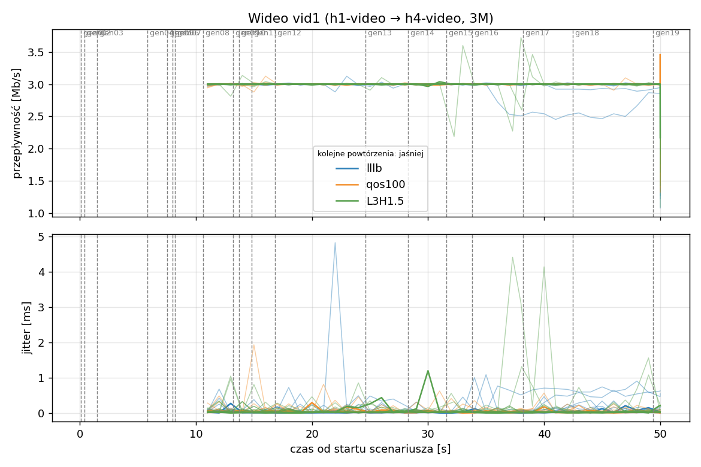
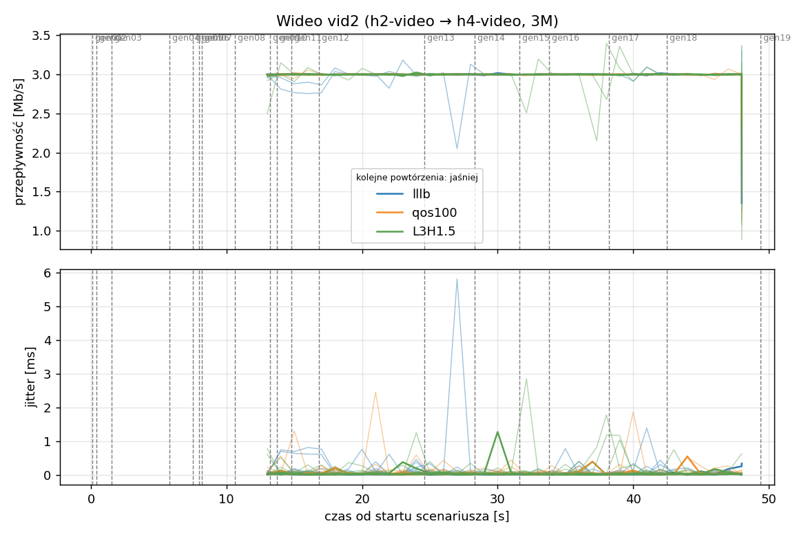
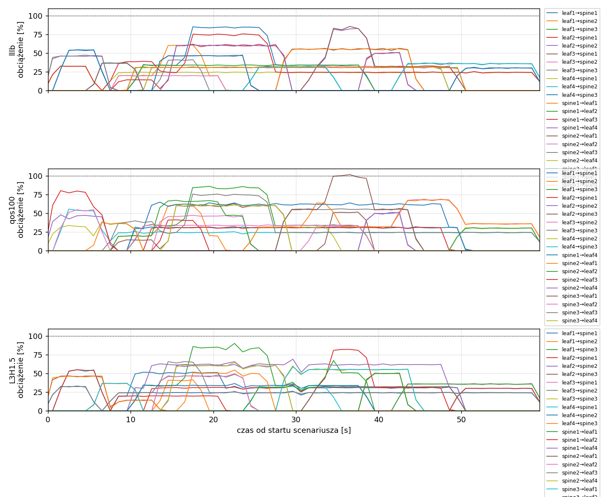
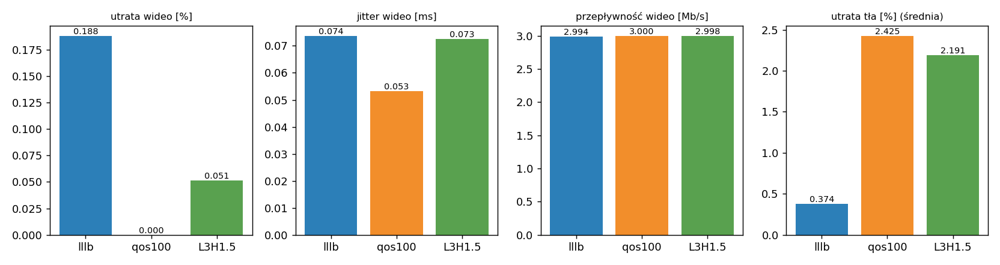

# Raport: clos-sdn

Katalog: `results/official/load-0.4/clos-sdn/20261105_214234`

## 1. Scenariusz

- Topologia: `clos` (sdn: `clos-sdn.clab.yml`)
- Warianty: **lllb** (POLICY=lllb), **qos100** (LAYERS=1, POLICY=qos, RESERVE_PCT=100), **L3H1.5** (HEADROOM_MBPS=1.5, LAYERS=3, POLICY=qos, RESERVE_PCT=70)
- Czas testu: 60 s, warmup (pomijany w statystykach, liczony od startu każdego przepływu): 5 s, powtórzeń: 20, seed: 42
- Wykonane przebiegi: lllb/rep1, lllb/rep10, lllb/rep11, lllb/rep12, lllb/rep13, lllb/rep14, lllb/rep15, lllb/rep16, lllb/rep17, lllb/rep18, lllb/rep19, lllb/rep2, lllb/rep20, lllb/rep3, lllb/rep4, lllb/rep5, lllb/rep6, lllb/rep7, lllb/rep8, lllb/rep9, qos100/rep1, qos100/rep10, qos100/rep11, qos100/rep12, qos100/rep13, qos100/rep14, qos100/rep15, qos100/rep16, qos100/rep17, qos100/rep18, qos100/rep19, qos100/rep2, qos100/rep20, qos100/rep3, qos100/rep4, qos100/rep5, qos100/rep6, qos100/rep7, qos100/rep8, qos100/rep9, L3H1.5/rep1, L3H1.5/rep10, L3H1.5/rep11, L3H1.5/rep12, L3H1.5/rep13, L3H1.5/rep14, L3H1.5/rep15, L3H1.5/rep16, L3H1.5/rep17, L3H1.5/rep18, L3H1.5/rep19, L3H1.5/rep2, L3H1.5/rep20, L3H1.5/rep3, L3H1.5/rep4, L3H1.5/rep5, L3H1.5/rep6, L3H1.5/rep7, L3H1.5/rep8, L3H1.5/rep9

Harmonogram losowego tła różni się między powtórzeniami (seed + nr powtórzenia, wspólny dla wariantów); poniżej powtórzenie 1.

| id | klasa | źródło → cel | proto | zadana [Mb/s] | DSCP | start–koniec [s] |
|---|---|---|---|---|---|---|
| gen01 | background | h2-bg1 → h3-bg2 | udp | 4.49 | – | 0.1–7.1 |
| gen02 | background | h4-bg2 → h3-bg1 | udp | 3.16 | – | 0.4–5.4 |
| gen03 | background | h4-bg1 → h2-bg2 | udp | 5.25 | – | 1.5–6.5 |
| gen04 | background | h4-bg1 → h1-bg2 | udp | 3.56 | – | 5.8–10.8 |
| gen05 | background | h4-bg1 → h3-bg1 | udp | 2.36 | – | 7.5–59.5 |
| gen06 | background | h1-bg2 → h2-bg1 | udp | 1.93 | – | 8–21 |
| gen07 | background | h2-bg1 → h3-bg1 | udp | 1.39 | – | 8.2–13.2 |
| vid1 | video | h1-video → h4-video | udp | 3.00 | 46 | 10–50 |
| gen08 | background | h1-bg1 → h2-bg1 | udp | 3.29 | – | 10.6–38.6 |
| vid2 | video | h2-video → h4-video | udp | 3.00 | 46 | 12–48 |
| gen09 | background | h3-bg2 → h2-bg1 | udp | 4.51 | – | 13.2–24.2 |
| gen10 | background | h1-bg2 → h3-bg1 | udp | 3.96 | – | 13.7–18.7 |
| gen11 | background | h2-bg1 → h4-bg2 | udp | 5.85 | – | 14.8–28.8 |
| gen12 | background | h1-bg2 → h3-bg1 | udp | 4.90 | – | 16.8–26.8 |
| gen13 | background | h4-bg1 → h1-bg1 | udp | 3.07 | – | 24.6–34.6 |
| gen14 | background | h3-bg2 → h1-bg2 | udp | 5.37 | – | 28.3–44.3 |
| gen15 | background | h3-bg1 → h1-bg1 | udp | 3.12 | – | 31.6–49.6 |
| gen16 | background | h2-bg1 → h1-bg1 | udp | 4.96 | – | 33.8–38.8 |
| gen17 | background | h2-bg1 → h4-bg2 | udp | 4.86 | – | 38.2–43.2 |
| gen18 | background | h3-bg2 → h1-bg1 | udp | 3.49 | – | 42.5–59.5 |
| gen19 | background | h4-bg2 → h2-bg1 | udp | 2.93 | – | 49.4–59.4 |

## 2. Wideo: QoS według wariantu

Wartości: średnia ± odchylenie standardowe z powtórzeń.

| przepływ | wariant | przepływność [Mb/s] | jitter [ms] | utrata [%] | RTT mediana [ms] | RTT p95 [ms] |
|---|---|---|---|---|---|---|
| vid1 | lllb | 2.99 ± 0.04 | 0.083 ± 0.082 | 0.32 ± 1.30 | 0.031 ± 0.005 | 5.944 ± 18.094 |
| vid1 | qos100 | 3.00 ± 0.00 | 0.050 ± 0.015 | 0.00 ± 0.00 | 0.030 ± 0.005 | 0.058 ± 0.013 |
| vid1 | L3H1.5 | 3.00 ± 0.00 | 0.078 ± 0.085 | 0.04 ± 0.14 | 0.030 ± 0.004 | 0.060 ± 0.022 |
| vid2 | lllb | 3.00 ± 0.01 | 0.064 ± 0.045 | 0.06 ± 0.20 | 0.028 ± 0.006 | 8.954 ± 21.728 |
| vid2 | qos100 | 3.00 ± 0.00 | 0.057 ± 0.024 | 0.00 ± 0.00 | 0.029 ± 0.006 | 0.056 ± 0.013 |
| vid2 | L3H1.5 | 3.00 ± 0.01 | 0.067 ± 0.050 | 0.06 ± 0.20 | 0.028 ± 0.004 | 0.060 ± 0.025 |

RTT z `ping` co 0,1 s między hostami wideo (osobny przepływ ICMP z tym samym DSCP - w SDN może iść inną ścieżką niż strumień UDP).

## 3. Ruch tła

Agregat tła w obrębie powtórzenia, potem średnia ± odchylenie standardowe po powtórzeniach (utrata = Σ utraconych / Σ wysłanych datagramów; dostarczone = Σ przepływności / Σ zadanych; przepływy trwające nie dłużej niż warmup pominięte).

| wariant | strumieni tła / powt. | dostarczone / zadane [%] | jitter [ms] | utrata [%] |
|---|---|---|---|---|
| lllb | 16 | 99.6 ± 0.7 | 0.068 ± 0.035 | 0.37 ± 0.64 |
| qos100 | 16 | 97.7 ± 2.8 | 0.117 ± 0.083 | 2.43 ± 2.89 |
| L3H1.5 | 16 | 97.8 ± 2.5 | 0.094 ± 0.084 | 2.19 ± 3.03 |

## 4. Obciążenie łączy fabricu

Średnia i maksimum z próbek co 1 s w oknie 0–60 s; MLU = maksymalne obciążenie łącza; drops = pakiety odrzucone przez `tbf` na wyjściu łącza.

| wariant | rep | średnie obciążenie łączy [%] | MLU [%] | łącza > 90% | drops tbf | CPU VM śr./maks. [%] |
|---|---|---|---|---|---|---|
| lllb | 1 | 15.4 | 85.8 | 0/24 | 0 | 13 / 33 |
| lllb | 2 | 21.4 | 102.4 | 4/24 | 2912 | 16 / 48 |
| lllb | 3 | 27.7 | 101.1 | 4/24 | 2709 | 13 / 23 |
| lllb | 4 | 18.4 | 102.0 | 1/24 | 186 | 13 / 23 |
| lllb | 5 | 18.0 | 91.0 | 1/24 | 0 | 12 / 19 |
| lllb | 6 | 10.4 | 64.0 | 0/24 | 0 | 12 / 22 |
| lllb | 7 | 15.9 | 82.7 | 0/24 | 0 | 13 / 36 |
| lllb | 8 | 22.1 | 103.0 | 2/24 | 1262 | 13 / 26 |
| lllb | 9 | 20.4 | 101.2 | 4/24 | 1484 | 12 / 18 |
| lllb | 10 | 13.2 | 95.2 | 1/24 | 0 | 18 / 54 |
| lllb | 11 | 14.7 | 84.8 | 0/24 | 0 | 14 / 27 |
| lllb | 12 | 13.1 | 77.0 | 0/24 | 0 | 12 / 19 |
| lllb | 13 | 19.0 | 101.2 | 2/24 | 924 | 14 / 24 |
| lllb | 14 | 17.0 | 101.1 | 4/24 | 229 | 13 / 20 |
| lllb | 15 | 25.2 | 102.6 | 5/24 | 436 | 14 / 24 |
| lllb | 16 | 19.2 | 102.5 | 4/24 | 518 | 12 / 20 |
| lllb | 17 | 22.2 | 101.8 | 1/24 | 172 | 13 / 20 |
| lllb | 18 | 15.3 | 100.8 | 1/24 | 889 | 12 / 20 |
| lllb | 19 | 14.1 | 86.3 | 0/24 | 7 | 13 / 32 |
| lllb | 20 | 14.8 | 101.7 | 1/24 | 90 | 12 / 21 |
| qos100 | 1 | 15.4 | 101.8 | 1/24 | 219 | 14 / 32 |
| qos100 | 2 | 20.9 | 103.1 | 6/24 | 5413 | 15 / 41 |
| qos100 | 3 | 26.8 | 112.1 | 6/24 | 9882 | 18 / 72 |
| qos100 | 4 | 17.6 | 102.9 | 5/24 | 6566 | 12 / 20 |
| qos100 | 5 | 17.9 | 90.9 | 1/24 | 0 | 14 / 32 |
| qos100 | 6 | 10.4 | 73.2 | 0/24 | 0 | 11 / 22 |
| qos100 | 7 | 15.7 | 101.5 | 2/24 | 1835 | 13 / 38 |
| qos100 | 8 | 22.1 | 101.8 | 7/24 | 1534 | 15 / 51 |
| qos100 | 9 | 19.2 | 101.8 | 4/24 | 9920 | 12 / 21 |
| qos100 | 10 | 13.2 | 95.9 | 1/24 | 0 | 12 / 22 |
| qos100 | 11 | 14.7 | 101.4 | 3/24 | 171 | 12 / 22 |
| qos100 | 12 | 12.9 | 101.2 | 1/24 | 1356 | 12 / 21 |
| qos100 | 13 | 18.8 | 101.9 | 4/24 | 2159 | 14 / 25 |
| qos100 | 14 | 16.9 | 103.8 | 3/24 | 409 | 42 / 55 |
| qos100 | 15 | 24.3 | 102.1 | 7/24 | 6386 | 13 / 24 |
| qos100 | 16 | 18.8 | 102.6 | 7/24 | 3987 | 12 / 24 |
| qos100 | 17 | 22.2 | 101.5 | 2/24 | 0 | 13 / 22 |
| qos100 | 18 | 15.4 | 99.1 | 2/24 | 0 | 14 / 23 |
| qos100 | 19 | 14.1 | 91.0 | 2/24 | 0 | 13 / 33 |
| qos100 | 20 | 14.7 | 105.3 | 2/24 | 773 | 14 / 27 |
| L3H1.5 | 1 | 15.4 | 90.2 | 1/24 | 0 | 13 / 33 |
| L3H1.5 | 2 | 21.2 | 101.3 | 3/24 | 1928 | 17 / 50 |
| L3H1.5 | 3 | 27.3 | 109.0 | 6/24 | 4779 | 22 / 63 |
| L3H1.5 | 4 | 18.2 | 91.3 | 1/24 | 0 | 12 / 24 |
| L3H1.5 | 5 | 17.9 | 91.9 | 1/24 | 0 | 13 / 22 |
| L3H1.5 | 6 | 10.3 | 80.6 | 0/24 | 0 | 13 / 41 |
| L3H1.5 | 7 | 15.6 | 88.5 | 0/24 | 104 | 21 / 64 |
| L3H1.5 | 8 | 22.1 | 101.7 | 8/24 | 1057 | 13 / 23 |
| L3H1.5 | 9 | 19.7 | 102.0 | 3/24 | 6331 | 12 / 20 |
| L3H1.5 | 10 | 13.1 | 101.1 | 1/24 | 629 | 12 / 19 |
| L3H1.5 | 11 | 14.7 | 89.2 | 0/24 | 0 | 12 / 20 |
| L3H1.5 | 12 | 13.1 | 83.9 | 0/24 | 0 | 13 / 23 |
| L3H1.5 | 13 | 18.5 | 94.1 | 1/24 | 340 | 17 / 59 |
| L3H1.5 | 14 | 16.6 | 102.9 | 2/24 | 0 | 19 / 70 |
| L3H1.5 | 15 | 23.6 | 102.4 | 3/24 | 1190 | 16 / 63 |
| L3H1.5 | 16 | 19.2 | 102.0 | 1/24 | 198 | 15 / 43 |
| L3H1.5 | 17 | 21.9 | 100.0 | 2/24 | 58 | 13 / 25 |
| L3H1.5 | 18 | 15.3 | 79.7 | 0/24 | 0 | 14 / 53 |
| L3H1.5 | 19 | 14.1 | 91.9 | 2/24 | 0 | 13 / 25 |
| L3H1.5 | 20 | 14.7 | 100.8 | 2/24 | 768 | 14 / 36 |

Łącza z obciążeniem > 10% (maksimum [%] / drops, powtórzenie 1):

| łącze | lllb | qos100 | L3H1.5 |
|---|---|---|---|
| leaf1→spine1 | 85 / 0 | 32 / 0 | 52 / 0 |
| leaf1→spine2 | 61 / 0 | 62 / 0 | 42 / 0 |
| leaf1→spine3 | 32 / 0 | 86 / 0 | 90 / 0 |
| leaf2→spine1 | 62 / 0 | 32 / 0 | 82 / 0 |
| leaf2→spine2 | 83 / 0 | 51 / 0 | 62 / 0 |
| leaf2→spine3 | 0 / 0 | 63 / 0 | 51 / 0 |
| leaf3→spine1 | 56 / 0 | 0 / 0 | 37 / 0 |
| leaf3→spine2 | 33 / 0 | 68 / 0 | 49 / 0 |
| leaf3→spine3 | 48 / 0 | 56 / 0 | 60 / 0 |
| leaf4→spine1 | 33 / 0 | 0 / 0 | 55 / 0 |
| leaf4→spine2 | 37 / 0 | 39 / 0 | 33 / 0 |
| leaf4→spine3 | 54 / 0 | 56 / 0 | 37 / 0 |
| spine1→leaf1 | 56 / 0 | 0 / 0 | 67 / 0 |
| spine1→leaf2 | 35 / 0 | 0 / 0 | 55 / 0 |
| spine1→leaf3 | 76 / 0 | 0 / 0 | 0 / 0 |
| spine1→leaf4 | 62 / 0 | 65 / 0 | 69 / 0 |
| spine2→leaf1 | 86 / 0 | 69 / 0 | 33 / 0 |
| spine2→leaf2 | 20 / 0 | 67 / 0 | 50 / 0 |
| spine2→leaf3 | 47 / 0 | 80 / 0 | 66 / 0 |
| spine2→leaf4 | 32 / 0 | 51 / 0 | 65 / 0 |
| spine3→leaf1 | 37 / 0 | 102 / 219 | 59 / 0 |
| spine3→leaf2 | 55 / 0 | 55 / 0 | 37 / 0 |
| spine3→leaf3 | 0 / 0 | 76 / 0 | 55 / 0 |
| spine3→leaf4 | 32 / 0 | 61 / 0 | 50 / 0 |

## 5. Ścieżki wybrane przez kontroler (powtórzenie 1)

Z logu kontrolera (linie `Flow`), dopasowane po piątce przepływu; ✓ = reguły widoczne w `dump-flows` na tych samych przełącznikach.

| przepływ | lllb | qos100 | L3H1.5 |
|---|---|---|---|
| gen01 | leaf2 -> spine2 -> leaf3 ✓ (loads 5% 0% 0%) | leaf2 -> spine2 -> leaf3 ✓ (loads 0% 0% 5%) | leaf2 -> spine3 -> leaf3 ✓ (loads 0% 20% 0%) |
| gen02 | leaf4 -> spine1 -> leaf3 ✓ (loads 5% 5% 5%) | leaf4 -> spine2 -> leaf3 ✓ (loads 0% 5% 10%) | leaf4 -> spine2 -> leaf3 ✓ (loads 20% 20% 20%) |
| gen03 | leaf4 -> spine3 -> leaf2 ✓ (loads 3% 5% 0%) | leaf4 -> spine3 -> leaf2 ✓ (loads 0% 20% 5%) | leaf4 -> spine1 -> leaf2 ✓ (loads 20% 31% 40%) |
| gen04 | leaf4 -> spine2 -> leaf1 ✓ (loads 29% 5% 54%) | leaf4 -> spine2 -> leaf1 ✓ (loads 0% 37% 54%) | leaf4 -> spine3 -> leaf1 ✓ (loads 54% 21% 14%) |
| gen05 | leaf4 -> spine1 -> leaf3 ✓ (loads 0% 37% 0%) | leaf4 -> spine3 -> leaf3 ✓ (loads 0% 46% 32%) | leaf4 -> spine2 -> leaf3 ✓ (loads 41% 13% 62%) |
| gen06 | leaf1 -> spine2 -> leaf2 ✓ (loads 5% 0% 0%) | leaf1 -> spine2 -> leaf2 ✓ (loads 0% 0% 5%) | leaf1 -> spine1 -> leaf2 ✓ (loads 11% 14% 14%) |
| gen07 | leaf2 -> spine1 -> leaf3 ✓ (loads 5% 28% 10%) | leaf2 -> spine3 -> leaf3 ✓ (loads 0% 16% 13%) | leaf2 -> spine3 -> leaf3 ✓ (loads 21% 31% 18%) |
| vid1 | leaf1 -> spine3 -> leaf4 ✓ (loads 5% 20% 0%) | leaf1 -> spine1 -> leaf4 ✓ (loads 0% 20% 5%) | leaf1 -> spine1 -> leaf4 ✓ (loads 41% 6% 0%) |
| gen08 | leaf1 -> spine1 -> leaf2 ✓ (loads 5% 20% 15%) | leaf1 -> spine3 -> leaf2 ✓ (loads 5% 20% 10%) | leaf1 -> spine3 -> leaf2 ✓ (loads 50% 17% 11%) |
| vid2 | leaf2 -> spine2 -> leaf4 ✓ (loads 14% 5% 31%) | leaf2 -> spine1 -> leaf4 ✓ (loads 31% 0% 14%) | leaf2 -> spine1 -> leaf4 ✓ (loads 61% 16% 14%) |
| gen09 | leaf3 -> spine3 -> leaf2 ✓ (loads 34% 20% 10%) | leaf3 -> spine2 -> leaf2 ✓ (loads 5% 25% 34%) | leaf3 -> spine2 -> leaf2 ✓ (loads 28% 4% 34%) |
| gen10 | leaf1 -> spine2 -> leaf3 ✓ (loads 34% 25% 31%) | leaf1 -> spine2 -> leaf3 ✓ (loads 31% 25% 39%) | leaf1 -> spine2 -> leaf3 ✓ (loads 51% 28% 34%) |
| gen11 | leaf2 -> spine1 -> leaf4 ✓ (loads 5% 31% 31%) | leaf2 -> spine3 -> leaf4 ✓ (loads 62% 5% 2%) | leaf2 -> spine2 -> leaf4 ✓ (loads 62% 3% 7%) |
| gen12 | leaf1 -> spine1 -> leaf3 ✓ (loads 34% 61% 36%) | leaf1 -> spine3 -> leaf3 ✓ (loads 31% 61% 39%) | leaf1 -> spine3 -> leaf3 ✓ (loads 51% 65% 39%) |
| gen13 | leaf4 -> spine3 -> leaf1 ✓ (loads 24% 5% 0%) | leaf4 -> spine2 -> leaf1 ✓ (loads 0% 5% 24%) | leaf4 -> spine1 -> leaf1 ✓ (loads 0% 24% 10%) |
| gen14 | leaf3 -> spine1 -> leaf1 ✓ (loads 0% 5% 32%) | leaf3 -> spine3 -> leaf1 ✓ (loads 0% 32% 5%) | leaf3 -> spine3 -> leaf1 ✓ (loads 32% 10% 0%) |
| gen15 | leaf3 -> spine2 -> leaf1 ✓ (loads 55% 5% 32%) | leaf3 -> spine2 -> leaf1 ✓ (loads 0% 37% 55%) | leaf3 -> spine2 -> leaf1 ✓ (loads 30% 8% 55%) |
| gen16 | leaf2 -> spine2 -> leaf1 ✓ (loads 55% 32% 37%) | leaf2 -> spine3 -> leaf1 ✓ (loads 31% 64% 60%) | leaf2 -> spine1 -> leaf1 ✓ (loads 40% 47% 55%) |
| gen17 | leaf2 -> spine1 -> leaf4 ✓ (loads 5% 82% 31%) | leaf2 -> spine2 -> leaf4 ✓ (loads 62% 5% 51%) | leaf2 -> spine3 -> leaf4 ✓ (loads 82% 9% 0%) |
| gen18 | leaf3 -> spine3 -> leaf1 ✓ (loads 55% 32% 5%) | leaf3 -> spine2 -> leaf1 ✓ (loads 0% 37% 55%) | leaf3 -> spine1 -> leaf1 ✓ (loads 9% 32% 55%) |
| gen19 | leaf4 -> spine3 -> leaf2 ✓ (loads 24% 5% 0%) | leaf4 -> spine2 -> leaf2 ✓ (loads 0% 5% 24%) | leaf4 -> spine1 -> leaf2 ✓ (loads 5% 24% 6%) |

## 6. Wnioski

<!-- WNIOSKI:START -->
_Do uzupełnienia: krótkie wnioski wyłącznie na podstawie liczb z sekcji 2–5._
<!-- WNIOSKI:END -->

## 7. Wiarygodność pomiaru

- lllb rep1, gen02: przepływ krótszy niż warmup - statystyki z całości
- lllb rep1, gen04: przepływ krótszy niż warmup - statystyki z całości
- lllb rep1, gen07: przepływ krótszy niż warmup - statystyki z całości
- lllb rep1, gen16: przepływ krótszy niż warmup - statystyki z całości
- lllb rep1, gen17: przepływ krótszy niż warmup - statystyki z całości
- lllb rep10, gen02: przepływ krótszy niż warmup - statystyki z całości
- lllb rep10, gen04: przepływ krótszy niż warmup - statystyki z całości
- lllb rep10, gen09: przepływ krótszy niż warmup - statystyki z całości
- lllb rep11, gen13: przepływ krótszy niż warmup - statystyki z całości
- lllb rep11, gen19: przepływ krótszy niż warmup - statystyki z całości
- lllb rep11, gen20: przepływ krótszy niż warmup - statystyki z całości
- lllb rep12, gen03: przepływ krótszy niż warmup - statystyki z całości
- lllb rep12, gen04: przepływ krótszy niż warmup - statystyki z całości
- lllb rep12, gen07: przepływ krótszy niż warmup - statystyki z całości
- lllb rep13, gen10: przepływ krótszy niż warmup - statystyki z całości
- lllb rep13, gen14: przepływ krótszy niż warmup - statystyki z całości
- lllb rep13, gen19: przepływ krótszy niż warmup - statystyki z całości
- lllb rep14, gen02: przepływ krótszy niż warmup - statystyki z całości
- lllb rep14, gen05: przepływ krótszy niż warmup - statystyki z całości
- lllb rep14, gen20: przepływ krótszy niż warmup - statystyki z całości
- lllb rep15, gen09: przepływ krótszy niż warmup - statystyki z całości
- lllb rep15, gen28: przepływ krótszy niż warmup - statystyki z całości
- lllb rep15, gen29: przepływ krótszy niż warmup - statystyki z całości
- lllb rep16, gen11: przepływ krótszy niż warmup - statystyki z całości
- lllb rep16, gen15: przepływ krótszy niż warmup - statystyki z całości
- lllb rep16, gen19: przepływ krótszy niż warmup - statystyki z całości
- lllb rep16, gen22: przepływ krótszy niż warmup - statystyki z całości
- lllb rep17, gen05: przepływ krótszy niż warmup - statystyki z całości
- lllb rep17, gen06: przepływ krótszy niż warmup - statystyki z całości
- lllb rep17, gen08: przepływ krótszy niż warmup - statystyki z całości
- lllb rep17, gen09: przepływ krótszy niż warmup - statystyki z całości
- lllb rep17, gen15: przepływ krótszy niż warmup - statystyki z całości
- lllb rep17, gen24: przepływ krótszy niż warmup - statystyki z całości
- lllb rep17, gen25: przepływ krótszy niż warmup - statystyki z całości
- lllb rep18, gen17: przepływ krótszy niż warmup - statystyki z całości
- lllb rep19, gen02: przepływ krótszy niż warmup - statystyki z całości
- lllb rep19, gen03: przepływ krótszy niż warmup - statystyki z całości
- lllb rep19, gen14: przepływ krótszy niż warmup - statystyki z całości
- lllb rep19, gen16: przepływ krótszy niż warmup - statystyki z całości
- lllb rep2, gen02: przepływ krótszy niż warmup - statystyki z całości
- lllb rep2, gen12: przepływ krótszy niż warmup - statystyki z całości
- lllb rep2, gen23: przepływ krótszy niż warmup - statystyki z całości
- lllb rep2, gen24: przepływ krótszy niż warmup - statystyki z całości
- lllb rep2, gen27: przepływ krótszy niż warmup - statystyki z całości
- lllb rep20, gen09: przepływ krótszy niż warmup - statystyki z całości
- lllb rep20, gen11: przepływ krótszy niż warmup - statystyki z całości
- lllb rep20, gen12: przepływ krótszy niż warmup - statystyki z całości
- lllb rep3, gen01: przepływ krótszy niż warmup - statystyki z całości
- lllb rep3, gen03: przepływ krótszy niż warmup - statystyki z całości
- lllb rep3, gen09: przepływ krótszy niż warmup - statystyki z całości
- lllb rep3, gen11: przepływ krótszy niż warmup - statystyki z całości
- lllb rep3, gen13: przepływ krótszy niż warmup - statystyki z całości
- lllb rep3, gen15: przepływ krótszy niż warmup - statystyki z całości
- lllb rep4, gen22: przepływ krótszy niż warmup - statystyki z całości
- lllb rep5, gen02: przepływ krótszy niż warmup - statystyki z całości
- lllb rep6, gen04: przepływ krótszy niż warmup - statystyki z całości
- lllb rep6, gen10: przepływ krótszy niż warmup - statystyki z całości
- lllb rep6, gen15: przepływ krótszy niż warmup - statystyki z całości
- lllb rep7, gen02: przepływ krótszy niż warmup - statystyki z całości
- lllb rep7, gen18: przepływ krótszy niż warmup - statystyki z całości
- lllb rep8, gen12: przepływ krótszy niż warmup - statystyki z całości
- lllb rep8, gen16: przepływ krótszy niż warmup - statystyki z całości
- lllb rep9, gen04: przepływ krótszy niż warmup - statystyki z całości
- qos100 rep1, gen02: przepływ krótszy niż warmup - statystyki z całości
- qos100 rep1, gen03: przepływ krótszy niż warmup - statystyki z całości
- qos100 rep1, gen07: przepływ krótszy niż warmup - statystyki z całości
- qos100 rep10, gen02: przepływ krótszy niż warmup - statystyki z całości
- qos100 rep10, gen04: przepływ krótszy niż warmup - statystyki z całości
- qos100 rep10, gen09: przepływ krótszy niż warmup - statystyki z całości
- qos100 rep11, gen09: przepływ krótszy niż warmup - statystyki z całości
- qos100 rep11, gen19: przepływ krótszy niż warmup - statystyki z całości
- qos100 rep12, gen03: przepływ krótszy niż warmup - statystyki z całości
- qos100 rep12, gen04: przepływ krótszy niż warmup - statystyki z całości
- qos100 rep13, gen13: przepływ krótszy niż warmup - statystyki z całości
- qos100 rep13, gen14: przepływ krótszy niż warmup - statystyki z całości
- qos100 rep15, gen09: przepływ krótszy niż warmup - statystyki z całości
- qos100 rep15, gen27: przepływ krótszy niż warmup - statystyki z całości
- qos100 rep15, gen28: przepływ krótszy niż warmup - statystyki z całości
- qos100 rep16, gen11: przepływ krótszy niż warmup - statystyki z całości
- qos100 rep16, gen15: przepływ krótszy niż warmup - statystyki z całości
- qos100 rep16, gen22: przepływ krótszy niż warmup - statystyki z całości
- qos100 rep17, gen01: przepływ krótszy niż warmup - statystyki z całości
- qos100 rep17, gen05: przepływ krótszy niż warmup - statystyki z całości
- qos100 rep17, gen06: przepływ krótszy niż warmup - statystyki z całości
- qos100 rep17, gen08: przepływ krótszy niż warmup - statystyki z całości
- qos100 rep17, gen09: przepływ krótszy niż warmup - statystyki z całości
- qos100 rep17, gen15: przepływ krótszy niż warmup - statystyki z całości
- qos100 rep17, gen22: przepływ krótszy niż warmup - statystyki z całości
- qos100 rep17, gen24: przepływ krótszy niż warmup - statystyki z całości
- qos100 rep17, gen25: przepływ krótszy niż warmup - statystyki z całości
- qos100 rep18, gen01: przepływ krótszy niż warmup - statystyki z całości
- qos100 rep18, gen04: przepływ krótszy niż warmup - statystyki z całości
- qos100 rep18, gen17: przepływ krótszy niż warmup - statystyki z całości
- qos100 rep19, gen02: przepływ krótszy niż warmup - statystyki z całości
- qos100 rep19, gen04: przepływ krótszy niż warmup - statystyki z całości
- qos100 rep19, gen14: przepływ krótszy niż warmup - statystyki z całości
- qos100 rep2, gen07: przepływ krótszy niż warmup - statystyki z całości
- qos100 rep2, gen12: przepływ krótszy niż warmup - statystyki z całości
- qos100 rep2, gen27: przepływ krótszy niż warmup - statystyki z całości
- qos100 rep20, gen09: przepływ krótszy niż warmup - statystyki z całości
- qos100 rep20, gen12: przepływ krótszy niż warmup - statystyki z całości
- qos100 rep20, gen15: przepływ krótszy niż warmup - statystyki z całości
- qos100 rep3, gen02: przepływ krótszy niż warmup - statystyki z całości
- qos100 rep3, gen03: przepływ krótszy niż warmup - statystyki z całości
- qos100 rep3, gen10: przepływ krótszy niż warmup - statystyki z całości
- qos100 rep3, gen11: przepływ krótszy niż warmup - statystyki z całości
- qos100 rep3, gen13: przepływ krótszy niż warmup - statystyki z całości
- qos100 rep3, gen15: przepływ krótszy niż warmup - statystyki z całości
- qos100 rep4, gen10: przepływ krótszy niż warmup - statystyki z całości
- qos100 rep4, gen22: przepływ krótszy niż warmup - statystyki z całości
- qos100 rep5, gen03: przepływ krótszy niż warmup - statystyki z całości
- qos100 rep6, gen04: przepływ krótszy niż warmup - statystyki z całości
- qos100 rep6, gen05: przepływ krótszy niż warmup - statystyki z całości
- qos100 rep6, gen10: przepływ krótszy niż warmup - statystyki z całości
- qos100 rep7, gen03: przepływ krótszy niż warmup - statystyki z całości
- qos100 rep7, gen18: przepływ krótszy niż warmup - statystyki z całości
- qos100 rep8, gen12: przepływ krótszy niż warmup - statystyki z całości
- qos100 rep8, gen16: przepływ krótszy niż warmup - statystyki z całości
- qos100 rep9, gen04: przepływ krótszy niż warmup - statystyki z całości
- L3H1.5 rep1, gen02: przepływ krótszy niż warmup - statystyki z całości
- L3H1.5 rep1, gen04: przepływ krótszy niż warmup - statystyki z całości
- L3H1.5 rep1, gen07: przepływ krótszy niż warmup - statystyki z całości
- L3H1.5 rep1, gen10: przepływ krótszy niż warmup - statystyki z całości
- L3H1.5 rep1, gen16: przepływ krótszy niż warmup - statystyki z całości
- L3H1.5 rep10, gen02: przepływ krótszy niż warmup - statystyki z całości
- L3H1.5 rep10, gen04: przepływ krótszy niż warmup - statystyki z całości
- L3H1.5 rep10, gen09: przepływ krótszy niż warmup - statystyki z całości
- L3H1.5 rep10, gen10: przepływ krótszy niż warmup - statystyki z całości
- L3H1.5 rep11, gen13: przepływ krótszy niż warmup - statystyki z całości
- L3H1.5 rep11, gen20: przepływ krótszy niż warmup - statystyki z całości
- L3H1.5 rep12, gen03: przepływ krótszy niż warmup - statystyki z całości
- L3H1.5 rep12, gen04: przepływ krótszy niż warmup - statystyki z całości
- L3H1.5 rep12, gen07: przepływ krótszy niż warmup - statystyki z całości
- L3H1.5 rep13, gen13: przepływ krótszy niż warmup - statystyki z całości
- L3H1.5 rep13, gen14: przepływ krótszy niż warmup - statystyki z całości
- L3H1.5 rep13, gen19: przepływ krótszy niż warmup - statystyki z całości
- L3H1.5 rep14, gen02: przepływ krótszy niż warmup - statystyki z całości
- L3H1.5 rep14, gen05: przepływ krótszy niż warmup - statystyki z całości
- L3H1.5 rep14, gen20: przepływ krótszy niż warmup - statystyki z całości
- L3H1.5 rep15, gen09: przepływ krótszy niż warmup - statystyki z całości
- L3H1.5 rep15, gen11: przepływ krótszy niż warmup - statystyki z całości
- L3H1.5 rep15, gen28: przepływ krótszy niż warmup - statystyki z całości
- L3H1.5 rep16, gen11: przepływ krótszy niż warmup - statystyki z całości
- L3H1.5 rep16, gen15: przepływ krótszy niż warmup - statystyki z całości
- L3H1.5 rep16, gen20: przepływ krótszy niż warmup - statystyki z całości
- L3H1.5 rep17, gen05: przepływ krótszy niż warmup - statystyki z całości
- L3H1.5 rep17, gen06: przepływ krótszy niż warmup - statystyki z całości
- L3H1.5 rep17, gen08: przepływ krótszy niż warmup - statystyki z całości
- L3H1.5 rep17, gen09: przepływ krótszy niż warmup - statystyki z całości
- L3H1.5 rep17, gen15: przepływ krótszy niż warmup - statystyki z całości
- L3H1.5 rep17, gen22: przepływ krótszy niż warmup - statystyki z całości
- L3H1.5 rep17, gen24: przepływ krótszy niż warmup - statystyki z całości
- L3H1.5 rep17, gen25: przepływ krótszy niż warmup - statystyki z całości
- L3H1.5 rep18, gen01: przepływ krótszy niż warmup - statystyki z całości
- L3H1.5 rep18, gen17: przepływ krótszy niż warmup - statystyki z całości
- L3H1.5 rep19, gen02: przepływ krótszy niż warmup - statystyki z całości
- L3H1.5 rep19, gen12: przepływ krótszy niż warmup - statystyki z całości
- L3H1.5 rep19, gen14: przepływ krótszy niż warmup - statystyki z całości
- L3H1.5 rep19, gen16: przepływ krótszy niż warmup - statystyki z całości
- L3H1.5 rep2, gen12: przepływ krótszy niż warmup - statystyki z całości
- L3H1.5 rep2, gen18: przepływ krótszy niż warmup - statystyki z całości
- L3H1.5 rep2, gen20: przepływ krótszy niż warmup - statystyki z całości
- L3H1.5 rep2, gen27: przepływ krótszy niż warmup - statystyki z całości
- L3H1.5 rep20, gen11: przepływ krótszy niż warmup - statystyki z całości
- L3H1.5 rep3, gen02: przepływ krótszy niż warmup - statystyki z całości
- L3H1.5 rep3, gen03: przepływ krótszy niż warmup - statystyki z całości
- L3H1.5 rep3, gen13: przepływ krótszy niż warmup - statystyki z całości
- L3H1.5 rep3, gen15: przepływ krótszy niż warmup - statystyki z całości
- L3H1.5 rep4, gen10: przepływ krótszy niż warmup - statystyki z całości
- L3H1.5 rep4, gen22: przepływ krótszy niż warmup - statystyki z całości
- L3H1.5 rep5, gen03: przepływ krótszy niż warmup - statystyki z całości
- L3H1.5 rep5, gen21: przepływ krótszy niż warmup - statystyki z całości
- L3H1.5 rep6, gen04: przepływ krótszy niż warmup - statystyki z całości
- L3H1.5 rep6, gen05: przepływ krótszy niż warmup - statystyki z całości
- L3H1.5 rep6, gen10: przepływ krótszy niż warmup - statystyki z całości
- L3H1.5 rep7, gen02: przepływ krótszy niż warmup - statystyki z całości
- L3H1.5 rep7, gen07: przepływ krótszy niż warmup - statystyki z całości
- L3H1.5 rep7, gen11: przepływ krótszy niż warmup - statystyki z całości
- L3H1.5 rep8, gen12: przepływ krótszy niż warmup - statystyki z całości
- L3H1.5 rep9, gen04: przepływ krótszy niż warmup - statystyki z całości
