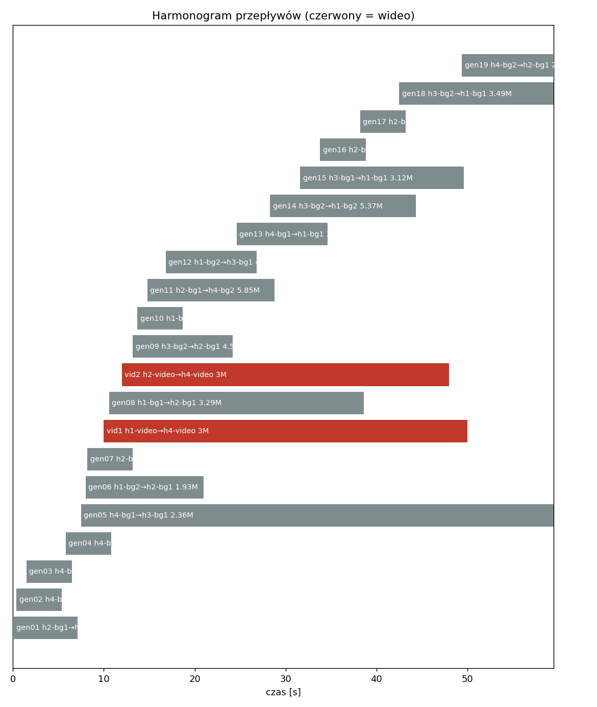
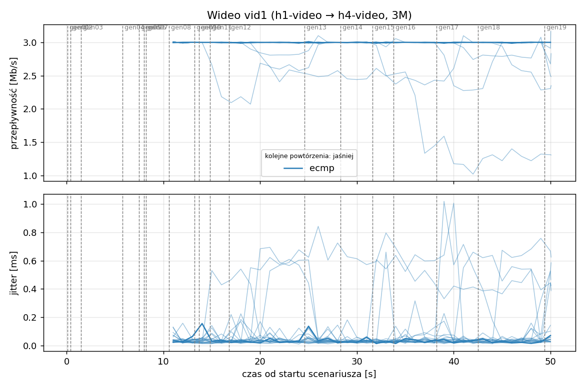
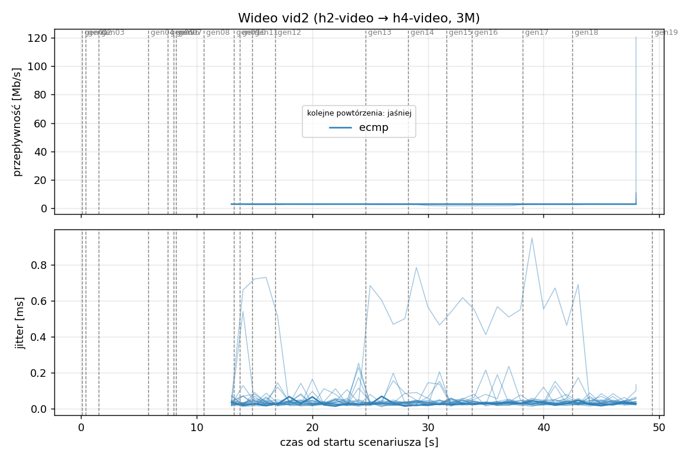
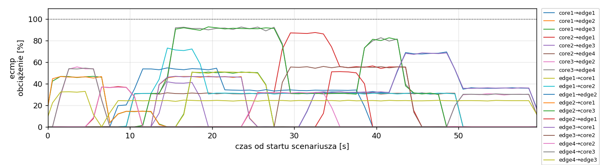
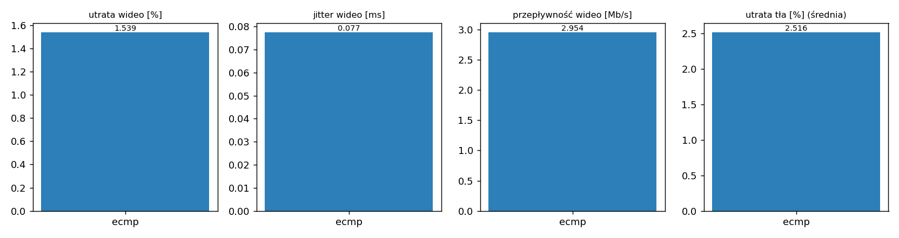

# Raport: mesh-frr

Katalog: `results/official/load-0.4/mesh-frr/20261106_004709`

## 1. Scenariusz

- Topologia: `mesh` (frr: `mesh-frr.clab.yml`)
- Warianty: **ecmp** (FRR, bez kontrolera)
- Czas testu: 60 s, warmup (pomijany w statystykach, liczony od startu każdego przepływu): 5 s, powtórzeń: 20, seed: 42
- Wykonane przebiegi: ecmp/rep1, ecmp/rep10, ecmp/rep11, ecmp/rep12, ecmp/rep13, ecmp/rep14, ecmp/rep15, ecmp/rep16, ecmp/rep17, ecmp/rep18, ecmp/rep19, ecmp/rep2, ecmp/rep20, ecmp/rep3, ecmp/rep4, ecmp/rep5, ecmp/rep6, ecmp/rep7, ecmp/rep8, ecmp/rep9

Harmonogram losowego tła różni się między powtórzeniami (seed + nr powtórzenia, wspólny dla wariantów); poniżej powtórzenie 1.

| id | klasa | źródło → cel | proto | zadana [Mb/s] | DSCP | start–koniec [s] |
|---|---|---|---|---|---|---|
| gen01 | background | h2-bg1 → h3-bg2 | udp | 4.49 | – | 0.1–7.1 |
| gen02 | background | h4-bg2 → h3-bg1 | udp | 3.16 | – | 0.4–5.4 |
| gen03 | background | h4-bg1 → h2-bg2 | udp | 5.25 | – | 1.5–6.5 |
| gen04 | background | h4-bg1 → h1-bg2 | udp | 3.56 | – | 5.8–10.8 |
| gen05 | background | h4-bg1 → h3-bg1 | udp | 2.36 | – | 7.5–59.5 |
| gen06 | background | h1-bg2 → h2-bg1 | udp | 1.93 | – | 8–21 |
| gen07 | background | h2-bg1 → h3-bg1 | udp | 1.39 | – | 8.2–13.2 |
| vid1 | video | h1-video → h4-video | udp | 3.00 | 46 | 10–50 |
| gen08 | background | h1-bg1 → h2-bg1 | udp | 3.29 | – | 10.6–38.6 |
| vid2 | video | h2-video → h4-video | udp | 3.00 | 46 | 12–48 |
| gen09 | background | h3-bg2 → h2-bg1 | udp | 4.51 | – | 13.2–24.2 |
| gen10 | background | h1-bg2 → h3-bg1 | udp | 3.96 | – | 13.7–18.7 |
| gen11 | background | h2-bg1 → h4-bg2 | udp | 5.85 | – | 14.8–28.8 |
| gen12 | background | h1-bg2 → h3-bg1 | udp | 4.90 | – | 16.8–26.8 |
| gen13 | background | h4-bg1 → h1-bg1 | udp | 3.07 | – | 24.6–34.6 |
| gen14 | background | h3-bg2 → h1-bg2 | udp | 5.37 | – | 28.3–44.3 |
| gen15 | background | h3-bg1 → h1-bg1 | udp | 3.12 | – | 31.6–49.6 |
| gen16 | background | h2-bg1 → h1-bg1 | udp | 4.96 | – | 33.8–38.8 |
| gen17 | background | h2-bg1 → h4-bg2 | udp | 4.86 | – | 38.2–43.2 |
| gen18 | background | h3-bg2 → h1-bg1 | udp | 3.49 | – | 42.5–59.5 |
| gen19 | background | h4-bg2 → h2-bg1 | udp | 2.93 | – | 49.4–59.4 |

## 2. Wideo: QoS według wariantu

Wartości: średnia ± odchylenie standardowe z powtórzeń.

| przepływ | wariant | przepływność [Mb/s] | jitter [ms] | utrata [%] | RTT mediana [ms] | RTT p95 [ms] |
|---|---|---|---|---|---|---|
| vid1 | ecmp | 2.93 ± 0.23 | 0.100 ± 0.117 | 2.43 ± 7.56 | 2.982 ± 13.232 | 21.746 ± 28.635 |
| vid2 | ecmp | 2.98 ± 0.09 | 0.055 ± 0.076 | 0.65 ± 2.88 | 2.925 ± 12.987 | 5.983 ± 18.285 |

RTT z `ping` co 0,1 s między hostami wideo (osobny przepływ ICMP z tym samym DSCP - w SDN może iść inną ścieżką niż strumień UDP).

## 3. Ruch tła

Agregat tła w obrębie powtórzenia, potem średnia ± odchylenie standardowe po powtórzeniach (utrata = Σ utraconych / Σ wysłanych datagramów; dostarczone = Σ przepływności / Σ zadanych; przepływy trwające nie dłużej niż warmup pominięte).

| wariant | strumieni tła / powt. | dostarczone / zadane [%] | jitter [ms] | utrata [%] |
|---|---|---|---|---|
| ecmp | 16 | 97.8 ± 3.1 | 0.081 ± 0.045 | 2.52 ± 3.93 |

## 4. Obciążenie łączy fabricu

Średnia i maksimum z próbek co 1 s w oknie 0–60 s; MLU = maksymalne obciążenie łącza; drops = pakiety odrzucone przez `tbf` na wyjściu łącza.

| wariant | rep | średnie obciążenie łączy [%] | MLU [%] | łącza > 90% | drops tbf | CPU VM śr./maks. [%] |
|---|---|---|---|---|---|---|
| ecmp | 1 | 13.4 | 92.8 | 2/24 | 0 | 10 / 12 |
| ecmp | 2 | 15.4 | 101.8 | 5/24 | 19532 | 11 / 15 |
| ecmp | 3 | 21.9 | 102.5 | 7/24 | 2011 | 12 / 14 |
| ecmp | 4 | 15.3 | 101.8 | 5/24 | 4290 | 11 / 15 |
| ecmp | 5 | 14.2 | 97.2 | 1/24 | 0 | 10 / 13 |
| ecmp | 6 | 9.4 | 97.4 | 1/24 | 0 | 10 / 14 |
| ecmp | 7 | 14.0 | 89.4 | 0/24 | 0 | 10 / 16 |
| ecmp | 8 | 17.6 | 102.5 | 8/24 | 4159 | 12 / 15 |
| ecmp | 9 | 13.5 | 101.2 | 2/24 | 10037 | 10 / 12 |
| ecmp | 10 | 11.3 | 96.4 | 1/24 | 0 | 10 / 12 |
| ecmp | 11 | 12.9 | 101.5 | 2/24 | 1472 | 10 / 13 |
| ecmp | 12 | 12.2 | 101.1 | 2/24 | 1329 | 10 / 14 |
| ecmp | 13 | 15.7 | 102.7 | 3/24 | 2955 | 11 / 20 |
| ecmp | 14 | 14.3 | 102.5 | 3/24 | 171 | 11 / 18 |
| ecmp | 15 | 19.9 | 103.4 | 6/24 | 6264 | 12 / 18 |
| ecmp | 16 | 15.0 | 101.3 | 5/24 | 2661 | 10 / 14 |
| ecmp | 17 | 19.2 | 101.6 | 4/24 | 1362 | 10 / 14 |
| ecmp | 18 | 13.5 | 93.9 | 2/24 | 0 | 10 / 17 |
| ecmp | 19 | 13.0 | 99.2 | 3/24 | 0 | 9 / 12 |
| ecmp | 20 | 12.1 | 103.1 | 3/24 | 151 | 10 / 14 |

Łącza z obciążeniem > 10% (maksimum [%] / drops, powtórzenie 1):

| łącze | ecmp |
|---|---|
| core1→edge1 | 69 / 0 |
| core1→edge2 | 47 / 0 |
| core1→edge3 | 51 / 0 |
| core2→edge1 | 88 / 0 |
| core2→edge3 | 42 / 0 |
| core2→edge4 | 32 / 0 |
| core3→edge2 | 56 / 0 |
| core3→edge4 | 93 / 0 |
| edge1→core1 | 51 / 0 |
| edge1→core2 | 73 / 0 |
| edge1→edge2 | 55 / 0 |
| edge2→core1 | 47 / 0 |
| edge2→core3 | 93 / 0 |
| edge2→edge1 | 51 / 0 |
| edge3→core1 | 69 / 0 |
| edge3→core2 | 56 / 0 |
| edge3→edge4 | 0 / 0 |
| edge4→core2 | 37 / 0 |
| edge4→core3 | 54 / 0 |
| edge4→edge3 | 33 / 0 |

## 5. Ścieżki wybrane przez kontroler (powtórzenie 1)

Z logu kontrolera (linie `Flow`), dopasowane po piątce przepływu; ✓ = reguły widoczne w `dump-flows` na tych samych przełącznikach.

| przepływ | ecmp |
|---|---|
| gen01 | ECMP (hash L4), nieobserwowana bezpośrednio |
| gen02 | ECMP (hash L4), nieobserwowana bezpośrednio |
| gen03 | ECMP (hash L4), nieobserwowana bezpośrednio |
| gen04 | ECMP (hash L4), nieobserwowana bezpośrednio |
| gen05 | ECMP (hash L4), nieobserwowana bezpośrednio |
| gen06 | ECMP (hash L4), nieobserwowana bezpośrednio |
| gen07 | ECMP (hash L4), nieobserwowana bezpośrednio |
| vid1 | ECMP (hash L4), nieobserwowana bezpośrednio |
| gen08 | ECMP (hash L4), nieobserwowana bezpośrednio |
| vid2 | ECMP (hash L4), nieobserwowana bezpośrednio |
| gen09 | ECMP (hash L4), nieobserwowana bezpośrednio |
| gen10 | ECMP (hash L4), nieobserwowana bezpośrednio |
| gen11 | ECMP (hash L4), nieobserwowana bezpośrednio |
| gen12 | ECMP (hash L4), nieobserwowana bezpośrednio |
| gen13 | ECMP (hash L4), nieobserwowana bezpośrednio |
| gen14 | ECMP (hash L4), nieobserwowana bezpośrednio |
| gen15 | ECMP (hash L4), nieobserwowana bezpośrednio |
| gen16 | ECMP (hash L4), nieobserwowana bezpośrednio |
| gen17 | ECMP (hash L4), nieobserwowana bezpośrednio |
| gen18 | ECMP (hash L4), nieobserwowana bezpośrednio |
| gen19 | ECMP (hash L4), nieobserwowana bezpośrednio |

## 6. Wnioski

<!-- WNIOSKI:START -->
_Do uzupełnienia: krótkie wnioski wyłącznie na podstawie liczb z sekcji 2–5._
<!-- WNIOSKI:END -->

## 7. Wiarygodność pomiaru

- ecmp rep1, gen02: przepływ krótszy niż warmup - statystyki z całości
- ecmp rep1, gen03: przepływ krótszy niż warmup - statystyki z całości
- ecmp rep1, gen04: przepływ krótszy niż warmup - statystyki z całości
- ecmp rep1, gen07: przepływ krótszy niż warmup - statystyki z całości
- ecmp rep1, gen16: przepływ krótszy niż warmup - statystyki z całości
- ecmp rep1, gen17: przepływ krótszy niż warmup - statystyki z całości
- ecmp rep10, gen02: przepływ krótszy niż warmup - statystyki z całości
- ecmp rep10, gen04: przepływ krótszy niż warmup - statystyki z całości
- ecmp rep10, gen09: przepływ krótszy niż warmup - statystyki z całości
- ecmp rep10, gen10: przepływ krótszy niż warmup - statystyki z całości
- ecmp rep10, gen17: przepływ krótszy niż warmup - statystyki z całości
- ecmp rep11, gen13: przepływ krótszy niż warmup - statystyki z całości
- ecmp rep11, gen17: przepływ krótszy niż warmup - statystyki z całości
- ecmp rep11, gen19: przepływ krótszy niż warmup - statystyki z całości
- ecmp rep11, gen20: przepływ krótszy niż warmup - statystyki z całości
- ecmp rep12, gen04: przepływ krótszy niż warmup - statystyki z całości
- ecmp rep12, gen07: przepływ krótszy niż warmup - statystyki z całości
- ecmp rep12, gen08: przepływ krótszy niż warmup - statystyki z całości
- ecmp rep13, gen02: przepływ krótszy niż warmup - statystyki z całości
- ecmp rep13, gen06: przepływ krótszy niż warmup - statystyki z całości
- ecmp rep13, gen10: przepływ krótszy niż warmup - statystyki z całości
- ecmp rep13, gen12: przepływ krótszy niż warmup - statystyki z całości
- ecmp rep13, gen13: przepływ krótszy niż warmup - statystyki z całości
- ecmp rep13, gen14: przepływ krótszy niż warmup - statystyki z całości
- ecmp rep13, gen19: przepływ krótszy niż warmup - statystyki z całości
- ecmp rep14, gen02: przepływ krótszy niż warmup - statystyki z całości
- ecmp rep14, gen03: przepływ krótszy niż warmup - statystyki z całości
- ecmp rep14, gen13: przepływ krótszy niż warmup - statystyki z całości
- ecmp rep14, gen17: przepływ krótszy niż warmup - statystyki z całości
- ecmp rep14, gen19: przepływ krótszy niż warmup - statystyki z całości
- ecmp rep14, gen20: przepływ krótszy niż warmup - statystyki z całości
- ecmp rep14, gen22: przepływ krótszy niż warmup - statystyki z całości
- ecmp rep15, gen09: przepływ krótszy niż warmup - statystyki z całości
- ecmp rep15, gen11: przepływ krótszy niż warmup - statystyki z całości
- ecmp rep15, gen17: przepływ krótszy niż warmup - statystyki z całości
- ecmp rep15, gen27: przepływ krótszy niż warmup - statystyki z całości
- ecmp rep15, gen28: przepływ krótszy niż warmup - statystyki z całości
- ecmp rep16, gen06: przepływ krótszy niż warmup - statystyki z całości
- ecmp rep16, gen11: przepływ krótszy niż warmup - statystyki z całości
- ecmp rep16, gen15: przepływ krótszy niż warmup - statystyki z całości
- ecmp rep16, gen22: przepływ krótszy niż warmup - statystyki z całości
- ecmp rep17, gen01: przepływ krótszy niż warmup - statystyki z całości
- ecmp rep17, gen05: przepływ krótszy niż warmup - statystyki z całości
- ecmp rep17, gen06: przepływ krótszy niż warmup - statystyki z całości
- ecmp rep17, gen08: przepływ krótszy niż warmup - statystyki z całości
- ecmp rep17, gen09: przepływ krótszy niż warmup - statystyki z całości
- ecmp rep17, gen15: przepływ krótszy niż warmup - statystyki z całości
- ecmp rep17, gen22: przepływ krótszy niż warmup - statystyki z całości
- ecmp rep17, gen24: przepływ krótszy niż warmup - statystyki z całości
- ecmp rep17, gen25: przepływ krótszy niż warmup - statystyki z całości
- ecmp rep18, gen04: przepływ krótszy niż warmup - statystyki z całości
- ecmp rep18, gen17: przepływ krótszy niż warmup - statystyki z całości
- ecmp rep19, gen01: przepływ krótszy niż warmup - statystyki z całości
- ecmp rep19, gen02: przepływ krótszy niż warmup - statystyki z całości
- ecmp rep19, gen03: przepływ krótszy niż warmup - statystyki z całości
- ecmp rep19, gen04: przepływ krótszy niż warmup - statystyki z całości
- ecmp rep19, gen10: przepływ krótszy niż warmup - statystyki z całości
- ecmp rep19, gen12: przepływ krótszy niż warmup - statystyki z całości
- ecmp rep19, gen14: przepływ krótszy niż warmup - statystyki z całości
- ecmp rep19, gen16: przepływ krótszy niż warmup - statystyki z całości
- ecmp rep2, gen02: przepływ krótszy niż warmup - statystyki z całości
- ecmp rep2, gen07: przepływ krótszy niż warmup - statystyki z całości
- ecmp rep2, gen12: przepływ krótszy niż warmup - statystyki z całości
- ecmp rep2, gen18: przepływ krótszy niż warmup - statystyki z całości
- ecmp rep2, gen27: przepływ krótszy niż warmup - statystyki z całości
- ecmp rep20, gen03: przepływ krótszy niż warmup - statystyki z całości
- ecmp rep20, gen09: przepływ krótszy niż warmup - statystyki z całości
- ecmp rep20, gen11: przepływ krótszy niż warmup - statystyki z całości
- ecmp rep20, gen15: przepływ krótszy niż warmup - statystyki z całości
- ecmp rep3, gen01: przepływ krótszy niż warmup - statystyki z całości
- ecmp rep3, gen02: przepływ krótszy niż warmup - statystyki z całości
- ecmp rep3, gen03: przepływ krótszy niż warmup - statystyki z całości
- ecmp rep3, gen09: przepływ krótszy niż warmup - statystyki z całości
- ecmp rep3, gen10: przepływ krótszy niż warmup - statystyki z całości
- ecmp rep3, gen11: przepływ krótszy niż warmup - statystyki z całości
- ecmp rep3, gen13: przepływ krótszy niż warmup - statystyki z całości
- ecmp rep3, gen15: przepływ krótszy niż warmup - statystyki z całości
- ecmp rep3, gen18: przepływ krótszy niż warmup - statystyki z całości
- ecmp rep4, gen10: przepływ krótszy niż warmup - statystyki z całości
- ecmp rep4, gen22: przepływ krótszy niż warmup - statystyki z całości
- ecmp rep5, gen03: przepływ krótszy niż warmup - statystyki z całości
- ecmp rep5, gen21: przepływ krótszy niż warmup - statystyki z całości
- ecmp rep6, gen04: przepływ krótszy niż warmup - statystyki z całości
- ecmp rep6, gen05: przepływ krótszy niż warmup - statystyki z całości
- ecmp rep6, gen10: przepływ krótszy niż warmup - statystyki z całości
- ecmp rep6, gen15: przepływ krótszy niż warmup - statystyki z całości
- ecmp rep7, gen02: przepływ krótszy niż warmup - statystyki z całości
- ecmp rep7, gen03: przepływ krótszy niż warmup - statystyki z całości
- ecmp rep7, gen11: przepływ krótszy niż warmup - statystyki z całości
- ecmp rep7, gen18: przepływ krótszy niż warmup - statystyki z całości
- ecmp rep8, gen05: przepływ krótszy niż warmup - statystyki z całości
- ecmp rep8, gen12: przepływ krótszy niż warmup - statystyki z całości
- ecmp rep8, gen22: przepływ krótszy niż warmup - statystyki z całości
- ecmp rep9, gen04: przepływ krótszy niż warmup - statystyki z całości
