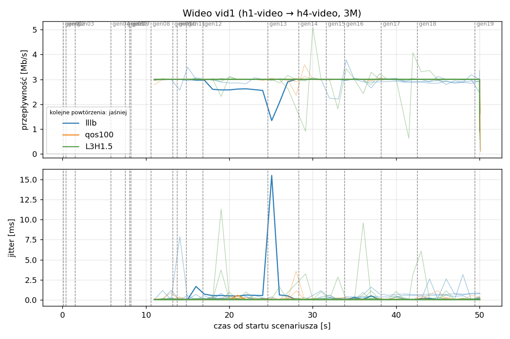
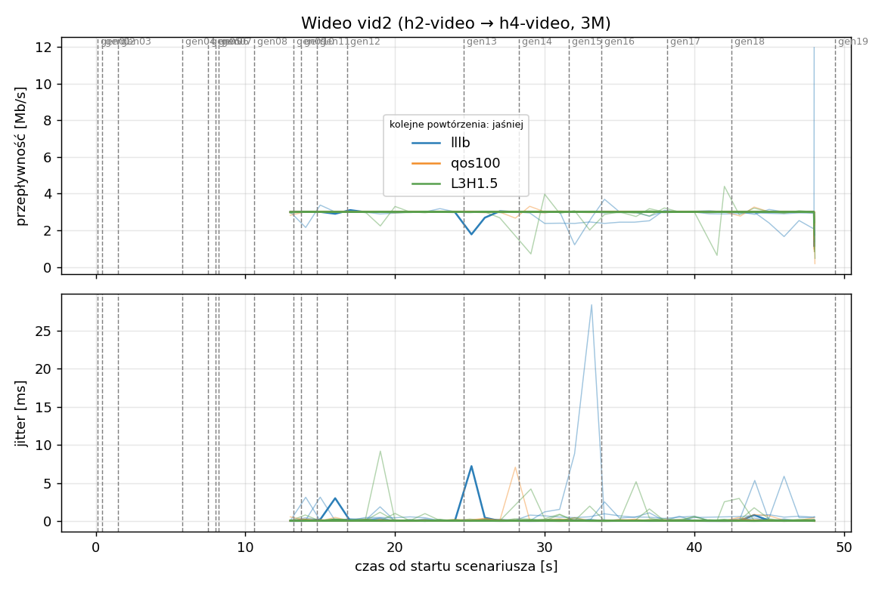
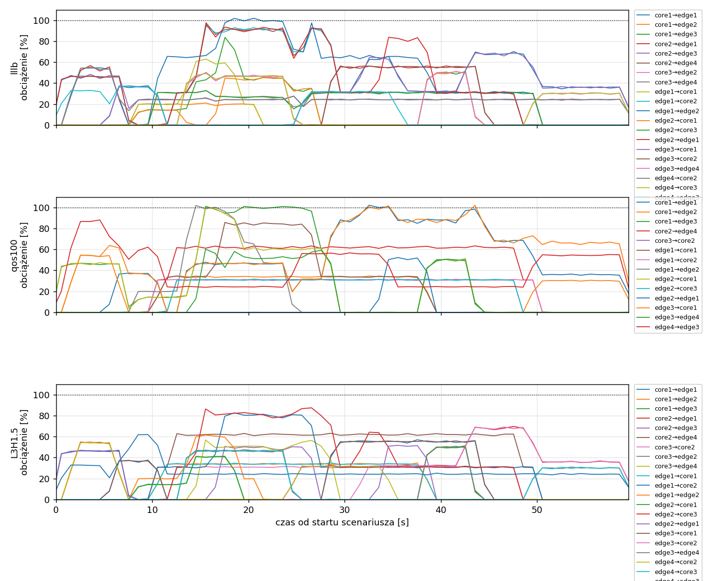
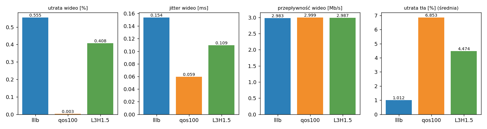

# Raport: mesh-sdn

Katalog: `results/official/load-0.4/mesh-sdn/20261108_210747`

## 1. Scenariusz

- Topologia: `mesh` (sdn: `mesh-sdn.clab.yml`)
- Warianty: **lllb** (POLICY=lllb), **qos100** (LAYERS=1, POLICY=qos, RESERVE_PCT=100), **L3H1.5** (HEADROOM_MBPS=1.5, LAYERS=3, POLICY=qos, RESERVE_PCT=70)
- Czas testu: 60 s, warmup (pomijany w statystykach, liczony od startu każdego przepływu): 5 s, powtórzeń: 20, seed: 42
- Wykonane przebiegi: lllb/rep1, lllb/rep10, lllb/rep11, lllb/rep12, lllb/rep13, lllb/rep14, lllb/rep15, lllb/rep16, lllb/rep17, lllb/rep18, lllb/rep19, lllb/rep2, lllb/rep20, lllb/rep3, lllb/rep4, lllb/rep5, lllb/rep6, lllb/rep7, lllb/rep8, lllb/rep9, qos100/rep1, qos100/rep10, qos100/rep11, qos100/rep12, qos100/rep13, qos100/rep14, qos100/rep15, qos100/rep16, qos100/rep17, qos100/rep18, qos100/rep19, qos100/rep2, qos100/rep20, qos100/rep3, qos100/rep4, qos100/rep5, qos100/rep6, qos100/rep7, qos100/rep8, qos100/rep9, L3H1.5/rep1, L3H1.5/rep10, L3H1.5/rep11, L3H1.5/rep12, L3H1.5/rep13, L3H1.5/rep14, L3H1.5/rep15, L3H1.5/rep16, L3H1.5/rep17, L3H1.5/rep18, L3H1.5/rep19, L3H1.5/rep2, L3H1.5/rep20, L3H1.5/rep3, L3H1.5/rep4, L3H1.5/rep5, L3H1.5/rep6, L3H1.5/rep7, L3H1.5/rep8, L3H1.5/rep9

Harmonogram losowego tła różni się między powtórzeniami (seed + nr powtórzenia, wspólny dla wariantów); poniżej powtórzenie 1.

| id | klasa | źródło → cel | proto | zadana [Mb/s] | DSCP | start–koniec [s] |
|---|---|---|---|---|---|---|
| gen01 | background | h2-bg1 → h3-bg2 | udp | 4.49 | – | 0.1–7.1 |
| gen02 | background | h4-bg2 → h3-bg1 | udp | 3.16 | – | 0.4–5.4 |
| gen03 | background | h4-bg1 → h2-bg2 | udp | 5.25 | – | 1.5–6.5 |
| gen04 | background | h4-bg1 → h1-bg2 | udp | 3.56 | – | 5.8–10.8 |
| gen05 | background | h4-bg1 → h3-bg1 | udp | 2.36 | – | 7.5–59.5 |
| gen06 | background | h1-bg2 → h2-bg1 | udp | 1.93 | – | 8–21 |
| gen07 | background | h2-bg1 → h3-bg1 | udp | 1.39 | – | 8.2–13.2 |
| vid1 | video | h1-video → h4-video | udp | 3.00 | 46 | 10–50 |
| gen08 | background | h1-bg1 → h2-bg1 | udp | 3.29 | – | 10.6–38.6 |
| vid2 | video | h2-video → h4-video | udp | 3.00 | 46 | 12–48 |
| gen09 | background | h3-bg2 → h2-bg1 | udp | 4.51 | – | 13.2–24.2 |
| gen10 | background | h1-bg2 → h3-bg1 | udp | 3.96 | – | 13.7–18.7 |
| gen11 | background | h2-bg1 → h4-bg2 | udp | 5.85 | – | 14.8–28.8 |
| gen12 | background | h1-bg2 → h3-bg1 | udp | 4.90 | – | 16.8–26.8 |
| gen13 | background | h4-bg1 → h1-bg1 | udp | 3.07 | – | 24.6–34.6 |
| gen14 | background | h3-bg2 → h1-bg2 | udp | 5.37 | – | 28.3–44.3 |
| gen15 | background | h3-bg1 → h1-bg1 | udp | 3.12 | – | 31.6–49.6 |
| gen16 | background | h2-bg1 → h1-bg1 | udp | 4.96 | – | 33.8–38.8 |
| gen17 | background | h2-bg1 → h4-bg2 | udp | 4.86 | – | 38.2–43.2 |
| gen18 | background | h3-bg2 → h1-bg1 | udp | 3.49 | – | 42.5–59.5 |
| gen19 | background | h4-bg2 → h2-bg1 | udp | 2.93 | – | 49.4–59.4 |

## 2. Wideo: QoS według wariantu

Wartości: średnia ± odchylenie standardowe z powtórzeń.

| przepływ | wariant | przepływność [Mb/s] | jitter [ms] | utrata [%] | RTT mediana [ms] | RTT p95 [ms] |
|---|---|---|---|---|---|---|
| vid1 | lllb | 2.98 ± 0.04 | 0.132 ± 0.159 | 0.49 ± 1.23 | 0.037 ± 0.012 | 23.978 ± 35.118 |
| vid1 | qos100 | 3.00 ± 0.00 | 0.058 ± 0.026 | 0.00 ± 0.01 | 0.028 ± 0.003 | 0.052 ± 0.011 |
| vid1 | L3H1.5 | 2.99 ± 0.04 | 0.118 ± 0.134 | 0.34 ± 1.32 | 0.032 ± 0.011 | 2.964 ± 12.978 |
| vid2 | lllb | 2.98 ± 0.05 | 0.175 ± 0.343 | 0.62 ± 1.57 | 3.619 ± 13.182 | 20.916 ± 29.148 |
| vid2 | qos100 | 3.00 ± 0.00 | 0.061 ± 0.055 | 0.00 ± 0.01 | 0.030 ± 0.004 | 0.055 ± 0.010 |
| vid2 | L3H1.5 | 2.99 ± 0.06 | 0.101 ± 0.114 | 0.47 ± 1.97 | 0.032 ± 0.013 | 2.944 ± 12.865 |

RTT z `ping` co 0,1 s między hostami wideo (osobny przepływ ICMP z tym samym DSCP - w SDN może iść inną ścieżką niż strumień UDP).

## 3. Ruch tła

Agregat tła w obrębie powtórzenia, potem średnia ± odchylenie standardowe po powtórzeniach (utrata = Σ utraconych / Σ wysłanych datagramów; dostarczone = Σ przepływności / Σ zadanych; przepływy trwające nie dłużej niż warmup pominięte).

| wariant | strumieni tła / powt. | dostarczone / zadane [%] | jitter [ms] | utrata [%] |
|---|---|---|---|---|
| lllb | 16 | 99.0 ± 1.5 | 0.120 ± 0.099 | 1.01 ± 1.63 |
| qos100 | 16 | 92.9 ± 5.7 | 0.232 ± 0.097 | 6.85 ± 6.36 |
| L3H1.5 | 16 | 95.5 ± 3.6 | 0.148 ± 0.166 | 4.47 ± 4.45 |

## 4. Obciążenie łączy fabricu

Średnia i maksimum z próbek co 1 s w oknie 0–60 s; MLU = maksymalne obciążenie łącza; drops = pakiety odrzucone przez `tbf` na wyjściu łącza.

| wariant | rep | średnie obciążenie łączy [%] | MLU [%] | łącza > 90% | drops tbf | CPU VM śr./maks. [%] |
|---|---|---|---|---|---|---|
| lllb | 1 | 17.9 | 101.8 | 4/24 | 2174 | 13 / 38 |
| lllb | 2 | 24.7 | 109.8 | 8/24 | 7801 | 18 / 94 |
| lllb | 3 | 29.3 | 103.3 | 9/24 | 3662 | 15 / 38 |
| lllb | 4 | 20.6 | 103.2 | 7/24 | 1321 | 13 / 23 |
| lllb | 5 | 20.5 | 93.2 | 1/24 | 0 | 12 / 25 |
| lllb | 6 | 12.6 | 88.4 | 0/24 | 0 | 12 / 26 |
| lllb | 7 | 17.7 | 105.3 | 4/24 | 126 | 13 / 34 |
| lllb | 8 | 25.2 | 102.8 | 7/24 | 280 | 26 / 92 |
| lllb | 9 | 19.1 | 104.4 | 3/24 | 898 | 13 / 25 |
| lllb | 10 | 13.6 | 87.9 | 0/24 | 0 | 14 / 27 |
| lllb | 11 | 17.3 | 101.2 | 3/24 | 1151 | 13 / 36 |
| lllb | 12 | 15.9 | 92.9 | 1/24 | 0 | 14 / 30 |
| lllb | 13 | 21.1 | 101.1 | 3/24 | 0 | 12 / 22 |
| lllb | 14 | 17.1 | 91.8 | 2/24 | 14 | 14 / 53 |
| lllb | 15 | 26.3 | 102.9 | 5/24 | 2479 | 13 / 24 |
| lllb | 16 | 22.2 | 103.7 | 7/24 | 1700 | 13 / 26 |
| lllb | 17 | 23.5 | 102.1 | 4/24 | 840 | 14 / 24 |
| lllb | 18 | 20.1 | 100.7 | 3/24 | 896 | 12 / 20 |
| lllb | 19 | 17.8 | 99.9 | 1/24 | 554 | 12 / 23 |
| lllb | 20 | 17.6 | 93.2 | 3/24 | 58 | 12 / 28 |
| qos100 | 1 | 16.5 | 102.1 | 5/24 | 2669 | 11 / 20 |
| qos100 | 2 | 19.9 | 103.8 | 5/24 | 15314 | 14 / 37 |
| qos100 | 3 | 27.2 | 103.8 | 8/24 | 13422 | 13 / 22 |
| qos100 | 4 | 17.7 | 103.4 | 6/24 | 7716 | 13 / 26 |
| qos100 | 5 | 17.5 | 102.3 | 2/24 | 2118 | 12 / 35 |
| qos100 | 6 | 10.9 | 100.5 | 2/24 | 782 | 12 / 24 |
| qos100 | 7 | 18.4 | 101.5 | 9/24 | 3419 | 11 / 17 |
| qos100 | 8 | 19.7 | 108.8 | 7/24 | 10292 | 15 / 78 |
| qos100 | 9 | 14.9 | 105.1 | 2/24 | 28745 | 15 / 37 |
| qos100 | 10 | 13.9 | 101.4 | 3/24 | 2253 | 12 / 23 |
| qos100 | 11 | 14.6 | 102.3 | 4/24 | 3660 | 12 / 28 |
| qos100 | 12 | 13.7 | 102.3 | 4/24 | 6532 | 12 / 19 |
| qos100 | 13 | 18.9 | 102.8 | 6/24 | 8747 | 12 / 22 |
| qos100 | 14 | 16.4 | 102.2 | 4/24 | 984 | 13 / 42 |
| qos100 | 15 | 26.2 | 110.0 | 8/24 | 8749 | 15 / 26 |
| qos100 | 16 | 18.1 | 102.9 | 7/24 | 6339 | 15 / 32 |
| qos100 | 17 | 22.7 | 103.7 | 6/24 | 5818 | 15 / 29 |
| qos100 | 18 | 16.6 | 101.8 | 5/24 | 2971 | 12 / 31 |
| qos100 | 19 | 15.7 | 102.1 | 4/24 | 1123 | 11 / 18 |
| qos100 | 20 | 16.5 | 101.9 | 3/24 | 218 | 12 / 20 |
| L3H1.5 | 1 | 15.9 | 87.5 | 0/24 | 0 | 11 / 20 |
| L3H1.5 | 2 | 22.4 | 102.8 | 4/24 | 4098 | 13 / 26 |
| L3H1.5 | 3 | 28.6 | 105.2 | 7/24 | 10605 | 13 / 22 |
| L3H1.5 | 4 | 19.8 | 102.5 | 4/24 | 420 | 13 / 25 |
| L3H1.5 | 5 | 17.6 | 92.8 | 2/24 | 0 | 12 / 20 |
| L3H1.5 | 6 | 10.7 | 85.4 | 0/24 | 0 | 13 / 25 |
| L3H1.5 | 7 | 17.1 | 100.7 | 1/24 | 1817 | 12 / 27 |
| L3H1.5 | 8 | 22.8 | 103.4 | 7/24 | 7050 | 19 / 94 |
| L3H1.5 | 9 | 19.2 | 102.5 | 2/24 | 2257 | 13 / 42 |
| L3H1.5 | 10 | 14.3 | 87.2 | 0/24 | 0 | 11 / 20 |
| L3H1.5 | 11 | 15.0 | 102.1 | 2/24 | 171 | 12 / 21 |
| L3H1.5 | 12 | 15.6 | 84.7 | 0/24 | 0 | 11 / 22 |
| L3H1.5 | 13 | 19.8 | 83.0 | 0/24 | 0 | 12 / 22 |
| L3H1.5 | 14 | 15.8 | 86.1 | 0/24 | 453 | 13 / 33 |
| L3H1.5 | 15 | 24.3 | 100.2 | 2/24 | 1799 | 15 / 35 |
| L3H1.5 | 16 | 18.4 | 102.5 | 5/24 | 2153 | 12 / 21 |
| L3H1.5 | 17 | 23.1 | 101.0 | 2/24 | 0 | 13 / 21 |
| L3H1.5 | 18 | 19.0 | 87.3 | 0/24 | 0 | 12 / 18 |
| L3H1.5 | 19 | 15.3 | 96.3 | 1/24 | 0 | 37 / 90 |
| L3H1.5 | 20 | 15.8 | 101.4 | 1/24 | 191 | 12 / 28 |

Łącza z obciążeniem > 10% (maksimum [%] / drops, powtórzenie 1):

| łącze | lllb | qos100 | L3H1.5 |
|---|---|---|---|
| core1→core3 | 0 / 0 | 0 / 0 | 0 / 0 |
| core1→edge1 | 70 / 0 | 102 / 0 | 57 / 0 |
| core1→edge2 | 21 / 0 | 55 / 0 | 35 / 0 |
| core1→edge3 | 84 / 0 | 101 / 1573 | 50 / 0 |
| core2→core3 | 0 / 0 | 0 / 0 | 0 / 0 |
| core2→edge1 | 57 / 0 | 0 / 0 | 70 / 0 |
| core2→edge3 | 48 / 0 | 0 / 0 | 51 / 0 |
| core2→edge4 | 98 / 0 | 63 / 0 | 63 / 0 |
| core3→core2 | 0 / 0 | 32 / 0 | 32 / 0 |
| core3→edge2 | 50 / 0 | 0 / 0 | 47 / 0 |
| core3→edge4 | 33 / 0 | 0 / 0 | 57 / 0 |
| edge1→core1 | 63 / 0 | 86 / 0 | 35 / 0 |
| edge1→core2 | 95 / 0 | 32 / 0 | 83 / 0 |
| edge1→edge2 | 102 / 1786 | 102 / 339 | 61 / 0 |
| edge2→core1 | 51 / 0 | 100 / 0 | 51 / 0 |
| edge2→core3 | 33 / 0 | 32 / 0 | 87 / 0 |
| edge2→edge1 | 96 / 388 | 52 / 0 | 52 / 0 |
| edge3→core1 | 70 / 0 | 102 / 757 | 56 / 0 |
| edge3→core2 | 56 / 0 | 0 / 0 | 69 / 0 |
| edge3→edge4 | 51 / 0 | 60 / 0 | 51 / 0 |
| edge4→core2 | 55 / 0 | 0 / 0 | 54 / 0 |
| edge4→core3 | 49 / 0 | 0 / 0 | 47 / 0 |
| edge4→edge3 | 37 / 0 | 88 / 0 | 62 / 0 |

## 5. Ścieżki wybrane przez kontroler (powtórzenie 1)

Z logu kontrolera (linie `Flow`), dopasowane po piątce przepływu; ✓ = reguły widoczne w `dump-flows` na tych samych przełącznikach.

| przepływ | lllb | qos100 | L3H1.5 |
|---|---|---|---|
| gen01 | edge2 -> edge1 -> core2 -> edge3 ✓ (loads 5% 5% 0% 0%) | edge2 -> core1 -> edge3 ✓ (loads 5% 5% 0% 0%) | edge2 -> edge1 -> core2 -> edge3 ✓ (loads 20% 20% 0% 0%) |
| gen02 | edge4 -> edge3 ✓ (loads 5% 7%) | edge4 -> edge3 ✓ (loads 5% 0%) | edge4 -> edge3 ✓ (loads 20% 20%) |
| gen03 | edge4 -> core2 -> edge1 -> edge2 ✓ (loads 5% 28% 0% 5%) | edge4 -> edge3 -> core1 -> edge2 ✓ (loads 0% 37% 0% 0%) | edge4 -> core2 -> edge1 -> edge2 ✓ (loads 20% 44% 20% 20%) |
| gen04 | edge4 -> edge3 -> core1 -> edge1 ✓ (loads 54% 38% 54% 46%) | edge4 -> edge3 -> core1 -> edge1 ✓ (loads 0% 92% 92% 0%) | edge4 -> edge3 -> core1 -> edge1 ✓ (loads 54% 42% 54% 46%) |
| gen05 | edge4 -> core2 -> edge3 ✓ (loads 42% 39%) | edge4 -> edge3 ✓ (loads 48% 0%) | edge4 -> edge3 ✓ (loads 55% 65%) |
| gen06 | edge1 -> core1 -> edge2 ✓ (loads 12% 5%) | edge1 -> edge2 ✓ (loads 5% 7%) | edge1 -> edge2 ✓ (loads 11% 28%) |
| gen07 | edge2 -> core1 -> edge3 ✓ (loads 10% 44% 44% 42%) | edge2 -> core1 -> edge3 ✓ (loads 39% 39% 10% 53%) | edge2 -> core1 -> edge3 ✓ (loads 25% 48% 48% 79%) |
| vid1 | edge1 -> edge2 -> core3 -> edge4 ✓ (loads 5% 0% 20% 20%) | edge1 -> core2 -> edge4 ✓ (loads 0% 20% 14% 5%) | edge1 -> core2 -> edge4 ✓ (loads 0% 41% 36% 6%) |
| gen08 | edge1 -> edge2 ✓ (loads 13% 20%) | edge1 -> core1 -> edge2 ✓ (loads 20% 5%) | edge1 -> core1 -> edge2 ✓ (loads 20% 11%) |
| vid2 | edge2 -> edge1 -> core2 -> edge4 ✓ (loads 31% 5% 14% 31%) | edge2 -> core3 -> core2 -> edge4 ✓ (loads 0% 31% 19% 19%) | edge2 -> core3 -> core2 -> edge4 ✓ (loads 10% 61% 14% 14%) |
| gen09 | edge3 -> edge4 -> core3 -> edge2 ✓ (loads 20% 10% 65% 10%) | edge3 -> core1 -> edge1 -> edge2 ✓ (loads 34% 5% 25% 5%) | edge3 -> edge4 -> core3 -> edge2 ✓ (loads 34% 11% 20% 11%) |
| gen10 | edge1 -> core1 -> edge3 ✓ (loads 25% 31% 65% 31%) | edge1 -> edge2 -> core1 -> edge3 ✓ (loads 34% 31% 34% 62%) | edge1 -> edge2 -> core1 -> edge3 ✓ (loads 34% 31% 22% 92%) |
| gen11 | edge2 -> edge1 -> core2 -> edge4 ✓ (loads 36% 31% 46% 36%) | edge2 -> core1 -> edge3 -> edge4 ✓ (loads 31% 62% 32% 32%) | edge2 -> core3 -> edge4 ✓ (loads 34% 62% 53% 47%) |
| gen12 | edge1 -> edge2 -> core1 -> edge3 ✓ (loads 66% 91% 65% 91%) | edge1 -> core1 -> edge3 ✓ (loads 104% 31% 104% 62%) | edge1 -> core2 -> edge3 ✓ (loads 41% 36% 61% 62%) |
| gen13 | edge4 -> edge3 -> core1 -> edge1 ✓ (loads 26% 5% 5% 51%) | edge4 -> edge3 -> core1 -> edge1 ✓ (loads 0% 42% 29% 0%) | edge4 -> core2 -> edge1 ✓ (loads 10% 24% 24% 30%) |
| gen14 | edge3 -> core2 -> edge1 ✓ (loads 32% 5% 24% 91%) | edge3 -> core1 -> edge1 ✓ (loads 37% 0% 60% 37%) | edge3 -> core1 -> edge1 ✓ (loads 10% 32% 32% 34%) |
| gen15 | edge3 -> core1 -> edge1 ✓ (loads 37% 55% 55% 37%) | edge3 -> core1 -> edge1 ✓ (loads 92% 0% 0% 92%) | edge3 -> core2 -> edge1 ✓ (loads 55% 40% 40% 55%) |
| gen16 | edge2 -> edge1 ✓ (loads 36% 64%) | edge2 -> edge1 ✓ (loads 5% 100%) | edge2 -> edge1 ✓ (loads 7% 55%) |
| gen17 | edge2 -> core1 -> edge3 -> edge4 ✓ (loads 31% 82% 5% 31%) | edge2 -> core1 -> edge3 -> edge4 ✓ (loads 31% 62% 5% 5%) | edge2 -> core1 -> edge3 -> edge4 ✓ (loads 31% 62% 9% 9%) |
| gen18 | edge3 -> core1 -> edge1 ✓ (loads 37% 55% 55% 37%) | edge3 -> core1 -> edge1 ✓ (loads 93% 0% 50% 93%) | edge3 -> core2 -> edge1 ✓ (loads 55% 41% 50% 55%) |
| gen19 | edge4 -> core3 -> edge2 ✓ (loads 5% 68% 31% 24%) | edge4 -> edge3 -> core1 -> edge2 ✓ (loads 0% 73% 0% 0%) | edge4 -> core3 -> edge2 ✓ (loads 12% 24% 68% 12%) |

## 6. Wnioski

<!-- WNIOSKI:START -->
_Do uzupełnienia: krótkie wnioski wyłącznie na podstawie liczb z sekcji 2–5._
<!-- WNIOSKI:END -->

## 7. Wiarygodność pomiaru

- lllb rep1, gen02: przepływ krótszy niż warmup - statystyki z całości
- lllb rep1, gen04: przepływ krótszy niż warmup - statystyki z całości
- lllb rep1, gen07: przepływ krótszy niż warmup - statystyki z całości
- lllb rep1, gen16: przepływ krótszy niż warmup - statystyki z całości
- lllb rep1, gen17: przepływ krótszy niż warmup - statystyki z całości
- lllb rep10, gen04: przepływ krótszy niż warmup - statystyki z całości
- lllb rep10, gen09: przepływ krótszy niż warmup - statystyki z całości
- lllb rep10, gen17: przepływ krótszy niż warmup - statystyki z całości
- lllb rep11, gen09: przepływ krótszy niż warmup - statystyki z całości
- lllb rep11, gen13: przepływ krótszy niż warmup - statystyki z całości
- lllb rep11, gen19: przepływ krótszy niż warmup - statystyki z całości
- lllb rep11, gen22: przepływ krótszy niż warmup - statystyki z całości
- lllb rep12, gen03: przepływ krótszy niż warmup - statystyki z całości
- lllb rep12, gen04: przepływ krótszy niż warmup - statystyki z całości
- lllb rep12, gen07: przepływ krótszy niż warmup - statystyki z całości
- lllb rep13, gen13: przepływ krótszy niż warmup - statystyki z całości
- lllb rep13, gen19: przepływ krótszy niż warmup - statystyki z całości
- lllb rep14, gen19: przepływ krótszy niż warmup - statystyki z całości
- lllb rep15, gen09: przepływ krótszy niż warmup - statystyki z całości
- lllb rep15, gen27: przepływ krótszy niż warmup - statystyki z całości
- lllb rep15, gen28: przepływ krótszy niż warmup - statystyki z całości
- lllb rep16, gen11: przepływ krótszy niż warmup - statystyki z całości
- lllb rep16, gen15: przepływ krótszy niż warmup - statystyki z całości
- lllb rep16, gen19: przepływ krótszy niż warmup - statystyki z całości
- lllb rep17, gen06: przepływ krótszy niż warmup - statystyki z całości
- lllb rep17, gen08: przepływ krótszy niż warmup - statystyki z całości
- lllb rep17, gen15: przepływ krótszy niż warmup - statystyki z całości
- lllb rep17, gen24: przepływ krótszy niż warmup - statystyki z całości
- lllb rep17, gen25: przepływ krótszy niż warmup - statystyki z całości
- lllb rep18, gen04: przepływ krótszy niż warmup - statystyki z całości
- lllb rep19, gen02: przepływ krótszy niż warmup - statystyki z całości
- lllb rep19, gen04: przepływ krótszy niż warmup - statystyki z całości
- lllb rep19, gen12: przepływ krótszy niż warmup - statystyki z całości
- lllb rep19, gen16: przepływ krótszy niż warmup - statystyki z całości
- lllb rep2, gen02: przepływ krótszy niż warmup - statystyki z całości
- lllb rep2, gen12: przepływ krótszy niż warmup - statystyki z całości
- lllb rep2, gen24: przepływ krótszy niż warmup - statystyki z całości
- lllb rep2, gen27: przepływ krótszy niż warmup - statystyki z całości
- lllb rep2: CPU maszyny do 94% (średnio 18%) - możliwy wpływ na pomiary
- lllb rep20, gen09: przepływ krótszy niż warmup - statystyki z całości
- lllb rep20, gen15: przepływ krótszy niż warmup - statystyki z całości
- lllb rep3, gen02: przepływ krótszy niż warmup - statystyki z całości
- lllb rep3, gen03: przepływ krótszy niż warmup - statystyki z całości
- lllb rep3, gen09: przepływ krótszy niż warmup - statystyki z całości
- lllb rep3, gen11: przepływ krótszy niż warmup - statystyki z całości
- lllb rep3, gen13: przepływ krótszy niż warmup - statystyki z całości
- lllb rep3, gen15: przepływ krótszy niż warmup - statystyki z całości
- lllb rep4, gen22: przepływ krótszy niż warmup - statystyki z całości
- lllb rep5, gen03: przepływ krótszy niż warmup - statystyki z całości
- lllb rep6, gen04: przepływ krótszy niż warmup - statystyki z całości
- lllb rep6, gen05: przepływ krótszy niż warmup - statystyki z całości
- lllb rep6, gen10: przepływ krótszy niż warmup - statystyki z całości
- lllb rep6, gen15: przepływ krótszy niż warmup - statystyki z całości
- lllb rep7, gen02: przepływ krótszy niż warmup - statystyki z całości
- lllb rep7, gen03: przepływ krótszy niż warmup - statystyki z całości
- lllb rep7, gen07: przepływ krótszy niż warmup - statystyki z całości
- lllb rep8, gen12: przepływ krótszy niż warmup - statystyki z całości
- lllb rep8, gen16: przepływ krótszy niż warmup - statystyki z całości
- lllb rep8: CPU maszyny do 92% (średnio 26%) - możliwy wpływ na pomiary
- lllb rep9, gen04: przepływ krótszy niż warmup - statystyki z całości
- qos100 rep1, gen02: przepływ krótszy niż warmup - statystyki z całości
- qos100 rep1, gen04: przepływ krótszy niż warmup - statystyki z całości
- qos100 rep1, gen07: przepływ krótszy niż warmup - statystyki z całości
- qos100 rep1, gen16: przepływ krótszy niż warmup - statystyki z całości
- qos100 rep10, gen02: przepływ krótszy niż warmup - statystyki z całości
- qos100 rep10, gen04: przepływ krótszy niż warmup - statystyki z całości
- qos100 rep10, gen09: przepływ krótszy niż warmup - statystyki z całości
- qos100 rep10, gen17: przepływ krótszy niż warmup - statystyki z całości
- qos100 rep11, gen09: przepływ krótszy niż warmup - statystyki z całości
- qos100 rep11, gen13: przepływ krótszy niż warmup - statystyki z całości
- qos100 rep11, gen19: przepływ krótszy niż warmup - statystyki z całości
- qos100 rep12, gen03: przepływ krótszy niż warmup - statystyki z całości
- qos100 rep12, gen04: przepływ krótszy niż warmup - statystyki z całości
- qos100 rep14, gen02: przepływ krótszy niż warmup - statystyki z całości
- qos100 rep14, gen03: przepływ krótszy niż warmup - statystyki z całości
- qos100 rep14, gen05: przepływ krótszy niż warmup - statystyki z całości
- qos100 rep14, gen17: przepływ krótszy niż warmup - statystyki z całości
- qos100 rep15, gen17: przepływ krótszy niż warmup - statystyki z całości
- qos100 rep16, gen11: przepływ krótszy niż warmup - statystyki z całości
- qos100 rep16, gen15: przepływ krótszy niż warmup - statystyki z całości
- qos100 rep16, gen22: przepływ krótszy niż warmup - statystyki z całości
- qos100 rep17, gen05: przepływ krótszy niż warmup - statystyki z całości
- qos100 rep17, gen06: przepływ krótszy niż warmup - statystyki z całości
- qos100 rep17, gen09: przepływ krótszy niż warmup - statystyki z całości
- qos100 rep17, gen24: przepływ krótszy niż warmup - statystyki z całości
- qos100 rep17, gen25: przepływ krótszy niż warmup - statystyki z całości
- qos100 rep18, gen04: przepływ krótszy niż warmup - statystyki z całości
- qos100 rep18, gen17: przepływ krótszy niż warmup - statystyki z całości
- qos100 rep18, gen20: przepływ krótszy niż warmup - statystyki z całości
- qos100 rep19, gen02: przepływ krótszy niż warmup - statystyki z całości
- qos100 rep19, gen14: przepływ krótszy niż warmup - statystyki z całości
- qos100 rep2, gen12: przepływ krótszy niż warmup - statystyki z całości
- qos100 rep2, gen23: klient: unable to read from stream socket: Resource temporarily unavailable
- qos100 rep2, gen23: BRAK WYNIKU - przepływ odrzucony z tabel
- qos100 rep2, gen27: przepływ krótszy niż warmup - statystyki z całości
- qos100 rep20, gen03: przepływ krótszy niż warmup - statystyki z całości
- qos100 rep20, gen09: przepływ krótszy niż warmup - statystyki z całości
- qos100 rep20, gen11: przepływ krótszy niż warmup - statystyki z całości
- qos100 rep3, gen03: przepływ krótszy niż warmup - statystyki z całości
- qos100 rep3, gen11: przepływ krótszy niż warmup - statystyki z całości
- qos100 rep3, gen15: przepływ krótszy niż warmup - statystyki z całości
- qos100 rep4, gen22: przepływ krótszy niż warmup - statystyki z całości
- qos100 rep5, gen02: przepływ krótszy niż warmup - statystyki z całości
- qos100 rep5, gen21: przepływ krótszy niż warmup - statystyki z całości
- qos100 rep6, gen04: przepływ krótszy niż warmup - statystyki z całości
- qos100 rep6, gen05: przepływ krótszy niż warmup - statystyki z całości
- qos100 rep6, gen10: przepływ krótszy niż warmup - statystyki z całości
- qos100 rep6, gen15: przepływ krótszy niż warmup - statystyki z całości
- qos100 rep7, gen02: przepływ krótszy niż warmup - statystyki z całości
- qos100 rep7, gen11: przepływ krótszy niż warmup - statystyki z całości
- qos100 rep8, gen05: przepływ krótszy niż warmup - statystyki z całości
- qos100 rep8, gen12: przepływ krótszy niż warmup - statystyki z całości
- qos100 rep8, gen16: przepływ krótszy niż warmup - statystyki z całości
- qos100 rep9, gen04: przepływ krótszy niż warmup - statystyki z całości
- L3H1.5 rep1, gen02: przepływ krótszy niż warmup - statystyki z całości
- L3H1.5 rep1, gen04: przepływ krótszy niż warmup - statystyki z całości
- L3H1.5 rep1, gen07: przepływ krótszy niż warmup - statystyki z całości
- L3H1.5 rep1, gen16: przepływ krótszy niż warmup - statystyki z całości
- L3H1.5 rep1, gen17: przepływ krótszy niż warmup - statystyki z całości
- L3H1.5 rep10, gen04: przepływ krótszy niż warmup - statystyki z całości
- L3H1.5 rep10, gen09: przepływ krótszy niż warmup - statystyki z całości
- L3H1.5 rep10, gen17: przepływ krótszy niż warmup - statystyki z całości
- L3H1.5 rep11, gen13: przepływ krótszy niż warmup - statystyki z całości
- L3H1.5 rep11, gen19: przepływ krótszy niż warmup - statystyki z całości
- L3H1.5 rep12, gen03: przepływ krótszy niż warmup - statystyki z całości
- L3H1.5 rep12, gen04: przepływ krótszy niż warmup - statystyki z całości
- L3H1.5 rep12, gen07: przepływ krótszy niż warmup - statystyki z całości
- L3H1.5 rep13, gen14: przepływ krótszy niż warmup - statystyki z całości
- L3H1.5 rep13, gen19: przepływ krótszy niż warmup - statystyki z całości
- L3H1.5 rep13, gen24: przepływ krótszy niż warmup - statystyki z całości
- L3H1.5 rep14, gen03: przepływ krótszy niż warmup - statystyki z całości
- L3H1.5 rep14, gen20: przepływ krótszy niż warmup - statystyki z całości
- L3H1.5 rep15, gen09: przepływ krótszy niż warmup - statystyki z całości
- L3H1.5 rep15, gen28: przepływ krótszy niż warmup - statystyki z całości
- L3H1.5 rep16, gen19: przepływ krótszy niż warmup - statystyki z całości
- L3H1.5 rep17, gen05: przepływ krótszy niż warmup - statystyki z całości
- L3H1.5 rep17, gen06: przepływ krótszy niż warmup - statystyki z całości
- L3H1.5 rep17, gen08: przepływ krótszy niż warmup - statystyki z całości
- L3H1.5 rep17, gen09: przepływ krótszy niż warmup - statystyki z całości
- L3H1.5 rep17, gen15: przepływ krótszy niż warmup - statystyki z całości
- L3H1.5 rep17, gen24: przepływ krótszy niż warmup - statystyki z całości
- L3H1.5 rep17, gen25: przepływ krótszy niż warmup - statystyki z całości
- L3H1.5 rep18, gen04: przepływ krótszy niż warmup - statystyki z całości
- L3H1.5 rep18, gen17: przepływ krótszy niż warmup - statystyki z całości
- L3H1.5 rep19, gen02: przepływ krótszy niż warmup - statystyki z całości
- L3H1.5 rep19, gen04: przepływ krótszy niż warmup - statystyki z całości
- L3H1.5 rep19: CPU maszyny do 90% (średnio 37%) - możliwy wpływ na pomiary
- L3H1.5 rep2, gen02: przepływ krótszy niż warmup - statystyki z całości
- L3H1.5 rep2, gen12: przepływ krótszy niż warmup - statystyki z całości
- L3H1.5 rep2, gen24: przepływ krótszy niż warmup - statystyki z całości
- L3H1.5 rep2, gen27: przepływ krótszy niż warmup - statystyki z całości
- L3H1.5 rep20, gen09: przepływ krótszy niż warmup - statystyki z całości
- L3H1.5 rep20, gen11: przepływ krótszy niż warmup - statystyki z całości
- L3H1.5 rep20, gen15: przepływ krótszy niż warmup - statystyki z całości
- L3H1.5 rep3, gen02: przepływ krótszy niż warmup - statystyki z całości
- L3H1.5 rep3, gen03: przepływ krótszy niż warmup - statystyki z całości
- L3H1.5 rep3, gen11: przepływ krótszy niż warmup - statystyki z całości
- L3H1.5 rep3, gen13: przepływ krótszy niż warmup - statystyki z całości
- L3H1.5 rep3, gen15: przepływ krótszy niż warmup - statystyki z całości
- L3H1.5 rep4, gen22: przepływ krótszy niż warmup - statystyki z całości
- L3H1.5 rep5, gen02: przepływ krótszy niż warmup - statystyki z całości
- L3H1.5 rep5, gen03: przepływ krótszy niż warmup - statystyki z całości
- L3H1.5 rep5, gen14: przepływ krótszy niż warmup - statystyki z całości
- L3H1.5 rep5, gen15: przepływ krótszy niż warmup - statystyki z całości
- L3H1.5 rep6, gen04: przepływ krótszy niż warmup - statystyki z całości
- L3H1.5 rep6, gen05: przepływ krótszy niż warmup - statystyki z całości
- L3H1.5 rep6, gen10: przepływ krótszy niż warmup - statystyki z całości
- L3H1.5 rep7, gen02: przepływ krótszy niż warmup - statystyki z całości
- L3H1.5 rep7, gen03: przepływ krótszy niż warmup - statystyki z całości
- L3H1.5 rep7, gen07: przepływ krótszy niż warmup - statystyki z całości
- L3H1.5 rep7, gen11: przepływ krótszy niż warmup - statystyki z całości
- L3H1.5 rep8, gen08: nadawca wysłał 1.47 z 1.63 Mb/s (ograniczenie po stronie hosta?)
- L3H1.5 rep8: CPU maszyny do 94% (średnio 19%) - możliwy wpływ na pomiary
- L3H1.5 rep9, gen04: przepływ krótszy niż warmup - statystyki z całości
