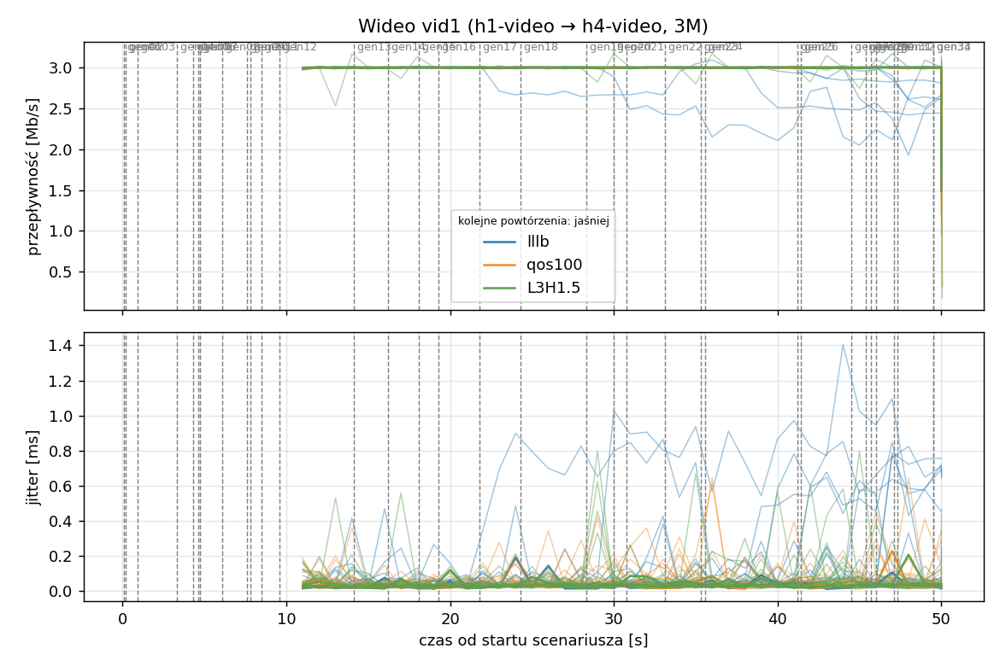
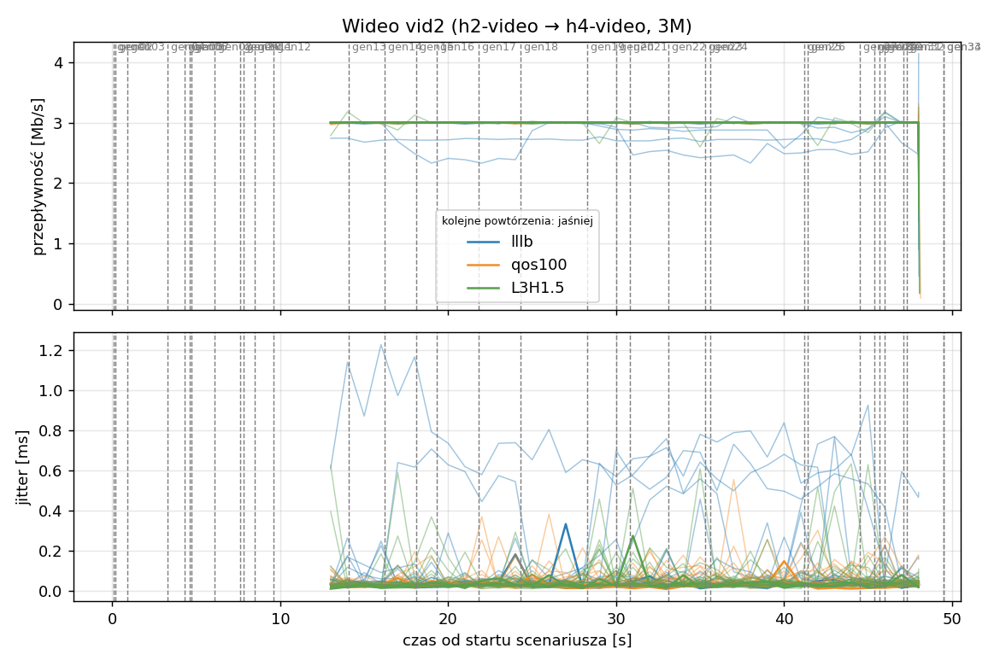
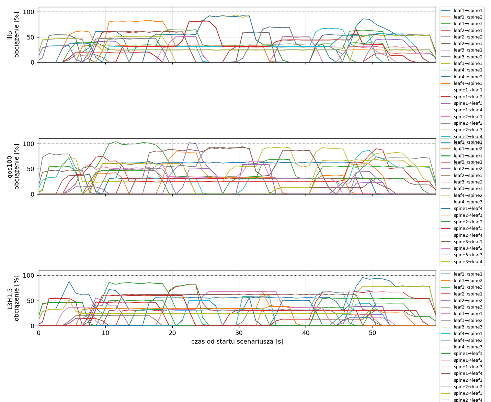
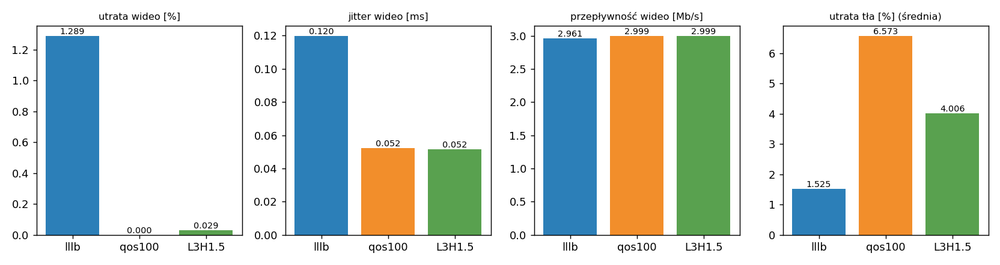

# Raport: clos-sdn

Katalog: `results/official/load-0.7/clos-sdn/20261105_231410`

## 1. Scenariusz

- Topologia: `clos` (sdn: `clos-sdn.clab.yml`)
- Warianty: **lllb** (POLICY=lllb), **qos100** (LAYERS=1, POLICY=qos, RESERVE_PCT=100), **L3H1.5** (HEADROOM_MBPS=1.5, LAYERS=3, POLICY=qos, RESERVE_PCT=70)
- Czas testu: 60 s, warmup (pomijany w statystykach, liczony od startu każdego przepływu): 5 s, powtórzeń: 20, seed: 42
- Wykonane przebiegi: lllb/rep1, lllb/rep10, lllb/rep11, lllb/rep12, lllb/rep13, lllb/rep14, lllb/rep15, lllb/rep16, lllb/rep17, lllb/rep18, lllb/rep19, lllb/rep2, lllb/rep20, lllb/rep3, lllb/rep4, lllb/rep5, lllb/rep6, lllb/rep7, lllb/rep8, lllb/rep9, qos100/rep1, qos100/rep10, qos100/rep11, qos100/rep12, qos100/rep13, qos100/rep14, qos100/rep15, qos100/rep16, qos100/rep17, qos100/rep18, qos100/rep19, qos100/rep2, qos100/rep20, qos100/rep3, qos100/rep4, qos100/rep5, qos100/rep6, qos100/rep7, qos100/rep8, qos100/rep9, L3H1.5/rep1, L3H1.5/rep10, L3H1.5/rep11, L3H1.5/rep12, L3H1.5/rep13, L3H1.5/rep14, L3H1.5/rep15, L3H1.5/rep16, L3H1.5/rep17, L3H1.5/rep18, L3H1.5/rep19, L3H1.5/rep2, L3H1.5/rep20, L3H1.5/rep3, L3H1.5/rep4, L3H1.5/rep5, L3H1.5/rep6, L3H1.5/rep7, L3H1.5/rep8, L3H1.5/rep9

Harmonogram losowego tła różni się między powtórzeniami (seed + nr powtórzenia, wspólny dla wariantów); poniżej powtórzenie 1.

| id | klasa | źródło → cel | proto | zadana [Mb/s] | DSCP | start–koniec [s] |
|---|---|---|---|---|---|---|
| gen01 | background | h2-bg1 → h3-bg2 | udp | 4.49 | – | 0.1–7.1 |
| gen02 | background | h4-bg2 → h3-bg1 | udp | 3.16 | – | 0.2–5.2 |
| gen03 | background | h4-bg1 → h2-bg2 | udp | 5.25 | – | 0.9–5.9 |
| gen04 | background | h4-bg1 → h1-bg2 | udp | 3.56 | – | 3.3–8.3 |
| gen05 | background | h4-bg1 → h3-bg1 | udp | 2.36 | – | 4.3–59.3 |
| gen06 | background | h1-bg2 → h2-bg1 | udp | 1.93 | – | 4.6–17.6 |
| gen07 | background | h2-bg1 → h3-bg1 | udp | 1.39 | – | 4.7–9.7 |
| gen08 | background | h1-bg1 → h2-bg1 | udp | 3.29 | – | 6.1–34.1 |
| gen09 | background | h3-bg2 → h2-bg1 | udp | 4.51 | – | 7.6–18.6 |
| gen10 | background | h1-bg2 → h3-bg1 | udp | 3.96 | – | 7.8–12.8 |
| gen11 | background | h2-bg1 → h4-bg2 | udp | 5.85 | – | 8.5–22.5 |
| gen12 | background | h1-bg2 → h3-bg1 | udp | 4.90 | – | 9.6–19.6 |
| vid1 | video | h1-video → h4-video | udp | 3.00 | 46 | 10–50 |
| vid2 | video | h2-video → h4-video | udp | 3.00 | 46 | 12–48 |
| gen13 | background | h4-bg1 → h1-bg1 | udp | 3.07 | – | 14.1–24.1 |
| gen14 | background | h3-bg2 → h1-bg2 | udp | 5.37 | – | 16.2–32.2 |
| gen15 | background | h3-bg1 → h1-bg1 | udp | 3.12 | – | 18.1–36.1 |
| gen16 | background | h2-bg1 → h1-bg1 | udp | 4.96 | – | 19.3–24.3 |
| gen17 | background | h2-bg1 → h4-bg2 | udp | 4.86 | – | 21.8–26.8 |
| gen18 | background | h3-bg2 → h1-bg1 | udp | 3.49 | – | 24.3–43.3 |
| gen19 | background | h4-bg2 → h2-bg1 | udp | 2.93 | – | 28.3–57.3 |
| gen20 | background | h1-bg2 → h4-bg2 | udp | 5.68 | – | 30–35 |
| gen21 | background | h4-bg1 → h2-bg1 | udp | 3.04 | – | 30.8–44.8 |
| gen22 | background | h4-bg1 → h2-bg1 | udp | 3.69 | – | 33.1–38.1 |
| gen23 | background | h2-bg2 → h4-bg2 | udp | 1.26 | – | 35.3–55.3 |
| gen24 | background | h3-bg1 → h1-bg2 | udp | 4.88 | – | 35.6–41.6 |
| gen25 | background | h4-bg1 → h1-bg2 | udp | 3.51 | – | 41.2–46.2 |
| gen26 | background | h1-bg1 → h4-bg1 | udp | 5.23 | – | 41.4–59.4 |
| gen27 | background | h1-bg2 → h4-bg1 | udp | 2.10 | – | 44.5–50.5 |
| gen28 | background | h4-bg1 → h1-bg2 | udp | 1.54 | – | 45.4–50.4 |
| gen29 | background | h4-bg1 → h1-bg2 | udp | 1.53 | – | 45.7–52.7 |
| gen30 | background | h1-bg2 → h3-bg1 | udp | 3.69 | – | 46–52 |
| gen31 | background | h2-bg1 → h4-bg2 | udp | 2.18 | – | 47.1–52.1 |
| gen32 | background | h4-bg2 → h3-bg2 | udp | 5.19 | – | 47.3–59.3 |
| gen33 | background | h4-bg2 → h3-bg2 | udp | 2.60 | – | 49.5–55.5 |
| gen34 | background | h2-bg2 → h3-bg2 | udp | 1.75 | – | 49.5–59.5 |

## 2. Wideo: QoS według wariantu

Wartości: średnia ± odchylenie standardowe z powtórzeń.

| przepływ | wariant | przepływność [Mb/s] | jitter [ms] | utrata [%] | RTT mediana [ms] | RTT p95 [ms] |
|---|---|---|---|---|---|---|
| vid1 | lllb | 2.96 ± 0.08 | 0.121 ± 0.123 | 1.33 ± 2.76 | 3.162 ± 13.014 | 38.484 ± 34.605 |
| vid1 | qos100 | 3.00 ± 0.00 | 0.054 ± 0.020 | 0.00 ± 0.00 | 0.027 ± 0.002 | 0.046 ± 0.003 |
| vid1 | L3H1.5 | 3.00 ± 0.00 | 0.051 ± 0.013 | 0.01 ± 0.03 | 0.026 ± 0.002 | 2.617 ± 11.482 |
| vid2 | lllb | 2.96 ± 0.08 | 0.118 ± 0.151 | 1.25 ± 2.88 | 8.809 ± 21.460 | 28.575 ± 40.198 |
| vid2 | qos100 | 3.00 ± 0.00 | 0.050 ± 0.013 | 0.00 ± 0.00 | 0.023 ± 0.002 | 0.045 ± 0.003 |
| vid2 | L3H1.5 | 3.00 ± 0.01 | 0.052 ± 0.016 | 0.05 ± 0.21 | 0.024 ± 0.002 | 2.954 ± 13.004 |

RTT z `ping` co 0,1 s między hostami wideo (osobny przepływ ICMP z tym samym DSCP - w SDN może iść inną ścieżką niż strumień UDP).

## 3. Ruch tła

Agregat tła w obrębie powtórzenia, potem średnia ± odchylenie standardowe po powtórzeniach (utrata = Σ utraconych / Σ wysłanych datagramów; dostarczone = Σ przepływności / Σ zadanych; przepływy trwające nie dłużej niż warmup pominięte).

| wariant | strumieni tła / powt. | dostarczone / zadane [%] | jitter [ms] | utrata [%] |
|---|---|---|---|---|
| lllb | 28 | 98.4 ± 1.6 | 0.109 ± 0.059 | 1.52 ± 1.59 |
| qos100 | 28 | 93.9 ± 4.2 | 0.201 ± 0.084 | 6.57 ± 5.18 |
| L3H1.5 | 28 | 96.0 ± 3.1 | 0.103 ± 0.055 | 4.01 ± 3.73 |

## 4. Obciążenie łączy fabricu

Średnia i maksimum z próbek co 1 s w oknie 0–60 s; MLU = maksymalne obciążenie łącza; drops = pakiety odrzucone przez `tbf` na wyjściu łącza.

| wariant | rep | średnie obciążenie łączy [%] | MLU [%] | łącza > 90% | drops tbf | CPU VM śr./maks. [%] |
|---|---|---|---|---|---|---|
| lllb | 1 | 22.4 | 93.8 | 2/24 | 0 | 13 / 22 |
| lllb | 2 | 33.3 | 104.7 | 10/24 | 5990 | 16 / 31 |
| lllb | 3 | 39.7 | 103.0 | 12/24 | 13330 | 16 / 26 |
| lllb | 4 | 25.6 | 101.2 | 4/24 | 0 | 14 / 24 |
| lllb | 5 | 28.7 | 102.6 | 7/24 | 1259 | 15 / 39 |
| lllb | 6 | 19.0 | 95.4 | 1/24 | 0 | 13 / 21 |
| lllb | 7 | 30.4 | 102.2 | 5/24 | 3353 | 14 / 23 |
| lllb | 8 | 29.4 | 102.2 | 7/24 | 2320 | 14 / 22 |
| lllb | 9 | 31.5 | 102.3 | 8/24 | 8351 | 14 / 22 |
| lllb | 10 | 30.6 | 102.9 | 11/24 | 5332 | 14 / 26 |
| lllb | 11 | 32.1 | 103.1 | 12/24 | 8485 | 15 / 26 |
| lllb | 12 | 20.2 | 101.1 | 1/24 | 68 | 13 / 27 |
| lllb | 13 | 32.0 | 102.2 | 4/24 | 1875 | 14 / 22 |
| lllb | 14 | 30.8 | 102.9 | 7/24 | 1220 | 15 / 26 |
| lllb | 15 | 36.0 | 102.4 | 10/24 | 6073 | 16 / 28 |
| lllb | 16 | 30.3 | 102.5 | 11/24 | 3931 | 14 / 26 |
| lllb | 17 | 32.9 | 101.6 | 6/24 | 1061 | 14 / 25 |
| lllb | 18 | 23.3 | 100.7 | 4/24 | 504 | 13 / 22 |
| lllb | 19 | 27.0 | 102.4 | 7/24 | 1426 | 14 / 23 |
| lllb | 20 | 27.8 | 102.5 | 5/24 | 3951 | 14 / 24 |
| qos100 | 1 | 22.3 | 103.6 | 5/24 | 242 | 14 / 30 |
| qos100 | 2 | 31.6 | 103.9 | 9/24 | 18536 | 15 / 26 |
| qos100 | 3 | 37.4 | 102.9 | 14/24 | 27723 | 16 / 32 |
| qos100 | 4 | 24.5 | 102.0 | 10/24 | 6702 | 15 / 42 |
| qos100 | 5 | 28.3 | 101.3 | 7/24 | 4875 | 14 / 24 |
| qos100 | 6 | 19.0 | 100.7 | 3/24 | 299 | 13 / 21 |
| qos100 | 7 | 29.0 | 102.7 | 12/24 | 14014 | 14 / 25 |
| qos100 | 8 | 29.1 | 102.0 | 12/24 | 5939 | 14 / 26 |
| qos100 | 9 | 27.2 | 102.7 | 6/24 | 31781 | 14 / 26 |
| qos100 | 10 | 29.6 | 103.1 | 14/24 | 12496 | 15 / 28 |
| qos100 | 11 | 29.8 | 103.1 | 12/24 | 24298 | 15 / 26 |
| qos100 | 12 | 19.8 | 102.6 | 6/24 | 2963 | 13 / 24 |
| qos100 | 13 | 31.1 | 102.6 | 10/24 | 9428 | 14 / 23 |
| qos100 | 14 | 29.8 | 103.0 | 12/24 | 7835 | 14 / 23 |
| qos100 | 15 | 33.1 | 103.1 | 10/24 | 27022 | 16 / 29 |
| qos100 | 16 | 29.4 | 102.3 | 9/24 | 11069 | 14 / 24 |
| qos100 | 17 | 32.5 | 102.3 | 9/24 | 4137 | 15 / 26 |
| qos100 | 18 | 23.0 | 102.2 | 7/24 | 3302 | 13 / 23 |
| qos100 | 19 | 26.5 | 101.9 | 7/24 | 6078 | 13 / 21 |
| qos100 | 20 | 27.4 | 101.0 | 8/24 | 7444 | 14 / 24 |
| L3H1.5 | 1 | 22.4 | 95.8 | 1/24 | 0 | 13 / 21 |
| L3H1.5 | 2 | 33.0 | 103.9 | 6/24 | 6516 | 15 / 27 |
| L3H1.5 | 3 | 38.8 | 102.4 | 10/24 | 15983 | 15 / 24 |
| L3H1.5 | 4 | 25.3 | 101.7 | 5/24 | 729 | 14 / 23 |
| L3H1.5 | 5 | 28.6 | 102.0 | 6/24 | 538 | 14 / 25 |
| L3H1.5 | 6 | 18.9 | 101.7 | 1/24 | 495 | 13 / 23 |
| L3H1.5 | 7 | 30.1 | 102.4 | 5/24 | 1362 | 14 / 22 |
| L3H1.5 | 8 | 27.9 | 101.6 | 6/24 | 1567 | 14 / 23 |
| L3H1.5 | 9 | 29.4 | 102.1 | 4/24 | 17726 | 14 / 25 |
| L3H1.5 | 10 | 30.5 | 102.6 | 5/24 | 4846 | 14 / 27 |
| L3H1.5 | 11 | 31.0 | 103.0 | 8/24 | 12120 | 15 / 24 |
| L3H1.5 | 12 | 20.1 | 100.4 | 1/24 | 147 | 13 / 21 |
| L3H1.5 | 13 | 31.2 | 103.9 | 7/24 | 466 | 15 / 36 |
| L3H1.5 | 14 | 30.7 | 102.8 | 8/24 | 1828 | 14 / 22 |
| L3H1.5 | 15 | 35.1 | 102.6 | 10/24 | 5533 | 16 / 29 |
| L3H1.5 | 16 | 29.8 | 102.8 | 4/24 | 1549 | 14 / 24 |
| L3H1.5 | 17 | 32.4 | 101.5 | 3/24 | 774 | 15 / 23 |
| L3H1.5 | 18 | 22.9 | 102.0 | 3/24 | 501 | 13 / 23 |
| L3H1.5 | 19 | 27.2 | 102.1 | 4/24 | 207 | 13 / 28 |
| L3H1.5 | 20 | 27.7 | 101.3 | 4/24 | 1600 | 14 / 29 |

Łącza z obciążeniem > 10% (maksimum [%] / drops, powtórzenie 1):

| łącze | lllb | qos100 | L3H1.5 |
|---|---|---|---|
| leaf1→spine1 | 61 / 0 | 32 / 0 | 72 / 0 |
| leaf1→spine2 | 83 / 0 | 60 / 0 | 60 / 0 |
| leaf1→spine3 | 39 / 0 | 104 / 242 | 86 / 0 |
| leaf2→spine1 | 62 / 0 | 32 / 0 | 82 / 0 |
| leaf2→spine2 | 51 / 0 | 102 / 0 | 50 / 0 |
| leaf2→spine3 | 83 / 0 | 62 / 0 | 61 / 0 |
| leaf3→spine1 | 33 / 0 | 0 / 0 | 48 / 0 |
| leaf3→spine2 | 51 / 0 | 58 / 0 | 69 / 0 |
| leaf3→spine3 | 94 / 0 | 94 / 0 | 57 / 0 |
| leaf4→spine1 | 68 / 0 | 0 / 0 | 67 / 0 |
| leaf4→spine2 | 86 / 0 | 93 / 0 | 96 / 0 |
| leaf4→spine3 | 62 / 0 | 87 / 0 | 39 / 0 |
| spine1→leaf1 | 65 / 0 | 0 / 0 | 83 / 0 |
| spine1→leaf2 | 31 / 0 | 0 / 0 | 55 / 0 |
| spine1→leaf3 | 46 / 0 | 0 / 0 | 55 / 0 |
| spine1→leaf4 | 61 / 0 | 64 / 0 | 63 / 0 |
| spine2→leaf1 | 52 / 0 | 84 / 0 | 69 / 0 |
| spine2→leaf2 | 70 / 0 | 69 / 0 | 32 / 0 |
| spine2→leaf3 | 54 / 0 | 90 / 0 | 79 / 0 |
| spine2→leaf4 | 53 / 0 | 59 / 0 | 59 / 0 |
| spine3→leaf1 | 92 / 0 | 93 / 0 | 56 / 0 |
| spine3→leaf2 | 34 / 0 | 65 / 0 | 67 / 0 |
| spine3→leaf3 | 63 / 0 | 80 / 0 | 51 / 0 |
| spine3→leaf4 | 82 / 0 | 68 / 0 | 67 / 0 |

## 5. Ścieżki wybrane przez kontroler (powtórzenie 1)

Z logu kontrolera (linie `Flow`), dopasowane po piątce przepływu; ✓ = reguły widoczne w `dump-flows` na tych samych przełącznikach.

| przepływ | lllb | qos100 | L3H1.5 |
|---|---|---|---|
| gen01 | leaf2 -> spine2 -> leaf3 ✓ (loads 5% 0% 0%) | leaf2 -> spine3 -> leaf3 ✓ (loads 0% 5% 0%) | leaf2 -> spine3 -> leaf3 ✓ (loads 0% 20% 0%) |
| gen02 | leaf4 -> spine1 -> leaf3 ✓ (loads 5% 5% 5%) | leaf4 -> spine3 -> leaf3 ✓ (loads 0% 10% 5%) | leaf4 -> spine2 -> leaf3 ✓ (loads 20% 20% 20%) |
| gen03 | leaf4 -> spine2 -> leaf2 ✓ (loads 10% 5% 5%) | leaf4 -> spine2 -> leaf2 ✓ (loads 0% 5% 7%) | leaf4 -> spine1 -> leaf2 ✓ (loads 20% 26% 40%) |
| gen04 | leaf4 -> spine3 -> leaf1 ✓ (loads 33% 54% 5%) | leaf4 -> spine3 -> leaf1 ✓ (loads 0% 54% 38%) | leaf4 -> spine2 -> leaf1 ✓ (loads 74% 33% 37%) |
| gen05 | leaf4 -> spine3 -> leaf3 ✓ (loads 33% 54% 27%) | leaf4 -> spine2 -> leaf3 ✓ (loads 0% 59% 79%) | leaf4 -> spine2 -> leaf3 ✓ (loads 54% 53% 62%) |
| gen06 | leaf1 -> spine1 -> leaf2 ✓ (loads 0% 54% 5%) | leaf1 -> spine3 -> leaf2 ✓ (loads 0% 54% 5%) | leaf1 -> spine2 -> leaf2 ✓ (loads 54% 14% 33%) |
| gen07 | leaf2 -> spine3 -> leaf3 ✓ (loads 32% 46% 15%) | leaf2 -> spine2 -> leaf3 ✓ (loads 0% 15% 79%) | leaf2 -> spine1 -> leaf3 ✓ (loads 43% 51% 62%) |
| gen08 | leaf1 -> spine3 -> leaf2 ✓ (loads 20% 53% 5%) | leaf1 -> spine3 -> leaf2 ✓ (loads 0% 54% 22%) | leaf1 -> spine3 -> leaf2 ✓ (loads 54% 45% 42%) |
| gen09 | leaf3 -> spine2 -> leaf2 ✓ (loads 20% 5% 27%) | leaf3 -> spine2 -> leaf2 ✓ (loads 0% 5% 54%) | leaf3 -> spine1 -> leaf2 ✓ (loads 8% 20% 59%) |
| gen10 | leaf1 -> spine1 -> leaf3 ✓ (loads 25% 46% 39%) | leaf1 -> spine2 -> leaf3 ✓ (loads 0% 44% 54%) | leaf1 -> spine1 -> leaf3 ✓ (loads 30% 32% 59%) |
| gen11 | leaf2 -> spine1 -> leaf4 ✓ (loads 5% 9% 14%) | leaf2 -> spine3 -> leaf4 ✓ (loads 0% 14% 5%) | leaf2 -> spine3 -> leaf4 ✓ (loads 30% 19% 13%) |
| gen12 | leaf1 -> spine2 -> leaf3 ✓ (loads 61% 5% 39%) | leaf1 -> spine3 -> leaf3 ✓ (loads 0% 79% 59%) | leaf1 -> spine3 -> leaf3 ✓ (loads 78% 38% 34%) |
| vid1 | leaf1 -> spine2 -> leaf4 ✓ (loads 61% 21% 34%) | leaf1 -> spine1 -> leaf4 ✓ (loads 0% 46% 64%) | leaf1 -> spine1 -> leaf4 ✓ (loads 49% 39% 60%) |
| vid2 | leaf2 -> spine3 -> leaf4 ✓ (loads 60% 31% 5%) | leaf2 -> spine1 -> leaf4 ✓ (loads 31% 5% 60%) | leaf2 -> spine1 -> leaf4 ✓ (loads 61% 12% 60%) |
| gen13 | leaf4 -> spine1 -> leaf1 ✓ (loads 0% 5% 24%) | leaf4 -> spine3 -> leaf1 ✓ (loads 0% 24% 5%) | leaf4 -> spine1 -> leaf1 ✓ (loads 0% 37% 6%) |
| gen14 | leaf3 -> spine3 -> leaf1 ✓ (loads 32% 46% 5%) | leaf3 -> spine3 -> leaf1 ✓ (loads 0% 46% 37%) | leaf3 -> spine3 -> leaf1 ✓ (loads 46% 6% 6%) |
| gen15 | leaf3 -> spine1 -> leaf1 ✓ (loads 37% 46% 55%) | leaf3 -> spine2 -> leaf1 ✓ (loads 0% 52% 87%) | leaf3 -> spine2 -> leaf1 ✓ (loads 47% 21% 61%) |
| gen16 | leaf2 -> spine2 -> leaf1 ✓ (loads 60% 5% 55%) | leaf2 -> spine2 -> leaf1 ✓ (loads 31% 16% 87%) | leaf2 -> spine1 -> leaf1 ✓ (loads 39% 40% 60%) |
| gen17 | leaf2 -> spine3 -> leaf4 ✓ (loads 60% 51% 36%) | leaf2 -> spine2 -> leaf4 ✓ (loads 62% 56% 60%) | leaf2 -> spine2 -> leaf4 ✓ (loads 76% 9% 60%) |
| gen18 | leaf3 -> spine3 -> leaf1 ✓ (loads 64% 56% 55%) | leaf3 -> spine3 -> leaf1 ✓ (loads 0% 88% 87%) | leaf3 -> spine2 -> leaf1 ✓ (loads 82% 41% 55%) |
| gen19 | leaf4 -> spine1 -> leaf2 ✓ (loads 0% 5% 34%) | leaf4 -> spine2 -> leaf2 ✓ (loads 0% 29% 34%) | leaf4 -> spine1 -> leaf2 ✓ (loads 7% 24% 34%) |
| gen20 | leaf1 -> spine1 -> leaf4 ✓ (loads 5% 31% 34%) | leaf1 -> spine2 -> leaf4 ✓ (loads 62% 5% 34%) | leaf1 -> spine2 -> leaf4 ✓ (loads 62% 7% 34%) |
| gen21 | leaf4 -> spine2 -> leaf2 ✓ (loads 30% 15% 34%) | leaf4 -> spine3 -> leaf2 ✓ (loads 0% 54% 39%) | leaf4 -> spine2 -> leaf2 ✓ (loads 50% 31% 34%) |
| gen22 | leaf4 -> spine2 -> leaf2 ✓ (loads 35% 31% 34%) | leaf4 -> spine2 -> leaf2 ✓ (loads 0% 59% 65%) | leaf4 -> spine3 -> leaf2 ✓ (loads 39% 69% 34%) |
| gen23 | leaf2 -> spine3 -> leaf4 ✓ (loads 58% 36% 31%) | leaf2 -> spine3 -> leaf4 ✓ (loads 62% 58% 5%) | leaf2 -> spine3 -> leaf4 ✓ (loads 62% 58% 32%) |
| gen24 | leaf3 -> spine2 -> leaf1 ✓ (loads 32% 5% 36%) | leaf3 -> spine3 -> leaf1 ✓ (loads 0% 37% 36%) | leaf3 -> spine3 -> leaf1 ✓ (loads 8% 68% 8%) |
| gen25 | leaf4 -> spine1 -> leaf1 ✓ (loads 35% 50% 36%) | leaf4 -> spine2 -> leaf1 ✓ (loads 0% 60% 86%) | leaf4 -> spine1 -> leaf1 ✓ (loads 37% 56% 50%) |
| gen26 | leaf1 -> spine1 -> leaf4 ✓ (loads 15% 31% 44%) | leaf1 -> spine3 -> leaf4 ✓ (loads 62% 15% 13%) | leaf1 -> spine3 -> leaf4 ✓ (loads 62% 19% 13%) |
| gen27 | leaf1 -> spine2 -> leaf4 ✓ (loads 54% 36% 44%) | leaf1 -> spine2 -> leaf4 ✓ (loads 62% 5% 67%) | leaf1 -> spine2 -> leaf4 ✓ (loads 62% 13% 67%) |
| gen28 | leaf4 -> spine2 -> leaf1 ✓ (loads 66% 27% 29%) | leaf4 -> spine3 -> leaf1 ✓ (loads 0% 91% 51%) | leaf4 -> spine3 -> leaf1 ✓ (loads 67% 56% 26%) |
| gen29 | leaf4 -> spine2 -> leaf1 ✓ (loads 66% 32% 34%) | leaf4 -> spine3 -> leaf1 ✓ (loads 0% 91% 17%) | leaf4 -> spine2 -> leaf1 ✓ (loads 67% 35% 40%) |
| gen30 | leaf1 -> spine3 -> leaf3 ✓ (loads 54% 52% 29%) | leaf1 -> spine2 -> leaf3 ✓ (loads 31% 36% 54%) | leaf1 -> spine1 -> leaf3 ✓ (loads 38% 60% 54%) |
| gen31 | leaf2 -> spine3 -> leaf4 ✓ (loads 54% 53% 49%) | leaf2 -> spine2 -> leaf4 ✓ (loads 62% 27% 67%) | leaf2 -> spine2 -> leaf4 ✓ (loads 62% 60% 67%) |
| gen32 | leaf4 -> spine2 -> leaf3 ✓ (loads 40% 37% 60%) | leaf4 -> spine3 -> leaf3 ✓ (loads 0% 81% 43%) | leaf4 -> spine2 -> leaf3 ✓ (loads 58% 48% 53%) |
| gen33 | leaf4 -> spine1 -> leaf3 ✓ (loads 35% 85% 62%) | leaf4 -> spine2 -> leaf3 ✓ (loads 0% 67% 85%) | leaf4 -> spine3 -> leaf3 ✓ (loads 38% 105% 33%) |
| gen34 | leaf2 -> spine1 -> leaf3 ✓ (loads 15% 53% 62%) | leaf2 -> spine3 -> leaf3 ✓ (loads 0% 62% 58%) | leaf2 -> spine3 -> leaf3 ✓ (loads 38% 83% 24%) |

## 6. Wnioski

<!-- WNIOSKI:START -->
_Do uzupełnienia: krótkie wnioski wyłącznie na podstawie liczb z sekcji 2–5._
<!-- WNIOSKI:END -->

## 7. Wiarygodność pomiaru

- lllb rep1, gen02: przepływ krótszy niż warmup - statystyki z całości
- lllb rep1, gen07: przepływ krótszy niż warmup - statystyki z całości
- lllb rep1, gen16: przepływ krótszy niż warmup - statystyki z całości
- lllb rep1, gen17: przepływ krótszy niż warmup - statystyki z całości
- lllb rep1, gen22: przepływ krótszy niż warmup - statystyki z całości
- lllb rep1, gen28: przepływ krótszy niż warmup - statystyki z całości
- lllb rep10, gen02: przepływ krótszy niż warmup - statystyki z całości
- lllb rep10, gen04: przepływ krótszy niż warmup - statystyki z całości
- lllb rep10, gen09: przepływ krótszy niż warmup - statystyki z całości
- lllb rep10, gen10: przepływ krótszy niż warmup - statystyki z całości
- lllb rep10, gen31: przepływ krótszy niż warmup - statystyki z całości
- lllb rep11, gen09: przepływ krótszy niż warmup - statystyki z całości
- lllb rep11, gen13: przepływ krótszy niż warmup - statystyki z całości
- lllb rep11, gen19: przepływ krótszy niż warmup - statystyki z całości
- lllb rep11, gen20: przepływ krótszy niż warmup - statystyki z całości
- lllb rep11, gen32: przepływ krótszy niż warmup - statystyki z całości
- lllb rep11, gen37: przepływ krótszy niż warmup - statystyki z całości
- lllb rep12, gen03: przepływ krótszy niż warmup - statystyki z całości
- lllb rep12, gen04: przepływ krótszy niż warmup - statystyki z całości
- lllb rep12, gen07: przepływ krótszy niż warmup - statystyki z całości
- lllb rep12, gen25: przepływ krótszy niż warmup - statystyki z całości
- lllb rep13, gen10: przepływ krótszy niż warmup - statystyki z całości
- lllb rep13, gen12: przepływ krótszy niż warmup - statystyki z całości
- lllb rep13, gen19: przepływ krótszy niż warmup - statystyki z całości
- lllb rep13, gen32: przepływ krótszy niż warmup - statystyki z całości
- lllb rep14, gen02: przepływ krótszy niż warmup - statystyki z całości
- lllb rep14, gen20: przepływ krótszy niż warmup - statystyki z całości
- lllb rep14, gen22: przepływ krótszy niż warmup - statystyki z całości
- lllb rep14, gen25: przepływ krótszy niż warmup - statystyki z całości
- lllb rep15, gen28: przepływ krótszy niż warmup - statystyki z całości
- lllb rep15, gen45: przepływ krótszy niż warmup - statystyki z całości
- lllb rep16, gen15: przepływ krótszy niż warmup - statystyki z całości
- lllb rep16, gen19: przepływ krótszy niż warmup - statystyki z całości
- lllb rep16, gen35: przepływ krótszy niż warmup - statystyki z całości
- lllb rep16, gen37: przepływ krótszy niż warmup - statystyki z całości
- lllb rep17, gen05: przepływ krótszy niż warmup - statystyki z całości
- lllb rep17, gen15: przepływ krótszy niż warmup - statystyki z całości
- lllb rep17, gen24: przepływ krótszy niż warmup - statystyki z całości
- lllb rep17, gen25: przepływ krótszy niż warmup - statystyki z całości
- lllb rep17, gen33: przepływ krótszy niż warmup - statystyki z całości
- lllb rep17, gen36: przepływ krótszy niż warmup - statystyki z całości
- lllb rep17, gen37: przepływ krótszy niż warmup - statystyki z całości
- lllb rep18, gen01: przepływ krótszy niż warmup - statystyki z całości
- lllb rep18, gen17: przepływ krótszy niż warmup - statystyki z całości
- lllb rep18, gen32: przepływ krótszy niż warmup - statystyki z całości
- lllb rep19, gen02: przepływ krótszy niż warmup - statystyki z całości
- lllb rep19, gen04: przepływ krótszy niż warmup - statystyki z całości
- lllb rep19, gen14: przepływ krótszy niż warmup - statystyki z całości
- lllb rep19, gen19: przepływ krótszy niż warmup - statystyki z całości
- lllb rep19, gen29: przepływ krótszy niż warmup - statystyki z całości
- lllb rep2, gen12: przepływ krótszy niż warmup - statystyki z całości
- lllb rep2, gen18: przepływ krótszy niż warmup - statystyki z całości
- lllb rep2, gen24: przepływ krótszy niż warmup - statystyki z całości
- lllb rep2, gen27: przepływ krótszy niż warmup - statystyki z całości
- lllb rep2, gen31: przepływ krótszy niż warmup - statystyki z całości
- lllb rep2, gen35: przepływ krótszy niż warmup - statystyki z całości
- lllb rep2, gen36: przepływ krótszy niż warmup - statystyki z całości
- lllb rep2, gen42: przepływ krótszy niż warmup - statystyki z całości
- lllb rep2, gen45: przepływ krótszy niż warmup - statystyki z całości
- lllb rep20, gen09: przepływ krótszy niż warmup - statystyki z całości
- lllb rep20, gen11: przepływ krótszy niż warmup - statystyki z całości
- lllb rep20, gen15: przepływ krótszy niż warmup - statystyki z całości
- lllb rep3, gen02: przepływ krótszy niż warmup - statystyki z całości
- lllb rep3, gen03: przepływ krótszy niż warmup - statystyki z całości
- lllb rep3, gen11: przepływ krótszy niż warmup - statystyki z całości
- lllb rep3, gen13: przepływ krótszy niż warmup - statystyki z całości
- lllb rep3, gen15: przepływ krótszy niż warmup - statystyki z całości
- lllb rep3, gen30: przepływ krótszy niż warmup - statystyki z całości
- lllb rep3, gen38: przepływ krótszy niż warmup - statystyki z całości
- lllb rep4, gen22: przepływ krótszy niż warmup - statystyki z całości
- lllb rep4, gen29: przepływ krótszy niż warmup - statystyki z całości
- lllb rep5, gen02: przepływ krótszy niż warmup - statystyki z całości
- lllb rep5, gen21: przepływ krótszy niż warmup - statystyki z całości
- lllb rep5, gen25: przepływ krótszy niż warmup - statystyki z całości
- lllb rep5, gen35: przepływ krótszy niż warmup - statystyki z całości
- lllb rep5, gen42: przepływ krótszy niż warmup - statystyki z całości
- lllb rep6, gen04: przepływ krótszy niż warmup - statystyki z całości
- lllb rep6, gen10: przepływ krótszy niż warmup - statystyki z całości
- lllb rep6, gen28: przepływ krótszy niż warmup - statystyki z całości
- lllb rep6, gen29: przepływ krótszy niż warmup - statystyki z całości
- lllb rep7, gen02: przepływ krótszy niż warmup - statystyki z całości
- lllb rep7, gen03: przepływ krótszy niż warmup - statystyki z całości
- lllb rep7, gen07: przepływ krótszy niż warmup - statystyki z całości
- lllb rep7, gen11: przepływ krótszy niż warmup - statystyki z całości
- lllb rep7, gen18: przepływ krótszy niż warmup - statystyki z całości
- lllb rep7, gen23: przepływ krótszy niż warmup - statystyki z całości
- lllb rep7, gen24: przepływ krótszy niż warmup - statystyki z całości
- lllb rep7, gen30: przepływ krótszy niż warmup - statystyki z całości
- lllb rep7, gen34: przepływ krótszy niż warmup - statystyki z całości
- lllb rep7, gen35: przepływ krótszy niż warmup - statystyki z całości
- lllb rep7, gen36: przepływ krótszy niż warmup - statystyki z całości
- lllb rep8, gen12: przepływ krótszy niż warmup - statystyki z całości
- lllb rep8, gen16: przepływ krótszy niż warmup - statystyki z całości
- lllb rep8, gen27: przepływ krótszy niż warmup - statystyki z całości
- lllb rep8, gen28: przepływ krótszy niż warmup - statystyki z całości
- lllb rep8, gen33: przepływ krótszy niż warmup - statystyki z całości
- lllb rep8, gen36: przepływ krótszy niż warmup - statystyki z całości
- lllb rep9, gen28: przepływ krótszy niż warmup - statystyki z całości
- qos100 rep1, gen02: przepływ krótszy niż warmup - statystyki z całości
- qos100 rep1, gen03: przepływ krótszy niż warmup - statystyki z całości
- qos100 rep1, gen04: przepływ krótszy niż warmup - statystyki z całości
- qos100 rep1, gen07: przepływ krótszy niż warmup - statystyki z całości
- qos100 rep1, gen10: przepływ krótszy niż warmup - statystyki z całości
- qos100 rep1, gen22: przepływ krótszy niż warmup - statystyki z całości
- qos100 rep1, gen28: przepływ krótszy niż warmup - statystyki z całości
- qos100 rep1, gen31: przepływ krótszy niż warmup - statystyki z całości
- qos100 rep10, gen17: przepływ krótszy niż warmup - statystyki z całości
- qos100 rep10, gen36: przepływ krótszy niż warmup - statystyki z całości
- qos100 rep11, gen13: przepływ krótszy niż warmup - statystyki z całości
- qos100 rep11, gen20: przepływ krótszy niż warmup - statystyki z całości
- qos100 rep11, gen32: przepływ krótszy niż warmup - statystyki z całości
- qos100 rep12, gen03: przepływ krótszy niż warmup - statystyki z całości
- qos100 rep12, gen07: przepływ krótszy niż warmup - statystyki z całości
- qos100 rep12, gen23: przepływ krótszy niż warmup - statystyki z całości
- qos100 rep13, gen14: przepływ krótszy niż warmup - statystyki z całości
- qos100 rep13, gen19: przepływ krótszy niż warmup - statystyki z całości
- qos100 rep13, gen32: przepływ krótszy niż warmup - statystyki z całości
- qos100 rep14, gen02: przepływ krótszy niż warmup - statystyki z całości
- qos100 rep14, gen05: przepływ krótszy niż warmup - statystyki z całości
- qos100 rep14, gen35: przepływ krótszy niż warmup - statystyki z całości
- qos100 rep15, gen28: przepływ krótszy niż warmup - statystyki z całości
- qos100 rep15, gen45: przepływ krótszy niż warmup - statystyki z całości
- qos100 rep16, gen06: przepływ krótszy niż warmup - statystyki z całości
- qos100 rep16, gen11: przepływ krótszy niż warmup - statystyki z całości
- qos100 rep16, gen15: przepływ krótszy niż warmup - statystyki z całości
- qos100 rep16, gen19: przepływ krótszy niż warmup - statystyki z całości
- qos100 rep16, gen32: przepływ krótszy niż warmup - statystyki z całości
- qos100 rep16, gen35: przepływ krótszy niż warmup - statystyki z całości
- qos100 rep16, gen36: przepływ krótszy niż warmup - statystyki z całości
- qos100 rep17, gen05: przepływ krótszy niż warmup - statystyki z całości
- qos100 rep17, gen06: przepływ krótszy niż warmup - statystyki z całości
- qos100 rep17, gen09: przepływ krótszy niż warmup - statystyki z całości
- qos100 rep17, gen24: przepływ krótszy niż warmup - statystyki z całości
- qos100 rep17, gen25: przepływ krótszy niż warmup - statystyki z całości
- qos100 rep17, gen36: przepływ krótszy niż warmup - statystyki z całości
- qos100 rep17, gen37: przepływ krótszy niż warmup - statystyki z całości
- qos100 rep18, gen01: przepływ krótszy niż warmup - statystyki z całości
- qos100 rep18, gen04: przepływ krótszy niż warmup - statystyki z całości
- qos100 rep18, gen32: przepływ krótszy niż warmup - statystyki z całości
- qos100 rep19, gen02: przepływ krótszy niż warmup - statystyki z całości
- qos100 rep19, gen04: przepływ krótszy niż warmup - statystyki z całości
- qos100 rep19, gen12: przepływ krótszy niż warmup - statystyki z całości
- qos100 rep19, gen19: przepływ krótszy niż warmup - statystyki z całości
- qos100 rep2, gen02: przepływ krótszy niż warmup - statystyki z całości
- qos100 rep2, gen12: przepływ krótszy niż warmup - statystyki z całości
- qos100 rep2, gen27: przepływ krótszy niż warmup - statystyki z całości
- qos100 rep2, gen35: przepływ krótszy niż warmup - statystyki z całości
- qos100 rep2, gen36: przepływ krótszy niż warmup - statystyki z całości
- qos100 rep2, gen42: przepływ krótszy niż warmup - statystyki z całości
- qos100 rep2, gen45: przepływ krótszy niż warmup - statystyki z całości
- qos100 rep20, gen12: przepływ krótszy niż warmup - statystyki z całości
- qos100 rep20, gen15: przepływ krótszy niż warmup - statystyki z całości
- qos100 rep3, gen01: przepływ krótszy niż warmup - statystyki z całości
- qos100 rep3, gen02: przepływ krótszy niż warmup - statystyki z całości
- qos100 rep3, gen03: przepływ krótszy niż warmup - statystyki z całości
- qos100 rep3, gen11: przepływ krótszy niż warmup - statystyki z całości
- qos100 rep3, gen15: przepływ krótszy niż warmup - statystyki z całości
- qos100 rep3, gen30: przepływ krótszy niż warmup - statystyki z całości
- qos100 rep3, gen38: przepływ krótszy niż warmup - statystyki z całości
- qos100 rep4, gen22: przepływ krótszy niż warmup - statystyki z całości
- qos100 rep4, gen29: przepływ krótszy niż warmup - statystyki z całości
- qos100 rep4, gen31: przepływ krótszy niż warmup - statystyki z całości
- qos100 rep5, gen02: przepływ krótszy niż warmup - statystyki z całości
- qos100 rep5, gen14: przepływ krótszy niż warmup - statystyki z całości
- qos100 rep5, gen42: przepływ krótszy niż warmup - statystyki z całości
- qos100 rep6, gen04: przepływ krótszy niż warmup - statystyki z całości
- qos100 rep6, gen10: przepływ krótszy niż warmup - statystyki z całości
- qos100 rep6, gen28: przepływ krótszy niż warmup - statystyki z całości
- qos100 rep6, gen29: przepływ krótszy niż warmup - statystyki z całości
- qos100 rep7, gen07: przepływ krótszy niż warmup - statystyki z całości
- qos100 rep7, gen11: przepływ krótszy niż warmup - statystyki z całości
- qos100 rep7, gen23: przepływ krótszy niż warmup - statystyki z całości
- qos100 rep7, gen28: przepływ krótszy niż warmup - statystyki z całości
- qos100 rep7, gen30: przepływ krótszy niż warmup - statystyki z całości
- qos100 rep8, gen12: przepływ krótszy niż warmup - statystyki z całości
- qos100 rep8, gen16: przepływ krótszy niż warmup - statystyki z całości
- qos100 rep8, gen28: przepływ krótszy niż warmup - statystyki z całości
- qos100 rep8, gen33: przepływ krótszy niż warmup - statystyki z całości
- qos100 rep8, gen36: przepływ krótszy niż warmup - statystyki z całości
- qos100 rep8, gen37: przepływ krótszy niż warmup - statystyki z całości
- qos100 rep9, gen04: przepływ krótszy niż warmup - statystyki z całości
- qos100 rep9, gen23: przepływ krótszy niż warmup - statystyki z całości
- qos100 rep9, gen26: klient: unable to read from stream socket: Resource temporarily unavailable
- qos100 rep9, gen26: BRAK WYNIKU - przepływ odrzucony z tabel
- L3H1.5 rep1, gen02: przepływ krótszy niż warmup - statystyki z całości
- L3H1.5 rep1, gen04: przepływ krótszy niż warmup - statystyki z całości
- L3H1.5 rep1, gen07: przepływ krótszy niż warmup - statystyki z całości
- L3H1.5 rep1, gen16: przepływ krótszy niż warmup - statystyki z całości
- L3H1.5 rep1, gen17: przepływ krótszy niż warmup - statystyki z całości
- L3H1.5 rep1, gen22: przepływ krótszy niż warmup - statystyki z całości
- L3H1.5 rep1, gen28: przepływ krótszy niż warmup - statystyki z całości
- L3H1.5 rep1, gen31: przepływ krótszy niż warmup - statystyki z całości
- L3H1.5 rep10, gen04: przepływ krótszy niż warmup - statystyki z całości
- L3H1.5 rep10, gen09: przepływ krótszy niż warmup - statystyki z całości
- L3H1.5 rep10, gen36: przepływ krótszy niż warmup - statystyki z całości
- L3H1.5 rep11, gen19: przepływ krótszy niż warmup - statystyki z całości
- L3H1.5 rep11, gen20: przepływ krótszy niż warmup - statystyki z całości
- L3H1.5 rep11, gen32: przepływ krótszy niż warmup - statystyki z całości
- L3H1.5 rep12, gen03: przepływ krótszy niż warmup - statystyki z całości
- L3H1.5 rep12, gen04: przepływ krótszy niż warmup - statystyki z całości
- L3H1.5 rep12, gen07: przepływ krótszy niż warmup - statystyki z całości
- L3H1.5 rep13, gen14: przepływ krótszy niż warmup - statystyki z całości
- L3H1.5 rep13, gen19: przepływ krótszy niż warmup - statystyki z całości
- L3H1.5 rep13, gen24: przepływ krótszy niż warmup - statystyki z całości
- L3H1.5 rep13, gen41: przepływ krótszy niż warmup - statystyki z całości
- L3H1.5 rep14, gen20: przepływ krótszy niż warmup - statystyki z całości
- L3H1.5 rep14, gen35: przepływ krótszy niż warmup - statystyki z całości
- L3H1.5 rep15, gen09: przepływ krótszy niż warmup - statystyki z całości
- L3H1.5 rep15, gen11: przepływ krótszy niż warmup - statystyki z całości
- L3H1.5 rep15, gen28: przepływ krótszy niż warmup - statystyki z całości
- L3H1.5 rep15, gen45: przepływ krótszy niż warmup - statystyki z całości
- L3H1.5 rep16, gen11: przepływ krótszy niż warmup - statystyki z całości
- L3H1.5 rep16, gen15: przepływ krótszy niż warmup - statystyki z całości
- L3H1.5 rep16, gen35: przepływ krótszy niż warmup - statystyki z całości
- L3H1.5 rep17, gen05: przepływ krótszy niż warmup - statystyki z całości
- L3H1.5 rep17, gen06: przepływ krótszy niż warmup - statystyki z całości
- L3H1.5 rep17, gen09: przepływ krótszy niż warmup - statystyki z całości
- L3H1.5 rep17, gen15: przepływ krótszy niż warmup - statystyki z całości
- L3H1.5 rep17, gen22: przepływ krótszy niż warmup - statystyki z całości
- L3H1.5 rep17, gen24: przepływ krótszy niż warmup - statystyki z całości
- L3H1.5 rep17, gen25: przepływ krótszy niż warmup - statystyki z całości
- L3H1.5 rep17, gen36: przepływ krótszy niż warmup - statystyki z całości
- L3H1.5 rep17, gen37: przepływ krótszy niż warmup - statystyki z całości
- L3H1.5 rep18, gen17: przepływ krótszy niż warmup - statystyki z całości
- L3H1.5 rep18, gen32: przepływ krótszy niż warmup - statystyki z całości
- L3H1.5 rep19, gen04: przepływ krótszy niż warmup - statystyki z całości
- L3H1.5 rep19, gen14: przepływ krótszy niż warmup - statystyki z całości
- L3H1.5 rep19, gen21: przepływ krótszy niż warmup - statystyki z całości
- L3H1.5 rep2, gen02: przepływ krótszy niż warmup - statystyki z całości
- L3H1.5 rep2, gen12: przepływ krótszy niż warmup - statystyki z całości
- L3H1.5 rep2, gen18: przepływ krótszy niż warmup - statystyki z całości
- L3H1.5 rep2, gen24: przepływ krótszy niż warmup - statystyki z całości
- L3H1.5 rep2, gen27: przepływ krótszy niż warmup - statystyki z całości
- L3H1.5 rep2, gen31: przepływ krótszy niż warmup - statystyki z całości
- L3H1.5 rep2, gen35: przepływ krótszy niż warmup - statystyki z całości
- L3H1.5 rep2, gen36: przepływ krótszy niż warmup - statystyki z całości
- L3H1.5 rep2, gen42: przepływ krótszy niż warmup - statystyki z całości
- L3H1.5 rep2, gen43: przepływ krótszy niż warmup - statystyki z całości
- L3H1.5 rep2, gen45: przepływ krótszy niż warmup - statystyki z całości
- L3H1.5 rep20, gen09: przepływ krótszy niż warmup - statystyki z całości
- L3H1.5 rep20, gen11: przepływ krótszy niż warmup - statystyki z całości
- L3H1.5 rep20, gen15: przepływ krótszy niż warmup - statystyki z całości
- L3H1.5 rep20, gen29: przepływ krótszy niż warmup - statystyki z całości
- L3H1.5 rep3, gen02: przepływ krótszy niż warmup - statystyki z całości
- L3H1.5 rep3, gen03: przepływ krótszy niż warmup - statystyki z całości
- L3H1.5 rep3, gen09: przepływ krótszy niż warmup - statystyki z całości
- L3H1.5 rep3, gen13: przepływ krótszy niż warmup - statystyki z całości
- L3H1.5 rep3, gen15: przepływ krótszy niż warmup - statystyki z całości
- L3H1.5 rep3, gen30: przepływ krótszy niż warmup - statystyki z całości
- L3H1.5 rep3, gen38: przepływ krótszy niż warmup - statystyki z całości
- L3H1.5 rep4, gen22: przepływ krótszy niż warmup - statystyki z całości
- L3H1.5 rep4, gen28: przepływ krótszy niż warmup - statystyki z całości
- L3H1.5 rep4, gen29: przepływ krótszy niż warmup - statystyki z całości
- L3H1.5 rep5, gen02: przepływ krótszy niż warmup - statystyki z całości
- L3H1.5 rep5, gen14: przepływ krótszy niż warmup - statystyki z całości
- L3H1.5 rep5, gen25: przepływ krótszy niż warmup - statystyki z całości
- L3H1.5 rep6, gen04: przepływ krótszy niż warmup - statystyki z całości
- L3H1.5 rep6, gen05: przepływ krótszy niż warmup - statystyki z całości
- L3H1.5 rep6, gen07: przepływ krótszy niż warmup - statystyki z całości
- L3H1.5 rep6, gen10: przepływ krótszy niż warmup - statystyki z całości
- L3H1.5 rep6, gen28: przepływ krótszy niż warmup - statystyki z całości
- L3H1.5 rep6, gen29: przepływ krótszy niż warmup - statystyki z całości
- L3H1.5 rep7, gen07: przepływ krótszy niż warmup - statystyki z całości
- L3H1.5 rep7, gen11: przepływ krótszy niż warmup - statystyki z całości
- L3H1.5 rep7, gen18: przepływ krótszy niż warmup - statystyki z całości
- L3H1.5 rep7, gen24: przepływ krótszy niż warmup - statystyki z całości
- L3H1.5 rep7, gen30: przepływ krótszy niż warmup - statystyki z całości
- L3H1.5 rep7, gen34: przepływ krótszy niż warmup - statystyki z całości
- L3H1.5 rep7, gen36: przepływ krótszy niż warmup - statystyki z całości
- L3H1.5 rep8, gen05: przepływ krótszy niż warmup - statystyki z całości
- L3H1.5 rep8, gen12: przepływ krótszy niż warmup - statystyki z całości
- L3H1.5 rep8, gen16: przepływ krótszy niż warmup - statystyki z całości
- L3H1.5 rep8, gen27: przepływ krótszy niż warmup - statystyki z całości
- L3H1.5 rep8, gen28: przepływ krótszy niż warmup - statystyki z całości
- L3H1.5 rep8, gen33: przepływ krótszy niż warmup - statystyki z całości
- L3H1.5 rep8, gen37: przepływ krótszy niż warmup - statystyki z całości
