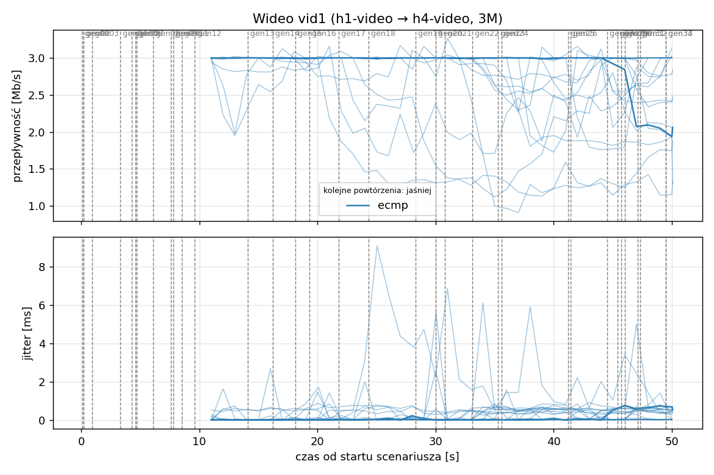
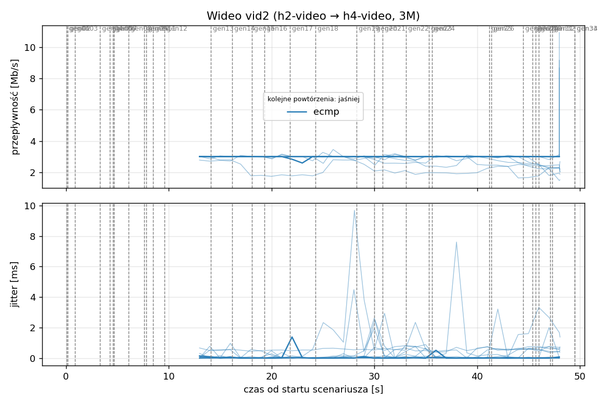
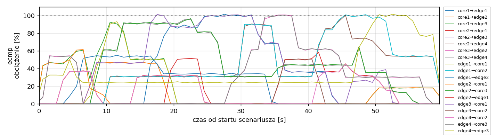
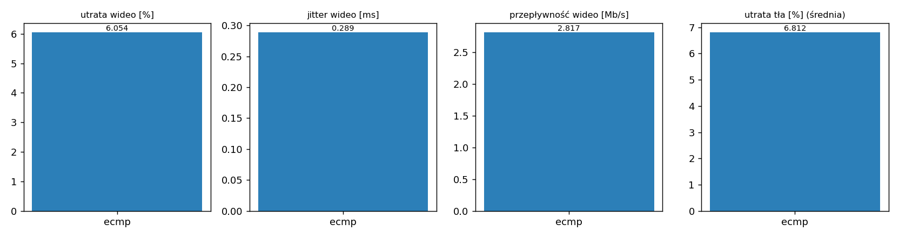

# Raport: mesh-frr

Katalog: `results/official/load-0.7/mesh-frr/20261108_204008`

## 1. Scenariusz

- Topologia: `mesh` (frr: `mesh-frr.clab.yml`)
- Warianty: **ecmp** (FRR, bez kontrolera)
- Czas testu: 60 s, warmup (pomijany w statystykach, liczony od startu każdego przepływu): 5 s, powtórzeń: 20, seed: 42
- Wykonane przebiegi: ecmp/rep1, ecmp/rep10, ecmp/rep11, ecmp/rep12, ecmp/rep13, ecmp/rep14, ecmp/rep15, ecmp/rep16, ecmp/rep17, ecmp/rep18, ecmp/rep19, ecmp/rep2, ecmp/rep20, ecmp/rep3, ecmp/rep4, ecmp/rep5, ecmp/rep6, ecmp/rep7, ecmp/rep8, ecmp/rep9

Harmonogram losowego tła różni się między powtórzeniami (seed + nr powtórzenia, wspólny dla wariantów); poniżej powtórzenie 1.

| id | klasa | źródło → cel | proto | zadana [Mb/s] | DSCP | start–koniec [s] |
|---|---|---|---|---|---|---|
| gen01 | background | h2-bg1 → h3-bg2 | udp | 4.49 | – | 0.1–7.1 |
| gen02 | background | h4-bg2 → h3-bg1 | udp | 3.16 | – | 0.2–5.2 |
| gen03 | background | h4-bg1 → h2-bg2 | udp | 5.25 | – | 0.9–5.9 |
| gen04 | background | h4-bg1 → h1-bg2 | udp | 3.56 | – | 3.3–8.3 |
| gen05 | background | h4-bg1 → h3-bg1 | udp | 2.36 | – | 4.3–59.3 |
| gen06 | background | h1-bg2 → h2-bg1 | udp | 1.93 | – | 4.6–17.6 |
| gen07 | background | h2-bg1 → h3-bg1 | udp | 1.39 | – | 4.7–9.7 |
| gen08 | background | h1-bg1 → h2-bg1 | udp | 3.29 | – | 6.1–34.1 |
| gen09 | background | h3-bg2 → h2-bg1 | udp | 4.51 | – | 7.6–18.6 |
| gen10 | background | h1-bg2 → h3-bg1 | udp | 3.96 | – | 7.8–12.8 |
| gen11 | background | h2-bg1 → h4-bg2 | udp | 5.85 | – | 8.5–22.5 |
| gen12 | background | h1-bg2 → h3-bg1 | udp | 4.90 | – | 9.6–19.6 |
| vid1 | video | h1-video → h4-video | udp | 3.00 | 46 | 10–50 |
| vid2 | video | h2-video → h4-video | udp | 3.00 | 46 | 12–48 |
| gen13 | background | h4-bg1 → h1-bg1 | udp | 3.07 | – | 14.1–24.1 |
| gen14 | background | h3-bg2 → h1-bg2 | udp | 5.37 | – | 16.2–32.2 |
| gen15 | background | h3-bg1 → h1-bg1 | udp | 3.12 | – | 18.1–36.1 |
| gen16 | background | h2-bg1 → h1-bg1 | udp | 4.96 | – | 19.3–24.3 |
| gen17 | background | h2-bg1 → h4-bg2 | udp | 4.86 | – | 21.8–26.8 |
| gen18 | background | h3-bg2 → h1-bg1 | udp | 3.49 | – | 24.3–43.3 |
| gen19 | background | h4-bg2 → h2-bg1 | udp | 2.93 | – | 28.3–57.3 |
| gen20 | background | h1-bg2 → h4-bg2 | udp | 5.68 | – | 30–35 |
| gen21 | background | h4-bg1 → h2-bg1 | udp | 3.04 | – | 30.8–44.8 |
| gen22 | background | h4-bg1 → h2-bg1 | udp | 3.69 | – | 33.1–38.1 |
| gen23 | background | h2-bg2 → h4-bg2 | udp | 1.26 | – | 35.3–55.3 |
| gen24 | background | h3-bg1 → h1-bg2 | udp | 4.88 | – | 35.6–41.6 |
| gen25 | background | h4-bg1 → h1-bg2 | udp | 3.51 | – | 41.2–46.2 |
| gen26 | background | h1-bg1 → h4-bg1 | udp | 5.23 | – | 41.4–59.4 |
| gen27 | background | h1-bg2 → h4-bg1 | udp | 2.10 | – | 44.5–50.5 |
| gen28 | background | h4-bg1 → h1-bg2 | udp | 1.54 | – | 45.4–50.4 |
| gen29 | background | h4-bg1 → h1-bg2 | udp | 1.53 | – | 45.7–52.7 |
| gen30 | background | h1-bg2 → h3-bg1 | udp | 3.69 | – | 46–52 |
| gen31 | background | h2-bg1 → h4-bg2 | udp | 2.18 | – | 47.1–52.1 |
| gen32 | background | h4-bg2 → h3-bg2 | udp | 5.19 | – | 47.3–59.3 |
| gen33 | background | h4-bg2 → h3-bg2 | udp | 2.60 | – | 49.5–55.5 |
| gen34 | background | h2-bg2 → h3-bg2 | udp | 1.75 | – | 49.5–59.5 |

## 2. Wideo: QoS według wariantu

Wartości: średnia ± odchylenie standardowe z powtórzeń.

| przepływ | wariant | przepływność [Mb/s] | jitter [ms] | utrata [%] | RTT mediana [ms] | RTT p95 [ms] |
|---|---|---|---|---|---|---|
| vid1 | ecmp | 2.72 ± 0.34 | 0.353 ± 0.468 | 9.20 ± 11.32 | 20.737 ± 28.358 | 66.762 ± 42.836 |
| vid2 | ecmp | 2.91 ± 0.21 | 0.225 ± 0.325 | 2.90 ± 6.98 | 5.883 ± 18.022 | 36.479 ± 30.917 |

RTT z `ping` co 0,1 s między hostami wideo (osobny przepływ ICMP z tym samym DSCP - w SDN może iść inną ścieżką niż strumień UDP).

## 3. Ruch tła

Agregat tła w obrębie powtórzenia, potem średnia ± odchylenie standardowe po powtórzeniach (utrata = Σ utraconych / Σ wysłanych datagramów; dostarczone = Σ przepływności / Σ zadanych; przepływy trwające nie dłużej niż warmup pominięte).

| wariant | strumieni tła / powt. | dostarczone / zadane [%] | jitter [ms] | utrata [%] |
|---|---|---|---|---|
| ecmp | 28 | 93.6 ± 4.8 | 0.232 ± 0.181 | 6.81 ± 5.67 |

## 4. Obciążenie łączy fabricu

Średnia i maksimum z próbek co 1 s w oknie 0–60 s; MLU = maksymalne obciążenie łącza; drops = pakiety odrzucone przez `tbf` na wyjściu łącza.

| wariant | rep | średnie obciążenie łączy [%] | MLU [%] | łącza > 90% | drops tbf | CPU VM śr./maks. [%] |
|---|---|---|---|---|---|---|
| ecmp | 1 | 19.2 | 101.5 | 11/24 | 3685 | 10 / 15 |
| ecmp | 2 | 25.5 | 102.3 | 9/24 | 23410 | 12 / 21 |
| ecmp | 3 | 27.6 | 102.1 | 9/24 | 31341 | 12 / 17 |
| ecmp | 4 | 21.5 | 102.4 | 8/24 | 3272 | 11 / 14 |
| ecmp | 5 | 22.4 | 102.5 | 6/24 | 2146 | 10 / 14 |
| ecmp | 6 | 15.6 | 103.0 | 2/24 | 2560 | 11 / 34 |
| ecmp | 7 | 23.4 | 115.1 | 8/24 | 14303 | 36 / 97 |
| ecmp | 8 | 23.3 | 103.2 | 10/24 | 11766 | 12 / 18 |
| ecmp | 9 | 19.9 | 102.8 | 8/24 | 35923 | 12 / 19 |
| ecmp | 10 | 23.2 | 102.6 | 9/24 | 11953 | 13 / 28 |
| ecmp | 11 | 24.2 | 104.4 | 8/24 | 39223 | 13 / 36 |
| ecmp | 12 | 17.2 | 102.0 | 7/24 | 2314 | 11 / 20 |
| ecmp | 13 | 26.1 | 104.2 | 9/24 | 7410 | 13 / 23 |
| ecmp | 14 | 24.4 | 103.4 | 10/24 | 4707 | 12 / 16 |
| ecmp | 15 | 27.8 | 103.1 | 8/24 | 23664 | 13 / 18 |
| ecmp | 16 | 24.1 | 102.6 | 9/24 | 9970 | 11 / 22 |
| ecmp | 17 | 28.4 | 108.9 | 11/24 | 7962 | 15 / 30 |
| ecmp | 18 | 20.7 | 102.9 | 6/24 | 3634 | 11 / 15 |
| ecmp | 19 | 23.5 | 102.7 | 10/24 | 8654 | 11 / 17 |
| ecmp | 20 | 21.9 | 110.0 | 8/24 | 8039 | 14 / 40 |

Łącza z obciążeniem > 10% (maksimum [%] / drops, powtórzenie 1):

| łącze | ecmp |
|---|---|
| core1→edge1 | 101 / 0 |
| core1→edge2 | 47 / 0 |
| core1→edge3 | 92 / 0 |
| core2→edge1 | 58 / 0 |
| core2→edge3 | 39 / 0 |
| core2→edge4 | 100 / 0 |
| core3→edge2 | 101 / 0 |
| core3→edge4 | 96 / 0 |
| edge1→core1 | 93 / 0 |
| edge1→core2 | 101 / 1655 |
| edge1→edge2 | 55 / 0 |
| edge2→core1 | 62 / 0 |
| edge2→core3 | 97 / 192 |
| edge2→edge1 | 51 / 0 |
| edge3→core1 | 101 / 1658 |
| edge3→core2 | 51 / 0 |
| edge3→edge4 | 0 / 0 |
| edge4→core2 | 45 / 0 |
| edge4→core3 | 100 / 0 |
| edge4→edge3 | 101 / 180 |

## 5. Ścieżki wybrane przez kontroler (powtórzenie 1)

Z logu kontrolera (linie `Flow`), dopasowane po piątce przepływu; ✓ = reguły widoczne w `dump-flows` na tych samych przełącznikach.

| przepływ | ecmp |
|---|---|
| gen01 | ECMP (hash L4), nieobserwowana bezpośrednio |
| gen02 | ECMP (hash L4), nieobserwowana bezpośrednio |
| gen03 | ECMP (hash L4), nieobserwowana bezpośrednio |
| gen04 | ECMP (hash L4), nieobserwowana bezpośrednio |
| gen05 | ECMP (hash L4), nieobserwowana bezpośrednio |
| gen06 | ECMP (hash L4), nieobserwowana bezpośrednio |
| gen07 | ECMP (hash L4), nieobserwowana bezpośrednio |
| gen08 | ECMP (hash L4), nieobserwowana bezpośrednio |
| gen09 | ECMP (hash L4), nieobserwowana bezpośrednio |
| gen10 | ECMP (hash L4), nieobserwowana bezpośrednio |
| gen11 | ECMP (hash L4), nieobserwowana bezpośrednio |
| gen12 | ECMP (hash L4), nieobserwowana bezpośrednio |
| vid1 | ECMP (hash L4), nieobserwowana bezpośrednio |
| vid2 | ECMP (hash L4), nieobserwowana bezpośrednio |
| gen13 | ECMP (hash L4), nieobserwowana bezpośrednio |
| gen14 | ECMP (hash L4), nieobserwowana bezpośrednio |
| gen15 | ECMP (hash L4), nieobserwowana bezpośrednio |
| gen16 | ECMP (hash L4), nieobserwowana bezpośrednio |
| gen17 | ECMP (hash L4), nieobserwowana bezpośrednio |
| gen18 | ECMP (hash L4), nieobserwowana bezpośrednio |
| gen19 | ECMP (hash L4), nieobserwowana bezpośrednio |
| gen20 | ECMP (hash L4), nieobserwowana bezpośrednio |
| gen21 | ECMP (hash L4), nieobserwowana bezpośrednio |
| gen22 | ECMP (hash L4), nieobserwowana bezpośrednio |
| gen23 | ECMP (hash L4), nieobserwowana bezpośrednio |
| gen24 | ECMP (hash L4), nieobserwowana bezpośrednio |
| gen25 | ECMP (hash L4), nieobserwowana bezpośrednio |
| gen26 | ECMP (hash L4), nieobserwowana bezpośrednio |
| gen27 | ECMP (hash L4), nieobserwowana bezpośrednio |
| gen28 | ECMP (hash L4), nieobserwowana bezpośrednio |
| gen29 | ECMP (hash L4), nieobserwowana bezpośrednio |
| gen30 | ECMP (hash L4), nieobserwowana bezpośrednio |
| gen31 | ECMP (hash L4), nieobserwowana bezpośrednio |
| gen32 | ECMP (hash L4), nieobserwowana bezpośrednio |
| gen33 | ECMP (hash L4), nieobserwowana bezpośrednio |
| gen34 | ECMP (hash L4), nieobserwowana bezpośrednio |

## 6. Wnioski

<!-- WNIOSKI:START -->
_Do uzupełnienia: krótkie wnioski wyłącznie na podstawie liczb z sekcji 2–5._
<!-- WNIOSKI:END -->

## 7. Wiarygodność pomiaru

- ecmp rep1, gen02: przepływ krótszy niż warmup - statystyki z całości
- ecmp rep1, gen03: przepływ krótszy niż warmup - statystyki z całości
- ecmp rep1, gen04: przepływ krótszy niż warmup - statystyki z całości
- ecmp rep1, gen07: przepływ krótszy niż warmup - statystyki z całości
- ecmp rep1, gen10: przepływ krótszy niż warmup - statystyki z całości
- ecmp rep1, gen16: przepływ krótszy niż warmup - statystyki z całości
- ecmp rep1, gen17: przepływ krótszy niż warmup - statystyki z całości
- ecmp rep1, gen20: przepływ krótszy niż warmup - statystyki z całości
- ecmp rep1, gen22: przepływ krótszy niż warmup - statystyki z całości
- ecmp rep1, gen25: przepływ krótszy niż warmup - statystyki z całości
- ecmp rep1, gen31: przepływ krótszy niż warmup - statystyki z całości
- ecmp rep10, gen02: przepływ krótszy niż warmup - statystyki z całości
- ecmp rep10, gen04: przepływ krótszy niż warmup - statystyki z całości
- ecmp rep10, gen09: przepływ krótszy niż warmup - statystyki z całości
- ecmp rep10, gen10: przepływ krótszy niż warmup - statystyki z całości
- ecmp rep10, gen17: przepływ krótszy niż warmup - statystyki z całości
- ecmp rep10, gen24: przepływ krótszy niż warmup - statystyki z całości
- ecmp rep10, gen31: przepływ krótszy niż warmup - statystyki z całości
- ecmp rep11, gen09: przepływ krótszy niż warmup - statystyki z całości
- ecmp rep11, gen17: przepływ krótszy niż warmup - statystyki z całości
- ecmp rep11, gen19: przepływ krótszy niż warmup - statystyki z całości
- ecmp rep11, gen20: przepływ krótszy niż warmup - statystyki z całości
- ecmp rep11, gen31: przepływ krótszy niż warmup - statystyki z całości
- ecmp rep11, gen32: przepływ krótszy niż warmup - statystyki z całości
- ecmp rep11, gen37: klient: unable to receive results: No such file or directory
- ecmp rep11, gen37: serwer: error - unable to receive results: Bad file descriptor
- ecmp rep12, gen03: przepływ krótszy niż warmup - statystyki z całości
- ecmp rep12, gen04: przepływ krótszy niż warmup - statystyki z całości
- ecmp rep12, gen07: przepływ krótszy niż warmup - statystyki z całości
- ecmp rep12, gen22: przepływ krótszy niż warmup - statystyki z całości
- ecmp rep12, gen25: przepływ krótszy niż warmup - statystyki z całości
- ecmp rep13, gen02: przepływ krótszy niż warmup - statystyki z całości
- ecmp rep13, gen06: przepływ krótszy niż warmup - statystyki z całości
- ecmp rep13, gen10: przepływ krótszy niż warmup - statystyki z całości
- ecmp rep13, gen12: przepływ krótszy niż warmup - statystyki z całości
- ecmp rep13, gen13: przepływ krótszy niż warmup - statystyki z całości
- ecmp rep13, gen14: przepływ krótszy niż warmup - statystyki z całości
- ecmp rep13, gen19: przepływ krótszy niż warmup - statystyki z całości
- ecmp rep13, gen26: przepływ krótszy niż warmup - statystyki z całości
- ecmp rep13, gen41: przepływ krótszy niż warmup - statystyki z całości
- ecmp rep14, gen02: przepływ krótszy niż warmup - statystyki z całości
- ecmp rep14, gen03: przepływ krótszy niż warmup - statystyki z całości
- ecmp rep14, gen05: przepływ krótszy niż warmup - statystyki z całości
- ecmp rep14, gen13: przepływ krótszy niż warmup - statystyki z całości
- ecmp rep14, gen17: przepływ krótszy niż warmup - statystyki z całości
- ecmp rep14, gen22: przepływ krótszy niż warmup - statystyki z całości
- ecmp rep15, gen09: przepływ krótszy niż warmup - statystyki z całości
- ecmp rep15, gen11: przepływ krótszy niż warmup - statystyki z całości
- ecmp rep15, gen17: przepływ krótszy niż warmup - statystyki z całości
- ecmp rep15, gen28: przepływ krótszy niż warmup - statystyki z całości
- ecmp rep15, gen38: przepływ krótszy niż warmup - statystyki z całości
- ecmp rep15, gen43: przepływ krótszy niż warmup - statystyki z całości
- ecmp rep15, gen45: przepływ krótszy niż warmup - statystyki z całości
- ecmp rep16, gen06: przepływ krótszy niż warmup - statystyki z całości
- ecmp rep16, gen11: przepływ krótszy niż warmup - statystyki z całości
- ecmp rep16, gen15: przepływ krótszy niż warmup - statystyki z całości
- ecmp rep16, gen22: przepływ krótszy niż warmup - statystyki z całości
- ecmp rep16, gen29: przepływ krótszy niż warmup - statystyki z całości
- ecmp rep16, gen32: przepływ krótszy niż warmup - statystyki z całości
- ecmp rep16, gen35: przepływ krótszy niż warmup - statystyki z całości
- ecmp rep17, gen01: przepływ krótszy niż warmup - statystyki z całości
- ecmp rep17, gen05: przepływ krótszy niż warmup - statystyki z całości
- ecmp rep17, gen06: przepływ krótszy niż warmup - statystyki z całości
- ecmp rep17, gen08: przepływ krótszy niż warmup - statystyki z całości
- ecmp rep17, gen09: przepływ krótszy niż warmup - statystyki z całości
- ecmp rep17, gen15: przepływ krótszy niż warmup - statystyki z całości
- ecmp rep17, gen24: przepływ krótszy niż warmup - statystyki z całości
- ecmp rep17, gen25: przepływ krótszy niż warmup - statystyki z całości
- ecmp rep17, gen33: przepływ krótszy niż warmup - statystyki z całości
- ecmp rep18, gen01: przepływ krótszy niż warmup - statystyki z całości
- ecmp rep18, gen04: przepływ krótszy niż warmup - statystyki z całości
- ecmp rep18, gen17: przepływ krótszy niż warmup - statystyki z całości
- ecmp rep18, gen20: przepływ krótszy niż warmup - statystyki z całości
- ecmp rep18, gen32: przepływ krótszy niż warmup - statystyki z całości
- ecmp rep19, gen01: przepływ krótszy niż warmup - statystyki z całości
- ecmp rep19, gen02: przepływ krótszy niż warmup - statystyki z całości
- ecmp rep19, gen03: przepływ krótszy niż warmup - statystyki z całości
- ecmp rep19, gen04: przepływ krótszy niż warmup - statystyki z całości
- ecmp rep19, gen10: przepływ krótszy niż warmup - statystyki z całości
- ecmp rep19, gen12: przepływ krótszy niż warmup - statystyki z całości
- ecmp rep19, gen14: przepływ krótszy niż warmup - statystyki z całości
- ecmp rep19, gen18: przepływ krótszy niż warmup - statystyki z całości
- ecmp rep19, gen21: przepływ krótszy niż warmup - statystyki z całości
- ecmp rep2, gen02: przepływ krótszy niż warmup - statystyki z całości
- ecmp rep2, gen07: przepływ krótszy niż warmup - statystyki z całości
- ecmp rep2, gen24: przepływ krótszy niż warmup - statystyki z całości
- ecmp rep2, gen31: przepływ krótszy niż warmup - statystyki z całości
- ecmp rep2, gen36: przepływ krótszy niż warmup - statystyki z całości
- ecmp rep2, gen42: przepływ krótszy niż warmup - statystyki z całości
- ecmp rep2, gen45: przepływ krótszy niż warmup - statystyki z całości
- ecmp rep20, gen03: przepływ krótszy niż warmup - statystyki z całości
- ecmp rep20, gen09: przepływ krótszy niż warmup - statystyki z całości
- ecmp rep20, gen11: przepływ krótszy niż warmup - statystyki z całości
- ecmp rep20, gen12: przepływ krótszy niż warmup - statystyki z całości
- ecmp rep20, gen15: przepływ krótszy niż warmup - statystyki z całości
- ecmp rep20, gen29: przepływ krótszy niż warmup - statystyki z całości
- ecmp rep20, gen31: przepływ krótszy niż warmup - statystyki z całości
- ecmp rep3, gen01: przepływ krótszy niż warmup - statystyki z całości
- ecmp rep3, gen02: przepływ krótszy niż warmup - statystyki z całości
- ecmp rep3, gen03: przepływ krótszy niż warmup - statystyki z całości
- ecmp rep3, gen09: przepływ krótszy niż warmup - statystyki z całości
- ecmp rep3, gen10: przepływ krótszy niż warmup - statystyki z całości
- ecmp rep3, gen11: przepływ krótszy niż warmup - statystyki z całości
- ecmp rep3, gen13: przepływ krótszy niż warmup - statystyki z całości
- ecmp rep3, gen15: przepływ krótszy niż warmup - statystyki z całości
- ecmp rep3, gen30: przepływ krótszy niż warmup - statystyki z całości
- ecmp rep3, gen33: przepływ krótszy niż warmup - statystyki z całości
- ecmp rep3, gen38: przepływ krótszy niż warmup - statystyki z całości
- ecmp rep4, gen10: przepływ krótszy niż warmup - statystyki z całości
- ecmp rep4, gen22: przepływ krótszy niż warmup - statystyki z całości
- ecmp rep4, gen29: przepływ krótszy niż warmup - statystyki z całości
- ecmp rep4, gen31: przepływ krótszy niż warmup - statystyki z całości
- ecmp rep5, gen02: przepływ krótszy niż warmup - statystyki z całości
- ecmp rep5, gen03: przepływ krótszy niż warmup - statystyki z całości
- ecmp rep5, gen14: przepływ krótszy niż warmup - statystyki z całości
- ecmp rep5, gen21: przepływ krótszy niż warmup - statystyki z całości
- ecmp rep5, gen25: przepływ krótszy niż warmup - statystyki z całości
- ecmp rep5, gen42: przepływ krótszy niż warmup - statystyki z całości
- ecmp rep6, gen04: przepływ krótszy niż warmup - statystyki z całości
- ecmp rep6, gen05: przepływ krótszy niż warmup - statystyki z całości
- ecmp rep6, gen07: przepływ krótszy niż warmup - statystyki z całości
- ecmp rep6, gen10: przepływ krótszy niż warmup - statystyki z całości
- ecmp rep6, gen15: przepływ krótszy niż warmup - statystyki z całości
- ecmp rep6, gen28: przepływ krótszy niż warmup - statystyki z całości
- ecmp rep6, gen29: przepływ krótszy niż warmup - statystyki z całości
- ecmp rep7, gen03: przepływ krótszy niż warmup - statystyki z całości
- ecmp rep7, gen07: przepływ krótszy niż warmup - statystyki z całości
- ecmp rep7, gen11: przepływ krótszy niż warmup - statystyki z całości
- ecmp rep7, gen23: przepływ krótszy niż warmup - statystyki z całości
- ecmp rep7, gen24: przepływ krótszy niż warmup - statystyki z całości
- ecmp rep7, gen34: przepływ krótszy niż warmup - statystyki z całości
- ecmp rep7, gen36: przepływ krótszy niż warmup - statystyki z całości
- ecmp rep7: CPU maszyny do 97% (średnio 36%) - możliwy wpływ na pomiary
- ecmp rep8, gen05: przepływ krótszy niż warmup - statystyki z całości
- ecmp rep8, gen12: przepływ krótszy niż warmup - statystyki z całości
- ecmp rep8, gen22: przepływ krótszy niż warmup - statystyki z całości
- ecmp rep8, gen28: przepływ krótszy niż warmup - statystyki z całości
- ecmp rep8, gen33: przepływ krótszy niż warmup - statystyki z całości
- ecmp rep8, gen36: przepływ krótszy niż warmup - statystyki z całości
- ecmp rep8, gen37: przepływ krótszy niż warmup - statystyki z całości
- ecmp rep9, gen04: przepływ krótszy niż warmup - statystyki z całości
