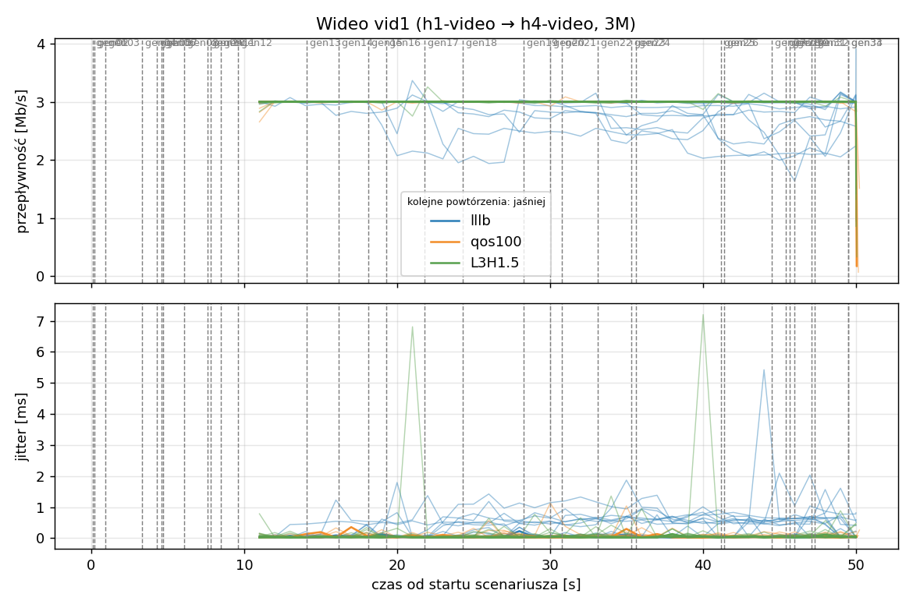
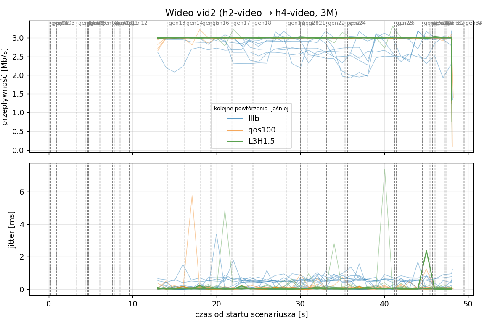
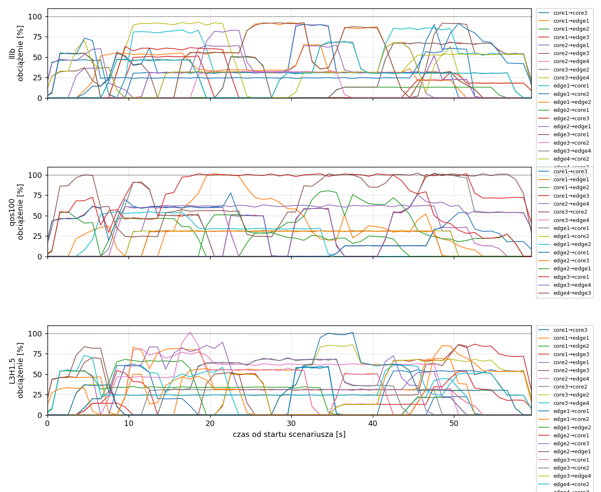
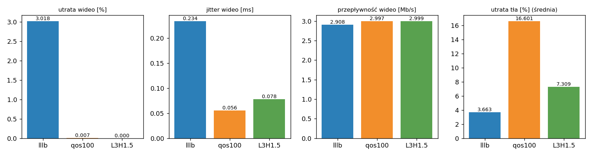

# Raport: mesh-sdn

Katalog: `results/official/load-0.7/mesh-sdn/20261108_223901`

## 1. Scenariusz

- Topologia: `mesh` (sdn: `mesh-sdn.clab.yml`)
- Warianty: **lllb** (POLICY=lllb), **qos100** (LAYERS=1, POLICY=qos, RESERVE_PCT=100), **L3H1.5** (HEADROOM_MBPS=1.5, LAYERS=3, POLICY=qos, RESERVE_PCT=70)
- Czas testu: 60 s, warmup (pomijany w statystykach, liczony od startu każdego przepływu): 5 s, powtórzeń: 20, seed: 42
- Wykonane przebiegi: lllb/rep1, lllb/rep10, lllb/rep11, lllb/rep12, lllb/rep13, lllb/rep14, lllb/rep15, lllb/rep16, lllb/rep17, lllb/rep18, lllb/rep19, lllb/rep2, lllb/rep20, lllb/rep3, lllb/rep4, lllb/rep5, lllb/rep6, lllb/rep7, lllb/rep8, lllb/rep9, qos100/rep1, qos100/rep10, qos100/rep11, qos100/rep12, qos100/rep13, qos100/rep14, qos100/rep15, qos100/rep16, qos100/rep17, qos100/rep18, qos100/rep19, qos100/rep2, qos100/rep20, qos100/rep3, qos100/rep4, qos100/rep5, qos100/rep6, qos100/rep7, qos100/rep8, qos100/rep9, L3H1.5/rep1, L3H1.5/rep10, L3H1.5/rep11, L3H1.5/rep12, L3H1.5/rep13, L3H1.5/rep14, L3H1.5/rep15, L3H1.5/rep16, L3H1.5/rep17, L3H1.5/rep18, L3H1.5/rep19, L3H1.5/rep2, L3H1.5/rep20, L3H1.5/rep3, L3H1.5/rep4, L3H1.5/rep5, L3H1.5/rep6, L3H1.5/rep7, L3H1.5/rep8, L3H1.5/rep9

Harmonogram losowego tła różni się między powtórzeniami (seed + nr powtórzenia, wspólny dla wariantów); poniżej powtórzenie 1.

| id | klasa | źródło → cel | proto | zadana [Mb/s] | DSCP | start–koniec [s] |
|---|---|---|---|---|---|---|
| gen01 | background | h2-bg1 → h3-bg2 | udp | 4.49 | – | 0.1–7.1 |
| gen02 | background | h4-bg2 → h3-bg1 | udp | 3.16 | – | 0.2–5.2 |
| gen03 | background | h4-bg1 → h2-bg2 | udp | 5.25 | – | 0.9–5.9 |
| gen04 | background | h4-bg1 → h1-bg2 | udp | 3.56 | – | 3.3–8.3 |
| gen05 | background | h4-bg1 → h3-bg1 | udp | 2.36 | – | 4.3–59.3 |
| gen06 | background | h1-bg2 → h2-bg1 | udp | 1.93 | – | 4.6–17.6 |
| gen07 | background | h2-bg1 → h3-bg1 | udp | 1.39 | – | 4.7–9.7 |
| gen08 | background | h1-bg1 → h2-bg1 | udp | 3.29 | – | 6.1–34.1 |
| gen09 | background | h3-bg2 → h2-bg1 | udp | 4.51 | – | 7.6–18.6 |
| gen10 | background | h1-bg2 → h3-bg1 | udp | 3.96 | – | 7.8–12.8 |
| gen11 | background | h2-bg1 → h4-bg2 | udp | 5.85 | – | 8.5–22.5 |
| gen12 | background | h1-bg2 → h3-bg1 | udp | 4.90 | – | 9.6–19.6 |
| vid1 | video | h1-video → h4-video | udp | 3.00 | 46 | 10–50 |
| vid2 | video | h2-video → h4-video | udp | 3.00 | 46 | 12–48 |
| gen13 | background | h4-bg1 → h1-bg1 | udp | 3.07 | – | 14.1–24.1 |
| gen14 | background | h3-bg2 → h1-bg2 | udp | 5.37 | – | 16.2–32.2 |
| gen15 | background | h3-bg1 → h1-bg1 | udp | 3.12 | – | 18.1–36.1 |
| gen16 | background | h2-bg1 → h1-bg1 | udp | 4.96 | – | 19.3–24.3 |
| gen17 | background | h2-bg1 → h4-bg2 | udp | 4.86 | – | 21.8–26.8 |
| gen18 | background | h3-bg2 → h1-bg1 | udp | 3.49 | – | 24.3–43.3 |
| gen19 | background | h4-bg2 → h2-bg1 | udp | 2.93 | – | 28.3–57.3 |
| gen20 | background | h1-bg2 → h4-bg2 | udp | 5.68 | – | 30–35 |
| gen21 | background | h4-bg1 → h2-bg1 | udp | 3.04 | – | 30.8–44.8 |
| gen22 | background | h4-bg1 → h2-bg1 | udp | 3.69 | – | 33.1–38.1 |
| gen23 | background | h2-bg2 → h4-bg2 | udp | 1.26 | – | 35.3–55.3 |
| gen24 | background | h3-bg1 → h1-bg2 | udp | 4.88 | – | 35.6–41.6 |
| gen25 | background | h4-bg1 → h1-bg2 | udp | 3.51 | – | 41.2–46.2 |
| gen26 | background | h1-bg1 → h4-bg1 | udp | 5.23 | – | 41.4–59.4 |
| gen27 | background | h1-bg2 → h4-bg1 | udp | 2.10 | – | 44.5–50.5 |
| gen28 | background | h4-bg1 → h1-bg2 | udp | 1.54 | – | 45.4–50.4 |
| gen29 | background | h4-bg1 → h1-bg2 | udp | 1.53 | – | 45.7–52.7 |
| gen30 | background | h1-bg2 → h3-bg1 | udp | 3.69 | – | 46–52 |
| gen31 | background | h2-bg1 → h4-bg2 | udp | 2.18 | – | 47.1–52.1 |
| gen32 | background | h4-bg2 → h3-bg2 | udp | 5.19 | – | 47.3–59.3 |
| gen33 | background | h4-bg2 → h3-bg2 | udp | 2.60 | – | 49.5–55.5 |
| gen34 | background | h2-bg2 → h3-bg2 | udp | 1.75 | – | 49.5–59.5 |

## 2. Wideo: QoS według wariantu

Wartości: średnia ± odchylenie standardowe z powtórzeń.

| przepływ | wariant | przepływność [Mb/s] | jitter [ms] | utrata [%] | RTT mediana [ms] | RTT p95 [ms] |
|---|---|---|---|---|---|---|
| vid1 | lllb | 2.90 ± 0.15 | 0.256 ± 0.216 | 3.23 ± 4.94 | 14.749 ± 25.692 | 57.495 ± 43.302 |
| vid1 | qos100 | 3.00 ± 0.00 | 0.053 ± 0.018 | 0.01 ± 0.03 | 0.029 ± 0.003 | 0.050 ± 0.008 |
| vid1 | L3H1.5 | 3.00 ± 0.00 | 0.076 ± 0.059 | 0.00 ± 0.00 | 0.029 ± 0.002 | 0.209 ± 0.714 |
| vid2 | lllb | 2.91 ± 0.11 | 0.212 ± 0.184 | 2.80 ± 3.71 | 22.742 ± 28.720 | 62.004 ± 55.816 |
| vid2 | qos100 | 3.00 ± 0.00 | 0.058 ± 0.021 | 0.01 ± 0.04 | 0.029 ± 0.004 | 0.056 ± 0.011 |
| vid2 | L3H1.5 | 3.00 ± 0.00 | 0.080 ± 0.066 | 0.00 ± 0.00 | 0.028 ± 0.003 | 0.278 ± 1.006 |

RTT z `ping` co 0,1 s między hostami wideo (osobny przepływ ICMP z tym samym DSCP - w SDN może iść inną ścieżką niż strumień UDP).

## 3. Ruch tła

Agregat tła w obrębie powtórzenia, potem średnia ± odchylenie standardowe po powtórzeniach (utrata = Σ utraconych / Σ wysłanych datagramów; dostarczone = Σ przepływności / Σ zadanych; przepływy trwające nie dłużej niż warmup pominięte).

| wariant | strumieni tła / powt. | dostarczone / zadane [%] | jitter [ms] | utrata [%] |
|---|---|---|---|---|
| lllb | 28 | 96.3 ± 3.0 | 0.187 ± 0.094 | 3.66 ± 3.24 |
| qos100 | 28 | 83.2 ± 5.8 | 0.360 ± 0.099 | 16.60 ± 7.80 |
| L3H1.5 | 28 | 92.7 ± 4.3 | 0.148 ± 0.068 | 7.31 ± 5.13 |

## 4. Obciążenie łączy fabricu

Średnia i maksimum z próbek co 1 s w oknie 0–60 s; MLU = maksymalne obciążenie łącza; drops = pakiety odrzucone przez `tbf` na wyjściu łącza.

| wariant | rep | średnie obciążenie łączy [%] | MLU [%] | łącza > 90% | drops tbf | CPU VM śr./maks. [%] |
|---|---|---|---|---|---|---|
| lllb | 1 | 24.5 | 92.9 | 7/24 | 0 | 12 / 26 |
| lllb | 2 | 34.3 | 102.1 | 13/24 | 11650 | 13 / 24 |
| lllb | 3 | 38.3 | 102.7 | 14/24 | 19226 | 15 / 32 |
| lllb | 4 | 27.7 | 102.5 | 10/24 | 2283 | 12 / 22 |
| lllb | 5 | 28.7 | 101.7 | 9/24 | 2055 | 12 / 21 |
| lllb | 6 | 20.2 | 101.3 | 4/24 | 0 | 12 / 18 |
| lllb | 7 | 30.9 | 104.3 | 15/24 | 8778 | 15 / 56 |
| lllb | 8 | 30.3 | 102.9 | 15/24 | 6720 | 13 / 21 |
| lllb | 9 | 28.9 | 102.9 | 7/24 | 12886 | 13 / 24 |
| lllb | 10 | 30.8 | 103.0 | 14/24 | 7565 | 15 / 38 |
| lllb | 11 | 33.0 | 102.8 | 14/24 | 25052 | 14 / 36 |
| lllb | 12 | 21.6 | 102.1 | 4/24 | 4496 | 13 / 41 |
| lllb | 13 | 36.3 | 103.7 | 13/24 | 4331 | 14 / 23 |
| lllb | 14 | 32.0 | 102.7 | 11/24 | 3683 | 14 / 21 |
| lllb | 15 | 38.5 | 103.9 | 13/24 | 12191 | 17 / 32 |
| lllb | 16 | 30.4 | 102.5 | 7/24 | 3706 | 13 / 24 |
| lllb | 17 | 36.2 | 102.5 | 8/24 | 5091 | 15 / 29 |
| lllb | 18 | 26.9 | 102.2 | 9/24 | 2458 | 12 / 22 |
| lllb | 19 | 31.7 | 110.2 | 10/24 | 4983 | 14 / 41 |
| lllb | 20 | 29.3 | 102.4 | 8/24 | 5686 | 13 / 22 |
| qos100 | 1 | 22.2 | 102.1 | 5/24 | 15456 | 11 / 19 |
| qos100 | 2 | 30.8 | 103.4 | 9/24 | 36861 | 18 / 50 |
| qos100 | 3 | 33.8 | 102.8 | 8/24 | 43506 | 14 / 23 |
| qos100 | 4 | 24.2 | 102.5 | 8/24 | 15994 | 12 / 19 |
| qos100 | 5 | 26.4 | 101.9 | 8/24 | 12594 | 13 / 22 |
| qos100 | 6 | 17.5 | 103.3 | 5/24 | 4913 | 12 / 21 |
| qos100 | 7 | 26.7 | 102.7 | 9/24 | 26951 | 14 / 24 |
| qos100 | 8 | 25.4 | 103.0 | 8/24 | 22126 | 13 / 21 |
| qos100 | 9 | 22.0 | 102.3 | 7/24 | 60138 | 12 / 20 |
| qos100 | 10 | 25.8 | 103.0 | 7/24 | 30632 | 15 / 32 |
| qos100 | 11 | 25.7 | 104.0 | 8/24 | 58205 | 15 / 31 |
| qos100 | 12 | 19.9 | 105.0 | 7/24 | 10319 | 13 / 22 |
| qos100 | 13 | 29.4 | 103.5 | 11/24 | 33589 | 14 / 30 |
| qos100 | 14 | 27.0 | 103.0 | 10/24 | 16894 | 14 / 25 |
| qos100 | 15 | 34.0 | 103.1 | 9/24 | 44109 | 14 / 24 |
| qos100 | 16 | 27.8 | 104.0 | 9/24 | 26681 | 15 / 27 |
| qos100 | 17 | 31.3 | 104.0 | 7/24 | 35607 | 16 / 38 |
| qos100 | 18 | 26.0 | 102.6 | 8/24 | 17407 | 12 / 21 |
| qos100 | 19 | 25.3 | 103.6 | 7/24 | 26160 | 14 / 26 |
| qos100 | 20 | 27.8 | 102.3 | 7/24 | 15150 | 13 / 22 |
| L3H1.5 | 1 | 23.8 | 101.8 | 2/24 | 0 | 12 / 19 |
| L3H1.5 | 2 | 33.8 | 102.5 | 11/24 | 1882 | 14 / 28 |
| L3H1.5 | 3 | 39.3 | 108.0 | 10/24 | 16709 | 16 / 43 |
| L3H1.5 | 4 | 25.9 | 102.0 | 5/24 | 2574 | 12 / 19 |
| L3H1.5 | 5 | 29.6 | 101.4 | 7/24 | 4660 | 14 / 24 |
| L3H1.5 | 6 | 19.8 | 100.6 | 4/24 | 289 | 11 / 18 |
| L3H1.5 | 7 | 33.5 | 102.4 | 10/24 | 8085 | 13 / 21 |
| L3H1.5 | 8 | 30.4 | 101.7 | 7/24 | 4007 | 13 / 27 |
| L3H1.5 | 9 | 26.9 | 102.3 | 3/24 | 21447 | 12 / 21 |
| L3H1.5 | 10 | 28.5 | 103.6 | 6/24 | 8039 | 14 / 26 |
| L3H1.5 | 11 | 32.1 | 102.9 | 12/24 | 26454 | 14 / 23 |
| L3H1.5 | 12 | 21.9 | 101.8 | 6/24 | 314 | 12 / 23 |
| L3H1.5 | 13 | 34.3 | 104.8 | 8/24 | 3812 | 14 / 25 |
| L3H1.5 | 14 | 26.9 | 103.8 | 5/24 | 4757 | 14 / 21 |
| L3H1.5 | 15 | 37.4 | 102.5 | 11/24 | 15780 | 15 / 37 |
| L3H1.5 | 16 | 31.2 | 102.4 | 6/24 | 5941 | 14 / 25 |
| L3H1.5 | 17 | 35.5 | 103.3 | 6/24 | 3336 | 15 / 26 |
| L3H1.5 | 18 | 26.9 | 101.4 | 7/24 | 1414 | 13 / 24 |
| L3H1.5 | 19 | 31.5 | 101.3 | 5/24 | 4977 | 14 / 26 |
| L3H1.5 | 20 | 29.7 | 102.2 | 6/24 | 6897 | 14 / 24 |

Łącza z obciążeniem > 10% (maksimum [%] / drops, powtórzenie 1):

| łącze | lllb | qos100 | L3H1.5 |
|---|---|---|---|
| core1→core3 | 32 / 0 | 61 / 0 | 59 / 0 |
| core1→edge1 | 92 / 0 | 102 / 0 | 57 / 0 |
| core1→edge2 | 55 / 0 | 81 / 0 | 68 / 0 |
| core1→edge3 | 68 / 0 | 102 / 305 | 87 / 0 |
| core2→core3 | 0 / 0 | 0 / 0 | 0 / 0 |
| core2→edge1 | 68 / 0 | 0 / 0 | 73 / 0 |
| core2→edge3 | 92 / 0 | 0 / 0 | 87 / 0 |
| core2→edge4 | 90 / 0 | 63 / 0 | 82 / 0 |
| core3→core2 | 0 / 0 | 32 / 0 | 32 / 0 |
| core3→edge2 | 69 / 0 | 0 / 0 | 86 / 0 |
| core3→edge4 | 93 / 0 | 62 / 0 | 61 / 0 |
| edge1→core1 | 86 / 0 | 102 / 496 | 62 / 0 |
| edge1→core2 | 90 / 0 | 32 / 0 | 83 / 0 |
| edge1→edge2 | 66 / 0 | 55 / 0 | 54 / 0 |
| edge2→core1 | 51 / 0 | 78 / 0 | 53 / 0 |
| edge2→core3 | 63 / 0 | 32 / 0 | 89 / 0 |
| edge2→edge1 | 83 / 0 | 52 / 0 | 84 / 0 |
| edge3→core1 | 92 / 0 | 101 / 9120 | 102 / 0 |
| edge3→core2 | 33 / 0 | 0 / 0 | 70 / 0 |
| edge3→edge4 | 68 / 0 | 76 / 0 | 68 / 0 |
| edge4→core2 | 70 / 0 | 0 / 0 | 73 / 0 |
| edge4→core3 | 69 / 0 | 0 / 0 | 101 / 0 |
| edge4→edge3 | 91 / 0 | 102 / 5535 | 85 / 0 |

## 5. Ścieżki wybrane przez kontroler (powtórzenie 1)

Z logu kontrolera (linie `Flow`), dopasowane po piątce przepływu; ✓ = reguły widoczne w `dump-flows` na tych samych przełącznikach.

| przepływ | lllb | qos100 | L3H1.5 |
|---|---|---|---|
| gen01 | edge2 -> edge1 -> core1 -> edge3 ✓ (loads 0% 0% 0% 0%) | edge2 -> core1 -> edge3 ✓ (loads 5% 5% 0% 0%) | edge2 -> edge1 -> core2 -> edge3 ✓ (loads 20% 20% 0% 0%) |
| gen02 | edge4 -> core2 -> edge3 ✓ (loads 5% 0%) | edge4 -> edge3 ✓ (loads 5% 0%) | edge4 -> edge3 ✓ (loads 20% 23%) |
| gen03 | edge4 -> edge3 -> core1 -> edge2 ✓ (loads 10% 5% 5% 10%) | edge4 -> edge3 -> core1 -> edge2 ✓ (loads 0% 9% 0% 0%) | edge4 -> core2 -> edge1 -> edge2 ✓ (loads 20% 40% 20% 20%) |
| gen04 | edge4 -> core2 -> edge1 ✓ (loads 38% 54% 54% 46%) | edge4 -> edge3 -> core1 -> edge1 ✓ (loads 0% 92% 92% 0%) | edge4 -> core3 -> edge2 -> edge1 ✓ (loads 94% 49% 94% 46%) |
| gen05 | edge4 -> edge3 ✓ (loads 59% 62%) | edge4 -> edge3 ✓ (loads 101% 0%) | edge4 -> core2 -> edge3 ✓ (loads 63% 54%) |
| gen06 | edge1 -> edge2 ✓ (loads 5% 54%) | edge1 -> edge2 ✓ (loads 5% 44%) | edge1 -> core1 -> edge2 ✓ (loads 54% 47%) |
| gen07 | edge2 -> edge1 -> core2 -> edge3 ✓ (loads 51% 51% 46% 64%) | edge2 -> core1 -> edge3 ✓ (loads 51% 51% 15% 106%) | edge2 -> core1 -> edge3 ✓ (loads 47% 95% 95% 63%) |
| gen08 | edge1 -> edge2 ✓ (loads 15% 54%) | edge1 -> edge2 ✓ (loads 19% 40%) | edge1 -> edge2 ✓ (loads 67% 71%) |
| gen09 | edge3 -> edge4 -> core3 -> edge2 ✓ (loads 5% 0% 54% 5%) | edge3 -> core1 -> edge2 ✓ (loads 42% 0% 54% 42%) | edge3 -> core1 -> edge2 ✓ (loads 28% 37% 61% 37%) |
| gen10 | edge1 -> core2 -> edge3 ✓ (loads 46% 19% 54% 34%) | edge1 -> core1 -> edge3 ✓ (loads 67% 0% 67% 61%) | edge1 -> core1 -> edge3 ✓ (loads 28% 66% 61% 42%) |
| gen11 | edge2 -> core3 -> edge4 ✓ (loads 5% 27% 24% 5%) | edge2 -> core1 -> core3 -> edge4 ✓ (loads 5% 0% 36% 19%) | edge2 -> core3 -> edge4 ✓ (loads 23% 37% 48% 41%) |
| gen12 | edge1 -> core1 -> edge3 ✓ (loads 5% 55% 54% 55%) | edge1 -> core1 -> edge3 ✓ (loads 60% 0% 64% 24%) | edge1 -> core2 -> edge4 -> edge3 ✓ (loads 77% 24% 72% 22%) |
| vid1 | edge1 -> core1 -> core3 -> edge4 ✓ (loads 55% 54% 47% 42%) | edge1 -> core2 -> edge4 ✓ (loads 0% 55% 65% 56%) | edge1 -> core2 -> edge4 ✓ (loads 17% 72% 77% 77%) |
| vid2 | edge2 -> edge1 -> core2 -> edge4 ✓ (loads 91% 46% 50% 91%) | edge2 -> core3 -> core2 -> edge4 ✓ (loads 65% 31% 91% 65%) | edge2 -> core3 -> core2 -> edge4 ✓ (loads 60% 129% 47% 60%) |
| gen13 | edge4 -> core2 -> edge1 ✓ (loads 5% 24% 24% 47%) | edge4 -> edge3 -> core1 -> edge1 ✓ (loads 0% 52% 29% 0%) | edge4 -> edge3 -> core2 -> edge1 ✓ (loads 24% 46% 10% 13%) |
| gen14 | edge3 -> core1 -> edge1 ✓ (loads 5% 32% 47% 31%) | edge3 -> core1 -> edge1 ✓ (loads 83% 0% 0% 83%) | edge3 -> core1 -> edge1 ✓ (loads 46% 49% 49% 66%) |
| gen15 | edge3 -> core2 -> edge1 ✓ (loads 55% 32% 47% 55%) | edge3 -> core1 -> edge1 ✓ (loads 105% 0% 0% 105%) | edge3 -> core2 -> edge1 ✓ (loads 105% 46% 46% 105%) |
| gen16 | edge2 -> edge1 ✓ (loads 36% 55%) | edge2 -> edge1 ✓ (loads 10% 70%) | edge2 -> edge1 ✓ (loads 16% 58%) |
| gen17 | edge2 -> core1 -> edge3 -> edge4 ✓ (loads 91% 82% 5% 91%) | edge2 -> core1 -> edge3 -> edge4 ✓ (loads 60% 62% 65% 65%) | edge2 -> core1 -> edge3 -> edge4 ✓ (loads 82% 62% 8% 51%) |
| gen18 | edge3 -> core1 -> edge1 ✓ (loads 60% 63% 63% 82%) | edge3 -> core1 -> edge2 -> edge1 ✓ (loads 100% 0% 50% 100%) | edge3 -> core2 -> edge1 ✓ (loads 63% 60% 65% 63%) |
| gen19 | edge4 -> core3 -> edge2 ✓ (loads 5% 91% 34% 5%) | edge4 -> edge3 -> core1 -> edge2 ✓ (loads 0% 100% 34% 0%) | edge4 -> core3 -> edge2 ✓ (loads 6% 55% 68% 24%) |
| gen20 | edge1 -> core2 -> edge4 ✓ (loads 31% 34% 36% 36%) | edge1 -> core1 -> edge3 -> edge4 ✓ (loads 62% 34% 5% 5%) | edge1 -> core1 -> core3 -> edge4 ✓ (loads 62% 34% 12% 7%) |
| gen21 | edge4 -> core2 -> edge1 -> edge2 ✓ (loads 35% 91% 34% 35%) | edge4 -> edge3 -> core1 -> edge2 ✓ (loads 0% 105% 34% 0%) | edge4 -> core3 -> edge2 ✓ (loads 50% 63% 68% 50%) |
| gen22 | edge4 -> core3 -> edge2 ✓ (loads 30% 39% 65% 31%) | edge4 -> edge3 -> core1 -> edge2 ✓ (loads 0% 105% 34% 0%) | edge4 -> core3 -> edge2 ✓ (loads 69% 79% 68% 69%) |
| gen23 | edge2 -> core1 -> edge3 -> edge4 ✓ (loads 31% 82% 5% 31%) | edge2 -> core1 -> core3 -> edge4 ✓ (loads 31% 62% 53% 0%) | edge2 -> core1 -> edge3 -> edge4 ✓ (loads 48% 62% 29% 48%) |
| gen24 | edge3 -> core1 -> edge1 ✓ (loads 51% 63% 63% 51%) | edge3 -> core1 -> edge1 ✓ (loads 110% 0% 53% 110%) | edge3 -> core1 -> edge1 ✓ (loads 37% 68% 68% 37%) |
| gen25 | edge4 -> core2 -> edge1 ✓ (loads 31% 86% 31% 36%) | edge4 -> edge3 -> core1 -> edge1 ✓ (loads 0% 110% 96% 24%) | edge4 -> core2 -> edge1 ✓ (loads 42% 50% 42% 62%) |
| gen26 | edge1 -> core1 -> edge3 -> edge4 ✓ (loads 36% 36% 36% 36%) | edge1 -> core1 -> edge3 -> edge4 ✓ (loads 62% 31% 5% 13%) | edge1 -> core1 -> edge3 -> edge4 ✓ (loads 62% 31% 19% 19%) |
| gen27 | edge1 -> edge2 -> core3 -> edge4 ✓ (loads 36% 31% 85% 85%) | edge1 -> core1 -> edge3 -> edge4 ✓ (loads 62% 31% 59% 59%) | edge1 -> edge2 -> core3 -> edge4 ✓ (loads 62% 37% 67% 54%) |
| gen28 | edge4 -> edge3 -> core1 -> edge1 ✓ (loads 57% 29% 57% 31%) | edge4 -> edge3 -> core1 -> edge1 ✓ (loads 0% 105% 105% 0%) | edge4 -> edge3 -> core1 -> edge1 ✓ (loads 59% 31% 36% 48%) |
| gen29 | edge4 -> edge3 -> core1 -> edge1 ✓ (loads 57% 34% 57% 36%) | edge4 -> edge3 -> core1 -> edge1 ✓ (loads 0% 115% 115% 0%) | edge4 -> edge3 -> core1 -> edge1 ✓ (loads 59% 37% 42% 48%) |
| gen30 | edge1 -> core2 -> edge3 ✓ (loads 85% 51% 67% 51%) | edge1 -> core1 -> edge3 ✓ (loads 92% 31% 92% 120%) | edge1 -> core2 -> edge3 ✓ (loads 67% 43% 67% 68%) |
| gen31 | edge2 -> edge1 -> core2 -> edge4 ✓ (loads 52% 42% 67% 52%) | edge2 -> core1 -> core3 -> edge4 ✓ (loads 31% 62% 85% 18%) | edge2 -> core1 -> core3 -> edge4 ✓ (loads 59% 68% 67% 53%) |
| gen32 | edge4 -> core2 -> edge3 ✓ (loads 56% 43%) | edge4 -> edge3 ✓ (loads 115% 0%) | edge4 -> edge3 ✓ (loads 68% 74%) |
| gen33 | edge4 -> edge3 ✓ (loads 71% 92%) | edge4 -> edge3 ✓ (loads 105% 0%) | edge4 -> core2 -> edge3 ✓ (loads 97% 68%) |
| gen34 | edge2 -> core3 -> edge4 -> edge3 ✓ (loads 67% 85% 92% 66%) | edge2 -> core1 -> edge3 ✓ (loads 105% 105% 31% 105%) | edge2 -> core1 -> edge3 ✓ (loads 73% 73% 74% 97%) |

## 6. Wnioski

<!-- WNIOSKI:START -->
_Do uzupełnienia: krótkie wnioski wyłącznie na podstawie liczb z sekcji 2–5._
<!-- WNIOSKI:END -->

## 7. Wiarygodność pomiaru

- lllb rep1, gen02: przepływ krótszy niż warmup - statystyki z całości
- lllb rep1, gen07: przepływ krótszy niż warmup - statystyki z całości
- lllb rep1, gen16: przepływ krótszy niż warmup - statystyki z całości
- lllb rep1, gen17: przepływ krótszy niż warmup - statystyki z całości
- lllb rep1, gen22: przepływ krótszy niż warmup - statystyki z całości
- lllb rep1, gen28: przepływ krótszy niż warmup - statystyki z całości
- lllb rep1, gen31: przepływ krótszy niż warmup - statystyki z całości
- lllb rep10, gen02: przepływ krótszy niż warmup - statystyki z całości
- lllb rep10, gen04: przepływ krótszy niż warmup - statystyki z całości
- lllb rep10, gen09: przepływ krótszy niż warmup - statystyki z całości
- lllb rep10, gen10: przepływ krótszy niż warmup - statystyki z całości
- lllb rep10, gen17: przepływ krótszy niż warmup - statystyki z całości
- lllb rep10, gen24: przepływ krótszy niż warmup - statystyki z całości
- lllb rep10, gen31: przepływ krótszy niż warmup - statystyki z całości
- lllb rep10, gen36: przepływ krótszy niż warmup - statystyki z całości
- lllb rep11, gen19: przepływ krótszy niż warmup - statystyki z całości
- lllb rep11, gen32: przepływ krótszy niż warmup - statystyki z całości
- lllb rep12, gen03: przepływ krótszy niż warmup - statystyki z całości
- lllb rep12, gen04: przepływ krótszy niż warmup - statystyki z całości
- lllb rep12, gen23: przepływ krótszy niż warmup - statystyki z całości
- lllb rep13, gen13: przepływ krótszy niż warmup - statystyki z całości
- lllb rep13, gen14: przepływ krótszy niż warmup - statystyki z całości
- lllb rep13, gen19: przepływ krótszy niż warmup - statystyki z całości
- lllb rep13, gen32: przepływ krótszy niż warmup - statystyki z całości
- lllb rep13, gen41: przepływ krótszy niż warmup - statystyki z całości
- lllb rep14, gen02: przepływ krótszy niż warmup - statystyki z całości
- lllb rep14, gen20: przepływ krótszy niż warmup - statystyki z całości
- lllb rep14, gen25: przepływ krótszy niż warmup - statystyki z całości
- lllb rep14, gen35: przepływ krótszy niż warmup - statystyki z całości
- lllb rep15, gen45: przepływ krótszy niż warmup - statystyki z całości
- lllb rep16, gen11: przepływ krótszy niż warmup - statystyki z całości
- lllb rep16, gen15: przepływ krótszy niż warmup - statystyki z całości
- lllb rep16, gen19: przepływ krótszy niż warmup - statystyki z całości
- lllb rep16, gen32: przepływ krótszy niż warmup - statystyki z całości
- lllb rep16, gen35: przepływ krótszy niż warmup - statystyki z całości
- lllb rep17, gen05: przepływ krótszy niż warmup - statystyki z całości
- lllb rep17, gen06: przepływ krótszy niż warmup - statystyki z całości
- lllb rep17, gen09: przepływ krótszy niż warmup - statystyki z całości
- lllb rep17, gen15: przepływ krótszy niż warmup - statystyki z całości
- lllb rep17, gen25: przepływ krótszy niż warmup - statystyki z całości
- lllb rep17, gen36: przepływ krótszy niż warmup - statystyki z całości
- lllb rep18, gen01: przepływ krótszy niż warmup - statystyki z całości
- lllb rep18, gen32: przepływ krótszy niż warmup - statystyki z całości
- lllb rep19, gen02: przepływ krótszy niż warmup - statystyki z całości
- lllb rep19, gen04: przepływ krótszy niż warmup - statystyki z całości
- lllb rep19, gen19: przepływ krótszy niż warmup - statystyki z całości
- lllb rep19, gen29: przepływ krótszy niż warmup - statystyki z całości
- lllb rep2, gen02: przepływ krótszy niż warmup - statystyki z całości
- lllb rep2, gen12: przepływ krótszy niż warmup - statystyki z całości
- lllb rep2, gen18: przepływ krótszy niż warmup - statystyki z całości
- lllb rep2, gen24: przepływ krótszy niż warmup - statystyki z całości
- lllb rep2, gen31: przepływ krótszy niż warmup - statystyki z całości
- lllb rep2, gen36: przepływ krótszy niż warmup - statystyki z całości
- lllb rep2, gen42: przepływ krótszy niż warmup - statystyki z całości
- lllb rep2, gen43: przepływ krótszy niż warmup - statystyki z całości
- lllb rep2, gen45: przepływ krótszy niż warmup - statystyki z całości
- lllb rep20, gen09: przepływ krótszy niż warmup - statystyki z całości
- lllb rep20, gen12: przepływ krótszy niż warmup - statystyki z całości
- lllb rep20, gen15: przepływ krótszy niż warmup - statystyki z całości
- lllb rep20, gen29: przepływ krótszy niż warmup - statystyki z całości
- lllb rep3, gen01: przepływ krótszy niż warmup - statystyki z całości
- lllb rep3, gen02: przepływ krótszy niż warmup - statystyki z całości
- lllb rep3, gen03: przepływ krótszy niż warmup - statystyki z całości
- lllb rep3, gen09: przepływ krótszy niż warmup - statystyki z całości
- lllb rep3, gen11: przepływ krótszy niż warmup - statystyki z całości
- lllb rep3, gen30: przepływ krótszy niż warmup - statystyki z całości
- lllb rep3, gen38: przepływ krótszy niż warmup - statystyki z całości
- lllb rep4, gen22: przepływ krótszy niż warmup - statystyki z całości
- lllb rep4, gen28: przepływ krótszy niż warmup - statystyki z całości
- lllb rep4, gen31: przepływ krótszy niż warmup - statystyki z całości
- lllb rep5, gen02: przepływ krótszy niż warmup - statystyki z całości
- lllb rep5, gen25: przepływ krótszy niż warmup - statystyki z całości
- lllb rep5, gen42: przepływ krótszy niż warmup - statystyki z całości
- lllb rep6, gen04: przepływ krótszy niż warmup - statystyki z całości
- lllb rep6, gen07: przepływ krótszy niż warmup - statystyki z całości
- lllb rep6, gen10: przepływ krótszy niż warmup - statystyki z całości
- lllb rep6, gen28: przepływ krótszy niż warmup - statystyki z całości
- lllb rep6, gen29: przepływ krótszy niż warmup - statystyki z całości
- lllb rep7, gen02: przepływ krótszy niż warmup - statystyki z całości
- lllb rep7, gen03: przepływ krótszy niż warmup - statystyki z całości
- lllb rep7, gen07: przepływ krótszy niż warmup - statystyki z całości
- lllb rep7, gen11: przepływ krótszy niż warmup - statystyki z całości
- lllb rep7, gen23: przepływ krótszy niż warmup - statystyki z całości
- lllb rep7, gen30: przepływ krótszy niż warmup - statystyki z całości
- lllb rep7, gen34: przepływ krótszy niż warmup - statystyki z całości
- lllb rep7, gen36: przepływ krótszy niż warmup - statystyki z całości
- lllb rep8, gen12: przepływ krótszy niż warmup - statystyki z całości
- lllb rep8, gen27: przepływ krótszy niż warmup - statystyki z całości
- lllb rep8, gen33: przepływ krótszy niż warmup - statystyki z całości
- lllb rep8, gen36: przepływ krótszy niż warmup - statystyki z całości
- lllb rep8, gen37: przepływ krótszy niż warmup - statystyki z całości
- qos100 rep1, gen04: przepływ krótszy niż warmup - statystyki z całości
- qos100 rep1, gen07: przepływ krótszy niż warmup - statystyki z całości
- qos100 rep1, gen10: przepływ krótszy niż warmup - statystyki z całości
- qos100 rep1, gen16: przepływ krótszy niż warmup - statystyki z całości
- qos100 rep10, gen04: przepływ krótszy niż warmup - statystyki z całości
- qos100 rep11, gen09: przepływ krótszy niż warmup - statystyki z całości
- qos100 rep12, gen02: klient: unable to receive results: No such file or directory
- qos100 rep12, gen02: serwer: error - unable to receive results: Bad file descriptor
- qos100 rep12, gen03: przepływ krótszy niż warmup - statystyki z całości
- qos100 rep12, gen23: przepływ krótszy niż warmup - statystyki z całości
- qos100 rep12, gen25: przepływ krótszy niż warmup - statystyki z całości
- qos100 rep13, gen02: przepływ krótszy niż warmup - statystyki z całości
- qos100 rep13, gen41: przepływ krótszy niż warmup - statystyki z całości
- qos100 rep14, gen02: przepływ krótszy niż warmup - statystyki z całości
- qos100 rep14, gen05: przepływ krótszy niż warmup - statystyki z całości
- qos100 rep15, vid2: klient: unable to receive results: No such file or directory
- qos100 rep16, vid2: klient: unable to receive results: No such file or directory
- qos100 rep16, gen15: przepływ krótszy niż warmup - statystyki z całości
- qos100 rep16, gen19: przepływ krótszy niż warmup - statystyki z całości
- qos100 rep16, gen22: przepływ krótszy niż warmup - statystyki z całości
- qos100 rep17, gen05: przepływ krótszy niż warmup - statystyki z całości
- qos100 rep17, gen09: przepływ krótszy niż warmup - statystyki z całości
- qos100 rep17, vid1: klient: unable to receive results: No such file or directory
- qos100 rep17, gen24: przepływ krótszy niż warmup - statystyki z całości
- qos100 rep17, gen25: przepływ krótszy niż warmup - statystyki z całości
- qos100 rep17, gen26: klient: unable to receive results: No such file or directory
- qos100 rep18, gen17: przepływ krótszy niż warmup - statystyki z całości
- qos100 rep19, gen02: przepływ krótszy niż warmup - statystyki z całości
- qos100 rep19, gen04: przepływ krótszy niż warmup - statystyki z całości
- qos100 rep19, gen10: przepływ krótszy niż warmup - statystyki z całości
- qos100 rep19, gen21: przepływ krótszy niż warmup - statystyki z całości
- qos100 rep2, gen02: przepływ krótszy niż warmup - statystyki z całości
- qos100 rep2, gen12: przepływ krótszy niż warmup - statystyki z całości
- qos100 rep2, gen31: przepływ krótszy niż warmup - statystyki z całości
- qos100 rep2, gen36: przepływ krótszy niż warmup - statystyki z całości
- qos100 rep2, gen42: przepływ krótszy niż warmup - statystyki z całości
- qos100 rep20, gen12: przepływ krótszy niż warmup - statystyki z całości
- qos100 rep20, gen15: przepływ krótszy niż warmup - statystyki z całości
- qos100 rep20, gen20: klient: unable to receive results: No such file or directory
- qos100 rep20, gen20: serwer: error - unable to receive results: Bad file descriptor
- qos100 rep3, gen02: przepływ krótszy niż warmup - statystyki z całości
- qos100 rep3, gen03: klient: unable to receive results: No such file or directory
- qos100 rep3, gen03: przepływ krótszy niż warmup - statystyki z całości
- qos100 rep3, gen38: przepływ krótszy niż warmup - statystyki z całości
- qos100 rep4, gen22: przepływ krótszy niż warmup - statystyki z całości
- qos100 rep4, gen25: przepływ krótszy niż warmup - statystyki z całości
- qos100 rep5, gen02: przepływ krótszy niż warmup - statystyki z całości
- qos100 rep5, gen21: przepływ krótszy niż warmup - statystyki z całości
- qos100 rep5, gen42: przepływ krótszy niż warmup - statystyki z całości
- qos100 rep6, gen15: przepływ krótszy niż warmup - statystyki z całości
- qos100 rep7, gen02: przepływ krótszy niż warmup - statystyki z całości
- qos100 rep7, gen07: przepływ krótszy niż warmup - statystyki z całości
- qos100 rep7, gen23: przepływ krótszy niż warmup - statystyki z całości
- qos100 rep7, gen24: przepływ krótszy niż warmup - statystyki z całości
- qos100 rep7, gen36: przepływ krótszy niż warmup - statystyki z całości
- qos100 rep8, gen05: przepływ krótszy niż warmup - statystyki z całości
- qos100 rep8, gen12: przepływ krótszy niż warmup - statystyki z całości
- qos100 rep8, gen15: klient: unable to receive results: No such file or directory
- qos100 rep8, gen15: serwer: error - unable to send results: Bad file descriptor
- qos100 rep8, gen22: przepływ krótszy niż warmup - statystyki z całości
- qos100 rep8, gen28: przepływ krótszy niż warmup - statystyki z całości
- qos100 rep8, gen33: przepływ krótszy niż warmup - statystyki z całości
- qos100 rep8, gen37: przepływ krótszy niż warmup - statystyki z całości
- qos100 rep9, gen04: przepływ krótszy niż warmup - statystyki z całości
- L3H1.5 rep1, gen02: przepływ krótszy niż warmup - statystyki z całości
- L3H1.5 rep1, gen07: przepływ krótszy niż warmup - statystyki z całości
- L3H1.5 rep1, gen17: przepływ krótszy niż warmup - statystyki z całości
- L3H1.5 rep1, gen22: przepływ krótszy niż warmup - statystyki z całości
- L3H1.5 rep1, gen28: przepływ krótszy niż warmup - statystyki z całości
- L3H1.5 rep1, gen31: przepływ krótszy niż warmup - statystyki z całości
- L3H1.5 rep10, gen02: przepływ krótszy niż warmup - statystyki z całości
- L3H1.5 rep10, gen04: przepływ krótszy niż warmup - statystyki z całości
- L3H1.5 rep10, gen09: przepływ krótszy niż warmup - statystyki z całości
- L3H1.5 rep10, gen10: przepływ krótszy niż warmup - statystyki z całości
- L3H1.5 rep10, gen17: przepływ krótszy niż warmup - statystyki z całości
- L3H1.5 rep10, gen31: przepływ krótszy niż warmup - statystyki z całości
- L3H1.5 rep10, gen36: przepływ krótszy niż warmup - statystyki z całości
- L3H1.5 rep11, gen09: przepływ krótszy niż warmup - statystyki z całości
- L3H1.5 rep11, gen19: przepływ krótszy niż warmup - statystyki z całości
- L3H1.5 rep11, gen20: przepływ krótszy niż warmup - statystyki z całości
- L3H1.5 rep11, gen31: przepływ krótszy niż warmup - statystyki z całości
- L3H1.5 rep12, gen03: przepływ krótszy niż warmup - statystyki z całości
- L3H1.5 rep12, gen04: przepływ krótszy niż warmup - statystyki z całości
- L3H1.5 rep13, gen13: przepływ krótszy niż warmup - statystyki z całości
- L3H1.5 rep13, gen14: przepływ krótszy niż warmup - statystyki z całości
- L3H1.5 rep13, gen19: przepływ krótszy niż warmup - statystyki z całości
- L3H1.5 rep13, gen24: przepływ krótszy niż warmup - statystyki z całości
- L3H1.5 rep13, gen32: przepływ krótszy niż warmup - statystyki z całości
- L3H1.5 rep13, gen41: przepływ krótszy niż warmup - statystyki z całości
- L3H1.5 rep14, gen02: przepływ krótszy niż warmup - statystyki z całości
- L3H1.5 rep14, gen03: przepływ krótszy niż warmup - statystyki z całości
- L3H1.5 rep14, gen20: przepływ krótszy niż warmup - statystyki z całości
- L3H1.5 rep14, gen22: przepływ krótszy niż warmup - statystyki z całości
- L3H1.5 rep14, gen25: przepływ krótszy niż warmup - statystyki z całości
- L3H1.5 rep15, gen09: przepływ krótszy niż warmup - statystyki z całości
- L3H1.5 rep15, gen17: przepływ krótszy niż warmup - statystyki z całości
- L3H1.5 rep15, gen38: przepływ krótszy niż warmup - statystyki z całości
- L3H1.5 rep16, gen11: przepływ krótszy niż warmup - statystyki z całości
- L3H1.5 rep16, gen15: przepływ krótszy niż warmup - statystyki z całości
- L3H1.5 rep16, gen19: przepływ krótszy niż warmup - statystyki z całości
- L3H1.5 rep16, gen35: przepływ krótszy niż warmup - statystyki z całości
- L3H1.5 rep16, gen37: przepływ krótszy niż warmup - statystyki z całości
- L3H1.5 rep17, gen05: przepływ krótszy niż warmup - statystyki z całości
- L3H1.5 rep17, gen06: przepływ krótszy niż warmup - statystyki z całości
- L3H1.5 rep17, gen15: przepływ krótszy niż warmup - statystyki z całości
- L3H1.5 rep17, gen24: przepływ krótszy niż warmup - statystyki z całości
- L3H1.5 rep17, gen25: przepływ krótszy niż warmup - statystyki z całości
- L3H1.5 rep17, gen37: przepływ krótszy niż warmup - statystyki z całości
- L3H1.5 rep18, gen17: przepływ krótszy niż warmup - statystyki z całości
- L3H1.5 rep18, gen32: przepływ krótszy niż warmup - statystyki z całości
- L3H1.5 rep19, gen02: przepływ krótszy niż warmup - statystyki z całości
- L3H1.5 rep19, gen04: przepływ krótszy niż warmup - statystyki z całości
- L3H1.5 rep19, gen10: przepływ krótszy niż warmup - statystyki z całości
- L3H1.5 rep19, gen12: przepływ krótszy niż warmup - statystyki z całości
- L3H1.5 rep19, gen14: przepływ krótszy niż warmup - statystyki z całości
- L3H1.5 rep19, gen19: przepływ krótszy niż warmup - statystyki z całości
- L3H1.5 rep19, gen29: przepływ krótszy niż warmup - statystyki z całości
- L3H1.5 rep2, gen05: przepływ krótszy niż warmup - statystyki z całości
- L3H1.5 rep2, gen12: przepływ krótszy niż warmup - statystyki z całości
- L3H1.5 rep2, gen31: przepływ krótszy niż warmup - statystyki z całości
- L3H1.5 rep2, gen35: przepływ krótszy niż warmup - statystyki z całości
- L3H1.5 rep2, gen36: przepływ krótszy niż warmup - statystyki z całości
- L3H1.5 rep2, gen45: przepływ krótszy niż warmup - statystyki z całości
- L3H1.5 rep20, gen09: przepływ krótszy niż warmup - statystyki z całości
- L3H1.5 rep20, gen15: przepływ krótszy niż warmup - statystyki z całości
- L3H1.5 rep20, gen29: przepływ krótszy niż warmup - statystyki z całości
- L3H1.5 rep3, gen02: przepływ krótszy niż warmup - statystyki z całości
- L3H1.5 rep3, gen03: przepływ krótszy niż warmup - statystyki z całości
- L3H1.5 rep3, gen11: przepływ krótszy niż warmup - statystyki z całości
- L3H1.5 rep3, gen13: przepływ krótszy niż warmup - statystyki z całości
- L3H1.5 rep3, gen15: przepływ krótszy niż warmup - statystyki z całości
- L3H1.5 rep3, gen30: przepływ krótszy niż warmup - statystyki z całości
- L3H1.5 rep3, gen38: przepływ krótszy niż warmup - statystyki z całości
- L3H1.5 rep4, gen22: przepływ krótszy niż warmup - statystyki z całości
- L3H1.5 rep4, gen28: przepływ krótszy niż warmup - statystyki z całości
- L3H1.5 rep4, gen29: przepływ krótszy niż warmup - statystyki z całości
- L3H1.5 rep5, gen02: przepływ krótszy niż warmup - statystyki z całości
- L3H1.5 rep5, gen14: przepływ krótszy niż warmup - statystyki z całości
- L3H1.5 rep5, gen25: przepływ krótszy niż warmup - statystyki z całości
- L3H1.5 rep6, gen04: przepływ krótszy niż warmup - statystyki z całości
- L3H1.5 rep6, gen05: przepływ krótszy niż warmup - statystyki z całości
- L3H1.5 rep6, gen07: przepływ krótszy niż warmup - statystyki z całości
- L3H1.5 rep6, gen10: przepływ krótszy niż warmup - statystyki z całości
- L3H1.5 rep6, gen15: przepływ krótszy niż warmup - statystyki z całości
- L3H1.5 rep6, gen28: przepływ krótszy niż warmup - statystyki z całości
- L3H1.5 rep6, gen29: przepływ krótszy niż warmup - statystyki z całości
- L3H1.5 rep7, gen02: przepływ krótszy niż warmup - statystyki z całości
- L3H1.5 rep7, gen03: przepływ krótszy niż warmup - statystyki z całości
- L3H1.5 rep7, gen07: przepływ krótszy niż warmup - statystyki z całości
- L3H1.5 rep7, gen30: przepływ krótszy niż warmup - statystyki z całości
- L3H1.5 rep7, gen35: przepływ krótszy niż warmup - statystyki z całości
- L3H1.5 rep8, gen12: przepływ krótszy niż warmup - statystyki z całości
- L3H1.5 rep8, gen33: przepływ krótszy niż warmup - statystyki z całości
- L3H1.5 rep8, gen36: przepływ krótszy niż warmup - statystyki z całości
- L3H1.5 rep9, gen04: przepływ krótszy niż warmup - statystyki z całości
