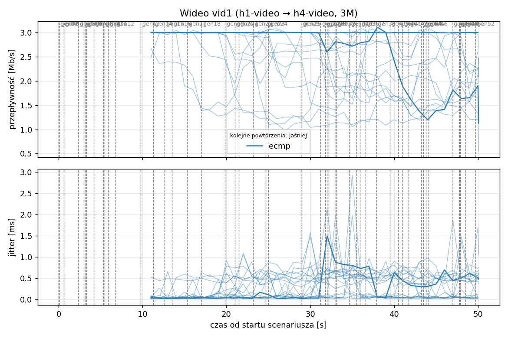
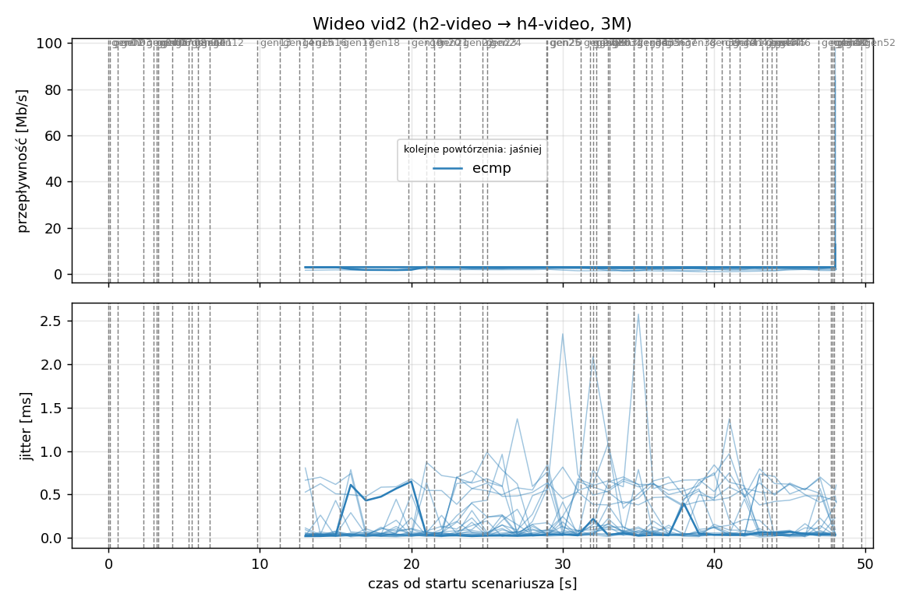
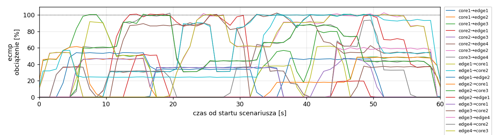
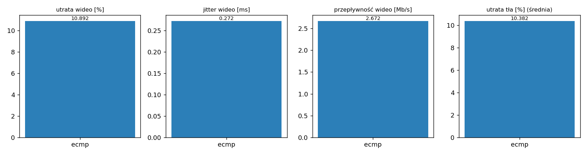

# Raport: mesh-frr

Katalog: `results/official/mesh-frr/20261105_080732`

## 1. Scenariusz

- Topologia: `mesh` (frr: `mesh-frr.clab.yml`)
- Warianty: **ecmp** (FRR, bez kontrolera)
- Czas testu: 60 s, warmup (pomijany w statystykach, liczony od startu każdego przepływu): 5 s, powtórzeń: 20, seed: 42
- Wykonane przebiegi: ecmp/rep1, ecmp/rep10, ecmp/rep11, ecmp/rep12, ecmp/rep13, ecmp/rep14, ecmp/rep15, ecmp/rep16, ecmp/rep17, ecmp/rep18, ecmp/rep19, ecmp/rep2, ecmp/rep20, ecmp/rep3, ecmp/rep4, ecmp/rep5, ecmp/rep6, ecmp/rep7, ecmp/rep8, ecmp/rep9

Harmonogram losowego tła różni się między powtórzeniami (seed + nr powtórzenia, wspólny dla wariantów); poniżej powtórzenie 1.

| id | klasa | źródło → cel | proto | zadana [Mb/s] | DSCP | start–koniec [s] |
|---|---|---|---|---|---|---|
| gen01 | background | h2-bg1 → h3-bg2 | udp | 4.49 | – | 0–7 |
| gen02 | background | h4-bg2 → h3-bg1 | udp | 3.16 | – | 0.1–5.1 |
| gen03 | background | h4-bg1 → h2-bg2 | udp | 5.25 | – | 0.6–5.6 |
| gen04 | background | h4-bg1 → h1-bg2 | udp | 3.56 | – | 2.3–7.3 |
| gen05 | background | h4-bg1 → h3-bg1 | udp | 2.36 | – | 3–60 |
| gen06 | background | h1-bg2 → h2-bg1 | udp | 1.93 | – | 3.2–16.2 |
| gen07 | background | h2-bg1 → h3-bg1 | udp | 1.39 | – | 3.3–8.3 |
| gen08 | background | h1-bg1 → h2-bg1 | udp | 3.29 | – | 4.2–32.2 |
| gen09 | background | h3-bg2 → h2-bg1 | udp | 4.51 | – | 5.3–16.3 |
| gen10 | background | h1-bg2 → h3-bg1 | udp | 3.96 | – | 5.5–10.5 |
| gen11 | background | h2-bg1 → h4-bg2 | udp | 5.85 | – | 5.9–19.9 |
| gen12 | background | h1-bg2 → h3-bg1 | udp | 4.90 | – | 6.7–16.7 |
| gen13 | background | h4-bg1 → h1-bg1 | udp | 3.07 | – | 9.8–19.8 |
| vid1 | video | h1-video → h4-video | udp | 3.00 | 46 | 10–50 |
| gen14 | background | h3-bg2 → h1-bg2 | udp | 5.37 | – | 11.3–27.3 |
| vid2 | video | h2-video → h4-video | udp | 3.00 | 46 | 12–48 |
| gen15 | background | h3-bg1 → h1-bg1 | udp | 3.12 | – | 12.6–30.6 |
| gen16 | background | h2-bg1 → h1-bg1 | udp | 4.96 | – | 13.5–18.5 |
| gen17 | background | h2-bg1 → h4-bg2 | udp | 4.86 | – | 15.3–20.3 |
| gen18 | background | h3-bg2 → h1-bg1 | udp | 3.49 | – | 17–36 |
| gen19 | background | h4-bg2 → h2-bg1 | udp | 2.93 | – | 19.8–48.8 |
| gen20 | background | h1-bg2 → h4-bg2 | udp | 5.68 | – | 21–26 |
| gen21 | background | h4-bg1 → h2-bg1 | udp | 3.04 | – | 21.5–35.5 |
| gen22 | background | h4-bg1 → h2-bg1 | udp | 3.69 | – | 23.2–28.2 |
| gen23 | background | h2-bg2 → h4-bg2 | udp | 1.26 | – | 24.7–44.7 |
| gen24 | background | h3-bg1 → h1-bg2 | udp | 4.88 | – | 25–31 |
| gen25 | background | h4-bg1 → h1-bg2 | udp | 3.51 | – | 28.9–33.9 |
| gen26 | background | h1-bg1 → h4-bg1 | udp | 5.23 | – | 29–59 |
| gen27 | background | h1-bg2 → h4-bg1 | udp | 2.10 | – | 31.2–37.2 |
| gen28 | background | h4-bg1 → h1-bg2 | udp | 1.54 | – | 31.8–36.8 |
| gen29 | background | h4-bg1 → h1-bg2 | udp | 1.53 | – | 32–39 |
| gen30 | background | h1-bg2 → h3-bg1 | udp | 3.69 | – | 32.2–38.2 |
| gen31 | background | h2-bg1 → h4-bg2 | udp | 2.18 | – | 33–38 |
| gen32 | background | h4-bg2 → h3-bg2 | udp | 5.19 | – | 33.1–59.1 |
| gen33 | background | h4-bg2 → h3-bg2 | udp | 2.60 | – | 34.7–40.7 |
| gen34 | background | h2-bg2 → h3-bg2 | udp | 1.75 | – | 34.7–59.7 |
| gen35 | background | h4-bg2 → h2-bg1 | udp | 5.89 | – | 35.5–54.5 |
| gen36 | background | h4-bg2 → h3-bg1 | udp | 4.62 | – | 35.9–49.9 |
| gen37 | background | h1-bg2 → h2-bg2 | udp | 4.50 | – | 36.6–50.6 |
| gen38 | background | h2-bg1 → h4-bg1 | udp | 4.23 | – | 37.9–58.9 |
| gen39 | background | h1-bg2 → h4-bg2 | udp | 5.93 | – | 39.5–44.5 |
| gen40 | background | h1-bg1 → h3-bg1 | udp | 5.99 | – | 40.5–45.5 |
| gen41 | background | h1-bg2 → h3-bg1 | udp | 4.47 | – | 41–50 |
| gen42 | background | h1-bg2 → h3-bg1 | udp | 2.82 | – | 41.7–48.7 |
| gen43 | background | h4-bg2 → h2-bg1 | udp | 4.98 | – | 43.2–49.2 |
| gen44 | background | h4-bg2 → h1-bg2 | udp | 5.97 | – | 43.5–50.5 |
| gen45 | background | h3-bg1 → h4-bg1 | udp | 5.74 | – | 43.8–58.8 |
| gen46 | background | h2-bg1 → h1-bg2 | udp | 1.89 | – | 44.1–49.1 |
| gen47 | background | h2-bg2 → h3-bg1 | udp | 2.94 | – | 46.9–59.9 |
| gen48 | background | h3-bg1 → h1-bg1 | udp | 3.58 | – | 47.7–59.7 |
| gen49 | background | h4-bg1 → h2-bg1 | udp | 5.93 | – | 47.8–57.8 |
| gen50 | background | h4-bg1 → h1-bg1 | udp | 3.20 | – | 47.9–54.9 |
| gen51 | background | h4-bg2 → h3-bg1 | udp | 1.53 | – | 48.5–59.5 |
| gen52 | background | h4-bg2 → h2-bg2 | udp | 2.44 | – | 49.7–59.7 |

## 2. Wideo: QoS według wariantu

Wartości: średnia ± odchylenie standardowe z powtórzeń.

| przepływ | wariant | przepływność [Mb/s] | jitter [ms] | utrata [%] | RTT mediana [ms] | RTT p95 [ms] |
|---|---|---|---|---|---|---|
| vid1 | ecmp | 2.54 ± 0.43 | 0.325 ± 0.159 | 15.35 ± 14.35 | 35.827 ± 34.758 | 87.327 ± 40.283 |
| vid2 | ecmp | 2.81 ± 0.30 | 0.220 ± 0.145 | 6.43 ± 9.98 | 16.498 ± 25.796 | 55.245 ± 33.589 |

RTT z `ping` co 0,1 s między hostami wideo (osobny przepływ ICMP z tym samym DSCP - w SDN może iść inną ścieżką niż strumień UDP).

## 3. Ruch tła

Agregat tła w obrębie powtórzenia, potem średnia ± odchylenie standardowe po powtórzeniach (utrata = Σ utraconych / Σ wysłanych datagramów; dostarczone = Σ przepływności / Σ zadanych; przepływy trwające nie dłużej niż warmup pominięte).

| wariant | strumieni tła / powt. | dostarczone / zadane [%] | jitter [ms] | utrata [%] |
|---|---|---|---|---|
| ecmp | 38 | 89.9 ± 4.7 | 0.225 ± 0.049 | 10.38 ± 5.45 |

## 4. Obciążenie łączy fabricu

Średnia i maksimum z próbek co 1 s w oknie 0–60 s; MLU = maksymalne obciążenie łącza; drops = pakiety odrzucone przez `tbf` na wyjściu łącza.

| wariant | rep | średnie obciążenie łączy [%] | MLU [%] | łącza > 90% | drops tbf | CPU VM śr./maks. [%] |
|---|---|---|---|---|---|---|
| ecmp | 1 | 28.9 | 102.7 | 12/24 | 20285 | 13 / 22 |
| ecmp | 2 | 30.4 | 102.7 | 14/24 | 36272 | 14 / 21 |
| ecmp | 3 | 35.2 | 103.2 | 12/24 | 49491 | 15 / 21 |
| ecmp | 4 | 28.3 | 102.2 | 13/24 | 10527 | 13 / 17 |
| ecmp | 5 | 29.4 | 102.1 | 11/24 | 11742 | 13 / 18 |
| ecmp | 6 | 24.2 | 102.1 | 8/24 | 9822 | 12 / 17 |
| ecmp | 7 | 31.4 | 102.4 | 11/24 | 13754 | 14 / 21 |
| ecmp | 8 | 27.4 | 102.5 | 12/24 | 14832 | 13 / 19 |
| ecmp | 9 | 24.8 | 103.4 | 9/24 | 46118 | 13 / 19 |
| ecmp | 10 | 30.6 | 104.1 | 12/24 | 19745 | 14 / 21 |
| ecmp | 11 | 30.0 | 102.8 | 12/24 | 54552 | 14 / 20 |
| ecmp | 12 | 23.9 | 106.8 | 12/24 | 7584 | 15 / 32 |
| ecmp | 13 | 30.4 | 103.0 | 10/24 | 20280 | 14 / 25 |
| ecmp | 14 | 29.9 | 102.4 | 12/24 | 24292 | 14 / 21 |
| ecmp | 15 | 33.4 | 102.8 | 10/24 | 52309 | 15 / 20 |
| ecmp | 16 | 28.5 | 102.7 | 13/24 | 17957 | 14 / 20 |
| ecmp | 17 | 34.1 | 103.1 | 12/24 | 36718 | 14 / 18 |
| ecmp | 18 | 26.1 | 103.4 | 9/24 | 18929 | 18 / 51 |
| ecmp | 19 | 32.5 | 103.1 | 12/24 | 30584 | 15 / 35 |
| ecmp | 20 | 33.2 | 103.4 | 14/24 | 25713 | 16 / 26 |

Łącza z obciążeniem > 10% (maksimum [%] / drops, powtórzenie 1):

| łącze | ecmp |
|---|---|
| core1→edge1 | 37 / 0 |
| core1→edge2 | 47 / 0 |
| core1→edge3 | 101 / 176 |
| core2→edge1 | 101 / 2005 |
| core2→edge3 | 47 / 0 |
| core2→edge4 | 102 / 0 |
| core3→edge2 | 103 / 0 |
| core3→edge4 | 102 / 0 |
| edge1→core1 | 92 / 0 |
| edge1→core2 | 101 / 6837 |
| edge1→edge2 | 54 / 0 |
| edge2→core1 | 62 / 0 |
| edge2→core3 | 101 / 1589 |
| edge2→edge1 | 52 / 0 |
| edge3→core1 | 48 / 0 |
| edge3→core2 | 101 / 694 |
| edge3→edge4 | 61 / 0 |
| edge4→core2 | 94 / 109 |
| edge4→core3 | 101 / 4526 |
| edge4→edge3 | 101 / 4349 |

## 5. Ścieżki wybrane przez kontroler (powtórzenie 1)

Z logu kontrolera (linie `Flow`), dopasowane po piątce przepływu; ✓ = reguły widoczne w `dump-flows` na tych samych przełącznikach.

| przepływ | ecmp |
|---|---|
| gen01 | ECMP (hash L4), nieobserwowana bezpośrednio |
| gen02 | ECMP (hash L4), nieobserwowana bezpośrednio |
| gen03 | ECMP (hash L4), nieobserwowana bezpośrednio |
| gen04 | ECMP (hash L4), nieobserwowana bezpośrednio |
| gen05 | ECMP (hash L4), nieobserwowana bezpośrednio |
| gen06 | ECMP (hash L4), nieobserwowana bezpośrednio |
| gen07 | ECMP (hash L4), nieobserwowana bezpośrednio |
| gen08 | ECMP (hash L4), nieobserwowana bezpośrednio |
| gen09 | ECMP (hash L4), nieobserwowana bezpośrednio |
| gen10 | ECMP (hash L4), nieobserwowana bezpośrednio |
| gen11 | ECMP (hash L4), nieobserwowana bezpośrednio |
| gen12 | ECMP (hash L4), nieobserwowana bezpośrednio |
| gen13 | ECMP (hash L4), nieobserwowana bezpośrednio |
| vid1 | ECMP (hash L4), nieobserwowana bezpośrednio |
| gen14 | ECMP (hash L4), nieobserwowana bezpośrednio |
| vid2 | ECMP (hash L4), nieobserwowana bezpośrednio |
| gen15 | ECMP (hash L4), nieobserwowana bezpośrednio |
| gen16 | ECMP (hash L4), nieobserwowana bezpośrednio |
| gen17 | ECMP (hash L4), nieobserwowana bezpośrednio |
| gen18 | ECMP (hash L4), nieobserwowana bezpośrednio |
| gen19 | ECMP (hash L4), nieobserwowana bezpośrednio |
| gen20 | ECMP (hash L4), nieobserwowana bezpośrednio |
| gen21 | ECMP (hash L4), nieobserwowana bezpośrednio |
| gen22 | ECMP (hash L4), nieobserwowana bezpośrednio |
| gen23 | ECMP (hash L4), nieobserwowana bezpośrednio |
| gen24 | ECMP (hash L4), nieobserwowana bezpośrednio |
| gen25 | ECMP (hash L4), nieobserwowana bezpośrednio |
| gen26 | ECMP (hash L4), nieobserwowana bezpośrednio |
| gen27 | ECMP (hash L4), nieobserwowana bezpośrednio |
| gen28 | ECMP (hash L4), nieobserwowana bezpośrednio |
| gen29 | ECMP (hash L4), nieobserwowana bezpośrednio |
| gen30 | ECMP (hash L4), nieobserwowana bezpośrednio |
| gen31 | ECMP (hash L4), nieobserwowana bezpośrednio |
| gen32 | ECMP (hash L4), nieobserwowana bezpośrednio |
| gen33 | ECMP (hash L4), nieobserwowana bezpośrednio |
| gen34 | ECMP (hash L4), nieobserwowana bezpośrednio |
| gen35 | ECMP (hash L4), nieobserwowana bezpośrednio |
| gen36 | ECMP (hash L4), nieobserwowana bezpośrednio |
| gen37 | ECMP (hash L4), nieobserwowana bezpośrednio |
| gen38 | ECMP (hash L4), nieobserwowana bezpośrednio |
| gen39 | ECMP (hash L4), nieobserwowana bezpośrednio |
| gen40 | ECMP (hash L4), nieobserwowana bezpośrednio |
| gen41 | ECMP (hash L4), nieobserwowana bezpośrednio |
| gen42 | ECMP (hash L4), nieobserwowana bezpośrednio |
| gen43 | ECMP (hash L4), nieobserwowana bezpośrednio |
| gen44 | ECMP (hash L4), nieobserwowana bezpośrednio |
| gen45 | ECMP (hash L4), nieobserwowana bezpośrednio |
| gen46 | ECMP (hash L4), nieobserwowana bezpośrednio |
| gen47 | ECMP (hash L4), nieobserwowana bezpośrednio |
| gen48 | ECMP (hash L4), nieobserwowana bezpośrednio |
| gen49 | ECMP (hash L4), nieobserwowana bezpośrednio |
| gen50 | ECMP (hash L4), nieobserwowana bezpośrednio |
| gen51 | ECMP (hash L4), nieobserwowana bezpośrednio |
| gen52 | ECMP (hash L4), nieobserwowana bezpośrednio |

## 6. Wnioski

<!-- WNIOSKI:START -->
_Do uzupełnienia: krótkie wnioski wyłącznie na podstawie liczb z sekcji 2–5._
<!-- WNIOSKI:END -->

## 7. Wiarygodność pomiaru

- ecmp rep1, gen02: przepływ krótszy niż warmup - statystyki z całości
- ecmp rep1, gen03: przepływ krótszy niż warmup - statystyki z całości
- ecmp rep1, gen04: przepływ krótszy niż warmup - statystyki z całości
- ecmp rep1, gen10: przepływ krótszy niż warmup - statystyki z całości
- ecmp rep1, gen16: przepływ krótszy niż warmup - statystyki z całości
- ecmp rep1, gen17: przepływ krótszy niż warmup - statystyki z całości
- ecmp rep1, gen20: przepływ krótszy niż warmup - statystyki z całości
- ecmp rep1, gen22: przepływ krótszy niż warmup - statystyki z całości
- ecmp rep1, gen25: przepływ krótszy niż warmup - statystyki z całości
- ecmp rep1, gen40: przepływ krótszy niż warmup - statystyki z całości
- ecmp rep1, gen46: przepływ krótszy niż warmup - statystyki z całości
- ecmp rep10, gen02: przepływ krótszy niż warmup - statystyki z całości
- ecmp rep10, gen04: przepływ krótszy niż warmup - statystyki z całości
- ecmp rep10, gen09: przepływ krótszy niż warmup - statystyki z całości
- ecmp rep10, gen10: przepływ krótszy niż warmup - statystyki z całości
- ecmp rep10, gen17: przepływ krótszy niż warmup - statystyki z całości
- ecmp rep10, gen24: przepływ krótszy niż warmup - statystyki z całości
- ecmp rep10, gen25: przepływ krótszy niż warmup - statystyki z całości
- ecmp rep10, gen31: przepływ krótszy niż warmup - statystyki z całości
- ecmp rep10, gen44: przepływ krótszy niż warmup - statystyki z całości
- ecmp rep10, gen57: przepływ krótszy niż warmup - statystyki z całości
- ecmp rep11, gen13: przepływ krótszy niż warmup - statystyki z całości
- ecmp rep11, gen17: przepływ krótszy niż warmup - statystyki z całości
- ecmp rep11, gen19: przepływ krótszy niż warmup - statystyki z całości
- ecmp rep11, gen20: przepływ krótszy niż warmup - statystyki z całości
- ecmp rep11, gen32: przepływ krótszy niż warmup - statystyki z całości
- ecmp rep11, gen54: przepływ krótszy niż warmup - statystyki z całości
- ecmp rep12, gen03: przepływ krótszy niż warmup - statystyki z całości
- ecmp rep12, gen04: przepływ krótszy niż warmup - statystyki z całości
- ecmp rep12, gen07: przepływ krótszy niż warmup - statystyki z całości
- ecmp rep12, gen25: przepływ krótszy niż warmup - statystyki z całości
- ecmp rep12, gen34: przepływ krótszy niż warmup - statystyki z całości
- ecmp rep13, gen02: przepływ krótszy niż warmup - statystyki z całości
- ecmp rep13, gen06: przepływ krótszy niż warmup - statystyki z całości
- ecmp rep13, gen10: przepływ krótszy niż warmup - statystyki z całości
- ecmp rep13, gen12: przepływ krótszy niż warmup - statystyki z całości
- ecmp rep13, gen14: przepływ krótszy niż warmup - statystyki z całości
- ecmp rep13, gen19: przepływ krótszy niż warmup - statystyki z całości
- ecmp rep13, gen26: przepływ krótszy niż warmup - statystyki z całości
- ecmp rep13, gen41: przepływ krótszy niż warmup - statystyki z całości
- ecmp rep13, gen43: przepływ krótszy niż warmup - statystyki z całości
- ecmp rep13, gen53: przepływ krótszy niż warmup - statystyki z całości
- ecmp rep13, gen54: przepływ krótszy niż warmup - statystyki z całości
- ecmp rep14, gen02: przepływ krótszy niż warmup - statystyki z całości
- ecmp rep14, gen03: przepływ krótszy niż warmup - statystyki z całości
- ecmp rep14, gen17: przepływ krótszy niż warmup - statystyki z całości
- ecmp rep14, gen35: przepływ krótszy niż warmup - statystyki z całości
- ecmp rep14, gen45: przepływ krótszy niż warmup - statystyki z całości
- ecmp rep14, gen50: przepływ krótszy niż warmup - statystyki z całości
- ecmp rep14, gen51: przepływ krótszy niż warmup - statystyki z całości
- ecmp rep14, gen52: przepływ krótszy niż warmup - statystyki z całości
- ecmp rep15, gen09: przepływ krótszy niż warmup - statystyki z całości
- ecmp rep15, gen11: przepływ krótszy niż warmup - statystyki z całości
- ecmp rep15, gen17: przepływ krótszy niż warmup - statystyki z całości
- ecmp rep15, gen38: przepływ krótszy niż warmup - statystyki z całości
- ecmp rep15, gen43: przepływ krótszy niż warmup - statystyki z całości
- ecmp rep15, gen45: przepływ krótszy niż warmup - statystyki z całości
- ecmp rep15, gen60: przepływ krótszy niż warmup - statystyki z całości
- ecmp rep16, gen11: przepływ krótszy niż warmup - statystyki z całości
- ecmp rep16, gen15: przepływ krótszy niż warmup - statystyki z całości
- ecmp rep16, gen22: przepływ krótszy niż warmup - statystyki z całości
- ecmp rep16, gen29: przepływ krótszy niż warmup - statystyki z całości
- ecmp rep16, gen32: przepływ krótszy niż warmup - statystyki z całości
- ecmp rep16, gen38: przepływ krótszy niż warmup - statystyki z całości
- ecmp rep16, gen40: przepływ krótszy niż warmup - statystyki z całości
- ecmp rep17, gen01: przepływ krótszy niż warmup - statystyki z całości
- ecmp rep17, gen05: przepływ krótszy niż warmup - statystyki z całości
- ecmp rep17, gen08: przepływ krótszy niż warmup - statystyki z całości
- ecmp rep17, gen09: przepływ krótszy niż warmup - statystyki z całości
- ecmp rep17, gen15: przepływ krótszy niż warmup - statystyki z całości
- ecmp rep17, gen24: przepływ krótszy niż warmup - statystyki z całości
- ecmp rep17, gen25: przepływ krótszy niż warmup - statystyki z całości
- ecmp rep17, gen33: przepływ krótszy niż warmup - statystyki z całości
- ecmp rep17, gen45: przepływ krótszy niż warmup - statystyki z całości
- ecmp rep17, gen46: przepływ krótszy niż warmup - statystyki z całości
- ecmp rep17, gen55: przepływ krótszy niż warmup - statystyki z całości
- ecmp rep17, gen57: przepływ krótszy niż warmup - statystyki z całości
- ecmp rep18, gen01: przepływ krótszy niż warmup - statystyki z całości
- ecmp rep18, gen04: przepływ krótszy niż warmup - statystyki z całości
- ecmp rep18, gen17: przepływ krótszy niż warmup - statystyki z całości
- ecmp rep18, gen32: przepływ krótszy niż warmup - statystyki z całości
- ecmp rep18, gen34: przepływ krótszy niż warmup - statystyki z całości
- ecmp rep19, gen02: przepływ krótszy niż warmup - statystyki z całości
- ecmp rep19, gen03: przepływ krótszy niż warmup - statystyki z całości
- ecmp rep19, gen10: przepływ krótszy niż warmup - statystyki z całości
- ecmp rep19, gen12: przepływ krótszy niż warmup - statystyki z całości
- ecmp rep19, gen14: przepływ krótszy niż warmup - statystyki z całości
- ecmp rep19, gen16: przepływ krótszy niż warmup - statystyki z całości
- ecmp rep19, gen21: przepływ krótszy niż warmup - statystyki z całości
- ecmp rep19, gen43: przepływ krótszy niż warmup - statystyki z całości
- ecmp rep19, gen50: przepływ krótszy niż warmup - statystyki z całości
- ecmp rep19, gen51: przepływ krótszy niż warmup - statystyki z całości
- ecmp rep2, gen31: przepływ krótszy niż warmup - statystyki z całości
- ecmp rep2, gen36: przepływ krótszy niż warmup - statystyki z całości
- ecmp rep2, gen45: przepływ krótszy niż warmup - statystyki z całości
- ecmp rep2, gen51: przepływ krótszy niż warmup - statystyki z całości
- ecmp rep20, gen03: przepływ krótszy niż warmup - statystyki z całości
- ecmp rep20, gen09: przepływ krótszy niż warmup - statystyki z całości
- ecmp rep20, gen11: przepływ krótszy niż warmup - statystyki z całości
- ecmp rep20, gen15: przepływ krótszy niż warmup - statystyki z całości
- ecmp rep20, gen31: przepływ krótszy niż warmup - statystyki z całości
- ecmp rep20, gen55: przepływ krótszy niż warmup - statystyki z całości
- ecmp rep3, gen02: przepływ krótszy niż warmup - statystyki z całości
- ecmp rep3, gen03: przepływ krótszy niż warmup - statystyki z całości
- ecmp rep3, gen09: przepływ krótszy niż warmup - statystyki z całości
- ecmp rep3, gen10: przepływ krótszy niż warmup - statystyki z całości
- ecmp rep3, gen11: przepływ krótszy niż warmup - statystyki z całości
- ecmp rep3, gen13: przepływ krótszy niż warmup - statystyki z całości
- ecmp rep3, gen15: przepływ krótszy niż warmup - statystyki z całości
- ecmp rep3, gen30: przepływ krótszy niż warmup - statystyki z całości
- ecmp rep3, gen38: przepływ krótszy niż warmup - statystyki z całości
- ecmp rep3, gen39: przepływ krótszy niż warmup - statystyki z całości
- ecmp rep4, gen10: przepływ krótszy niż warmup - statystyki z całości
- ecmp rep4, gen22: przepływ krótszy niż warmup - statystyki z całości
- ecmp rep4, gen28: przepływ krótszy niż warmup - statystyki z całości
- ecmp rep4, gen29: przepływ krótszy niż warmup - statystyki z całości
- ecmp rep4, gen31: przepływ krótszy niż warmup - statystyki z całości
- ecmp rep4, gen36: przepływ krótszy niż warmup - statystyki z całości
- ecmp rep4, gen40: przepływ krótszy niż warmup - statystyki z całości
- ecmp rep4, gen41: przepływ krótszy niż warmup - statystyki z całości
- ecmp rep4, gen46: przepływ krótszy niż warmup - statystyki z całości
- ecmp rep4, gen49: przepływ krótszy niż warmup - statystyki z całości
- ecmp rep5, gen02: przepływ krótszy niż warmup - statystyki z całości
- ecmp rep5, gen14: przepływ krótszy niż warmup - statystyki z całości
- ecmp rep5, gen15: przepływ krótszy niż warmup - statystyki z całości
- ecmp rep5, gen51: przepływ krótszy niż warmup - statystyki z całości
- ecmp rep5, gen52: przepływ krótszy niż warmup - statystyki z całości
- ecmp rep5, gen54: przepływ krótszy niż warmup - statystyki z całości
- ecmp rep5, gen55: przepływ krótszy niż warmup - statystyki z całości
- ecmp rep6, gen04: przepływ krótszy niż warmup - statystyki z całości
- ecmp rep6, gen05: przepływ krótszy niż warmup - statystyki z całości
- ecmp rep6, gen07: przepływ krótszy niż warmup - statystyki z całości
- ecmp rep6, gen10: przepływ krótszy niż warmup - statystyki z całości
- ecmp rep6, gen15: przepływ krótszy niż warmup - statystyki z całości
- ecmp rep6, gen21: przepływ krótszy niż warmup - statystyki z całości
- ecmp rep6, gen29: przepływ krótszy niż warmup - statystyki z całości
- ecmp rep6, gen38: przepływ krótszy niż warmup - statystyki z całości
- ecmp rep7, gen02: przepływ krótszy niż warmup - statystyki z całości
- ecmp rep7, gen03: przepływ krótszy niż warmup - statystyki z całości
- ecmp rep7, gen07: przepływ krótszy niż warmup - statystyki z całości
- ecmp rep7, gen11: przepływ krótszy niż warmup - statystyki z całości
- ecmp rep7, gen23: przepływ krótszy niż warmup - statystyki z całości
- ecmp rep7, gen24: przepływ krótszy niż warmup - statystyki z całości
- ecmp rep7, gen34: przepływ krótszy niż warmup - statystyki z całości
- ecmp rep7, gen43: przepływ krótszy niż warmup - statystyki z całości
- ecmp rep7, gen47: przepływ krótszy niż warmup - statystyki z całości
- ecmp rep7, gen48: przepływ krótszy niż warmup - statystyki z całości
- ecmp rep7, gen49: przepływ krótszy niż warmup - statystyki z całości
- ecmp rep7, gen50: przepływ krótszy niż warmup - statystyki z całości
- ecmp rep8, gen05: przepływ krótszy niż warmup - statystyki z całości
- ecmp rep8, gen12: przepływ krótszy niż warmup - statystyki z całości
- ecmp rep8, gen22: przepływ krótszy niż warmup - statystyki z całości
- ecmp rep8, gen33: przepływ krótszy niż warmup - statystyki z całości
- ecmp rep8, gen36: przepływ krótszy niż warmup - statystyki z całości
- ecmp rep8, gen37: przepływ krótszy niż warmup - statystyki z całości
- ecmp rep8, gen40: przepływ krótszy niż warmup - statystyki z całości
- ecmp rep8, gen47: przepływ krótszy niż warmup - statystyki z całości
- ecmp rep9, gen37: przepływ krótszy niż warmup - statystyki z całości
- ecmp rep9, gen41: przepływ krótszy niż warmup - statystyki z całości
- ecmp rep9, gen42: przepływ krótszy niż warmup - statystyki z całości
