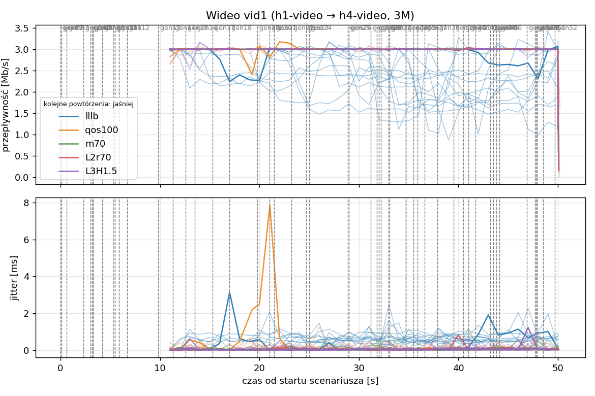
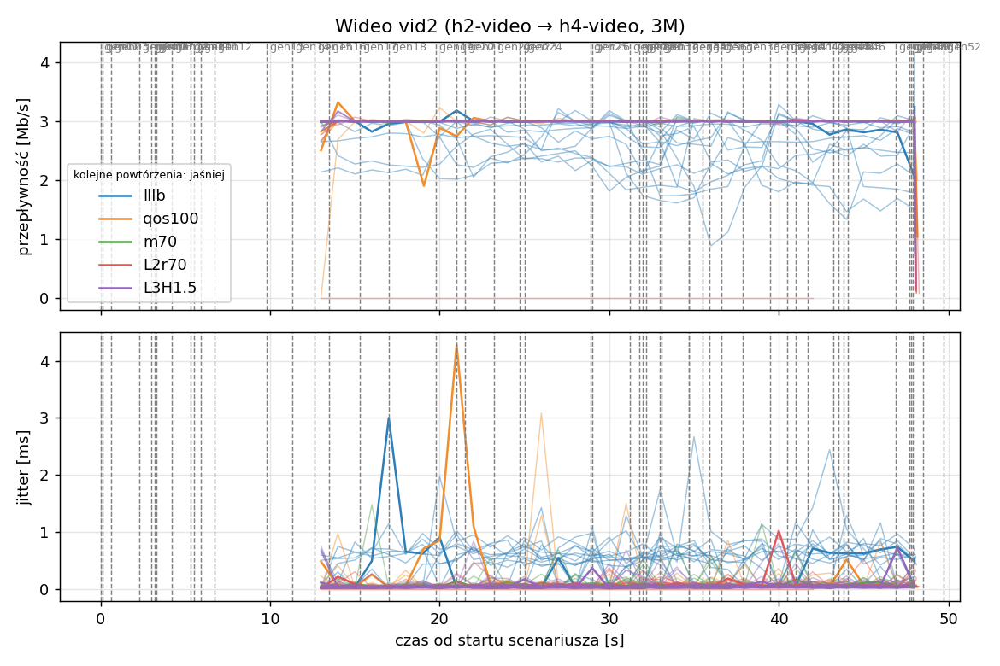
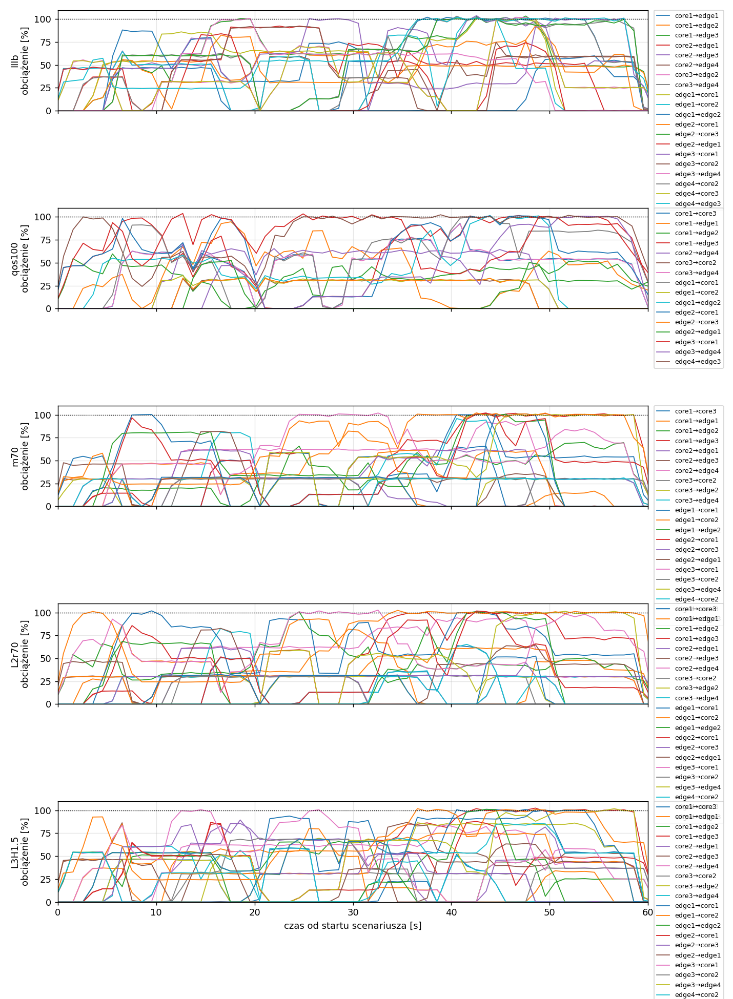
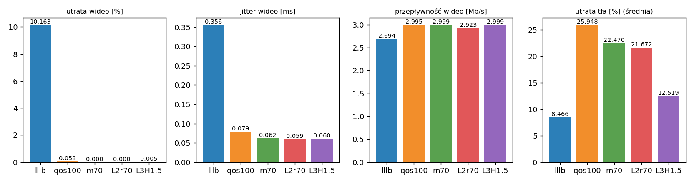

# Raport: mesh-sdn

Katalog: `results/official/mesh-sdn/20261105_123304`

## 1. Scenariusz

- Topologia: `mesh` (sdn: `mesh-sdn.clab.yml`)
- Warianty: **lllb** (POLICY=lllb), **qos100** (LAYERS=1, POLICY=qos, RESERVE_PCT=100), **m70** (LAYERS=1, POLICY=qos, RESERVE_PCT=70), **L2r70** (LAYERS=2, POLICY=qos, RESERVE_PCT=70), **L3H1.5** (HEADROOM_MBPS=1.5, LAYERS=3, POLICY=qos, RESERVE_PCT=70)
- Czas testu: 60 s, warmup (pomijany w statystykach, liczony od startu każdego przepływu): 5 s, powtórzeń: 20, seed: 42
- Wykonane przebiegi: lllb/rep1, lllb/rep10, lllb/rep11, lllb/rep12, lllb/rep13, lllb/rep14, lllb/rep15, lllb/rep16, lllb/rep17, lllb/rep18, lllb/rep19, lllb/rep2, lllb/rep20, lllb/rep3, lllb/rep4, lllb/rep5, lllb/rep6, lllb/rep7, lllb/rep8, lllb/rep9, qos100/rep1, qos100/rep10, qos100/rep11, qos100/rep12, qos100/rep13, qos100/rep14, qos100/rep15, qos100/rep16, qos100/rep17, qos100/rep18, qos100/rep19, qos100/rep2, qos100/rep20, qos100/rep3, qos100/rep4, qos100/rep5, qos100/rep6, qos100/rep7, qos100/rep8, qos100/rep9, m70/rep1, m70/rep10, m70/rep11, m70/rep12, m70/rep13, m70/rep14, m70/rep15, m70/rep16, m70/rep17, m70/rep18, m70/rep19, m70/rep2, m70/rep20, m70/rep3, m70/rep4, m70/rep5, m70/rep6, m70/rep7, m70/rep8, m70/rep9, L2r70/rep1, L2r70/rep10, L2r70/rep11, L2r70/rep12, L2r70/rep13, L2r70/rep14, L2r70/rep15, L2r70/rep16, L2r70/rep17, L2r70/rep18, L2r70/rep19, L2r70/rep2, L2r70/rep20, L2r70/rep3, L2r70/rep4, L2r70/rep5, L2r70/rep6, L2r70/rep7, L2r70/rep8, L2r70/rep9, L3H1.5/rep1, L3H1.5/rep10, L3H1.5/rep11, L3H1.5/rep12, L3H1.5/rep13, L3H1.5/rep14, L3H1.5/rep15, L3H1.5/rep16, L3H1.5/rep17, L3H1.5/rep18, L3H1.5/rep19, L3H1.5/rep2, L3H1.5/rep20, L3H1.5/rep3, L3H1.5/rep4, L3H1.5/rep5, L3H1.5/rep6, L3H1.5/rep7, L3H1.5/rep8, L3H1.5/rep9

Harmonogram losowego tła różni się między powtórzeniami (seed + nr powtórzenia, wspólny dla wariantów); poniżej powtórzenie 1.

| id | klasa | źródło → cel | proto | zadana [Mb/s] | DSCP | start–koniec [s] |
|---|---|---|---|---|---|---|
| gen01 | background | h2-bg1 → h3-bg2 | udp | 4.49 | – | 0–7 |
| gen02 | background | h4-bg2 → h3-bg1 | udp | 3.16 | – | 0.1–5.1 |
| gen03 | background | h4-bg1 → h2-bg2 | udp | 5.25 | – | 0.6–5.6 |
| gen04 | background | h4-bg1 → h1-bg2 | udp | 3.56 | – | 2.3–7.3 |
| gen05 | background | h4-bg1 → h3-bg1 | udp | 2.36 | – | 3–60 |
| gen06 | background | h1-bg2 → h2-bg1 | udp | 1.93 | – | 3.2–16.2 |
| gen07 | background | h2-bg1 → h3-bg1 | udp | 1.39 | – | 3.3–8.3 |
| gen08 | background | h1-bg1 → h2-bg1 | udp | 3.29 | – | 4.2–32.2 |
| gen09 | background | h3-bg2 → h2-bg1 | udp | 4.51 | – | 5.3–16.3 |
| gen10 | background | h1-bg2 → h3-bg1 | udp | 3.96 | – | 5.5–10.5 |
| gen11 | background | h2-bg1 → h4-bg2 | udp | 5.85 | – | 5.9–19.9 |
| gen12 | background | h1-bg2 → h3-bg1 | udp | 4.90 | – | 6.7–16.7 |
| gen13 | background | h4-bg1 → h1-bg1 | udp | 3.07 | – | 9.8–19.8 |
| vid1 | video | h1-video → h4-video | udp | 3.00 | 46 | 10–50 |
| gen14 | background | h3-bg2 → h1-bg2 | udp | 5.37 | – | 11.3–27.3 |
| vid2 | video | h2-video → h4-video | udp | 3.00 | 46 | 12–48 |
| gen15 | background | h3-bg1 → h1-bg1 | udp | 3.12 | – | 12.6–30.6 |
| gen16 | background | h2-bg1 → h1-bg1 | udp | 4.96 | – | 13.5–18.5 |
| gen17 | background | h2-bg1 → h4-bg2 | udp | 4.86 | – | 15.3–20.3 |
| gen18 | background | h3-bg2 → h1-bg1 | udp | 3.49 | – | 17–36 |
| gen19 | background | h4-bg2 → h2-bg1 | udp | 2.93 | – | 19.8–48.8 |
| gen20 | background | h1-bg2 → h4-bg2 | udp | 5.68 | – | 21–26 |
| gen21 | background | h4-bg1 → h2-bg1 | udp | 3.04 | – | 21.5–35.5 |
| gen22 | background | h4-bg1 → h2-bg1 | udp | 3.69 | – | 23.2–28.2 |
| gen23 | background | h2-bg2 → h4-bg2 | udp | 1.26 | – | 24.7–44.7 |
| gen24 | background | h3-bg1 → h1-bg2 | udp | 4.88 | – | 25–31 |
| gen25 | background | h4-bg1 → h1-bg2 | udp | 3.51 | – | 28.9–33.9 |
| gen26 | background | h1-bg1 → h4-bg1 | udp | 5.23 | – | 29–59 |
| gen27 | background | h1-bg2 → h4-bg1 | udp | 2.10 | – | 31.2–37.2 |
| gen28 | background | h4-bg1 → h1-bg2 | udp | 1.54 | – | 31.8–36.8 |
| gen29 | background | h4-bg1 → h1-bg2 | udp | 1.53 | – | 32–39 |
| gen30 | background | h1-bg2 → h3-bg1 | udp | 3.69 | – | 32.2–38.2 |
| gen31 | background | h2-bg1 → h4-bg2 | udp | 2.18 | – | 33–38 |
| gen32 | background | h4-bg2 → h3-bg2 | udp | 5.19 | – | 33.1–59.1 |
| gen33 | background | h4-bg2 → h3-bg2 | udp | 2.60 | – | 34.7–40.7 |
| gen34 | background | h2-bg2 → h3-bg2 | udp | 1.75 | – | 34.7–59.7 |
| gen35 | background | h4-bg2 → h2-bg1 | udp | 5.89 | – | 35.5–54.5 |
| gen36 | background | h4-bg2 → h3-bg1 | udp | 4.62 | – | 35.9–49.9 |
| gen37 | background | h1-bg2 → h2-bg2 | udp | 4.50 | – | 36.6–50.6 |
| gen38 | background | h2-bg1 → h4-bg1 | udp | 4.23 | – | 37.9–58.9 |
| gen39 | background | h1-bg2 → h4-bg2 | udp | 5.93 | – | 39.5–44.5 |
| gen40 | background | h1-bg1 → h3-bg1 | udp | 5.99 | – | 40.5–45.5 |
| gen41 | background | h1-bg2 → h3-bg1 | udp | 4.47 | – | 41–50 |
| gen42 | background | h1-bg2 → h3-bg1 | udp | 2.82 | – | 41.7–48.7 |
| gen43 | background | h4-bg2 → h2-bg1 | udp | 4.98 | – | 43.2–49.2 |
| gen44 | background | h4-bg2 → h1-bg2 | udp | 5.97 | – | 43.5–50.5 |
| gen45 | background | h3-bg1 → h4-bg1 | udp | 5.74 | – | 43.8–58.8 |
| gen46 | background | h2-bg1 → h1-bg2 | udp | 1.89 | – | 44.1–49.1 |
| gen47 | background | h2-bg2 → h3-bg1 | udp | 2.94 | – | 46.9–59.9 |
| gen48 | background | h3-bg1 → h1-bg1 | udp | 3.58 | – | 47.7–59.7 |
| gen49 | background | h4-bg1 → h2-bg1 | udp | 5.93 | – | 47.8–57.8 |
| gen50 | background | h4-bg1 → h1-bg1 | udp | 3.20 | – | 47.9–54.9 |
| gen51 | background | h4-bg2 → h3-bg1 | udp | 1.53 | – | 48.5–59.5 |
| gen52 | background | h4-bg2 → h2-bg2 | udp | 2.44 | – | 49.7–59.7 |

## 2. Wideo: QoS według wariantu

Wartości: średnia ± odchylenie standardowe z powtórzeń.

| przepływ | wariant | przepływność [Mb/s] | jitter [ms] | utrata [%] | RTT mediana [ms] | RTT p95 [ms] |
|---|---|---|---|---|---|---|
| vid1 | lllb | 2.62 ± 0.31 | 0.358 ± 0.199 | 12.59 ± 10.26 | 39.385 ± 39.101 | 123.592 ± 61.731 |
| vid1 | qos100 | 3.00 ± 0.00 | 0.079 ± 0.084 | 0.03 ± 0.12 | 0.031 ± 0.001 | 0.073 ± 0.095 |
| vid1 | m70 | 3.00 ± 0.00 | 0.061 ± 0.018 | 0.00 ± 0.00 | 0.029 ± 0.002 | 0.051 ± 0.006 |
| vid1 | L2r70 | 3.00 ± 0.00 | 0.063 ± 0.016 | 0.00 ± 0.00 | 0.030 ± 0.001 | 0.051 ± 0.006 |
| vid1 | L3H1.5 | 3.00 ± 0.00 | 0.060 ± 0.021 | 0.01 ± 0.04 | 0.030 ± 0.002 | 0.512 ± 2.015 |
| vid2 | lllb | 2.77 ± 0.18 | 0.354 ± 0.154 | 7.74 ± 5.93 | 45.684 ± 40.602 | 120.076 ± 75.737 |
| vid2 | qos100 | 2.99 ± 0.01 | 0.078 ± 0.060 | 0.08 ± 0.35 | 0.030 ± 0.003 | 0.154 ± 0.442 |
| vid2 | m70 | 3.00 ± 0.00 | 0.062 ± 0.017 | 0.00 ± 0.00 | 0.029 ± 0.003 | 0.054 ± 0.006 |
| vid2 | L2r70 | 2.85 ± 0.67 | 0.056 ± 0.018 | 0.00 ± 0.00 | 0.029 ± 0.003 | 0.056 ± 0.007 |
| vid2 | L3H1.5 | 3.00 ± 0.00 | 0.060 ± 0.020 | 0.00 ± 0.00 | 0.029 ± 0.003 | 0.685 ± 2.517 |

RTT z `ping` co 0,1 s między hostami wideo (osobny przepływ ICMP z tym samym DSCP - w SDN może iść inną ścieżką niż strumień UDP).

## 3. Ruch tła

Agregat tła w obrębie powtórzenia, potem średnia ± odchylenie standardowe po powtórzeniach (utrata = Σ utraconych / Σ wysłanych datagramów; dostarczone = Σ przepływności / Σ zadanych; przepływy trwające nie dłużej niż warmup pominięte).

| wariant | strumieni tła / powt. | dostarczone / zadane [%] | jitter [ms] | utrata [%] |
|---|---|---|---|---|
| lllb | 38 | 92.0 ± 4.0 | 0.259 ± 0.091 | 8.47 ± 4.44 |
| qos100 | 38 | 72.7 ± 6.2 | 0.464 ± 0.177 | 25.95 ± 7.51 |
| m70 | 38 | 76.8 ± 4.7 | 0.259 ± 0.073 | 22.47 ± 5.57 |
| L2r70 | 38 | 78.0 ± 6.5 | 0.301 ± 0.093 | 21.67 ± 6.35 |
| L3H1.5 | 38 | 87.5 ± 4.7 | 0.229 ± 0.079 | 12.52 ± 5.12 |

## 4. Obciążenie łączy fabricu

Średnia i maksimum z próbek co 1 s w oknie 0–60 s; MLU = maksymalne obciążenie łącza; drops = pakiety odrzucone przez `tbf` na wyjściu łącza.

| wariant | rep | średnie obciążenie łączy [%] | MLU [%] | łącza > 90% | drops tbf | CPU VM śr./maks. [%] |
|---|---|---|---|---|---|---|
| lllb | 1 | 38.6 | 103.8 | 16/24 | 13268 | 17 / 33 |
| lllb | 2 | 40.2 | 103.6 | 18/24 | 22577 | 17 / 30 |
| lllb | 3 | 48.8 | 104.9 | 18/24 | 37658 | 18 / 29 |
| lllb | 4 | 35.9 | 103.3 | 13/24 | 4929 | 15 / 23 |
| lllb | 5 | 35.9 | 102.3 | 13/24 | 7124 | 15 / 25 |
| lllb | 6 | 33.0 | 103.0 | 11/24 | 6174 | 14 / 27 |
| lllb | 7 | 38.4 | 103.1 | 14/24 | 20811 | 15 / 27 |
| lllb | 8 | 36.2 | 102.1 | 17/24 | 13053 | 14 / 29 |
| lllb | 9 | 33.3 | 102.4 | 13/24 | 28573 | 15 / 24 |
| lllb | 10 | 39.5 | 102.9 | 17/24 | 21375 | 16 / 30 |
| lllb | 11 | 40.0 | 102.4 | 17/24 | 38259 | 16 / 29 |
| lllb | 12 | 31.3 | 102.2 | 11/24 | 5730 | 13 / 25 |
| lllb | 13 | 41.4 | 102.6 | 15/24 | 24013 | 15 / 25 |
| lllb | 14 | 37.6 | 103.0 | 15/24 | 16627 | 15 / 27 |
| lllb | 15 | 45.5 | 103.9 | 16/24 | 45949 | 18 / 32 |
| lllb | 16 | 41.9 | 103.0 | 14/24 | 13332 | 15 / 23 |
| lllb | 17 | 43.9 | 103.8 | 16/24 | 32264 | 16 / 29 |
| lllb | 18 | 35.7 | 102.5 | 11/24 | 18156 | 14 / 24 |
| lllb | 19 | 39.8 | 102.5 | 14/24 | 26879 | 15 / 27 |
| lllb | 20 | 44.2 | 103.8 | 20/24 | 40816 | 17 / 34 |
| qos100 | 1 | 29.4 | 103.8 | 10/24 | 64854 | 26 / 94 |
| qos100 | 2 | 34.4 | 102.7 | 10/24 | 59394 | 16 / 29 |
| qos100 | 3 | 39.2 | 104.0 | 10/24 | 79397 | 18 / 29 |
| qos100 | 4 | 29.9 | 104.0 | 8/24 | 42020 | 15 / 24 |
| qos100 | 5 | 31.7 | 102.9 | 10/24 | 44524 | 15 / 26 |
| qos100 | 6 | 25.4 | 103.5 | 7/24 | 25102 | 14 / 26 |
| qos100 | 7 | 33.2 | 103.3 | 12/24 | 60531 | 15 / 26 |
| qos100 | 8 | 29.0 | 102.5 | 9/24 | 35787 | 14 / 29 |
| qos100 | 9 | 26.0 | 103.1 | 7/24 | 83405 | 14 / 22 |
| qos100 | 10 | 31.3 | 102.6 | 9/24 | 67793 | 15 / 28 |
| qos100 | 11 | 30.5 | 103.5 | 11/24 | 95566 | 15 / 27 |
| qos100 | 12 | 26.4 | 102.5 | 7/24 | 24884 | 14 / 42 |
| qos100 | 13 | 32.9 | 102.3 | 10/24 | 57299 | 15 / 24 |
| qos100 | 14 | 32.7 | 102.8 | 12/24 | 47231 | 14 / 27 |
| qos100 | 15 | 37.1 | 103.3 | 12/24 | 87378 | 17 / 28 |
| qos100 | 16 | 32.3 | 103.6 | 10/24 | 44685 | 14 / 23 |
| qos100 | 17 | 36.0 | 104.0 | 8/24 | 73842 | 16 / 25 |
| qos100 | 18 | 31.6 | 103.1 | 11/24 | 38530 | 14 / 26 |
| qos100 | 19 | 29.5 | 102.6 | 7/24 | 68957 | 15 / 24 |
| qos100 | 20 | 33.8 | 104.2 | 9/24 | 80992 | 16 / 30 |
| m70 | 1 | 30.8 | 102.1 | 10/24 | 27944 | 15 / 25 |
| m70 | 2 | 37.3 | 104.0 | 14/24 | 30371 | 16 / 27 |
| m70 | 3 | 41.2 | 103.4 | 11/24 | 39662 | 17 / 28 |
| m70 | 4 | 29.9 | 102.1 | 10/24 | 13442 | 14 / 23 |
| m70 | 5 | 33.3 | 102.3 | 10/24 | 15486 | 16 / 24 |
| m70 | 6 | 28.0 | 102.2 | 8/24 | 3859 | 14 / 24 |
| m70 | 7 | 33.2 | 103.3 | 11/24 | 22280 | 15 / 25 |
| m70 | 8 | 31.5 | 102.5 | 10/24 | 13005 | 14 / 28 |
| m70 | 9 | 29.3 | 102.1 | 5/24 | 41806 | 14 / 22 |
| m70 | 10 | 32.8 | 102.2 | 10/24 | 20082 | 15 / 29 |
| m70 | 11 | 34.5 | 103.1 | 12/24 | 47846 | 15 / 27 |
| m70 | 12 | 26.4 | 102.4 | 8/24 | 10293 | 13 / 27 |
| m70 | 13 | 34.4 | 102.3 | 12/24 | 16607 | 15 / 25 |
| m70 | 14 | 34.2 | 103.8 | 11/24 | 9434 | 15 / 26 |
| m70 | 15 | 40.6 | 103.6 | 10/24 | 41909 | 16 / 28 |
| m70 | 16 | 31.7 | 103.1 | 11/24 | 13099 | 14 / 23 |
| m70 | 17 | 42.1 | 103.8 | 11/24 | 18643 | 16 / 28 |
| m70 | 18 | 29.7 | 102.3 | 10/24 | 8852 | 14 / 23 |
| m70 | 19 | 35.5 | 102.8 | 11/24 | 33576 | 15 / 26 |
| m70 | 20 | 37.8 | 102.8 | 12/24 | 40809 | 16 / 30 |
| L2r70 | 1 | 30.8 | 102.7 | 9/24 | 42403 | 14 / 26 |
| L2r70 | 2 | 37.6 | 105.1 | 12/24 | 25304 | 17 / 28 |
| L2r70 | 3 | 40.9 | 103.7 | 12/24 | 66605 | 18 / 29 |
| L2r70 | 4 | 28.7 | 102.4 | 9/24 | 15025 | 14 / 23 |
| L2r70 | 5 | 33.3 | 103.3 | 9/24 | 15862 | 15 / 24 |
| L2r70 | 6 | 28.1 | 103.0 | 6/24 | 9294 | 14 / 24 |
| L2r70 | 7 | 32.5 | 103.9 | 11/24 | 31805 | 17 / 33 |
| L2r70 | 8 | 31.3 | 102.3 | 9/24 | 17078 | 14 / 31 |
| L2r70 | 9 | 29.8 | 102.1 | 6/24 | 40726 | 14 / 23 |
| L2r70 | 10 | 33.2 | 103.2 | 9/24 | 23734 | 15 / 27 |
| L2r70 | 11 | 34.6 | 102.7 | 11/24 | 53937 | 15 / 28 |
| L2r70 | 12 | 26.9 | 102.5 | 7/24 | 12352 | 14 / 24 |
| L2r70 | 13 | 34.8 | 102.5 | 10/24 | 24897 | 14 / 24 |
| L2r70 | 14 | 35.0 | 103.4 | 11/24 | 22179 | 15 / 27 |
| L2r70 | 15 | 42.3 | 102.9 | 11/24 | 45753 | 17 / 29 |
| L2r70 | 16 | 34.0 | 103.7 | 12/24 | 21245 | 14 / 23 |
| L2r70 | 17 | 42.5 | 102.9 | 11/24 | 43580 | 16 / 25 |
| L2r70 | 18 | 32.8 | 102.8 | 12/24 | 14335 | 14 / 24 |
| L2r70 | 19 | 34.8 | 102.1 | 9/24 | 58923 | 15 / 23 |
| L2r70 | 20 | 36.3 | 103.6 | 12/24 | 48392 | 17 / 32 |
| L3H1.5 | 1 | 36.6 | 102.5 | 7/24 | 12773 | 15 / 26 |
| L3H1.5 | 2 | 40.5 | 105.3 | 11/24 | 17328 | 16 / 35 |
| L3H1.5 | 3 | 46.2 | 103.5 | 12/24 | 34955 | 18 / 28 |
| L3H1.5 | 4 | 36.8 | 102.5 | 12/24 | 2761 | 15 / 24 |
| L3H1.5 | 5 | 37.0 | 103.6 | 8/24 | 14651 | 15 / 24 |
| L3H1.5 | 6 | 29.7 | 102.6 | 11/24 | 2368 | 14 / 25 |
| L3H1.5 | 7 | 38.7 | 102.3 | 12/24 | 9786 | 16 / 28 |
| L3H1.5 | 8 | 36.6 | 102.8 | 11/24 | 12106 | 14 / 29 |
| L3H1.5 | 9 | 34.5 | 102.6 | 6/24 | 23367 | 14 / 22 |
| L3H1.5 | 10 | 36.6 | 102.5 | 10/24 | 16084 | 16 / 32 |
| L3H1.5 | 11 | 38.7 | 102.9 | 13/24 | 30020 | 15 / 27 |
| L3H1.5 | 12 | 30.5 | 102.9 | 7/24 | 1311 | 13 / 24 |
| L3H1.5 | 13 | 39.2 | 102.5 | 9/24 | 16892 | 15 / 27 |
| L3H1.5 | 14 | 35.8 | 102.4 | 12/24 | 15838 | 15 / 27 |
| L3H1.5 | 15 | 45.0 | 103.3 | 12/24 | 34756 | 16 / 28 |
| L3H1.5 | 16 | 39.0 | 102.8 | 9/24 | 5573 | 14 / 22 |
| L3H1.5 | 17 | 43.0 | 103.6 | 12/24 | 27715 | 16 / 25 |
| L3H1.5 | 18 | 35.7 | 103.5 | 13/24 | 20284 | 14 / 24 |
| L3H1.5 | 19 | 41.3 | 102.8 | 12/24 | 18613 | 15 / 26 |
| L3H1.5 | 20 | 41.1 | 102.1 | 12/24 | 38839 | 16 / 31 |

Łącza z obciążeniem > 10% (maksimum [%] / drops, powtórzenie 1):

| łącze | lllb | qos100 | m70 | L2r70 | L3H1.5 |
|---|---|---|---|---|---|
| core1→core3 | 0 / 0 | 93 / 0 | 66 / 0 | 64 / 0 | 59 / 0 |
| core1→edge1 | 80 / 0 | 95 / 0 | 82 / 0 | 87 / 0 | 80 / 0 |
| core1→edge2 | 93 / 0 | 60 / 0 | 70 / 0 | 101 / 0 | 66 / 0 |
| core1→edge3 | 103 / 912 | 102 / 2670 | 102 / 3260 | 101 / 4034 | 102 / 4073 |
| core2→core3 | 0 / 0 | 0 / 0 | 0 / 0 | 0 / 0 | 0 / 0 |
| core2→edge1 | 92 / 0 | 0 / 0 | 31 / 0 | 31 / 0 | 86 / 0 |
| core2→edge3 | 104 / 690 | 0 / 0 | 31 / 0 | 31 / 0 | 87 / 0 |
| core2→edge4 | 75 / 0 | 70 / 101 | 93 / 0 | 94 / 0 | 84 / 0 |
| core3→core2 | 0 / 0 | 33 / 0 | 32 / 0 | 32 / 0 | 32 / 0 |
| core3→edge2 | 102 / 0 | 0 / 0 | 31 / 0 | 31 / 0 | 87 / 0 |
| core3→edge4 | 103 / 0 | 93 / 0 | 96 / 0 | 83 / 0 | 61 / 0 |
| edge1→core1 | 101 / 326 | 101 / 2975 | 101 / 903 | 102 / 1816 | 101 / 3575 |
| edge1→core2 | 101 / 2103 | 36 / 30 | 61 / 0 | 63 / 0 | 85 / 0 |
| edge1→edge2 | 102 / 819 | 102 / 1385 | 101 / 2038 | 101 / 1925 | 101 / 293 |
| edge2→core1 | 83 / 0 | 101 / 3337 | 102 / 0 | 102 / 20 | 88 / 0 |
| edge2→core3 | 101 / 344 | 33 / 52 | 62 / 0 | 62 / 0 | 90 / 0 |
| edge2→edge1 | 84 / 0 | 53 / 27 | 82 / 0 | 83 / 0 | 64 / 0 |
| edge3→core1 | 101 / 934 | 104 / 14789 | 102 / 2655 | 103 / 2579 | 101 / 701 |
| edge3→core2 | 92 / 0 | 0 / 0 | 30 / 0 | 31 / 0 | 70 / 0 |
| edge3→edge4 | 101 / 0 | 101 / 200 | 101 / 877 | 101 / 938 | 102 / 840 |
| edge4→core2 | 102 / 2284 | 0 / 0 | 31 / 0 | 31 / 0 | 86 / 0 |
| edge4→core3 | 100 / 595 | 0 / 0 | 101 / 579 | 53 / 0 | 101 / 1466 |
| edge4→edge3 | 102 / 4261 | 102 / 39288 | 102 / 17632 | 102 / 31091 | 102 / 1825 |

## 5. Ścieżki wybrane przez kontroler (powtórzenie 1)

Z logu kontrolera (linie `Flow`), dopasowane po piątce przepływu; ✓ = reguły widoczne w `dump-flows` na tych samych przełącznikach.

| przepływ | lllb | qos100 | m70 | L2r70 | L3H1.5 |
|---|---|---|---|---|---|
| gen01 | edge2 -> edge1 -> core2 -> edge3 ✓ (loads 5% 5% 0% 0%) | edge2 -> core1 -> edge3 ✓ (loads 5% 5% 0% 0%) | edge2 -> edge1 -> core2 -> edge3 ✓ (loads 5% 5% 0% 0%) | edge2 -> edge1 -> core2 -> edge3 ✓ (loads 20% 20% 0% 0%) | edge2 -> edge1 -> core2 -> edge3 ✓ (loads 20% 20% 0% 0%) |
| gen02 | edge4 -> edge3 ✓ (loads 5% 5%) | edge4 -> edge3 ✓ (loads 5% 0%) | edge4 -> edge3 ✓ (loads 5% 5%) | edge4 -> edge3 ✓ (loads 20% 20%) | edge4 -> edge3 ✓ (loads 20% 20%) |
| gen03 | edge4 -> core3 -> edge2 ✓ (loads 0% 4% 5% 5%) | edge4 -> edge3 -> core1 -> edge2 ✓ (loads 0% 18% 0% 0%) | edge4 -> core3 -> edge2 ✓ (loads 5% 10% 5% 5%) | edge4 -> edge3 -> core1 -> edge2 ✓ (loads 20% 40% 20% 20%) | edge4 -> core2 -> edge1 -> edge2 ✓ (loads 20% 43% 20% 20%) |
| gen04 | edge4 -> core2 -> edge1 ✓ (loads 5% 33% 33% 54%) | edge4 -> edge3 -> core1 -> edge1 ✓ (loads 0% 89% 89% 0%) | edge4 -> core2 -> edge1 ✓ (loads 5% 33% 33% 54%) | edge4 -> edge3 -> core1 -> edge1 ✓ (loads 20% 165% 165% 66%) | edge4 -> edge3 -> core1 -> edge1 ✓ (loads 94% 73% 94% 83%) |
| gen05 | edge4 -> edge3 ✓ (loads 38% 46%) | edge4 -> edge3 ✓ (loads 96% 0%) | edge4 -> edge3 ✓ (loads 32% 35%) | edge4 -> edge3 ✓ (loads 148% 30%) | edge4 -> edge3 ✓ (loads 66% 94%) |
| gen06 | edge1 -> core1 -> edge2 ✓ (loads 10% 5%) | edge1 -> edge2 ✓ (loads 5% 52%) | edge1 -> core1 -> edge2 ✓ (loads 5% 0%) | edge1 -> edge2 ✓ (loads 17% 48%) | edge1 -> core1 -> edge2 ✓ (loads 54% 51%) |
| gen07 | edge2 -> core1 -> edge3 ✓ (loads 5% 46% 46% 38%) | edge2 -> core1 -> edge3 ✓ (loads 51% 51% 10% 101%) | edge2 -> core1 -> edge3 ✓ (loads 15% 46% 46% 37%) | edge2 -> core1 -> edge3 ✓ (loads 35% 63% 63% 148%) | edge2 -> core1 -> edge3 ✓ (loads 49% 68% 63% 120%) |
| gen08 | edge1 -> core1 -> edge2 ✓ (loads 10% 5%) | edge1 -> edge2 ✓ (loads 10% 44%) | edge1 -> edge2 ✓ (loads 5% 13%) | edge1 -> core1 -> edge2 ✓ (loads 61% 60%) | edge1 -> core1 -> edge2 ✓ (loads 70% 68%) |
| gen09 | edge3 -> core1 -> edge1 -> edge2 ✓ (loads 54% 54% 5% 54%) | edge3 -> core1 -> edge2 ✓ (loads 68% 0% 68% 68%) | edge3 -> core1 -> edge1 -> edge2 ✓ (loads 25% 54% 21% 30%) | edge3 -> core1 -> edge1 -> edge2 ✓ (loads 91% 46% 80% 80%) | edge3 -> core1 -> core3 -> edge2 ✓ (loads 103% 48% 70% 47%) |
| gen10 | edge1 -> edge2 -> core1 -> edge3 ✓ (loads 54% 46% 29% 53%) | edge1 -> core1 -> edge3 ✓ (loads 61% 0% 61% 100%) | edge1 -> core1 -> edge3 ✓ (loads 29% 30% 29% 57%) | edge1 -> core1 -> edge3 ✓ (loads 84% 30% 89% 134%) | edge1 -> core2 -> edge3 ✓ (loads 103% 66% 89% 124%) |
| gen11 | edge2 -> core3 -> edge4 ✓ (loads 5% 46% 34% 34%) | edge2 -> core1 -> core3 -> edge4 ✓ (loads 5% 0% 66% 65%) | edge2 -> core3 -> edge4 ✓ (loads 5% 46% 28% 14%) | edge2 -> core3 -> edge4 ✓ (loads 10% 76% 77% 38%) | edge2 -> core3 -> edge4 ✓ (loads 10% 87% 24% 24%) |
| gen12 | edge1 -> core2 -> edge3 ✓ (loads 54% 51% 75% 51%) | edge1 -> core1 -> edge3 ✓ (loads 94% 0% 94% 69%) | edge1 -> core1 -> edge3 ✓ (loads 39% 30% 58% 44%) | edge1 -> core1 -> edge3 ✓ (loads 86% 30% 86% 105%) | edge1 -> edge2 -> core1 -> edge3 ✓ (loads 54% 104% 32% 104%) |
| gen13 | edge4 -> core3 -> edge2 -> edge1 ✓ (loads 5% 47% 24% 0%) | edge4 -> edge3 -> core1 -> edge1 ✓ (loads 0% 51% 29% 0%) | edge4 -> core3 -> edge2 -> edge1 ✓ (loads 5% 47% 24% 0%) | edge4 -> core3 -> edge2 -> edge1 ✓ (loads 7% 47% 24% 0%) | edge4 -> core2 -> edge1 ✓ (loads 6% 46% 24% 47%) |
| vid1 | edge1 -> core1 -> edge3 -> edge4 ✓ (loads 60% 87% 59% 60%) | edge1 -> core2 -> edge4 ✓ (loads 0% 70% 106% 106%) | edge1 -> core2 -> edge4 ✓ (loads 5% 80% 100% 100%) | edge1 -> core2 -> edge4 ✓ (loads 20% 66% 100% 100%) | edge1 -> core2 -> edge4 ✓ (loads 59% 60% 54% 60%) |
| gen14 | edge3 -> core2 -> edge1 ✓ (loads 47% 5% 31% 54%) | edge3 -> core1 -> edge1 ✓ (loads 76% 5% 5% 76%) | edge3 -> core2 -> edge1 ✓ (loads 47% 10% 10% 47%) | edge3 -> core2 -> edge1 ✓ (loads 46% 19% 19% 46%) | edge3 -> core1 -> edge1 ✓ (loads 52% 56% 56% 54%) |
| vid2 | edge2 -> core1 -> edge3 -> edge4 ✓ (loads 60% 60% 46% 60%) | edge2 -> core3 -> core2 -> edge4 ✓ (loads 60% 31% 65% 65%) | edge2 -> core3 -> core2 -> edge4 ✓ (loads 35% 31% 50% 35%) | edge2 -> core3 -> core2 -> edge4 ✓ (loads 36% 81% 62% 36%) | edge2 -> core3 -> core2 -> edge4 ✓ (loads 66% 91% 62% 66%) |
| gen15 | edge3 -> core1 -> edge1 ✓ (loads 51% 54% 54% 54%) | edge3 -> core1 -> edge1 ✓ (loads 105% 0% 0% 105%) | edge3 -> core2 -> edge1 ✓ (loads 56% 22% 22% 56%) | edge3 -> core2 -> edge1 ✓ (loads 59% 35% 35% 59%) | edge3 -> core2 -> edge1 ✓ (loads 108% 37% 37% 108%) |
| gen16 | edge2 -> edge1 ✓ (loads 37% 68%) | edge2 -> edge1 ✓ (loads 5% 55%) | edge2 -> edge1 ✓ (loads 35% 46%) | edge2 -> edge1 ✓ (loads 36% 47%) | edge2 -> edge1 ✓ (loads 7% 66%) |
| gen17 | edge2 -> core1 -> edge3 -> edge4 ✓ (loads 65% 83% 62% 65%) | edge2 -> core1 -> edge3 -> edge4 ✓ (loads 64% 64% 69% 69%) | edge2 -> core1 -> core3 -> edge4 ✓ (loads 61% 81% 50% 35%) | edge2 -> core1 -> core3 -> edge4 ✓ (loads 61% 93% 50% 36%) | edge2 -> core1 -> edge3 -> edge4 ✓ (loads 50% 64% 57% 57%) |
| gen18 | edge3 -> core2 -> edge1 ✓ (loads 84% 60% 100% 84%) | edge3 -> core1 -> edge1 ✓ (loads 105% 0% 47% 105%) | edge3 -> core1 -> edge1 ✓ (loads 27% 30% 30% 81%) | edge3 -> core1 -> edge1 ✓ (loads 52% 30% 30% 81%) | edge3 -> core2 -> edge1 ✓ (loads 99% 70% 70% 99%) |
| gen19 | edge4 -> edge3 -> core1 -> edge2 ✓ (loads 37% 34% 91% 37%) | edge4 -> edge3 -> core1 -> edge2 ✓ (loads 0% 60% 21% 0%) | edge4 -> edge3 -> core1 -> edge2 ✓ (loads 32% 36% 39% 30%) | edge4 -> edge3 -> core1 -> edge2 ✓ (loads 32% 43% 30% 30%) | edge4 -> core3 -> edge2 ✓ (loads 7% 55% 85% 32%) |
| gen20 | edge1 -> core2 -> edge4 ✓ (loads 5% 38% 100% 65%) | edge1 -> core1 -> core3 -> edge4 ✓ (loads 62% 37% 29% 8%) | edge1 -> core1 -> edge3 -> edge4 ✓ (loads 62% 34% 5% 25%) | edge1 -> core1 -> edge3 -> edge4 ✓ (loads 70% 39% 34% 34%) | edge1 -> core1 -> core3 -> edge4 ✓ (loads 68% 66% 63% 41%) |
| gen21 | edge4 -> core3 -> edge2 ✓ (loads 5% 64% 91% 5%) | edge4 -> edge3 -> core1 -> edge2 ✓ (loads 0% 99% 37% 0%) | edge4 -> core3 -> edge2 ✓ (loads 15% 66% 34% 15%) | edge4 -> core3 -> edge2 ✓ (loads 18% 89% 30% 18%) | edge4 -> edge3 -> core1 -> edge2 ✓ (loads 68% 61% 68% 68%) |
| gen22 | edge4 -> core3 -> edge2 ✓ (loads 30% 64% 91% 30%) | edge4 -> edge3 -> core1 -> edge2 ✓ (loads 0% 104% 34% 0%) | edge4 -> edge3 -> core1 -> edge2 ✓ (loads 31% 71% 34% 30%) | edge4 -> edge3 -> core1 -> edge2 ✓ (loads 55% 73% 30% 53%) | edge4 -> core3 -> edge2 ✓ (loads 49% 89% 68% 49%) |
| gen23 | edge2 -> core3 -> edge4 ✓ (loads 5% 59% 62% 31%) | edge2 -> core1 -> edge3 -> edge4 ✓ (loads 58% 62% 5% 58%) | edge2 -> core1 -> core3 -> edge4 ✓ (loads 31% 62% 58% 5%) | edge2 -> core1 -> core3 -> edge4 ✓ (loads 31% 62% 59% 21%) | edge2 -> core1 -> edge3 -> edge4 ✓ (loads 58% 62% 22% 58%) |
| gen24 | edge3 -> core1 -> edge1 ✓ (loads 77% 91% 91% 77%) | edge3 -> core1 -> edge1 ✓ (loads 100% 0% 0% 100%) | edge3 -> core1 -> edge1 ✓ (loads 100% 35% 64% 100%) | edge3 -> core1 -> edge1 ✓ (loads 137% 30% 59% 137%) | edge3 -> core1 -> edge1 ✓ (loads 94% 84% 84% 94%) |
| gen25 | edge4 -> core2 -> edge1 ✓ (loads 42% 100% 54% 66%) | edge4 -> edge3 -> core1 -> edge1 ✓ (loads 0% 105% 105% 0%) | edge4 -> edge3 -> core1 -> edge1 ✓ (loads 35% 100% 70% 31%) | edge4 -> edge3 -> core1 -> edge1 ✓ (loads 30% 125% 84% 31%) | edge4 -> core3 -> edge2 -> edge1 ✓ (loads 77% 89% 77% 75%) |
| gen26 | edge1 -> edge2 -> core3 -> edge4 ✓ (loads 15% 13% 65% 65%) | edge1 -> core1 -> core3 -> edge4 ✓ (loads 62% 34% 13% 0%) | edge1 -> core1 -> edge3 -> edge4 ✓ (loads 62% 34% 15% 15%) | edge1 -> core1 -> edge3 -> edge4 ✓ (loads 62% 48% 43% 43%) | edge1 -> core1 -> edge3 -> edge4 ✓ (loads 62% 46% 42% 42%) |
| gen27 | edge1 -> core2 -> edge4 ✓ (loads 15% 67% 65% 67%) | edge1 -> core1 -> edge3 -> edge4 ✓ (loads 62% 54% 59% 59%) | edge1 -> edge2 -> core3 -> edge4 ✓ (loads 62% 39% 54% 54%) | edge1 -> core2 -> edge4 ✓ (loads 62% 58% 105% 105%) | edge1 -> edge2 -> core3 -> edge4 ✓ (loads 62% 55% 103% 103%) |
| gen28 | edge4 -> core3 -> edge2 -> edge1 ✓ (loads 72% 79% 72% 36%) | edge4 -> edge3 -> core1 -> edge1 ✓ (loads 0% 120% 110% 5%) | edge4 -> core2 -> edge1 ✓ (loads 20% 100% 91% 31%) | edge4 -> core2 -> edge1 ✓ (loads 0% 135% 119% 31%) | edge4 -> core2 -> edge1 ✓ (loads 57% 96% 73% 66%) |
| gen29 | edge4 -> core3 -> edge2 -> edge1 ✓ (loads 72% 79% 72% 46%) | edge4 -> edge3 -> core1 -> edge1 ✓ (loads 0% 105% 100% 5%) | edge4 -> core2 -> edge1 ✓ (loads 5% 100% 91% 31%) | edge4 -> core2 -> edge1 ✓ (loads 18% 135% 119% 31%) | edge4 -> edge3 -> core1 -> edge1 ✓ (loads 67% 106% 82% 66%) |
| gen30 | edge1 -> core2 -> edge3 ✓ (loads 65% 27% 62% 54%) | edge1 -> edge2 -> core1 -> edge3 ✓ (loads 73% 31% 44% 105%) | edge1 -> core2 -> edge3 ✓ (loads 54% 36% 54% 91%) | edge1 -> edge2 -> core1 -> edge3 ✓ (loads 97% 65% 72% 119%) | edge1 -> core2 -> edge3 ✓ (loads 97% 58% 76% 91%) |
| gen31 | edge2 -> edge1 -> core2 -> edge4 ✓ (loads 67% 30% 62% 67%) | edge2 -> core1 -> core3 -> edge4 ✓ (loads 54% 62% 55% 54%) | edge2 -> core1 -> core3 -> edge4 ✓ (loads 53% 62% 54% 40%) | edge2 -> core1 -> core3 -> edge4 ✓ (loads 59% 102% 97% 55%) | edge2 -> core1 -> core3 -> edge4 ✓ (loads 88% 71% 76% 65%) |
| gen32 | edge4 -> core2 -> edge3 ✓ (loads 54% 41%) | edge4 -> edge3 ✓ (loads 110% 0%) | edge4 -> core2 -> edge3 ✓ (loads 91% 35%) | edge4 -> edge3 ✓ (loads 133% 54%) | edge4 -> core2 -> edge3 ✓ (loads 95% 42%) |
| gen33 | edge4 -> edge3 ✓ (loads 60% 92%) | edge4 -> edge3 ✓ (loads 100% 0%) | edge4 -> edge3 ✓ (loads 91% 35%) | edge4 -> edge3 ✓ (loads 128% 30%) | edge4 -> edge3 ✓ (loads 78% 101%) |
| gen34 | edge2 -> core1 -> edge3 ✓ (loads 67% 67% 92% 67%) | edge2 -> core1 -> edge3 ✓ (loads 78% 78% 31% 105%) | edge2 -> core1 -> edge3 ✓ (loads 59% 59% 61% 91%) | edge2 -> core1 -> edge3 ✓ (loads 101% 101% 59% 126%) | edge2 -> core1 -> edge3 ✓ (loads 74% 74% 101% 78%) |
| gen35 | edge4 -> core2 -> edge1 -> edge2 ✓ (loads 63% 70% 59% 63%) | edge4 -> edge3 -> core1 -> edge2 ✓ (loads 0% 115% 38% 0%) | edge4 -> edge3 -> core1 -> edge2 ✓ (loads 31% 80% 30% 30%) | edge4 -> edge3 -> core1 -> edge2 ✓ (loads 31% 127% 38% 30%) | edge4 -> core3 -> edge2 ✓ (loads 45% 99% 93% 93%) |
| gen36 | edge4 -> edge3 ✓ (loads 75% 92%) | edge4 -> edge3 ✓ (loads 120% 0%) | edge4 -> edge3 ✓ (loads 94% 30%) | edge4 -> edge3 ✓ (loads 140% 30%) | edge4 -> edge3 ✓ (loads 106% 85%) |
| gen37 | edge1 -> core1 -> edge2 ✓ (loads 91% 36%) | edge1 -> edge2 ✓ (loads 43% 81%) | edge1 -> edge2 ✓ (loads 27% 59%) | edge1 -> edge2 ✓ (loads 44% 60%) | edge1 -> edge2 ✓ (loads 27% 61%) |
| gen38 | edge2 -> core3 -> edge4 ✓ (loads 70% 80% 80% 70%) | edge2 -> core1 -> edge3 -> edge4 ✓ (loads 76% 62% 97% 97%) | edge2 -> core3 -> edge4 ✓ (loads 53% 62% 72% 53%) | edge2 -> edge1 -> core2 -> edge4 ✓ (loads 62% 75% 106% 92%) | edge2 -> edge1 -> core2 -> edge4 ✓ (loads 70% 69% 92% 70%) |
| gen39 | edge1 -> core2 -> edge4 ✓ (loads 5% 100% 80% 100%) | edge1 -> core1 -> core3 -> edge4 ✓ (loads 62% 69% 88% 67%) | edge1 -> core1 -> core3 -> edge4 ✓ (loads 62% 60% 72% 59%) | edge1 -> core1 -> core3 -> edge4 ✓ (loads 97% 67% 93% 59%) | edge1 -> core1 -> core3 -> edge4 ✓ (loads 86% 61% 85% 60%) |
| gen40 | edge1 -> core2 -> edge3 ✓ (loads 80% 54% 100% 100%) | edge1 -> core1 -> edge3 ✓ (loads 85% 31% 85% 100%) | edge1 -> edge2 -> core1 -> edge3 ✓ (loads 71% 36% 70% 100%) | edge1 -> edge2 -> core1 -> edge3 ✓ (loads 83% 61% 76% 100%) | edge1 -> edge2 -> core1 -> edge3 ✓ (loads 100% 75% 86% 100%) |
| gen41 | edge1 -> core2 -> edge3 ✓ (loads 80% 64% 100% 100%) | edge1 -> edge2 -> core1 -> edge3 ✓ (loads 100% 31% 75% 100%) | edge1 -> edge2 -> core1 -> edge3 ✓ (loads 100% 36% 79% 100%) | edge1 -> edge2 -> core1 -> edge3 ✓ (loads 109% 61% 99% 100%) | edge1 -> core1 -> edge3 ✓ (loads 112% 75% 112% 88%) |
| gen42 | edge1 -> core1 -> edge3 ✓ (loads 85% 93% 100% 100%) | edge1 -> edge2 -> core1 -> edge3 ✓ (loads 100% 31% 99% 100%) | edge1 -> core2 -> edge4 -> edge3 ✓ (loads 100% 31% 100% 98%) | edge1 -> core1 -> edge3 ✓ (loads 132% 61% 132% 100%) | edge1 -> core1 -> edge3 ✓ (loads 130% 74% 130% 75%) |
| gen43 | edge4 -> core3 -> edge2 ✓ (loads 0% 100% 100% 100%) | edge4 -> edge3 -> core1 -> edge2 ✓ (loads 0% 110% 95% 0%) | edge4 -> core3 -> edge2 ✓ (loads 5% 100% 100% 30%) | edge4 -> core3 -> edge2 ✓ (loads 7% 100% 120% 7%) | edge4 -> edge3 -> core1 -> edge2 ✓ (loads 91% 81% 105% 85%) |
| gen44 | edge4 -> core3 -> edge2 -> edge1 ✓ (loads 100% 100% 100% 10%) | edge4 -> edge3 -> core1 -> edge1 ✓ (loads 0% 120% 120% 0%) | edge4 -> core3 -> edge2 -> edge1 ✓ (loads 30% 100% 100% 15%) | edge4 -> core2 -> edge1 ✓ (loads 20% 100% 100% 44%) | edge4 -> core2 -> edge1 ✓ (loads 62% 93% 93% 91%) |
| gen45 | edge3 -> core2 -> edge4 ✓ (loads 62% 48%) | edge3 -> edge4 ✓ (loads 39% 62%) | edge3 -> edge4 ✓ (loads 40% 91%) | edge3 -> edge4 ✓ (loads 26% 92%) | edge3 -> edge4 ✓ (loads 38% 79%) |
| gen46 | edge2 -> edge1 ✓ (loads 15% 54%) | edge2 -> edge1 ✓ (loads 0% 100%) | edge2 -> edge1 ✓ (loads 12% 100%) | edge2 -> edge1 ✓ (loads 52% 100%) | edge2 -> edge1 ✓ (loads 52% 86%) |
| gen47 | edge2 -> core1 -> edge3 ✓ (loads 100% 100% 100% 104%) | edge2 -> edge1 -> core1 -> edge3 ✓ (loads 100% 100% 31% 100%) | edge2 -> core1 -> edge3 ✓ (loads 105% 105% 60% 100%) | edge2 -> core3 -> edge4 -> edge3 ✓ (loads 108% 108% 63% 100%) | edge2 -> core1 -> edge3 ✓ (loads 100% 100% 74% 110%) |
| gen48 | edge3 -> core1 -> edge1 ✓ (loads 35% 59% 100% 74%) | edge3 -> core1 -> edge1 ✓ (loads 78% 0% 91% 78%) | edge3 -> core2 -> edge1 ✓ (loads 48% 0% 100% 64%) | edge3 -> core1 -> edge1 ✓ (loads 76% 30% 100% 76%) | edge3 -> core2 -> edge1 ✓ (loads 82% 55% 96% 82%) |
| gen49 | edge4 -> edge3 -> core1 -> edge2 ✓ (loads 105% 105% 105% 105%) | edge4 -> edge3 -> core1 -> edge2 ✓ (loads 0% 100% 100% 0%) | edge4 -> edge3 -> core1 -> edge2 ✓ (loads 100% 105% 93% 30%) | edge4 -> edge3 -> core1 -> edge2 ✓ (loads 51% 152% 104% 30%) | edge4 -> core3 -> edge2 ✓ (loads 100% 110% 85% 93%) |
| gen50 | edge4 -> edge3 -> core1 -> edge1 ✓ (loads 100% 100% 100% 100%) | edge4 -> edge3 -> core1 -> edge1 ✓ (loads 0% 115% 115% 44%) | edge4 -> edge3 -> core1 -> edge1 ✓ (loads 30% 115% 115% 100%) | edge4 -> edge3 -> core1 -> edge1 ✓ (loads 30% 140% 140% 63%) | edge4 -> edge3 -> core1 -> edge1 ✓ (loads 85% 129% 129% 115%) |
| gen51 | edge4 -> edge3 ✓ (loads 105% 105%) | edge4 -> edge3 ✓ (loads 120% 0%) | edge4 -> edge3 ✓ (loads 100% 30%) | edge4 -> edge3 ✓ (loads 174% 30%) | edge4 -> edge3 ✓ (loads 163% 85%) |
| gen52 | edge4 -> core3 -> edge2 ✓ (loads 75% 100% 100% 100%) | edge4 -> edge3 -> core1 -> edge2 ✓ (loads 0% 100% 29% 0%) | edge4 -> edge3 -> core1 -> edge2 ✓ (loads 80% 100% 92% 30%) | edge4 -> edge3 -> core1 -> edge2 ✓ (loads 26% 200% 104% 30%) | edge4 -> edge3 -> core1 -> edge2 ✓ (loads 119% 198% 101% 104%) |

## 6. Wnioski

<!-- WNIOSKI:START -->
_Do uzupełnienia: krótkie wnioski wyłącznie na podstawie liczb z sekcji 2–5._
<!-- WNIOSKI:END -->

## 7. Wiarygodność pomiaru

- lllb rep1, gen02: przepływ krótszy niż warmup - statystyki z całości
- lllb rep1, gen04: przepływ krótszy niż warmup - statystyki z całości
- lllb rep1, gen07: przepływ krótszy niż warmup - statystyki z całości
- lllb rep1, gen16: przepływ krótszy niż warmup - statystyki z całości
- lllb rep1, gen17: przepływ krótszy niż warmup - statystyki z całości
- lllb rep1, gen22: przepływ krótszy niż warmup - statystyki z całości
- lllb rep1, gen28: przepływ krótszy niż warmup - statystyki z całości
- lllb rep1, gen31: przepływ krótszy niż warmup - statystyki z całości
- lllb rep10, gen02: przepływ krótszy niż warmup - statystyki z całości
- lllb rep10, gen04: przepływ krótszy niż warmup - statystyki z całości
- lllb rep10, gen09: przepływ krótszy niż warmup - statystyki z całości
- lllb rep10, gen10: przepływ krótszy niż warmup - statystyki z całości
- lllb rep10, gen44: przepływ krótszy niż warmup - statystyki z całości
- lllb rep11, gen19: przepływ krótszy niż warmup - statystyki z całości
- lllb rep11, gen20: przepływ krótszy niż warmup - statystyki z całości
- lllb rep11, gen37: klient: unable to receive results: No such file or directory
- lllb rep11, gen37: serwer: error - unable to receive results: Bad file descriptor
- lllb rep12, gen03: przepływ krótszy niż warmup - statystyki z całości
- lllb rep12, gen07: przepływ krótszy niż warmup - statystyki z całości
- lllb rep12, gen33: przepływ krótszy niż warmup - statystyki z całości
- lllb rep13, gen10: przepływ krótszy niż warmup - statystyki z całości
- lllb rep13, gen13: przepływ krótszy niż warmup - statystyki z całości
- lllb rep13, gen14: przepływ krótszy niż warmup - statystyki z całości
- lllb rep13, gen19: przepływ krótszy niż warmup - statystyki z całości
- lllb rep13, gen43: przepływ krótszy niż warmup - statystyki z całości
- lllb rep13, gen54: przepływ krótszy niż warmup - statystyki z całości
- lllb rep14, gen17: przepływ krótszy niż warmup - statystyki z całości
- lllb rep14, gen36: przepływ krótszy niż warmup - statystyki z całości
- lllb rep14, gen41: przepływ krótszy niż warmup - statystyki z całości
- lllb rep14, gen51: przepływ krótszy niż warmup - statystyki z całości
- lllb rep14, gen52: przepływ krótszy niż warmup - statystyki z całości
- lllb rep15, gen09: przepływ krótszy niż warmup - statystyki z całości
- lllb rep15, gen47: klient: unable to receive results: No such file or directory
- lllb rep15, gen60: przepływ krótszy niż warmup - statystyki z całości
- lllb rep16, gen15: przepływ krótszy niż warmup - statystyki z całości
- lllb rep16, gen29: przepływ krótszy niż warmup - statystyki z całości
- lllb rep16, gen40: przepływ krótszy niż warmup - statystyki z całości
- lllb rep16, gen41: przepływ krótszy niż warmup - statystyki z całości
- lllb rep16, gen44: przepływ krótszy niż warmup - statystyki z całości
- lllb rep17, gen05: przepływ krótszy niż warmup - statystyki z całości
- lllb rep17, gen06: przepływ krótszy niż warmup - statystyki z całości
- lllb rep17, gen09: przepływ krótszy niż warmup - statystyki z całości
- lllb rep17, gen15: przepływ krótszy niż warmup - statystyki z całości
- lllb rep17, gen24: przepływ krótszy niż warmup - statystyki z całości
- lllb rep17, gen25: przepływ krótszy niż warmup - statystyki z całości
- lllb rep17, gen37: klient: unable to receive results: No such file or directory
- lllb rep17, gen37: serwer: error - unable to receive results: Bad file descriptor
- lllb rep18, gen01: przepływ krótszy niż warmup - statystyki z całości
- lllb rep18, gen04: przepływ krótszy niż warmup - statystyki z całości
- lllb rep18, gen38: przepływ krótszy niż warmup - statystyki z całości
- lllb rep18, gen44: przepływ krótszy niż warmup - statystyki z całości
- lllb rep19, gen02: przepływ krótszy niż warmup - statystyki z całości
- lllb rep19, gen04: przepływ krótszy niż warmup - statystyki z całości
- lllb rep19, gen10: przepływ krótszy niż warmup - statystyki z całości
- lllb rep19, gen14: przepływ krótszy niż warmup - statystyki z całości
- lllb rep19, gen21: przepływ krótszy niż warmup - statystyki z całości
- lllb rep2, gen05: przepływ krótszy niż warmup - statystyki z całości
- lllb rep2, gen12: przepływ krótszy niż warmup - statystyki z całości
- lllb rep2, gen24: przepływ krótszy niż warmup - statystyki z całości
- lllb rep2, gen27: przepływ krótszy niż warmup - statystyki z całości
- lllb rep2, gen36: przepływ krótszy niż warmup - statystyki z całości
- lllb rep2, gen51: przepływ krótszy niż warmup - statystyki z całości
- lllb rep20, gen09: przepływ krótszy niż warmup - statystyki z całości
- lllb rep20, gen15: przepływ krótszy niż warmup - statystyki z całości
- lllb rep3, gen02: przepływ krótszy niż warmup - statystyki z całości
- lllb rep3, gen03: przepływ krótszy niż warmup - statystyki z całości
- lllb rep3, gen09: przepływ krótszy niż warmup - statystyki z całości
- lllb rep3, gen11: przepływ krótszy niż warmup - statystyki z całości
- lllb rep3, gen13: przepływ krótszy niż warmup - statystyki z całości
- lllb rep3, gen15: przepływ krótszy niż warmup - statystyki z całości
- lllb rep3, gen30: przepływ krótszy niż warmup - statystyki z całości
- lllb rep3, gen38: przepływ krótszy niż warmup - statystyki z całości
- lllb rep3, gen50: przepływ krótszy niż warmup - statystyki z całości
- lllb rep3, gen58: przepływ krótszy niż warmup - statystyki z całości
- lllb rep4, gen22: przepływ krótszy niż warmup - statystyki z całości
- lllb rep4, gen25: przepływ krótszy niż warmup - statystyki z całości
- lllb rep4, gen28: przepływ krótszy niż warmup - statystyki z całości
- lllb rep4, gen29: przepływ krótszy niż warmup - statystyki z całości
- lllb rep4, gen31: przepływ krótszy niż warmup - statystyki z całości
- lllb rep4, gen45: przepływ krótszy niż warmup - statystyki z całości
- lllb rep5, gen02: przepływ krótszy niż warmup - statystyki z całości
- lllb rep5, gen03: przepływ krótszy niż warmup - statystyki z całości
- lllb rep5, gen46: przepływ krótszy niż warmup - statystyki z całości
- lllb rep6, gen04: przepływ krótszy niż warmup - statystyki z całości
- lllb rep6, gen05: przepływ krótszy niż warmup - statystyki z całości
- lllb rep6, gen10: przepływ krótszy niż warmup - statystyki z całości
- lllb rep6, gen38: przepływ krótszy niż warmup - statystyki z całości
- lllb rep7, gen07: przepływ krótszy niż warmup - statystyki z całości
- lllb rep7, gen11: przepływ krótszy niż warmup - statystyki z całości
- lllb rep7, gen18: przepływ krótszy niż warmup - statystyki z całości
- lllb rep7, gen30: przepływ krótszy niż warmup - statystyki z całości
- lllb rep7, gen34: przepływ krótszy niż warmup - statystyki z całości
- lllb rep7, gen36: przepływ krótszy niż warmup - statystyki z całości
- lllb rep7, gen43: przepływ krótszy niż warmup - statystyki z całości
- lllb rep8, gen12: przepływ krótszy niż warmup - statystyki z całości
- lllb rep8, gen22: przepływ krótszy niż warmup - statystyki z całości
- lllb rep8, gen33: przepływ krótszy niż warmup - statystyki z całości
- lllb rep8, gen36: przepływ krótszy niż warmup - statystyki z całości
- lllb rep8, gen37: przepływ krótszy niż warmup - statystyki z całości
- lllb rep8, gen47: przepływ krótszy niż warmup - statystyki z całości
- lllb rep9, gen04: przepływ krótszy niż warmup - statystyki z całości
- qos100 rep1, gen04: przepływ krótszy niż warmup - statystyki z całości
- qos100 rep1, gen16: przepływ krótszy niż warmup - statystyki z całości
- qos100 rep1, gen44: klient: unable to receive results: No such file or directory
- qos100 rep1, gen44: serwer: error - unable to receive results: Bad file descriptor
- qos100 rep1: CPU maszyny do 94% (średnio 26%) - możliwy wpływ na pomiary
- qos100 rep10, gen04: przepływ krótszy niż warmup - statystyki z całości
- qos100 rep11, gen08: klient: unable to receive results: No such file or directory
- qos100 rep11, gen08: serwer: error - unable to receive results: Bad file descriptor
- qos100 rep11, gen11: klient: unable to receive results: No such file or directory
- qos100 rep11, gen11: serwer: error - unable to receive results: Bad file descriptor
- qos100 rep11, gen15: klient: unable to receive results: No such file or directory
- qos100 rep11, gen15: serwer: error - unable to receive results: Bad file descriptor
- qos100 rep11, gen19: przepływ krótszy niż warmup - statystyki z całości
- qos100 rep11, gen26: klient: unable to receive results: No such file or directory
- qos100 rep11, gen32: klient: unable to receive results: No such file or directory
- qos100 rep11, gen32: serwer: error - unable to receive results: Bad file descriptor
- qos100 rep11, gen46: przepływ krótszy niż warmup - statystyki z całości
- qos100 rep12, gen34: przepływ krótszy niż warmup - statystyki z całości
- qos100 rep13, gen15: klient: unable to receive results: No such file or directory
- qos100 rep13, gen15: serwer: error - unable to receive results: Bad file descriptor
- qos100 rep13, gen29: klient: unable to receive results: No such file or directory
- qos100 rep13, gen29: serwer: error - unable to receive results: Bad file descriptor
- qos100 rep13, gen41: przepływ krótszy niż warmup - statystyki z całości
- qos100 rep13, gen53: przepływ krótszy niż warmup - statystyki z całości
- qos100 rep14, gen02: przepływ krótszy niż warmup - statystyki z całości
- qos100 rep14, gen05: przepływ krótszy niż warmup - statystyki z całości
- qos100 rep14, gen17: przepływ krótszy niż warmup - statystyki z całości
- qos100 rep14, gen50: przepływ krótszy niż warmup - statystyki z całości
- qos100 rep14, gen51: przepływ krótszy niż warmup - statystyki z całości
- qos100 rep14, gen55: klient: unable to read from stream socket: Resource temporarily unavailable
- qos100 rep15, gen06: klient: unable to receive results: No such file or directory
- qos100 rep15, gen19: klient: unable to read from stream socket: Resource temporarily unavailable
- qos100 rep15, gen20: klient: unable to receive results: No such file or directory
- qos100 rep15, gen20: serwer: error - unable to receive results: Bad file descriptor
- qos100 rep15, gen24: klient: unable to receive results: No such file or directory
- qos100 rep15, gen24: serwer: error - unable to receive results: Bad file descriptor
- qos100 rep15, gen34: klient: unable to receive results: No such file or directory
- qos100 rep15, gen47: klient: unable to receive results: No such file or directory
- qos100 rep15, gen51: klient: unable to receive results: No such file or directory
- qos100 rep15, gen51: serwer: error - unable to receive results: Bad file descriptor
- qos100 rep16, gen07: klient: unable to receive results: No such file or directory
- qos100 rep16, gen15: przepływ krótszy niż warmup - statystyki z całości
- qos100 rep16, gen32: przepływ krótszy niż warmup - statystyki z całości
- qos100 rep16, gen40: przepływ krótszy niż warmup - statystyki z całości
- qos100 rep17, gen05: przepływ krótszy niż warmup - statystyki z całości
- qos100 rep17, gen09: przepływ krótszy niż warmup - statystyki z całości
- qos100 rep17, gen24: przepływ krótszy niż warmup - statystyki z całości
- qos100 rep17, gen25: przepływ krótszy niż warmup - statystyki z całości
- qos100 rep17, gen34: klient: unable to read from stream socket: Resource temporarily unavailable
- qos100 rep17, gen43: klient: unable to receive results: No such file or directory
- qos100 rep17, gen43: serwer: error - unable to receive results: Bad file descriptor
- qos100 rep17, gen44: klient: unable to receive results: No such file or directory
- qos100 rep17, gen44: serwer: error - unable to receive results: Bad file descriptor
- qos100 rep17, gen49: klient: unable to read from stream socket: Resource temporarily unavailable
- qos100 rep18, gen01: przepływ krótszy niż warmup - statystyki z całości
- qos100 rep18, gen04: przepływ krótszy niż warmup - statystyki z całości
- qos100 rep18, gen17: przepływ krótszy niż warmup - statystyki z całości
- qos100 rep18, gen28: klient: unable to receive results: No such file or directory
- qos100 rep18, gen34: przepływ krótszy niż warmup - statystyki z całości
- qos100 rep19, gen02: przepływ krótszy niż warmup - statystyki z całości
- qos100 rep19, gen12: przepływ krótszy niż warmup - statystyki z całości
- qos100 rep19, vid2: klient: unable to receive results: No such file or directory
- qos100 rep19, gen19: klient: unable to receive results: No such file or directory
- qos100 rep19, gen19: serwer: error - unable to receive results: Bad file descriptor
- qos100 rep19, gen25: klient: unable to read from stream socket: Resource temporarily unavailable
- qos100 rep19, gen29: klient: unable to receive results: No such file or directory
- qos100 rep19, gen32: klient: unable to read from stream socket: Resource temporarily unavailable
- qos100 rep19, gen40: klient: unable to receive results: No such file or directory
- qos100 rep19, gen40: serwer: error - unable to receive results: Bad file descriptor
- qos100 rep2, gen02: przepływ krótszy niż warmup - statystyki z całości
- qos100 rep2, gen07: przepływ krótszy niż warmup - statystyki z całości
- qos100 rep2, gen12: przepływ krótszy niż warmup - statystyki z całości
- qos100 rep2, gen16: klient: unable to receive results: No such file or directory
- qos100 rep2, gen19: klient: unable to receive results: No such file or directory
- qos100 rep2, gen31: przepływ krótszy niż warmup - statystyki z całości
- qos100 rep2, gen34: klient: unable to receive results: No such file or directory
- qos100 rep2, gen51: klient: unable to read from stream socket: Resource temporarily unavailable
- qos100 rep20, gen09: przepływ krótszy niż warmup - statystyki z całości
- qos100 rep3, gen02: przepływ krótszy niż warmup - statystyki z całości
- qos100 rep3, gen03: przepływ krótszy niż warmup - statystyki z całości
- qos100 rep3, gen05: klient: unable to receive results: No such file or directory
- qos100 rep3, gen05: serwer: error - unable to receive results: Bad file descriptor
- qos100 rep3, gen18: klient: unable to receive results: No such file or directory
- qos100 rep3, gen18: serwer: error - unable to receive results: Bad file descriptor
- qos100 rep3, gen29: klient: unable to read from stream socket: Resource temporarily unavailable
- qos100 rep4, gen22: przepływ krótszy niż warmup - statystyki z całości
- qos100 rep4, gen45: przepływ krótszy niż warmup - statystyki z całości
- qos100 rep5, gen02: przepływ krótszy niż warmup - statystyki z całości
- qos100 rep6, gen04: przepływ krótszy niż warmup - statystyki z całości
- qos100 rep6, gen05: przepływ krótszy niż warmup - statystyki z całości
- qos100 rep6, gen07: przepływ krótszy niż warmup - statystyki z całości
- qos100 rep6, gen38: przepływ krótszy niż warmup - statystyki z całości
- qos100 rep6, gen43: klient: unable to read from stream socket: Resource temporarily unavailable
- qos100 rep7, gen07: przepływ krótszy niż warmup - statystyki z całości
- qos100 rep7, gen13: klient: unable to receive results: No such file or directory
- qos100 rep7, gen23: przepływ krótszy niż warmup - statystyki z całości
- qos100 rep8, gen12: przepływ krótszy niż warmup - statystyki z całości
- qos100 rep8, gen33: przepływ krótszy niż warmup - statystyki z całości
- qos100 rep8, gen36: przepływ krótszy niż warmup - statystyki z całości
- qos100 rep8, gen47: przepływ krótszy niż warmup - statystyki z całości
- qos100 rep9, gen04: przepływ krótszy niż warmup - statystyki z całości
- qos100 rep9, gen10: klient: unable to receive results: No such file or directory
- qos100 rep9, gen10: serwer: error - unable to receive results: Bad file descriptor
- qos100 rep9, gen16: klient: unable to receive results: No such file or directory
- qos100 rep9, gen16: serwer: error - unable to receive results: Bad file descriptor
- qos100 rep9, gen37: klient: unable to read from stream socket: Resource temporarily unavailable
- qos100 rep9, gen42: przepływ krótszy niż warmup - statystyki z całości
- m70 rep1, gen02: przepływ krótszy niż warmup - statystyki z całości
- m70 rep1, gen07: przepływ krótszy niż warmup - statystyki z całości
- m70 rep1, vid2: klient: unable to receive results: No such file or directory
- m70 rep1, gen28: przepływ krótszy niż warmup - statystyki z całości
- m70 rep1, gen31: przepływ krótszy niż warmup - statystyki z całości
- m70 rep1, gen40: przepływ krótszy niż warmup - statystyki z całości
- m70 rep10, gen02: przepływ krótszy niż warmup - statystyki z całości
- m70 rep10, gen04: przepływ krótszy niż warmup - statystyki z całości
- m70 rep10, gen05: klient: unable to receive results: No such file or directory
- m70 rep10, gen09: przepływ krótszy niż warmup - statystyki z całości
- m70 rep10, gen10: przepływ krótszy niż warmup - statystyki z całości
- m70 rep10, gen17: przepływ krótszy niż warmup - statystyki z całości
- m70 rep10, gen24: przepływ krótszy niż warmup - statystyki z całości
- m70 rep10, gen31: przepływ krótszy niż warmup - statystyki z całości
- m70 rep11, gen08: klient: unable to receive results: No such file or directory
- m70 rep11, gen08: serwer: error - unable to receive results: Bad file descriptor
- m70 rep11, gen13: przepływ krótszy niż warmup - statystyki z całości
- m70 rep11, gen17: przepływ krótszy niż warmup - statystyki z całości
- m70 rep11, gen53: przepływ krótszy niż warmup - statystyki z całości
- m70 rep12, gen03: przepływ krótszy niż warmup - statystyki z całości
- m70 rep12, gen04: przepływ krótszy niż warmup - statystyki z całości
- m70 rep12, gen33: przepływ krótszy niż warmup - statystyki z całości
- m70 rep12, gen34: przepływ krótszy niż warmup - statystyki z całości
- m70 rep13, gen02: przepływ krótszy niż warmup - statystyki z całości
- m70 rep13, gen10: przepływ krótszy niż warmup - statystyki z całości
- m70 rep13, gen14: przepływ krótszy niż warmup - statystyki z całości
- m70 rep13, gen32: przepływ krótszy niż warmup - statystyki z całości
- m70 rep13, gen41: przepływ krótszy niż warmup - statystyki z całości
- m70 rep13, gen54: przepływ krótszy niż warmup - statystyki z całości
- m70 rep14, gen02: przepływ krótszy niż warmup - statystyki z całości
- m70 rep14, gen17: przepływ krótszy niż warmup - statystyki z całości
- m70 rep14, gen20: przepływ krótszy niż warmup - statystyki z całości
- m70 rep14, gen25: przepływ krótszy niż warmup - statystyki z całości
- m70 rep14, gen45: przepływ krótszy niż warmup - statystyki z całości
- m70 rep14, gen52: przepływ krótszy niż warmup - statystyki z całości
- m70 rep15, gen09: przepływ krótszy niż warmup - statystyki z całości
- m70 rep15, gen17: przepływ krótszy niż warmup - statystyki z całości
- m70 rep15, gen27: przepływ krótszy niż warmup - statystyki z całości
- m70 rep15, gen38: przepływ krótszy niż warmup - statystyki z całości
- m70 rep15, gen45: przepływ krótszy niż warmup - statystyki z całości
- m70 rep15, gen47: przepływ krótszy niż warmup - statystyki z całości
- m70 rep15, gen48: przepływ krótszy niż warmup - statystyki z całości
- m70 rep16, gen15: przepływ krótszy niż warmup - statystyki z całości
- m70 rep16, gen29: przepływ krótszy niż warmup - statystyki z całości
- m70 rep16, gen38: przepływ krótszy niż warmup - statystyki z całości
- m70 rep16, gen41: przepływ krótszy niż warmup - statystyki z całości
- m70 rep17, gen05: przepływ krótszy niż warmup - statystyki z całości
- m70 rep17, gen06: przepływ krótszy niż warmup - statystyki z całości
- m70 rep17, gen08: przepływ krótszy niż warmup - statystyki z całości
- m70 rep17, gen09: przepływ krótszy niż warmup - statystyki z całości
- m70 rep17, gen15: przepływ krótszy niż warmup - statystyki z całości
- m70 rep17, gen24: przepływ krótszy niż warmup - statystyki z całości
- m70 rep17, gen25: przepływ krótszy niż warmup - statystyki z całości
- m70 rep17, gen57: przepływ krótszy niż warmup - statystyki z całości
- m70 rep18, gen32: przepływ krótszy niż warmup - statystyki z całości
- m70 rep18, gen34: przepływ krótszy niż warmup - statystyki z całości
- m70 rep19, gen02: przepływ krótszy niż warmup - statystyki z całości
- m70 rep19, gen04: przepływ krótszy niż warmup - statystyki z całości
- m70 rep19, gen12: przepływ krótszy niż warmup - statystyki z całości
- m70 rep19, gen14: przepływ krótszy niż warmup - statystyki z całości
- m70 rep19, gen18: przepływ krótszy niż warmup - statystyki z całości
- m70 rep19, gen34: klient: unable to receive results: No such file or directory
- m70 rep2, gen02: przepływ krótszy niż warmup - statystyki z całości
- m70 rep2, gen05: przepływ krótszy niż warmup - statystyki z całości
- m70 rep2, gen12: przepływ krótszy niż warmup - statystyki z całości
- m70 rep2, gen24: przepływ krótszy niż warmup - statystyki z całości
- m70 rep2, gen31: przepływ krótszy niż warmup - statystyki z całości
- m70 rep2, gen42: przepływ krótszy niż warmup - statystyki z całości
- m70 rep2, gen51: przepływ krótszy niż warmup - statystyki z całości
- m70 rep20, gen08: klient: unable to read from stream socket: Resource temporarily unavailable
- m70 rep20, gen09: przepływ krótszy niż warmup - statystyki z całości
- m70 rep20, gen12: przepływ krótszy niż warmup - statystyki z całości
- m70 rep20, gen15: przepływ krótszy niż warmup - statystyki z całości
- m70 rep20, gen19: klient: unable to receive results: No such file or directory
- m70 rep3, gen01: przepływ krótszy niż warmup - statystyki z całości
- m70 rep3, gen02: przepływ krótszy niż warmup - statystyki z całości
- m70 rep3, gen03: przepływ krótszy niż warmup - statystyki z całości
- m70 rep3, gen10: przepływ krótszy niż warmup - statystyki z całości
- m70 rep3, gen11: przepływ krótszy niż warmup - statystyki z całości
- m70 rep3, gen13: przepływ krótszy niż warmup - statystyki z całości
- m70 rep3, gen15: przepływ krótszy niż warmup - statystyki z całości
- m70 rep3, gen38: przepływ krótszy niż warmup - statystyki z całości
- m70 rep3, gen50: przepływ krótszy niż warmup - statystyki z całości
- m70 rep4, gen22: przepływ krótszy niż warmup - statystyki z całości
- m70 rep4, gen29: przepływ krótszy niż warmup - statystyki z całości
- m70 rep4, gen45: przepływ krótszy niż warmup - statystyki z całości
- m70 rep4, gen49: przepływ krótszy niż warmup - statystyki z całości
- m70 rep5, gen02: przepływ krótszy niż warmup - statystyki z całości
- m70 rep5, gen21: przepływ krótszy niż warmup - statystyki z całości
- m70 rep5, gen30: przepływ krótszy niż warmup - statystyki z całości
- m70 rep6, gen04: przepływ krótszy niż warmup - statystyki z całości
- m70 rep6, gen07: przepływ krótszy niż warmup - statystyki z całości
- m70 rep6, gen10: przepływ krótszy niż warmup - statystyki z całości
- m70 rep6, gen29: przepływ krótszy niż warmup - statystyki z całości
- m70 rep6, gen38: przepływ krótszy niż warmup - statystyki z całości
- m70 rep7, gen02: przepływ krótszy niż warmup - statystyki z całości
- m70 rep7, gen03: przepływ krótszy niż warmup - statystyki z całości
- m70 rep7, gen07: przepływ krótszy niż warmup - statystyki z całości
- m70 rep7, gen11: przepływ krótszy niż warmup - statystyki z całości
- m70 rep7, gen24: przepływ krótszy niż warmup - statystyki z całości
- m70 rep7, gen34: przepływ krótszy niż warmup - statystyki z całości
- m70 rep7, gen36: przepływ krótszy niż warmup - statystyki z całości
- m70 rep7, gen43: przepływ krótszy niż warmup - statystyki z całości
- m70 rep7, gen47: przepływ krótszy niż warmup - statystyki z całości
- m70 rep7, gen48: przepływ krótszy niż warmup - statystyki z całości
- m70 rep7, gen50: przepływ krótszy niż warmup - statystyki z całości
- m70 rep8, gen12: przepływ krótszy niż warmup - statystyki z całości
- m70 rep8, gen33: przepływ krótszy niż warmup - statystyki z całości
- m70 rep8, gen37: przepływ krótszy niż warmup - statystyki z całości
- m70 rep8, gen47: przepływ krótszy niż warmup - statystyki z całości
- m70 rep9, gen04: przepływ krótszy niż warmup - statystyki z całości
- L2r70 rep1, gen07: przepływ krótszy niż warmup - statystyki z całości
- L2r70 rep1, gen16: przepływ krótszy niż warmup - statystyki z całości
- L2r70 rep1, gen17: przepływ krótszy niż warmup - statystyki z całości
- L2r70 rep1, gen28: przepływ krótszy niż warmup - statystyki z całości
- L2r70 rep10, gen02: przepływ krótszy niż warmup - statystyki z całości
- L2r70 rep10, gen04: przepływ krótszy niż warmup - statystyki z całości
- L2r70 rep10, gen09: przepływ krótszy niż warmup - statystyki z całości
- L2r70 rep10, gen31: przepływ krótszy niż warmup - statystyki z całości
- L2r70 rep11, gen19: przepływ krótszy niż warmup - statystyki z całości
- L2r70 rep11, gen20: przepływ krótszy niż warmup - statystyki z całości
- L2r70 rep11, gen32: przepływ krótszy niż warmup - statystyki z całości
- L2r70 rep11, gen33: klient: unable to receive results: No such file or directory
- L2r70 rep11, gen33: serwer: error - unable to receive results: Bad file descriptor
- L2r70 rep12, gen03: przepływ krótszy niż warmup - statystyki z całości
- L2r70 rep12, gen22: przepływ krótszy niż warmup - statystyki z całości
- L2r70 rep12, gen34: przepływ krótszy niż warmup - statystyki z całości
- L2r70 rep13, gen02: przepływ krótszy niż warmup - statystyki z całości
- L2r70 rep13, gen14: przepływ krótszy niż warmup - statystyki z całości
- L2r70 rep13, gen19: przepływ krótszy niż warmup - statystyki z całości
- L2r70 rep13, gen41: przepływ krótszy niż warmup - statystyki z całości
- L2r70 rep13, gen46: przepływ krótszy niż warmup - statystyki z całości
- L2r70 rep13, gen54: przepływ krótszy niż warmup - statystyki z całości
- L2r70 rep14, gen02: przepływ krótszy niż warmup - statystyki z całości
- L2r70 rep14, gen05: przepływ krótszy niż warmup - statystyki z całości
- L2r70 rep14, gen17: przepływ krótszy niż warmup - statystyki z całości
- L2r70 rep14, gen20: przepływ krótszy niż warmup - statystyki z całości
- L2r70 rep14, gen51: przepływ krótszy niż warmup - statystyki z całości
- L2r70 rep15, gen41: klient: unable to read from stream socket: Resource temporarily unavailable
- L2r70 rep15, gen54: przepływ krótszy niż warmup - statystyki z całości
- L2r70 rep16, gen11: przepływ krótszy niż warmup - statystyki z całości
- L2r70 rep16, vid2: klient: unable to receive results: No such file or directory
- L2r70 rep16, gen15: przepływ krótszy niż warmup - statystyki z całości
- L2r70 rep16, gen28: przepływ krótszy niż warmup - statystyki z całości
- L2r70 rep16, gen32: przepływ krótszy niż warmup - statystyki z całości
- L2r70 rep16, gen40: przepływ krótszy niż warmup - statystyki z całości
- L2r70 rep16, gen41: przepływ krótszy niż warmup - statystyki z całości
- L2r70 rep17, gen05: przepływ krótszy niż warmup - statystyki z całości
- L2r70 rep17, gen08: przepływ krótszy niż warmup - statystyki z całości
- L2r70 rep17, gen09: przepływ krótszy niż warmup - statystyki z całości
- L2r70 rep17, gen24: przepływ krótszy niż warmup - statystyki z całości
- L2r70 rep17, gen25: przepływ krótszy niż warmup - statystyki z całości
- L2r70 rep17, gen45: przepływ krótszy niż warmup - statystyki z całości
- L2r70 rep18, gen24: przepływ krótszy niż warmup - statystyki z całości
- L2r70 rep18, gen32: przepływ krótszy niż warmup - statystyki z całości
- L2r70 rep19, gen01: przepływ krótszy niż warmup - statystyki z całości
- L2r70 rep19, gen02: przepływ krótszy niż warmup - statystyki z całości
- L2r70 rep19, gen04: przepływ krótszy niż warmup - statystyki z całości
- L2r70 rep19, gen10: przepływ krótszy niż warmup - statystyki z całości
- L2r70 rep19, gen12: przepływ krótszy niż warmup - statystyki z całości
- L2r70 rep19, gen14: przepływ krótszy niż warmup - statystyki z całości
- L2r70 rep19, gen18: przepływ krótszy niż warmup - statystyki z całości
- L2r70 rep19, gen21: przepływ krótszy niż warmup - statystyki z całości
- L2r70 rep19, gen32: klient: unable to receive results: No such file or directory
- L2r70 rep19, gen32: serwer: error - unable to receive results: Bad file descriptor
- L2r70 rep19, gen50: przepływ krótszy niż warmup - statystyki z całości
- L2r70 rep19, gen51: przepływ krótszy niż warmup - statystyki z całości
- L2r70 rep2, gen12: przepływ krótszy niż warmup - statystyki z całości
- L2r70 rep2, gen51: przepływ krótszy niż warmup - statystyki z całości
- L2r70 rep2, gen54: przepływ krótszy niż warmup - statystyki z całości
- L2r70 rep20, gen09: przepływ krótszy niż warmup - statystyki z całości
- L2r70 rep20, gen12: przepływ krótszy niż warmup - statystyki z całości
- L2r70 rep20, gen15: przepływ krótszy niż warmup - statystyki z całości
- L2r70 rep20, gen19: klient: unable to receive results: No such file or directory
- L2r70 rep20, gen19: serwer: error - unable to receive results: Bad file descriptor
- L2r70 rep3, gen02: przepływ krótszy niż warmup - statystyki z całości
- L2r70 rep3, gen03: przepływ krótszy niż warmup - statystyki z całości
- L2r70 rep3, gen13: przepływ krótszy niż warmup - statystyki z całości
- L2r70 rep3, gen30: przepływ krótszy niż warmup - statystyki z całości
- L2r70 rep3, gen38: przepływ krótszy niż warmup - statystyki z całości
- L2r70 rep3, gen58: przepływ krótszy niż warmup - statystyki z całości
- L2r70 rep4, vid2: klient: unable to read from stream socket: Resource temporarily unavailable
- L2r70 rep4, gen22: przepływ krótszy niż warmup - statystyki z całości
- L2r70 rep4, gen29: przepływ krótszy niż warmup - statystyki z całości
- L2r70 rep4, gen45: przepływ krótszy niż warmup - statystyki z całości
- L2r70 rep5, gen02: przepływ krótszy niż warmup - statystyki z całości
- L2r70 rep5, gen14: przepływ krótszy niż warmup - statystyki z całości
- L2r70 rep5, gen16: klient: unable to receive results: No such file or directory
- L2r70 rep5, gen16: serwer: error - unable to receive results: Bad file descriptor
- L2r70 rep5, vid2: klient: unable to receive results: No such file or directory
- L2r70 rep5, gen21: przepływ krótszy niż warmup - statystyki z całości
- L2r70 rep5, gen25: przepływ krótszy niż warmup - statystyki z całości
- L2r70 rep5, gen30: przepływ krótszy niż warmup - statystyki z całości
- L2r70 rep6, gen04: przepływ krótszy niż warmup - statystyki z całości
- L2r70 rep6, gen10: przepływ krótszy niż warmup - statystyki z całości
- L2r70 rep6, gen28: przepływ krótszy niż warmup - statystyki z całości
- L2r70 rep6, gen29: przepływ krótszy niż warmup - statystyki z całości
- L2r70 rep6, gen38: przepływ krótszy niż warmup - statystyki z całości
- L2r70 rep7, gen03: przepływ krótszy niż warmup - statystyki z całości
- L2r70 rep7, gen07: przepływ krótszy niż warmup - statystyki z całości
- L2r70 rep7, gen18: przepływ krótszy niż warmup - statystyki z całości
- L2r70 rep7, gen21: klient: unable to receive results: No such file or directory
- L2r70 rep7, gen24: przepływ krótszy niż warmup - statystyki z całości
- L2r70 rep7, gen34: przepływ krótszy niż warmup - statystyki z całości
- L2r70 rep8, gen33: przepływ krótszy niż warmup - statystyki z całości
- L2r70 rep8, gen36: przepływ krótszy niż warmup - statystyki z całości
- L2r70 rep8, gen40: przepływ krótszy niż warmup - statystyki z całości
- L2r70 rep8, gen47: przepływ krótszy niż warmup - statystyki z całości
- L2r70 rep9, gen04: przepływ krótszy niż warmup - statystyki z całości
- L2r70 rep9, gen10: klient: unable to receive results: No such file or directory
- L2r70 rep9, gen10: serwer: error - unable to receive results: Bad file descriptor
- L3H1.5 rep1, gen02: przepływ krótszy niż warmup - statystyki z całości
- L3H1.5 rep1, gen07: przepływ krótszy niż warmup - statystyki z całości
- L3H1.5 rep1, gen16: przepływ krótszy niż warmup - statystyki z całości
- L3H1.5 rep1, gen28: przepływ krótszy niż warmup - statystyki z całości
- L3H1.5 rep10, gen04: przepływ krótszy niż warmup - statystyki z całości
- L3H1.5 rep10, gen09: przepływ krótszy niż warmup - statystyki z całości
- L3H1.5 rep10, gen10: przepływ krótszy niż warmup - statystyki z całości
- L3H1.5 rep10, gen17: przepływ krótszy niż warmup - statystyki z całości
- L3H1.5 rep10, gen25: przepływ krótszy niż warmup - statystyki z całości
- L3H1.5 rep10, gen44: przepływ krótszy niż warmup - statystyki z całości
- L3H1.5 rep10, gen47: przepływ krótszy niż warmup - statystyki z całości
- L3H1.5 rep10, gen48: przepływ krótszy niż warmup - statystyki z całości
- L3H1.5 rep11, gen19: przepływ krótszy niż warmup - statystyki z całości
- L3H1.5 rep11, gen20: przepływ krótszy niż warmup - statystyki z całości
- L3H1.5 rep11, gen53: przepływ krótszy niż warmup - statystyki z całości
- L3H1.5 rep11, gen54: przepływ krótszy niż warmup - statystyki z całości
- L3H1.5 rep12, gen03: przepływ krótszy niż warmup - statystyki z całości
- L3H1.5 rep12, gen04: przepływ krótszy niż warmup - statystyki z całości
- L3H1.5 rep12, gen34: przepływ krótszy niż warmup - statystyki z całości
- L3H1.5 rep13, gen10: przepływ krótszy niż warmup - statystyki z całości
- L3H1.5 rep13, gen19: przepływ krótszy niż warmup - statystyki z całości
- L3H1.5 rep13, gen32: przepływ krótszy niż warmup - statystyki z całości
- L3H1.5 rep13, gen41: przepływ krótszy niż warmup - statystyki z całości
- L3H1.5 rep13, gen42: przepływ krótszy niż warmup - statystyki z całości
- L3H1.5 rep13, gen43: przepływ krótszy niż warmup - statystyki z całości
- L3H1.5 rep13, gen54: przepływ krótszy niż warmup - statystyki z całości
- L3H1.5 rep14, gen02: przepływ krótszy niż warmup - statystyki z całości
- L3H1.5 rep14, gen05: przepływ krótszy niż warmup - statystyki z całości
- L3H1.5 rep14, gen17: przepływ krótszy niż warmup - statystyki z całości
- L3H1.5 rep14, gen20: przepływ krótszy niż warmup - statystyki z całości
- L3H1.5 rep14, gen25: przepływ krótszy niż warmup - statystyki z całości
- L3H1.5 rep14, gen35: przepływ krótszy niż warmup - statystyki z całości
- L3H1.5 rep14, gen41: przepływ krótszy niż warmup - statystyki z całości
- L3H1.5 rep14, gen50: przepływ krótszy niż warmup - statystyki z całości
- L3H1.5 rep14, gen51: przepływ krótszy niż warmup - statystyki z całości
- L3H1.5 rep15, gen27: przepływ krótszy niż warmup - statystyki z całości
- L3H1.5 rep15, gen47: klient: unable to receive results: No such file or directory
- L3H1.5 rep16, gen11: przepływ krótszy niż warmup - statystyki z całości
- L3H1.5 rep16, gen15: przepływ krótszy niż warmup - statystyki z całości
- L3H1.5 rep16, gen28: przepływ krótszy niż warmup - statystyki z całości
- L3H1.5 rep16, gen29: przepływ krótszy niż warmup - statystyki z całości
- L3H1.5 rep16, gen38: przepływ krótszy niż warmup - statystyki z całości
- L3H1.5 rep16, gen40: przepływ krótszy niż warmup - statystyki z całości
- L3H1.5 rep16, gen44: przepływ krótszy niż warmup - statystyki z całości
- L3H1.5 rep17, gen05: przepływ krótszy niż warmup - statystyki z całości
- L3H1.5 rep17, gen06: przepływ krótszy niż warmup - statystyki z całości
- L3H1.5 rep17, gen08: przepływ krótszy niż warmup - statystyki z całości
- L3H1.5 rep17, gen09: przepływ krótszy niż warmup - statystyki z całości
- L3H1.5 rep17, gen15: przepływ krótszy niż warmup - statystyki z całości
- L3H1.5 rep17, gen24: przepływ krótszy niż warmup - statystyki z całości
- L3H1.5 rep17, gen25: przepływ krótszy niż warmup - statystyki z całości
- L3H1.5 rep17, gen33: przepływ krótszy niż warmup - statystyki z całości
- L3H1.5 rep17, gen36: przepływ krótszy niż warmup - statystyki z całości
- L3H1.5 rep17, gen46: przepływ krótszy niż warmup - statystyki z całości
- L3H1.5 rep17, gen49: przepływ krótszy niż warmup - statystyki z całości
- L3H1.5 rep17, gen51: przepływ krótszy niż warmup - statystyki z całości
- L3H1.5 rep18, gen01: przepływ krótszy niż warmup - statystyki z całości
- L3H1.5 rep18, gen34: przepływ krótszy niż warmup - statystyki z całości
- L3H1.5 rep18, gen44: przepływ krótszy niż warmup - statystyki z całości
- L3H1.5 rep19, gen02: przepływ krótszy niż warmup - statystyki z całości
- L3H1.5 rep19, gen50: przepływ krótszy niż warmup - statystyki z całości
- L3H1.5 rep2, gen02: przepływ krótszy niż warmup - statystyki z całości
- L3H1.5 rep2, gen05: przepływ krótszy niż warmup - statystyki z całości
- L3H1.5 rep2, gen12: klient: unable to receive results: No such file or directory
- L3H1.5 rep2, gen24: przepływ krótszy niż warmup - statystyki z całości
- L3H1.5 rep2, gen31: przepływ krótszy niż warmup - statystyki z całości
- L3H1.5 rep2, gen36: przepływ krótszy niż warmup - statystyki z całości
- L3H1.5 rep2, gen45: przepływ krótszy niż warmup - statystyki z całości
- L3H1.5 rep2, gen51: przepływ krótszy niż warmup - statystyki z całości
- L3H1.5 rep2, gen58: przepływ krótszy niż warmup - statystyki z całości
- L3H1.5 rep20, gen11: przepływ krótszy niż warmup - statystyki z całości
- L3H1.5 rep20, vid2: klient: unable to receive results: No such file or directory
- L3H1.5 rep20, vid2: serwer: error - unable to receive results: Bad file descriptor
- L3H1.5 rep20, gen15: przepływ krótszy niż warmup - statystyki z całości
- L3H1.5 rep20, gen29: przepływ krótszy niż warmup - statystyki z całości
- L3H1.5 rep20, gen40: klient: unable to receive results: No such file or directory
- L3H1.5 rep3, gen01: przepływ krótszy niż warmup - statystyki z całości
- L3H1.5 rep3, gen02: przepływ krótszy niż warmup - statystyki z całości
- L3H1.5 rep3, gen03: przepływ krótszy niż warmup - statystyki z całości
- L3H1.5 rep3, gen11: przepływ krótszy niż warmup - statystyki z całości
- L3H1.5 rep3, gen13: przepływ krótszy niż warmup - statystyki z całości
- L3H1.5 rep3, gen15: przepływ krótszy niż warmup - statystyki z całości
- L3H1.5 rep3, gen38: przepływ krótszy niż warmup - statystyki z całości
- L3H1.5 rep3, gen42: przepływ krótszy niż warmup - statystyki z całości
- L3H1.5 rep4, gen22: przepływ krótszy niż warmup - statystyki z całości
- L3H1.5 rep4, gen28: przepływ krótszy niż warmup - statystyki z całości
- L3H1.5 rep4, gen29: przepływ krótszy niż warmup - statystyki z całości
- L3H1.5 rep4, gen45: przepływ krótszy niż warmup - statystyki z całości
- L3H1.5 rep4, gen49: przepływ krótszy niż warmup - statystyki z całości
- L3H1.5 rep5, gen02: przepływ krótszy niż warmup - statystyki z całości
- L3H1.5 rep5, gen03: przepływ krótszy niż warmup - statystyki z całości
- L3H1.5 rep5, gen21: przepływ krótszy niż warmup - statystyki z całości
- L3H1.5 rep5, gen25: przepływ krótszy niż warmup - statystyki z całości
- L3H1.5 rep5, gen46: przepływ krótszy niż warmup - statystyki z całości
- L3H1.5 rep5, gen51: przepływ krótszy niż warmup - statystyki z całości
- L3H1.5 rep6, gen04: przepływ krótszy niż warmup - statystyki z całości
- L3H1.5 rep6, gen05: przepływ krótszy niż warmup - statystyki z całości
- L3H1.5 rep6, gen07: przepływ krótszy niż warmup - statystyki z całości
- L3H1.5 rep6, gen10: przepływ krótszy niż warmup - statystyki z całości
- L3H1.5 rep6, gen28: przepływ krótszy niż warmup - statystyki z całości
- L3H1.5 rep7, gen07: przepływ krótszy niż warmup - statystyki z całości
- L3H1.5 rep7, gen24: przepływ krótszy niż warmup - statystyki z całości
- L3H1.5 rep7, gen30: przepływ krótszy niż warmup - statystyki z całości
- L3H1.5 rep7, gen34: przepływ krótszy niż warmup - statystyki z całości
- L3H1.5 rep7, gen43: klient: unable to read from stream socket: Resource temporarily unavailable
- L3H1.5 rep7, gen43: BRAK WYNIKU - przepływ odrzucony z tabel
- L3H1.5 rep7, gen48: przepływ krótszy niż warmup - statystyki z całości
- L3H1.5 rep7, gen50: przepływ krótszy niż warmup - statystyki z całości
- L3H1.5 rep8, gen27: przepływ krótszy niż warmup - statystyki z całości
- L3H1.5 rep8, gen33: przepływ krótszy niż warmup - statystyki z całości
- L3H1.5 rep8, gen36: przepływ krótszy niż warmup - statystyki z całości
- L3H1.5 rep8, gen37: przepływ krótszy niż warmup - statystyki z całości
- L3H1.5 rep8, gen42: przepływ krótszy niż warmup - statystyki z całości
- L3H1.5 rep8, gen47: przepływ krótszy niż warmup - statystyki z całości
