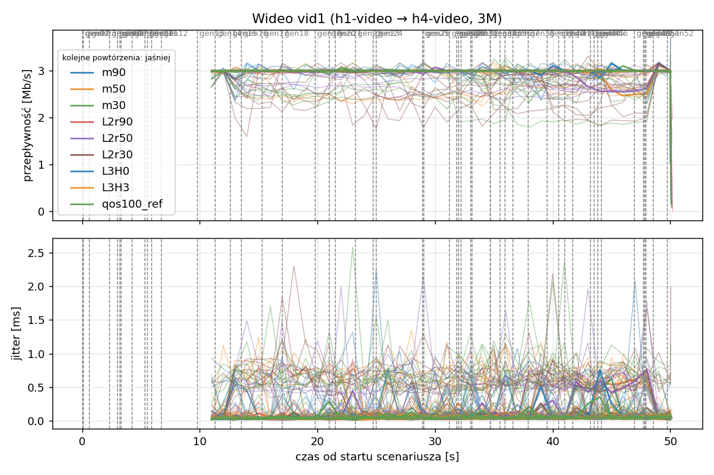
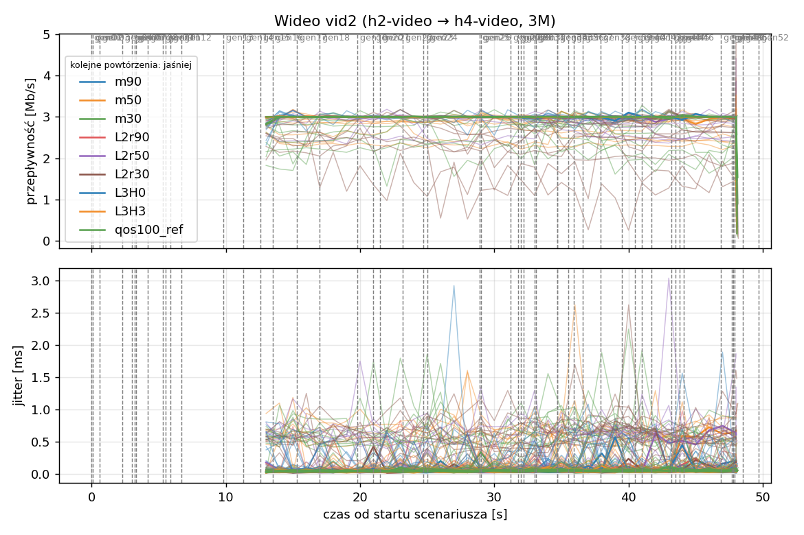
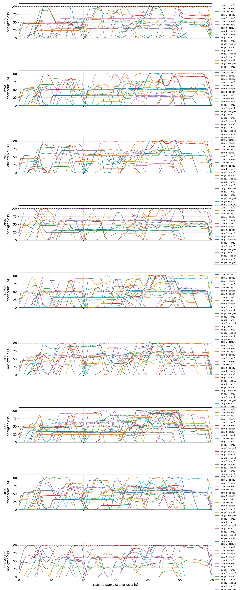
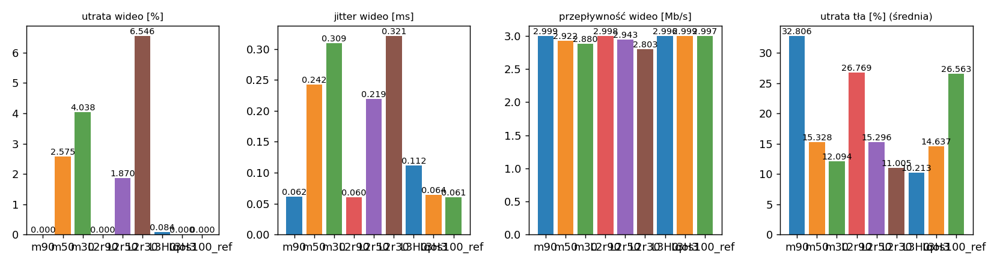

# Raport: mesh-sdn

Katalog: `results/official/mesh-sdn/20261105_150652`

## 1. Scenariusz

- Topologia: `mesh` (sdn: `mesh-sdn.clab.yml`)
- Warianty: **m90** (LAYERS=1, POLICY=qos, RESERVE_PCT=90), **m50** (LAYERS=1, POLICY=qos, RESERVE_PCT=50), **m30** (LAYERS=1, POLICY=qos, RESERVE_PCT=30), **L2r90** (LAYERS=2, POLICY=qos, RESERVE_PCT=90), **L2r50** (LAYERS=2, POLICY=qos, RESERVE_PCT=50), **L2r30** (LAYERS=2, POLICY=qos, RESERVE_PCT=30), **L3H0** (HEADROOM_MBPS=0, LAYERS=3, POLICY=qos, RESERVE_PCT=70), **L3H3** (HEADROOM_MBPS=3, LAYERS=3, POLICY=qos, RESERVE_PCT=70), **qos100_ref** (LAYERS=1, POLICY=qos, RESERVE_PCT=100)
- Czas testu: 60 s, warmup (pomijany w statystykach, liczony od startu każdego przepływu): 5 s, powtórzeń: 20, seed: 42
- Wykonane przebiegi: m90/rep1, m90/rep10, m90/rep11, m90/rep12, m90/rep13, m90/rep14, m90/rep15, m90/rep16, m90/rep17, m90/rep18, m90/rep19, m90/rep2, m90/rep20, m90/rep3, m90/rep4, m90/rep5, m90/rep6, m90/rep7, m90/rep8, m90/rep9, m50/rep1, m50/rep10, m50/rep11, m50/rep12, m50/rep13, m50/rep14, m50/rep15, m50/rep16, m50/rep17, m50/rep18, m50/rep19, m50/rep2, m50/rep20, m50/rep3, m50/rep4, m50/rep5, m50/rep6, m50/rep7, m50/rep8, m50/rep9, m30/rep1, m30/rep10, m30/rep11, m30/rep12, m30/rep13, m30/rep14, m30/rep15, m30/rep16, m30/rep17, m30/rep18, m30/rep19, m30/rep2, m30/rep20, m30/rep3, m30/rep4, m30/rep5, m30/rep6, m30/rep7, m30/rep8, m30/rep9, L2r90/rep1, L2r90/rep10, L2r90/rep11, L2r90/rep12, L2r90/rep13, L2r90/rep14, L2r90/rep15, L2r90/rep16, L2r90/rep17, L2r90/rep18, L2r90/rep19, L2r90/rep2, L2r90/rep20, L2r90/rep3, L2r90/rep4, L2r90/rep5, L2r90/rep6, L2r90/rep7, L2r90/rep8, L2r90/rep9, L2r50/rep1, L2r50/rep10, L2r50/rep11, L2r50/rep12, L2r50/rep13, L2r50/rep14, L2r50/rep15, L2r50/rep16, L2r50/rep17, L2r50/rep18, L2r50/rep19, L2r50/rep2, L2r50/rep20, L2r50/rep3, L2r50/rep4, L2r50/rep5, L2r50/rep6, L2r50/rep7, L2r50/rep8, L2r50/rep9, L2r30/rep1, L2r30/rep10, L2r30/rep11, L2r30/rep12, L2r30/rep13, L2r30/rep14, L2r30/rep15, L2r30/rep16, L2r30/rep17, L2r30/rep18, L2r30/rep19, L2r30/rep2, L2r30/rep20, L2r30/rep3, L2r30/rep4, L2r30/rep5, L2r30/rep6, L2r30/rep7, L2r30/rep8, L2r30/rep9, L3H0/rep1, L3H0/rep10, L3H0/rep11, L3H0/rep12, L3H0/rep13, L3H0/rep14, L3H0/rep15, L3H0/rep16, L3H0/rep17, L3H0/rep18, L3H0/rep19, L3H0/rep2, L3H0/rep20, L3H0/rep3, L3H0/rep4, L3H0/rep5, L3H0/rep6, L3H0/rep7, L3H0/rep8, L3H0/rep9, L3H3/rep1, L3H3/rep10, L3H3/rep11, L3H3/rep12, L3H3/rep13, L3H3/rep14, L3H3/rep15, L3H3/rep16, L3H3/rep17, L3H3/rep18, L3H3/rep19, L3H3/rep2, L3H3/rep20, L3H3/rep3, L3H3/rep4, L3H3/rep5, L3H3/rep6, L3H3/rep7, L3H3/rep8, L3H3/rep9, qos100_ref/rep1, qos100_ref/rep10, qos100_ref/rep11, qos100_ref/rep12, qos100_ref/rep13, qos100_ref/rep14, qos100_ref/rep15, qos100_ref/rep16, qos100_ref/rep17, qos100_ref/rep18, qos100_ref/rep19, qos100_ref/rep2, qos100_ref/rep20, qos100_ref/rep3, qos100_ref/rep4, qos100_ref/rep5, qos100_ref/rep6, qos100_ref/rep7, qos100_ref/rep8, qos100_ref/rep9

Harmonogram losowego tła różni się między powtórzeniami (seed + nr powtórzenia, wspólny dla wariantów); poniżej powtórzenie 1.

| id | klasa | źródło → cel | proto | zadana [Mb/s] | DSCP | start–koniec [s] |
|---|---|---|---|---|---|---|
| gen01 | background | h2-bg1 → h3-bg2 | udp | 4.49 | – | 0–7 |
| gen02 | background | h4-bg2 → h3-bg1 | udp | 3.16 | – | 0.1–5.1 |
| gen03 | background | h4-bg1 → h2-bg2 | udp | 5.25 | – | 0.6–5.6 |
| gen04 | background | h4-bg1 → h1-bg2 | udp | 3.56 | – | 2.3–7.3 |
| gen05 | background | h4-bg1 → h3-bg1 | udp | 2.36 | – | 3–60 |
| gen06 | background | h1-bg2 → h2-bg1 | udp | 1.93 | – | 3.2–16.2 |
| gen07 | background | h2-bg1 → h3-bg1 | udp | 1.39 | – | 3.3–8.3 |
| gen08 | background | h1-bg1 → h2-bg1 | udp | 3.29 | – | 4.2–32.2 |
| gen09 | background | h3-bg2 → h2-bg1 | udp | 4.51 | – | 5.3–16.3 |
| gen10 | background | h1-bg2 → h3-bg1 | udp | 3.96 | – | 5.5–10.5 |
| gen11 | background | h2-bg1 → h4-bg2 | udp | 5.85 | – | 5.9–19.9 |
| gen12 | background | h1-bg2 → h3-bg1 | udp | 4.90 | – | 6.7–16.7 |
| gen13 | background | h4-bg1 → h1-bg1 | udp | 3.07 | – | 9.8–19.8 |
| vid1 | video | h1-video → h4-video | udp | 3.00 | 46 | 10–50 |
| gen14 | background | h3-bg2 → h1-bg2 | udp | 5.37 | – | 11.3–27.3 |
| vid2 | video | h2-video → h4-video | udp | 3.00 | 46 | 12–48 |
| gen15 | background | h3-bg1 → h1-bg1 | udp | 3.12 | – | 12.6–30.6 |
| gen16 | background | h2-bg1 → h1-bg1 | udp | 4.96 | – | 13.5–18.5 |
| gen17 | background | h2-bg1 → h4-bg2 | udp | 4.86 | – | 15.3–20.3 |
| gen18 | background | h3-bg2 → h1-bg1 | udp | 3.49 | – | 17–36 |
| gen19 | background | h4-bg2 → h2-bg1 | udp | 2.93 | – | 19.8–48.8 |
| gen20 | background | h1-bg2 → h4-bg2 | udp | 5.68 | – | 21–26 |
| gen21 | background | h4-bg1 → h2-bg1 | udp | 3.04 | – | 21.5–35.5 |
| gen22 | background | h4-bg1 → h2-bg1 | udp | 3.69 | – | 23.2–28.2 |
| gen23 | background | h2-bg2 → h4-bg2 | udp | 1.26 | – | 24.7–44.7 |
| gen24 | background | h3-bg1 → h1-bg2 | udp | 4.88 | – | 25–31 |
| gen25 | background | h4-bg1 → h1-bg2 | udp | 3.51 | – | 28.9–33.9 |
| gen26 | background | h1-bg1 → h4-bg1 | udp | 5.23 | – | 29–59 |
| gen27 | background | h1-bg2 → h4-bg1 | udp | 2.10 | – | 31.2–37.2 |
| gen28 | background | h4-bg1 → h1-bg2 | udp | 1.54 | – | 31.8–36.8 |
| gen29 | background | h4-bg1 → h1-bg2 | udp | 1.53 | – | 32–39 |
| gen30 | background | h1-bg2 → h3-bg1 | udp | 3.69 | – | 32.2–38.2 |
| gen31 | background | h2-bg1 → h4-bg2 | udp | 2.18 | – | 33–38 |
| gen32 | background | h4-bg2 → h3-bg2 | udp | 5.19 | – | 33.1–59.1 |
| gen33 | background | h4-bg2 → h3-bg2 | udp | 2.60 | – | 34.7–40.7 |
| gen34 | background | h2-bg2 → h3-bg2 | udp | 1.75 | – | 34.7–59.7 |
| gen35 | background | h4-bg2 → h2-bg1 | udp | 5.89 | – | 35.5–54.5 |
| gen36 | background | h4-bg2 → h3-bg1 | udp | 4.62 | – | 35.9–49.9 |
| gen37 | background | h1-bg2 → h2-bg2 | udp | 4.50 | – | 36.6–50.6 |
| gen38 | background | h2-bg1 → h4-bg1 | udp | 4.23 | – | 37.9–58.9 |
| gen39 | background | h1-bg2 → h4-bg2 | udp | 5.93 | – | 39.5–44.5 |
| gen40 | background | h1-bg1 → h3-bg1 | udp | 5.99 | – | 40.5–45.5 |
| gen41 | background | h1-bg2 → h3-bg1 | udp | 4.47 | – | 41–50 |
| gen42 | background | h1-bg2 → h3-bg1 | udp | 2.82 | – | 41.7–48.7 |
| gen43 | background | h4-bg2 → h2-bg1 | udp | 4.98 | – | 43.2–49.2 |
| gen44 | background | h4-bg2 → h1-bg2 | udp | 5.97 | – | 43.5–50.5 |
| gen45 | background | h3-bg1 → h4-bg1 | udp | 5.74 | – | 43.8–58.8 |
| gen46 | background | h2-bg1 → h1-bg2 | udp | 1.89 | – | 44.1–49.1 |
| gen47 | background | h2-bg2 → h3-bg1 | udp | 2.94 | – | 46.9–59.9 |
| gen48 | background | h3-bg1 → h1-bg1 | udp | 3.58 | – | 47.7–59.7 |
| gen49 | background | h4-bg1 → h2-bg1 | udp | 5.93 | – | 47.8–57.8 |
| gen50 | background | h4-bg1 → h1-bg1 | udp | 3.20 | – | 47.9–54.9 |
| gen51 | background | h4-bg2 → h3-bg1 | udp | 1.53 | – | 48.5–59.5 |
| gen52 | background | h4-bg2 → h2-bg2 | udp | 2.44 | – | 49.7–59.7 |

## 2. Wideo: QoS według wariantu

Wartości: średnia ± odchylenie standardowe z powtórzeń.

| przepływ | wariant | przepływność [Mb/s] | jitter [ms] | utrata [%] | RTT mediana [ms] | RTT p95 [ms] |
|---|---|---|---|---|---|---|
| vid1 | m90 | 3.00 ± 0.00 | 0.060 ± 0.023 | 0.00 ± 0.00 | 0.028 ± 0.002 | 0.048 ± 0.003 |
| vid1 | m50 | 2.94 ± 0.10 | 0.235 ± 0.167 | 2.07 ± 3.26 | 11.714 ± 22.009 | 41.514 ± 27.853 |
| vid1 | m30 | 2.89 ± 0.12 | 0.326 ± 0.198 | 3.60 ± 4.08 | 16.900 ± 23.697 | 64.595 ± 33.035 |
| vid1 | L2r90 | 3.00 ± 0.00 | 0.057 ± 0.019 | 0.00 ± 0.00 | 0.028 ± 0.002 | 0.050 ± 0.004 |
| vid1 | L2r50 | 2.94 ± 0.10 | 0.208 ± 0.145 | 2.09 ± 3.26 | 11.608 ± 23.761 | 38.543 ± 28.863 |
| vid1 | L2r30 | 2.86 ± 0.16 | 0.311 ± 0.188 | 4.67 ± 5.44 | 28.988 ± 35.500 | 61.877 ± 39.105 |
| vid1 | L3H0 | 3.00 ± 0.01 | 0.115 ± 0.052 | 0.11 ± 0.21 | 0.028 ± 0.003 | 22.269 ± 20.171 |
| vid1 | L3H3 | 3.00 ± 0.00 | 0.061 ± 0.016 | 0.00 ± 0.00 | 0.027 ± 0.002 | 0.047 ± 0.003 |
| vid1 | qos100_ref | 3.00 ± 0.00 | 0.064 ± 0.018 | 0.00 ± 0.00 | 0.029 ± 0.001 | 0.049 ± 0.004 |
| vid2 | m90 | 3.00 ± 0.00 | 0.063 ± 0.015 | 0.00 ± 0.00 | 0.028 ± 0.002 | 0.056 ± 0.005 |
| vid2 | m50 | 2.91 ± 0.16 | 0.249 ± 0.175 | 3.08 ± 5.36 | 11.721 ± 22.072 | 41.531 ± 27.859 |
| vid2 | m30 | 2.87 ± 0.19 | 0.292 ± 0.166 | 4.48 ± 6.34 | 16.207 ± 23.237 | 59.300 ± 27.077 |
| vid2 | L2r90 | 3.00 ± 0.00 | 0.063 ± 0.024 | 0.00 ± 0.00 | 0.029 ± 0.002 | 0.057 ± 0.005 |
| vid2 | L2r50 | 2.95 ± 0.07 | 0.230 ± 0.188 | 1.65 ± 2.48 | 11.583 ± 23.698 | 38.569 ± 28.860 |
| vid2 | L2r30 | 2.75 ± 0.36 | 0.331 ± 0.190 | 8.42 ± 11.96 | 25.337 ± 29.731 | 61.994 ± 33.696 |
| vid2 | L3H0 | 3.00 ± 0.00 | 0.108 ± 0.054 | 0.06 ± 0.12 | 0.030 ± 0.003 | 18.862 ± 18.264 |
| vid2 | L3H3 | 3.00 ± 0.00 | 0.068 ± 0.027 | 0.00 ± 0.00 | 0.029 ± 0.003 | 0.054 ± 0.006 |
| vid2 | qos100_ref | 3.00 ± 0.00 | 0.057 ± 0.011 | 0.00 ± 0.00 | 0.028 ± 0.003 | 0.054 ± 0.004 |

RTT z `ping` co 0,1 s między hostami wideo (osobny przepływ ICMP z tym samym DSCP - w SDN może iść inną ścieżką niż strumień UDP).

## 3. Ruch tła

Agregat tła w obrębie powtórzenia, potem średnia ± odchylenie standardowe po powtórzeniach (utrata = Σ utraconych / Σ wysłanych datagramów; dostarczone = Σ przepływności / Σ zadanych; przepływy trwające nie dłużej niż warmup pominięte).

| wariant | strumieni tła / powt. | dostarczone / zadane [%] | jitter [ms] | utrata [%] |
|---|---|---|---|---|
| m90 | 38 | 67.1 ± 7.1 | 0.299 ± 0.097 | 32.81 ± 6.41 |
| m50 | 38 | 84.3 ± 4.6 | 0.242 ± 0.080 | 15.33 ± 4.56 |
| m30 | 38 | 87.8 ± 5.1 | 0.246 ± 0.087 | 12.09 ± 6.01 |
| L2r90 | 38 | 72.6 ± 5.9 | 0.400 ± 0.095 | 26.77 ± 7.08 |
| L2r50 | 38 | 84.0 ± 5.5 | 0.280 ± 0.097 | 15.30 ± 5.88 |
| L2r30 | 38 | 88.7 ± 4.6 | 0.262 ± 0.095 | 11.01 ± 4.89 |
| L3H0 | 38 | 89.8 ± 4.6 | 0.232 ± 0.068 | 10.21 ± 5.07 |
| L3H3 | 38 | 84.5 ± 5.7 | 0.243 ± 0.076 | 14.64 ± 6.11 |
| qos100_ref | 38 | 73.0 ± 6.6 | 0.441 ± 0.089 | 26.56 ± 8.04 |

## 4. Obciążenie łączy fabricu

Średnia i maksimum z próbek co 1 s w oknie 0–60 s; MLU = maksymalne obciążenie łącza; drops = pakiety odrzucone przez `tbf` na wyjściu łącza.

| wariant | rep | średnie obciążenie łączy [%] | MLU [%] | łącza > 90% | drops tbf | CPU VM śr./maks. [%] |
|---|---|---|---|---|---|---|
| m90 | 1 | 28.3 | 103.1 | 10/24 | 33487 | 14 / 24 |
| m90 | 2 | 33.5 | 102.4 | 11/24 | 31037 | 16 / 32 |
| m90 | 3 | 36.0 | 102.4 | 9/24 | 49801 | 17 / 29 |
| m90 | 4 | 25.9 | 102.2 | 8/24 | 15676 | 14 / 24 |
| m90 | 5 | 29.6 | 103.7 | 10/24 | 27799 | 15 / 26 |
| m90 | 6 | 24.6 | 102.7 | 7/24 | 12907 | 14 / 25 |
| m90 | 7 | 29.0 | 102.5 | 11/24 | 34417 | 15 / 26 |
| m90 | 8 | 26.8 | 103.0 | 9/24 | 10433 | 15 / 34 |
| m90 | 9 | 27.0 | 103.9 | 5/24 | 42142 | 14 / 23 |
| m90 | 10 | 33.4 | 104.3 | 10/24 | 54349 | 16 / 33 |
| m90 | 11 | 31.0 | 103.1 | 9/24 | 58781 | 15 / 28 |
| m90 | 12 | 25.1 | 102.1 | 7/24 | 11356 | 13 / 25 |
| m90 | 13 | 29.1 | 103.7 | 7/24 | 16958 | 16 / 26 |
| m90 | 14 | 30.9 | 102.6 | 12/24 | 14716 | 15 / 28 |
| m90 | 15 | 35.7 | 103.3 | 9/24 | 56566 | 18 / 32 |
| m90 | 16 | 30.8 | 101.9 | 11/24 | 14057 | 14 / 22 |
| m90 | 17 | 38.9 | 102.8 | 11/24 | 41462 | 16 / 25 |
| m90 | 18 | 27.4 | 102.8 | 8/24 | 14349 | 14 / 22 |
| m90 | 19 | 28.4 | 102.4 | 6/24 | 48625 | 15 / 23 |
| m90 | 20 | 35.3 | 109.5 | 12/24 | 57319 | 17 / 33 |
| m50 | 1 | 34.2 | 102.0 | 10/24 | 8695 | 14 / 24 |
| m50 | 2 | 39.3 | 104.1 | 13/24 | 19477 | 17 / 32 |
| m50 | 3 | 45.4 | 102.8 | 12/24 | 39453 | 17 / 27 |
| m50 | 4 | 35.4 | 102.5 | 12/24 | 5101 | 14 / 24 |
| m50 | 5 | 36.1 | 103.5 | 9/24 | 16278 | 15 / 24 |
| m50 | 6 | 30.2 | 102.4 | 7/24 | 9240 | 14 / 24 |
| m50 | 7 | 34.9 | 103.1 | 10/24 | 16655 | 15 / 27 |
| m50 | 8 | 34.7 | 104.7 | 9/24 | 15657 | 15 / 35 |
| m50 | 9 | 32.8 | 102.9 | 7/24 | 32799 | 14 / 23 |
| m50 | 10 | 38.5 | 105.0 | 13/24 | 23310 | 17 / 37 |
| m50 | 11 | 38.2 | 102.5 | 11/24 | 44860 | 16 / 29 |
| m50 | 12 | 28.2 | 101.8 | 7/24 | 4663 | 13 / 24 |
| m50 | 13 | 38.6 | 102.5 | 11/24 | 16174 | 15 / 25 |
| m50 | 14 | 36.4 | 103.5 | 12/24 | 10981 | 16 / 29 |
| m50 | 15 | 42.4 | 103.5 | 11/24 | 40970 | 18 / 32 |
| m50 | 16 | 36.7 | 102.7 | 10/24 | 6204 | 15 / 24 |
| m50 | 17 | 44.4 | 103.3 | 8/24 | 13883 | 16 / 25 |
| m50 | 18 | 32.3 | 102.4 | 10/24 | 16939 | 14 / 23 |
| m50 | 19 | 40.7 | 104.3 | 13/24 | 29973 | 16 / 26 |
| m50 | 20 | 42.5 | 103.0 | 13/24 | 34926 | 18 / 32 |
| m30 | 1 | 35.5 | 102.6 | 11/24 | 9450 | 14 / 26 |
| m30 | 2 | 41.2 | 103.5 | 13/24 | 23187 | 16 / 30 |
| m30 | 3 | 45.7 | 103.2 | 11/24 | 45228 | 17 / 28 |
| m30 | 4 | 35.7 | 103.1 | 12/24 | 9259 | 15 / 24 |
| m30 | 5 | 37.2 | 102.3 | 9/24 | 13228 | 15 / 25 |
| m30 | 6 | 31.4 | 102.4 | 9/24 | 5297 | 14 / 26 |
| m30 | 7 | 39.1 | 103.0 | 14/24 | 20901 | 15 / 29 |
| m30 | 8 | 35.6 | 102.6 | 12/24 | 12925 | 15 / 34 |
| m30 | 9 | 34.2 | 102.2 | 7/24 | 20875 | 15 / 25 |
| m30 | 10 | 38.4 | 102.7 | 13/24 | 16644 | 16 / 32 |
| m30 | 11 | 39.1 | 103.2 | 12/24 | 40823 | 16 / 28 |
| m30 | 12 | 31.3 | 103.4 | 9/24 | 1939 | 14 / 24 |
| m30 | 13 | 39.1 | 103.0 | 13/24 | 16847 | 16 / 26 |
| m30 | 14 | 37.1 | 104.7 | 12/24 | 12019 | 16 / 28 |
| m30 | 15 | 44.0 | 104.3 | 13/24 | 31455 | 18 / 32 |
| m30 | 16 | 36.4 | 102.4 | 10/24 | 7043 | 15 / 23 |
| m30 | 17 | 47.8 | 104.5 | 15/24 | 18298 | 16 / 27 |
| m30 | 18 | 33.1 | 102.9 | 10/24 | 13423 | 14 / 24 |
| m30 | 19 | 39.6 | 102.6 | 11/24 | 26759 | 16 / 27 |
| m30 | 20 | 43.5 | 104.0 | 14/24 | 34415 | 18 / 33 |
| L2r90 | 1 | 27.8 | 102.8 | 7/24 | 55996 | 14 / 24 |
| L2r90 | 2 | 35.1 | 103.2 | 10/24 | 47301 | 16 / 33 |
| L2r90 | 3 | 40.2 | 103.8 | 11/24 | 72925 | 18 / 30 |
| L2r90 | 4 | 29.7 | 103.3 | 8/24 | 25520 | 15 / 25 |
| L2r90 | 5 | 31.9 | 102.8 | 10/24 | 28971 | 15 / 24 |
| L2r90 | 6 | 25.4 | 102.5 | 7/24 | 21111 | 14 / 24 |
| L2r90 | 7 | 31.1 | 103.5 | 9/24 | 37483 | 15 / 27 |
| L2r90 | 8 | 28.4 | 104.1 | 9/24 | 39542 | 15 / 32 |
| L2r90 | 9 | 25.4 | 102.6 | 6/24 | 55039 | 14 / 22 |
| L2r90 | 10 | 31.6 | 103.2 | 9/24 | 57338 | 16 / 32 |
| L2r90 | 11 | 30.7 | 102.9 | 6/24 | 76187 | 15 / 27 |
| L2r90 | 12 | 26.0 | 102.6 | 8/24 | 14443 | 13 / 24 |
| L2r90 | 13 | 33.2 | 103.1 | 10/24 | 40803 | 16 / 28 |
| L2r90 | 14 | 31.6 | 102.7 | 12/24 | 45451 | 15 / 29 |
| L2r90 | 15 | 39.0 | 103.1 | 12/24 | 87259 | 17 / 30 |
| L2r90 | 16 | 31.1 | 102.5 | 10/24 | 35333 | 15 / 23 |
| L2r90 | 17 | 38.4 | 103.0 | 11/24 | 55952 | 16 / 26 |
| L2r90 | 18 | 31.7 | 104.0 | 10/24 | 24926 | 14 / 23 |
| L2r90 | 19 | 32.4 | 103.0 | 9/24 | 61943 | 16 / 28 |
| L2r90 | 20 | 32.9 | 102.9 | 10/24 | 69827 | 17 / 31 |
| L2r50 | 1 | 35.2 | 103.2 | 11/24 | 28023 | 14 / 25 |
| L2r50 | 2 | 38.2 | 102.4 | 11/24 | 26560 | 16 / 36 |
| L2r50 | 3 | 43.6 | 103.4 | 12/24 | 43198 | 17 / 28 |
| L2r50 | 4 | 32.8 | 102.4 | 8/24 | 1855 | 14 / 24 |
| L2r50 | 5 | 35.3 | 103.1 | 11/24 | 19943 | 15 / 24 |
| L2r50 | 6 | 28.3 | 101.8 | 5/24 | 4120 | 14 / 23 |
| L2r50 | 7 | 35.3 | 102.1 | 11/24 | 23907 | 15 / 27 |
| L2r50 | 8 | 32.5 | 104.0 | 8/24 | 12049 | 15 / 36 |
| L2r50 | 9 | 32.6 | 102.9 | 7/24 | 41371 | 14 / 24 |
| L2r50 | 10 | 35.2 | 104.2 | 11/24 | 39361 | 17 / 36 |
| L2r50 | 11 | 37.4 | 102.6 | 11/24 | 33265 | 16 / 28 |
| L2r50 | 12 | 29.5 | 102.3 | 6/24 | 5515 | 14 / 25 |
| L2r50 | 13 | 39.2 | 103.5 | 10/24 | 19052 | 16 / 25 |
| L2r50 | 14 | 37.7 | 103.0 | 12/24 | 17477 | 16 / 27 |
| L2r50 | 15 | 44.4 | 104.6 | 13/24 | 45051 | 18 / 30 |
| L2r50 | 16 | 36.3 | 102.3 | 12/24 | 18029 | 14 / 23 |
| L2r50 | 17 | 43.9 | 103.7 | 12/24 | 48266 | 16 / 25 |
| L2r50 | 18 | 33.5 | 102.8 | 13/24 | 27720 | 14 / 26 |
| L2r50 | 19 | 36.7 | 102.0 | 8/24 | 30051 | 16 / 28 |
| L2r50 | 20 | 41.1 | 104.2 | 11/24 | 39635 | 17 / 32 |
| L2r30 | 1 | 37.6 | 103.0 | 13/24 | 13174 | 15 / 26 |
| L2r30 | 2 | 40.9 | 104.8 | 14/24 | 19766 | 17 / 34 |
| L2r30 | 3 | 48.3 | 104.3 | 13/24 | 38984 | 19 / 27 |
| L2r30 | 4 | 33.6 | 101.8 | 12/24 | 8052 | 15 / 24 |
| L2r30 | 5 | 37.3 | 104.0 | 11/24 | 15980 | 15 / 25 |
| L2r30 | 6 | 29.9 | 102.4 | 8/24 | 4351 | 14 / 26 |
| L2r30 | 7 | 37.5 | 102.6 | 12/24 | 15463 | 15 / 26 |
| L2r30 | 8 | 35.1 | 104.0 | 10/24 | 7561 | 16 / 37 |
| L2r30 | 9 | 35.1 | 103.5 | 9/24 | 32671 | 15 / 26 |
| L2r30 | 10 | 38.3 | 103.0 | 13/24 | 25358 | 17 / 35 |
| L2r30 | 11 | 41.0 | 103.2 | 13/24 | 30230 | 17 / 30 |
| L2r30 | 12 | 30.4 | 101.6 | 10/24 | 1822 | 13 / 24 |
| L2r30 | 13 | 40.4 | 103.6 | 14/24 | 12674 | 15 / 25 |
| L2r30 | 14 | 37.0 | 102.8 | 13/24 | 21773 | 16 / 27 |
| L2r30 | 15 | 45.1 | 102.7 | 14/24 | 44254 | 18 / 30 |
| L2r30 | 16 | 35.8 | 102.7 | 12/24 | 10533 | 15 / 23 |
| L2r30 | 17 | 45.0 | 103.2 | 14/24 | 31439 | 17 / 29 |
| L2r30 | 18 | 34.3 | 105.6 | 11/24 | 5968 | 15 / 25 |
| L2r30 | 19 | 39.3 | 102.7 | 11/24 | 28911 | 16 / 26 |
| L2r30 | 20 | 41.0 | 104.2 | 14/24 | 49766 | 17 / 32 |
| L3H0 | 1 | 37.1 | 102.6 | 16/24 | 13257 | 14 / 26 |
| L3H0 | 2 | 42.1 | 103.4 | 16/24 | 21566 | 16 / 33 |
| L3H0 | 3 | 47.8 | 103.5 | 17/24 | 29135 | 18 / 28 |
| L3H0 | 4 | 35.8 | 103.0 | 16/24 | 2349 | 15 / 24 |
| L3H0 | 5 | 37.8 | 102.8 | 13/24 | 16258 | 15 / 26 |
| L3H0 | 6 | 31.9 | 103.1 | 12/24 | 10283 | 14 / 24 |
| L3H0 | 7 | 36.7 | 102.5 | 13/24 | 22837 | 15 / 27 |
| L3H0 | 8 | 36.2 | 103.2 | 13/24 | 15351 | 15 / 33 |
| L3H0 | 9 | 34.9 | 101.9 | 12/24 | 23807 | 15 / 25 |
| L3H0 | 10 | 37.7 | 102.4 | 13/24 | 21301 | 16 / 31 |
| L3H0 | 11 | 39.5 | 103.6 | 18/24 | 39326 | 16 / 28 |
| L3H0 | 12 | 31.7 | 101.2 | 12/24 | 2008 | 14 / 25 |
| L3H0 | 13 | 42.2 | 103.0 | 16/24 | 13617 | 16 / 41 |
| L3H0 | 14 | 36.7 | 102.3 | 13/24 | 12786 | 16 / 28 |
| L3H0 | 15 | 45.8 | 102.8 | 16/24 | 21623 | 17 / 29 |
| L3H0 | 16 | 36.5 | 104.2 | 11/24 | 10939 | 14 / 24 |
| L3H0 | 17 | 45.4 | 105.2 | 15/24 | 17575 | 17 / 28 |
| L3H0 | 18 | 34.8 | 101.5 | 11/24 | 9027 | 15 / 23 |
| L3H0 | 19 | 39.7 | 102.8 | 15/24 | 33739 | 16 / 25 |
| L3H0 | 20 | 42.9 | 104.6 | 17/24 | 33865 | 18 / 34 |
| L3H3 | 1 | 35.4 | 102.4 | 7/24 | 19544 | 14 / 26 |
| L3H3 | 2 | 39.8 | 103.1 | 10/24 | 28577 | 16 / 33 |
| L3H3 | 3 | 44.4 | 102.4 | 10/24 | 41978 | 18 / 27 |
| L3H3 | 4 | 32.9 | 103.4 | 10/24 | 7090 | 14 / 23 |
| L3H3 | 5 | 36.0 | 102.5 | 8/24 | 12199 | 15 / 24 |
| L3H3 | 6 | 30.0 | 102.1 | 8/24 | 4118 | 14 / 25 |
| L3H3 | 7 | 36.9 | 103.5 | 12/24 | 19084 | 15 / 26 |
| L3H3 | 8 | 33.8 | 101.8 | 9/24 | 12194 | 15 / 34 |
| L3H3 | 9 | 32.7 | 102.4 | 8/24 | 27375 | 14 / 23 |
| L3H3 | 10 | 37.9 | 102.7 | 11/24 | 21837 | 16 / 34 |
| L3H3 | 11 | 37.4 | 102.9 | 9/24 | 40197 | 16 / 27 |
| L3H3 | 12 | 29.2 | 102.7 | 7/24 | 7682 | 14 / 24 |
| L3H3 | 13 | 38.5 | 102.4 | 11/24 | 16639 | 15 / 26 |
| L3H3 | 14 | 36.7 | 102.8 | 12/24 | 17229 | 16 / 30 |
| L3H3 | 15 | 41.9 | 102.7 | 13/24 | 56709 | 18 / 29 |
| L3H3 | 16 | 35.3 | 103.1 | 10/24 | 11523 | 15 / 22 |
| L3H3 | 17 | 44.8 | 104.4 | 11/24 | 21913 | 16 / 26 |
| L3H3 | 18 | 33.5 | 103.1 | 10/24 | 14770 | 15 / 25 |
| L3H3 | 19 | 36.0 | 102.0 | 6/24 | 33210 | 15 / 24 |
| L3H3 | 20 | 39.6 | 103.3 | 10/24 | 49564 | 16 / 33 |
| qos100_ref | 1 | 29.6 | 102.2 | 10/24 | 61682 | 14 / 25 |
| qos100_ref | 2 | 34.1 | 104.0 | 11/24 | 57526 | 17 / 32 |
| qos100_ref | 3 | 38.8 | 104.2 | 10/24 | 95285 | 17 / 30 |
| qos100_ref | 4 | 29.9 | 102.6 | 8/24 | 41802 | 14 / 24 |
| qos100_ref | 5 | 31.9 | 103.1 | 10/24 | 45845 | 15 / 25 |
| qos100_ref | 6 | 24.6 | 102.8 | 7/24 | 33804 | 14 / 24 |
| qos100_ref | 7 | 32.5 | 103.7 | 9/24 | 57820 | 15 / 28 |
| qos100_ref | 8 | 28.4 | 103.2 | 11/24 | 31558 | 15 / 33 |
| qos100_ref | 9 | 26.5 | 102.6 | 6/24 | 80481 | 14 / 23 |
| qos100_ref | 10 | 31.4 | 109.0 | 9/24 | 58791 | 17 / 43 |
| qos100_ref | 11 | 29.5 | 103.2 | 9/24 | 103773 | 15 / 25 |
| qos100_ref | 12 | 26.2 | 102.3 | 8/24 | 24307 | 14 / 24 |
| qos100_ref | 13 | 32.9 | 102.5 | 11/24 | 59276 | 16 / 25 |
| qos100_ref | 14 | 32.3 | 102.9 | 12/24 | 48141 | 16 / 30 |
| qos100_ref | 15 | 37.4 | 104.2 | 12/24 | 95834 | 18 / 32 |
| qos100_ref | 16 | 31.2 | 103.0 | 10/24 | 46502 | 15 / 23 |
| qos100_ref | 17 | 35.9 | 103.6 | 9/24 | 81293 | 16 / 27 |
| qos100_ref | 18 | 32.5 | 102.6 | 8/24 | 41281 | 15 / 24 |
| qos100_ref | 19 | 32.0 | 106.7 | 11/24 | 79654 | 15 / 31 |
| qos100_ref | 20 | 33.8 | 103.6 | 9/24 | 80043 | 18 / 33 |

Łącza z obciążeniem > 10% (maksimum [%] / drops, powtórzenie 1):

| łącze | m90 | m50 | m30 | L2r90 | L2r50 | L2r30 | L3H0 | L3H3 | qos100_ref |
|---|---|---|---|---|---|---|---|---|---|
| core1→core3 | 103 / 61 | 102 / 0 | 101 / 0 | 68 / 0 | 60 / 0 | 68 / 0 | 13 / 0 | 59 / 0 | 93 / 0 |
| core1→edge1 | 81 / 0 | 101 / 0 | 76 / 0 | 100 / 0 | 92 / 0 | 99 / 0 | 94 / 0 | 74 / 0 | 101 / 0 |
| core1→edge2 | 99 / 0 | 69 / 0 | 69 / 0 | 61 / 0 | 64 / 0 | 91 / 0 | 96 / 0 | 99 / 0 | 70 / 0 |
| core1→edge3 | 102 / 636 | 100 / 31 | 103 / 0 | 103 / 1515 | 102 / 2614 | 102 / 0 | 100 / 1194 | 101 / 1095 | 101 / 1682 |
| core2→core3 | 0 / 0 | 0 / 0 | 0 / 0 | 0 / 0 | 0 / 0 | 0 / 0 | 0 / 0 | 0 / 0 | 0 / 0 |
| core2→edge1 | 10 / 0 | 51 / 0 | 71 / 0 | 0 / 0 | 51 / 0 | 65 / 0 | 99 / 0 | 72 / 0 | 0 / 0 |
| core2→edge3 | 10 / 0 | 51 / 0 | 72 / 0 | 0 / 0 | 51 / 0 | 71 / 0 | 102 / 0 | 70 / 0 | 0 / 0 |
| core2→edge4 | 64 / 0 | 102 / 381 | 63 / 0 | 63 / 0 | 103 / 407 | 64 / 0 | 103 / 0 | 64 / 0 | 65 / 0 |
| core3→core2 | 32 / 0 | 32 / 0 | 32 / 0 | 32 / 0 | 32 / 0 | 32 / 0 | 32 / 0 | 32 / 0 | 32 / 0 |
| core3→edge2 | 10 / 0 | 51 / 0 | 71 / 0 | 10 / 0 | 51 / 0 | 72 / 0 | 101 / 0 | 68 / 0 | 0 / 0 |
| core3→edge4 | 100 / 0 | 102 / 0 | 100 / 0 | 77 / 0 | 94 / 0 | 102 / 560 | 69 / 0 | 100 / 0 | 92 / 0 |
| edge1→core1 | 102 / 881 | 102 / 590 | 101 / 898 | 101 / 1839 | 103 / 1279 | 103 / 274 | 103 / 271 | 102 / 1747 | 102 / 2920 |
| edge1→core2 | 42 / 0 | 82 / 0 | 101 / 0 | 32 / 0 | 79 / 0 | 94 / 0 | 101 / 0 | 78 / 0 | 32 / 0 |
| edge1→edge2 | 94 / 0 | 86 / 0 | 82 / 0 | 102 / 1744 | 103 / 291 | 102 / 1706 | 102 / 2365 | 102 / 1616 | 102 / 1256 |
| edge2→core1 | 102 / 990 | 93 / 0 | 101 / 306 | 101 / 410 | 102 / 305 | 102 / 1628 | 96 / 0 | 85 / 0 | 101 / 3290 |
| edge2→core3 | 42 / 0 | 81 / 0 | 91 / 0 | 42 / 0 | 82 / 0 | 92 / 0 | 92 / 0 | 74 / 0 | 32 / 0 |
| edge2→edge1 | 62 / 0 | 83 / 0 | 83 / 0 | 62 / 0 | 52 / 0 | 61 / 0 | 64 / 0 | 85 / 0 | 52 / 0 |
| edge3→core1 | 101 / 2719 | 102 / 935 | 101 / 1493 | 101 / 11868 | 101 / 2066 | 101 / 781 | 102 / 761 | 101 / 1846 | 102 / 13804 |
| edge3→core2 | 10 / 0 | 51 / 0 | 72 / 0 | 0 / 0 | 38 / 0 | 37 / 0 | 33 / 0 | 56 / 0 | 0 / 0 |
| edge3→edge4 | 102 / 1288 | 57 / 0 | 101 / 340 | 79 / 0 | 103 / 1674 | 101 / 183 | 84 / 0 | 90 / 0 | 102 / 187 |
| edge4→core2 | 10 / 0 | 51 / 0 | 71 / 0 | 0 / 0 | 52 / 0 | 70 / 0 | 100 / 0 | 71 / 0 | 0 / 0 |
| edge4→core3 | 54 / 0 | 101 / 1879 | 101 / 581 | 32 / 0 | 93 / 0 | 93 / 0 | 101 / 325 | 68 / 0 | 0 / 0 |
| edge4→edge3 | 101 / 26912 | 101 / 4879 | 101 / 5832 | 102 / 38620 | 103 / 19387 | 102 / 8042 | 101 / 8341 | 101 / 13240 | 102 / 38543 |

## 5. Ścieżki wybrane przez kontroler (powtórzenie 1)

Z logu kontrolera (linie `Flow`), dopasowane po piątce przepływu; ✓ = reguły widoczne w `dump-flows` na tych samych przełącznikach.

| przepływ | m90 | m50 | m30 | L2r90 | L2r50 | L2r30 | L3H0 | L3H3 | qos100_ref |
|---|---|---|---|---|---|---|---|---|---|
| gen01 | edge2 -> edge1 -> core2 -> edge3 ✓ (loads 5% 5% 0% 0%) | edge2 -> edge1 -> core2 -> edge3 ✓ (loads 5% 5% 0% 0%) | edge2 -> edge1 -> core2 -> edge3 ✓ (loads 5% 5% 0% 0%) | edge2 -> core1 -> edge3 ✓ (loads 20% 20% 0% 0%) | edge2 -> edge1 -> core2 -> edge3 ✓ (loads 20% 20% 0% 0%) | edge2 -> edge1 -> core2 -> edge3 ✓ (loads 20% 20% 0% 0%) | edge2 -> edge1 -> core2 -> edge3 ✓ (loads 20% 20% 0% 0%) | edge2 -> edge1 -> core2 -> edge3 ✓ (loads 20% 20% 0% 0%) | edge2 -> core1 -> edge3 ✓ (loads 5% 5% 0% 0%) |
| gen02 | edge4 -> edge3 ✓ (loads 5% 5%) | edge4 -> edge3 ✓ (loads 5% 5%) | edge4 -> edge3 ✓ (loads 5% 5%) | edge4 -> edge3 ✓ (loads 20% 0%) | edge4 -> edge3 ✓ (loads 20% 21%) | edge4 -> edge3 ✓ (loads 20% 20%) | edge4 -> edge3 ✓ (loads 20% 20%) | edge4 -> edge3 ✓ (loads 20% 20%) | edge4 -> edge3 ✓ (loads 5% 0%) |
| gen03 | edge4 -> core3 -> edge2 ✓ (loads 0% 3% 5% 5%) | edge4 -> core3 -> edge2 ✓ (loads 0% 1% 5% 5%) | edge4 -> core3 -> edge2 ✓ (loads 5% 10% 5% 5%) | edge4 -> edge3 -> core1 -> edge2 ✓ (loads 0% 64% 0% 0%) | edge4 -> core2 -> edge1 -> edge2 ✓ (loads 20% 40% 20% 20%) | edge4 -> core3 -> edge2 ✓ (loads 20% 40% 20% 20%) | edge4 -> core3 -> edge2 ✓ (loads 20% 40% 20% 20%) | edge4 -> core3 -> edge2 ✓ (loads 20% 40% 20% 20%) | edge4 -> edge3 -> core1 -> edge2 ✓ (loads 0% 15% 0% 0%) |
| gen04 | edge4 -> core2 -> edge1 ✓ (loads 5% 33% 33% 54%) | edge4 -> core2 -> edge1 ✓ (loads 5% 33% 33% 54%) | edge4 -> core2 -> edge1 ✓ (loads 5% 33% 33% 54%) | edge4 -> edge3 -> core1 -> edge1 ✓ (loads 0% 184% 184% 0%) | edge4 -> edge3 -> core1 -> edge1 ✓ (loads 90% 73% 90% 83%) | edge4 -> core2 -> edge1 ✓ (loads 38% 73% 73% 94%) | edge4 -> core2 -> edge1 ✓ (loads 38% 73% 73% 94%) | edge4 -> core2 -> edge1 ✓ (loads 38% 72% 72% 94%) | edge4 -> edge3 -> core1 -> edge1 ✓ (loads 0% 92% 92% 0%) |
| gen05 | edge4 -> edge3 ✓ (loads 38% 10%) | edge4 -> edge3 ✓ (loads 38% 46%) | edge4 -> edge3 ✓ (loads 37% 46%) | edge4 -> edge3 ✓ (loads 138% 0%) | edge4 -> edge3 ✓ (loads 67% 90%) | edge4 -> edge3 ✓ (loads 49% 76%) | edge4 -> edge3 ✓ (loads 49% 81%) | edge4 -> edge3 ✓ (loads 50% 56%) | edge4 -> edge3 ✓ (loads 98% 0%) |
| gen06 | edge1 -> core1 -> edge2 ✓ (loads 10% 5%) | edge1 -> core1 -> edge2 ✓ (loads 5% 0%) | edge1 -> core1 -> edge2 ✓ (loads 5% 0%) | edge1 -> edge2 ✓ (loads 17% 54%) | edge1 -> edge2 ✓ (loads 50% 51%) | edge1 -> edge2 ✓ (loads 17% 36%) | edge1 -> edge2 ✓ (loads 17% 36%) | edge1 -> edge2 ✓ (loads 17% 36%) | edge1 -> edge2 ✓ (loads 5% 46%) |
| gen07 | edge2 -> core1 -> edge3 ✓ (loads 5% 46% 46% 37%) | edge2 -> core1 -> edge3 ✓ (loads 15% 46% 46% 37%) | edge2 -> core1 -> edge3 ✓ (loads 15% 46% 46% 42%) | edge2 -> core1 -> edge3 ✓ (loads 62% 62% 34% 168%) | edge2 -> core1 -> edge3 ✓ (loads 51% 64% 64% 115%) | edge2 -> edge1 -> core1 -> edge3 ✓ (loads 50% 46% 46% 66%) | edge2 -> edge1 -> core1 -> edge3 ✓ (loads 50% 46% 46% 66%) | edge2 -> edge1 -> core1 -> edge3 ✓ (loads 51% 46% 46% 68%) | edge2 -> core1 -> edge3 ✓ (loads 51% 51% 10% 103%) |
| gen08 | edge1 -> core1 -> edge2 ✓ (loads 10% 5%) | edge1 -> edge2 ✓ (loads 5% 19%) | edge1 -> edge2 ✓ (loads 5% 14%) | edge1 -> edge2 ✓ (loads 51% 77%) | edge1 -> core1 -> edge2 ✓ (loads 79% 65%) | edge1 -> core1 -> edge2 ✓ (loads 61% 61%) | edge1 -> core1 -> edge2 ✓ (loads 64% 62%) | edge1 -> core1 -> edge2 ✓ (loads 67% 64%) | edge1 -> edge2 ✓ (loads 23% 40%) |
| gen09 | edge3 -> core1 -> edge1 -> edge2 ✓ (loads 54% 54% 5% 10%) | edge3 -> core1 -> edge2 ✓ (loads 25% 54% 33% 50%) | edge3 -> core1 -> edge1 -> edge2 ✓ (loads 25% 54% 25% 54%) | edge3 -> core1 -> edge2 ✓ (loads 107% 33% 120% 107%) | edge3 -> edge4 -> core3 -> edge2 ✓ (loads 91% 28% 87% 54%) | edge3 -> core1 -> edge1 -> edge2 ✓ (loads 70% 65% 68% 65%) | edge3 -> edge4 -> core3 -> edge2 ✓ (loads 74% 66% 68% 66%) | edge3 -> core1 -> edge1 -> edge2 ✓ (loads 78% 66% 69% 66%) | edge3 -> core1 -> edge2 ✓ (loads 69% 0% 69% 69%) |
| gen10 | edge1 -> edge2 -> core1 -> edge3 ✓ (loads 54% 10% 29% 54%) | edge1 -> core1 -> edge3 ✓ (loads 29% 46% 33% 56%) | edge1 -> core1 -> edge3 ✓ (loads 29% 46% 30% 57%) | edge1 -> core1 -> edge3 ✓ (loads 126% 0% 126% 117%) | edge1 -> edge2 -> core1 -> edge3 ✓ (loads 96% 46% 93% 130%) | edge1 -> core2 -> edge3 ✓ (loads 79% 57% 91% 90%) | edge1 -> core2 -> edge3 ✓ (loads 84% 58% 91% 90%) | edge1 -> core1 -> edge3 ✓ (loads 88% 58% 93% 93%) | edge1 -> core1 -> edge3 ✓ (loads 76% 0% 76% 100%) |
| gen11 | edge2 -> core3 -> edge4 ✓ (loads 5% 46% 34% 34%) | edge2 -> core3 -> edge4 ✓ (loads 5% 46% 34% 24%) | edge2 -> core3 -> edge4 ✓ (loads 5% 46% 34% 24%) | edge2 -> core1 -> core3 -> edge4 ✓ (loads 11% 43% 105% 83%) | edge2 -> core3 -> edge4 ✓ (loads 11% 85% 59% 36%) | edge2 -> core3 -> edge4 ✓ (loads 9% 78% 40% 40%) | edge2 -> core3 -> edge4 ✓ (loads 12% 73% 41% 41%) | edge2 -> core3 -> edge4 ✓ (loads 12% 73% 51% 42%) | edge2 -> core1 -> core3 -> edge4 ✓ (loads 5% 5% 81% 71%) |
| gen12 | edge1 -> core1 -> edge3 ✓ (loads 59% 10% 71% 24%) | edge1 -> edge2 -> core1 -> edge3 ✓ (loads 47% 46% 47% 46%) | edge1 -> core1 -> edge3 ✓ (loads 42% 46% 63% 46%) | edge1 -> core1 -> edge3 ✓ (loads 125% 9% 125% 103%) | edge1 -> core1 -> edge3 ✓ (loads 93% 46% 93% 62%) | edge1 -> core1 -> edge3 ✓ (loads 60% 78% 66% 78%) | edge1 -> edge2 -> core1 -> edge3 ✓ (loads 60% 89% 49% 89%) | edge1 -> edge2 -> core1 -> edge3 ✓ (loads 96% 59% 84% 59%) | edge1 -> core1 -> edge3 ✓ (loads 80% 0% 80% 87%) |
| gen13 | edge4 -> core3 -> edge2 -> edge1 ✓ (loads 5% 47% 24% 0%) | edge4 -> core3 -> edge2 -> edge1 ✓ (loads 5% 47% 24% 0%) | edge4 -> core3 -> edge2 -> edge1 ✓ (loads 5% 47% 24% 0%) | edge4 -> core3 -> edge2 -> edge1 ✓ (loads 6% 47% 24% 0%) | edge4 -> core2 -> edge1 ✓ (loads 7% 24% 24% 47%) | edge4 -> core2 -> edge1 ✓ (loads 6% 47% 24% 6%) | edge4 -> core2 -> edge1 ✓ (loads 7% 24% 24% 47%) | edge4 -> core3 -> edge2 -> edge1 ✓ (loads 7% 47% 24% 3%) | edge4 -> edge3 -> core1 -> edge1 ✓ (loads 0% 51% 29% 0%) |
| vid1 | edge1 -> core2 -> edge4 ✓ (loads 10% 87% 105% 105%) | edge1 -> core2 -> edge4 ✓ (loads 15% 84% 98% 61%) | edge1 -> core2 -> edge4 ✓ (loads 5% 80% 100% 100%) | edge1 -> core2 -> edge4 ✓ (loads 6% 72% 98% 97%) | edge1 -> core2 -> edge4 ✓ (loads 22% 61% 99% 84%) | edge1 -> core2 -> edge4 ✓ (loads 60% 66% 84% 84%) | edge1 -> core2 -> edge4 ✓ (loads 54% 70% 58% 60%) | edge1 -> core2 -> edge4 ✓ (loads 21% 100% 89% 78%) | edge1 -> core2 -> edge4 ✓ (loads 0% 70% 106% 106%) |
| gen14 | edge3 -> core2 -> edge1 ✓ (loads 47% 5% 5% 51%) | edge3 -> core2 -> edge1 ✓ (loads 47% 5% 5% 66%) | edge3 -> core2 -> edge1 ✓ (loads 47% 10% 10% 47%) | edge3 -> core1 -> edge1 ✓ (loads 64% 6% 6% 64%) | edge3 -> core1 -> edge1 ✓ (loads 6% 61% 61% 34%) | edge3 -> core1 -> edge2 -> edge1 ✓ (loads 46% 50% 50% 46%) | edge3 -> core1 -> edge1 ✓ (loads 13% 52% 54% 34%) | edge3 -> core2 -> edge1 ✓ (loads 46% 20% 20% 46%) | edge3 -> core1 -> edge1 ✓ (loads 83% 0% 0% 83%) |
| vid2 | edge2 -> core3 -> core2 -> edge4 ✓ (loads 15% 41% 61% 17%) | edge2 -> core3 -> core2 -> edge4 ✓ (loads 50% 46% 64% 50%) | edge2 -> core3 -> core2 -> edge4 ✓ (loads 60% 37% 51% 60%) | edge2 -> core3 -> core2 -> edge4 ✓ (loads 77% 67% 80% 77%) | edge2 -> core3 -> core2 -> edge4 ✓ (loads 56% 83% 79% 56%) | edge2 -> core3 -> core2 -> edge4 ✓ (loads 67% 80% 62% 67%) | edge2 -> core3 -> core2 -> edge4 ✓ (loads 66% 74% 69% 66%) | edge2 -> core3 -> core2 -> edge4 ✓ (loads 66% 82% 75% 66%) | edge2 -> core3 -> core2 -> edge4 ✓ (loads 60% 31% 60% 60%) |
| gen15 | edge3 -> core2 -> edge1 ✓ (loads 46% 15% 15% 51%) | edge3 -> core1 -> edge1 ✓ (loads 46% 49% 49% 66%) | edge3 -> core2 -> edge1 ✓ (loads 47% 40% 40% 47%) | edge3 -> core1 -> edge1 ✓ (loads 120% 6% 6% 120%) | edge3 -> core2 -> edge1 ✓ (loads 69% 38% 46% 69%) | edge3 -> core2 -> edge1 ✓ (loads 83% 44% 44% 83%) | edge3 -> core2 -> edge1 ✓ (loads 50% 38% 47% 50%) | edge3 -> edge4 -> core2 -> edge1 ✓ (loads 58% 55% 55% 58%) | edge3 -> core1 -> edge1 ✓ (loads 100% 0% 0% 100%) |
| gen16 | edge2 -> edge1 ✓ (loads 15% 46%) | edge2 -> edge1 ✓ (loads 37% 50%) | edge2 -> edge1 ✓ (loads 37% 47%) | edge2 -> edge1 ✓ (loads 16% 77%) | edge2 -> edge1 ✓ (loads 6% 68%) | edge2 -> core1 -> edge1 ✓ (loads 60% 51%) | edge2 -> edge1 ✓ (loads 5% 67%) | edge2 -> edge1 ✓ (loads 37% 52%) | edge2 -> edge1 ✓ (loads 5% 69%) |
| gen17 | edge2 -> core1 -> core3 -> edge4 ✓ (loads 41% 62% 49% 15%) | edge2 -> core1 -> edge3 -> edge4 ✓ (loads 81% 83% 55% 55%) | edge2 -> core1 -> edge3 -> edge4 ✓ (loads 91% 83% 55% 60%) | edge2 -> core3 -> edge4 ✓ (loads 60% 73% 67% 67%) | edge2 -> core1 -> edge3 -> edge4 ✓ (loads 81% 63% 50% 57%) | edge2 -> core1 -> edge3 -> edge4 ✓ (loads 91% 69% 62% 62%) | edge2 -> core1 -> edge3 -> edge4 ✓ (loads 91% 62% 58% 60%) | edge2 -> core1 -> edge3 -> edge4 ✓ (loads 35% 93% 51% 51%) | edge2 -> core1 -> edge3 -> edge4 ✓ (loads 60% 62% 65% 65%) |
| gen18 | edge3 -> core1 -> edge1 ✓ (loads 52% 15% 15% 61%) | edge3 -> core1 -> edge1 ✓ (loads 84% 50% 50% 88%) | edge3 -> core1 -> edge1 ✓ (loads 22% 70% 70% 83%) | edge3 -> core1 -> edge1 ✓ (loads 123% 7% 7% 123%) | edge3 -> core1 -> edge1 ✓ (loads 83% 50% 94% 83%) | edge3 -> core1 -> edge1 ✓ (loads 91% 64% 67% 92%) | edge3 -> core1 -> edge1 ✓ (loads 64% 73% 78% 69%) | edge3 -> core1 -> edge1 ✓ (loads 64% 70% 78% 100%) | edge3 -> core1 -> edge1 ✓ (loads 100% 0% 48% 100%) |
| gen19 | edge4 -> edge3 -> core1 -> edge2 ✓ (loads 32% 36% 15% 10%) | edge4 -> core3 -> edge2 ✓ (loads 37% 68% 50% 37%) | edge4 -> edge3 -> core1 -> edge2 ✓ (loads 37% 36% 70% 37%) | edge4 -> edge3 -> core1 -> edge2 ✓ (loads 32% 100% 42% 10%) | edge4 -> core3 -> edge2 ✓ (loads 8% 91% 50% 32%) | edge4 -> core3 -> edge2 ✓ (loads 7% 91% 64% 32%) | edge4 -> core3 -> edge2 ✓ (loads 8% 91% 64% 32%) | edge4 -> edge3 -> core1 -> edge2 ✓ (loads 39% 36% 70% 39%) | edge4 -> edge3 -> core1 -> edge2 ✓ (loads 0% 100% 34% 0%) |
| gen20 | edge1 -> core1 -> edge3 -> edge4 ✓ (loads 62% 57% 39% 57%) | edge1 -> core1 -> core3 -> edge4 ✓ (loads 62% 67% 50% 41%) | edge1 -> core1 -> core3 -> edge4 ✓ (loads 62% 34% 18% 5%) | edge1 -> core1 -> edge3 -> edge4 ✓ (loads 70% 55% 23% 55%) | edge1 -> core1 -> core3 -> edge4 ✓ (loads 70% 70% 58% 55%) | edge1 -> core1 -> edge3 -> edge4 ✓ (loads 76% 39% 34% 34%) | edge1 -> core1 -> edge3 -> edge4 ✓ (loads 70% 38% 34% 34%) | edge1 -> core1 -> core3 -> edge4 ✓ (loads 62% 60% 82% 58%) | edge1 -> core1 -> core3 -> edge4 ✓ (loads 62% 34% 23% 0%) |
| gen21 | edge4 -> core3 -> edge2 ✓ (loads 5% 66% 10% 5%) | edge4 -> core3 -> edge2 ✓ (loads 35% 68% 50% 35%) | edge4 -> core3 -> edge2 ✓ (loads 15% 66% 70% 15%) | edge4 -> edge3 -> core1 -> edge2 ✓ (loads 7% 130% 42% 8%) | edge4 -> core2 -> edge1 -> edge2 ✓ (loads 71% 91% 39% 71%) | edge4 -> core2 -> edge1 -> edge2 ✓ (loads 53% 91% 50% 53%) | edge4 -> core2 -> edge1 -> edge2 ✓ (loads 55% 91% 52% 55%) | edge4 -> core3 -> edge2 ✓ (loads 35% 73% 70% 35%) | edge4 -> edge3 -> core1 -> edge2 ✓ (loads 0% 110% 34% 0%) |
| gen22 | edge4 -> edge3 -> core1 -> edge2 ✓ (loads 31% 66% 10% 10%) | edge4 -> edge3 -> core1 -> edge2 ✓ (loads 61% 68% 50% 50%) | edge4 -> core3 -> edge2 ✓ (loads 36% 66% 70% 36%) | edge4 -> edge3 -> core1 -> edge2 ✓ (loads 7% 121% 40% 7%) | edge4 -> edge3 -> core1 -> edge2 ✓ (loads 45% 98% 63% 45%) | edge4 -> core3 -> edge2 ✓ (loads 37% 91% 88% 55%) | edge4 -> core3 -> edge2 ✓ (loads 37% 91% 90% 58%) | edge4 -> edge3 -> core1 -> edge2 ✓ (loads 65% 66% 70% 65%) | edge4 -> edge3 -> core1 -> edge2 ✓ (loads 0% 105% 34% 0%) |
| gen23 | edge2 -> core1 -> core3 -> edge4 ✓ (loads 31% 62% 59% 5%) | edge2 -> core1 -> edge3 -> edge4 ✓ (loads 59% 62% 5% 59%) | edge2 -> core1 -> edge3 -> edge4 ✓ (loads 59% 62% 5% 59%) | edge2 -> core1 -> core3 -> edge4 ✓ (loads 31% 62% 59% 19%) | edge2 -> core1 -> edge3 -> edge4 ✓ (loads 59% 62% 18% 59%) | edge2 -> core1 -> core3 -> edge4 ✓ (loads 31% 62% 59% 21%) | edge2 -> core1 -> core3 -> edge4 ✓ (loads 31% 62% 59% 19%) | edge2 -> core1 -> edge3 -> edge4 ✓ (loads 58% 62% 52% 59%) | edge2 -> core1 -> edge3 -> edge4 ✓ (loads 59% 62% 5% 59%) |
| gen24 | edge3 -> core1 -> edge1 ✓ (loads 109% 10% 59% 109%) | edge3 -> core2 -> edge1 ✓ (loads 100% 65% 65% 100%) | edge3 -> core1 -> edge1 ✓ (loads 71% 70% 70% 71%) | edge3 -> core1 -> edge1 ✓ (loads 119% 6% 59% 119%) | edge3 -> core1 -> edge1 ✓ (loads 118% 50% 50% 118%) | edge3 -> core1 -> edge1 ✓ (loads 98% 64% 64% 98%) | edge3 -> core1 -> edge2 -> edge1 ✓ (loads 91% 83% 83% 91%) | edge3 -> core1 -> edge1 ✓ (loads 113% 70% 70% 113%) | edge3 -> core1 -> edge1 ✓ (loads 100% 0% 0% 100%) |
| gen25 | edge4 -> edge3 -> core1 -> edge1 ✓ (loads 10% 110% 103% 31%) | edge4 -> edge3 -> core1 -> edge1 ✓ (loads 50% 105% 67% 61%) | edge4 -> core2 -> edge1 ✓ (loads 50% 100% 54% 69%) | edge4 -> edge3 -> core1 -> edge1 ✓ (loads 9% 100% 100% 9%) | edge4 -> core3 -> edge2 -> edge1 ✓ (loads 50% 106% 62% 37%) | edge4 -> core3 -> edge2 -> edge1 ✓ (loads 63% 95% 63% 50%) | edge4 -> core2 -> edge1 ✓ (loads 71% 96% 71% 76%) | edge4 -> core3 -> edge2 -> edge1 ✓ (loads 40% 108% 92% 39%) | edge4 -> edge3 -> core1 -> edge1 ✓ (loads 0% 105% 105% 0%) |
| gen26 | edge1 -> core1 -> edge3 -> edge4 ✓ (loads 62% 41% 39% 39%) | edge1 -> core1 -> core3 -> edge4 ✓ (loads 62% 34% 18% 15%) | edge1 -> core1 -> core3 -> edge4 ✓ (loads 62% 34% 13% 5%) | edge1 -> edge2 -> core3 -> edge4 ✓ (loads 62% 34% 35% 35%) | edge1 -> core1 -> edge3 -> edge4 ✓ (loads 62% 44% 40% 40%) | edge1 -> edge2 -> core3 -> edge4 ✓ (loads 62% 47% 48% 48%) | edge1 -> edge2 -> core3 -> edge4 ✓ (loads 62% 46% 48% 48%) | edge1 -> core1 -> core3 -> edge4 ✓ (loads 62% 47% 45% 42%) | edge1 -> core1 -> core3 -> edge4 ✓ (loads 62% 34% 13% 0%) |
| gen27 | edge1 -> edge2 -> core3 -> edge4 ✓ (loads 62% 31% 88% 88%) | edge1 -> edge2 -> core3 -> edge4 ✓ (loads 62% 54% 54% 54%) | edge1 -> edge2 -> core3 -> edge4 ✓ (loads 62% 54% 59% 59%) | edge1 -> core1 -> edge3 -> edge4 ✓ (loads 62% 96% 15% 31%) | edge1 -> edge2 -> core3 -> edge4 ✓ (loads 62% 52% 101% 101%) | edge1 -> core1 -> edge3 -> edge4 ✓ (loads 62% 99% 56% 81%) | edge1 -> core1 -> edge3 -> edge4 ✓ (loads 62% 99% 55% 81%) | edge1 -> edge2 -> core3 -> edge4 ✓ (loads 70% 86% 104% 104%) | edge1 -> core1 -> edge3 -> edge4 ✓ (loads 62% 54% 64% 64%) |
| gen28 | edge4 -> edge3 -> core1 -> edge1 ✓ (loads 9% 105% 96% 31%) | edge4 -> edge3 -> core1 -> edge1 ✓ (loads 46% 95% 71% 62%) | edge4 -> core3 -> edge2 -> edge1 ✓ (loads 57% 100% 57% 46%) | edge4 -> edge3 -> core1 -> edge1 ✓ (loads 8% 144% 130% 15%) | edge4 -> edge3 -> core1 -> edge1 ✓ (loads 40% 120% 50% 66%) | edge4 -> edge3 -> core1 -> edge1 ✓ (loads 61% 111% 61% 66%) | edge4 -> core3 -> edge2 -> edge1 ✓ (loads 86% 92% 86% 70%) | edge4 -> core2 -> edge1 ✓ (loads 49% 100% 54% 68%) | edge4 -> edge3 -> core1 -> edge1 ✓ (loads 0% 110% 100% 5%) |
| gen29 | edge4 -> core2 -> edge1 ✓ (loads 5% 100% 92% 31%) | edge4 -> edge3 -> core1 -> edge1 ✓ (loads 46% 105% 81% 62%) | edge4 -> core2 -> edge1 ✓ (loads 36% 74% 55% 39%) | edge4 -> edge3 -> core1 -> edge1 ✓ (loads 8% 130% 123% 15%) | edge4 -> edge3 -> core1 -> edge1 ✓ (loads 40% 137% 67% 66%) | edge4 -> core2 -> edge1 ✓ (loads 46% 79% 58% 66%) | edge4 -> core3 -> edge2 -> edge1 ✓ (loads 86% 92% 86% 84%) | edge4 -> edge3 -> core1 -> edge1 ✓ (loads 57% 108% 63% 68%) | edge4 -> edge3 -> core1 -> edge1 ✓ (loads 0% 115% 105% 5%) |
| gen30 | edge1 -> core2 -> edge3 ✓ (loads 87% 31% 54% 92%) | edge1 -> core2 -> edge3 ✓ (loads 54% 31% 55% 70%) | edge1 -> core2 -> edge3 ✓ (loads 64% 36% 50% 62%) | edge1 -> core1 -> edge3 ✓ (loads 59% 39% 85% 130%) | edge1 -> core2 -> edge3 ✓ (loads 88% 55% 95% 83%) | edge1 -> core2 -> edge3 ✓ (loads 80% 64% 85% 80%) | edge1 -> core2 -> edge3 ✓ (loads 85% 52% 94% 69%) | edge1 -> edge2 -> core1 -> edge3 ✓ (loads 88% 48% 68% 72%) | edge1 -> edge2 -> core1 -> edge3 ✓ (loads 59% 31% 44% 100%) |
| gen31 | edge2 -> core1 -> core3 -> edge4 ✓ (loads 41% 62% 54% 23%) | edge2 -> core1 -> edge3 -> edge4 ✓ (loads 75% 62% 18% 75%) | edge2 -> core1 -> edge3 -> edge4 ✓ (loads 76% 62% 18% 76%) | edge2 -> core1 -> core3 -> edge4 ✓ (loads 41% 68% 105% 30%) | edge2 -> core1 -> edge3 -> edge4 ✓ (loads 94% 71% 67% 71%) | edge2 -> core1 -> edge3 -> edge4 ✓ (loads 85% 99% 61% 67%) | edge2 -> core1 -> edge3 -> edge4 ✓ (loads 85% 69% 60% 67%) | edge2 -> core1 -> edge3 -> edge4 ✓ (loads 114% 70% 39% 114%) | edge2 -> core1 -> core3 -> edge4 ✓ (loads 54% 62% 60% 54%) |
| gen32 | edge4 -> edge3 ✓ (loads 97% 10%) | edge4 -> core2 -> edge3 ✓ (loads 70% 15%) | edge4 -> core2 -> edge3 ✓ (loads 60% 56%) | edge4 -> edge3 ✓ (loads 151% 8%) | edge4 -> core2 -> edge3 ✓ (loads 124% 59%) | edge4 -> core2 -> edge3 ✓ (loads 86% 69%) | edge4 -> edge3 ✓ (loads 49% 67%) | edge4 -> edge3 ✓ (loads 95% 64%) | edge4 -> edge3 ✓ (loads 99% 0%) |
| gen33 | edge4 -> edge3 ✓ (loads 105% 10%) | edge4 -> edge3 ✓ (loads 87% 50%) | edge4 -> edge3 ✓ (loads 60% 67%) | edge4 -> edge3 ✓ (loads 132% 6%) | edge4 -> edge3 ✓ (loads 82% 64%) | edge4 -> edge3 ✓ (loads 61% 78%) | edge4 -> core2 -> edge3 ✓ (loads 104% 69%) | edge4 -> core2 -> edge3 ✓ (loads 114% 37%) | edge4 -> edge3 ✓ (loads 105% 0%) |
| gen34 | edge2 -> core1 -> edge3 ✓ (loads 59% 59% 41% 105%) | edge2 -> core1 -> edge3 ✓ (loads 41% 54% 69% 87%) | edge2 -> core1 -> edge3 ✓ (loads 39% 54% 69% 76%) | edge2 -> core1 -> edge3 ✓ (loads 81% 81% 36% 139%) | edge2 -> core3 -> edge4 -> edge3 ✓ (loads 97% 97% 69% 88%) | edge2 -> core1 -> edge3 ✓ (loads 61% 61% 76% 85%) | edge2 -> core1 -> edge3 ✓ (loads 67% 67% 87% 104%) | edge2 -> edge1 -> core2 -> edge3 ✓ (loads 91% 91% 36% 114%) | edge2 -> core1 -> edge3 ✓ (loads 78% 78% 31% 105%) |
| gen35 | edge4 -> edge3 -> core1 -> edge2 ✓ (loads 31% 110% 22% 10%) | edge4 -> core2 -> edge1 -> edge2 ✓ (loads 62% 69% 55% 55%) | edge4 -> core3 -> edge2 ✓ (loads 52% 66% 69% 69%) | edge4 -> edge3 -> core1 -> edge2 ✓ (loads 5% 130% 54% 5%) | edge4 -> core3 -> edge2 ✓ (loads 37% 113% 64% 64%) | edge4 -> core3 -> edge2 ✓ (loads 38% 79% 84% 84%) | edge4 -> core3 -> edge2 ✓ (loads 74% 109% 85% 74%) | edge4 -> core3 -> edge2 ✓ (loads 42% 116% 68% 53%) | edge4 -> edge3 -> core1 -> edge2 ✓ (loads 0% 100% 48% 0%) |
| gen36 | edge4 -> edge3 ✓ (loads 120% 10%) | edge4 -> edge3 ✓ (loads 74% 65%) | edge4 -> edge3 ✓ (loads 66% 70%) | edge4 -> edge3 ✓ (loads 136% 5%) | edge4 -> edge3 ✓ (loads 103% 50%) | edge4 -> edge3 ✓ (loads 87% 70%) | edge4 -> core2 -> edge3 ✓ (loads 78% 64%) | edge4 -> core2 -> edge3 ✓ (loads 100% 44%) | edge4 -> edge3 ✓ (loads 115% 0%) |
| gen37 | edge1 -> edge2 ✓ (loads 27% 54%) | edge1 -> edge2 ✓ (loads 46% 54%) | edge1 -> edge2 ✓ (loads 32% 54%) | edge1 -> edge2 ✓ (loads 61% 66%) | edge1 -> edge2 ✓ (loads 35% 60%) | edge1 -> core1 -> edge2 ✓ (loads 68% 34%) | edge1 -> core1 -> edge2 ✓ (loads 69% 34%) | edge1 -> edge2 ✓ (loads 60% 60%) | edge1 -> edge2 ✓ (loads 43% 81%) |
| gen38 | edge2 -> core1 -> core3 -> edge4 ✓ (loads 50% 62% 72% 59%) | edge2 -> core1 -> edge3 -> edge4 ✓ (loads 75% 69% 59% 75%) | edge2 -> core1 -> edge3 -> edge4 ✓ (loads 76% 69% 58% 76%) | edge2 -> core1 -> core3 -> edge4 ✓ (loads 64% 69% 84% 72%) | edge2 -> core1 -> core3 -> edge4 ✓ (loads 71% 75% 96% 45%) | edge2 -> core1 -> edge3 -> edge4 ✓ (loads 85% 69% 62% 67%) | edge2 -> edge1 -> core2 -> edge4 ✓ (loads 85% 76% 78% 79%) | edge2 -> core3 -> edge4 ✓ (loads 75% 62% 78% 77%) | edge2 -> core1 -> edge3 -> edge4 ✓ (loads 76% 62% 96% 96%) |
| gen39 | edge1 -> core1 -> core3 -> edge4 ✓ (loads 62% 66% 72% 66%) | edge1 -> core1 -> core3 -> edge4 ✓ (loads 62% 74% 75% 59%) | edge1 -> core1 -> core3 -> edge4 ✓ (loads 62% 59% 76% 59%) | edge1 -> core1 -> edge3 -> edge4 ✓ (loads 69% 100% 29% 78%) | edge1 -> core1 -> edge3 -> edge4 ✓ (loads 68% 73% 67% 73%) | edge1 -> core1 -> core3 -> edge4 ✓ (loads 68% 85% 72% 67%) | edge1 -> core1 -> edge3 -> edge4 ✓ (loads 106% 85% 54% 73%) | edge1 -> core1 -> edge3 -> edge4 ✓ (loads 62% 99% 61% 99%) | edge1 -> core1 -> core3 -> edge4 ✓ (loads 62% 67% 82% 67%) |
| gen40 | edge1 -> core2 -> edge3 ✓ (loads 89% 36% 75% 100%) | edge1 -> core2 -> edge3 ✓ (loads 87% 36% 75% 100%) | edge1 -> core2 -> edge3 ✓ (loads 76% 58% 75% 100%) | edge1 -> core1 -> edge3 ✓ (loads 74% 39% 100% 106%) | edge1 -> edge2 -> core1 -> edge3 ✓ (loads 114% 50% 114% 117%) | edge1 -> core2 -> edge3 ✓ (loads 69% 58% 82% 120%) | edge1 -> edge2 -> core1 -> edge3 ✓ (loads 91% 75% 70% 85%) | edge1 -> edge2 -> core1 -> edge3 ✓ (loads 84% 69% 52% 114%) | edge1 -> core1 -> edge3 ✓ (loads 80% 31% 80% 100%) |
| gen41 | edge1 -> edge2 -> core1 -> edge3 ✓ (loads 89% 41% 80% 100%) | edge1 -> core2 -> edge3 ✓ (loads 87% 46% 75% 100%) | edge1 -> core2 -> edge3 ✓ (loads 100% 66% 75% 100%) | edge1 -> core1 -> edge3 ✓ (loads 131% 39% 131% 106%) | edge1 -> core2 -> edge4 -> edge3 ✓ (loads 114% 50% 114% 111%) | edge1 -> edge2 -> core1 -> edge3 ✓ (loads 106% 70% 81% 108%) | edge1 -> edge2 -> core1 -> edge3 ✓ (loads 91% 81% 76% 85%) | edge1 -> core1 -> edge3 ✓ (loads 123% 68% 123% 114%) | edge1 -> edge2 -> core1 -> edge3 ✓ (loads 100% 31% 84% 100%) |
| gen42 | edge1 -> core2 -> edge3 ✓ (loads 100% 44% 81% 100%) | edge1 -> core2 -> edge3 ✓ (loads 100% 72% 75% 90%) | edge1 -> edge2 -> core1 -> edge3 ✓ (loads 100% 76% 75% 100%) | edge1 -> edge2 -> core1 -> edge3 ✓ (loads 130% 39% 130% 100%) | edge1 -> core1 -> edge3 ✓ (loads 120% 50% 120% 123%) | edge1 -> edge2 -> core1 -> edge3 ✓ (loads 106% 70% 95% 108%) | edge1 -> core2 -> edge3 ✓ (loads 123% 88% 123% 94%) | edge1 -> core2 -> edge3 ✓ (loads 129% 66% 129% 100%) | edge1 -> edge2 -> core1 -> edge3 ✓ (loads 100% 31% 94% 100%) |
| gen43 | edge4 -> core3 -> edge2 ✓ (loads 5% 99% 92% 5%) | edge4 -> core3 -> edge2 ✓ (loads 35% 72% 74% 50%) | edge4 -> core3 -> edge2 ✓ (loads 66% 100% 75% 66%) | edge4 -> edge3 -> core1 -> edge2 ✓ (loads 7% 100% 107% 7%) | edge4 -> edge3 -> core1 -> edge2 ✓ (loads 91% 119% 106% 50%) | edge4 -> edge3 -> core1 -> edge2 ✓ (loads 91% 80% 128% 70%) | edge4 -> edge3 -> core1 -> edge2 ✓ (loads 91% 85% 106% 91%) | edge4 -> edge3 -> core1 -> edge2 ✓ (loads 67% 100% 105% 67%) | edge4 -> edge3 -> core1 -> edge2 ✓ (loads 0% 110% 101% 0%) |
| gen44 | edge4 -> core2 -> edge1 ✓ (loads 5% 105% 105% 15%) | edge4 -> core3 -> edge2 -> edge1 ✓ (loads 50% 72% 72% 36%) | edge4 -> core2 -> edge1 ✓ (loads 59% 100% 100% 71%) | edge4 -> edge3 -> core1 -> edge1 ✓ (loads 8% 123% 123% 7%) | edge4 -> edge3 -> core1 -> edge1 ✓ (loads 50% 136% 136% 91%) | edge4 -> edge3 -> core1 -> edge1 ✓ (loads 62% 97% 97% 91%) | edge4 -> core2 -> edge1 ✓ (loads 55% 93% 93% 91%) | edge4 -> core2 -> edge1 ✓ (loads 61% 106% 106% 67%) | edge4 -> edge3 -> core1 -> edge1 ✓ (loads 0% 120% 120% 0%) |
| gen45 | edge3 -> edge4 ✓ (loads 58% 62%) | edge3 -> core2 -> edge4 ✓ (loads 66% 62%) | edge3 -> edge4 ✓ (loads 55% 62%) | edge3 -> edge4 ✓ (loads 43% 69%) | edge3 -> edge4 ✓ (loads 56% 106%) | edge3 -> edge4 ✓ (loads 42% 69%) | edge3 -> edge4 ✓ (loads 37% 94%) | edge3 -> edge4 ✓ (loads 45% 62%) | edge3 -> edge4 ✓ (loads 41% 62%) |
| gen46 | edge2 -> edge1 ✓ (loads 10% 100%) | edge2 -> edge1 ✓ (loads 15% 75%) | edge2 -> edge1 ✓ (loads 5% 100%) | edge2 -> edge1 ✓ (loads 15% 95%) | edge2 -> edge1 ✓ (loads 7% 100%) | edge2 -> edge1 ✓ (loads 7% 107%) | edge2 -> edge1 ✓ (loads 50% 93%) | edge2 -> edge1 ✓ (loads 24% 82%) | edge2 -> edge1 ✓ (loads 0% 99%) |
| gen47 | edge2 -> core3 -> edge4 -> edge3 ✓ (loads 105% 105% 41% 100%) | edge2 -> core1 -> edge3 ✓ (loads 67% 67% 81% 72%) | edge2 -> core1 -> edge3 ✓ (loads 99% 99% 93% 100%) | edge2 -> core1 -> edge3 ✓ (loads 95% 95% 41% 109%) | edge2 -> core3 -> edge4 -> edge3 ✓ (loads 118% 118% 77% 109%) | edge2 -> edge1 -> core2 -> edge3 ✓ (loads 109% 109% 53% 107%) | edge2 -> core1 -> edge3 ✓ (loads 82% 82% 97% 100%) | edge2 -> core1 -> edge3 ✓ (loads 84% 100% 62% 100%) | edge2 -> core1 -> edge3 ✓ (loads 105% 105% 31% 100%) |
| gen48 | edge3 -> core1 -> edge1 ✓ (loads 52% 10% 100% 52%) | edge3 -> core1 -> edge1 ✓ (loads 5% 50% 50% 41%) | edge3 -> core1 -> edge1 ✓ (loads 34% 36% 100% 34%) | edge3 -> core1 -> edge1 ✓ (loads 83% 9% 69% 83%) | edge3 -> core2 -> edge1 ✓ (loads 63% 12% 100% 63%) | edge3 -> core2 -> edge1 ✓ (loads 84% 20% 97% 94%) | edge3 -> core1 -> edge1 ✓ (loads 60% 66% 100% 107%) | edge3 -> core2 -> edge1 ✓ (loads 67% 51% 70% 67%) | edge3 -> core1 -> edge1 ✓ (loads 76% 0% 100% 76%) |
| gen49 | edge4 -> edge3 -> core1 -> edge2 ✓ (loads 51% 100% 92% 10%) | edge4 -> edge3 -> core1 -> edge2 ✓ (loads 100% 77% 75% 50%) | edge4 -> edge3 -> core1 -> edge2 ✓ (loads 100% 100% 75% 70%) | edge4 -> edge3 -> core1 -> edge2 ✓ (loads 10% 147% 100% 10%) | edge4 -> edge3 -> core1 -> edge2 ✓ (loads 91% 131% 79% 50%) | edge4 -> edge3 -> core1 -> edge2 ✓ (loads 91% 120% 110% 70%) | edge4 -> edge3 -> core1 -> edge2 ✓ (loads 91% 120% 100% 100%) | edge4 -> edge3 -> core1 -> edge2 ✓ (loads 61% 129% 72% 70%) | edge4 -> edge3 -> core1 -> edge2 ✓ (loads 0% 120% 100% 0%) |
| gen50 | edge4 -> edge3 -> core1 -> edge1 ✓ (loads 10% 115% 115% 51%) | edge4 -> edge3 -> core1 -> edge1 ✓ (loads 50% 87% 87% 100%) | edge4 -> edge3 -> core1 -> edge1 ✓ (loads 69% 110% 110% 100%) | edge4 -> edge3 -> core1 -> edge1 ✓ (loads 9% 128% 128% 29%) | edge4 -> edge3 -> core1 -> edge1 ✓ (loads 50% 153% 153% 91%) | edge4 -> edge3 -> core1 -> edge1 ✓ (loads 64% 143% 143% 91%) | edge4 -> edge3 -> core1 -> edge1 ✓ (loads 100% 141% 141% 91%) | edge4 -> edge3 -> core1 -> edge1 ✓ (loads 72% 154% 154% 61%) | edge4 -> edge3 -> core1 -> edge1 ✓ (loads 0% 110% 110% 19%) |
| gen51 | edge4 -> edge3 ✓ (loads 110% 10%) | edge4 -> edge3 ✓ (loads 100% 50%) | edge4 -> edge3 ✓ (loads 100% 70%) | edge4 -> edge3 ✓ (loads 167% 10%) | edge4 -> edge3 ✓ (loads 185% 50%) | edge4 -> edge3 ✓ (loads 177% 80%) | edge4 -> edge3 ✓ (loads 166% 100%) | edge4 -> edge3 ✓ (loads 180% 70%) | edge4 -> edge3 ✓ (loads 115% 0%) |
| gen52 | edge4 -> core3 -> edge2 ✓ (loads 0% 100% 16% 10%) | edge4 -> edge3 -> core1 -> edge2 ✓ (loads 100% 110% 74% 50%) | edge4 -> edge3 -> core1 -> edge2 ✓ (loads 84% 105% 70% 70%) | edge4 -> edge3 -> core1 -> edge2 ✓ (loads 10% 177% 100% 10%) | edge4 -> edge3 -> core1 -> edge2 ✓ (loads 61% 176% 50% 50%) | edge4 -> core3 -> edge2 ✓ (loads 61% 195% 119% 72%) | edge4 -> core3 -> edge2 ✓ (loads 96% 191% 100% 100%) | edge4 -> edge3 -> core1 -> edge2 ✓ (loads 71% 192% 88% 70%) | edge4 -> edge3 -> core1 -> edge2 ✓ (loads 0% 106% 99% 0%) |

## 6. Wnioski

<!-- WNIOSKI:START -->
_Do uzupełnienia: krótkie wnioski wyłącznie na podstawie liczb z sekcji 2–5._
<!-- WNIOSKI:END -->

## 7. Wiarygodność pomiaru

- m90 rep1, gen02: przepływ krótszy niż warmup - statystyki z całości
- m90 rep1, gen03: przepływ krótszy niż warmup - statystyki z całości
- m90 rep1, gen04: przepływ krótszy niż warmup - statystyki z całości
- m90 rep1, gen10: przepływ krótszy niż warmup - statystyki z całości
- m90 rep1, gen16: przepływ krótszy niż warmup - statystyki z całości
- m90 rep1, gen17: przepływ krótszy niż warmup - statystyki z całości
- m90 rep1, gen22: przepływ krótszy niż warmup - statystyki z całości
- m90 rep1, gen36: klient: unable to receive results: No such file or directory
- m90 rep1, gen36: serwer: error - unable to receive results: Bad file descriptor
- m90 rep1, gen39: przepływ krótszy niż warmup - statystyki z całości
- m90 rep1, gen40: przepływ krótszy niż warmup - statystyki z całości
- m90 rep1, gen46: przepływ krótszy niż warmup - statystyki z całości
- m90 rep10, gen02: przepływ krótszy niż warmup - statystyki z całości
- m90 rep10, gen04: przepływ krótszy niż warmup - statystyki z całości
- m90 rep10, gen10: przepływ krótszy niż warmup - statystyki z całości
- m90 rep11, gen17: przepływ krótszy niż warmup - statystyki z całości
- m90 rep11, gen19: przepływ krótszy niż warmup - statystyki z całości
- m90 rep11, gen20: przepływ krótszy niż warmup - statystyki z całości
- m90 rep12, gen03: przepływ krótszy niż warmup - statystyki z całości
- m90 rep12, gen34: przepływ krótszy niż warmup - statystyki z całości
- m90 rep13, gen06: przepływ krótszy niż warmup - statystyki z całości
- m90 rep13, gen13: przepływ krótszy niż warmup - statystyki z całości
- m90 rep13, gen14: przepływ krótszy niż warmup - statystyki z całości
- m90 rep13, gen32: przepływ krótszy niż warmup - statystyki z całości
- m90 rep13, gen39: przepływ krótszy niż warmup - statystyki z całości
- m90 rep13, gen41: przepływ krótszy niż warmup - statystyki z całości
- m90 rep13, gen43: przepływ krótszy niż warmup - statystyki z całości
- m90 rep13, gen47: przepływ krótszy niż warmup - statystyki z całości
- m90 rep13, gen54: przepływ krótszy niż warmup - statystyki z całości
- m90 rep14, gen02: przepływ krótszy niż warmup - statystyki z całości
- m90 rep14, gen03: przepływ krótszy niż warmup - statystyki z całości
- m90 rep14, gen05: przepływ krótszy niż warmup - statystyki z całości
- m90 rep14, gen41: przepływ krótszy niż warmup - statystyki z całości
- m90 rep14, gen45: przepływ krótszy niż warmup - statystyki z całości
- m90 rep14, gen50: przepływ krótszy niż warmup - statystyki z całości
- m90 rep15, gen06: klient: unable to receive results: No such file or directory
- m90 rep15, gen06: serwer: error - unable to receive results: Bad file descriptor
- m90 rep15, gen09: przepływ krótszy niż warmup - statystyki z całości
- m90 rep15, gen17: przepływ krótszy niż warmup - statystyki z całości
- m90 rep15, gen47: przepływ krótszy niż warmup - statystyki z całości
- m90 rep15, gen48: klient: unable to receive results: No such file or directory
- m90 rep15, gen48: serwer: error - unable to receive results: Bad file descriptor
- m90 rep16, gen11: przepływ krótszy niż warmup - statystyki z całości
- m90 rep16, gen15: przepływ krótszy niż warmup - statystyki z całości
- m90 rep16, gen28: przepływ krótszy niż warmup - statystyki z całości
- m90 rep17, gen01: przepływ krótszy niż warmup - statystyki z całości
- m90 rep17, gen05: przepływ krótszy niż warmup - statystyki z całości
- m90 rep17, gen08: przepływ krótszy niż warmup - statystyki z całości
- m90 rep17, gen09: przepływ krótszy niż warmup - statystyki z całości
- m90 rep17, gen15: przepływ krótszy niż warmup - statystyki z całości
- m90 rep17, gen24: przepływ krótszy niż warmup - statystyki z całości
- m90 rep17, gen25: przepływ krótszy niż warmup - statystyki z całości
- m90 rep18, gen01: przepływ krótszy niż warmup - statystyki z całości
- m90 rep18, gen04: przepływ krótszy niż warmup - statystyki z całości
- m90 rep18, gen33: przepływ krótszy niż warmup - statystyki z całości
- m90 rep18, gen34: przepływ krótszy niż warmup - statystyki z całości
- m90 rep19, gen01: przepływ krótszy niż warmup - statystyki z całości
- m90 rep19, gen02: przepływ krótszy niż warmup - statystyki z całości
- m90 rep19, gen03: przepływ krótszy niż warmup - statystyki z całości
- m90 rep19, gen10: przepływ krótszy niż warmup - statystyki z całości
- m90 rep19, gen12: przepływ krótszy niż warmup - statystyki z całości
- m90 rep19, vid2: klient: unable to receive results: No such file or directory
- m90 rep19, gen14: przepływ krótszy niż warmup - statystyki z całości
- m90 rep19, gen25: klient: unable to receive results: No such file or directory
- m90 rep19, gen53: przepływ krótszy niż warmup - statystyki z całości
- m90 rep2, gen02: przepływ krótszy niż warmup - statystyki z całości
- m90 rep2, gen04: klient: unable to receive results: No such file or directory
- m90 rep2, gen05: przepływ krótszy niż warmup - statystyki z całości
- m90 rep2, gen12: przepływ krótszy niż warmup - statystyki z całości
- m90 rep2, gen19: klient: unable to receive results: No such file or directory
- m90 rep2, gen51: przepływ krótszy niż warmup - statystyki z całości
- m90 rep2, gen54: przepływ krótszy niż warmup - statystyki z całości
- m90 rep20, gen09: przepływ krótszy niż warmup - statystyki z całości
- m90 rep20, gen12: przepływ krótszy niż warmup - statystyki z całości
- m90 rep20, gen15: przepływ krótszy niż warmup - statystyki z całości
- m90 rep3, gen01: przepływ krótszy niż warmup - statystyki z całości
- m90 rep3, gen02: przepływ krótszy niż warmup - statystyki z całości
- m90 rep3, gen03: przepływ krótszy niż warmup - statystyki z całości
- m90 rep3, gen09: przepływ krótszy niż warmup - statystyki z całości
- m90 rep3, gen10: przepływ krótszy niż warmup - statystyki z całości
- m90 rep3, gen11: przepływ krótszy niż warmup - statystyki z całości
- m90 rep3, gen13: przepływ krótszy niż warmup - statystyki z całości
- m90 rep3, gen15: przepływ krótszy niż warmup - statystyki z całości
- m90 rep4, gen22: przepływ krótszy niż warmup - statystyki z całości
- m90 rep4, gen29: przepływ krótszy niż warmup - statystyki z całości
- m90 rep4, gen45: przepływ krótszy niż warmup - statystyki z całości
- m90 rep4, gen46: przepływ krótszy niż warmup - statystyki z całości
- m90 rep5, gen02: przepływ krótszy niż warmup - statystyki z całości
- m90 rep5, gen30: przepływ krótszy niż warmup - statystyki z całości
- m90 rep5, gen51: przepływ krótszy niż warmup - statystyki z całości
- m90 rep5, gen54: przepływ krótszy niż warmup - statystyki z całości
- m90 rep6, gen04: przepływ krótszy niż warmup - statystyki z całości
- m90 rep6, gen05: przepływ krótszy niż warmup - statystyki z całości
- m90 rep6, gen10: przepływ krótszy niż warmup - statystyki z całości
- m90 rep6, gen28: przepływ krótszy niż warmup - statystyki z całości
- m90 rep6, gen29: przepływ krótszy niż warmup - statystyki z całości
- m90 rep6, gen38: przepływ krótszy niż warmup - statystyki z całości
- m90 rep6, gen41: przepływ krótszy niż warmup - statystyki z całości
- m90 rep7, gen02: przepływ krótszy niż warmup - statystyki z całości
- m90 rep7, gen07: przepływ krótszy niż warmup - statystyki z całości
- m90 rep7, gen11: przepływ krótszy niż warmup - statystyki z całości
- m90 rep7, gen15: klient: unable to read from stream socket: Resource temporarily unavailable
- m90 rep7, gen18: przepływ krótszy niż warmup - statystyki z całości
- m90 rep7, gen23: przepływ krótszy niż warmup - statystyki z całości
- m90 rep7, gen24: przepływ krótszy niż warmup - statystyki z całości
- m90 rep7, gen34: przepływ krótszy niż warmup - statystyki z całości
- m90 rep7, gen43: przepływ krótszy niż warmup - statystyki z całości
- m90 rep8, gen12: przepływ krótszy niż warmup - statystyki z całości
- m90 rep8, gen27: przepływ krótszy niż warmup - statystyki z całości
- m90 rep8, gen28: przepływ krótszy niż warmup - statystyki z całości
- m90 rep8, gen33: przepływ krótszy niż warmup - statystyki z całości
- m90 rep8, gen36: przepływ krótszy niż warmup - statystyki z całości
- m90 rep8, gen37: przepływ krótszy niż warmup - statystyki z całości
- m90 rep8, gen40: przepływ krótszy niż warmup - statystyki z całości
- m90 rep8, gen47: przepływ krótszy niż warmup - statystyki z całości
- m90 rep9, gen04: przepływ krótszy niż warmup - statystyki z całości
- m50 rep1, gen02: przepływ krótszy niż warmup - statystyki z całości
- m50 rep1, gen03: przepływ krótszy niż warmup - statystyki z całości
- m50 rep1, gen04: przepływ krótszy niż warmup - statystyki z całości
- m50 rep1, gen17: przepływ krótszy niż warmup - statystyki z całości
- m50 rep1, gen46: przepływ krótszy niż warmup - statystyki z całości
- m50 rep10, gen04: przepływ krótszy niż warmup - statystyki z całości
- m50 rep10, gen09: przepływ krótszy niż warmup - statystyki z całości
- m50 rep10, gen10: przepływ krótszy niż warmup - statystyki z całości
- m50 rep10, gen44: przepływ krótszy niż warmup - statystyki z całości
- m50 rep11, gen09: przepływ krótszy niż warmup - statystyki z całości
- m50 rep11, gen15: klient: unable to receive results: No such file or directory
- m50 rep11, gen15: serwer: error - unable to receive results: Bad file descriptor
- m50 rep11, gen19: przepływ krótszy niż warmup - statystyki z całości
- m50 rep11, gen20: przepływ krótszy niż warmup - statystyki z całości
- m50 rep11, gen25: klient: unable to receive results: No such file or directory
- m50 rep11, gen25: serwer: error - unable to receive results: Bad file descriptor
- m50 rep11, gen33: klient: unable to receive results: No such file or directory
- m50 rep11, gen33: serwer: error - unable to receive results: Bad file descriptor
- m50 rep11, gen53: przepływ krótszy niż warmup - statystyki z całości
- m50 rep11, gen54: przepływ krótszy niż warmup - statystyki z całości
- m50 rep12, gen03: przepływ krótszy niż warmup - statystyki z całości
- m50 rep12, gen07: przepływ krótszy niż warmup - statystyki z całości
- m50 rep12, gen25: przepływ krótszy niż warmup - statystyki z całości
- m50 rep12, gen33: przepływ krótszy niż warmup - statystyki z całości
- m50 rep12, gen34: przepływ krótszy niż warmup - statystyki z całości
- m50 rep12, gen35: przepływ krótszy niż warmup - statystyki z całości
- m50 rep13, gen14: przepływ krótszy niż warmup - statystyki z całości
- m50 rep13, gen43: przepływ krótszy niż warmup - statystyki z całości
- m50 rep13, gen46: przepływ krótszy niż warmup - statystyki z całości
- m50 rep13, gen53: przepływ krótszy niż warmup - statystyki z całości
- m50 rep14, gen03: przepływ krótszy niż warmup - statystyki z całości
- m50 rep14, gen05: przepływ krótszy niż warmup - statystyki z całości
- m50 rep14, gen17: przepływ krótszy niż warmup - statystyki z całości
- m50 rep14, gen20: przepływ krótszy niż warmup - statystyki z całości
- m50 rep14, gen25: przepływ krótszy niż warmup - statystyki z całości
- m50 rep14, gen41: przepływ krótszy niż warmup - statystyki z całości
- m50 rep14, gen50: przepływ krótszy niż warmup - statystyki z całości
- m50 rep14, gen51: przepływ krótszy niż warmup - statystyki z całości
- m50 rep15, gen09: przepływ krótszy niż warmup - statystyki z całości
- m50 rep15, gen11: przepływ krótszy niż warmup - statystyki z całości
- m50 rep15, gen17: przepływ krótszy niż warmup - statystyki z całości
- m50 rep15, gen37: przepływ krótszy niż warmup - statystyki z całości
- m50 rep15, gen47: klient: unable to receive results: No such file or directory
- m50 rep15, gen47: przepływ krótszy niż warmup - statystyki z całości
- m50 rep15, gen54: przepływ krótszy niż warmup - statystyki z całości
- m50 rep16, gen11: przepływ krótszy niż warmup - statystyki z całości
- m50 rep16, gen15: przepływ krótszy niż warmup - statystyki z całości
- m50 rep16, gen22: przepływ krótszy niż warmup - statystyki z całości
- m50 rep16, gen36: przepływ krótszy niż warmup - statystyki z całości
- m50 rep16, gen40: przepływ krótszy niż warmup - statystyki z całości
- m50 rep16, gen41: przepływ krótszy niż warmup - statystyki z całości
- m50 rep16, gen44: przepływ krótszy niż warmup - statystyki z całości
- m50 rep17, gen05: przepływ krótszy niż warmup - statystyki z całości
- m50 rep17, gen06: przepływ krótszy niż warmup - statystyki z całości
- m50 rep17, gen09: przepływ krótszy niż warmup - statystyki z całości
- m50 rep17, gen15: przepływ krótszy niż warmup - statystyki z całości
- m50 rep17, gen24: przepływ krótszy niż warmup - statystyki z całości
- m50 rep17, gen25: przepływ krótszy niż warmup - statystyki z całości
- m50 rep17, gen37: przepływ krótszy niż warmup - statystyki z całości
- m50 rep17, gen43: klient: unable to receive results: No such file or directory
- m50 rep17, gen45: przepływ krótszy niż warmup - statystyki z całości
- m50 rep17, gen55: przepływ krótszy niż warmup - statystyki z całości
- m50 rep18, gen04: przepływ krótszy niż warmup - statystyki z całości
- m50 rep18, gen32: przepływ krótszy niż warmup - statystyki z całości
- m50 rep18, gen34: przepływ krótszy niż warmup - statystyki z całości
- m50 rep18, gen38: przepływ krótszy niż warmup - statystyki z całości
- m50 rep18, gen44: przepływ krótszy niż warmup - statystyki z całości
- m50 rep19, gen02: przepływ krótszy niż warmup - statystyki z całości
- m50 rep19, gen04: przepływ krótszy niż warmup - statystyki z całości
- m50 rep19, gen12: przepływ krótszy niż warmup - statystyki z całości
- m50 rep19, gen14: przepływ krótszy niż warmup - statystyki z całości
- m50 rep19, gen32: klient: unable to receive results: No such file or directory
- m50 rep19, gen32: serwer: error - unable to receive results: Bad file descriptor
- m50 rep19, gen40: przepływ krótszy niż warmup - statystyki z całości
- m50 rep19, gen43: przepływ krótszy niż warmup - statystyki z całości
- m50 rep19, gen50: przepływ krótszy niż warmup - statystyki z całości
- m50 rep2, gen02: przepływ krótszy niż warmup - statystyki z całości
- m50 rep2, gen05: przepływ krótszy niż warmup - statystyki z całości
- m50 rep2, gen12: przepływ krótszy niż warmup - statystyki z całości
- m50 rep2, gen36: przepływ krótszy niż warmup - statystyki z całości
- m50 rep2, gen51: przepływ krótszy niż warmup - statystyki z całości
- m50 rep20, gen09: przepływ krótszy niż warmup - statystyki z całości
- m50 rep20, gen11: przepływ krótszy niż warmup - statystyki z całości
- m50 rep20, gen15: przepływ krótszy niż warmup - statystyki z całości
- m50 rep20, gen29: przepływ krótszy niż warmup - statystyki z całości
- m50 rep3, gen02: przepływ krótszy niż warmup - statystyki z całości
- m50 rep3, gen03: przepływ krótszy niż warmup - statystyki z całości
- m50 rep3, gen11: przepływ krótszy niż warmup - statystyki z całości
- m50 rep3, gen13: przepływ krótszy niż warmup - statystyki z całości
- m50 rep3, gen15: przepływ krótszy niż warmup - statystyki z całości
- m50 rep3, gen18: przepływ krótszy niż warmup - statystyki z całości
- m50 rep4, gen29: przepływ krótszy niż warmup - statystyki z całości
- m50 rep4, gen45: przepływ krótszy niż warmup - statystyki z całości
- m50 rep4, gen46: przepływ krótszy niż warmup - statystyki z całości
- m50 rep5, gen02: przepływ krótszy niż warmup - statystyki z całości
- m50 rep5, gen21: przepływ krótszy niż warmup - statystyki z całości
- m50 rep5, gen30: przepływ krótszy niż warmup - statystyki z całości
- m50 rep6, gen04: przepływ krótszy niż warmup - statystyki z całości
- m50 rep6, gen10: przepływ krótszy niż warmup - statystyki z całości
- m50 rep6, gen28: przepływ krótszy niż warmup - statystyki z całości
- m50 rep6, gen29: przepływ krótszy niż warmup - statystyki z całości
- m50 rep6, gen38: przepływ krótszy niż warmup - statystyki z całości
- m50 rep7, gen28: przepływ krótszy niż warmup - statystyki z całości
- m50 rep7, gen43: przepływ krótszy niż warmup - statystyki z całości
- m50 rep7, gen49: przepływ krótszy niż warmup - statystyki z całości
- m50 rep8, gen33: przepływ krótszy niż warmup - statystyki z całości
- m50 rep8, gen36: przepływ krótszy niż warmup - statystyki z całości
- m50 rep8, gen37: przepływ krótszy niż warmup - statystyki z całości
- m50 rep9, gen04: przepływ krótszy niż warmup - statystyki z całości
- m50 rep9, gen23: przepływ krótszy niż warmup - statystyki z całości
- m30 rep1, gen02: przepływ krótszy niż warmup - statystyki z całości
- m30 rep1, gen03: przepływ krótszy niż warmup - statystyki z całości
- m30 rep1, gen04: przepływ krótszy niż warmup - statystyki z całości
- m30 rep1, gen07: przepływ krótszy niż warmup - statystyki z całości
- m30 rep1, gen16: przepływ krótszy niż warmup - statystyki z całości
- m30 rep1, gen17: przepływ krótszy niż warmup - statystyki z całości
- m30 rep1, gen28: przepływ krótszy niż warmup - statystyki z całości
- m30 rep1, gen46: przepływ krótszy niż warmup - statystyki z całości
- m30 rep10, gen02: przepływ krótszy niż warmup - statystyki z całości
- m30 rep10, gen04: przepływ krótszy niż warmup - statystyki z całości
- m30 rep10, gen09: przepływ krótszy niż warmup - statystyki z całości
- m30 rep10, gen10: przepływ krótszy niż warmup - statystyki z całości
- m30 rep10, gen44: przepływ krótszy niż warmup - statystyki z całości
- m30 rep10, gen48: przepływ krótszy niż warmup - statystyki z całości
- m30 rep11, gen19: przepływ krótszy niż warmup - statystyki z całości
- m30 rep11, gen20: przepływ krótszy niż warmup - statystyki z całości
- m30 rep11, gen33: klient: unable to receive results: No such file or directory
- m30 rep11, gen33: serwer: error - unable to receive results: Bad file descriptor
- m30 rep11, gen46: przepływ krótszy niż warmup - statystyki z całości
- m30 rep12, gen03: przepływ krótszy niż warmup - statystyki z całości
- m30 rep12, gen04: przepływ krótszy niż warmup - statystyki z całości
- m30 rep12, gen25: przepływ krótszy niż warmup - statystyki z całości
- m30 rep12, gen33: przepływ krótszy niż warmup - statystyki z całości
- m30 rep12, gen34: przepływ krótszy niż warmup - statystyki z całości
- m30 rep12, gen35: przepływ krótszy niż warmup - statystyki z całości
- m30 rep13, gen10: przepływ krótszy niż warmup - statystyki z całości
- m30 rep13, gen19: przepływ krótszy niż warmup - statystyki z całości
- m30 rep13, gen32: przepływ krótszy niż warmup - statystyki z całości
- m30 rep13, gen53: przepływ krótszy niż warmup - statystyki z całości
- m30 rep13, gen54: przepływ krótszy niż warmup - statystyki z całości
- m30 rep14, gen02: przepływ krótszy niż warmup - statystyki z całości
- m30 rep14, gen36: przepływ krótszy niż warmup - statystyki z całości
- m30 rep14, gen41: przepływ krótszy niż warmup - statystyki z całości
- m30 rep14, gen50: przepływ krótszy niż warmup - statystyki z całości
- m30 rep14, gen51: przepływ krótszy niż warmup - statystyki z całości
- m30 rep15, gen09: przepływ krótszy niż warmup - statystyki z całości
- m30 rep15, gen27: przepływ krótszy niż warmup - statystyki z całości
- m30 rep15, gen28: przepływ krótszy niż warmup - statystyki z całości
- m30 rep15, gen48: przepływ krótszy niż warmup - statystyki z całości
- m30 rep16, gen06: przepływ krótszy niż warmup - statystyki z całości
- m30 rep16, gen15: przepływ krótszy niż warmup - statystyki z całości
- m30 rep16, gen29: przepływ krótszy niż warmup - statystyki z całości
- m30 rep16, gen35: przepływ krótszy niż warmup - statystyki z całości
- m30 rep16, gen38: przepływ krótszy niż warmup - statystyki z całości
- m30 rep16, gen40: przepływ krótszy niż warmup - statystyki z całości
- m30 rep16, gen41: przepływ krótszy niż warmup - statystyki z całości
- m30 rep17, gen05: przepływ krótszy niż warmup - statystyki z całości
- m30 rep17, gen06: przepływ krótszy niż warmup - statystyki z całości
- m30 rep17, gen08: przepływ krótszy niż warmup - statystyki z całości
- m30 rep17, gen09: przepływ krótszy niż warmup - statystyki z całości
- m30 rep17, gen15: przepływ krótszy niż warmup - statystyki z całości
- m30 rep17, gen24: przepływ krótszy niż warmup - statystyki z całości
- m30 rep17, gen25: przepływ krótszy niż warmup - statystyki z całości
- m30 rep17, gen33: przepływ krótszy niż warmup - statystyki z całości
- m30 rep17, gen49: przepływ krótszy niż warmup - statystyki z całości
- m30 rep18, gen04: przepływ krótszy niż warmup - statystyki z całości
- m30 rep18, gen32: przepływ krótszy niż warmup - statystyki z całości
- m30 rep18, gen34: przepływ krótszy niż warmup - statystyki z całości
- m30 rep18, gen38: przepływ krótszy niż warmup - statystyki z całości
- m30 rep18, gen44: przepływ krótszy niż warmup - statystyki z całości
- m30 rep19, gen02: przepływ krótszy niż warmup - statystyki z całości
- m30 rep19, gen14: przepływ krótszy niż warmup - statystyki z całości
- m30 rep19, gen50: przepływ krótszy niż warmup - statystyki z całości
- m30 rep2, gen02: przepływ krótszy niż warmup - statystyki z całości
- m30 rep2, gen12: przepływ krótszy niż warmup - statystyki z całości
- m30 rep2, gen31: przepływ krótszy niż warmup - statystyki z całości
- m30 rep2, gen36: przepływ krótszy niż warmup - statystyki z całości
- m30 rep2, gen51: przepływ krótszy niż warmup - statystyki z całości
- m30 rep20, gen09: przepływ krótszy niż warmup - statystyki z całości
- m30 rep20, gen11: przepływ krótszy niż warmup - statystyki z całości
- m30 rep20, gen15: przepływ krótszy niż warmup - statystyki z całości
- m30 rep20, gen29: przepływ krótszy niż warmup - statystyki z całości
- m30 rep3, gen02: przepływ krótszy niż warmup - statystyki z całości
- m30 rep3, gen03: przepływ krótszy niż warmup - statystyki z całości
- m30 rep3, gen11: przepływ krótszy niż warmup - statystyki z całości
- m30 rep3, gen13: przepływ krótszy niż warmup - statystyki z całości
- m30 rep3, gen23: klient: unable to receive results: No such file or directory
- m30 rep3, gen38: przepływ krótszy niż warmup - statystyki z całości
- m30 rep3, gen50: przepływ krótszy niż warmup - statystyki z całości
- m30 rep4, gen10: przepływ krótszy niż warmup - statystyki z całości
- m30 rep4, gen41: przepływ krótszy niż warmup - statystyki z całości
- m30 rep4, gen45: przepływ krótszy niż warmup - statystyki z całości
- m30 rep5, gen02: przepływ krótszy niż warmup - statystyki z całości
- m30 rep5, gen03: przepływ krótszy niż warmup - statystyki z całości
- m30 rep5, gen15: przepływ krótszy niż warmup - statystyki z całości
- m30 rep5, gen21: przepływ krótszy niż warmup - statystyki z całości
- m30 rep5, gen42: przepływ krótszy niż warmup - statystyki z całości
- m30 rep6, gen04: przepływ krótszy niż warmup - statystyki z całości
- m30 rep6, gen10: przepływ krótszy niż warmup - statystyki z całości
- m30 rep6, gen28: przepływ krótszy niż warmup - statystyki z całości
- m30 rep6, gen38: przepływ krótszy niż warmup - statystyki z całości
- m30 rep7, gen02: przepływ krótszy niż warmup - statystyki z całości
- m30 rep7, gen03: przepływ krótszy niż warmup - statystyki z całości
- m30 rep7, gen11: przepływ krótszy niż warmup - statystyki z całości
- m30 rep7, gen24: przepływ krótszy niż warmup - statystyki z całości
- m30 rep7, gen28: przepływ krótszy niż warmup - statystyki z całości
- m30 rep7, gen30: przepływ krótszy niż warmup - statystyki z całości
- m30 rep7, gen34: przepływ krótszy niż warmup - statystyki z całości
- m30 rep7, gen43: przepływ krótszy niż warmup - statystyki z całości
- m30 rep7, gen50: przepływ krótszy niż warmup - statystyki z całości
- m30 rep8, gen12: przepływ krótszy niż warmup - statystyki z całości
- m30 rep8, gen28: przepływ krótszy niż warmup - statystyki z całości
- m30 rep8, gen33: przepływ krótszy niż warmup - statystyki z całości
- m30 rep8, gen36: przepływ krótszy niż warmup - statystyki z całości
- m30 rep8, gen37: przepływ krótszy niż warmup - statystyki z całości
- m30 rep9, gen04: przepływ krótszy niż warmup - statystyki z całości
- m30 rep9, gen37: przepływ krótszy niż warmup - statystyki z całości
- L2r90 rep1, gen04: przepływ krótszy niż warmup - statystyki z całości
- L2r90 rep1, vid2: klient: unable to receive results: No such file or directory
- L2r90 rep1, gen16: przepływ krótszy niż warmup - statystyki z całości
- L2r90 rep1, gen19: klient: unable to receive results: No such file or directory
- L2r90 rep1, gen19: serwer: error - unable to receive results: Bad file descriptor
- L2r90 rep1, gen22: przepływ krótszy niż warmup - statystyki z całości
- L2r90 rep1, gen23: klient: unable to receive results: No such file or directory
- L2r90 rep1, gen25: przepływ krótszy niż warmup - statystyki z całości
- L2r90 rep1, gen28: klient: unable to receive results: No such file or directory
- L2r90 rep1, gen28: serwer: error - unable to receive results: Bad file descriptor
- L2r90 rep1, gen40: przepływ krótszy niż warmup - statystyki z całości
- L2r90 rep10, gen02: przepływ krótszy niż warmup - statystyki z całości
- L2r90 rep10, gen04: przepływ krótszy niż warmup - statystyki z całości
- L2r90 rep10, gen31: klient: unable to receive results: No such file or directory
- L2r90 rep11, gen13: przepływ krótszy niż warmup - statystyki z całości
- L2r90 rep11, gen19: przepływ krótszy niż warmup - statystyki z całości
- L2r90 rep11, gen46: przepływ krótszy niż warmup - statystyki z całości
- L2r90 rep12, gen25: przepływ krótszy niż warmup - statystyki z całości
- L2r90 rep12, gen33: przepływ krótszy niż warmup - statystyki z całości
- L2r90 rep12, gen34: przepływ krótszy niż warmup - statystyki z całości
- L2r90 rep13, gen32: przepływ krótszy niż warmup - statystyki z całości
- L2r90 rep13, gen39: przepływ krótszy niż warmup - statystyki z całości
- L2r90 rep13, gen41: przepływ krótszy niż warmup - statystyki z całości
- L2r90 rep13, gen43: przepływ krótszy niż warmup - statystyki z całości
- L2r90 rep13, gen53: przepływ krótszy niż warmup - statystyki z całości
- L2r90 rep14, gen02: przepływ krótszy niż warmup - statystyki z całości
- L2r90 rep14, gen17: przepływ krótszy niż warmup - statystyki z całości
- L2r90 rep14, gen20: przepływ krótszy niż warmup - statystyki z całości
- L2r90 rep14, gen50: przepływ krótszy niż warmup - statystyki z całości
- L2r90 rep15, gen03: klient: unable to receive results: No such file or directory
- L2r90 rep15, gen06: klient: unable to receive results: No such file or directory
- L2r90 rep15, gen16: klient: unable to receive results: No such file or directory
- L2r90 rep15, gen17: przepływ krótszy niż warmup - statystyki z całości
- L2r90 rep15, gen54: przepływ krótszy niż warmup - statystyki z całości
- L2r90 rep16, gen15: przepływ krótszy niż warmup - statystyki z całości
- L2r90 rep16, gen40: przepływ krótszy niż warmup - statystyki z całości
- L2r90 rep17, gen05: przepływ krótszy niż warmup - statystyki z całości
- L2r90 rep17, gen06: przepływ krótszy niż warmup - statystyki z całości
- L2r90 rep17, gen09: przepływ krótszy niż warmup - statystyki z całości
- L2r90 rep17, gen24: przepływ krótszy niż warmup - statystyki z całości
- L2r90 rep17, gen25: przepływ krótszy niż warmup - statystyki z całości
- L2r90 rep17, gen33: przepływ krótszy niż warmup - statystyki z całości
- L2r90 rep17, gen44: klient: unable to receive results: No such file or directory
- L2r90 rep17, gen44: serwer: error - unable to receive results: Bad file descriptor
- L2r90 rep18, gen04: przepływ krótszy niż warmup - statystyki z całości
- L2r90 rep18, gen34: przepływ krótszy niż warmup - statystyki z całości
- L2r90 rep19, gen02: przepływ krótszy niż warmup - statystyki z całości
- L2r90 rep19, gen10: przepływ krótszy niż warmup - statystyki z całości
- L2r90 rep19, gen18: przepływ krótszy niż warmup - statystyki z całości
- L2r90 rep19, gen21: przepływ krótszy niż warmup - statystyki z całości
- L2r90 rep19, gen43: klient: unable to receive results: No such file or directory
- L2r90 rep19, gen43: serwer: error - unable to receive results: Bad file descriptor
- L2r90 rep2, gen02: przepływ krótszy niż warmup - statystyki z całości
- L2r90 rep2, gen12: przepływ krótszy niż warmup - statystyki z całości
- L2r90 rep2, gen20: klient: unable to receive results: No such file or directory
- L2r90 rep20, gen09: przepływ krótszy niż warmup - statystyki z całości
- L2r90 rep20, vid1: klient: unable to receive results: No such file or directory
- L2r90 rep20, vid2: klient: unable to receive results: No such file or directory
- L2r90 rep3, gen02: przepływ krótszy niż warmup - statystyki z całości
- L2r90 rep3, gen03: przepływ krótszy niż warmup - statystyki z całości
- L2r90 rep4, gen22: przepływ krótszy niż warmup - statystyki z całości
- L2r90 rep4, gen29: przepływ krótszy niż warmup - statystyki z całości
- L2r90 rep4, gen45: przepływ krótszy niż warmup - statystyki z całości
- L2r90 rep5, gen02: przepływ krótszy niż warmup - statystyki z całości
- L2r90 rep5, gen03: przepływ krótszy niż warmup - statystyki z całości
- L2r90 rep5, gen14: przepływ krótszy niż warmup - statystyki z całości
- L2r90 rep5, gen51: przepływ krótszy niż warmup - statystyki z całości
- L2r90 rep6, gen04: przepływ krótszy niż warmup - statystyki z całości
- L2r90 rep6, gen05: przepływ krótszy niż warmup - statystyki z całości
- L2r90 rep6, gen07: przepływ krótszy niż warmup - statystyki z całości
- L2r90 rep6, gen38: przepływ krótszy niż warmup - statystyki z całości
- L2r90 rep7, gen07: przepływ krótszy niż warmup - statystyki z całości
- L2r90 rep7, gen11: przepływ krótszy niż warmup - statystyki z całości
- L2r90 rep7, gen23: przepływ krótszy niż warmup - statystyki z całości
- L2r90 rep7, gen43: przepływ krótszy niż warmup - statystyki z całości
- L2r90 rep8, gen05: przepływ krótszy niż warmup - statystyki z całości
- L2r90 rep8, gen27: przepływ krótszy niż warmup - statystyki z całości
- L2r90 rep8, gen33: przepływ krótszy niż warmup - statystyki z całości
- L2r90 rep8, gen36: przepływ krótszy niż warmup - statystyki z całości
- L2r90 rep8, gen37: przepływ krótszy niż warmup - statystyki z całości
- L2r90 rep8, gen40: przepływ krótszy niż warmup - statystyki z całości
- L2r90 rep8, gen47: przepływ krótszy niż warmup - statystyki z całości
- L2r90 rep9, gen04: przepływ krótszy niż warmup - statystyki z całości
- L2r90 rep9, gen35: przepływ krótszy niż warmup - statystyki z całości
- L2r50 rep1, gen02: przepływ krótszy niż warmup - statystyki z całości
- L2r50 rep1, gen16: przepływ krótszy niż warmup - statystyki z całości
- L2r50 rep10, gen04: przepływ krótszy niż warmup - statystyki z całości
- L2r50 rep10, gen09: przepływ krótszy niż warmup - statystyki z całości
- L2r50 rep10, gen10: przepływ krótszy niż warmup - statystyki z całości
- L2r50 rep10, gen17: przepływ krótszy niż warmup - statystyki z całości
- L2r50 rep11, gen20: przepływ krótszy niż warmup - statystyki z całości
- L2r50 rep11, gen32: przepływ krótszy niż warmup - statystyki z całości
- L2r50 rep11, gen53: przepływ krótszy niż warmup - statystyki z całości
- L2r50 rep12, gen03: przepływ krótszy niż warmup - statystyki z całości
- L2r50 rep12, gen07: przepływ krótszy niż warmup - statystyki z całości
- L2r50 rep12, gen33: przepływ krótszy niż warmup - statystyki z całości
- L2r50 rep12, gen34: przepływ krótszy niż warmup - statystyki z całości
- L2r50 rep13, gen13: przepływ krótszy niż warmup - statystyki z całości
- L2r50 rep13, gen19: przepływ krótszy niż warmup - statystyki z całości
- L2r50 rep13, gen53: przepływ krótszy niż warmup - statystyki z całości
- L2r50 rep14, gen02: przepływ krótszy niż warmup - statystyki z całości
- L2r50 rep14, gen45: przepływ krótszy niż warmup - statystyki z całości
- L2r50 rep14, gen50: przepływ krótszy niż warmup - statystyki z całości
- L2r50 rep14, gen51: przepływ krótszy niż warmup - statystyki z całości
- L2r50 rep14, gen52: przepływ krótszy niż warmup - statystyki z całości
- L2r50 rep15, gen47: przepływ krótszy niż warmup - statystyki z całości
- L2r50 rep16, gen11: przepływ krótszy niż warmup - statystyki z całości
- L2r50 rep16, gen15: przepływ krótszy niż warmup - statystyki z całości
- L2r50 rep16, gen22: przepływ krótszy niż warmup - statystyki z całości
- L2r50 rep16, gen35: przepływ krótszy niż warmup - statystyki z całości
- L2r50 rep16, gen36: przepływ krótszy niż warmup - statystyki z całości
- L2r50 rep16, gen37: przepływ krótszy niż warmup - statystyki z całości
- L2r50 rep16, gen40: przepływ krótszy niż warmup - statystyki z całości
- L2r50 rep16, gen41: przepływ krótszy niż warmup - statystyki z całości
- L2r50 rep17, gen05: przepływ krótszy niż warmup - statystyki z całości
- L2r50 rep17, gen09: przepływ krótszy niż warmup - statystyki z całości
- L2r50 rep17, gen15: przepływ krótszy niż warmup - statystyki z całości
- L2r50 rep17, gen33: przepływ krótszy niż warmup - statystyki z całości
- L2r50 rep17, gen45: przepływ krótszy niż warmup - statystyki z całości
- L2r50 rep17, gen49: klient: unable to receive results: No such file or directory
- L2r50 rep17, gen51: przepływ krótszy niż warmup - statystyki z całości
- L2r50 rep17, gen55: przepływ krótszy niż warmup - statystyki z całości
- L2r50 rep17, gen57: przepływ krótszy niż warmup - statystyki z całości
- L2r50 rep18, gen01: przepływ krótszy niż warmup - statystyki z całości
- L2r50 rep18, gen04: przepływ krótszy niż warmup - statystyki z całości
- L2r50 rep18, gen32: przepływ krótszy niż warmup - statystyki z całości
- L2r50 rep18, gen34: przepływ krótszy niż warmup - statystyki z całości
- L2r50 rep19, gen02: przepływ krótszy niż warmup - statystyki z całości
- L2r50 rep19, gen04: przepływ krótszy niż warmup - statystyki z całości
- L2r50 rep19, gen12: przepływ krótszy niż warmup - statystyki z całości
- L2r50 rep19, gen14: przepływ krótszy niż warmup - statystyki z całości
- L2r50 rep19, gen43: przepływ krótszy niż warmup - statystyki z całości
- L2r50 rep2, gen02: przepływ krótszy niż warmup - statystyki z całości
- L2r50 rep2, gen05: przepływ krótszy niż warmup - statystyki z całości
- L2r50 rep2, gen09: klient: unable to receive results: No such file or directory
- L2r50 rep2, gen12: przepływ krótszy niż warmup - statystyki z całości
- L2r50 rep2, gen42: przepływ krótszy niż warmup - statystyki z całości
- L2r50 rep2, gen51: przepływ krótszy niż warmup - statystyki z całości
- L2r50 rep20, gen11: przepływ krótszy niż warmup - statystyki z całości
- L2r50 rep20, gen15: przepływ krótszy niż warmup - statystyki z całości
- L2r50 rep20, gen21: klient: unable to receive results: No such file or directory
- L2r50 rep20, gen21: serwer: error - unable to receive results: Bad file descriptor
- L2r50 rep20, gen41: przepływ krótszy niż warmup - statystyki z całości
- L2r50 rep3, gen01: przepływ krótszy niż warmup - statystyki z całości
- L2r50 rep3, gen02: przepływ krótszy niż warmup - statystyki z całości
- L2r50 rep3, gen03: przepływ krótszy niż warmup - statystyki z całości
- L2r50 rep3, gen10: przepływ krótszy niż warmup - statystyki z całości
- L2r50 rep3, gen13: przepływ krótszy niż warmup - statystyki z całości
- L2r50 rep4, gen22: przepływ krótszy niż warmup - statystyki z całości
- L2r50 rep4, gen29: przepływ krótszy niż warmup - statystyki z całości
- L2r50 rep4, gen45: przepływ krótszy niż warmup - statystyki z całości
- L2r50 rep5, gen02: przepływ krótszy niż warmup - statystyki z całości
- L2r50 rep5, vid2: klient: unable to receive results: No such file or directory
- L2r50 rep5, gen30: przepływ krótszy niż warmup - statystyki z całości
- L2r50 rep5, gen35: przepływ krótszy niż warmup - statystyki z całości
- L2r50 rep5, gen38: klient: unable to receive results: No such file or directory
- L2r50 rep5, gen46: przepływ krótszy niż warmup - statystyki z całości
- L2r50 rep6, gen04: przepływ krótszy niż warmup - statystyki z całości
- L2r50 rep6, gen05: przepływ krótszy niż warmup - statystyki z całości
- L2r50 rep6, gen10: przepływ krótszy niż warmup - statystyki z całości
- L2r50 rep6, gen28: przepływ krótszy niż warmup - statystyki z całości
- L2r50 rep6, gen29: przepływ krótszy niż warmup - statystyki z całości
- L2r50 rep6, gen38: przepływ krótszy niż warmup - statystyki z całości
- L2r50 rep7, gen03: przepływ krótszy niż warmup - statystyki z całości
- L2r50 rep7, gen11: przepływ krótszy niż warmup - statystyki z całości
- L2r50 rep7, gen23: przepływ krótszy niż warmup - statystyki z całości
- L2r50 rep7, gen24: przepływ krótszy niż warmup - statystyki z całości
- L2r50 rep7, gen34: przepływ krótszy niż warmup - statystyki z całości
- L2r50 rep7, gen43: przepływ krótszy niż warmup - statystyki z całości
- L2r50 rep7, gen48: przepływ krótszy niż warmup - statystyki z całości
- L2r50 rep7, gen49: przepływ krótszy niż warmup - statystyki z całości
- L2r50 rep8, gen28: przepływ krótszy niż warmup - statystyki z całości
- L2r50 rep8, gen33: przepływ krótszy niż warmup - statystyki z całości
- L2r50 rep8, gen36: przepływ krótszy niż warmup - statystyki z całości
- L2r50 rep8, gen37: przepływ krótszy niż warmup - statystyki z całości
- L2r50 rep9, gen04: przepływ krótszy niż warmup - statystyki z całości
- L2r50 rep9, gen23: przepływ krótszy niż warmup - statystyki z całości
- L2r30 rep1, gen02: przepływ krótszy niż warmup - statystyki z całości
- L2r30 rep1, gen07: przepływ krótszy niż warmup - statystyki z całości
- L2r30 rep1, gen17: przepływ krótszy niż warmup - statystyki z całości
- L2r30 rep1, gen31: przepływ krótszy niż warmup - statystyki z całości
- L2r30 rep1, gen40: przepływ krótszy niż warmup - statystyki z całości
- L2r30 rep10, gen02: przepływ krótszy niż warmup - statystyki z całości
- L2r30 rep10, gen04: przepływ krótszy niż warmup - statystyki z całości
- L2r30 rep10, gen09: przepływ krótszy niż warmup - statystyki z całości
- L2r30 rep10, gen10: przepływ krótszy niż warmup - statystyki z całości
- L2r30 rep10, gen17: przepływ krótszy niż warmup - statystyki z całości
- L2r30 rep10, gen48: przepływ krótszy niż warmup - statystyki z całości
- L2r30 rep11, gen19: przepływ krótszy niż warmup - statystyki z całości
- L2r30 rep11, gen31: przepływ krótszy niż warmup - statystyki z całości
- L2r30 rep11, gen54: przepływ krótszy niż warmup - statystyki z całości
- L2r30 rep12, gen03: przepływ krótszy niż warmup - statystyki z całości
- L2r30 rep12, gen04: przepływ krótszy niż warmup - statystyki z całości
- L2r30 rep12, gen22: przepływ krótszy niż warmup - statystyki z całości
- L2r30 rep12, gen25: przepływ krótszy niż warmup - statystyki z całości
- L2r30 rep12, gen33: przepływ krótszy niż warmup - statystyki z całości
- L2r30 rep12, gen34: przepływ krótszy niż warmup - statystyki z całości
- L2r30 rep12, gen35: przepływ krótszy niż warmup - statystyki z całości
- L2r30 rep13, gen10: przepływ krótszy niż warmup - statystyki z całości
- L2r30 rep13, gen14: przepływ krótszy niż warmup - statystyki z całości
- L2r30 rep13, gen19: przepływ krótszy niż warmup - statystyki z całości
- L2r30 rep13, gen43: przepływ krótszy niż warmup - statystyki z całości
- L2r30 rep13, gen53: przepływ krótszy niż warmup - statystyki z całości
- L2r30 rep14, gen05: przepływ krótszy niż warmup - statystyki z całości
- L2r30 rep14, gen17: przepływ krótszy niż warmup - statystyki z całości
- L2r30 rep14, gen50: przepływ krótszy niż warmup - statystyki z całości
- L2r30 rep14, gen52: przepływ krótszy niż warmup - statystyki z całości
- L2r30 rep15, gen16: klient: unable to receive results: No such file or directory
- L2r30 rep15, gen17: przepływ krótszy niż warmup - statystyki z całości
- L2r30 rep15, gen30: klient: unable to receive results: No such file or directory
- L2r30 rep16, gen11: przepływ krótszy niż warmup - statystyki z całości
- L2r30 rep16, gen15: przepływ krótszy niż warmup - statystyki z całości
- L2r30 rep16, gen35: przepływ krótszy niż warmup - statystyki z całości
- L2r30 rep16, gen38: przepływ krótszy niż warmup - statystyki z całości
- L2r30 rep16, gen41: przepływ krótszy niż warmup - statystyki z całości
- L2r30 rep17, gen01: przepływ krótszy niż warmup - statystyki z całości
- L2r30 rep17, gen05: przepływ krótszy niż warmup - statystyki z całości
- L2r30 rep17, gen06: przepływ krótszy niż warmup - statystyki z całości
- L2r30 rep17, gen09: przepływ krótszy niż warmup - statystyki z całości
- L2r30 rep17, gen24: przepływ krótszy niż warmup - statystyki z całości
- L2r30 rep17, gen25: przepływ krótszy niż warmup - statystyki z całości
- L2r30 rep17, gen33: przepływ krótszy niż warmup - statystyki z całości
- L2r30 rep17, gen45: przepływ krótszy niż warmup - statystyki z całości
- L2r30 rep17, gen51: przepływ krótszy niż warmup - statystyki z całości
- L2r30 rep18, gen32: przepływ krótszy niż warmup - statystyki z całości
- L2r30 rep18, gen38: przepływ krótszy niż warmup - statystyki z całości
- L2r30 rep19, gen02: przepływ krótszy niż warmup - statystyki z całości
- L2r30 rep19, gen03: przepływ krótszy niż warmup - statystyki z całości
- L2r30 rep19, gen04: przepływ krótszy niż warmup - statystyki z całości
- L2r30 rep19, gen12: przepływ krótszy niż warmup - statystyki z całości
- L2r30 rep19, gen14: przepływ krótszy niż warmup - statystyki z całości
- L2r30 rep19, gen19: przepływ krótszy niż warmup - statystyki z całości
- L2r30 rep19, gen36: klient: unable to receive results: No such file or directory
- L2r30 rep19, gen36: serwer: error - unable to receive results: Bad file descriptor
- L2r30 rep19, gen43: przepływ krótszy niż warmup - statystyki z całości
- L2r30 rep19, gen45: przepływ krótszy niż warmup - statystyki z całości
- L2r30 rep19, gen50: przepływ krótszy niż warmup - statystyki z całości
- L2r30 rep2, gen20: przepływ krótszy niż warmup - statystyki z całości
- L2r30 rep2, gen31: przepływ krótszy niż warmup - statystyki z całości
- L2r30 rep2, gen43: przepływ krótszy niż warmup - statystyki z całości
- L2r30 rep2, gen51: przepływ krótszy niż warmup - statystyki z całości
- L2r30 rep2, gen54: przepływ krótszy niż warmup - statystyki z całości
- L2r30 rep20, gen09: przepływ krótszy niż warmup - statystyki z całości
- L2r30 rep20, gen12: przepływ krótszy niż warmup - statystyki z całości
- L2r30 rep20, gen15: przepływ krótszy niż warmup - statystyki z całości
- L2r30 rep3, gen01: przepływ krótszy niż warmup - statystyki z całości
- L2r30 rep3, gen02: przepływ krótszy niż warmup - statystyki z całości
- L2r30 rep3, gen03: przepływ krótszy niż warmup - statystyki z całości
- L2r30 rep3, gen09: przepływ krótszy niż warmup - statystyki z całości
- L2r30 rep3, gen10: przepływ krótszy niż warmup - statystyki z całości
- L2r30 rep3, gen11: przepływ krótszy niż warmup - statystyki z całości
- L2r30 rep3, gen13: przepływ krótszy niż warmup - statystyki z całości
- L2r30 rep3, gen15: przepływ krótszy niż warmup - statystyki z całości
- L2r30 rep4, gen22: przepływ krótszy niż warmup - statystyki z całości
- L2r30 rep4, gen25: przepływ krótszy niż warmup - statystyki z całości
- L2r30 rep4, gen29: przepływ krótszy niż warmup - statystyki z całości
- L2r30 rep4, gen36: przepływ krótszy niż warmup - statystyki z całości
- L2r30 rep4, gen41: przepływ krótszy niż warmup - statystyki z całości
- L2r30 rep4, gen45: przepływ krótszy niż warmup - statystyki z całości
- L2r30 rep5, gen02: przepływ krótszy niż warmup - statystyki z całości
- L2r30 rep5, gen30: przepływ krótszy niż warmup - statystyki z całości
- L2r30 rep5, gen52: przepływ krótszy niż warmup - statystyki z całości
- L2r30 rep6, gen04: przepływ krótszy niż warmup - statystyki z całości
- L2r30 rep6, gen10: przepływ krótszy niż warmup - statystyki z całości
- L2r30 rep6, gen28: przepływ krótszy niż warmup - statystyki z całości
- L2r30 rep6, gen38: przepływ krótszy niż warmup - statystyki z całości
- L2r30 rep7, gen02: przepływ krótszy niż warmup - statystyki z całości
- L2r30 rep7, gen07: przepływ krótszy niż warmup - statystyki z całości
- L2r30 rep7, gen11: przepływ krótszy niż warmup - statystyki z całości
- L2r30 rep7, gen23: przepływ krótszy niż warmup - statystyki z całości
- L2r30 rep7, gen24: przepływ krótszy niż warmup - statystyki z całości
- L2r30 rep7, gen34: przepływ krótszy niż warmup - statystyki z całości
- L2r30 rep7, gen36: przepływ krótszy niż warmup - statystyki z całości
- L2r30 rep7, gen43: przepływ krótszy niż warmup - statystyki z całości
- L2r30 rep7, gen48: przepływ krótszy niż warmup - statystyki z całości
- L2r30 rep8, gen05: przepływ krótszy niż warmup - statystyki z całości
- L2r30 rep8, gen33: przepływ krótszy niż warmup - statystyki z całości
- L2r30 rep8, gen36: przepływ krótszy niż warmup - statystyki z całości
- L2r30 rep9, gen28: przepływ krótszy niż warmup - statystyki z całości
- L2r30 rep9, gen37: przepływ krótszy niż warmup - statystyki z całości
- L2r30 rep9, gen39: przepływ krótszy niż warmup - statystyki z całości
- L3H0 rep1, gen02: przepływ krótszy niż warmup - statystyki z całości
- L3H0 rep1, gen03: przepływ krótszy niż warmup - statystyki z całości
- L3H0 rep1, gen07: przepływ krótszy niż warmup - statystyki z całości
- L3H0 rep1, gen16: przepływ krótszy niż warmup - statystyki z całości
- L3H0 rep1, gen22: przepływ krótszy niż warmup - statystyki z całości
- L3H0 rep10, gen04: przepływ krótszy niż warmup - statystyki z całości
- L3H0 rep10, gen09: przepływ krótszy niż warmup - statystyki z całości
- L3H0 rep10, gen17: przepływ krótszy niż warmup - statystyki z całości
- L3H0 rep10, gen31: przepływ krótszy niż warmup - statystyki z całości
- L3H0 rep10, gen44: przepływ krótszy niż warmup - statystyki z całości
- L3H0 rep10, gen48: przepływ krótszy niż warmup - statystyki z całości
- L3H0 rep11, gen08: klient: unable to receive results: No such file or directory
- L3H0 rep11, gen08: serwer: error - unable to receive results: Bad file descriptor
- L3H0 rep11, gen19: przepływ krótszy niż warmup - statystyki z całości
- L3H0 rep11, gen20: przepływ krótszy niż warmup - statystyki z całości
- L3H0 rep11, gen33: klient: unable to receive results: No such file or directory
- L3H0 rep11, gen33: serwer: error - unable to receive results: Bad file descriptor
- L3H0 rep11, gen53: przepływ krótszy niż warmup - statystyki z całości
- L3H0 rep12, gen03: przepływ krótszy niż warmup - statystyki z całości
- L3H0 rep12, gen04: przepływ krótszy niż warmup - statystyki z całości
- L3H0 rep12, gen25: przepływ krótszy niż warmup - statystyki z całości
- L3H0 rep12, gen34: przepływ krótszy niż warmup - statystyki z całości
- L3H0 rep12, gen35: przepływ krótszy niż warmup - statystyki z całości
- L3H0 rep13, gen10: przepływ krótszy niż warmup - statystyki z całości
- L3H0 rep13, gen13: przepływ krótszy niż warmup - statystyki z całości
- L3H0 rep13, gen14: przepływ krótszy niż warmup - statystyki z całości
- L3H0 rep13, gen19: przepływ krótszy niż warmup - statystyki z całości
- L3H0 rep13, gen24: przepływ krótszy niż warmup - statystyki z całości
- L3H0 rep13, gen29: klient: unable to receive results: No such file or directory
- L3H0 rep13, gen29: serwer: error - unable to receive results: Bad file descriptor
- L3H0 rep13, gen42: przepływ krótszy niż warmup - statystyki z całości
- L3H0 rep13, gen43: przepływ krótszy niż warmup - statystyki z całości
- L3H0 rep13, gen54: przepływ krótszy niż warmup - statystyki z całości
- L3H0 rep14, gen17: przepływ krótszy niż warmup - statystyki z całości
- L3H0 rep14, gen20: przepływ krótszy niż warmup - statystyki z całości
- L3H0 rep14, gen41: przepływ krótszy niż warmup - statystyki z całości
- L3H0 rep14, gen50: przepływ krótszy niż warmup - statystyki z całości
- L3H0 rep14, gen51: przepływ krótszy niż warmup - statystyki z całości
- L3H0 rep15, gen27: przepływ krótszy niż warmup - statystyki z całości
- L3H0 rep16, gen11: przepływ krótszy niż warmup - statystyki z całości
- L3H0 rep16, gen15: przepływ krótszy niż warmup - statystyki z całości
- L3H0 rep16, gen29: przepływ krótszy niż warmup - statystyki z całości
- L3H0 rep16, gen35: przepływ krótszy niż warmup - statystyki z całości
- L3H0 rep16, gen38: przepływ krótszy niż warmup - statystyki z całości
- L3H0 rep16, gen40: przepływ krótszy niż warmup - statystyki z całości
- L3H0 rep16, gen41: przepływ krótszy niż warmup - statystyki z całości
- L3H0 rep16, gen44: przepływ krótszy niż warmup - statystyki z całości
- L3H0 rep17, gen05: przepływ krótszy niż warmup - statystyki z całości
- L3H0 rep17, gen06: przepływ krótszy niż warmup - statystyki z całości
- L3H0 rep17, gen09: przepływ krótszy niż warmup - statystyki z całości
- L3H0 rep17, gen15: przepływ krótszy niż warmup - statystyki z całości
- L3H0 rep17, gen24: przepływ krótszy niż warmup - statystyki z całości
- L3H0 rep17, gen25: przepływ krótszy niż warmup - statystyki z całości
- L3H0 rep17, gen33: przepływ krótszy niż warmup - statystyki z całości
- L3H0 rep17, gen49: przepływ krótszy niż warmup - statystyki z całości
- L3H0 rep17, gen51: przepływ krótszy niż warmup - statystyki z całości
- L3H0 rep18, gen24: przepływ krótszy niż warmup - statystyki z całości
- L3H0 rep18, gen32: przepływ krótszy niż warmup - statystyki z całości
- L3H0 rep18, gen34: przepływ krótszy niż warmup - statystyki z całości
- L3H0 rep19, gen02: przepływ krótszy niż warmup - statystyki z całości
- L3H0 rep19, gen04: przepływ krótszy niż warmup - statystyki z całości
- L3H0 rep19, gen10: przepływ krótszy niż warmup - statystyki z całości
- L3H0 rep19, gen14: przepływ krótszy niż warmup - statystyki z całości
- L3H0 rep19, gen21: przepływ krótszy niż warmup - statystyki z całości
- L3H0 rep19, gen40: przepływ krótszy niż warmup - statystyki z całości
- L3H0 rep19, gen43: przepływ krótszy niż warmup - statystyki z całości
- L3H0 rep19, gen50: przepływ krótszy niż warmup - statystyki z całości
- L3H0 rep19, gen51: przepływ krótszy niż warmup - statystyki z całości
- L3H0 rep2, gen02: przepływ krótszy niż warmup - statystyki z całości
- L3H0 rep2, gen12: przepływ krótszy niż warmup - statystyki z całości
- L3H0 rep2, gen51: przepływ krótszy niż warmup - statystyki z całości
- L3H0 rep20, gen09: przepływ krótszy niż warmup - statystyki z całości
- L3H0 rep20, gen15: przepływ krótszy niż warmup - statystyki z całości
- L3H0 rep3, gen02: przepływ krótszy niż warmup - statystyki z całości
- L3H0 rep3, gen03: przepływ krótszy niż warmup - statystyki z całości
- L3H0 rep3, gen11: przepływ krótszy niż warmup - statystyki z całości
- L3H0 rep3, gen13: przepływ krótszy niż warmup - statystyki z całości
- L3H0 rep3, gen15: przepływ krótszy niż warmup - statystyki z całości
- L3H0 rep3, gen18: przepływ krótszy niż warmup - statystyki z całości
- L3H0 rep3, gen30: przepływ krótszy niż warmup - statystyki z całości
- L3H0 rep4, gen22: przepływ krótszy niż warmup - statystyki z całości
- L3H0 rep4, gen25: przepływ krótszy niż warmup - statystyki z całości
- L3H0 rep4, gen29: przepływ krótszy niż warmup - statystyki z całości
- L3H0 rep4, gen31: przepływ krótszy niż warmup - statystyki z całości
- L3H0 rep4, gen41: przepływ krótszy niż warmup - statystyki z całości
- L3H0 rep4, gen45: przepływ krótszy niż warmup - statystyki z całości
- L3H0 rep5, gen02: przepływ krótszy niż warmup - statystyki z całości
- L3H0 rep5, gen15: przepływ krótszy niż warmup - statystyki z całości
- L3H0 rep5, gen51: przepływ krótszy niż warmup - statystyki z całości
- L3H0 rep5, gen52: przepływ krótszy niż warmup - statystyki z całości
- L3H0 rep6, gen04: przepływ krótszy niż warmup - statystyki z całości
- L3H0 rep6, gen05: przepływ krótszy niż warmup - statystyki z całości
- L3H0 rep6, gen10: przepływ krótszy niż warmup - statystyki z całości
- L3H0 rep6, gen28: przepływ krótszy niż warmup - statystyki z całości
- L3H0 rep6, gen29: przepływ krótszy niż warmup - statystyki z całości
- L3H0 rep7, gen03: przepływ krótszy niż warmup - statystyki z całości
- L3H0 rep7, gen07: przepływ krótszy niż warmup - statystyki z całości
- L3H0 rep7, gen11: przepływ krótszy niż warmup - statystyki z całości
- L3H0 rep7, gen18: przepływ krótszy niż warmup - statystyki z całości
- L3H0 rep7, gen23: przepływ krótszy niż warmup - statystyki z całości
- L3H0 rep7, gen24: przepływ krótszy niż warmup - statystyki z całości
- L3H0 rep7, gen34: przepływ krótszy niż warmup - statystyki z całości
- L3H0 rep7, gen35: przepływ krótszy niż warmup - statystyki z całości
- L3H0 rep7, gen36: przepływ krótszy niż warmup - statystyki z całości
- L3H0 rep7, gen43: przepływ krótszy niż warmup - statystyki z całości
- L3H0 rep7, gen49: przepływ krótszy niż warmup - statystyki z całości
- L3H0 rep8, gen27: przepływ krótszy niż warmup - statystyki z całości
- L3H0 rep8, gen28: przepływ krótszy niż warmup - statystyki z całości
- L3H0 rep8, gen33: przepływ krótszy niż warmup - statystyki z całości
- L3H0 rep8, gen36: przepływ krótszy niż warmup - statystyki z całości
- L3H0 rep8, gen37: przepływ krótszy niż warmup - statystyki z całości
- L3H0 rep8, gen40: przepływ krótszy niż warmup - statystyki z całości
- L3H0 rep8, gen47: przepływ krótszy niż warmup - statystyki z całości
- L3H0 rep9, gen04: przepływ krótszy niż warmup - statystyki z całości
- L3H0 rep9, gen21: klient: unable to receive results: No such file or directory
- L3H0 rep9, gen37: przepływ krótszy niż warmup - statystyki z całości
- L3H0 rep9, gen39: przepływ krótszy niż warmup - statystyki z całości
- L3H3 rep1, gen02: przepływ krótszy niż warmup - statystyki z całości
- L3H3 rep1, gen03: przepływ krótszy niż warmup - statystyki z całości
- L3H3 rep1, gen04: przepływ krótszy niż warmup - statystyki z całości
- L3H3 rep1, gen07: przepływ krótszy niż warmup - statystyki z całości
- L3H3 rep1, gen16: przepływ krótszy niż warmup - statystyki z całości
- L3H3 rep1, gen22: przepływ krótszy niż warmup - statystyki z całości
- L3H3 rep1, gen28: przepływ krótszy niż warmup - statystyki z całości
- L3H3 rep1, gen39: klient: unable to receive results: No such file or directory
- L3H3 rep10, gen02: przepływ krótszy niż warmup - statystyki z całości
- L3H3 rep10, gen04: przepływ krótszy niż warmup - statystyki z całości
- L3H3 rep10, gen09: przepływ krótszy niż warmup - statystyki z całości
- L3H3 rep10, gen44: przepływ krótszy niż warmup - statystyki z całości
- L3H3 rep10, gen48: przepływ krótszy niż warmup - statystyki z całości
- L3H3 rep11, gen13: przepływ krótszy niż warmup - statystyki z całości
- L3H3 rep11, gen33: klient: unable to receive results: No such file or directory
- L3H3 rep11, gen33: serwer: error - unable to receive results: Bad file descriptor
- L3H3 rep12, gen03: przepływ krótszy niż warmup - statystyki z całości
- L3H3 rep12, gen07: przepływ krótszy niż warmup - statystyki z całości
- L3H3 rep12, gen25: przepływ krótszy niż warmup - statystyki z całości
- L3H3 rep12, gen33: przepływ krótszy niż warmup - statystyki z całości
- L3H3 rep13, gen14: przepływ krótszy niż warmup - statystyki z całości
- L3H3 rep13, gen32: przepływ krótszy niż warmup - statystyki z całości
- L3H3 rep13, gen43: przepływ krótszy niż warmup - statystyki z całości
- L3H3 rep13, gen53: przepływ krótszy niż warmup - statystyki z całości
- L3H3 rep13, gen54: przepływ krótszy niż warmup - statystyki z całości
- L3H3 rep14, gen02: przepływ krótszy niż warmup - statystyki z całości
- L3H3 rep14, gen20: przepływ krótszy niż warmup - statystyki z całości
- L3H3 rep14, gen41: przepływ krótszy niż warmup - statystyki z całości
- L3H3 rep14, gen50: przepływ krótszy niż warmup - statystyki z całości
- L3H3 rep14, gen52: przepływ krótszy niż warmup - statystyki z całości
- L3H3 rep15, gen11: przepływ krótszy niż warmup - statystyki z całości
- L3H3 rep15, gen25: klient: unable to receive results: No such file or directory
- L3H3 rep15, gen25: serwer: error - unable to receive results: Bad file descriptor
- L3H3 rep15, gen28: przepływ krótszy niż warmup - statystyki z całości
- L3H3 rep15, gen47: przepływ krótszy niż warmup - statystyki z całości
- L3H3 rep15, gen60: przepływ krótszy niż warmup - statystyki z całości
- L3H3 rep16, gen11: przepływ krótszy niż warmup - statystyki z całości
- L3H3 rep16, gen15: przepływ krótszy niż warmup - statystyki z całości
- L3H3 rep16, gen38: przepływ krótszy niż warmup - statystyki z całości
- L3H3 rep16, gen40: przepływ krótszy niż warmup - statystyki z całości
- L3H3 rep16, gen41: przepływ krótszy niż warmup - statystyki z całości
- L3H3 rep17, gen06: przepływ krótszy niż warmup - statystyki z całości
- L3H3 rep17, gen09: przepływ krótszy niż warmup - statystyki z całości
- L3H3 rep17, gen15: przepływ krótszy niż warmup - statystyki z całości
- L3H3 rep17, gen24: przepływ krótszy niż warmup - statystyki z całości
- L3H3 rep17, gen25: przepływ krótszy niż warmup - statystyki z całości
- L3H3 rep17, gen45: przepływ krótszy niż warmup - statystyki z całości
- L3H3 rep17, gen51: przepływ krótszy niż warmup - statystyki z całości
- L3H3 rep18, gen01: przepływ krótszy niż warmup - statystyki z całości
- L3H3 rep18, gen32: przepływ krótszy niż warmup - statystyki z całości
- L3H3 rep18, gen38: klient: unable to receive results: No such file or directory
- L3H3 rep18, gen38: serwer: error - unable to receive results: Bad file descriptor
- L3H3 rep19, gen02: przepływ krótszy niż warmup - statystyki z całości
- L3H3 rep19, gen12: przepływ krótszy niż warmup - statystyki z całości
- L3H3 rep19, gen14: przepływ krótszy niż warmup - statystyki z całości
- L3H3 rep19, gen19: przepływ krótszy niż warmup - statystyki z całości
- L3H3 rep19, gen21: przepływ krótszy niż warmup - statystyki z całości
- L3H3 rep19, gen32: klient: unable to receive results: No such file or directory
- L3H3 rep19, gen32: serwer: error - unable to receive results: Bad file descriptor
- L3H3 rep19, gen50: przepływ krótszy niż warmup - statystyki z całości
- L3H3 rep19, gen51: przepływ krótszy niż warmup - statystyki z całości
- L3H3 rep2, gen05: przepływ krótszy niż warmup - statystyki z całości
- L3H3 rep2, gen24: przepływ krótszy niż warmup - statystyki z całości
- L3H3 rep2, gen31: przepływ krótszy niż warmup - statystyki z całości
- L3H3 rep2, gen43: przepływ krótszy niż warmup - statystyki z całości
- L3H3 rep2, gen51: przepływ krótszy niż warmup - statystyki z całości
- L3H3 rep20, gen15: przepływ krótszy niż warmup - statystyki z całości
- L3H3 rep20, gen19: klient: unable to receive results: No such file or directory
- L3H3 rep20, gen19: serwer: error - unable to receive results: Bad file descriptor
- L3H3 rep20, gen48: klient: unable to receive results: No such file or directory
- L3H3 rep20, gen59: klient: unable to read from stream socket: Resource temporarily unavailable
- L3H3 rep3, gen02: przepływ krótszy niż warmup - statystyki z całości
- L3H3 rep3, gen03: przepływ krótszy niż warmup - statystyki z całości
- L3H3 rep3, gen11: przepływ krótszy niż warmup - statystyki z całości
- L3H3 rep3, gen13: przepływ krótszy niż warmup - statystyki z całości
- L3H3 rep3, gen15: przepływ krótszy niż warmup - statystyki z całości
- L3H3 rep3, gen38: przepływ krótszy niż warmup - statystyki z całości
- L3H3 rep4, gen22: przepływ krótszy niż warmup - statystyki z całości
- L3H3 rep4, gen28: przepływ krótszy niż warmup - statystyki z całości
- L3H3 rep4, gen29: przepływ krótszy niż warmup - statystyki z całości
- L3H3 rep4, gen36: przepływ krótszy niż warmup - statystyki z całości
- L3H3 rep4, gen45: przepływ krótszy niż warmup - statystyki z całości
- L3H3 rep5, gen02: przepływ krótszy niż warmup - statystyki z całości
- L3H3 rep5, gen03: przepływ krótszy niż warmup - statystyki z całości
- L3H3 rep5, gen21: przepływ krótszy niż warmup - statystyki z całości
- L3H3 rep5, gen30: przepływ krótszy niż warmup - statystyki z całości
- L3H3 rep5, gen42: przepływ krótszy niż warmup - statystyki z całości
- L3H3 rep6, gen04: przepływ krótszy niż warmup - statystyki z całości
- L3H3 rep6, gen05: przepływ krótszy niż warmup - statystyki z całości
- L3H3 rep6, gen07: przepływ krótszy niż warmup - statystyki z całości
- L3H3 rep6, gen10: przepływ krótszy niż warmup - statystyki z całości
- L3H3 rep6, gen15: przepływ krótszy niż warmup - statystyki z całości
- L3H3 rep6, gen29: przepływ krótszy niż warmup - statystyki z całości
- L3H3 rep6, gen38: przepływ krótszy niż warmup - statystyki z całości
- L3H3 rep7, gen02: przepływ krótszy niż warmup - statystyki z całości
- L3H3 rep7, gen07: przepływ krótszy niż warmup - statystyki z całości
- L3H3 rep7, gen11: przepływ krótszy niż warmup - statystyki z całości
- L3H3 rep7, gen23: przepływ krótszy niż warmup - statystyki z całości
- L3H3 rep7, gen24: przepływ krótszy niż warmup - statystyki z całości
- L3H3 rep7, gen34: przepływ krótszy niż warmup - statystyki z całości
- L3H3 rep7, gen43: przepływ krótszy niż warmup - statystyki z całości
- L3H3 rep8, gen05: przepływ krótszy niż warmup - statystyki z całości
- L3H3 rep8, gen33: przepływ krótszy niż warmup - statystyki z całości
- L3H3 rep8, gen36: przepływ krótszy niż warmup - statystyki z całości
- L3H3 rep8, gen37: przepływ krótszy niż warmup - statystyki z całości
- L3H3 rep8, gen47: przepływ krótszy niż warmup - statystyki z całości
- L3H3 rep9, gen04: przepływ krótszy niż warmup - statystyki z całości
- L3H3 rep9, gen28: przepływ krótszy niż warmup - statystyki z całości
- qos100_ref rep1, gen04: przepływ krótszy niż warmup - statystyki z całości
- qos100_ref rep1, gen19: klient: unable to receive results: No such file or directory
- qos100_ref rep1, gen19: serwer: error - unable to receive results: Bad file descriptor
- qos100_ref rep1, gen23: klient: unable to receive results: No such file or directory
- qos100_ref rep10, gen02: przepływ krótszy niż warmup - statystyki z całości
- qos100_ref rep10, gen04: przepływ krótszy niż warmup - statystyki z całości
- qos100_ref rep11, gen11: klient: unable to receive results: No such file or directory
- qos100_ref rep11, gen11: serwer: error - unable to receive results: Bad file descriptor
- qos100_ref rep11, gen19: przepływ krótszy niż warmup - statystyki z całości
- qos100_ref rep11, gen22: klient: unable to receive results: No such file or directory
- qos100_ref rep11, gen23: klient: unable to receive results: No such file or directory
- qos100_ref rep11, gen32: klient: unable to receive results: No such file or directory
- qos100_ref rep11, gen32: serwer: error - unable to receive results: Bad file descriptor
- qos100_ref rep11, gen33: klient: unable to receive results: No such file or directory
- qos100_ref rep11, gen33: serwer: error - unable to receive results: Bad file descriptor
- qos100_ref rep11, gen37: klient: unable to receive results: No such file or directory
- qos100_ref rep11, gen37: serwer: error - unable to receive results: Bad file descriptor
- qos100_ref rep11, gen43: klient: unable to receive results: No such file or directory
- qos100_ref rep11, gen46: przepływ krótszy niż warmup - statystyki z całości
- qos100_ref rep12, gen34: przepływ krótszy niż warmup - statystyki z całości
- qos100_ref rep13, gen53: przepływ krótszy niż warmup - statystyki z całości
- qos100_ref rep14, gen02: przepływ krótszy niż warmup - statystyki z całości
- qos100_ref rep14, gen09: klient: unable to receive results: No such file or directory
- qos100_ref rep14, gen17: przepływ krótszy niż warmup - statystyki z całości
- qos100_ref rep14, gen50: przepływ krótszy niż warmup - statystyki z całości
- qos100_ref rep14, gen51: przepływ krótszy niż warmup - statystyki z całości
- qos100_ref rep15, gen06: klient: unable to receive results: No such file or directory
- qos100_ref rep15, gen16: klient: unable to receive results: No such file or directory
- qos100_ref rep15, gen16: serwer: error - unable to receive results: Bad file descriptor
- qos100_ref rep15, gen17: przepływ krótszy niż warmup - statystyki z całości
- qos100_ref rep15, gen20: klient: unable to receive results: No such file or directory
- qos100_ref rep15, gen20: serwer: error - unable to receive results: Bad file descriptor
- qos100_ref rep15, gen23: klient: unable to receive results: No such file or directory
- qos100_ref rep15, gen34: klient: unable to receive results: No such file or directory
- qos100_ref rep15, gen47: klient: unable to receive results: No such file or directory
- qos100_ref rep16, gen06: przepływ krótszy niż warmup - statystyki z całości
- qos100_ref rep16, gen15: przepływ krótszy niż warmup - statystyki z całości
- qos100_ref rep17, gen05: przepływ krótszy niż warmup - statystyki z całości
- qos100_ref rep17, gen09: przepływ krótszy niż warmup - statystyki z całości
- qos100_ref rep17, gen24: przepływ krótszy niż warmup - statystyki z całości
- qos100_ref rep17, gen25: przepływ krótszy niż warmup - statystyki z całości
- qos100_ref rep17, gen33: klient: unable to receive results: No such file or directory
- qos100_ref rep17, gen33: serwer: error - unable to receive results: Bad file descriptor
- qos100_ref rep17, gen37: klient: unable to receive results: No such file or directory
- qos100_ref rep18, gen01: przepływ krótszy niż warmup - statystyki z całości
- qos100_ref rep18, gen04: przepływ krótszy niż warmup - statystyki z całości
- qos100_ref rep18, gen23: klient: unable to receive results: No such file or directory
- qos100_ref rep18, gen30: klient: unable to receive results: No such file or directory
- qos100_ref rep19, gen02: przepływ krótszy niż warmup - statystyki z całości
- qos100_ref rep19, gen06: klient: unable to receive results: No such file or directory
- qos100_ref rep19, gen06: serwer: error - unable to receive results: Bad file descriptor
- qos100_ref rep19, vid1: klient: unable to receive results: No such file or directory
- qos100_ref rep19, gen29: klient: unable to receive results: No such file or directory
- qos100_ref rep19, gen40: klient: unable to receive results: No such file or directory
- qos100_ref rep19, gen40: serwer: error - unable to receive results: Bad file descriptor
- qos100_ref rep2, gen02: przepływ krótszy niż warmup - statystyki z całości
- qos100_ref rep2, gen15: klient: unable to receive results: No such file or directory
- qos100_ref rep2, gen15: serwer: error - unable to receive results: Bad file descriptor
- qos100_ref rep2, gen16: klient: unable to receive results: No such file or directory
- qos100_ref rep2, gen16: serwer: error - unable to receive results: Bad file descriptor
- qos100_ref rep2, gen21: klient: unable to receive results: No such file or directory
- qos100_ref rep2, gen21: serwer: error - unable to receive results: Bad file descriptor
- qos100_ref rep2, gen27: klient: unable to receive results: No such file or directory
- qos100_ref rep2, gen31: przepływ krótszy niż warmup - statystyki z całości
- qos100_ref rep2, gen36: przepływ krótszy niż warmup - statystyki z całości
- qos100_ref rep20, gen09: przepływ krótszy niż warmup - statystyki z całości
- qos100_ref rep20, gen10: klient: unable to receive results: No such file or directory
- qos100_ref rep20, gen10: serwer: error - unable to receive results: Bad file descriptor
- qos100_ref rep20, vid2: klient: unable to receive results: No such file or directory
- qos100_ref rep20, gen26: klient: unable to receive results: No such file or directory
- qos100_ref rep20, gen26: serwer: error - unable to receive results: Bad file descriptor
- qos100_ref rep20, gen36: klient: unable to receive results: No such file or directory
- qos100_ref rep3, gen02: przepływ krótszy niż warmup - statystyki z całości
- qos100_ref rep3, gen03: przepływ krótszy niż warmup - statystyki z całości
- qos100_ref rep3, gen18: klient: unable to receive results: No such file or directory
- qos100_ref rep3, gen18: serwer: error - unable to receive results: Bad file descriptor
- qos100_ref rep3, gen34: klient: unable to receive results: No such file or directory
- qos100_ref rep3, gen38: klient: unable to receive results: No such file or directory
- qos100_ref rep3, gen50: klient: unable to read from stream socket: Resource temporarily unavailable
- qos100_ref rep4, gen01: klient: unable to receive results: No such file or directory
- qos100_ref rep4, gen01: serwer: error - unable to receive results: Bad file descriptor
- qos100_ref rep4, gen13: klient: unable to receive results: No such file or directory
- qos100_ref rep4, gen22: przepływ krótszy niż warmup - statystyki z całości
- qos100_ref rep4, gen44: klient: unable to receive results: No such file or directory
- qos100_ref rep4, gen45: przepływ krótszy niż warmup - statystyki z całości
- qos100_ref rep5, gen02: przepływ krótszy niż warmup - statystyki z całości
- qos100_ref rep5, gen35: klient: unable to receive results: No such file or directory
- qos100_ref rep6, gen05: przepływ krótszy niż warmup - statystyki z całości
- qos100_ref rep6, gen15: przepływ krótszy niż warmup - statystyki z całości
- qos100_ref rep6, gen38: przepływ krótszy niż warmup - statystyki z całości
- qos100_ref rep7, gen02: przepływ krótszy niż warmup - statystyki z całości
- qos100_ref rep7, gen03: przepływ krótszy niż warmup - statystyki z całości
- qos100_ref rep7, gen07: przepływ krótszy niż warmup - statystyki z całości
- qos100_ref rep7, gen13: klient: unable to receive results: No such file or directory
- qos100_ref rep7, gen13: serwer: error - unable to receive results: Bad file descriptor
- qos100_ref rep7, gen18: klient: unable to receive results: No such file or directory
- qos100_ref rep7, gen21: klient: unable to receive results: No such file or directory
- qos100_ref rep8, gen12: przepływ krótszy niż warmup - statystyki z całości
- qos100_ref rep8, gen30: klient: unable to read from stream socket: Resource temporarily unavailable
- qos100_ref rep8, gen33: przepływ krótszy niż warmup - statystyki z całości
- qos100_ref rep8, gen36: przepływ krótszy niż warmup - statystyki z całości
- qos100_ref rep8, gen47: przepływ krótszy niż warmup - statystyki z całości
- qos100_ref rep9, gen04: przepływ krótszy niż warmup - statystyki z całości
- qos100_ref rep9, gen18: klient: unable to receive results: No such file or directory
- qos100_ref rep9, gen21: klient: unable to receive results: No such file or directory
- qos100_ref rep9, gen26: klient: unable to receive results: No such file or directory
- qos100_ref rep9, gen26: serwer: error - unable to receive results: Bad file descriptor
