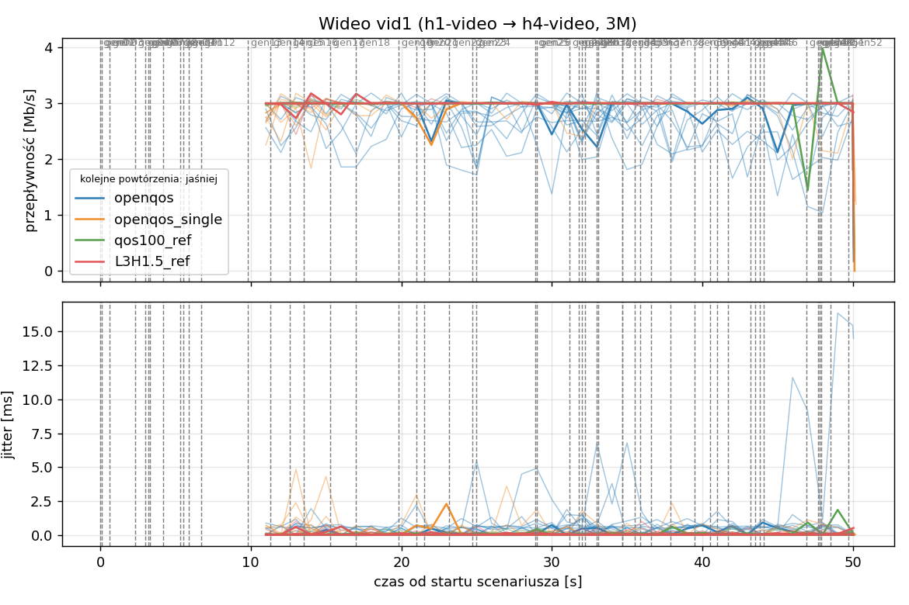
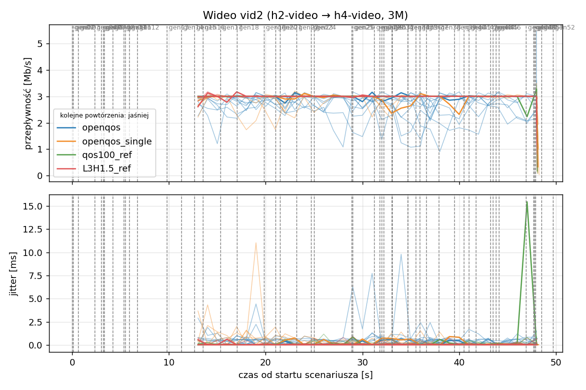
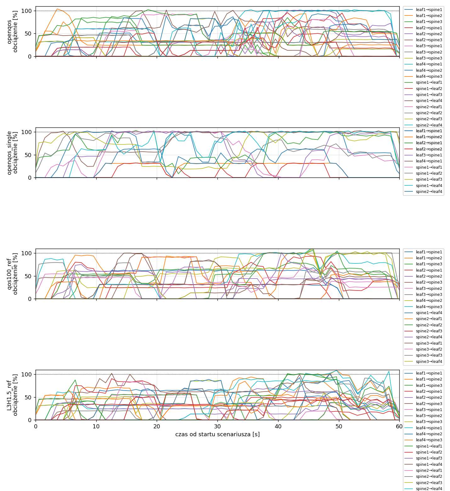
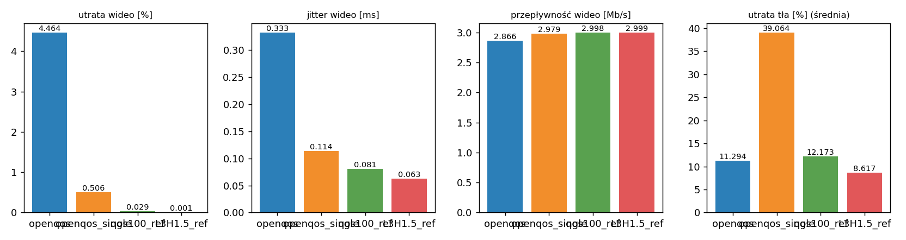

# Raport: clos-sdn

Katalog: `results/official/openqos/clos-sdn/20261109_025456`

## 1. Scenariusz

- Topologia: `clos` (sdn: `clos-sdn.clab.yml`)
- Warianty: **openqos** (POLICY=openqos), **openqos_single** (OPENQOS_BE=single, POLICY=openqos), **qos100_ref** (LAYERS=1, POLICY=qos, RESERVE_PCT=100), **L3H1.5_ref** (HEADROOM_MBPS=1.5, LAYERS=3, POLICY=qos, RESERVE_PCT=70)
- Czas testu: 60 s, warmup (pomijany w statystykach, liczony od startu każdego przepływu): 5 s, powtórzeń: 20, seed: 42
- Wykonane przebiegi: openqos/rep1, openqos/rep10, openqos/rep11, openqos/rep12, openqos/rep13, openqos/rep14, openqos/rep15, openqos/rep16, openqos/rep17, openqos/rep18, openqos/rep19, openqos/rep2, openqos/rep20, openqos/rep3, openqos/rep4, openqos/rep5, openqos/rep6, openqos/rep7, openqos/rep8, openqos/rep9, openqos_single/rep1, openqos_single/rep10, openqos_single/rep11, openqos_single/rep12, openqos_single/rep13, openqos_single/rep14, openqos_single/rep15, openqos_single/rep16, openqos_single/rep17, openqos_single/rep18, openqos_single/rep19, openqos_single/rep2, openqos_single/rep20, openqos_single/rep3, openqos_single/rep4, openqos_single/rep5, openqos_single/rep6, openqos_single/rep7, openqos_single/rep8, openqos_single/rep9, qos100_ref/rep1, qos100_ref/rep10, qos100_ref/rep11, qos100_ref/rep12, qos100_ref/rep13, qos100_ref/rep14, qos100_ref/rep15, qos100_ref/rep16, qos100_ref/rep17, qos100_ref/rep18, qos100_ref/rep19, qos100_ref/rep2, qos100_ref/rep20, qos100_ref/rep3, qos100_ref/rep4, qos100_ref/rep5, qos100_ref/rep6, qos100_ref/rep7, qos100_ref/rep8, qos100_ref/rep9, L3H1.5_ref/rep1, L3H1.5_ref/rep10, L3H1.5_ref/rep11, L3H1.5_ref/rep12, L3H1.5_ref/rep13, L3H1.5_ref/rep14, L3H1.5_ref/rep15, L3H1.5_ref/rep16, L3H1.5_ref/rep17, L3H1.5_ref/rep18, L3H1.5_ref/rep19, L3H1.5_ref/rep2, L3H1.5_ref/rep20, L3H1.5_ref/rep3, L3H1.5_ref/rep4, L3H1.5_ref/rep5, L3H1.5_ref/rep6, L3H1.5_ref/rep7, L3H1.5_ref/rep8, L3H1.5_ref/rep9

Harmonogram losowego tła różni się między powtórzeniami (seed + nr powtórzenia, wspólny dla wariantów); poniżej powtórzenie 1.

| id | klasa | źródło → cel | proto | zadana [Mb/s] | DSCP | start–koniec [s] |
|---|---|---|---|---|---|---|
| gen01 | background | h2-bg1 → h3-bg2 | udp | 4.49 | – | 0–7 |
| gen02 | background | h4-bg2 → h3-bg1 | udp | 3.16 | – | 0.1–5.1 |
| gen03 | background | h4-bg1 → h2-bg2 | udp | 5.25 | – | 0.6–5.6 |
| gen04 | background | h4-bg1 → h1-bg2 | udp | 3.56 | – | 2.3–7.3 |
| gen05 | background | h4-bg1 → h3-bg1 | udp | 2.36 | – | 3–60 |
| gen06 | background | h1-bg2 → h2-bg1 | udp | 1.93 | – | 3.2–16.2 |
| gen07 | background | h2-bg1 → h3-bg1 | udp | 1.39 | – | 3.3–8.3 |
| gen08 | background | h1-bg1 → h2-bg1 | udp | 3.29 | – | 4.2–32.2 |
| gen09 | background | h3-bg2 → h2-bg1 | udp | 4.51 | – | 5.3–16.3 |
| gen10 | background | h1-bg2 → h3-bg1 | udp | 3.96 | – | 5.5–10.5 |
| gen11 | background | h2-bg1 → h4-bg2 | udp | 5.85 | – | 5.9–19.9 |
| gen12 | background | h1-bg2 → h3-bg1 | udp | 4.90 | – | 6.7–16.7 |
| gen13 | background | h4-bg1 → h1-bg1 | udp | 3.07 | – | 9.8–19.8 |
| vid1 | video | h1-video → h4-video | udp | 3.00 | 46 | 10–50 |
| gen14 | background | h3-bg2 → h1-bg2 | udp | 5.37 | – | 11.3–27.3 |
| vid2 | video | h2-video → h4-video | udp | 3.00 | 46 | 12–48 |
| gen15 | background | h3-bg1 → h1-bg1 | udp | 3.12 | – | 12.6–30.6 |
| gen16 | background | h2-bg1 → h1-bg1 | udp | 4.96 | – | 13.5–18.5 |
| gen17 | background | h2-bg1 → h4-bg2 | udp | 4.86 | – | 15.3–20.3 |
| gen18 | background | h3-bg2 → h1-bg1 | udp | 3.49 | – | 17–36 |
| gen19 | background | h4-bg2 → h2-bg1 | udp | 2.93 | – | 19.8–48.8 |
| gen20 | background | h1-bg2 → h4-bg2 | udp | 5.68 | – | 21–26 |
| gen21 | background | h4-bg1 → h2-bg1 | udp | 3.04 | – | 21.5–35.5 |
| gen22 | background | h4-bg1 → h2-bg1 | udp | 3.69 | – | 23.2–28.2 |
| gen23 | background | h2-bg2 → h4-bg2 | udp | 1.26 | – | 24.7–44.7 |
| gen24 | background | h3-bg1 → h1-bg2 | udp | 4.88 | – | 25–31 |
| gen25 | background | h4-bg1 → h1-bg2 | udp | 3.51 | – | 28.9–33.9 |
| gen26 | background | h1-bg1 → h4-bg1 | udp | 5.23 | – | 29–59 |
| gen27 | background | h1-bg2 → h4-bg1 | udp | 2.10 | – | 31.2–37.2 |
| gen28 | background | h4-bg1 → h1-bg2 | udp | 1.54 | – | 31.8–36.8 |
| gen29 | background | h4-bg1 → h1-bg2 | udp | 1.53 | – | 32–39 |
| gen30 | background | h1-bg2 → h3-bg1 | udp | 3.69 | – | 32.2–38.2 |
| gen31 | background | h2-bg1 → h4-bg2 | udp | 2.18 | – | 33–38 |
| gen32 | background | h4-bg2 → h3-bg2 | udp | 5.19 | – | 33.1–59.1 |
| gen33 | background | h4-bg2 → h3-bg2 | udp | 2.60 | – | 34.7–40.7 |
| gen34 | background | h2-bg2 → h3-bg2 | udp | 1.75 | – | 34.7–59.7 |
| gen35 | background | h4-bg2 → h2-bg1 | udp | 5.89 | – | 35.5–54.5 |
| gen36 | background | h4-bg2 → h3-bg1 | udp | 4.62 | – | 35.9–49.9 |
| gen37 | background | h1-bg2 → h2-bg2 | udp | 4.50 | – | 36.6–50.6 |
| gen38 | background | h2-bg1 → h4-bg1 | udp | 4.23 | – | 37.9–58.9 |
| gen39 | background | h1-bg2 → h4-bg2 | udp | 5.93 | – | 39.5–44.5 |
| gen40 | background | h1-bg1 → h3-bg1 | udp | 5.99 | – | 40.5–45.5 |
| gen41 | background | h1-bg2 → h3-bg1 | udp | 4.47 | – | 41–50 |
| gen42 | background | h1-bg2 → h3-bg1 | udp | 2.82 | – | 41.7–48.7 |
| gen43 | background | h4-bg2 → h2-bg1 | udp | 4.98 | – | 43.2–49.2 |
| gen44 | background | h4-bg2 → h1-bg2 | udp | 5.97 | – | 43.5–50.5 |
| gen45 | background | h3-bg1 → h4-bg1 | udp | 5.74 | – | 43.8–58.8 |
| gen46 | background | h2-bg1 → h1-bg2 | udp | 1.89 | – | 44.1–49.1 |
| gen47 | background | h2-bg2 → h3-bg1 | udp | 2.94 | – | 46.9–59.9 |
| gen48 | background | h3-bg1 → h1-bg1 | udp | 3.58 | – | 47.7–59.7 |
| gen49 | background | h4-bg1 → h2-bg1 | udp | 5.93 | – | 47.8–57.8 |
| gen50 | background | h4-bg1 → h1-bg1 | udp | 3.20 | – | 47.9–54.9 |
| gen51 | background | h4-bg2 → h3-bg1 | udp | 1.53 | – | 48.5–59.5 |
| gen52 | background | h4-bg2 → h2-bg2 | udp | 2.44 | – | 49.7–59.7 |

## 2. Wideo: QoS według wariantu

Wartości: średnia ± odchylenie standardowe z powtórzeń.

| przepływ | wariant | przepływność [Mb/s] | jitter [ms] | utrata [%] | RTT mediana [ms] | RTT p95 [ms] |
|---|---|---|---|---|---|---|
| vid1 | openqos | 2.87 ± 0.11 | 0.382 ± 0.658 | 4.41 ± 3.77 | 0.779 ± 2.339 | 55.672 ± 22.897 |
| vid1 | openqos_single | 2.98 ± 0.02 | 0.101 ± 0.077 | 0.31 ± 0.68 | 0.028 ± 0.002 | 16.256 ± 27.214 |
| vid1 | qos100_ref | 3.00 ± 0.00 | 0.070 ± 0.025 | 0.03 ± 0.13 | 0.029 ± 0.002 | 0.049 ± 0.007 |
| vid1 | L3H1.5_ref | 3.00 ± 0.00 | 0.064 ± 0.025 | 0.00 ± 0.01 | 0.028 ± 0.002 | 0.051 ± 0.023 |
| vid2 | openqos | 2.86 ± 0.15 | 0.283 ± 0.239 | 4.51 ± 4.78 | 2.611 ± 8.215 | 59.407 ± 31.826 |
| vid2 | openqos_single | 2.97 ± 0.03 | 0.127 ± 0.094 | 0.70 ± 0.94 | 0.028 ± 0.003 | 26.822 ± 34.589 |
| vid2 | qos100_ref | 3.00 ± 0.00 | 0.092 ± 0.116 | 0.03 ± 0.12 | 0.026 ± 0.002 | 0.053 ± 0.021 |
| vid2 | L3H1.5_ref | 3.00 ± 0.00 | 0.062 ± 0.022 | 0.00 ± 0.00 | 0.025 ± 0.002 | 0.045 ± 0.004 |

RTT z `ping` co 0,1 s między hostami wideo (osobny przepływ ICMP z tym samym DSCP - w SDN może iść inną ścieżką niż strumień UDP).

## 3. Ruch tła

Agregat tła w obrębie powtórzenia, potem średnia ± odchylenie standardowe po powtórzeniach (utrata = Σ utraconych / Σ wysłanych datagramów; dostarczone = Σ przepływności / Σ zadanych; przepływy trwające nie dłużej niż warmup pominięte).

| wariant | strumieni tła / powt. | dostarczone / zadane [%] | jitter [ms] | utrata [%] |
|---|---|---|---|---|
| openqos | 38 | 89.1 ± 4.5 | 0.289 ± 0.070 | 11.29 ± 4.90 |
| openqos_single | 38 | 61.3 ± 6.5 | 0.634 ± 0.075 | 39.06 ± 7.49 |
| qos100_ref | 38 | 88.2 ± 5.3 | 0.335 ± 0.087 | 12.17 ± 6.15 |
| L3H1.5_ref | 38 | 91.5 ± 3.7 | 0.202 ± 0.111 | 8.62 ± 3.60 |

## 4. Obciążenie łączy fabricu

Średnia i maksimum z próbek co 1 s w oknie 0–60 s; MLU = maksymalne obciążenie łącza; drops = pakiety odrzucone przez `tbf` na wyjściu łącza.

| wariant | rep | średnie obciążenie łączy [%] | MLU [%] | łącza > 90% | drops tbf | CPU VM śr./maks. [%] |
|---|---|---|---|---|---|---|
| openqos | 1 | 33.0 | 104.0 | 13/24 | 22992 | 14 / 25 |
| openqos | 2 | 38.4 | 102.7 | 16/24 | 40194 | 16 / 27 |
| openqos | 3 | 46.2 | 104.9 | 15/24 | 57965 | 19 / 62 |
| openqos | 4 | 34.2 | 102.9 | 13/24 | 5630 | 14 / 22 |
| openqos | 5 | 36.4 | 102.8 | 11/24 | 28677 | 15 / 25 |
| openqos | 6 | 28.7 | 102.1 | 10/24 | 15011 | 13 / 24 |
| openqos | 7 | 37.7 | 102.5 | 15/24 | 15288 | 15 / 24 |
| openqos | 8 | 35.5 | 102.9 | 15/24 | 12106 | 14 / 31 |
| openqos | 9 | 36.2 | 102.9 | 11/24 | 25344 | 14 / 24 |
| openqos | 10 | 40.1 | 102.9 | 15/24 | 21822 | 16 / 30 |
| openqos | 11 | 37.4 | 103.6 | 15/24 | 36750 | 16 / 29 |
| openqos | 12 | 27.8 | 103.3 | 11/24 | 7522 | 13 / 23 |
| openqos | 13 | 37.0 | 102.7 | 16/24 | 24979 | 15 / 25 |
| openqos | 14 | 37.9 | 104.0 | 17/24 | 27685 | 15 / 26 |
| openqos | 15 | 40.7 | 104.0 | 13/24 | 48458 | 17 / 28 |
| openqos | 16 | 34.7 | 102.9 | 13/24 | 19267 | 14 / 22 |
| openqos | 17 | 40.9 | 103.4 | 14/24 | 19442 | 16 / 25 |
| openqos | 18 | 30.8 | 102.4 | 12/24 | 22236 | 13 / 22 |
| openqos | 19 | 36.9 | 105.1 | 14/24 | 42624 | 15 / 25 |
| openqos | 20 | 40.2 | 103.7 | 18/24 | 42749 | 16 / 31 |
| openqos_single | 1 | 25.9 | 102.9 | 8/24 | 71046 | 13 / 21 |
| openqos_single | 2 | 28.6 | 103.7 | 8/24 | 96998 | 15 / 29 |
| openqos_single | 3 | 31.2 | 103.7 | 8/24 | 135767 | 16 / 32 |
| openqos_single | 4 | 26.9 | 103.9 | 8/24 | 57562 | 14 / 22 |
| openqos_single | 5 | 27.7 | 102.5 | 8/24 | 83160 | 14 / 23 |
| openqos_single | 6 | 23.5 | 102.8 | 8/24 | 54168 | 13 / 23 |
| openqos_single | 7 | 26.8 | 103.6 | 8/24 | 89674 | 14 / 26 |
| openqos_single | 8 | 27.8 | 105.4 | 8/24 | 64738 | 15 / 32 |
| openqos_single | 9 | 24.9 | 102.5 | 7/24 | 93613 | 13 / 21 |
| openqos_single | 10 | 27.6 | 104.4 | 8/24 | 100861 | 15 / 29 |
| openqos_single | 11 | 24.7 | 103.5 | 7/24 | 117738 | 15 / 24 |
| openqos_single | 12 | 23.8 | 103.3 | 8/24 | 35661 | 13 / 23 |
| openqos_single | 13 | 27.6 | 103.0 | 8/24 | 90586 | 15 / 24 |
| openqos_single | 14 | 27.1 | 102.8 | 8/24 | 93843 | 15 / 25 |
| openqos_single | 15 | 27.6 | 104.8 | 8/24 | 135365 | 15 / 31 |
| openqos_single | 16 | 26.2 | 102.9 | 8/24 | 77657 | 14 / 21 |
| openqos_single | 17 | 28.5 | 103.2 | 8/24 | 105831 | 15 / 27 |
| openqos_single | 18 | 25.0 | 103.1 | 7/24 | 58702 | 13 / 20 |
| openqos_single | 19 | 28.4 | 103.4 | 8/24 | 91509 | 15 / 30 |
| openqos_single | 20 | 27.5 | 102.9 | 8/24 | 121103 | 15 / 31 |
| qos100_ref | 1 | 32.7 | 112.8 | 12/24 | 23998 | 17 / 94 |
| qos100_ref | 2 | 39.2 | 102.6 | 14/24 | 34396 | 16 / 28 |
| qos100_ref | 3 | 45.1 | 103.4 | 15/24 | 61066 | 17 / 26 |
| qos100_ref | 4 | 33.4 | 102.8 | 14/24 | 9093 | 13 / 22 |
| qos100_ref | 5 | 36.8 | 102.7 | 12/24 | 19628 | 14 / 22 |
| qos100_ref | 6 | 28.9 | 102.1 | 10/24 | 12495 | 13 / 24 |
| qos100_ref | 7 | 36.1 | 103.6 | 15/24 | 27587 | 14 / 25 |
| qos100_ref | 8 | 35.2 | 103.0 | 14/24 | 13340 | 14 / 32 |
| qos100_ref | 9 | 32.4 | 103.0 | 9/24 | 50581 | 14 / 21 |
| qos100_ref | 10 | 39.4 | 103.4 | 16/24 | 23068 | 16 / 30 |
| qos100_ref | 11 | 35.5 | 103.4 | 14/24 | 49371 | 15 / 26 |
| qos100_ref | 12 | 28.2 | 102.0 | 9/24 | 3692 | 13 / 23 |
| qos100_ref | 13 | 37.1 | 103.0 | 13/24 | 25534 | 15 / 25 |
| qos100_ref | 14 | 37.7 | 104.6 | 15/24 | 27197 | 15 / 27 |
| qos100_ref | 15 | 38.9 | 104.0 | 13/24 | 61757 | 16 / 27 |
| qos100_ref | 16 | 34.5 | 103.1 | 15/24 | 22092 | 14 / 22 |
| qos100_ref | 17 | 40.2 | 103.1 | 15/24 | 24149 | 15 / 25 |
| qos100_ref | 18 | 31.8 | 102.1 | 12/24 | 12895 | 13 / 22 |
| qos100_ref | 19 | 36.4 | 103.0 | 12/24 | 37927 | 15 / 23 |
| qos100_ref | 20 | 40.0 | 103.4 | 16/24 | 42483 | 16 / 30 |
| L3H1.5_ref | 1 | 33.4 | 109.0 | 10/24 | 9426 | 21 / 96 |
| L3H1.5_ref | 2 | 41.0 | 104.6 | 10/24 | 12733 | 16 / 29 |
| L3H1.5_ref | 3 | 48.4 | 105.7 | 15/24 | 33792 | 17 / 28 |
| L3H1.5_ref | 4 | 34.0 | 102.8 | 9/24 | 764 | 14 / 22 |
| L3H1.5_ref | 5 | 37.5 | 103.6 | 10/24 | 12024 | 14 / 23 |
| L3H1.5_ref | 6 | 29.6 | 101.8 | 5/24 | 4162 | 13 / 23 |
| L3H1.5_ref | 7 | 37.8 | 102.3 | 12/24 | 11676 | 14 / 25 |
| L3H1.5_ref | 8 | 35.6 | 103.6 | 12/24 | 6730 | 14 / 30 |
| L3H1.5_ref | 9 | 35.6 | 102.8 | 9/24 | 23048 | 14 / 22 |
| L3H1.5_ref | 10 | 41.1 | 102.8 | 13/24 | 11059 | 16 / 31 |
| L3H1.5_ref | 11 | 37.8 | 103.5 | 12/24 | 23311 | 15 / 27 |
| L3H1.5_ref | 12 | 28.3 | 101.5 | 3/24 | 195 | 13 / 22 |
| L3H1.5_ref | 13 | 37.5 | 102.7 | 7/24 | 13097 | 14 / 24 |
| L3H1.5_ref | 14 | 39.0 | 103.0 | 13/24 | 9490 | 15 / 26 |
| L3H1.5_ref | 15 | 42.9 | 102.7 | 12/24 | 21188 | 16 / 27 |
| L3H1.5_ref | 16 | 35.4 | 102.5 | 5/24 | 8816 | 14 / 21 |
| L3H1.5_ref | 17 | 40.8 | 102.4 | 11/24 | 7779 | 15 / 24 |
| L3H1.5_ref | 18 | 31.7 | 102.4 | 8/24 | 8167 | 13 / 23 |
| L3H1.5_ref | 19 | 39.5 | 102.1 | 10/24 | 19189 | 15 / 26 |
| L3H1.5_ref | 20 | 41.3 | 103.0 | 15/24 | 16439 | 16 / 31 |

Łącza z obciążeniem > 10% (maksimum [%] / drops, powtórzenie 1):

| łącze | openqos | openqos_single | qos100_ref | L3H1.5_ref |
|---|---|---|---|---|
| leaf1→spine1 | 101 / 5339 | 102 / 13781 | 32 / 44 | 93 / 0 |
| leaf1→spine2 | 94 / 0 | 32 / 0 | 101 / 3282 | 94 / 214 |
| leaf1→spine3 | 85 / 0 | 0 / 0 | 107 / 468 | 102 / 2041 |
| leaf2→spine1 | 50 / 0 | 103 / 2306 | 33 / 3 | 91 / 0 |
| leaf2→spine2 | 74 / 0 | 32 / 0 | 75 / 72 | 52 / 19 |
| leaf2→spine3 | 100 / 0 | 0 / 0 | 100 / 27 | 51 / 69 |
| leaf3→spine1 | 93 / 0 | 103 / 4446 | 0 / 0 | 57 / 0 |
| leaf3→spine2 | 60 / 0 | 0 / 0 | 92 / 0 | 66 / 160 |
| leaf3→spine3 | 84 / 0 | 0 / 0 | 83 / 22 | 87 / 0 |
| leaf4→spine1 | 102 / 14966 | 103 / 37927 | 0 / 0 | 89 / 0 |
| leaf4→spine2 | 93 / 0 | 0 / 0 | 112 / 8859 | 101 / 949 |
| leaf4→spine3 | 104 / 278 | 0 / 0 | 113 / 7577 | 109 / 2637 |
| spine1→leaf1 | 102 / 506 | 102 / 3006 | 0 / 0 | 56 / 0 |
| spine1→leaf2 | 95 / 20 | 101 / 726 | 0 / 0 | 58 / 0 |
| spine1→leaf3 | 101 / 555 | 102 / 1545 | 0 / 0 | 70 / 0 |
| spine1→leaf4 | 101 / 479 | 102 / 7309 | 68 / 54 | 102 / 80 |
| spine2→leaf1 | 81 / 0 | 0 / 0 | 93 / 0 | 84 / 0 |
| spine2→leaf2 | 69 / 0 | 0 / 0 | 80 / 0 | 103 / 0 |
| spine2→leaf3 | 63 / 0 | 0 / 0 | 93 / 214 | 60 / 0 |
| spine2→leaf4 | 102 / 662 | 63 / 0 | 101 / 0 | 109 / 2402 |
| spine3→leaf1 | 85 / 0 | 0 / 0 | 100 / 576 | 89 / 0 |
| spine3→leaf2 | 76 / 0 | 0 / 0 | 70 / 0 | 65 / 0 |
| spine3→leaf3 | 82 / 8 | 0 / 0 | 103 / 904 | 101 / 855 |
| spine3→leaf4 | 96 / 179 | 0 / 0 | 111 / 1896 | 59 / 0 |

## 5. Ścieżki wybrane przez kontroler (powtórzenie 1)

Z logu kontrolera (linie `Flow`), dopasowane po piątce przepływu; ✓ = reguły widoczne w `dump-flows` na tych samych przełącznikach.

| przepływ | openqos | openqos_single | qos100_ref | L3H1.5_ref |
|---|---|---|---|---|
| gen01 | leaf2 -> spine3 -> leaf3 ✓ (loads 0% 0% 0%) | leaf2 -> spine1 -> leaf3 ✓ (loads 0% 0% 0%) | leaf2 -> spine3 -> leaf3 ✓ (loads 0% 5% 0%) | leaf2 -> spine3 -> leaf3 ✓ (loads 0% 20% 0%) |
| gen02 | leaf4 -> spine2 -> leaf3 ✓ (loads 0% 0% 0%) | leaf4 -> spine1 -> leaf3 ✓ (loads 0% 0% 0%) | leaf4 -> spine3 -> leaf3 ✓ (loads 0% 10% 5%) | leaf4 -> spine2 -> leaf3 ✓ (loads 20% 20% 20%) |
| gen03 | leaf4 -> spine3 -> leaf2 ✓ (loads 0% 1% 0%) | leaf4 -> spine1 -> leaf2 ✓ (loads 4% 0% 0%) | leaf4 -> spine3 -> leaf2 ✓ (loads 0% 5% 4%) | leaf4 -> spine3 -> leaf2 ✓ (loads 20% 40% 20%) |
| gen04 | leaf4 -> spine3 -> leaf1 ✓ (loads 0% 33% 54%) | leaf4 -> spine1 -> leaf1 ✓ (loads 87% 0% 0%) | leaf4 -> spine2 -> leaf1 ✓ (loads 0% 5% 87%) | leaf4 -> spine1 -> leaf1 ✓ (loads 38% 72% 74%) |
| gen05 | leaf4 -> spine3 -> leaf3 ✓ (loads 0% 33% 54%) | leaf4 -> spine1 -> leaf3 ✓ (loads 100% 0% 0%) | leaf4 -> spine2 -> leaf3 ✓ (loads 0% 15% 87%) | leaf4 -> spine1 -> leaf3 ✓ (loads 62% 70% 74%) |
| gen06 | leaf1 -> spine1 -> leaf2 ✓ (loads 0% 0% 54%) | leaf1 -> spine1 -> leaf2 ✓ (loads 54% 0% 0%) | leaf1 -> spine2 -> leaf2 ✓ (loads 0% 10% 54%) | leaf1 -> spine2 -> leaf2 ✓ (loads 18% 17% 54%) |
| gen07 | leaf2 -> spine1 -> leaf3 ✓ (loads 0% 33% 49%) | leaf2 -> spine1 -> leaf3 ✓ (loads 73% 0% 0%) | leaf2 -> spine2 -> leaf3 ✓ (loads 0% 9% 79%) | leaf2 -> spine1 -> leaf3 ✓ (loads 34% 50% 46%) |
| gen08 | leaf1 -> spine3 -> leaf2 ✓ (loads 19% 0% 47%) | leaf1 -> spine1 -> leaf2 ✓ (loads 46% 0% 0%) | leaf1 -> spine2 -> leaf2 ✓ (loads 0% 16% 54%) | leaf1 -> spine1 -> leaf2 ✓ (loads 33% 67% 54%) |
| gen09 | leaf3 -> spine2 -> leaf2 ✓ (loads 20% 0% 80%) | leaf3 -> spine1 -> leaf2 ✓ (loads 93% 0% 0%) | leaf3 -> spine3 -> leaf2 ✓ (loads 0% 59% 54%) | leaf3 -> spine3 -> leaf2 ✓ (loads 73% 71% 66%) |
| gen10 | leaf1 -> spine2 -> leaf3 ✓ (loads 20% 31% 68%) | leaf1 -> spine1 -> leaf3 ✓ (loads 96% 0% 0%) | leaf1 -> spine2 -> leaf3 ✓ (loads 0% 59% 75%) | leaf1 -> spine3 -> leaf3 ✓ (loads 89% 73% 58%) |
| gen11 | leaf2 -> spine2 -> leaf4 ✓ (loads 14% 0% 46%) | leaf2 -> spine1 -> leaf4 ✓ (loads 61% 0% 0%) | leaf2 -> spine2 -> leaf4 ✓ (loads 0% 34% 46%) | leaf2 -> spine1 -> leaf4 ✓ (loads 26% 38% 61%) |
| gen12 | leaf1 -> spine3 -> leaf3 ✓ (loads 20% 26% 71%) | leaf1 -> spine1 -> leaf3 ✓ (loads 96% 0% 0%) | leaf1 -> spine3 -> leaf3 ✓ (loads 0% 84% 51%) | leaf1 -> spine2 -> leaf3 ✓ (loads 64% 38% 90%) |
| gen13 | leaf4 -> spine1 -> leaf1 ✓ (loads 0% 0% 24%) | leaf4 -> spine1 -> leaf1 ✓ (loads 24% 0% 0%) | leaf4 -> spine3 -> leaf1 ✓ (loads 0% 24% 5%) | leaf4 -> spine3 -> leaf1 ✓ (loads 24% 7% 0%) |
| vid1 | leaf1 -> spine3 -> leaf4 ✓ (loads 100% 100% 31%) | leaf1 -> spine2 -> leaf4 ✓ (loads 100% 31% 0%) | leaf1 -> spine1 -> leaf4 ✓ (loads 0% 95% 65%) | leaf1 -> spine1 -> leaf4 ✓ (loads 60% 70% 61%) |
| gen14 | leaf3 -> spine1 -> leaf1 ✓ (loads 32% 46% 0%) | leaf3 -> spine1 -> leaf1 ✓ (loads 47% 0% 0%) | leaf3 -> spine2 -> leaf1 ✓ (loads 0% 5% 47%) | leaf3 -> spine1 -> leaf1 ✓ (loads 6% 14% 47%) |
| vid2 | leaf2 -> spine1 -> leaf4 ✓ (loads 64% 100% 31%) | leaf2 -> spine2 -> leaf4 ✓ (loads 100% 62% 0%) | leaf2 -> spine1 -> leaf4 ✓ (loads 31% 60% 5%) | leaf2 -> spine1 -> leaf4 ✓ (loads 113% 6% 20%) |
| gen15 | leaf3 -> spine3 -> leaf1 ✓ (loads 79% 46% 0%) | leaf3 -> spine1 -> leaf1 ✓ (loads 84% 0% 0%) | leaf3 -> spine3 -> leaf1 ✓ (loads 0% 52% 51%) | leaf3 -> spine2 -> leaf1 ✓ (loads 49% 6% 47%) |
| gen16 | leaf2 -> spine3 -> leaf1 ✓ (loads 87% 60% 18%) | leaf2 -> spine1 -> leaf1 ✓ (loads 91% 0% 0%) | leaf2 -> spine3 -> leaf1 ✓ (loads 31% 60% 57%) | leaf2 -> spine2 -> leaf1 ✓ (loads 121% 30% 32%) |
| gen17 | leaf2 -> spine3 -> leaf4 ✓ (loads 62% 60% 51%) | leaf2 -> spine1 -> leaf4 ✓ (loads 100% 62% 0%) | leaf2 -> spine3 -> leaf4 ✓ (loads 62% 60% 56%) | leaf2 -> spine3 -> leaf4 ✓ (loads 83% 62% 7%) |
| gen18 | leaf3 -> spine1 -> leaf1 ✓ (loads 87% 46% 83%) | leaf3 -> spine1 -> leaf1 ✓ (loads 100% 0% 0%) | leaf3 -> spine2 -> leaf1 ✓ (loads 0% 65% 100%) | leaf3 -> spine3 -> leaf1 ✓ (loads 55% 83% 54%) |
| gen19 | leaf4 -> spine2 -> leaf2 ✓ (loads 32% 0% 34%) | leaf4 -> spine1 -> leaf2 ✓ (loads 56% 0% 0%) | leaf4 -> spine2 -> leaf2 ✓ (loads 0% 34% 37%) | leaf4 -> spine2 -> leaf2 ✓ (loads 34% 7% 32%) |
| gen20 | leaf1 -> spine1 -> leaf4 ✓ (loads 62% 44% 50%) | leaf1 -> spine1 -> leaf4 ✓ (loads 99% 62% 0%) | leaf1 -> spine2 -> leaf4 ✓ (loads 62% 45% 50%) | leaf1 -> spine3 -> leaf4 ✓ (loads 65% 26% 14%) |
| gen21 | leaf4 -> spine1 -> leaf2 ✓ (loads 0% 30% 34%) | leaf4 -> spine1 -> leaf2 ✓ (loads 64% 0% 0%) | leaf4 -> spine3 -> leaf2 ✓ (loads 0% 64% 5%) | leaf4 -> spine3 -> leaf2 ✓ (loads 34% 56% 11%) |
| gen22 | leaf4 -> spine2 -> leaf2 ✓ (loads 31% 30% 34%) | leaf4 -> spine1 -> leaf2 ✓ (loads 89% 0% 0%) | leaf4 -> spine3 -> leaf2 ✓ (loads 0% 64% 29%) | leaf4 -> spine2 -> leaf2 ✓ (loads 40% 37% 48%) |
| gen23 | leaf2 -> spine3 -> leaf4 ✓ (loads 59% 62% 0%) | leaf2 -> spine1 -> leaf4 ✓ (loads 69% 62% 0%) | leaf2 -> spine3 -> leaf4 ✓ (loads 62% 58% 5%) | leaf2 -> spine2 -> leaf4 ✓ (loads 62% 19% 59%) |
| gen24 | leaf3 -> spine3 -> leaf1 ✓ (loads 91% 0% 32%) | leaf3 -> spine1 -> leaf1 ✓ (loads 100% 0% 0%) | leaf3 -> spine3 -> leaf1 ✓ (loads 0% 91% 37%) | leaf3 -> spine3 -> leaf1 ✓ (loads 55% 39% 36%) |
| gen25 | leaf4 -> spine2 -> leaf1 ✓ (loads 41% 68% 83%) | leaf4 -> spine1 -> leaf1 ✓ (loads 100% 0% 0%) | leaf4 -> spine2 -> leaf1 ✓ (loads 0% 60% 82%) | leaf4 -> spine1 -> leaf1 ✓ (loads 32% 68% 86%) |
| gen26 | leaf1 -> spine1 -> leaf4 ✓ (loads 62% 0% 34%) | leaf1 -> spine1 -> leaf4 ✓ (loads 44% 31% 0%) | leaf1 -> spine3 -> leaf4 ✓ (loads 62% 34% 28%) | leaf1 -> spine2 -> leaf4 ✓ (loads 65% 20% 22%) |
| gen27 | leaf1 -> spine2 -> leaf4 ✓ (loads 100% 0% 34%) | leaf1 -> spine1 -> leaf4 ✓ (loads 88% 62% 0%) | leaf1 -> spine2 -> leaf4 ✓ (loads 62% 44% 67%) | leaf1 -> spine3 -> leaf4 ✓ (loads 65% 82% 28%) |
| gen28 | leaf4 -> spine2 -> leaf1 ✓ (loads 36% 66% 53%) | leaf4 -> spine1 -> leaf1 ✓ (loads 100% 0% 0%) | leaf4 -> spine3 -> leaf1 ✓ (loads 0% 91% 56%) | leaf4 -> spine2 -> leaf1 ✓ (loads 60% 52% 86%) |
| gen29 | leaf4 -> spine1 -> leaf1 ✓ (loads 36% 66% 53%) | leaf4 -> spine1 -> leaf1 ✓ (loads 100% 0% 0%) | leaf4 -> spine3 -> leaf1 ✓ (loads 0% 91% 66%) | leaf4 -> spine2 -> leaf1 ✓ (loads 67% 60% 86%) |
| gen30 | leaf1 -> spine2 -> leaf3 ✓ (loads 54% 31% 34%) | leaf1 -> spine1 -> leaf3 ✓ (loads 97% 31% 0%) | leaf1 -> spine2 -> leaf3 ✓ (loads 31% 55% 59%) | leaf1 -> spine2 -> leaf3 ✓ (loads 65% 63% 71%) |
| gen31 | leaf2 -> spine1 -> leaf4 ✓ (loads 101% 22% 13%) | – | leaf2 -> spine2 -> leaf4 ✓ (loads 62% 27% 67%) | leaf2 -> spine2 -> leaf4 ✓ (loads 62% 67% 74%) |
| gen32 | leaf4 -> spine1 -> leaf3 ✓ (loads 47% 82% 24%) | leaf4 -> spine1 -> leaf3 ✓ (loads 100% 0% 0%) | leaf4 -> spine3 -> leaf3 ✓ (loads 0% 91% 58%) | leaf4 -> spine3 -> leaf3 ✓ (loads 68% 99% 57%) |
| gen33 | leaf4 -> spine3 -> leaf3 ✓ (loads 94% 71% 24%) | leaf4 -> spine1 -> leaf3 ✓ (loads 100% 0% 0%) | leaf4 -> spine2 -> leaf3 ✓ (loads 0% 87% 99%) | leaf4 -> spine1 -> leaf3 ✓ (loads 61% 62% 112%) |
| gen34 | leaf2 -> spine1 -> leaf3 ✓ (loads 47% 38% 24%) | leaf2 -> spine1 -> leaf3 ✓ (loads 51% 0% 0%) | leaf2 -> spine3 -> leaf3 ✓ (loads 31% 72% 52%) | leaf2 -> spine1 -> leaf3 ✓ (loads 42% 45% 62%) |
| gen35 | leaf4 -> spine1 -> leaf2 ✓ (loads 100% 46% 38%) | leaf4 -> spine1 -> leaf2 ✓ (loads 100% 0% 0%) | leaf4 -> spine2 -> leaf2 ✓ (loads 0% 79% 100%) | leaf4 -> spine1 -> leaf2 ✓ (loads 52% 62% 117%) |
| gen36 | leaf4 -> spine1 -> leaf3 ✓ (loads 100% 46% 38%) | leaf4 -> spine1 -> leaf3 ✓ (loads 100% 0% 0%) | leaf4 -> spine3 -> leaf3 ✓ (loads 0% 97% 95%) | leaf4 -> spine1 -> leaf3 ✓ (loads 65% 68% 85%) |
| gen37 | leaf1 -> spine1 -> leaf2 ✓ (loads 54% 91% 0%) | leaf1 -> spine1 -> leaf2 ✓ (loads 100% 31% 0%) | leaf1 -> spine3 -> leaf2 ✓ (loads 31% 60% 59%) | leaf1 -> spine3 -> leaf2 ✓ (loads 57% 92% 36%) |
| gen38 | leaf2 -> spine2 -> leaf4 ✓ (loads 76% 21% 75%) | leaf2 -> spine1 -> leaf4 ✓ (loads 70% 62% 0%) | leaf2 -> spine2 -> leaf4 ✓ (loads 62% 48% 67%) | leaf2 -> spine3 -> leaf4 ✓ (loads 62% 89% 60%) |
| gen39 | leaf1 -> spine3 -> leaf4 ✓ (loads 100% 100% 13%) | leaf1 -> spine1 -> leaf4 ✓ (loads 100% 31% 0%) | leaf1 -> spine2 -> leaf4 ✓ (loads 62% 49% 99%) | leaf1 -> spine1 -> leaf4 ✓ (loads 62% 67% 63%) |
| gen40 | leaf1 -> spine2 -> leaf3 ✓ (loads 99% 0% 76%) | leaf1 -> spine1 -> leaf3 ✓ (loads 100% 31% 0%) | leaf1 -> spine2 -> leaf3 ✓ (loads 31% 38% 100%) | leaf1 -> spine3 -> leaf3 ✓ (loads 67% 62% 54%) |
| gen41 | leaf1 -> spine1 -> leaf3 ✓ (loads 99% 0% 76%) | leaf1 -> spine1 -> leaf3 ✓ (loads 100% 31% 0%) | leaf1 -> spine2 -> leaf3 ✓ (loads 31% 48% 100%) | leaf1 -> spine3 -> leaf3 ✓ (loads 67% 70% 62%) |
| gen42 | leaf1 -> spine1 -> leaf3 ✓ (loads 100% 77% 61%) | leaf1 -> spine1 -> leaf3 ✓ (loads 100% 31% 0%) | leaf1 -> spine2 -> leaf3 ✓ (loads 31% 97% 100%) | leaf1 -> spine2 -> leaf3 ✓ (loads 89% 78% 101%) |
| gen43 | leaf4 -> spine1 -> leaf2 ✓ (loads 100% 30% 24%) | leaf4 -> spine1 -> leaf2 ✓ (loads 100% 0% 0%) | leaf4 -> spine3 -> leaf2 ✓ (loads 0% 100% 100%) | leaf4 -> spine2 -> leaf2 ✓ (loads 85% 40% 53%) |
| gen44 | leaf4 -> spine2 -> leaf1 ✓ (loads 100% 30% 24%) | leaf4 -> spine1 -> leaf1 ✓ (loads 100% 0% 0%) | leaf4 -> spine3 -> leaf1 ✓ (loads 0% 105% 105%) | leaf4 -> spine3 -> leaf1 ✓ (loads 85% 59% 53%) |
| gen45 | leaf3 -> spine2 -> leaf4 ✓ (loads 64% 74% 79%) | leaf3 -> spine1 -> leaf4 ✓ (loads 100% 62% 0%) | leaf3 -> spine3 -> leaf4 ✓ (loads 62% 86% 77%) | leaf3 -> spine2 -> leaf4 ✓ (loads 80% 76% 82%) |
| gen46 | leaf2 -> spine2 -> leaf1 ✓ (loads 49% 44% 13%) | leaf2 -> spine1 -> leaf1 ✓ (loads 75% 31% 0%) | leaf2 -> spine3 -> leaf1 ✓ (loads 31% 44% 41%) | leaf2 -> spine2 -> leaf1 ✓ (loads 49% 25% 63%) |
| gen47 | leaf2 -> spine3 -> leaf3 ✓ (loads 100% 63% 24%) | leaf2 -> spine1 -> leaf3 ✓ (loads 100% 31% 0%) | leaf2 -> spine3 -> leaf3 ✓ (loads 31% 65% 49%) | leaf2 -> spine2 -> leaf3 ✓ (loads 65% 38% 100%) |
| gen48 | leaf3 -> spine3 -> leaf1 ✓ (loads 0% 81% 0%) | leaf3 -> spine1 -> leaf1 ✓ (loads 59% 0% 0%) | leaf3 -> spine2 -> leaf1 ✓ (loads 0% 15% 54%) | leaf3 -> spine1 -> leaf1 ✓ (loads 27% 59% 52%) |
| gen49 | leaf4 -> spine1 -> leaf2 ✓ (loads 100% 92% 35%) | leaf4 -> spine1 -> leaf2 ✓ (loads 100% 0% 0%) | leaf4 -> spine2 -> leaf2 ✓ (loads 0% 63% 67%) | leaf4 -> spine2 -> leaf2 ✓ (loads 85% 91% 100%) |
| gen50 | leaf4 -> spine3 -> leaf1 ✓ (loads 100% 92% 24%) | leaf4 -> spine1 -> leaf1 ✓ (loads 100% 0% 0%) | leaf4 -> spine2 -> leaf1 ✓ (loads 0% 68% 72%) | leaf4 -> spine3 -> leaf1 ✓ (loads 85% 110% 110%) |
| gen51 | leaf4 -> spine2 -> leaf3 ✓ (loads 100% 92% 55%) | leaf4 -> spine1 -> leaf3 ✓ (loads 100% 0% 0%) | leaf4 -> spine2 -> leaf3 ✓ (loads 0% 98% 99%) | leaf4 -> spine3 -> leaf3 ✓ (loads 85% 130% 119%) |
| gen52 | leaf4 -> spine3 -> leaf2 ✓ (loads 100% 86% 57%) | leaf4 -> spine1 -> leaf2 ✓ (loads 100% 0% 0%) | leaf4 -> spine3 -> leaf2 ✓ (loads 0% 98% 96%) | leaf4 -> spine2 -> leaf2 ✓ (loads 80% 135% 150%) |

## 6. Wnioski

<!-- WNIOSKI:START -->
_Do uzupełnienia: krótkie wnioski wyłącznie na podstawie liczb z sekcji 2–5._
<!-- WNIOSKI:END -->

## 7. Wiarygodność pomiaru

- openqos rep1, gen02: przepływ krótszy niż warmup - statystyki z całości
- openqos rep1, gen04: przepływ krótszy niż warmup - statystyki z całości
- openqos rep1, gen07: przepływ krótszy niż warmup - statystyki z całości
- openqos rep1, gen20: przepływ krótszy niż warmup - statystyki z całości
- openqos rep1, gen22: przepływ krótszy niż warmup - statystyki z całości
- openqos rep1, gen28: przepływ krótszy niż warmup - statystyki z całości
- openqos rep1, gen31: przepływ krótszy niż warmup - statystyki z całości
- openqos rep1, gen39: przepływ krótszy niż warmup - statystyki z całości
- openqos rep1, gen44: klient: unable to receive results: No such file or directory
- openqos rep1, gen44: serwer: error - unable to receive results: Bad file descriptor
- openqos rep1, vid1: 28 decyzji kontrolera dla jednego przepływu (wygasła reguła albo duplikat Packet-In)
- openqos rep1, vid2: 25 decyzji kontrolera dla jednego przepływu (wygasła reguła albo duplikat Packet-In)
- openqos rep10, gen04: przepływ krótszy niż warmup - statystyki z całości
- openqos rep10, gen09: przepływ krótszy niż warmup - statystyki z całości
- openqos rep10, gen31: przepływ krótszy niż warmup - statystyki z całości
- openqos rep10, gen48: przepływ krótszy niż warmup - statystyki z całości
- openqos rep10, vid1: 28 decyzji kontrolera dla jednego przepływu (wygasła reguła albo duplikat Packet-In)
- openqos rep10, vid2: 27 decyzji kontrolera dla jednego przepływu (wygasła reguła albo duplikat Packet-In)
- openqos rep11, gen13: przepływ krótszy niż warmup - statystyki z całości
- openqos rep11, gen20: przepływ krótszy niż warmup - statystyki z całości
- openqos rep11, gen31: przepływ krótszy niż warmup - statystyki z całości
- openqos rep11, gen53: przepływ krótszy niż warmup - statystyki z całości
- openqos rep11, vid1: 28 decyzji kontrolera dla jednego przepływu (wygasła reguła albo duplikat Packet-In)
- openqos rep11, vid2: 25 decyzji kontrolera dla jednego przepływu (wygasła reguła albo duplikat Packet-In)
- openqos rep12, gen03: przepływ krótszy niż warmup - statystyki z całości
- openqos rep12, gen07: przepływ krótszy niż warmup - statystyki z całości
- openqos rep12, gen34: przepływ krótszy niż warmup - statystyki z całości
- openqos rep12, vid1: 26 decyzji kontrolera dla jednego przepływu (wygasła reguła albo duplikat Packet-In)
- openqos rep12, vid2: 24 decyzji kontrolera dla jednego przepływu (wygasła reguła albo duplikat Packet-In)
- openqos rep13, gen19: przepływ krótszy niż warmup - statystyki z całości
- openqos rep13, gen41: przepływ krótszy niż warmup - statystyki z całości
- openqos rep13, gen54: przepływ krótszy niż warmup - statystyki z całości
- openqos rep13, vid1: 31 decyzji kontrolera dla jednego przepływu (wygasła reguła albo duplikat Packet-In)
- openqos rep13, vid2: 28 decyzji kontrolera dla jednego przepływu (wygasła reguła albo duplikat Packet-In)
- openqos rep14, gen17: przepływ krótszy niż warmup - statystyki z całości
- openqos rep14, gen22: przepływ krótszy niż warmup - statystyki z całości
- openqos rep14, gen25: przepływ krótszy niż warmup - statystyki z całości
- openqos rep14, gen41: przepływ krótszy niż warmup - statystyki z całości
- openqos rep14, gen50: przepływ krótszy niż warmup - statystyki z całości
- openqos rep14, gen52: przepływ krótszy niż warmup - statystyki z całości
- openqos rep14, vid1: 29 decyzji kontrolera dla jednego przepływu (wygasła reguła albo duplikat Packet-In)
- openqos rep14, vid2: 28 decyzji kontrolera dla jednego przepływu (wygasła reguła albo duplikat Packet-In)
- openqos rep15, gen09: przepływ krótszy niż warmup - statystyki z całości
- openqos rep15, gen14: klient: unable to receive results: No such file or directory
- openqos rep15, gen14: serwer: error - unable to receive results: Bad file descriptor
- openqos rep15, gen17: przepływ krótszy niż warmup - statystyki z całości
- openqos rep15, gen23: klient: unable to receive results: No such file or directory
- openqos rep15, gen23: serwer: error - unable to receive results: Bad file descriptor
- openqos rep15, gen29: przepływ krótszy niż warmup - statystyki z całości
- openqos rep15, gen37: przepływ krótszy niż warmup - statystyki z całości
- openqos rep15, gen38: przepływ krótszy niż warmup - statystyki z całości
- openqos rep15, gen44: klient: unable to receive results: No such file or directory
- openqos rep15, vid1: 26 decyzji kontrolera dla jednego przepływu (wygasła reguła albo duplikat Packet-In)
- openqos rep15, vid2: 22 decyzji kontrolera dla jednego przepływu (wygasła reguła albo duplikat Packet-In)
- openqos rep16, gen11: przepływ krótszy niż warmup - statystyki z całości
- openqos rep16, gen20: przepływ krótszy niż warmup - statystyki z całości
- openqos rep16, gen28: przepływ krótszy niż warmup - statystyki z całości
- openqos rep16, gen35: przepływ krótszy niż warmup - statystyki z całości
- openqos rep16, vid1: 31 decyzji kontrolera dla jednego przepływu (wygasła reguła albo duplikat Packet-In)
- openqos rep16, vid2: 28 decyzji kontrolera dla jednego przepływu (wygasła reguła albo duplikat Packet-In)
- openqos rep17, gen05: przepływ krótszy niż warmup - statystyki z całości
- openqos rep17, gen08: przepływ krótszy niż warmup - statystyki z całości
- openqos rep17, gen09: przepływ krótszy niż warmup - statystyki z całości
- openqos rep17, gen15: przepływ krótszy niż warmup - statystyki z całości
- openqos rep17, gen24: przepływ krótszy niż warmup - statystyki z całości
- openqos rep17, gen25: przepływ krótszy niż warmup - statystyki z całości
- openqos rep17, gen33: przepływ krótszy niż warmup - statystyki z całości
- openqos rep17, gen36: przepływ krótszy niż warmup - statystyki z całości
- openqos rep17, gen45: przepływ krótszy niż warmup - statystyki z całości
- openqos rep17, gen46: przepływ krótszy niż warmup - statystyki z całości
- openqos rep17, gen51: przepływ krótszy niż warmup - statystyki z całości
- openqos rep17, gen55: przepływ krótszy niż warmup - statystyki z całości
- openqos rep17, vid1: 31 decyzji kontrolera dla jednego przepływu (wygasła reguła albo duplikat Packet-In)
- openqos rep17, vid2: 28 decyzji kontrolera dla jednego przepływu (wygasła reguła albo duplikat Packet-In)
- openqos rep18, gen01: przepływ krótszy niż warmup - statystyki z całości
- openqos rep18, gen32: przepływ krótszy niż warmup - statystyki z całości
- openqos rep18, gen33: przepływ krótszy niż warmup - statystyki z całości
- openqos rep18, vid1: 25 decyzji kontrolera dla jednego przepływu (wygasła reguła albo duplikat Packet-In)
- openqos rep18, vid2: 23 decyzji kontrolera dla jednego przepływu (wygasła reguła albo duplikat Packet-In)
- openqos rep19, gen02: przepływ krótszy niż warmup - statystyki z całości
- openqos rep19, gen04: przepływ krótszy niż warmup - statystyki z całości
- openqos rep19, gen14: przepływ krótszy niż warmup - statystyki z całości
- openqos rep19, gen19: przepływ krótszy niż warmup - statystyki z całości
- openqos rep19, gen43: przepływ krótszy niż warmup - statystyki z całości
- openqos rep19, gen45: przepływ krótszy niż warmup - statystyki z całości
- openqos rep19, vid1: 24 decyzji kontrolera dla jednego przepływu (wygasła reguła albo duplikat Packet-In)
- openqos rep19, vid2: 22 decyzji kontrolera dla jednego przepływu (wygasła reguła albo duplikat Packet-In)
- openqos rep2, gen02: przepływ krótszy niż warmup - statystyki z całości
- openqos rep2, gen05: przepływ krótszy niż warmup - statystyki z całości
- openqos rep2, gen12: przepływ krótszy niż warmup - statystyki z całości
- openqos rep2, gen24: przepływ krótszy niż warmup - statystyki z całości
- openqos rep2, gen31: przepływ krótszy niż warmup - statystyki z całości
- openqos rep2, gen51: przepływ krótszy niż warmup - statystyki z całości
- openqos rep2, vid1: 30 decyzji kontrolera dla jednego przepływu (wygasła reguła albo duplikat Packet-In)
- openqos rep2, vid1: dump-flows nie potwierdza ścieżki z logu (leaf1 -> spine1 -> leaf4 vs leaf1, spine2, spine3)
- openqos rep2, vid2: 28 decyzji kontrolera dla jednego przepływu (wygasła reguła albo duplikat Packet-In)
- openqos rep20, gen09: przepływ krótszy niż warmup - statystyki z całości
- openqos rep20, gen15: przepływ krótszy niż warmup - statystyki z całości
- openqos rep20, gen29: przepływ krótszy niż warmup - statystyki z całości
- openqos rep20, vid1: 29 decyzji kontrolera dla jednego przepływu (wygasła reguła albo duplikat Packet-In)
- openqos rep20, vid2: 26 decyzji kontrolera dla jednego przepływu (wygasła reguła albo duplikat Packet-In)
- openqos rep3, gen02: przepływ krótszy niż warmup - statystyki z całości
- openqos rep3, gen03: przepływ krótszy niż warmup - statystyki z całości
- openqos rep3, gen05: klient: unable to receive results: No such file or directory
- openqos rep3, gen09: przepływ krótszy niż warmup - statystyki z całości
- openqos rep3, gen11: przepływ krótszy niż warmup - statystyki z całości
- openqos rep3, gen38: przepływ krótszy niż warmup - statystyki z całości
- openqos rep3, vid1: 26 decyzji kontrolera dla jednego przepływu (wygasła reguła albo duplikat Packet-In)
- openqos rep3, vid2: 23 decyzji kontrolera dla jednego przepływu (wygasła reguła albo duplikat Packet-In)
- openqos rep4, gen31: przepływ krótszy niż warmup - statystyki z całości
- openqos rep4, gen41: przepływ krótszy niż warmup - statystyki z całości
- openqos rep4, gen45: przepływ krótszy niż warmup - statystyki z całości
- openqos rep4, gen46: przepływ krótszy niż warmup - statystyki z całości
- openqos rep4, gen49: przepływ krótszy niż warmup - statystyki z całości
- openqos rep4, vid1: 30 decyzji kontrolera dla jednego przepływu (wygasła reguła albo duplikat Packet-In)
- openqos rep4, vid2: 27 decyzji kontrolera dla jednego przepływu (wygasła reguła albo duplikat Packet-In)
- openqos rep5, gen14: przepływ krótszy niż warmup - statystyki z całości
- openqos rep5, gen21: przepływ krótszy niż warmup - statystyki z całości
- openqos rep5, gen42: przepływ krótszy niż warmup - statystyki z całości
- openqos rep5, gen51: przepływ krótszy niż warmup - statystyki z całości
- openqos rep5, vid1: 27 decyzji kontrolera dla jednego przepływu (wygasła reguła albo duplikat Packet-In)
- openqos rep5, vid2: 25 decyzji kontrolera dla jednego przepływu (wygasła reguła albo duplikat Packet-In)
- openqos rep6, gen04: przepływ krótszy niż warmup - statystyki z całości
- openqos rep6, gen10: przepływ krótszy niż warmup - statystyki z całości
- openqos rep6, gen28: przepływ krótszy niż warmup - statystyki z całości
- openqos rep6, gen29: przepływ krótszy niż warmup - statystyki z całości
- openqos rep6, vid1: 21 decyzji kontrolera dla jednego przepływu (wygasła reguła albo duplikat Packet-In)
- openqos rep6, vid2: 20 decyzji kontrolera dla jednego przepływu (wygasła reguła albo duplikat Packet-In)
- openqos rep7, gen07: przepływ krótszy niż warmup - statystyki z całości
- openqos rep7, gen18: przepływ krótszy niż warmup - statystyki z całości
- openqos rep7, gen24: przepływ krótszy niż warmup - statystyki z całości
- openqos rep7, gen30: przepływ krótszy niż warmup - statystyki z całości
- openqos rep7, gen36: przepływ krótszy niż warmup - statystyki z całości
- openqos rep7, gen43: przepływ krótszy niż warmup - statystyki z całości
- openqos rep7, gen48: przepływ krótszy niż warmup - statystyki z całości
- openqos rep7, gen49: przepływ krótszy niż warmup - statystyki z całości
- openqos rep7, vid1: 28 decyzji kontrolera dla jednego przepływu (wygasła reguła albo duplikat Packet-In)
- openqos rep7, vid2: 25 decyzji kontrolera dla jednego przepływu (wygasła reguła albo duplikat Packet-In)
- openqos rep8, gen05: przepływ krótszy niż warmup - statystyki z całości
- openqos rep8, gen12: przepływ krótszy niż warmup - statystyki z całości
- openqos rep8, gen27: przepływ krótszy niż warmup - statystyki z całości
- openqos rep8, gen33: przepływ krótszy niż warmup - statystyki z całości
- openqos rep8, gen36: przepływ krótszy niż warmup - statystyki z całości
- openqos rep8, gen37: przepływ krótszy niż warmup - statystyki z całości
- openqos rep8, vid1: 30 decyzji kontrolera dla jednego przepływu (wygasła reguła albo duplikat Packet-In)
- openqos rep8, vid2: 28 decyzji kontrolera dla jednego przepływu (wygasła reguła albo duplikat Packet-In)
- openqos rep9, gen04: przepływ krótszy niż warmup - statystyki z całości
- openqos rep9, gen39: przepływ krótszy niż warmup - statystyki z całości
- openqos rep9, vid1: 26 decyzji kontrolera dla jednego przepływu (wygasła reguła albo duplikat Packet-In)
- openqos rep9, vid2: 23 decyzji kontrolera dla jednego przepływu (wygasła reguła albo duplikat Packet-In)
- openqos_single rep1, gen29: klient: unable to receive results: No such file or directory
- openqos_single rep1, gen31: klient: unable to read from stream socket: Resource temporarily unavailable
- openqos_single rep1, vid1: 18 decyzji kontrolera dla jednego przepływu (wygasła reguła albo duplikat Packet-In)
- openqos_single rep1, vid2: 16 decyzji kontrolera dla jednego przepływu (wygasła reguła albo duplikat Packet-In)
- openqos_single rep10, vid1: 19 decyzji kontrolera dla jednego przepływu (wygasła reguła albo duplikat Packet-In)
- openqos_single rep10, vid2: 18 decyzji kontrolera dla jednego przepływu (wygasła reguła albo duplikat Packet-In)
- openqos_single rep11, gen08: klient: unable to receive results: No such file or directory
- openqos_single rep11, gen08: serwer: error - unable to receive results: Bad file descriptor
- openqos_single rep11, gen12: klient: unable to receive results: No such file or directory
- openqos_single rep11, vid1: 7 decyzji kontrolera dla jednego przepływu (wygasła reguła albo duplikat Packet-In)
- openqos_single rep11, vid2: 6 decyzji kontrolera dla jednego przepływu (wygasła reguła albo duplikat Packet-In)
- openqos_single rep12, gen13: klient: unable to receive results: No such file or directory
- openqos_single rep12, gen35: klient: unable to receive results: No such file or directory
- openqos_single rep12, gen35: serwer: error - unable to receive results: Bad file descriptor
- openqos_single rep12, vid1: 20 decyzji kontrolera dla jednego przepływu (wygasła reguła albo duplikat Packet-In)
- openqos_single rep12, vid2: 18 decyzji kontrolera dla jednego przepływu (wygasła reguła albo duplikat Packet-In)
- openqos_single rep13, gen20: klient: unable to receive results: No such file or directory
- openqos_single rep13, gen25: klient: unable to receive results: No such file or directory
- openqos_single rep13, gen25: serwer: error - unable to receive results: Bad file descriptor
- openqos_single rep13, vid1: 17 decyzji kontrolera dla jednego przepływu (wygasła reguła albo duplikat Packet-In)
- openqos_single rep13, vid2: 14 decyzji kontrolera dla jednego przepływu (wygasła reguła albo duplikat Packet-In)
- openqos_single rep14, gen01: klient: unable to receive results: No such file or directory
- openqos_single rep14, gen29: klient: unable to receive results: No such file or directory
- openqos_single rep14, vid1: 16 decyzji kontrolera dla jednego przepływu (wygasła reguła albo duplikat Packet-In)
- openqos_single rep14, vid2: 14 decyzji kontrolera dla jednego przepływu (wygasła reguła albo duplikat Packet-In)
- openqos_single rep15, gen13: klient: unable to receive results: No such file or directory
- openqos_single rep15, gen20: klient: unable to receive results: No such file or directory
- openqos_single rep15, gen20: serwer: error - unable to receive results: Bad file descriptor
- openqos_single rep15, gen28: klient: unable to receive results: No such file or directory
- openqos_single rep15, gen28: serwer: error - unable to receive results: Bad file descriptor
- openqos_single rep15, gen30: klient: unable to receive results: No such file or directory
- openqos_single rep15, gen30: serwer: error - unable to receive results: Bad file descriptor
- openqos_single rep15, gen43: klient: unable to receive results: No such file or directory
- openqos_single rep15, gen47: klient: unable to receive results: No such file or directory
- openqos_single rep15, gen59: klient: unable to read from stream socket: Resource temporarily unavailable
- openqos_single rep15, vid1: 12 decyzji kontrolera dla jednego przepływu (wygasła reguła albo duplikat Packet-In)
- openqos_single rep15, vid2: 11 decyzji kontrolera dla jednego przepływu (wygasła reguła albo duplikat Packet-In)
- openqos_single rep16, vid1: 16 decyzji kontrolera dla jednego przepływu (wygasła reguła albo duplikat Packet-In)
- openqos_single rep16, vid2: 13 decyzji kontrolera dla jednego przepływu (wygasła reguła albo duplikat Packet-In)
- openqos_single rep17, gen02: klient: unable to receive results: No such file or directory
- openqos_single rep17, gen02: serwer: error - unable to receive results: Bad file descriptor
- openqos_single rep17, gen43: klient: unable to receive results: No such file or directory
- openqos_single rep17, vid1: 8 decyzji kontrolera dla jednego przepływu (wygasła reguła albo duplikat Packet-In)
- openqos_single rep17, vid2: 8 decyzji kontrolera dla jednego przepływu (wygasła reguła albo duplikat Packet-In)
- openqos_single rep18, gen01: przepływ krótszy niż warmup - statystyki z całości
- openqos_single rep18, gen25: klient: unable to receive results: No such file or directory
- openqos_single rep18, gen25: serwer: error - unable to receive results: Bad file descriptor
- openqos_single rep18, vid1: 13 decyzji kontrolera dla jednego przepływu (wygasła reguła albo duplikat Packet-In)
- openqos_single rep18, vid2: 11 decyzji kontrolera dla jednego przepływu (wygasła reguła albo duplikat Packet-In)
- openqos_single rep19, gen02: przepływ krótszy niż warmup - statystyki z całości
- openqos_single rep19, gen28: klient: unable to receive results: No such file or directory
- openqos_single rep19, gen28: serwer: error - unable to receive results: Bad file descriptor
- openqos_single rep19, gen34: klient: unable to receive results: No such file or directory
- openqos_single rep19, gen40: klient: unable to receive results: No such file or directory
- openqos_single rep19, gen40: serwer: error - unable to receive results: Bad file descriptor
- openqos_single rep19, gen45: klient: unable to receive results: No such file or directory
- openqos_single rep19, gen45: serwer: error - unable to receive results: Bad file descriptor
- openqos_single rep19, vid1: 16 decyzji kontrolera dla jednego przepływu (wygasła reguła albo duplikat Packet-In)
- openqos_single rep19, vid2: 15 decyzji kontrolera dla jednego przepływu (wygasła reguła albo duplikat Packet-In)
- openqos_single rep2, gen12: klient: unable to receive results: No such file or directory
- openqos_single rep2, gen12: serwer: error - unable to receive results: Bad file descriptor
- openqos_single rep2, gen20: klient: unable to read from stream socket: Resource temporarily unavailable
- openqos_single rep2, vid1: 12 decyzji kontrolera dla jednego przepływu (wygasła reguła albo duplikat Packet-In)
- openqos_single rep2, vid2: 9 decyzji kontrolera dla jednego przepływu (wygasła reguła albo duplikat Packet-In)
- openqos_single rep20, gen14: klient: unable to receive results: No such file or directory
- openqos_single rep20, gen37: klient: unable to receive results: No such file or directory
- openqos_single rep20, gen41: klient: unable to read from stream socket: Resource temporarily unavailable
- openqos_single rep20, gen48: klient: unable to receive results: No such file or directory
- openqos_single rep20, vid1: 11 decyzji kontrolera dla jednego przepływu (wygasła reguła albo duplikat Packet-In)
- openqos_single rep20, vid2: 9 decyzji kontrolera dla jednego przepływu (wygasła reguła albo duplikat Packet-In)
- openqos_single rep3, gen03: przepływ krótszy niż warmup - statystyki z całości
- openqos_single rep3, gen12: klient: unable to receive results: No such file or directory
- openqos_single rep3, gen12: serwer: error - unable to receive results: Bad file descriptor
- openqos_single rep3, gen22: klient: unable to read from stream socket: Resource temporarily unavailable
- openqos_single rep3, gen22: BRAK WYNIKU - przepływ odrzucony z tabel
- openqos_single rep3, gen37: klient: unable to read from stream socket: Resource temporarily unavailable
- openqos_single rep3, gen37: BRAK WYNIKU - przepływ odrzucony z tabel
- openqos_single rep3, gen38: klient: unable to receive results: No such file or directory
- openqos_single rep3, gen42: klient: unable to receive results: No such file or directory
- openqos_single rep3, gen42: serwer: error - unable to receive results: Bad file descriptor
- openqos_single rep3, vid1: 10 decyzji kontrolera dla jednego przepływu (wygasła reguła albo duplikat Packet-In)
- openqos_single rep3, vid2: 10 decyzji kontrolera dla jednego przepływu (wygasła reguła albo duplikat Packet-In)
- openqos_single rep4, gen44: klient: unable to receive results: No such file or directory
- openqos_single rep4, vid1: 23 decyzji kontrolera dla jednego przepływu (wygasła reguła albo duplikat Packet-In)
- openqos_single rep4, vid2: 21 decyzji kontrolera dla jednego przepływu (wygasła reguła albo duplikat Packet-In)
- openqos_single rep5, gen02: przepływ krótszy niż warmup - statystyki z całości
- openqos_single rep5, gen30: klient: unable to receive results: No such file or directory
- openqos_single rep5, vid1: 17 decyzji kontrolera dla jednego przepływu (wygasła reguła albo duplikat Packet-In)
- openqos_single rep5, vid2: 14 decyzji kontrolera dla jednego przepływu (wygasła reguła albo duplikat Packet-In)
- openqos_single rep6, gen04: przepływ krótszy niż warmup - statystyki z całości
- openqos_single rep6, gen05: przepływ krótszy niż warmup - statystyki z całości
- openqos_single rep6, vid1: 19 decyzji kontrolera dla jednego przepływu (wygasła reguła albo duplikat Packet-In)
- openqos_single rep6, vid2: 17 decyzji kontrolera dla jednego przepływu (wygasła reguła albo duplikat Packet-In)
- openqos_single rep7, gen11: przepływ krótszy niż warmup - statystyki z całości
- openqos_single rep7, gen20: klient: unable to receive results: No such file or directory
- openqos_single rep7, gen23: klient: unable to receive results: No such file or directory
- openqos_single rep7, vid1: 16 decyzji kontrolera dla jednego przepływu (wygasła reguła albo duplikat Packet-In)
- openqos_single rep7, vid2: 15 decyzji kontrolera dla jednego przepływu (wygasła reguła albo duplikat Packet-In)
- openqos_single rep8, gen12: klient: unable to receive results: No such file or directory
- openqos_single rep8, gen29: klient: unable to receive results: No such file or directory
- openqos_single rep8, vid1: 16 decyzji kontrolera dla jednego przepływu (wygasła reguła albo duplikat Packet-In)
- openqos_single rep8, vid2: 14 decyzji kontrolera dla jednego przepływu (wygasła reguła albo duplikat Packet-In)
- openqos_single rep9, gen13: klient: unable to read from stream socket: Resource temporarily unavailable
- openqos_single rep9, gen22: klient: unable to receive results: No such file or directory
- openqos_single rep9, gen29: klient: unable to receive results: No such file or directory
- openqos_single rep9, vid1: 12 decyzji kontrolera dla jednego przepływu (wygasła reguła albo duplikat Packet-In)
- openqos_single rep9, vid2: 11 decyzji kontrolera dla jednego przepływu (wygasła reguła albo duplikat Packet-In)
- qos100_ref rep1, gen02: przepływ krótszy niż warmup - statystyki z całości
- qos100_ref rep1, gen03: przepływ krótszy niż warmup - statystyki z całości
- qos100_ref rep1, gen04: przepływ krótszy niż warmup - statystyki z całości
- qos100_ref rep1, gen07: przepływ krótszy niż warmup - statystyki z całości
- qos100_ref rep1, gen22: przepływ krótszy niż warmup - statystyki z całości
- qos100_ref rep1: CPU maszyny do 94% (średnio 17%) - możliwy wpływ na pomiary
- qos100_ref rep10, gen04: przepływ krótszy niż warmup - statystyki z całości
- qos100_ref rep10, gen47: przepływ krótszy niż warmup - statystyki z całości
- qos100_ref rep10, gen48: przepływ krótszy niż warmup - statystyki z całości
- qos100_ref rep12, gen03: przepływ krótszy niż warmup - statystyki z całości
- qos100_ref rep12, gen04: przepływ krótszy niż warmup - statystyki z całości
- qos100_ref rep12, gen07: przepływ krótszy niż warmup - statystyki z całości
- qos100_ref rep12, gen25: przepływ krótszy niż warmup - statystyki z całości
- qos100_ref rep12, gen33: przepływ krótszy niż warmup - statystyki z całości
- qos100_ref rep12, gen34: przepływ krótszy niż warmup - statystyki z całości
- qos100_ref rep12, gen35: przepływ krótszy niż warmup - statystyki z całości
- qos100_ref rep13, gen14: przepływ krótszy niż warmup - statystyki z całości
- qos100_ref rep13, gen19: przepływ krótszy niż warmup - statystyki z całości
- qos100_ref rep13, gen42: przepływ krótszy niż warmup - statystyki z całości
- qos100_ref rep14, gen05: przepływ krótszy niż warmup - statystyki z całości
- qos100_ref rep14, gen17: przepływ krótszy niż warmup - statystyki z całości
- qos100_ref rep14, gen36: przepływ krótszy niż warmup - statystyki z całości
- qos100_ref rep14, gen41: przepływ krótszy niż warmup - statystyki z całości
- qos100_ref rep14, gen51: przepływ krótszy niż warmup - statystyki z całości
- qos100_ref rep14, gen52: przepływ krótszy niż warmup - statystyki z całości
- qos100_ref rep15, gen09: przepływ krótszy niż warmup - statystyki z całości
- qos100_ref rep15, gen43: przepływ krótszy niż warmup - statystyki z całości
- qos100_ref rep16, gen20: przepływ krótszy niż warmup - statystyki z całości
- qos100_ref rep16, gen29: przepływ krótszy niż warmup - statystyki z całości
- qos100_ref rep16, gen44: przepływ krótszy niż warmup - statystyki z całości
- qos100_ref rep17, gen05: przepływ krótszy niż warmup - statystyki z całości
- qos100_ref rep17, gen06: przepływ krótszy niż warmup - statystyki z całości
- qos100_ref rep17, gen08: przepływ krótszy niż warmup - statystyki z całości
- qos100_ref rep17, gen09: przepływ krótszy niż warmup - statystyki z całości
- qos100_ref rep17, gen15: przepływ krótszy niż warmup - statystyki z całości
- qos100_ref rep17, gen24: przepływ krótszy niż warmup - statystyki z całości
- qos100_ref rep17, gen25: przepływ krótszy niż warmup - statystyki z całości
- qos100_ref rep17, gen51: przepływ krótszy niż warmup - statystyki z całości
- qos100_ref rep17, gen55: przepływ krótszy niż warmup - statystyki z całości
- qos100_ref rep18, gen32: przepływ krótszy niż warmup - statystyki z całości
- qos100_ref rep18, gen34: przepływ krótszy niż warmup - statystyki z całości
- qos100_ref rep19, gen02: przepływ krótszy niż warmup - statystyki z całości
- qos100_ref rep19, gen04: przepływ krótszy niż warmup - statystyki z całości
- qos100_ref rep19, gen16: przepływ krótszy niż warmup - statystyki z całości
- qos100_ref rep19, gen50: przepływ krótszy niż warmup - statystyki z całości
- qos100_ref rep2, gen02: przepływ krótszy niż warmup - statystyki z całości
- qos100_ref rep2, gen12: przepływ krótszy niż warmup - statystyki z całości
- qos100_ref rep2, gen51: przepływ krótszy niż warmup - statystyki z całości
- qos100_ref rep20, gen09: przepływ krótszy niż warmup - statystyki z całości
- qos100_ref rep20, gen11: przepływ krótszy niż warmup - statystyki z całości
- qos100_ref rep20, gen12: przepływ krótszy niż warmup - statystyki z całości
- qos100_ref rep20, gen15: przepływ krótszy niż warmup - statystyki z całości
- qos100_ref rep3, gen02: przepływ krótszy niż warmup - statystyki z całości
- qos100_ref rep3, gen03: przepływ krótszy niż warmup - statystyki z całości
- qos100_ref rep3, gen09: przepływ krótszy niż warmup - statystyki z całości
- qos100_ref rep3, gen11: przepływ krótszy niż warmup - statystyki z całości
- qos100_ref rep3, gen13: przepływ krótszy niż warmup - statystyki z całości
- qos100_ref rep3, gen15: przepływ krótszy niż warmup - statystyki z całości
- qos100_ref rep3, gen18: przepływ krótszy niż warmup - statystyki z całości
- qos100_ref rep3, gen30: przepływ krótszy niż warmup - statystyki z całości
- qos100_ref rep3, gen38: przepływ krótszy niż warmup - statystyki z całości
- qos100_ref rep4, gen22: przepływ krótszy niż warmup - statystyki z całości
- qos100_ref rep4, gen29: przepływ krótszy niż warmup - statystyki z całości
- qos100_ref rep4, gen45: przepływ krótszy niż warmup - statystyki z całości
- qos100_ref rep5, gen02: przepływ krótszy niż warmup - statystyki z całości
- qos100_ref rep5, gen21: przepływ krótszy niż warmup - statystyki z całości
- qos100_ref rep6, gen04: przepływ krótszy niż warmup - statystyki z całości
- qos100_ref rep6, gen07: przepływ krótszy niż warmup - statystyki z całości
- qos100_ref rep6, gen10: przepływ krótszy niż warmup - statystyki z całości
- qos100_ref rep6, gen29: przepływ krótszy niż warmup - statystyki z całości
- qos100_ref rep6, gen38: przepływ krótszy niż warmup - statystyki z całości
- qos100_ref rep7, gen11: przepływ krótszy niż warmup - statystyki z całości
- qos100_ref rep7, gen18: przepływ krótszy niż warmup - statystyki z całości
- qos100_ref rep7, gen23: klient: unable to receive results: No such file or directory
- qos100_ref rep7, gen23: przepływ krótszy niż warmup - statystyki z całości
- qos100_ref rep7, gen35: przepływ krótszy niż warmup - statystyki z całości
- qos100_ref rep7, gen36: przepływ krótszy niż warmup - statystyki z całości
- qos100_ref rep7, gen43: przepływ krótszy niż warmup - statystyki z całości
- qos100_ref rep8, gen27: przepływ krótszy niż warmup - statystyki z całości
- qos100_ref rep8, gen28: przepływ krótszy niż warmup - statystyki z całości
- qos100_ref rep8, gen33: przepływ krótszy niż warmup - statystyki z całości
- qos100_ref rep8, gen36: przepływ krótszy niż warmup - statystyki z całości
- qos100_ref rep8, gen37: przepływ krótszy niż warmup - statystyki z całości
- qos100_ref rep9, gen04: przepływ krótszy niż warmup - statystyki z całości
- qos100_ref rep9, gen39: przepływ krótszy niż warmup - statystyki z całości
- L3H1.5_ref rep1, gen02: przepływ krótszy niż warmup - statystyki z całości
- L3H1.5_ref rep1, gen03: przepływ krótszy niż warmup - statystyki z całości
- L3H1.5_ref rep1, gen04: przepływ krótszy niż warmup - statystyki z całości
- L3H1.5_ref rep1, gen07: przepływ krótszy niż warmup - statystyki z całości
- L3H1.5_ref rep1, gen17: przepływ krótszy niż warmup - statystyki z całości
- L3H1.5_ref rep1, gen20: przepływ krótszy niż warmup - statystyki z całości
- L3H1.5_ref rep1, gen28: przepływ krótszy niż warmup - statystyki z całości
- L3H1.5_ref rep1, gen39: przepływ krótszy niż warmup - statystyki z całości
- L3H1.5_ref rep1, gen40: przepływ krótszy niż warmup - statystyki z całości
- L3H1.5_ref rep1: CPU maszyny do 96% (średnio 21%) - możliwy wpływ na pomiary
- L3H1.5_ref rep10, gen04: przepływ krótszy niż warmup - statystyki z całości
- L3H1.5_ref rep10, gen09: przepływ krótszy niż warmup - statystyki z całości
- L3H1.5_ref rep10, gen10: przepływ krótszy niż warmup - statystyki z całości
- L3H1.5_ref rep10, gen36: przepływ krótszy niż warmup - statystyki z całości
- L3H1.5_ref rep10, gen41: przepływ krótszy niż warmup - statystyki z całości
- L3H1.5_ref rep10, gen48: przepływ krótszy niż warmup - statystyki z całości
- L3H1.5_ref rep11, gen13: przepływ krótszy niż warmup - statystyki z całości
- L3H1.5_ref rep11, gen19: przepływ krótszy niż warmup - statystyki z całości
- L3H1.5_ref rep11, gen20: przepływ krótszy niż warmup - statystyki z całości
- L3H1.5_ref rep11, gen31: przepływ krótszy niż warmup - statystyki z całości
- L3H1.5_ref rep12, gen03: przepływ krótszy niż warmup - statystyki z całości
- L3H1.5_ref rep12, gen04: przepływ krótszy niż warmup - statystyki z całości
- L3H1.5_ref rep12, gen07: przepływ krótszy niż warmup - statystyki z całości
- L3H1.5_ref rep12, gen25: przepływ krótszy niż warmup - statystyki z całości
- L3H1.5_ref rep12, gen33: przepływ krótszy niż warmup - statystyki z całości
- L3H1.5_ref rep12, gen34: przepływ krótszy niż warmup - statystyki z całości
- L3H1.5_ref rep12, gen35: przepływ krótszy niż warmup - statystyki z całości
- L3H1.5_ref rep12, gen41: przepływ krótszy niż warmup - statystyki z całości
- L3H1.5_ref rep13, gen14: przepływ krótszy niż warmup - statystyki z całości
- L3H1.5_ref rep13, gen19: przepływ krótszy niż warmup - statystyki z całości
- L3H1.5_ref rep13, gen24: przepływ krótszy niż warmup - statystyki z całości
- L3H1.5_ref rep13, gen41: przepływ krótszy niż warmup - statystyki z całości
- L3H1.5_ref rep13, gen42: przepływ krótszy niż warmup - statystyki z całości
- L3H1.5_ref rep13, gen46: przepływ krótszy niż warmup - statystyki z całości
- L3H1.5_ref rep13, gen54: przepływ krótszy niż warmup - statystyki z całości
- L3H1.5_ref rep14, gen02: przepływ krótszy niż warmup - statystyki z całości
- L3H1.5_ref rep14, gen17: przepływ krótszy niż warmup - statystyki z całości
- L3H1.5_ref rep14, gen41: przepływ krótszy niż warmup - statystyki z całości
- L3H1.5_ref rep14, gen51: przepływ krótszy niż warmup - statystyki z całości
- L3H1.5_ref rep14, gen52: przepływ krótszy niż warmup - statystyki z całości
- L3H1.5_ref rep14, gen53: przepływ krótszy niż warmup - statystyki z całości
- L3H1.5_ref rep15, gen28: przepływ krótszy niż warmup - statystyki z całości
- L3H1.5_ref rep15, gen43: przepływ krótszy niż warmup - statystyki z całości
- L3H1.5_ref rep16, gen11: przepływ krótszy niż warmup - statystyki z całości
- L3H1.5_ref rep16, gen15: przepływ krótszy niż warmup - statystyki z całości
- L3H1.5_ref rep16, gen19: przepływ krótszy niż warmup - statystyki z całości
- L3H1.5_ref rep16, gen35: przepływ krótszy niż warmup - statystyki z całości
- L3H1.5_ref rep16, gen36: przepływ krótszy niż warmup - statystyki z całości
- L3H1.5_ref rep16, gen38: przepływ krótszy niż warmup - statystyki z całości
- L3H1.5_ref rep16, gen40: przepływ krótszy niż warmup - statystyki z całości
- L3H1.5_ref rep16, gen41: przepływ krótszy niż warmup - statystyki z całości
- L3H1.5_ref rep16, gen44: przepływ krótszy niż warmup - statystyki z całości
- L3H1.5_ref rep17, gen01: przepływ krótszy niż warmup - statystyki z całości
- L3H1.5_ref rep17, gen05: przepływ krótszy niż warmup - statystyki z całości
- L3H1.5_ref rep17, gen06: przepływ krótszy niż warmup - statystyki z całości
- L3H1.5_ref rep17, gen08: przepływ krótszy niż warmup - statystyki z całości
- L3H1.5_ref rep17, gen09: przepływ krótszy niż warmup - statystyki z całości
- L3H1.5_ref rep17, gen15: przepływ krótszy niż warmup - statystyki z całości
- L3H1.5_ref rep17, gen22: przepływ krótszy niż warmup - statystyki z całości
- L3H1.5_ref rep17, gen24: przepływ krótszy niż warmup - statystyki z całości
- L3H1.5_ref rep17, gen25: przepływ krótszy niż warmup - statystyki z całości
- L3H1.5_ref rep17, gen33: przepływ krótszy niż warmup - statystyki z całości
- L3H1.5_ref rep17, gen36: przepływ krótszy niż warmup - statystyki z całości
- L3H1.5_ref rep17, gen37: przepływ krótszy niż warmup - statystyki z całości
- L3H1.5_ref rep17, gen51: przepływ krótszy niż warmup - statystyki z całości
- L3H1.5_ref rep17, gen55: przepływ krótszy niż warmup - statystyki z całości
- L3H1.5_ref rep17, gen57: przepływ krótszy niż warmup - statystyki z całości
- L3H1.5_ref rep18, gen01: przepływ krótszy niż warmup - statystyki z całości
- L3H1.5_ref rep18, gen04: przepływ krótszy niż warmup - statystyki z całości
- L3H1.5_ref rep18, gen34: przepływ krótszy niż warmup - statystyki z całości
- L3H1.5_ref rep18, gen38: przepływ krótszy niż warmup - statystyki z całości
- L3H1.5_ref rep19, gen02: przepływ krótszy niż warmup - statystyki z całości
- L3H1.5_ref rep19, gen04: przepływ krótszy niż warmup - statystyki z całości
- L3H1.5_ref rep19, gen19: przepływ krótszy niż warmup - statystyki z całości
- L3H1.5_ref rep19, gen43: przepływ krótszy niż warmup - statystyki z całości
- L3H1.5_ref rep19, gen50: przepływ krótszy niż warmup - statystyki z całości
- L3H1.5_ref rep19, gen51: przepływ krótszy niż warmup - statystyki z całości
- L3H1.5_ref rep2, gen02: przepływ krótszy niż warmup - statystyki z całości
- L3H1.5_ref rep2, gen12: przepływ krótszy niż warmup - statystyki z całości
- L3H1.5_ref rep2, gen27: przepływ krótszy niż warmup - statystyki z całości
- L3H1.5_ref rep2, gen31: przepływ krótszy niż warmup - statystyki z całości
- L3H1.5_ref rep2, gen45: przepływ krótszy niż warmup - statystyki z całości
- L3H1.5_ref rep2, gen51: przepływ krótszy niż warmup - statystyki z całości
- L3H1.5_ref rep2, gen54: przepływ krótszy niż warmup - statystyki z całości
- L3H1.5_ref rep20, gen09: przepływ krótszy niż warmup - statystyki z całości
- L3H1.5_ref rep20, gen11: przepływ krótszy niż warmup - statystyki z całości
- L3H1.5_ref rep20, gen12: przepływ krótszy niż warmup - statystyki z całości
- L3H1.5_ref rep20, gen15: przepływ krótszy niż warmup - statystyki z całości
- L3H1.5_ref rep20, gen29: przepływ krótszy niż warmup - statystyki z całości
- L3H1.5_ref rep20, gen55: przepływ krótszy niż warmup - statystyki z całości
- L3H1.5_ref rep3, gen01: przepływ krótszy niż warmup - statystyki z całości
- L3H1.5_ref rep3, gen02: przepływ krótszy niż warmup - statystyki z całości
- L3H1.5_ref rep3, gen03: przepływ krótszy niż warmup - statystyki z całości
- L3H1.5_ref rep3, gen09: przepływ krótszy niż warmup - statystyki z całości
- L3H1.5_ref rep3, gen11: przepływ krótszy niż warmup - statystyki z całości
- L3H1.5_ref rep3, gen15: przepływ krótszy niż warmup - statystyki z całości
- L3H1.5_ref rep3, gen30: przepływ krótszy niż warmup - statystyki z całości
- L3H1.5_ref rep3, gen38: przepływ krótszy niż warmup - statystyki z całości
- L3H1.5_ref rep4, gen22: przepływ krótszy niż warmup - statystyki z całości
- L3H1.5_ref rep4, gen25: przepływ krótszy niż warmup - statystyki z całości
- L3H1.5_ref rep4, gen28: przepływ krótszy niż warmup - statystyki z całości
- L3H1.5_ref rep4, gen29: przepływ krótszy niż warmup - statystyki z całości
- L3H1.5_ref rep4, gen45: przepływ krótszy niż warmup - statystyki z całości
- L3H1.5_ref rep5, gen02: przepływ krótszy niż warmup - statystyki z całości
- L3H1.5_ref rep5, gen21: przepływ krótszy niż warmup - statystyki z całości
- L3H1.5_ref rep5, gen42: przepływ krótszy niż warmup - statystyki z całości
- L3H1.5_ref rep5, gen46: przepływ krótszy niż warmup - statystyki z całości
- L3H1.5_ref rep5, gen51: przepływ krótszy niż warmup - statystyki z całości
- L3H1.5_ref rep5, gen54: przepływ krótszy niż warmup - statystyki z całości
- L3H1.5_ref rep5, gen55: przepływ krótszy niż warmup - statystyki z całości
- L3H1.5_ref rep6, gen04: przepływ krótszy niż warmup - statystyki z całości
- L3H1.5_ref rep6, gen05: przepływ krótszy niż warmup - statystyki z całości
- L3H1.5_ref rep6, gen10: przepływ krótszy niż warmup - statystyki z całości
- L3H1.5_ref rep6, gen21: przepływ krótszy niż warmup - statystyki z całości
- L3H1.5_ref rep6, gen29: przepływ krótszy niż warmup - statystyki z całości
- L3H1.5_ref rep6, gen38: przepływ krótszy niż warmup - statystyki z całości
- L3H1.5_ref rep7, gen02: przepływ krótszy niż warmup - statystyki z całości
- L3H1.5_ref rep7, gen11: przepływ krótszy niż warmup - statystyki z całości
- L3H1.5_ref rep7, gen18: przepływ krótszy niż warmup - statystyki z całości
- L3H1.5_ref rep7, gen23: przepływ krótszy niż warmup - statystyki z całości
- L3H1.5_ref rep7, gen24: przepływ krótszy niż warmup - statystyki z całości
- L3H1.5_ref rep7, gen28: przepływ krótszy niż warmup - statystyki z całości
- L3H1.5_ref rep7, gen34: przepływ krótszy niż warmup - statystyki z całości
- L3H1.5_ref rep7, gen48: przepływ krótszy niż warmup - statystyki z całości
- L3H1.5_ref rep7, gen49: przepływ krótszy niż warmup - statystyki z całości
- L3H1.5_ref rep8, gen12: przepływ krótszy niż warmup - statystyki z całości
- L3H1.5_ref rep8, gen27: przepływ krótszy niż warmup - statystyki z całości
- L3H1.5_ref rep8, gen28: przepływ krótszy niż warmup - statystyki z całości
- L3H1.5_ref rep8, gen33: przepływ krótszy niż warmup - statystyki z całości
- L3H1.5_ref rep8, gen36: przepływ krótszy niż warmup - statystyki z całości
- L3H1.5_ref rep8, gen37: przepływ krótszy niż warmup - statystyki z całości
- L3H1.5_ref rep8, gen40: przepływ krótszy niż warmup - statystyki z całości
- L3H1.5_ref rep8, gen42: przepływ krótszy niż warmup - statystyki z całości
- L3H1.5_ref rep8, gen46: przepływ krótszy niż warmup - statystyki z całości
- L3H1.5_ref rep9, gen04: przepływ krótszy niż warmup - statystyki z całości
- L3H1.5_ref rep9, gen23: klient: unable to receive results: No such file or directory
- L3H1.5_ref rep9, gen23: serwer: error - unable to receive results: Bad file descriptor
- L3H1.5_ref rep9, gen37: przepływ krótszy niż warmup - statystyki z całości
- L3H1.5_ref rep9, gen39: przepływ krótszy niż warmup - statystyki z całości
