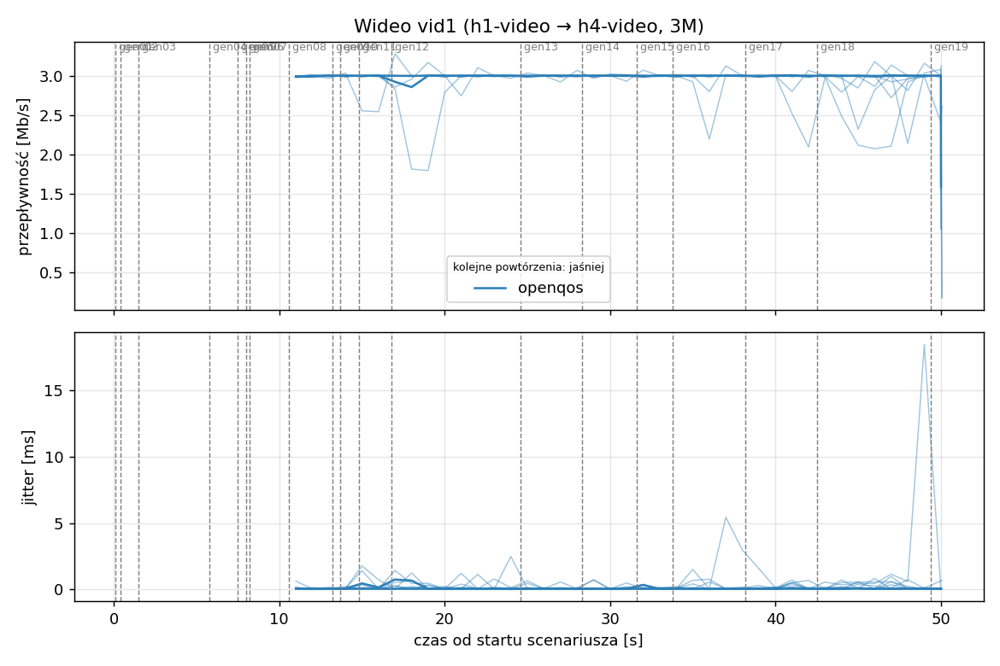
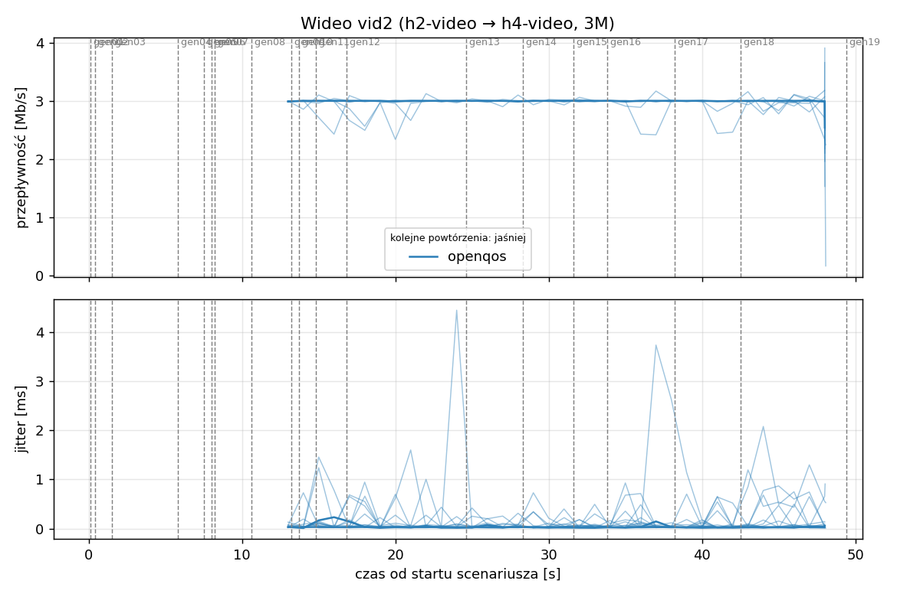
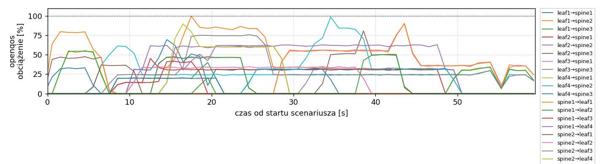
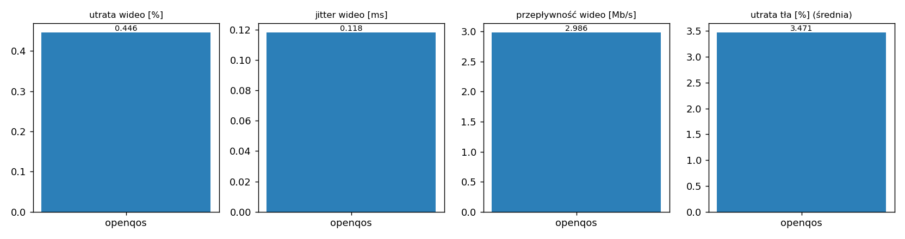

# Raport: clos-sdn

Katalog: `results/official/openqos/load-0.4/clos-sdn/20261109_114550`

## 1. Scenariusz

- Topologia: `clos` (sdn: `clos-sdn.clab.yml`)
- Warianty: **openqos** (POLICY=openqos)
- Czas testu: 60 s, warmup (pomijany w statystykach, liczony od startu każdego przepływu): 5 s, powtórzeń: 20, seed: 42
- Wykonane przebiegi: openqos/rep1, openqos/rep10, openqos/rep11, openqos/rep12, openqos/rep13, openqos/rep14, openqos/rep15, openqos/rep16, openqos/rep17, openqos/rep18, openqos/rep19, openqos/rep2, openqos/rep20, openqos/rep3, openqos/rep4, openqos/rep5, openqos/rep6, openqos/rep7, openqos/rep8, openqos/rep9

Harmonogram losowego tła różni się między powtórzeniami (seed + nr powtórzenia, wspólny dla wariantów); poniżej powtórzenie 1.

| id | klasa | źródło → cel | proto | zadana [Mb/s] | DSCP | start–koniec [s] |
|---|---|---|---|---|---|---|
| gen01 | background | h2-bg1 → h3-bg2 | udp | 4.49 | – | 0.1–7.1 |
| gen02 | background | h4-bg2 → h3-bg1 | udp | 3.16 | – | 0.4–5.4 |
| gen03 | background | h4-bg1 → h2-bg2 | udp | 5.25 | – | 1.5–6.5 |
| gen04 | background | h4-bg1 → h1-bg2 | udp | 3.56 | – | 5.8–10.8 |
| gen05 | background | h4-bg1 → h3-bg1 | udp | 2.36 | – | 7.5–59.5 |
| gen06 | background | h1-bg2 → h2-bg1 | udp | 1.93 | – | 8–21 |
| gen07 | background | h2-bg1 → h3-bg1 | udp | 1.39 | – | 8.2–13.2 |
| vid1 | video | h1-video → h4-video | udp | 3.00 | 46 | 10–50 |
| gen08 | background | h1-bg1 → h2-bg1 | udp | 3.29 | – | 10.6–38.6 |
| vid2 | video | h2-video → h4-video | udp | 3.00 | 46 | 12–48 |
| gen09 | background | h3-bg2 → h2-bg1 | udp | 4.51 | – | 13.2–24.2 |
| gen10 | background | h1-bg2 → h3-bg1 | udp | 3.96 | – | 13.7–18.7 |
| gen11 | background | h2-bg1 → h4-bg2 | udp | 5.85 | – | 14.8–28.8 |
| gen12 | background | h1-bg2 → h3-bg1 | udp | 4.90 | – | 16.8–26.8 |
| gen13 | background | h4-bg1 → h1-bg1 | udp | 3.07 | – | 24.6–34.6 |
| gen14 | background | h3-bg2 → h1-bg2 | udp | 5.37 | – | 28.3–44.3 |
| gen15 | background | h3-bg1 → h1-bg1 | udp | 3.12 | – | 31.6–49.6 |
| gen16 | background | h2-bg1 → h1-bg1 | udp | 4.96 | – | 33.8–38.8 |
| gen17 | background | h2-bg1 → h4-bg2 | udp | 4.86 | – | 38.2–43.2 |
| gen18 | background | h3-bg2 → h1-bg1 | udp | 3.49 | – | 42.5–59.5 |
| gen19 | background | h4-bg2 → h2-bg1 | udp | 2.93 | – | 49.4–59.4 |

## 2. Wideo: QoS według wariantu

Wartości: średnia ± odchylenie standardowe z powtórzeń.

| przepływ | wariant | przepływność [Mb/s] | jitter [ms] | utrata [%] | RTT mediana [ms] | RTT p95 [ms] |
|---|---|---|---|---|---|---|
| vid1 | openqos | 2.98 ± 0.04 | 0.128 ± 0.163 | 0.58 ± 1.27 | 0.030 ± 0.002 | 16.219 ± 25.395 |
| vid2 | openqos | 2.99 ± 0.02 | 0.109 ± 0.127 | 0.31 ± 0.73 | 0.026 ± 0.003 | 16.221 ± 23.989 |

RTT z `ping` co 0,1 s między hostami wideo (osobny przepływ ICMP z tym samym DSCP - w SDN może iść inną ścieżką niż strumień UDP).

## 3. Ruch tła

Agregat tła w obrębie powtórzenia, potem średnia ± odchylenie standardowe po powtórzeniach (utrata = Σ utraconych / Σ wysłanych datagramów; dostarczone = Σ przepływności / Σ zadanych; przepływy trwające nie dłużej niż warmup pominięte).

| wariant | strumieni tła / powt. | dostarczone / zadane [%] | jitter [ms] | utrata [%] |
|---|---|---|---|---|
| openqos | 16 | 96.6 ± 3.1 | 0.117 ± 0.052 | 3.47 ± 3.41 |

## 4. Obciążenie łączy fabricu

Średnia i maksimum z próbek co 1 s w oknie 0–60 s; MLU = maksymalne obciążenie łącza; drops = pakiety odrzucone przez `tbf` na wyjściu łącza.

| wariant | rep | średnie obciążenie łączy [%] | MLU [%] | łącza > 90% | drops tbf | CPU VM śr./maks. [%] |
|---|---|---|---|---|---|---|
| openqos | 1 | 15.5 | 99.7 | 3/24 | 448 | 15 / 90 |
| openqos | 2 | 21.5 | 102.9 | 8/24 | 2526 | 14 / 26 |
| openqos | 3 | 26.6 | 102.7 | 6/24 | 10645 | 14 / 21 |
| openqos | 4 | 18.3 | 102.2 | 6/24 | 922 | 12 / 21 |
| openqos | 5 | 17.9 | 97.3 | 3/24 | 163 | 12 / 21 |
| openqos | 6 | 10.4 | 92.6 | 1/24 | 0 | 11 / 19 |
| openqos | 7 | 15.7 | 102.1 | 3/24 | 2275 | 11 / 20 |
| openqos | 8 | 21.5 | 103.5 | 9/24 | 6587 | 12 / 24 |
| openqos | 9 | 18.9 | 102.4 | 6/24 | 11019 | 12 / 19 |
| openqos | 10 | 13.2 | 101.1 | 2/24 | 0 | 11 / 19 |
| openqos | 11 | 14.4 | 103.1 | 2/24 | 1752 | 11 / 19 |
| openqos | 12 | 12.9 | 102.0 | 4/24 | 1326 | 11 / 18 |
| openqos | 13 | 18.8 | 102.1 | 5/24 | 3932 | 12 / 22 |
| openqos | 14 | 16.9 | 101.9 | 4/24 | 506 | 12 / 22 |
| openqos | 15 | 23.8 | 103.8 | 7/24 | 12218 | 13 / 22 |
| openqos | 16 | 17.9 | 102.5 | 6/24 | 9161 | 12 / 20 |
| openqos | 17 | 21.7 | 102.6 | 4/24 | 7187 | 12 / 21 |
| openqos | 18 | 15.2 | 101.5 | 4/24 | 819 | 12 / 30 |
| openqos | 19 | 14.1 | 99.8 | 5/24 | 138 | 11 / 18 |
| openqos | 20 | 14.6 | 102.7 | 2/24 | 2419 | 11 / 21 |

Łącza z obciążeniem > 10% (maksimum [%] / drops, powtórzenie 1):

| łącze | openqos |
|---|---|
| leaf1→spine1 | 70 / 0 |
| leaf1→spine2 | 100 / 60 |
| leaf1→spine3 | 40 / 0 |
| leaf2→spine1 | 45 / 0 |
| leaf2→spine2 | 61 / 0 |
| leaf2→spine3 | 81 / 0 |
| leaf3→spine1 | 90 / 145 |
| leaf3→spine2 | 0 / 0 |
| leaf3→spine3 | 33 / 0 |
| leaf4→spine1 | 56 / 125 |
| leaf4→spine2 | 61 / 73 |
| leaf4→spine3 | 33 / 0 |
| spine1→leaf1 | 90 / 0 |
| spine1→leaf2 | 55 / 0 |
| spine1→leaf3 | 42 / 0 |
| spine1→leaf4 | 63 / 0 |
| spine2→leaf1 | 37 / 0 |
| spine2→leaf2 | 35 / 0 |
| spine2→leaf3 | 76 / 0 |
| spine2→leaf4 | 90 / 0 |
| spine3→leaf1 | 99 / 45 |
| spine3→leaf2 | 20 / 0 |
| spine3→leaf3 | 80 / 0 |
| spine3→leaf4 | 51 / 0 |

## 5. Ścieżki wybrane przez kontroler (powtórzenie 1)

Z logu kontrolera (linie `Flow`), dopasowane po piątce przepływu; ✓ = reguły widoczne w `dump-flows` na tych samych przełącznikach.

| przepływ | openqos |
|---|---|
| gen01 | leaf2 -> spine3 -> leaf3 ✓ (loads 0% 0% 0%) |
| gen02 | leaf4 -> spine3 -> leaf3 ✓ (loads 0% 0% 0%) |
| gen03 | leaf4 -> spine1 -> leaf2 ✓ (loads 0% 0% 9%) |
| gen04 | leaf4 -> spine2 -> leaf1 ✓ (loads 54% 0% 24%) |
| gen05 | leaf4 -> spine2 -> leaf3 ✓ (loads 45% 32% 46%) |
| gen06 | leaf1 -> spine3 -> leaf2 ✓ (loads 0% 0% 0%) |
| gen07 | leaf2 -> spine1 -> leaf3 ✓ (loads 0% 4% 21%) |
| vid1 | leaf1 -> spine1 -> leaf4 ✓ (loads 62% 0% 0%) |
| gen08 | leaf1 -> spine2 -> leaf2 ✓ (loads 0% 0% 20%) |
| vid2 | leaf2 -> spine1 -> leaf4 ✓ (loads 62% 0% 0%) |
| gen09 | leaf3 -> spine1 -> leaf2 ✓ (loads 0% 34% 20%) |
| gen10 | leaf1 -> spine1 -> leaf3 ✓ (loads 31% 34% 20%) |
| gen11 | leaf2 -> spine2 -> leaf4 ✓ (loads 62% 0% 0%) |
| gen12 | leaf1 -> spine2 -> leaf3 ✓ (loads 41% 65% 20%) |
| gen13 | leaf4 -> spine3 -> leaf1 ✓ (loads 0% 24% 0%) |
| gen14 | leaf3 -> spine1 -> leaf1 ✓ (loads 0% 0% 32%) |
| gen15 | leaf3 -> spine3 -> leaf1 ✓ (loads 55% 0% 32%) |
| gen16 | leaf2 -> spine3 -> leaf1 ✓ (loads 55% 0% 64%) |
| gen17 | leaf2 -> spine3 -> leaf4 ✓ (loads 62% 0% 51%) |
| gen18 | leaf3 -> spine1 -> leaf1 ✓ (loads 55% 0% 32%) |
| gen19 | leaf4 -> spine1 -> leaf2 ✓ (loads 0% 24% 0%) |

## 6. Wnioski

<!-- WNIOSKI:START -->
_Do uzupełnienia: krótkie wnioski wyłącznie na podstawie liczb z sekcji 2–5._
<!-- WNIOSKI:END -->

## 7. Wiarygodność pomiaru

- openqos rep1, gen02: przepływ krótszy niż warmup - statystyki z całości
- openqos rep1, gen03: przepływ krótszy niż warmup - statystyki z całości
- openqos rep1, gen04: przepływ krótszy niż warmup - statystyki z całości
- openqos rep1, gen07: przepływ krótszy niż warmup - statystyki z całości
- openqos rep1, vid1: 13 decyzji kontrolera dla jednego przepływu (wygasła reguła albo duplikat Packet-In)
- openqos rep1, vid2: 13 decyzji kontrolera dla jednego przepływu (wygasła reguła albo duplikat Packet-In)
- openqos rep1: CPU maszyny do 90% (średnio 15%) - możliwy wpływ na pomiary
- openqos rep10, gen04: przepływ krótszy niż warmup - statystyki z całości
- openqos rep10, gen09: przepływ krótszy niż warmup - statystyki z całości
- openqos rep10, gen10: przepływ krótszy niż warmup - statystyki z całości
- openqos rep10, vid1: 6 decyzji kontrolera dla jednego przepływu (wygasła reguła albo duplikat Packet-In)
- openqos rep10, vid2: 6 decyzji kontrolera dla jednego przepływu (wygasła reguła albo duplikat Packet-In)
- openqos rep11, gen13: przepływ krótszy niż warmup - statystyki z całości
- openqos rep11, gen19: przepływ krótszy niż warmup - statystyki z całości
- openqos rep11, gen22: przepływ krótszy niż warmup - statystyki z całości
- openqos rep11, vid1: 5 decyzji kontrolera dla jednego przepływu (wygasła reguła albo duplikat Packet-In)
- openqos rep11, vid2: 5 decyzji kontrolera dla jednego przepływu (wygasła reguła albo duplikat Packet-In)
- openqos rep12, gen04: przepływ krótszy niż warmup - statystyki z całości
- openqos rep12, gen07: przepływ krótszy niż warmup - statystyki z całości
- openqos rep12, vid1: 7 decyzji kontrolera dla jednego przepływu (wygasła reguła albo duplikat Packet-In)
- openqos rep12, vid2: 6 decyzji kontrolera dla jednego przepływu (wygasła reguła albo duplikat Packet-In)
- openqos rep13, gen14: przepływ krótszy niż warmup - statystyki z całości
- openqos rep13, gen19: przepływ krótszy niż warmup - statystyki z całości
- openqos rep13, vid1: 17 decyzji kontrolera dla jednego przepływu (wygasła reguła albo duplikat Packet-In)
- openqos rep13, vid2: 17 decyzji kontrolera dla jednego przepływu (wygasła reguła albo duplikat Packet-In)
- openqos rep14, gen17: przepływ krótszy niż warmup - statystyki z całości
- openqos rep14, vid1: 21 decyzji kontrolera dla jednego przepływu (wygasła reguła albo duplikat Packet-In)
- openqos rep14, vid1: dump-flows nie potwierdza ścieżki z logu (leaf1 -> spine3 -> leaf4 vs leaf1, spine1, spine2)
- openqos rep14, vid2: 20 decyzji kontrolera dla jednego przepływu (wygasła reguła albo duplikat Packet-In)
- openqos rep15, vid1: 20 decyzji kontrolera dla jednego przepływu (wygasła reguła albo duplikat Packet-In)
- openqos rep15, vid1: dump-flows nie potwierdza ścieżki z logu (leaf1 -> spine1 -> leaf4 vs leaf1, spine2)
- openqos rep15, vid2: 18 decyzji kontrolera dla jednego przepływu (wygasła reguła albo duplikat Packet-In)
- openqos rep16, gen11: przepływ krótszy niż warmup - statystyki z całości
- openqos rep16, gen15: przepływ krótszy niż warmup - statystyki z całości
- openqos rep16, gen20: przepływ krótszy niż warmup - statystyki z całości
- openqos rep16, vid1: 18 decyzji kontrolera dla jednego przepływu (wygasła reguła albo duplikat Packet-In)
- openqos rep16, vid2: 17 decyzji kontrolera dla jednego przepływu (wygasła reguła albo duplikat Packet-In)
- openqos rep17, gen05: przepływ krótszy niż warmup - statystyki z całości
- openqos rep17, gen06: przepływ krótszy niż warmup - statystyki z całości
- openqos rep17, gen09: przepływ krótszy niż warmup - statystyki z całości
- openqos rep17, gen15: przepływ krótszy niż warmup - statystyki z całości
- openqos rep17, gen24: przepływ krótszy niż warmup - statystyki z całości
- openqos rep17, gen25: przepływ krótszy niż warmup - statystyki z całości
- openqos rep17, vid1: 14 decyzji kontrolera dla jednego przepływu (wygasła reguła albo duplikat Packet-In)
- openqos rep17, vid2: 14 decyzji kontrolera dla jednego przepływu (wygasła reguła albo duplikat Packet-In)
- openqos rep18, gen04: przepływ krótszy niż warmup - statystyki z całości
- openqos rep18, gen17: przepływ krótszy niż warmup - statystyki z całości
- openqos rep18, vid1: 15 decyzji kontrolera dla jednego przepływu (wygasła reguła albo duplikat Packet-In)
- openqos rep18, vid2: 15 decyzji kontrolera dla jednego przepływu (wygasła reguła albo duplikat Packet-In)
- openqos rep19, gen02: przepływ krótszy niż warmup - statystyki z całości
- openqos rep19, gen04: przepływ krótszy niż warmup - statystyki z całości
- openqos rep19, gen12: przepływ krótszy niż warmup - statystyki z całości
- openqos rep19, gen14: przepływ krótszy niż warmup - statystyki z całości
- openqos rep19, vid1: 8 decyzji kontrolera dla jednego przepływu (wygasła reguła albo duplikat Packet-In)
- openqos rep19, vid2: 7 decyzji kontrolera dla jednego przepływu (wygasła reguła albo duplikat Packet-In)
- openqos rep2, gen05: przepływ krótszy niż warmup - statystyki z całości
- openqos rep2, gen12: przepływ krótszy niż warmup - statystyki z całości
- openqos rep2, gen24: przepływ krótszy niż warmup - statystyki z całości
- openqos rep2, gen27: przepływ krótszy niż warmup - statystyki z całości
- openqos rep2, vid1: 15 decyzji kontrolera dla jednego przepływu (wygasła reguła albo duplikat Packet-In)
- openqos rep2, vid2: 14 decyzji kontrolera dla jednego przepływu (wygasła reguła albo duplikat Packet-In)
- openqos rep2, vid2: dump-flows nie potwierdza ścieżki z logu (leaf2 -> spine2 -> leaf4 vs leaf2, spine1)
- openqos rep20, gen09: przepływ krótszy niż warmup - statystyki z całości
- openqos rep20, gen12: przepływ krótszy niż warmup - statystyki z całości
- openqos rep20, vid1: 15 decyzji kontrolera dla jednego przepływu (wygasła reguła albo duplikat Packet-In)
- openqos rep20, vid2: 15 decyzji kontrolera dla jednego przepływu (wygasła reguła albo duplikat Packet-In)
- openqos rep3, gen02: przepływ krótszy niż warmup - statystyki z całości
- openqos rep3, gen03: przepływ krótszy niż warmup - statystyki z całości
- openqos rep3, gen11: przepływ krótszy niż warmup - statystyki z całości
- openqos rep3, gen13: przepływ krótszy niż warmup - statystyki z całości
- openqos rep3, gen15: przepływ krótszy niż warmup - statystyki z całości
- openqos rep3, vid1: 17 decyzji kontrolera dla jednego przepływu (wygasła reguła albo duplikat Packet-In)
- openqos rep3, vid1: dump-flows nie potwierdza ścieżki z logu (leaf1 -> spine1 -> leaf4 vs leaf1, spine2)
- openqos rep3, vid2: 16 decyzji kontrolera dla jednego przepływu (wygasła reguła albo duplikat Packet-In)
- openqos rep4, gen22: przepływ krótszy niż warmup - statystyki z całości
- openqos rep4, vid1: 17 decyzji kontrolera dla jednego przepływu (wygasła reguła albo duplikat Packet-In)
- openqos rep4, vid2: 16 decyzji kontrolera dla jednego przepływu (wygasła reguła albo duplikat Packet-In)
- openqos rep5, gen02: przepływ krótszy niż warmup - statystyki z całości
- openqos rep5, gen03: przepływ krótszy niż warmup - statystyki z całości
- openqos rep5, vid1: 15 decyzji kontrolera dla jednego przepływu (wygasła reguła albo duplikat Packet-In)
- openqos rep5, vid2: 13 decyzji kontrolera dla jednego przepływu (wygasła reguła albo duplikat Packet-In)
- openqos rep6, gen04: przepływ krótszy niż warmup - statystyki z całości
- openqos rep6, gen10: przepływ krótszy niż warmup - statystyki z całości
- openqos rep6, vid1: 7 decyzji kontrolera dla jednego przepływu (wygasła reguła albo duplikat Packet-In)
- openqos rep6, vid2: 5 decyzji kontrolera dla jednego przepływu (wygasła reguła albo duplikat Packet-In)
- openqos rep7, gen03: przepływ krótszy niż warmup - statystyki z całości
- openqos rep7, vid1: 8 decyzji kontrolera dla jednego przepływu (wygasła reguła albo duplikat Packet-In)
- openqos rep7, vid2: 8 decyzji kontrolera dla jednego przepływu (wygasła reguła albo duplikat Packet-In)
- openqos rep8, gen12: przepływ krótszy niż warmup - statystyki z całości
- openqos rep8, vid1: 12 decyzji kontrolera dla jednego przepływu (wygasła reguła albo duplikat Packet-In)
- openqos rep8, vid2: 11 decyzji kontrolera dla jednego przepływu (wygasła reguła albo duplikat Packet-In)
- openqos rep9, vid1: 11 decyzji kontrolera dla jednego przepływu (wygasła reguła albo duplikat Packet-In)
- openqos rep9, vid2: 11 decyzji kontrolera dla jednego przepływu (wygasła reguła albo duplikat Packet-In)
