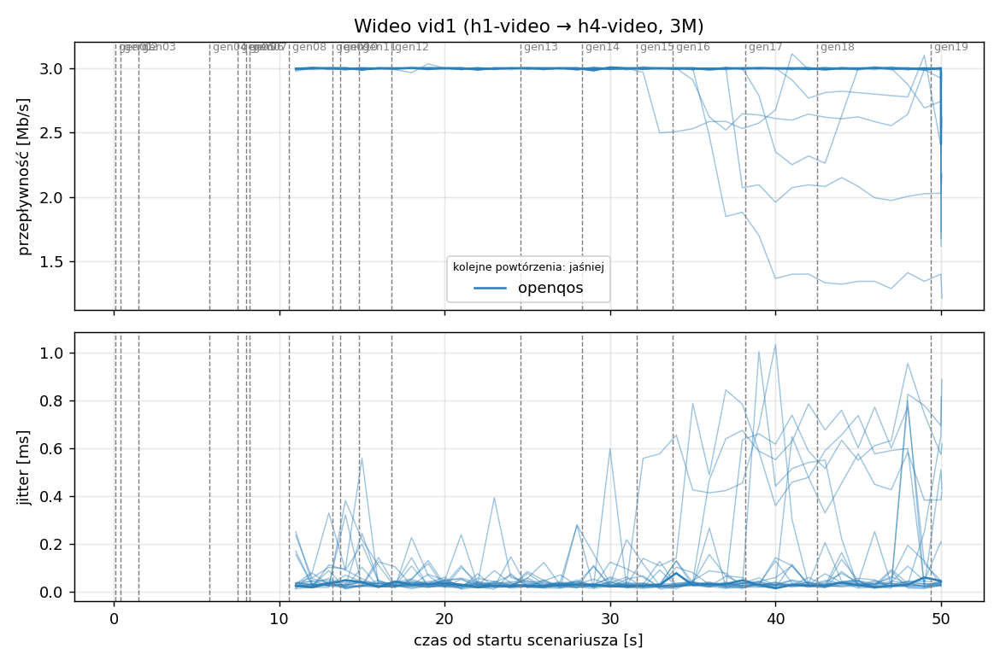
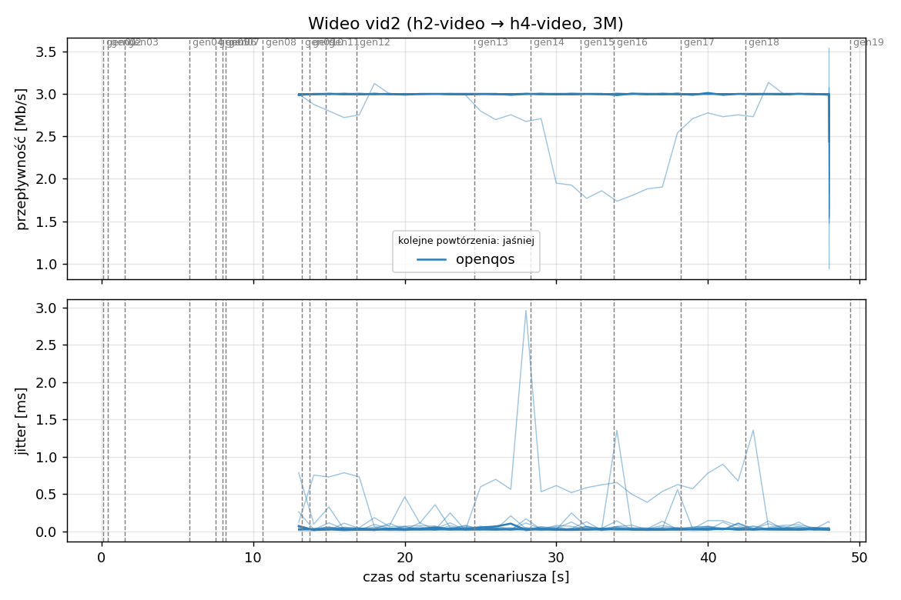
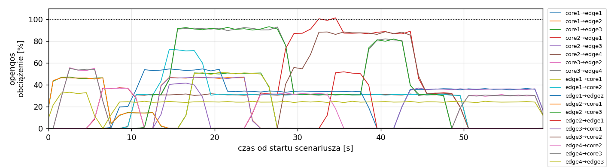
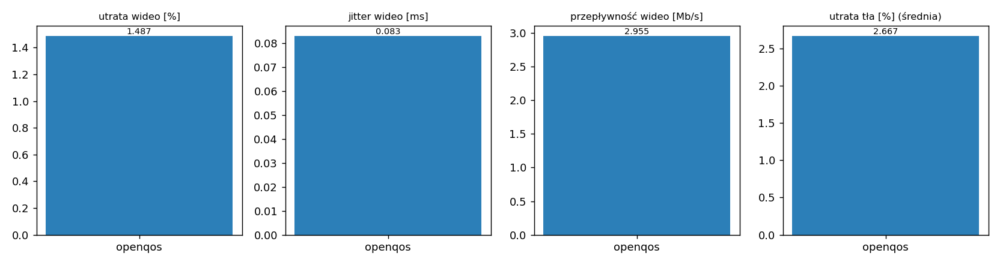

# Raport: mesh-sdn

Katalog: `results/official/openqos/load-0.4/mesh-sdn/20261109_124648`

## 1. Scenariusz

- Topologia: `mesh` (sdn: `mesh-sdn.clab.yml`)
- Warianty: **openqos** (POLICY=openqos)
- Czas testu: 60 s, warmup (pomijany w statystykach, liczony od startu każdego przepływu): 5 s, powtórzeń: 20, seed: 42
- Wykonane przebiegi: openqos/rep1, openqos/rep10, openqos/rep11, openqos/rep12, openqos/rep13, openqos/rep14, openqos/rep15, openqos/rep16, openqos/rep17, openqos/rep18, openqos/rep19, openqos/rep2, openqos/rep20, openqos/rep3, openqos/rep4, openqos/rep5, openqos/rep6, openqos/rep7, openqos/rep8, openqos/rep9

Harmonogram losowego tła różni się między powtórzeniami (seed + nr powtórzenia, wspólny dla wariantów); poniżej powtórzenie 1.

| id | klasa | źródło → cel | proto | zadana [Mb/s] | DSCP | start–koniec [s] |
|---|---|---|---|---|---|---|
| gen01 | background | h2-bg1 → h3-bg2 | udp | 4.49 | – | 0.1–7.1 |
| gen02 | background | h4-bg2 → h3-bg1 | udp | 3.16 | – | 0.4–5.4 |
| gen03 | background | h4-bg1 → h2-bg2 | udp | 5.25 | – | 1.5–6.5 |
| gen04 | background | h4-bg1 → h1-bg2 | udp | 3.56 | – | 5.8–10.8 |
| gen05 | background | h4-bg1 → h3-bg1 | udp | 2.36 | – | 7.5–59.5 |
| gen06 | background | h1-bg2 → h2-bg1 | udp | 1.93 | – | 8–21 |
| gen07 | background | h2-bg1 → h3-bg1 | udp | 1.39 | – | 8.2–13.2 |
| vid1 | video | h1-video → h4-video | udp | 3.00 | 46 | 10–50 |
| gen08 | background | h1-bg1 → h2-bg1 | udp | 3.29 | – | 10.6–38.6 |
| vid2 | video | h2-video → h4-video | udp | 3.00 | 46 | 12–48 |
| gen09 | background | h3-bg2 → h2-bg1 | udp | 4.51 | – | 13.2–24.2 |
| gen10 | background | h1-bg2 → h3-bg1 | udp | 3.96 | – | 13.7–18.7 |
| gen11 | background | h2-bg1 → h4-bg2 | udp | 5.85 | – | 14.8–28.8 |
| gen12 | background | h1-bg2 → h3-bg1 | udp | 4.90 | – | 16.8–26.8 |
| gen13 | background | h4-bg1 → h1-bg1 | udp | 3.07 | – | 24.6–34.6 |
| gen14 | background | h3-bg2 → h1-bg2 | udp | 5.37 | – | 28.3–44.3 |
| gen15 | background | h3-bg1 → h1-bg1 | udp | 3.12 | – | 31.6–49.6 |
| gen16 | background | h2-bg1 → h1-bg1 | udp | 4.96 | – | 33.8–38.8 |
| gen17 | background | h2-bg1 → h4-bg2 | udp | 4.86 | – | 38.2–43.2 |
| gen18 | background | h3-bg2 → h1-bg1 | udp | 3.49 | – | 42.5–59.5 |
| gen19 | background | h4-bg2 → h2-bg1 | udp | 2.93 | – | 49.4–59.4 |

## 2. Wideo: QoS według wariantu

Wartości: średnia ± odchylenie standardowe z powtórzeń.

| przepływ | wariant | przepływność [Mb/s] | jitter [ms] | utrata [%] | RTT mediana [ms] | RTT p95 [ms] |
|---|---|---|---|---|---|---|
| vid1 | openqos | 2.93 ± 0.16 | 0.102 ± 0.088 | 2.32 ± 5.23 | 0.030 ± 0.003 | 26.575 ± 29.984 |
| vid2 | openqos | 2.98 ± 0.09 | 0.064 ± 0.101 | 0.66 ± 2.92 | 2.994 ± 13.277 | 6.092 ± 18.594 |

RTT z `ping` co 0,1 s między hostami wideo (osobny przepływ ICMP z tym samym DSCP - w SDN może iść inną ścieżką niż strumień UDP).

## 3. Ruch tła

Agregat tła w obrębie powtórzenia, potem średnia ± odchylenie standardowe po powtórzeniach (utrata = Σ utraconych / Σ wysłanych datagramów; dostarczone = Σ przepływności / Σ zadanych; przepływy trwające nie dłużej niż warmup pominięte).

| wariant | strumieni tła / powt. | dostarczone / zadane [%] | jitter [ms] | utrata [%] |
|---|---|---|---|---|
| openqos | 16 | 97.6 ± 2.7 | 0.094 ± 0.046 | 2.67 ± 3.28 |

## 4. Obciążenie łączy fabricu

Średnia i maksimum z próbek co 1 s w oknie 0–60 s; MLU = maksymalne obciążenie łącza; drops = pakiety odrzucone przez `tbf` na wyjściu łącza.

| wariant | rep | średnie obciążenie łączy [%] | MLU [%] | łącza > 90% | drops tbf | CPU VM śr./maks. [%] |
|---|---|---|---|---|---|---|
| openqos | 1 | 13.4 | 101.3 | 3/24 | 447 | 11 / 21 |
| openqos | 2 | 16.4 | 102.6 | 4/24 | 13403 | 12 / 20 |
| openqos | 3 | 21.8 | 103.0 | 6/24 | 2019 | 13 / 20 |
| openqos | 4 | 15.2 | 102.3 | 5/24 | 4297 | 12 / 20 |
| openqos | 5 | 14.2 | 80.8 | 0/24 | 0 | 11 / 20 |
| openqos | 6 | 9.3 | 101.1 | 1/24 | 788 | 11 / 21 |
| openqos | 7 | 13.2 | 101.4 | 1/24 | 4440 | 11 / 18 |
| openqos | 8 | 17.6 | 102.1 | 8/24 | 4160 | 12 / 21 |
| openqos | 9 | 13.5 | 103.2 | 2/24 | 10108 | 11 / 19 |
| openqos | 10 | 11.3 | 87.5 | 0/24 | 0 | 11 / 20 |
| openqos | 11 | 12.9 | 102.1 | 1/24 | 1231 | 11 / 19 |
| openqos | 12 | 12.1 | 103.4 | 3/24 | 1332 | 11 / 18 |
| openqos | 13 | 15.8 | 102.6 | 3/24 | 1793 | 12 / 22 |
| openqos | 14 | 14.3 | 100.2 | 2/24 | 0 | 12 / 20 |
| openqos | 15 | 20.0 | 102.3 | 6/24 | 5502 | 13 / 20 |
| openqos | 16 | 14.7 | 102.2 | 6/24 | 4022 | 12 / 19 |
| openqos | 17 | 19.4 | 102.2 | 4/24 | 151 | 12 / 20 |
| openqos | 18 | 13.5 | 93.6 | 2/24 | 0 | 12 / 20 |
| openqos | 19 | 12.9 | 99.4 | 3/24 | 0 | 11 / 19 |
| openqos | 20 | 12.1 | 102.1 | 3/24 | 162 | 11 / 20 |

Łącza z obciążeniem > 10% (maksimum [%] / drops, powtórzenie 1):

| łącze | openqos |
|---|---|
| core1→edge1 | 37 / 0 |
| core1→edge2 | 47 / 0 |
| core1→edge3 | 51 / 0 |
| core2→edge1 | 101 / 447 |
| core2→edge3 | 42 / 0 |
| core2→edge4 | 32 / 0 |
| core3→edge2 | 56 / 0 |
| core3→edge4 | 93 / 0 |
| edge1→core1 | 51 / 0 |
| edge1→core2 | 72 / 0 |
| edge1→edge2 | 54 / 0 |
| edge2→core1 | 46 / 0 |
| edge2→core3 | 93 / 0 |
| edge2→edge1 | 52 / 0 |
| edge3→core1 | 47 / 0 |
| edge3→core2 | 89 / 0 |
| edge3→edge4 | 0 / 0 |
| edge4→core2 | 37 / 0 |
| edge4→core3 | 55 / 0 |
| edge4→edge3 | 33 / 0 |

## 5. Ścieżki wybrane przez kontroler (powtórzenie 1)

Z logu kontrolera (linie `Flow`), dopasowane po piątce przepływu; ✓ = reguły widoczne w `dump-flows` na tych samych przełącznikach.

| przepływ | openqos |
|---|---|
| gen01 | edge2 -> core1 -> edge3 ✓ (loads 0% 0% 0% 0%) |
| gen02 | edge4 -> edge3 ✓ (loads 0% 0%) |
| gen03 | edge4 -> core3 -> edge2 ✓ (loads 0% 33% 0% 0%) |
| gen04 | edge4 -> core2 -> edge1 ✓ (loads 0% 29% 29% 54%) |
| gen05 | edge4 -> edge3 ✓ (loads 0% 37%) |
| gen06 | edge1 -> edge2 ✓ (loads 0% 0%) |
| gen07 | edge2 -> core1 -> edge3 ✓ (loads 29% 29% 0% 0%) |
| vid1 | edge1 -> core2 -> edge4 ✓ (loads 31% 31% 0% 14%) |
| gen08 | edge1 -> edge2 ✓ (loads 20% 0%) |
| vid2 | edge2 -> core3 -> edge4 ✓ (loads 31% 31% 0% 31%) |
| gen09 | edge3 -> core1 -> edge2 ✓ (loads 0% 0% 54% 0%) |
| gen10 | edge1 -> core2 -> edge3 ✓ (loads 10% 31% 54% 31%) |
| gen11 | edge2 -> core3 -> edge4 ✓ (loads 31% 63% 0% 31%) |
| gen12 | edge1 -> core1 -> edge3 ✓ (loads 0% 72% 54% 72%) |
| gen13 | edge4 -> core2 -> edge1 ✓ (loads 0% 31% 24% 0%) |
| gen14 | edge3 -> core2 -> edge1 ✓ (loads 0% 32% 32% 0%) |
| gen15 | edge3 -> core2 -> edge1 ✓ (loads 0% 87% 87% 0%) |
| gen16 | edge2 -> edge1 ✓ (loads 0% 0%) |
| gen17 | edge2 -> core3 -> edge4 ✓ (loads 31% 51% 0% 31%) |
| gen18 | edge3 -> core1 -> edge1 ✓ (loads 0% 88% 88% 0%) |
| gen19 | edge4 -> core3 -> edge2 ✓ (loads 0% 36% 32% 0%) |

## 6. Wnioski

<!-- WNIOSKI:START -->
_Do uzupełnienia: krótkie wnioski wyłącznie na podstawie liczb z sekcji 2–5._
<!-- WNIOSKI:END -->

## 7. Wiarygodność pomiaru

- openqos rep1, gen02: przepływ krótszy niż warmup - statystyki z całości
- openqos rep1, gen03: przepływ krótszy niż warmup - statystyki z całości
- openqos rep1, gen04: przepływ krótszy niż warmup - statystyki z całości
- openqos rep1, gen07: przepływ krótszy niż warmup - statystyki z całości
- openqos rep1, gen16: przepływ krótszy niż warmup - statystyki z całości
- openqos rep1, vid1: 9 decyzji kontrolera dla jednego przepływu (wygasła reguła albo duplikat Packet-In)
- openqos rep1, vid2: 8 decyzji kontrolera dla jednego przepływu (wygasła reguła albo duplikat Packet-In)
- openqos rep10, gen02: przepływ krótszy niż warmup - statystyki z całości
- openqos rep10, gen04: przepływ krótszy niż warmup - statystyki z całości
- openqos rep10, gen09: przepływ krótszy niż warmup - statystyki z całości
- openqos rep10, gen10: przepływ krótszy niż warmup - statystyki z całości
- openqos rep10, gen17: przepływ krótszy niż warmup - statystyki z całości
- openqos rep10, vid1: 7 decyzji kontrolera dla jednego przepływu (wygasła reguła albo duplikat Packet-In)
- openqos rep10, vid2: 6 decyzji kontrolera dla jednego przepływu (wygasła reguła albo duplikat Packet-In)
- openqos rep11, gen09: przepływ krótszy niż warmup - statystyki z całości
- openqos rep11, gen19: przepływ krótszy niż warmup - statystyki z całości
- openqos rep11, gen20: przepływ krótszy niż warmup - statystyki z całości
- openqos rep11, vid1: 5 decyzji kontrolera dla jednego przepływu (wygasła reguła albo duplikat Packet-In)
- openqos rep11, vid2: 5 decyzji kontrolera dla jednego przepływu (wygasła reguła albo duplikat Packet-In)
- openqos rep12, gen03: przepływ krótszy niż warmup - statystyki z całości
- openqos rep12, gen04: przepływ krótszy niż warmup - statystyki z całości
- openqos rep12, gen07: przepływ krótszy niż warmup - statystyki z całości
- openqos rep12, vid1: 4 decyzji kontrolera dla jednego przepływu (wygasła reguła albo duplikat Packet-In)
- openqos rep12, vid2: 4 decyzji kontrolera dla jednego przepływu (wygasła reguła albo duplikat Packet-In)
- openqos rep13, gen12: przepływ krótszy niż warmup - statystyki z całości
- openqos rep13, gen13: przepływ krótszy niż warmup - statystyki z całości
- openqos rep13, gen14: przepływ krótszy niż warmup - statystyki z całości
- openqos rep13, gen19: przepływ krótszy niż warmup - statystyki z całości
- openqos rep13, vid1: 14 decyzji kontrolera dla jednego przepływu (wygasła reguła albo duplikat Packet-In)
- openqos rep13, vid2: 13 decyzji kontrolera dla jednego przepływu (wygasła reguła albo duplikat Packet-In)
- openqos rep14, gen13: przepływ krótszy niż warmup - statystyki z całości
- openqos rep14, gen17: przepływ krótszy niż warmup - statystyki z całości
- openqos rep14, gen20: przepływ krótszy niż warmup - statystyki z całości
- openqos rep14, vid1: 9 decyzji kontrolera dla jednego przepływu (wygasła reguła albo duplikat Packet-In)
- openqos rep14, vid2: 8 decyzji kontrolera dla jednego przepływu (wygasła reguła albo duplikat Packet-In)
- openqos rep15, gen09: przepływ krótszy niż warmup - statystyki z całości
- openqos rep15, vid1: 9 decyzji kontrolera dla jednego przepływu (wygasła reguła albo duplikat Packet-In)
- openqos rep15, vid2: 8 decyzji kontrolera dla jednego przepływu (wygasła reguła albo duplikat Packet-In)
- openqos rep16, gen11: przepływ krótszy niż warmup - statystyki z całości
- openqos rep16, gen15: przepływ krótszy niż warmup - statystyki z całości
- openqos rep16, gen19: przepływ krótszy niż warmup - statystyki z całości
- openqos rep16, vid1: 10 decyzji kontrolera dla jednego przepływu (wygasła reguła albo duplikat Packet-In)
- openqos rep16, vid2: 10 decyzji kontrolera dla jednego przepływu (wygasła reguła albo duplikat Packet-In)
- openqos rep17, gen05: przepływ krótszy niż warmup - statystyki z całości
- openqos rep17, gen06: przepływ krótszy niż warmup - statystyki z całości
- openqos rep17, gen08: przepływ krótszy niż warmup - statystyki z całości
- openqos rep17, gen09: przepływ krótszy niż warmup - statystyki z całości
- openqos rep17, gen15: przepływ krótszy niż warmup - statystyki z całości
- openqos rep17, gen24: przepływ krótszy niż warmup - statystyki z całości
- openqos rep17, gen25: przepływ krótszy niż warmup - statystyki z całości
- openqos rep17, vid1: 12 decyzji kontrolera dla jednego przepływu (wygasła reguła albo duplikat Packet-In)
- openqos rep17, vid2: 12 decyzji kontrolera dla jednego przepływu (wygasła reguła albo duplikat Packet-In)
- openqos rep18, gen01: przepływ krótszy niż warmup - statystyki z całości
- openqos rep18, gen04: przepływ krótszy niż warmup - statystyki z całości
- openqos rep18, gen17: przepływ krótszy niż warmup - statystyki z całości
- openqos rep18, vid1: 5 decyzji kontrolera dla jednego przepływu (wygasła reguła albo duplikat Packet-In)
- openqos rep18, vid2: 4 decyzji kontrolera dla jednego przepływu (wygasła reguła albo duplikat Packet-In)
- openqos rep19, gen02: przepływ krótszy niż warmup - statystyki z całości
- openqos rep19, gen04: przepływ krótszy niż warmup - statystyki z całości
- openqos rep19, gen12: przepływ krótszy niż warmup - statystyki z całości
- openqos rep19, gen14: przepływ krótszy niż warmup - statystyki z całości
- openqos rep19, gen16: przepływ krótszy niż warmup - statystyki z całości
- openqos rep19, vid1: 7 decyzji kontrolera dla jednego przepływu (wygasła reguła albo duplikat Packet-In)
- openqos rep19, vid2: 7 decyzji kontrolera dla jednego przepływu (wygasła reguła albo duplikat Packet-In)
- openqos rep2, gen07: przepływ krótszy niż warmup - statystyki z całości
- openqos rep2, gen12: przepływ krótszy niż warmup - statystyki z całości
- openqos rep2, gen18: przepływ krótszy niż warmup - statystyki z całości
- openqos rep2, gen27: przepływ krótszy niż warmup - statystyki z całości
- openqos rep2, vid1: 9 decyzji kontrolera dla jednego przepływu (wygasła reguła albo duplikat Packet-In)
- openqos rep2, vid2: 8 decyzji kontrolera dla jednego przepływu (wygasła reguła albo duplikat Packet-In)
- openqos rep20, gen09: przepływ krótszy niż warmup - statystyki z całości
- openqos rep20, gen11: przepływ krótszy niż warmup - statystyki z całości
- openqos rep20, gen15: przepływ krótszy niż warmup - statystyki z całości
- openqos rep20, vid1: 6 decyzji kontrolera dla jednego przepływu (wygasła reguła albo duplikat Packet-In)
- openqos rep20, vid2: 6 decyzji kontrolera dla jednego przepływu (wygasła reguła albo duplikat Packet-In)
- openqos rep3, gen02: przepływ krótszy niż warmup - statystyki z całości
- openqos rep3, gen03: przepływ krótszy niż warmup - statystyki z całości
- openqos rep3, gen13: przepływ krótszy niż warmup - statystyki z całości
- openqos rep3, gen15: przepływ krótszy niż warmup - statystyki z całości
- openqos rep3, gen18: przepływ krótszy niż warmup - statystyki z całości
- openqos rep3, vid1: 9 decyzji kontrolera dla jednego przepływu (wygasła reguła albo duplikat Packet-In)
- openqos rep3, vid2: 9 decyzji kontrolera dla jednego przepływu (wygasła reguła albo duplikat Packet-In)
- openqos rep4, gen22: przepływ krótszy niż warmup - statystyki z całości
- openqos rep4, vid1: 12 decyzji kontrolera dla jednego przepływu (wygasła reguła albo duplikat Packet-In)
- openqos rep4, vid2: 12 decyzji kontrolera dla jednego przepływu (wygasła reguła albo duplikat Packet-In)
- openqos rep5, gen02: przepływ krótszy niż warmup - statystyki z całości
- openqos rep5, gen21: przepływ krótszy niż warmup - statystyki z całości
- openqos rep5, vid1: 2 decyzji kontrolera dla jednego przepływu (wygasła reguła albo duplikat Packet-In)
- openqos rep5, vid2: 2 decyzji kontrolera dla jednego przepływu (wygasła reguła albo duplikat Packet-In)
- openqos rep6, gen04: przepływ krótszy niż warmup - statystyki z całości
- openqos rep6, gen07: przepływ krótszy niż warmup - statystyki z całości
- openqos rep6, gen10: przepływ krótszy niż warmup - statystyki z całości
- openqos rep6, vid1: 6 decyzji kontrolera dla jednego przepływu (wygasła reguła albo duplikat Packet-In)
- openqos rep6, vid2: 5 decyzji kontrolera dla jednego przepływu (wygasła reguła albo duplikat Packet-In)
- openqos rep7, gen02: przepływ krótszy niż warmup - statystyki z całości
- openqos rep7, gen11: przepływ krótszy niż warmup - statystyki z całości
- openqos rep7, vid1: 7 decyzji kontrolera dla jednego przepływu (wygasła reguła albo duplikat Packet-In)
- openqos rep7, vid2: 7 decyzji kontrolera dla jednego przepływu (wygasła reguła albo duplikat Packet-In)
- openqos rep8, gen12: przepływ krótszy niż warmup - statystyki z całości
- openqos rep8, gen22: przepływ krótszy niż warmup - statystyki z całości
- openqos rep8, vid1: 9 decyzji kontrolera dla jednego przepływu (wygasła reguła albo duplikat Packet-In)
- openqos rep8, vid2: 8 decyzji kontrolera dla jednego przepływu (wygasła reguła albo duplikat Packet-In)
- openqos rep9, vid1: 6 decyzji kontrolera dla jednego przepływu (wygasła reguła albo duplikat Packet-In)
- openqos rep9, vid2: 6 decyzji kontrolera dla jednego przepływu (wygasła reguła albo duplikat Packet-In)
