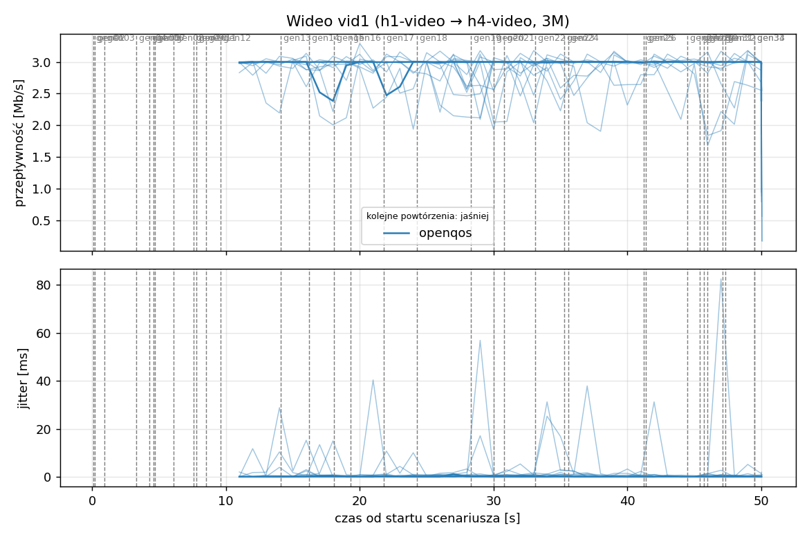
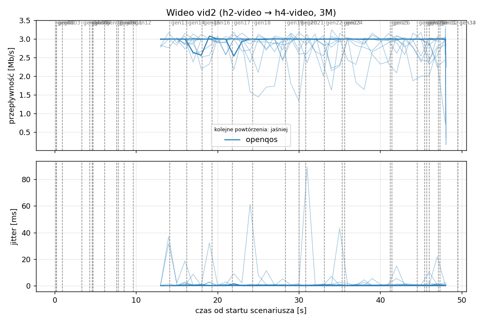
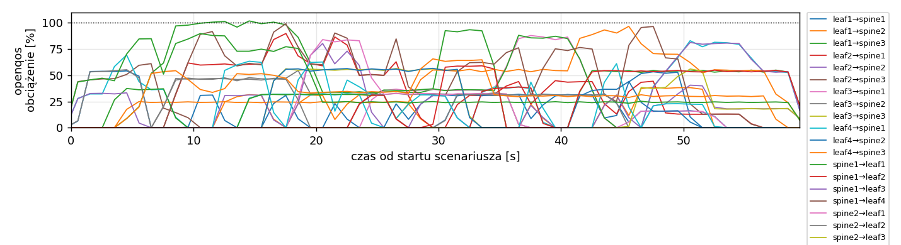
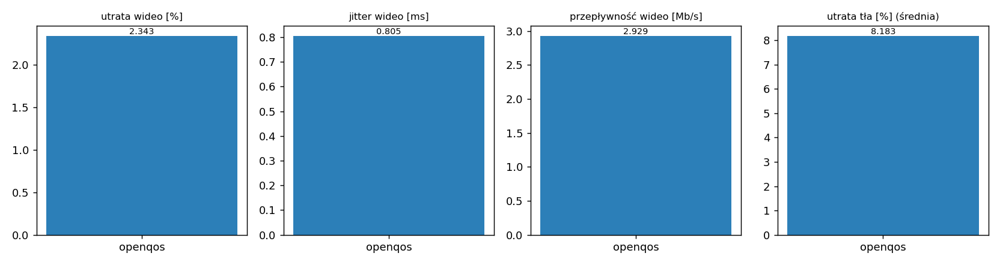

# Raport: clos-sdn

Katalog: `results/official/openqos/load-0.7/clos-sdn/20261109_121557`

## 1. Scenariusz

- Topologia: `clos` (sdn: `clos-sdn.clab.yml`)
- Warianty: **openqos** (POLICY=openqos)
- Czas testu: 60 s, warmup (pomijany w statystykach, liczony od startu każdego przepływu): 5 s, powtórzeń: 20, seed: 42
- Wykonane przebiegi: openqos/rep1, openqos/rep10, openqos/rep11, openqos/rep12, openqos/rep13, openqos/rep14, openqos/rep15, openqos/rep16, openqos/rep17, openqos/rep18, openqos/rep19, openqos/rep2, openqos/rep20, openqos/rep3, openqos/rep4, openqos/rep5, openqos/rep6, openqos/rep7, openqos/rep8, openqos/rep9

Harmonogram losowego tła różni się między powtórzeniami (seed + nr powtórzenia, wspólny dla wariantów); poniżej powtórzenie 1.

| id | klasa | źródło → cel | proto | zadana [Mb/s] | DSCP | start–koniec [s] |
|---|---|---|---|---|---|---|
| gen01 | background | h2-bg1 → h3-bg2 | udp | 4.49 | – | 0.1–7.1 |
| gen02 | background | h4-bg2 → h3-bg1 | udp | 3.16 | – | 0.2–5.2 |
| gen03 | background | h4-bg1 → h2-bg2 | udp | 5.25 | – | 0.9–5.9 |
| gen04 | background | h4-bg1 → h1-bg2 | udp | 3.56 | – | 3.3–8.3 |
| gen05 | background | h4-bg1 → h3-bg1 | udp | 2.36 | – | 4.3–59.3 |
| gen06 | background | h1-bg2 → h2-bg1 | udp | 1.93 | – | 4.6–17.6 |
| gen07 | background | h2-bg1 → h3-bg1 | udp | 1.39 | – | 4.7–9.7 |
| gen08 | background | h1-bg1 → h2-bg1 | udp | 3.29 | – | 6.1–34.1 |
| gen09 | background | h3-bg2 → h2-bg1 | udp | 4.51 | – | 7.6–18.6 |
| gen10 | background | h1-bg2 → h3-bg1 | udp | 3.96 | – | 7.8–12.8 |
| gen11 | background | h2-bg1 → h4-bg2 | udp | 5.85 | – | 8.5–22.5 |
| gen12 | background | h1-bg2 → h3-bg1 | udp | 4.90 | – | 9.6–19.6 |
| vid1 | video | h1-video → h4-video | udp | 3.00 | 46 | 10–50 |
| vid2 | video | h2-video → h4-video | udp | 3.00 | 46 | 12–48 |
| gen13 | background | h4-bg1 → h1-bg1 | udp | 3.07 | – | 14.1–24.1 |
| gen14 | background | h3-bg2 → h1-bg2 | udp | 5.37 | – | 16.2–32.2 |
| gen15 | background | h3-bg1 → h1-bg1 | udp | 3.12 | – | 18.1–36.1 |
| gen16 | background | h2-bg1 → h1-bg1 | udp | 4.96 | – | 19.3–24.3 |
| gen17 | background | h2-bg1 → h4-bg2 | udp | 4.86 | – | 21.8–26.8 |
| gen18 | background | h3-bg2 → h1-bg1 | udp | 3.49 | – | 24.3–43.3 |
| gen19 | background | h4-bg2 → h2-bg1 | udp | 2.93 | – | 28.3–57.3 |
| gen20 | background | h1-bg2 → h4-bg2 | udp | 5.68 | – | 30–35 |
| gen21 | background | h4-bg1 → h2-bg1 | udp | 3.04 | – | 30.8–44.8 |
| gen22 | background | h4-bg1 → h2-bg1 | udp | 3.69 | – | 33.1–38.1 |
| gen23 | background | h2-bg2 → h4-bg2 | udp | 1.26 | – | 35.3–55.3 |
| gen24 | background | h3-bg1 → h1-bg2 | udp | 4.88 | – | 35.6–41.6 |
| gen25 | background | h4-bg1 → h1-bg2 | udp | 3.51 | – | 41.2–46.2 |
| gen26 | background | h1-bg1 → h4-bg1 | udp | 5.23 | – | 41.4–59.4 |
| gen27 | background | h1-bg2 → h4-bg1 | udp | 2.10 | – | 44.5–50.5 |
| gen28 | background | h4-bg1 → h1-bg2 | udp | 1.54 | – | 45.4–50.4 |
| gen29 | background | h4-bg1 → h1-bg2 | udp | 1.53 | – | 45.7–52.7 |
| gen30 | background | h1-bg2 → h3-bg1 | udp | 3.69 | – | 46–52 |
| gen31 | background | h2-bg1 → h4-bg2 | udp | 2.18 | – | 47.1–52.1 |
| gen32 | background | h4-bg2 → h3-bg2 | udp | 5.19 | – | 47.3–59.3 |
| gen33 | background | h4-bg2 → h3-bg2 | udp | 2.60 | – | 49.5–55.5 |
| gen34 | background | h2-bg2 → h3-bg2 | udp | 1.75 | – | 49.5–59.5 |

## 2. Wideo: QoS według wariantu

Wartości: średnia ± odchylenie standardowe z powtórzeń.

| przepływ | wariant | przepływność [Mb/s] | jitter [ms] | utrata [%] | RTT mediana [ms] | RTT p95 [ms] |
|---|---|---|---|---|---|---|
| vid1 | openqos | 2.94 ± 0.05 | 0.846 ± 1.208 | 2.01 ± 1.76 | 0.030 ± 0.003 | 55.417 ± 26.716 |
| vid2 | openqos | 2.92 ± 0.12 | 0.764 ± 1.477 | 2.68 ± 3.88 | 1.047 ± 4.555 | 51.016 ± 23.935 |

RTT z `ping` co 0,1 s między hostami wideo (osobny przepływ ICMP z tym samym DSCP - w SDN może iść inną ścieżką niż strumień UDP).

## 3. Ruch tła

Agregat tła w obrębie powtórzenia, potem średnia ± odchylenie standardowe po powtórzeniach (utrata = Σ utraconych / Σ wysłanych datagramów; dostarczone = Σ przepływności / Σ zadanych; przepływy trwające nie dłużej niż warmup pominięte).

| wariant | strumieni tła / powt. | dostarczone / zadane [%] | jitter [ms] | utrata [%] |
|---|---|---|---|---|
| openqos | 28 | 92.7 ± 4.4 | 0.204 ± 0.078 | 8.18 ± 6.24 |

## 4. Obciążenie łączy fabricu

Średnia i maksimum z próbek co 1 s w oknie 0–60 s; MLU = maksymalne obciążenie łącza; drops = pakiety odrzucone przez `tbf` na wyjściu łącza.

| wariant | rep | średnie obciążenie łączy [%] | MLU [%] | łącza > 90% | drops tbf | CPU VM śr./maks. [%] |
|---|---|---|---|---|---|---|
| openqos | 1 | 22.1 | 101.7 | 3/24 | 1999 | 12 / 20 |
| openqos | 2 | 32.9 | 103.1 | 12/24 | 9002 | 15 / 26 |
| openqos | 3 | 38.9 | 104.7 | 17/24 | 19018 | 15 / 24 |
| openqos | 4 | 25.1 | 102.0 | 8/24 | 3977 | 13 / 22 |
| openqos | 5 | 27.0 | 103.3 | 10/24 | 13093 | 14 / 23 |
| openqos | 6 | 18.9 | 103.3 | 6/24 | 912 | 13 / 30 |
| openqos | 7 | 29.1 | 102.1 | 8/24 | 15519 | 13 / 23 |
| openqos | 8 | 28.6 | 102.7 | 11/24 | 10143 | 14 / 22 |
| openqos | 9 | 25.7 | 102.5 | 7/24 | 45369 | 13 / 21 |
| openqos | 10 | 29.5 | 102.4 | 12/24 | 13414 | 14 / 27 |
| openqos | 11 | 29.9 | 103.0 | 11/24 | 25097 | 15 / 27 |
| openqos | 12 | 20.1 | 102.2 | 5/24 | 835 | 13 / 21 |
| openqos | 13 | 29.6 | 103.2 | 11/24 | 17933 | 14 / 24 |
| openqos | 14 | 29.6 | 102.8 | 15/24 | 12894 | 14 / 28 |
| openqos | 15 | 33.7 | 102.9 | 13/24 | 22991 | 16 / 26 |
| openqos | 16 | 27.8 | 102.9 | 10/24 | 24664 | 14 / 28 |
| openqos | 17 | 31.5 | 103.5 | 13/24 | 11456 | 15 / 26 |
| openqos | 18 | 22.6 | 103.0 | 9/24 | 6031 | 13 / 24 |
| openqos | 19 | 26.3 | 102.4 | 8/24 | 7971 | 13 / 23 |
| openqos | 20 | 26.7 | 103.4 | 9/24 | 15619 | 14 / 24 |

Łącza z obciążeniem > 10% (maksimum [%] / drops, powtórzenie 1):

| łącze | openqos |
|---|---|
| leaf1→spine1 | 53 / 0 |
| leaf1→spine2 | 39 / 0 |
| leaf1→spine3 | 102 / 1374 |
| leaf2→spine1 | 90 / 117 |
| leaf2→spine2 | 80 / 0 |
| leaf2→spine3 | 61 / 0 |
| leaf3→spine1 | 88 / 0 |
| leaf3→spine2 | 54 / 0 |
| leaf3→spine3 | 56 / 0 |
| leaf4→spine1 | 83 / 0 |
| leaf4→spine2 | 54 / 0 |
| leaf4→spine3 | 97 / 0 |
| spine1→leaf1 | 88 / 0 |
| spine1→leaf2 | 39 / 0 |
| spine1→leaf3 | 81 / 0 |
| spine1→leaf4 | 99 / 508 |
| spine2→leaf1 | 84 / 0 |
| spine2→leaf2 | 55 / 0 |
| spine2→leaf3 | 56 / 0 |
| spine2→leaf4 | 63 / 0 |
| spine3→leaf1 | 57 / 0 |
| spine3→leaf2 | 66 / 0 |
| spine3→leaf3 | 90 / 0 |
| spine3→leaf4 | 59 / 0 |

## 5. Ścieżki wybrane przez kontroler (powtórzenie 1)

Z logu kontrolera (linie `Flow`), dopasowane po piątce przepływu; ✓ = reguły widoczne w `dump-flows` na tych samych przełącznikach.

| przepływ | openqos |
|---|---|
| gen01 | leaf2 -> spine3 -> leaf3 ✓ (loads 0% 0% 0%) |
| gen02 | leaf4 -> spine1 -> leaf3 ✓ (loads 0% 0% 0%) |
| gen03 | leaf4 -> spine2 -> leaf2 ✓ (loads 2% 0% 0%) |
| gen04 | leaf4 -> spine1 -> leaf1 ✓ (loads 32% 54% 0%) |
| gen05 | leaf4 -> spine3 -> leaf3 ✓ (loads 68% 54% 46%) |
| gen06 | leaf1 -> spine3 -> leaf2 ✓ (loads 0% 54% 0%) |
| gen07 | leaf2 -> spine3 -> leaf3 ✓ (loads 32% 0% 46%) |
| gen08 | leaf1 -> spine3 -> leaf2 ✓ (loads 0% 54% 13%) |
| gen09 | leaf3 -> spine2 -> leaf2 ✓ (loads 0% 0% 54%) |
| gen10 | leaf1 -> spine3 -> leaf3 ✓ (loads 0% 0% 78%) |
| gen11 | leaf2 -> spine1 -> leaf4 ✓ (loads 0% 0% 14%) |
| gen12 | leaf1 -> spine3 -> leaf3 ✓ (loads 0% 0% 95%) |
| vid1 | leaf1 -> spine1 -> leaf4 ✓ (loads 31% 62% 54%) |
| vid2 | leaf2 -> spine1 -> leaf4 ✓ (loads 31% 62% 54%) |
| gen13 | leaf4 -> spine1 -> leaf1 ✓ (loads 0% 0% 24%) |
| gen14 | leaf3 -> spine3 -> leaf1 ✓ (loads 32% 47% 0%) |
| gen15 | leaf3 -> spine2 -> leaf1 ✓ (loads 32% 46% 55%) |
| gen16 | leaf2 -> spine2 -> leaf1 ✓ (loads 60% 32% 55%) |
| gen17 | leaf2 -> spine1 -> leaf4 ✓ (loads 60% 82% 0%) |
| gen18 | leaf3 -> spine1 -> leaf1 ✓ (loads 32% 83% 55%) |
| gen19 | leaf4 -> spine3 -> leaf2 ✓ (loads 0% 0% 34%) |
| gen20 | leaf1 -> spine3 -> leaf4 ✓ (loads 31% 31% 34%) |
| gen21 | leaf4 -> spine2 -> leaf2 ✓ (loads 0% 0% 64%) |
| gen22 | leaf4 -> spine1 -> leaf2 ✓ (loads 0% 31% 64%) |
| gen23 | leaf2 -> spine1 -> leaf4 ✓ (loads 62% 0% 59%) |
| gen24 | leaf3 -> spine1 -> leaf1 ✓ (loads 36% 32% 0%) |
| gen25 | leaf4 -> spine3 -> leaf1 ✓ (loads 86% 31% 54%) |
| gen26 | leaf1 -> spine3 -> leaf4 ✓ (loads 75% 0% 0%) |
| gen27 | leaf1 -> spine1 -> leaf4 ✓ (loads 13% 62% 54%) |
| gen28 | leaf4 -> spine3 -> leaf1 ✓ (loads 0% 14% 91%) |
| gen29 | leaf4 -> spine2 -> leaf1 ✓ (loads 0% 14% 91%) |
| gen30 | leaf1 -> spine2 -> leaf3 ✓ (loads 18% 31% 54%) |
| gen31 | leaf2 -> spine2 -> leaf4 ✓ (loads 97% 0% 54%) |
| gen32 | leaf4 -> spine1 -> leaf3 ✓ (loads 0% 13% 100%) |
| gen33 | leaf4 -> spine1 -> leaf3 ✓ (loads 54% 38% 70%) |
| gen34 | leaf2 -> spine2 -> leaf3 ✓ (loads 53% 38% 24%) |

## 6. Wnioski

<!-- WNIOSKI:START -->
_Do uzupełnienia: krótkie wnioski wyłącznie na podstawie liczb z sekcji 2–5._
<!-- WNIOSKI:END -->

## 7. Wiarygodność pomiaru

- openqos rep1, gen02: przepływ krótszy niż warmup - statystyki z całości
- openqos rep1, gen03: przepływ krótszy niż warmup - statystyki z całości
- openqos rep1, gen04: przepływ krótszy niż warmup - statystyki z całości
- openqos rep1, gen07: przepływ krótszy niż warmup - statystyki z całości
- openqos rep1, gen16: przepływ krótszy niż warmup - statystyki z całości
- openqos rep1, gen28: przepływ krótszy niż warmup - statystyki z całości
- openqos rep1, gen31: przepływ krótszy niż warmup - statystyki z całości
- openqos rep1, vid1: 16 decyzji kontrolera dla jednego przepływu (wygasła reguła albo duplikat Packet-In)
- openqos rep1, vid2: 16 decyzji kontrolera dla jednego przepływu (wygasła reguła albo duplikat Packet-In)
- openqos rep10, gen04: przepływ krótszy niż warmup - statystyki z całości
- openqos rep10, gen09: przepływ krótszy niż warmup - statystyki z całości
- openqos rep10, gen10: przepływ krótszy niż warmup - statystyki z całości
- openqos rep10, gen17: przepływ krótszy niż warmup - statystyki z całości
- openqos rep10, gen25: przepływ krótszy niż warmup - statystyki z całości
- openqos rep10, gen31: przepływ krótszy niż warmup - statystyki z całości
- openqos rep10, gen36: przepływ krótszy niż warmup - statystyki z całości
- openqos rep10, vid1: 25 decyzji kontrolera dla jednego przepływu (wygasła reguła albo duplikat Packet-In)
- openqos rep10, vid2: 23 decyzji kontrolera dla jednego przepływu (wygasła reguła albo duplikat Packet-In)
- openqos rep11, gen13: przepływ krótszy niż warmup - statystyki z całości
- openqos rep11, gen19: przepływ krótszy niż warmup - statystyki z całości
- openqos rep11, vid1: 23 decyzji kontrolera dla jednego przepływu (wygasła reguła albo duplikat Packet-In)
- openqos rep11, vid2: 20 decyzji kontrolera dla jednego przepływu (wygasła reguła albo duplikat Packet-In)
- openqos rep12, gen03: przepływ krótszy niż warmup - statystyki z całości
- openqos rep12, vid1: 17 decyzji kontrolera dla jednego przepływu (wygasła reguła albo duplikat Packet-In)
- openqos rep12, vid2: 15 decyzji kontrolera dla jednego przepływu (wygasła reguła albo duplikat Packet-In)
- openqos rep13, gen19: przepływ krótszy niż warmup - statystyki z całości
- openqos rep13, gen24: przepływ krótszy niż warmup - statystyki z całości
- openqos rep13, gen26: przepływ krótszy niż warmup - statystyki z całości
- openqos rep13, gen32: przepływ krótszy niż warmup - statystyki z całości
- openqos rep13, gen41: przepływ krótszy niż warmup - statystyki z całości
- openqos rep13, vid1: 22 decyzji kontrolera dla jednego przepływu (wygasła reguła albo duplikat Packet-In)
- openqos rep13, vid2: 20 decyzji kontrolera dla jednego przepływu (wygasła reguła albo duplikat Packet-In)
- openqos rep14, gen02: przepływ krótszy niż warmup - statystyki z całości
- openqos rep14, gen03: przepływ krótszy niż warmup - statystyki z całości
- openqos rep14, gen35: przepływ krótszy niż warmup - statystyki z całości
- openqos rep14, vid1: 20 decyzji kontrolera dla jednego przepływu (wygasła reguła albo duplikat Packet-In)
- openqos rep14, vid1: dump-flows nie potwierdza ścieżki z logu (leaf1 -> spine2 -> leaf4 vs leaf1, spine1, spine3)
- openqos rep14, vid2: 18 decyzji kontrolera dla jednego przepływu (wygasła reguła albo duplikat Packet-In)
- openqos rep15, gen09: przepływ krótszy niż warmup - statystyki z całości
- openqos rep15, gen27: przepływ krótszy niż warmup - statystyki z całości
- openqos rep15, gen43: przepływ krótszy niż warmup - statystyki z całości
- openqos rep15, gen45: przepływ krótszy niż warmup - statystyki z całości
- openqos rep15, vid1: 27 decyzji kontrolera dla jednego przepływu (wygasła reguła albo duplikat Packet-In)
- openqos rep15, vid2: 26 decyzji kontrolera dla jednego przepływu (wygasła reguła albo duplikat Packet-In)
- openqos rep16, gen11: przepływ krótszy niż warmup - statystyki z całości
- openqos rep16, gen15: przepływ krótszy niż warmup - statystyki z całości
- openqos rep16, gen19: przepływ krótszy niż warmup - statystyki z całości
- openqos rep16, gen28: przepływ krótszy niż warmup - statystyki z całości
- openqos rep16, gen35: przepływ krótszy niż warmup - statystyki z całości
- openqos rep16, vid1: 20 decyzji kontrolera dla jednego przepływu (wygasła reguła albo duplikat Packet-In)
- openqos rep16, vid2: 18 decyzji kontrolera dla jednego przepływu (wygasła reguła albo duplikat Packet-In)
- openqos rep17, gen06: przepływ krótszy niż warmup - statystyki z całości
- openqos rep17, gen08: przepływ krótszy niż warmup - statystyki z całości
- openqos rep17, gen09: przepływ krótszy niż warmup - statystyki z całości
- openqos rep17, gen15: przepływ krótszy niż warmup - statystyki z całości
- openqos rep17, gen24: przepływ krótszy niż warmup - statystyki z całości
- openqos rep17, gen25: przepływ krótszy niż warmup - statystyki z całości
- openqos rep17, gen36: przepływ krótszy niż warmup - statystyki z całości
- openqos rep17, vid1: 24 decyzji kontrolera dla jednego przepływu (wygasła reguła albo duplikat Packet-In)
- openqos rep17, vid2: 23 decyzji kontrolera dla jednego przepływu (wygasła reguła albo duplikat Packet-In)
- openqos rep18, gen04: przepływ krótszy niż warmup - statystyki z całości
- openqos rep18, gen32: przepływ krótszy niż warmup - statystyki z całości
- openqos rep18, vid1: 24 decyzji kontrolera dla jednego przepływu (wygasła reguła albo duplikat Packet-In)
- openqos rep18, vid2: 20 decyzji kontrolera dla jednego przepływu (wygasła reguła albo duplikat Packet-In)
- openqos rep19, gen04: przepływ krótszy niż warmup - statystyki z całości
- openqos rep19, gen14: przepływ krótszy niż warmup - statystyki z całości
- openqos rep19, gen21: przepływ krótszy niż warmup - statystyki z całości
- openqos rep19, vid1: 16 decyzji kontrolera dla jednego przepływu (wygasła reguła albo duplikat Packet-In)
- openqos rep19, vid2: 16 decyzji kontrolera dla jednego przepływu (wygasła reguła albo duplikat Packet-In)
- openqos rep2, gen12: przepływ krótszy niż warmup - statystyki z całości
- openqos rep2, gen24: przepływ krótszy niż warmup - statystyki z całości
- openqos rep2, gen27: przepływ krótszy niż warmup - statystyki z całości
- openqos rep2, gen35: przepływ krótszy niż warmup - statystyki z całości
- openqos rep2, gen45: przepływ krótszy niż warmup - statystyki z całości
- openqos rep2, vid1: 24 decyzji kontrolera dla jednego przepływu (wygasła reguła albo duplikat Packet-In)
- openqos rep2, vid2: 22 decyzji kontrolera dla jednego przepływu (wygasła reguła albo duplikat Packet-In)
- openqos rep20, gen09: przepływ krótszy niż warmup - statystyki z całości
- openqos rep20, gen11: przepływ krótszy niż warmup - statystyki z całości
- openqos rep20, gen15: przepływ krótszy niż warmup - statystyki z całości
- openqos rep20, gen29: przepływ krótszy niż warmup - statystyki z całości
- openqos rep20, vid1: 24 decyzji kontrolera dla jednego przepływu (wygasła reguła albo duplikat Packet-In)
- openqos rep20, vid2: 22 decyzji kontrolera dla jednego przepływu (wygasła reguła albo duplikat Packet-In)
- openqos rep3, gen02: przepływ krótszy niż warmup - statystyki z całości
- openqos rep3, gen03: przepływ krótszy niż warmup - statystyki z całości
- openqos rep3, gen11: przepływ krótszy niż warmup - statystyki z całości
- openqos rep3, gen13: przepływ krótszy niż warmup - statystyki z całości
- openqos rep3, gen15: przepływ krótszy niż warmup - statystyki z całości
- openqos rep3, gen33: przepływ krótszy niż warmup - statystyki z całości
- openqos rep3, gen38: przepływ krótszy niż warmup - statystyki z całości
- openqos rep3, gen42: przepływ krótszy niż warmup - statystyki z całości
- openqos rep3, vid1: 20 decyzji kontrolera dla jednego przepływu (wygasła reguła albo duplikat Packet-In)
- openqos rep3, vid2: 20 decyzji kontrolera dla jednego przepływu (wygasła reguła albo duplikat Packet-In)
- openqos rep4, gen22: przepływ krótszy niż warmup - statystyki z całości
- openqos rep4, gen28: przepływ krótszy niż warmup - statystyki z całości
- openqos rep4, gen31: przepływ krótszy niż warmup - statystyki z całości
- openqos rep4, vid1: 24 decyzji kontrolera dla jednego przepływu (wygasła reguła albo duplikat Packet-In)
- openqos rep4, vid2: 22 decyzji kontrolera dla jednego przepływu (wygasła reguła albo duplikat Packet-In)
- openqos rep5, gen02: przepływ krótszy niż warmup - statystyki z całości
- openqos rep5, gen15: przepływ krótszy niż warmup - statystyki z całości
- openqos rep5, gen30: przepływ krótszy niż warmup - statystyki z całości
- openqos rep5, gen42: przepływ krótszy niż warmup - statystyki z całości
- openqos rep5, vid1: 24 decyzji kontrolera dla jednego przepływu (wygasła reguła albo duplikat Packet-In)
- openqos rep5, vid2: 20 decyzji kontrolera dla jednego przepływu (wygasła reguła albo duplikat Packet-In)
- openqos rep6, gen04: przepływ krótszy niż warmup - statystyki z całości
- openqos rep6, gen05: przepływ krótszy niż warmup - statystyki z całości
- openqos rep6, gen10: przepływ krótszy niż warmup - statystyki z całości
- openqos rep6, gen15: przepływ krótszy niż warmup - statystyki z całości
- openqos rep6, gen28: przepływ krótszy niż warmup - statystyki z całości
- openqos rep6, gen29: przepływ krótszy niż warmup - statystyki z całości
- openqos rep6, vid1: 16 decyzji kontrolera dla jednego przepływu (wygasła reguła albo duplikat Packet-In)
- openqos rep6, vid2: 14 decyzji kontrolera dla jednego przepływu (wygasła reguła albo duplikat Packet-In)
- openqos rep7, gen02: przepływ krótszy niż warmup - statystyki z całości
- openqos rep7, gen03: przepływ krótszy niż warmup - statystyki z całości
- openqos rep7, gen11: przepływ krótszy niż warmup - statystyki z całości
- openqos rep7, gen24: przepływ krótszy niż warmup - statystyki z całości
- openqos rep7, gen28: przepływ krótszy niż warmup - statystyki z całości
- openqos rep7, gen34: przepływ krótszy niż warmup - statystyki z całości
- openqos rep7, gen36: przepływ krótszy niż warmup - statystyki z całości
- openqos rep7, vid1: 27 decyzji kontrolera dla jednego przepływu (wygasła reguła albo duplikat Packet-In)
- openqos rep7, vid1: dump-flows nie potwierdza ścieżki z logu (leaf1 -> spine2 -> leaf4 vs leaf1, spine1, spine3)
- openqos rep7, vid2: 24 decyzji kontrolera dla jednego przepływu (wygasła reguła albo duplikat Packet-In)
- openqos rep8, gen22: przepływ krótszy niż warmup - statystyki z całości
- openqos rep8, gen33: przepływ krótszy niż warmup - statystyki z całości
- openqos rep8, gen36: przepływ krótszy niż warmup - statystyki z całości
- openqos rep8, gen37: przepływ krótszy niż warmup - statystyki z całości
- openqos rep8, vid1: 22 decyzji kontrolera dla jednego przepływu (wygasła reguła albo duplikat Packet-In)
- openqos rep8, vid2: 20 decyzji kontrolera dla jednego przepływu (wygasła reguła albo duplikat Packet-In)
- openqos rep9, gen14: przepływ krótszy niż warmup - statystyki z całości
- openqos rep9, gen28: przepływ krótszy niż warmup - statystyki z całości
- openqos rep9, vid1: 15 decyzji kontrolera dla jednego przepływu (wygasła reguła albo duplikat Packet-In)
- openqos rep9, vid2: 14 decyzji kontrolera dla jednego przepływu (wygasła reguła albo duplikat Packet-In)
