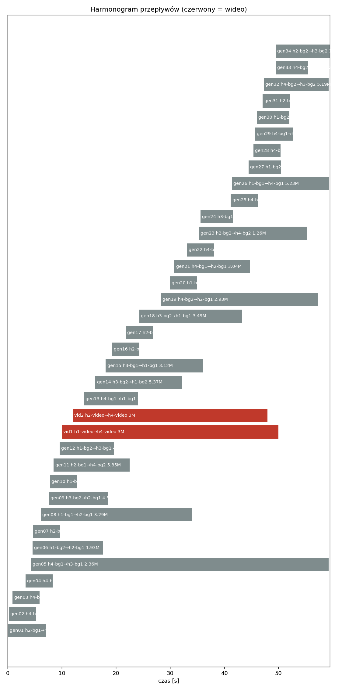
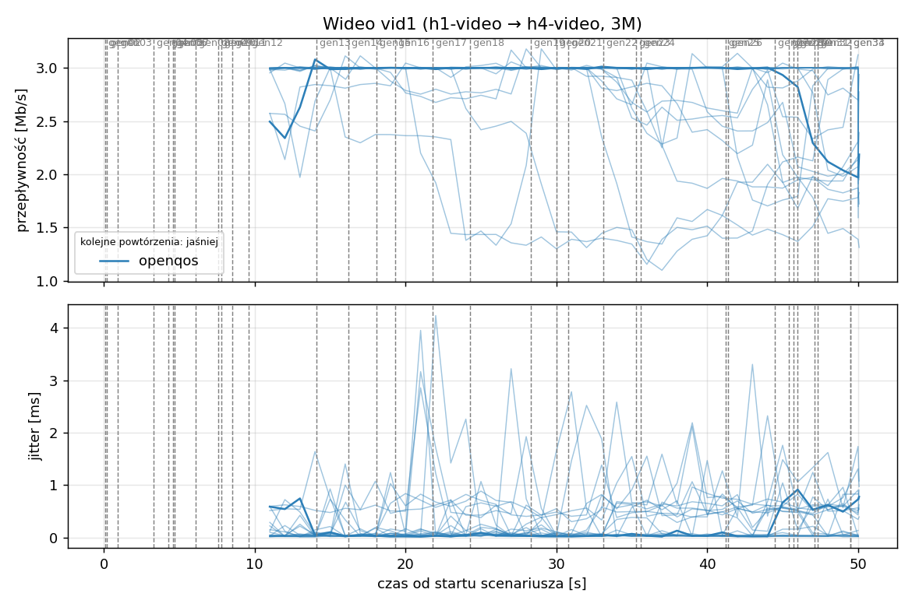
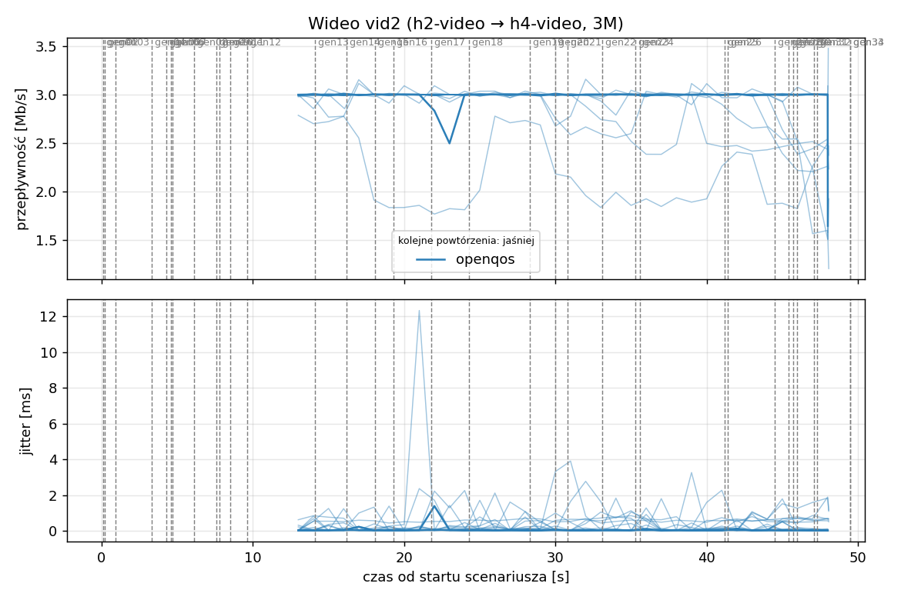
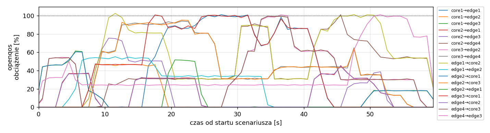
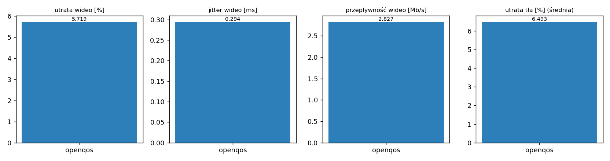

# Raport: mesh-sdn

Katalog: `results/official/openqos/load-0.7/mesh-sdn/20261109_131653`

## 1. Scenariusz

- Topologia: `mesh` (sdn: `mesh-sdn.clab.yml`)
- Warianty: **openqos** (POLICY=openqos)
- Czas testu: 60 s, warmup (pomijany w statystykach, liczony od startu każdego przepływu): 5 s, powtórzeń: 20, seed: 42
- Wykonane przebiegi: openqos/rep1, openqos/rep10, openqos/rep11, openqos/rep12, openqos/rep13, openqos/rep14, openqos/rep15, openqos/rep16, openqos/rep17, openqos/rep18, openqos/rep19, openqos/rep2, openqos/rep20, openqos/rep3, openqos/rep4, openqos/rep5, openqos/rep6, openqos/rep7, openqos/rep8, openqos/rep9

Harmonogram losowego tła różni się między powtórzeniami (seed + nr powtórzenia, wspólny dla wariantów); poniżej powtórzenie 1.

| id | klasa | źródło → cel | proto | zadana [Mb/s] | DSCP | start–koniec [s] |
|---|---|---|---|---|---|---|
| gen01 | background | h2-bg1 → h3-bg2 | udp | 4.49 | – | 0.1–7.1 |
| gen02 | background | h4-bg2 → h3-bg1 | udp | 3.16 | – | 0.2–5.2 |
| gen03 | background | h4-bg1 → h2-bg2 | udp | 5.25 | – | 0.9–5.9 |
| gen04 | background | h4-bg1 → h1-bg2 | udp | 3.56 | – | 3.3–8.3 |
| gen05 | background | h4-bg1 → h3-bg1 | udp | 2.36 | – | 4.3–59.3 |
| gen06 | background | h1-bg2 → h2-bg1 | udp | 1.93 | – | 4.6–17.6 |
| gen07 | background | h2-bg1 → h3-bg1 | udp | 1.39 | – | 4.7–9.7 |
| gen08 | background | h1-bg1 → h2-bg1 | udp | 3.29 | – | 6.1–34.1 |
| gen09 | background | h3-bg2 → h2-bg1 | udp | 4.51 | – | 7.6–18.6 |
| gen10 | background | h1-bg2 → h3-bg1 | udp | 3.96 | – | 7.8–12.8 |
| gen11 | background | h2-bg1 → h4-bg2 | udp | 5.85 | – | 8.5–22.5 |
| gen12 | background | h1-bg2 → h3-bg1 | udp | 4.90 | – | 9.6–19.6 |
| vid1 | video | h1-video → h4-video | udp | 3.00 | 46 | 10–50 |
| vid2 | video | h2-video → h4-video | udp | 3.00 | 46 | 12–48 |
| gen13 | background | h4-bg1 → h1-bg1 | udp | 3.07 | – | 14.1–24.1 |
| gen14 | background | h3-bg2 → h1-bg2 | udp | 5.37 | – | 16.2–32.2 |
| gen15 | background | h3-bg1 → h1-bg1 | udp | 3.12 | – | 18.1–36.1 |
| gen16 | background | h2-bg1 → h1-bg1 | udp | 4.96 | – | 19.3–24.3 |
| gen17 | background | h2-bg1 → h4-bg2 | udp | 4.86 | – | 21.8–26.8 |
| gen18 | background | h3-bg2 → h1-bg1 | udp | 3.49 | – | 24.3–43.3 |
| gen19 | background | h4-bg2 → h2-bg1 | udp | 2.93 | – | 28.3–57.3 |
| gen20 | background | h1-bg2 → h4-bg2 | udp | 5.68 | – | 30–35 |
| gen21 | background | h4-bg1 → h2-bg1 | udp | 3.04 | – | 30.8–44.8 |
| gen22 | background | h4-bg1 → h2-bg1 | udp | 3.69 | – | 33.1–38.1 |
| gen23 | background | h2-bg2 → h4-bg2 | udp | 1.26 | – | 35.3–55.3 |
| gen24 | background | h3-bg1 → h1-bg2 | udp | 4.88 | – | 35.6–41.6 |
| gen25 | background | h4-bg1 → h1-bg2 | udp | 3.51 | – | 41.2–46.2 |
| gen26 | background | h1-bg1 → h4-bg1 | udp | 5.23 | – | 41.4–59.4 |
| gen27 | background | h1-bg2 → h4-bg1 | udp | 2.10 | – | 44.5–50.5 |
| gen28 | background | h4-bg1 → h1-bg2 | udp | 1.54 | – | 45.4–50.4 |
| gen29 | background | h4-bg1 → h1-bg2 | udp | 1.53 | – | 45.7–52.7 |
| gen30 | background | h1-bg2 → h3-bg1 | udp | 3.69 | – | 46–52 |
| gen31 | background | h2-bg1 → h4-bg2 | udp | 2.18 | – | 47.1–52.1 |
| gen32 | background | h4-bg2 → h3-bg2 | udp | 5.19 | – | 47.3–59.3 |
| gen33 | background | h4-bg2 → h3-bg2 | udp | 2.60 | – | 49.5–55.5 |
| gen34 | background | h2-bg2 → h3-bg2 | udp | 1.75 | – | 49.5–59.5 |

## 2. Wideo: QoS według wariantu

Wartości: średnia ± odchylenie standardowe z powtórzeń.

| przepływ | wariant | przepływność [Mb/s] | jitter [ms] | utrata [%] | RTT mediana [ms] | RTT p95 [ms] |
|---|---|---|---|---|---|---|
| vid1 | openqos | 2.74 ± 0.34 | 0.325 ± 0.225 | 8.67 ± 11.31 | 15.001 ± 25.834 | 59.901 ± 28.656 |
| vid2 | openqos | 2.92 ± 0.20 | 0.263 ± 0.244 | 2.77 ± 6.79 | 5.887 ± 18.028 | 37.070 ± 28.954 |

RTT z `ping` co 0,1 s między hostami wideo (osobny przepływ ICMP z tym samym DSCP - w SDN może iść inną ścieżką niż strumień UDP).

## 3. Ruch tła

Agregat tła w obrębie powtórzenia, potem średnia ± odchylenie standardowe po powtórzeniach (utrata = Σ utraconych / Σ wysłanych datagramów; dostarczone = Σ przepływności / Σ zadanych; przepływy trwające nie dłużej niż warmup pominięte).

| wariant | strumieni tła / powt. | dostarczone / zadane [%] | jitter [ms] | utrata [%] |
|---|---|---|---|---|
| openqos | 28 | 93.9 ± 5.1 | 0.196 ± 0.086 | 6.49 ± 5.72 |

## 4. Obciążenie łączy fabricu

Średnia i maksimum z próbek co 1 s w oknie 0–60 s; MLU = maksymalne obciążenie łącza; drops = pakiety odrzucone przez `tbf` na wyjściu łącza.

| wariant | rep | średnie obciążenie łączy [%] | MLU [%] | łącza > 90% | drops tbf | CPU VM śr./maks. [%] |
|---|---|---|---|---|---|---|
| openqos | 1 | 19.1 | 102.6 | 9/24 | 4077 | 12 / 21 |
| openqos | 2 | 24.8 | 103.2 | 7/24 | 26867 | 15 / 23 |
| openqos | 3 | 27.6 | 104.1 | 9/24 | 31124 | 16 / 24 |
| openqos | 4 | 20.6 | 102.4 | 9/24 | 7635 | 13 / 24 |
| openqos | 5 | 22.1 | 101.7 | 6/24 | 3880 | 14 / 23 |
| openqos | 6 | 15.9 | 102.3 | 4/24 | 929 | 13 / 20 |
| openqos | 7 | 25.2 | 103.8 | 9/24 | 4876 | 14 / 22 |
| openqos | 8 | 23.2 | 103.1 | 10/24 | 8255 | 14 / 24 |
| openqos | 9 | 19.9 | 103.4 | 8/24 | 35427 | 14 / 25 |
| openqos | 10 | 23.1 | 113.7 | 10/24 | 11961 | 23 / 87 |
| openqos | 11 | 24.6 | 107.3 | 10/24 | 38363 | 19 / 41 |
| openqos | 12 | 17.1 | 103.4 | 7/24 | 2596 | 13 / 22 |
| openqos | 13 | 25.8 | 103.0 | 8/24 | 8306 | 14 / 23 |
| openqos | 14 | 24.4 | 103.7 | 10/24 | 4581 | 14 / 25 |
| openqos | 15 | 28.4 | 103.9 | 8/24 | 17438 | 15 / 26 |
| openqos | 16 | 24.0 | 102.3 | 9/24 | 9954 | 13 / 22 |
| openqos | 17 | 28.4 | 103.1 | 10/24 | 8172 | 15 / 24 |
| openqos | 18 | 20.7 | 102.1 | 6/24 | 3785 | 14 / 57 |
| openqos | 19 | 23.4 | 102.5 | 10/24 | 8585 | 13 / 25 |
| openqos | 20 | 21.8 | 103.3 | 8/24 | 7993 | 13 / 23 |

Łącza z obciążeniem > 10% (maksimum [%] / drops, powtórzenie 1):

| łącze | openqos |
|---|---|
| core1→edge1 | 101 / 0 |
| core1→edge2 | 47 / 0 |
| core1→edge3 | 61 / 0 |
| core2→edge1 | 45 / 0 |
| core2→edge3 | 76 / 0 |
| core2→edge4 | 101 / 0 |
| core3→edge2 | 101 / 0 |
| core3→edge4 | 94 / 0 |
| edge1→core1 | 0 / 0 |
| edge1→core2 | 103 / 2034 |
| edge1→edge2 | 55 / 0 |
| edge2→core1 | 61 / 0 |
| edge2→core3 | 95 / 193 |
| edge2→edge1 | 52 / 0 |
| edge3→core1 | 101 / 1672 |
| edge3→core2 | 0 / 0 |
| edge3→edge4 | 0 / 0 |
| edge4→core2 | 45 / 0 |
| edge4→core3 | 100 / 0 |
| edge4→edge3 | 101 / 178 |

## 5. Ścieżki wybrane przez kontroler (powtórzenie 1)

Z logu kontrolera (linie `Flow`), dopasowane po piątce przepływu; ✓ = reguły widoczne w `dump-flows` na tych samych przełącznikach.

| przepływ | openqos |
|---|---|
| gen01 | edge2 -> core1 -> edge3 ✓ (loads 0% 0% 0% 0%) |
| gen02 | edge4 -> edge3 ✓ (loads 0% 0%) |
| gen03 | edge4 -> core3 -> edge2 ✓ (loads 0% 0% 0% 0%) |
| gen04 | edge4 -> core2 -> edge1 ✓ (loads 0% 32% 32% 54%) |
| gen05 | edge4 -> edge3 ✓ (loads 33% 33%) |
| gen06 | edge1 -> edge2 ✓ (loads 0% 0%) |
| gen07 | edge2 -> core1 -> edge3 ✓ (loads 46% 46% 0% 33%) |
| gen08 | edge1 -> edge2 ✓ (loads 12% 0%) |
| gen09 | edge3 -> core1 -> edge2 ✓ (loads 0% 0% 54% 0%) |
| gen10 | edge1 -> core2 -> edge3 ✓ (loads 56% 0% 56% 24%) |
| gen11 | edge2 -> core3 -> edge4 ✓ (loads 0% 17% 14% 14%) |
| gen12 | edge1 -> core2 -> edge3 ✓ (loads 14% 41% 54% 41%) |
| vid1 | edge1 -> core2 -> edge4 ✓ (loads 100% 58% 0% 35%) |
| vid2 | edge2 -> core3 -> edge4 ✓ (loads 44% 98% 0% 44%) |
| gen13 | edge4 -> core2 -> edge1 ✓ (loads 0% 47% 24% 0%) |
| gen14 | edge3 -> core1 -> edge1 ✓ (loads 46% 32% 32% 46%) |
| gen15 | edge3 -> core1 -> edge1 ✓ (loads 99% 32% 32% 99%) |
| gen16 | edge2 -> edge1 ✓ (loads 0% 82%) |
| gen17 | edge2 -> core3 -> edge4 ✓ (loads 91% 51% 0% 91%) |
| gen18 | edge3 -> core1 -> edge1 ✓ (loads 87% 27% 27% 87%) |
| gen19 | edge4 -> core3 -> edge2 ✓ (loads 0% 100% 34% 0%) |
| gen20 | edge1 -> core2 -> edge4 ✓ (loads 31% 34% 0% 31%) |
| gen21 | edge4 -> core3 -> edge2 ✓ (loads 30% 99% 34% 30%) |
| gen22 | edge4 -> core3 -> edge2 ✓ (loads 62% 100% 34% 62%) |
| gen23 | edge2 -> core3 -> edge4 ✓ (loads 31% 75% 0% 31%) |
| gen24 | edge3 -> core1 -> edge1 ✓ (loads 68% 0% 0% 68%) |
| gen25 | edge4 -> core2 -> edge1 ✓ (loads 0% 86% 24% 62%) |
| gen26 | edge1 -> core2 -> edge4 ✓ (loads 31% 44% 0% 44%) |
| gen27 | edge1 -> core2 -> edge4 ✓ (loads 85% 44% 0% 44%) |
| gen28 | edge4 -> core2 -> edge1 ✓ (loads 36% 24% 36% 46%) |
| gen29 | edge4 -> core2 -> edge1 ✓ (loads 36% 24% 36% 46%) |
| gen30 | edge1 -> core2 -> edge3 ✓ (loads 0% 98% 0% 98%) |
| gen31 | edge2 -> core3 -> edge4 ✓ (loads 44% 100% 0% 44%) |
| gen32 | edge4 -> edge3 ✓ (loads 24% 32%) |
| gen33 | edge4 -> edge3 ✓ (loads 78% 32%) |
| gen34 | edge2 -> core1 -> edge3 ✓ (loads 0% 0% 100% 78%) |

## 6. Wnioski

<!-- WNIOSKI:START -->
_Do uzupełnienia: krótkie wnioski wyłącznie na podstawie liczb z sekcji 2–5._
<!-- WNIOSKI:END -->

## 7. Wiarygodność pomiaru

- openqos rep1, gen02: przepływ krótszy niż warmup - statystyki z całości
- openqos rep1, gen04: przepływ krótszy niż warmup - statystyki z całości
- openqos rep1, gen07: przepływ krótszy niż warmup - statystyki z całości
- openqos rep1, gen16: przepływ krótszy niż warmup - statystyki z całości
- openqos rep1, gen17: przepływ krótszy niż warmup - statystyki z całości
- openqos rep1, gen22: przepływ krótszy niż warmup - statystyki z całości
- openqos rep1, gen31: przepływ krótszy niż warmup - statystyki z całości
- openqos rep1, vid1: 16 decyzji kontrolera dla jednego przepływu (wygasła reguła albo duplikat Packet-In)
- openqos rep1, vid2: 14 decyzji kontrolera dla jednego przepływu (wygasła reguła albo duplikat Packet-In)
- openqos rep10, gen09: przepływ krótszy niż warmup - statystyki z całości
- openqos rep10, gen10: przepływ krótszy niż warmup - statystyki z całości
- openqos rep10, gen31: przepływ krótszy niż warmup - statystyki z całości
- openqos rep10, vid1: 19 decyzji kontrolera dla jednego przepływu (wygasła reguła albo duplikat Packet-In)
- openqos rep10, vid2: 17 decyzji kontrolera dla jednego przepływu (wygasła reguła albo duplikat Packet-In)
- openqos rep10: CPU maszyny do 87% (średnio 23%) - możliwy wpływ na pomiary
- openqos rep11, gen13: przepływ krótszy niż warmup - statystyki z całości
- openqos rep11, gen19: przepływ krótszy niż warmup - statystyki z całości
- openqos rep11, gen20: przepływ krótszy niż warmup - statystyki z całości
- openqos rep11, gen32: przepływ krótszy niż warmup - statystyki z całości
- openqos rep11, vid1: 17 decyzji kontrolera dla jednego przepływu (wygasła reguła albo duplikat Packet-In)
- openqos rep11, vid2: 15 decyzji kontrolera dla jednego przepływu (wygasła reguła albo duplikat Packet-In)
- openqos rep12, gen03: przepływ krótszy niż warmup - statystyki z całości
- openqos rep12, gen04: przepływ krótszy niż warmup - statystyki z całości
- openqos rep12, gen07: przepływ krótszy niż warmup - statystyki z całości
- openqos rep12, vid1: 9 decyzji kontrolera dla jednego przepływu (wygasła reguła albo duplikat Packet-In)
- openqos rep12, vid2: 8 decyzji kontrolera dla jednego przepływu (wygasła reguła albo duplikat Packet-In)
- openqos rep13, gen14: przepływ krótszy niż warmup - statystyki z całości
- openqos rep13, gen19: przepływ krótszy niż warmup - statystyki z całości
- openqos rep13, gen41: przepływ krótszy niż warmup - statystyki z całości
- openqos rep13, vid1: 21 decyzji kontrolera dla jednego przepływu (wygasła reguła albo duplikat Packet-In)
- openqos rep13, vid2: 20 decyzji kontrolera dla jednego przepływu (wygasła reguła albo duplikat Packet-In)
- openqos rep14, gen02: przepływ krótszy niż warmup - statystyki z całości
- openqos rep14, gen05: przepływ krótszy niż warmup - statystyki z całości
- openqos rep14, gen17: przepływ krótszy niż warmup - statystyki z całości
- openqos rep14, vid1: 15 decyzji kontrolera dla jednego przepływu (wygasła reguła albo duplikat Packet-In)
- openqos rep14, vid2: 15 decyzji kontrolera dla jednego przepływu (wygasła reguła albo duplikat Packet-In)
- openqos rep15, gen17: przepływ krótszy niż warmup - statystyki z całości
- openqos rep15, gen28: przepływ krótszy niż warmup - statystyki z całości
- openqos rep15, gen43: przepływ krótszy niż warmup - statystyki z całości
- openqos rep15, gen45: przepływ krótszy niż warmup - statystyki z całości
- openqos rep15, vid1: 13 decyzji kontrolera dla jednego przepływu (wygasła reguła albo duplikat Packet-In)
- openqos rep15, vid2: 11 decyzji kontrolera dla jednego przepływu (wygasła reguła albo duplikat Packet-In)
- openqos rep16, gen11: przepływ krótszy niż warmup - statystyki z całości
- openqos rep16, gen15: przepływ krótszy niż warmup - statystyki z całości
- openqos rep16, gen19: przepływ krótszy niż warmup - statystyki z całości
- openqos rep16, gen35: przepływ krótszy niż warmup - statystyki z całości
- openqos rep16, vid1: 18 decyzji kontrolera dla jednego przepływu (wygasła reguła albo duplikat Packet-In)
- openqos rep16, vid2: 16 decyzji kontrolera dla jednego przepływu (wygasła reguła albo duplikat Packet-In)
- openqos rep17, gen05: przepływ krótszy niż warmup - statystyki z całości
- openqos rep17, gen06: przepływ krótszy niż warmup - statystyki z całości
- openqos rep17, gen08: przepływ krótszy niż warmup - statystyki z całości
- openqos rep17, gen09: przepływ krótszy niż warmup - statystyki z całości
- openqos rep17, gen15: przepływ krótszy niż warmup - statystyki z całości
- openqos rep17, gen24: przepływ krótszy niż warmup - statystyki z całości
- openqos rep17, gen25: przepływ krótszy niż warmup - statystyki z całości
- openqos rep17, gen33: przepływ krótszy niż warmup - statystyki z całości
- openqos rep17, vid1: 22 decyzji kontrolera dla jednego przepływu (wygasła reguła albo duplikat Packet-In)
- openqos rep17, vid2: 22 decyzji kontrolera dla jednego przepływu (wygasła reguła albo duplikat Packet-In)
- openqos rep18, gen01: przepływ krótszy niż warmup - statystyki z całości
- openqos rep18, gen04: przepływ krótszy niż warmup - statystyki z całości
- openqos rep18, gen17: przepływ krótszy niż warmup - statystyki z całości
- openqos rep18, gen20: przepływ krótszy niż warmup - statystyki z całości
- openqos rep18, gen32: przepływ krótszy niż warmup - statystyki z całości
- openqos rep18, vid1: 9 decyzji kontrolera dla jednego przepływu (wygasła reguła albo duplikat Packet-In)
- openqos rep18, vid2: 7 decyzji kontrolera dla jednego przepływu (wygasła reguła albo duplikat Packet-In)
- openqos rep19, gen02: przepływ krótszy niż warmup - statystyki z całości
- openqos rep19, gen03: przepływ krótszy niż warmup - statystyki z całości
- openqos rep19, gen04: przepływ krótszy niż warmup - statystyki z całości
- openqos rep19, gen10: przepływ krótszy niż warmup - statystyki z całości
- openqos rep19, gen12: przepływ krótszy niż warmup - statystyki z całości
- openqos rep19, gen14: przepływ krótszy niż warmup - statystyki z całości
- openqos rep19, gen21: przepływ krótszy niż warmup - statystyki z całości
- openqos rep19, vid1: 15 decyzji kontrolera dla jednego przepływu (wygasła reguła albo duplikat Packet-In)
- openqos rep19, vid2: 14 decyzji kontrolera dla jednego przepływu (wygasła reguła albo duplikat Packet-In)
- openqos rep2, gen07: przepływ krótszy niż warmup - statystyki z całości
- openqos rep2, gen31: przepływ krótszy niż warmup - statystyki z całości
- openqos rep2, gen35: przepływ krótszy niż warmup - statystyki z całości
- openqos rep2, gen36: przepływ krótszy niż warmup - statystyki z całości
- openqos rep2, gen42: przepływ krótszy niż warmup - statystyki z całości
- openqos rep2, gen45: przepływ krótszy niż warmup - statystyki z całości
- openqos rep2, vid1: 17 decyzji kontrolera dla jednego przepływu (wygasła reguła albo duplikat Packet-In)
- openqos rep2, vid2: 14 decyzji kontrolera dla jednego przepływu (wygasła reguła albo duplikat Packet-In)
- openqos rep20, gen09: przepływ krótszy niż warmup - statystyki z całości
- openqos rep20, gen11: przepływ krótszy niż warmup - statystyki z całości
- openqos rep20, gen15: przepływ krótszy niż warmup - statystyki z całości
- openqos rep20, gen29: przepływ krótszy niż warmup - statystyki z całości
- openqos rep20, gen31: przepływ krótszy niż warmup - statystyki z całości
- openqos rep20, vid1: 10 decyzji kontrolera dla jednego przepływu (wygasła reguła albo duplikat Packet-In)
- openqos rep20, vid2: 10 decyzji kontrolera dla jednego przepływu (wygasła reguła albo duplikat Packet-In)
- openqos rep3, gen02: przepływ krótszy niż warmup - statystyki z całości
- openqos rep3, gen03: przepływ krótszy niż warmup - statystyki z całości
- openqos rep3, gen11: przepływ krótszy niż warmup - statystyki z całości
- openqos rep3, gen13: przepływ krótszy niż warmup - statystyki z całości
- openqos rep3, gen15: przepływ krótszy niż warmup - statystyki z całości
- openqos rep3, gen30: przepływ krótszy niż warmup - statystyki z całości
- openqos rep3, gen38: przepływ krótszy niż warmup - statystyki z całości
- openqos rep3, vid1: 15 decyzji kontrolera dla jednego przepływu (wygasła reguła albo duplikat Packet-In)
- openqos rep3, vid2: 14 decyzji kontrolera dla jednego przepływu (wygasła reguła albo duplikat Packet-In)
- openqos rep4, gen22: przepływ krótszy niż warmup - statystyki z całości
- openqos rep4, vid1: 16 decyzji kontrolera dla jednego przepływu (wygasła reguła albo duplikat Packet-In)
- openqos rep4, vid2: 15 decyzji kontrolera dla jednego przepływu (wygasła reguła albo duplikat Packet-In)
- openqos rep5, gen02: przepływ krótszy niż warmup - statystyki z całości
- openqos rep5, gen14: przepływ krótszy niż warmup - statystyki z całości
- openqos rep5, gen15: przepływ krótszy niż warmup - statystyki z całości
- openqos rep5, gen21: przepływ krótszy niż warmup - statystyki z całości
- openqos rep5, gen25: przepływ krótszy niż warmup - statystyki z całości
- openqos rep5, gen42: przepływ krótszy niż warmup - statystyki z całości
- openqos rep5, vid1: 19 decyzji kontrolera dla jednego przepływu (wygasła reguła albo duplikat Packet-In)
- openqos rep5, vid2: 15 decyzji kontrolera dla jednego przepływu (wygasła reguła albo duplikat Packet-In)
- openqos rep6, gen05: przepływ krótszy niż warmup - statystyki z całości
- openqos rep6, gen07: przepływ krótszy niż warmup - statystyki z całości
- openqos rep6, gen10: przepływ krótszy niż warmup - statystyki z całości
- openqos rep6, gen28: przepływ krótszy niż warmup - statystyki z całości
- openqos rep6, gen29: przepływ krótszy niż warmup - statystyki z całości
- openqos rep6, vid1: 13 decyzji kontrolera dla jednego przepływu (wygasła reguła albo duplikat Packet-In)
- openqos rep6, vid2: 12 decyzji kontrolera dla jednego przepływu (wygasła reguła albo duplikat Packet-In)
- openqos rep7, gen11: przepływ krótszy niż warmup - statystyki z całości
- openqos rep7, gen18: przepływ krótszy niż warmup - statystyki z całości
- openqos rep7, gen24: przepływ krótszy niż warmup - statystyki z całości
- openqos rep7, gen34: przepływ krótszy niż warmup - statystyki z całości
- openqos rep7, gen36: przepływ krótszy niż warmup - statystyki z całości
- openqos rep7, vid1: 16 decyzji kontrolera dla jednego przepływu (wygasła reguła albo duplikat Packet-In)
- openqos rep7, vid2: 15 decyzji kontrolera dla jednego przepływu (wygasła reguła albo duplikat Packet-In)
- openqos rep8, gen12: przepływ krótszy niż warmup - statystyki z całości
- openqos rep8, gen22: przepływ krótszy niż warmup - statystyki z całości
- openqos rep8, gen33: przepływ krótszy niż warmup - statystyki z całości
- openqos rep8, gen36: przepływ krótszy niż warmup - statystyki z całości
- openqos rep8, gen37: przepływ krótszy niż warmup - statystyki z całości
- openqos rep8, vid1: 13 decyzji kontrolera dla jednego przepływu (wygasła reguła albo duplikat Packet-In)
- openqos rep8, vid2: 12 decyzji kontrolera dla jednego przepływu (wygasła reguła albo duplikat Packet-In)
- openqos rep9, gen04: przepływ krótszy niż warmup - statystyki z całości
- openqos rep9, vid1: 9 decyzji kontrolera dla jednego przepływu (wygasła reguła albo duplikat Packet-In)
- openqos rep9, vid2: 8 decyzji kontrolera dla jednego przepływu (wygasła reguła albo duplikat Packet-In)
