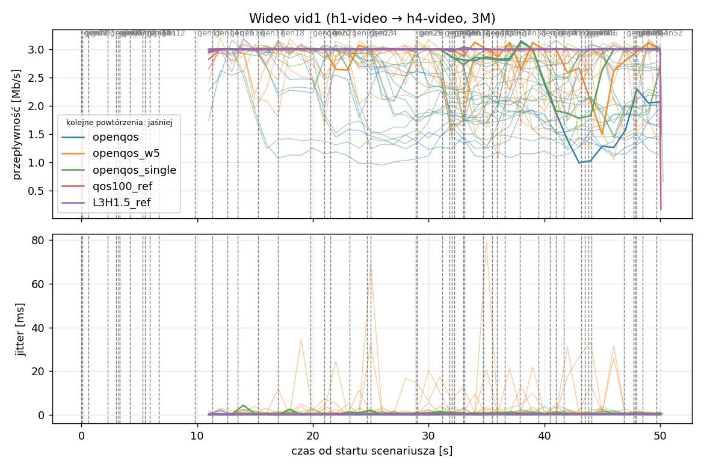
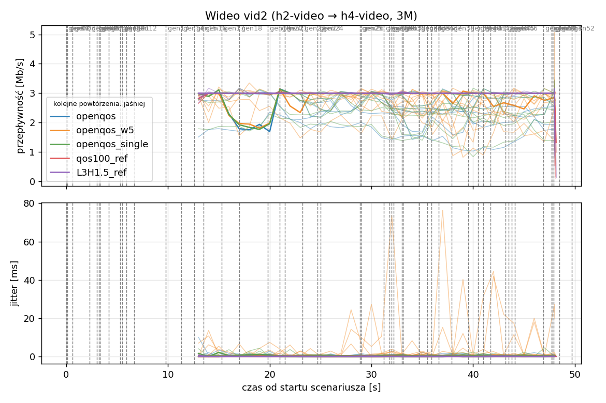
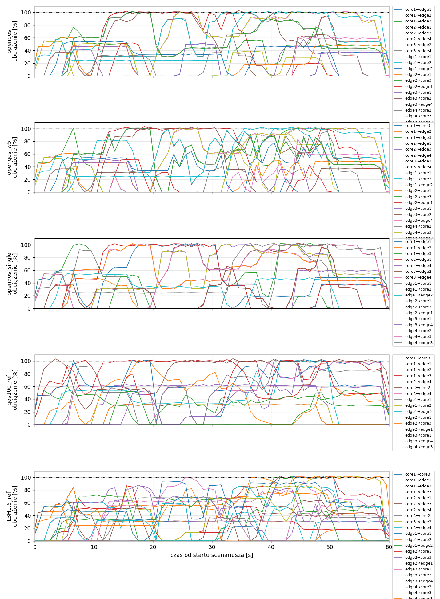
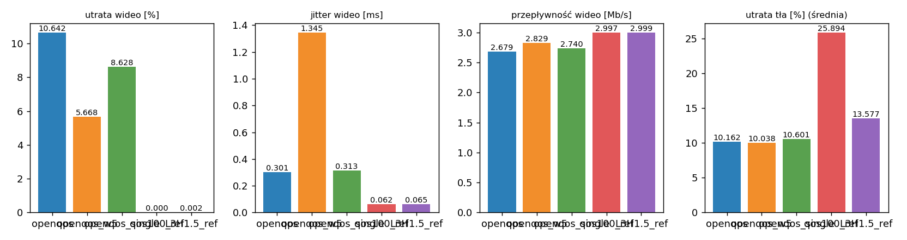

# Raport: mesh-sdn

Katalog: `results/official/openqos/mesh-sdn/20261109_045801`

## 1. Scenariusz

- Topologia: `mesh` (sdn: `mesh-sdn.clab.yml`)
- Warianty: **openqos** (POLICY=openqos), **openqos_w5** (CONG_WEIGHT=5, POLICY=openqos), **openqos_single** (OPENQOS_BE=single, POLICY=openqos), **qos100_ref** (LAYERS=1, POLICY=qos, RESERVE_PCT=100), **L3H1.5_ref** (HEADROOM_MBPS=1.5, LAYERS=3, POLICY=qos, RESERVE_PCT=70)
- Czas testu: 60 s, warmup (pomijany w statystykach, liczony od startu każdego przepływu): 5 s, powtórzeń: 20, seed: 42
- Wykonane przebiegi: openqos/rep1, openqos/rep10, openqos/rep11, openqos/rep12, openqos/rep13, openqos/rep14, openqos/rep15, openqos/rep16, openqos/rep17, openqos/rep18, openqos/rep19, openqos/rep2, openqos/rep20, openqos/rep3, openqos/rep4, openqos/rep5, openqos/rep6, openqos/rep7, openqos/rep8, openqos/rep9, openqos_w5/rep1, openqos_w5/rep10, openqos_w5/rep11, openqos_w5/rep12, openqos_w5/rep13, openqos_w5/rep14, openqos_w5/rep15, openqos_w5/rep16, openqos_w5/rep17, openqos_w5/rep18, openqos_w5/rep19, openqos_w5/rep2, openqos_w5/rep20, openqos_w5/rep3, openqos_w5/rep4, openqos_w5/rep5, openqos_w5/rep6, openqos_w5/rep7, openqos_w5/rep8, openqos_w5/rep9, openqos_single/rep1, openqos_single/rep10, openqos_single/rep11, openqos_single/rep12, openqos_single/rep13, openqos_single/rep14, openqos_single/rep15, openqos_single/rep16, openqos_single/rep17, openqos_single/rep18, openqos_single/rep19, openqos_single/rep2, openqos_single/rep20, openqos_single/rep3, openqos_single/rep4, openqos_single/rep5, openqos_single/rep6, openqos_single/rep7, openqos_single/rep8, openqos_single/rep9, qos100_ref/rep1, qos100_ref/rep10, qos100_ref/rep11, qos100_ref/rep12, qos100_ref/rep13, qos100_ref/rep14, qos100_ref/rep15, qos100_ref/rep16, qos100_ref/rep17, qos100_ref/rep18, qos100_ref/rep19, qos100_ref/rep2, qos100_ref/rep20, qos100_ref/rep3, qos100_ref/rep4, qos100_ref/rep5, qos100_ref/rep6, qos100_ref/rep7, qos100_ref/rep8, qos100_ref/rep9, L3H1.5_ref/rep1, L3H1.5_ref/rep10, L3H1.5_ref/rep11, L3H1.5_ref/rep12, L3H1.5_ref/rep13, L3H1.5_ref/rep14, L3H1.5_ref/rep15, L3H1.5_ref/rep16, L3H1.5_ref/rep17, L3H1.5_ref/rep18, L3H1.5_ref/rep19, L3H1.5_ref/rep2, L3H1.5_ref/rep20, L3H1.5_ref/rep3, L3H1.5_ref/rep4, L3H1.5_ref/rep5, L3H1.5_ref/rep6, L3H1.5_ref/rep7, L3H1.5_ref/rep8, L3H1.5_ref/rep9

Harmonogram losowego tła różni się między powtórzeniami (seed + nr powtórzenia, wspólny dla wariantów); poniżej powtórzenie 1.

| id | klasa | źródło → cel | proto | zadana [Mb/s] | DSCP | start–koniec [s] |
|---|---|---|---|---|---|---|
| gen01 | background | h2-bg1 → h3-bg2 | udp | 4.49 | – | 0–7 |
| gen02 | background | h4-bg2 → h3-bg1 | udp | 3.16 | – | 0.1–5.1 |
| gen03 | background | h4-bg1 → h2-bg2 | udp | 5.25 | – | 0.6–5.6 |
| gen04 | background | h4-bg1 → h1-bg2 | udp | 3.56 | – | 2.3–7.3 |
| gen05 | background | h4-bg1 → h3-bg1 | udp | 2.36 | – | 3–60 |
| gen06 | background | h1-bg2 → h2-bg1 | udp | 1.93 | – | 3.2–16.2 |
| gen07 | background | h2-bg1 → h3-bg1 | udp | 1.39 | – | 3.3–8.3 |
| gen08 | background | h1-bg1 → h2-bg1 | udp | 3.29 | – | 4.2–32.2 |
| gen09 | background | h3-bg2 → h2-bg1 | udp | 4.51 | – | 5.3–16.3 |
| gen10 | background | h1-bg2 → h3-bg1 | udp | 3.96 | – | 5.5–10.5 |
| gen11 | background | h2-bg1 → h4-bg2 | udp | 5.85 | – | 5.9–19.9 |
| gen12 | background | h1-bg2 → h3-bg1 | udp | 4.90 | – | 6.7–16.7 |
| gen13 | background | h4-bg1 → h1-bg1 | udp | 3.07 | – | 9.8–19.8 |
| vid1 | video | h1-video → h4-video | udp | 3.00 | 46 | 10–50 |
| gen14 | background | h3-bg2 → h1-bg2 | udp | 5.37 | – | 11.3–27.3 |
| vid2 | video | h2-video → h4-video | udp | 3.00 | 46 | 12–48 |
| gen15 | background | h3-bg1 → h1-bg1 | udp | 3.12 | – | 12.6–30.6 |
| gen16 | background | h2-bg1 → h1-bg1 | udp | 4.96 | – | 13.5–18.5 |
| gen17 | background | h2-bg1 → h4-bg2 | udp | 4.86 | – | 15.3–20.3 |
| gen18 | background | h3-bg2 → h1-bg1 | udp | 3.49 | – | 17–36 |
| gen19 | background | h4-bg2 → h2-bg1 | udp | 2.93 | – | 19.8–48.8 |
| gen20 | background | h1-bg2 → h4-bg2 | udp | 5.68 | – | 21–26 |
| gen21 | background | h4-bg1 → h2-bg1 | udp | 3.04 | – | 21.5–35.5 |
| gen22 | background | h4-bg1 → h2-bg1 | udp | 3.69 | – | 23.2–28.2 |
| gen23 | background | h2-bg2 → h4-bg2 | udp | 1.26 | – | 24.7–44.7 |
| gen24 | background | h3-bg1 → h1-bg2 | udp | 4.88 | – | 25–31 |
| gen25 | background | h4-bg1 → h1-bg2 | udp | 3.51 | – | 28.9–33.9 |
| gen26 | background | h1-bg1 → h4-bg1 | udp | 5.23 | – | 29–59 |
| gen27 | background | h1-bg2 → h4-bg1 | udp | 2.10 | – | 31.2–37.2 |
| gen28 | background | h4-bg1 → h1-bg2 | udp | 1.54 | – | 31.8–36.8 |
| gen29 | background | h4-bg1 → h1-bg2 | udp | 1.53 | – | 32–39 |
| gen30 | background | h1-bg2 → h3-bg1 | udp | 3.69 | – | 32.2–38.2 |
| gen31 | background | h2-bg1 → h4-bg2 | udp | 2.18 | – | 33–38 |
| gen32 | background | h4-bg2 → h3-bg2 | udp | 5.19 | – | 33.1–59.1 |
| gen33 | background | h4-bg2 → h3-bg2 | udp | 2.60 | – | 34.7–40.7 |
| gen34 | background | h2-bg2 → h3-bg2 | udp | 1.75 | – | 34.7–59.7 |
| gen35 | background | h4-bg2 → h2-bg1 | udp | 5.89 | – | 35.5–54.5 |
| gen36 | background | h4-bg2 → h3-bg1 | udp | 4.62 | – | 35.9–49.9 |
| gen37 | background | h1-bg2 → h2-bg2 | udp | 4.50 | – | 36.6–50.6 |
| gen38 | background | h2-bg1 → h4-bg1 | udp | 4.23 | – | 37.9–58.9 |
| gen39 | background | h1-bg2 → h4-bg2 | udp | 5.93 | – | 39.5–44.5 |
| gen40 | background | h1-bg1 → h3-bg1 | udp | 5.99 | – | 40.5–45.5 |
| gen41 | background | h1-bg2 → h3-bg1 | udp | 4.47 | – | 41–50 |
| gen42 | background | h1-bg2 → h3-bg1 | udp | 2.82 | – | 41.7–48.7 |
| gen43 | background | h4-bg2 → h2-bg1 | udp | 4.98 | – | 43.2–49.2 |
| gen44 | background | h4-bg2 → h1-bg2 | udp | 5.97 | – | 43.5–50.5 |
| gen45 | background | h3-bg1 → h4-bg1 | udp | 5.74 | – | 43.8–58.8 |
| gen46 | background | h2-bg1 → h1-bg2 | udp | 1.89 | – | 44.1–49.1 |
| gen47 | background | h2-bg2 → h3-bg1 | udp | 2.94 | – | 46.9–59.9 |
| gen48 | background | h3-bg1 → h1-bg1 | udp | 3.58 | – | 47.7–59.7 |
| gen49 | background | h4-bg1 → h2-bg1 | udp | 5.93 | – | 47.8–57.8 |
| gen50 | background | h4-bg1 → h1-bg1 | udp | 3.20 | – | 47.9–54.9 |
| gen51 | background | h4-bg2 → h3-bg1 | udp | 1.53 | – | 48.5–59.5 |
| gen52 | background | h4-bg2 → h2-bg2 | udp | 2.44 | – | 49.7–59.7 |

## 2. Wideo: QoS według wariantu

Wartości: średnia ± odchylenie standardowe z powtórzeń.

| przepływ | wariant | przepływność [Mb/s] | jitter [ms] | utrata [%] | RTT mediana [ms] | RTT p95 [ms] |
|---|---|---|---|---|---|---|
| vid1 | openqos | 2.55 ± 0.41 | 0.349 ± 0.198 | 14.97 ± 13.67 | 35.757 ± 29.607 | 77.522 ± 38.994 |
| vid1 | openqos_w5 | 2.83 ± 0.16 | 1.348 ± 2.019 | 5.56 ± 5.17 | 6.985 ± 16.045 | 66.956 ± 30.489 |
| vid1 | openqos_single | 2.67 ± 0.34 | 0.337 ± 0.148 | 10.82 ± 11.28 | 22.841 ± 28.858 | 59.593 ± 26.901 |
| vid1 | qos100_ref | 3.00 ± 0.00 | 0.068 ± 0.025 | 0.00 ± 0.00 | 0.029 ± 0.002 | 0.049 ± 0.004 |
| vid1 | L3H1.5_ref | 3.00 ± 0.00 | 0.068 ± 0.020 | 0.00 ± 0.02 | 0.028 ± 0.002 | 0.050 ± 0.007 |
| vid2 | openqos | 2.81 ± 0.30 | 0.252 ± 0.192 | 6.31 ± 10.08 | 16.459 ± 25.859 | 55.369 ± 32.748 |
| vid2 | openqos_w5 | 2.83 ± 0.18 | 1.341 ± 2.072 | 5.78 ± 5.76 | 9.263 ± 18.847 | 63.094 ± 41.461 |
| vid2 | openqos_single | 2.81 ± 0.31 | 0.289 ± 0.154 | 6.43 ± 10.22 | 16.720 ± 25.818 | 55.375 ± 33.313 |
| vid2 | qos100_ref | 3.00 ± 0.00 | 0.057 ± 0.010 | 0.00 ± 0.00 | 0.029 ± 0.003 | 0.057 ± 0.007 |
| vid2 | L3H1.5_ref | 3.00 ± 0.00 | 0.062 ± 0.017 | 0.00 ± 0.00 | 0.029 ± 0.004 | 6.000 ± 26.597 |

RTT z `ping` co 0,1 s między hostami wideo (osobny przepływ ICMP z tym samym DSCP - w SDN może iść inną ścieżką niż strumień UDP).

## 3. Ruch tła

Agregat tła w obrębie powtórzenia, potem średnia ± odchylenie standardowe po powtórzeniach (utrata = Σ utraconych / Σ wysłanych datagramów; dostarczone = Σ przepływności / Σ zadanych; przepływy trwające nie dłużej niż warmup pominięte).

| wariant | strumieni tła / powt. | dostarczone / zadane [%] | jitter [ms] | utrata [%] |
|---|---|---|---|---|
| openqos | 38 | 90.3 ± 4.7 | 0.233 ± 0.054 | 10.16 ± 5.50 |
| openqos_w5 | 38 | 90.2 ± 4.8 | 0.241 ± 0.063 | 10.04 ± 5.40 |
| openqos_single | 38 | 89.6 ± 4.6 | 0.231 ± 0.047 | 10.60 ± 5.40 |
| qos100_ref | 38 | 73.5 ± 5.4 | 0.447 ± 0.089 | 25.89 ± 7.55 |
| L3H1.5_ref | 38 | 86.5 ± 5.2 | 0.233 ± 0.082 | 13.58 ± 5.42 |

## 4. Obciążenie łączy fabricu

Średnia i maksimum z próbek co 1 s w oknie 0–60 s; MLU = maksymalne obciążenie łącza; drops = pakiety odrzucone przez `tbf` na wyjściu łącza.

| wariant | rep | średnie obciążenie łączy [%] | MLU [%] | łącza > 90% | drops tbf | CPU VM śr./maks. [%] |
|---|---|---|---|---|---|---|
| openqos | 1 | 28.6 | 102.8 | 10/24 | 21588 | 14 / 25 |
| openqos | 2 | 29.6 | 103.9 | 15/24 | 41477 | 15 / 29 |
| openqos | 3 | 36.3 | 103.4 | 11/24 | 42276 | 17 / 26 |
| openqos | 4 | 28.9 | 102.7 | 12/24 | 7117 | 15 / 24 |
| openqos | 5 | 28.9 | 103.5 | 10/24 | 14282 | 15 / 23 |
| openqos | 6 | 24.9 | 103.4 | 8/24 | 5132 | 14 / 25 |
| openqos | 7 | 31.6 | 102.9 | 11/24 | 11250 | 15 / 26 |
| openqos | 8 | 27.9 | 103.6 | 12/24 | 16068 | 15 / 31 |
| openqos | 9 | 24.2 | 102.6 | 8/24 | 49348 | 14 / 23 |
| openqos | 10 | 30.7 | 103.6 | 12/24 | 18819 | 16 / 30 |
| openqos | 11 | 30.6 | 103.5 | 12/24 | 50530 | 16 / 30 |
| openqos | 12 | 24.0 | 103.0 | 10/24 | 7675 | 14 / 25 |
| openqos | 13 | 29.8 | 102.7 | 10/24 | 26246 | 16 / 31 |
| openqos | 14 | 29.9 | 103.6 | 10/24 | 23648 | 16 / 29 |
| openqos | 15 | 34.2 | 104.4 | 10/24 | 41476 | 18 / 32 |
| openqos | 16 | 28.8 | 104.3 | 14/24 | 14903 | 16 / 32 |
| openqos | 17 | 33.8 | 103.7 | 12/24 | 37283 | 16 / 36 |
| openqos | 18 | 26.2 | 102.3 | 8/24 | 18136 | 14 / 23 |
| openqos | 19 | 31.9 | 103.1 | 11/24 | 34218 | 15 / 25 |
| openqos | 20 | 33.0 | 103.7 | 14/24 | 26713 | 17 / 33 |
| openqos_w5 | 1 | 29.4 | 103.4 | 12/24 | 21407 | 14 / 24 |
| openqos_w5 | 2 | 31.4 | 106.3 | 14/24 | 32074 | 16 / 29 |
| openqos_w5 | 3 | 37.6 | 103.0 | 12/24 | 41626 | 17 / 27 |
| openqos_w5 | 4 | 29.6 | 102.7 | 13/24 | 5086 | 15 / 25 |
| openqos_w5 | 5 | 30.1 | 103.6 | 12/24 | 12086 | 15 / 25 |
| openqos_w5 | 6 | 24.1 | 102.5 | 7/24 | 11244 | 14 / 23 |
| openqos_w5 | 7 | 31.4 | 102.9 | 11/24 | 17105 | 15 / 27 |
| openqos_w5 | 8 | 28.6 | 102.9 | 12/24 | 11491 | 15 / 36 |
| openqos_w5 | 9 | 25.3 | 103.1 | 9/24 | 46184 | 14 / 24 |
| openqos_w5 | 10 | 31.0 | 103.4 | 14/24 | 21353 | 16 / 30 |
| openqos_w5 | 11 | 31.7 | 103.0 | 12/24 | 49067 | 16 / 29 |
| openqos_w5 | 12 | 24.3 | 101.8 | 9/24 | 7499 | 14 / 23 |
| openqos_w5 | 13 | 32.1 | 102.4 | 12/24 | 20201 | 15 / 25 |
| openqos_w5 | 14 | 30.8 | 102.8 | 11/24 | 20900 | 16 / 28 |
| openqos_w5 | 15 | 35.0 | 103.5 | 12/24 | 48967 | 18 / 30 |
| openqos_w5 | 16 | 30.1 | 103.3 | 15/24 | 13586 | 14 / 24 |
| openqos_w5 | 17 | 36.1 | 104.0 | 13/24 | 29411 | 16 / 25 |
| openqos_w5 | 18 | 28.3 | 102.0 | 8/24 | 11655 | 14 / 23 |
| openqos_w5 | 19 | 31.8 | 102.6 | 10/24 | 35274 | 15 / 29 |
| openqos_w5 | 20 | 34.2 | 103.4 | 15/24 | 24601 | 16 / 32 |
| openqos_single | 1 | 28.9 | 102.8 | 13/24 | 19504 | 14 / 25 |
| openqos_single | 2 | 30.4 | 103.3 | 13/24 | 38163 | 16 / 32 |
| openqos_single | 3 | 37.1 | 105.1 | 13/24 | 38145 | 17 / 26 |
| openqos_single | 4 | 28.1 | 102.7 | 12/24 | 11719 | 14 / 24 |
| openqos_single | 5 | 29.3 | 103.0 | 11/24 | 11895 | 15 / 24 |
| openqos_single | 6 | 23.9 | 102.2 | 7/24 | 12240 | 14 / 27 |
| openqos_single | 7 | 30.8 | 103.0 | 11/24 | 18020 | 15 / 27 |
| openqos_single | 8 | 28.2 | 102.7 | 12/24 | 13722 | 15 / 30 |
| openqos_single | 9 | 24.8 | 102.9 | 9/24 | 45888 | 14 / 22 |
| openqos_single | 10 | 30.7 | 103.2 | 12/24 | 19505 | 16 / 30 |
| openqos_single | 11 | 30.7 | 103.5 | 12/24 | 52521 | 15 / 26 |
| openqos_single | 12 | 23.9 | 102.0 | 10/24 | 7770 | 14 / 24 |
| openqos_single | 13 | 29.9 | 102.7 | 11/24 | 21568 | 15 / 26 |
| openqos_single | 14 | 31.5 | 102.8 | 12/24 | 14552 | 16 / 27 |
| openqos_single | 15 | 34.2 | 102.9 | 10/24 | 41420 | 17 / 33 |
| openqos_single | 16 | 28.5 | 103.5 | 14/24 | 16827 | 15 / 24 |
| openqos_single | 17 | 34.5 | 105.8 | 12/24 | 33930 | 16 / 28 |
| openqos_single | 18 | 26.1 | 103.0 | 8/24 | 18630 | 14 / 21 |
| openqos_single | 19 | 29.7 | 103.2 | 10/24 | 47762 | 15 / 24 |
| openqos_single | 20 | 32.4 | 103.4 | 13/24 | 30615 | 16 / 30 |
| qos100_ref | 1 | 30.1 | 103.7 | 10/24 | 61384 | 14 / 24 |
| qos100_ref | 2 | 34.4 | 104.4 | 10/24 | 59334 | 15 / 29 |
| qos100_ref | 3 | 39.6 | 103.3 | 12/24 | 87871 | 17 / 30 |
| qos100_ref | 4 | 30.0 | 104.0 | 10/24 | 40779 | 14 / 24 |
| qos100_ref | 5 | 32.1 | 103.6 | 10/24 | 44771 | 15 / 25 |
| qos100_ref | 6 | 25.7 | 103.6 | 7/24 | 31382 | 14 / 25 |
| qos100_ref | 7 | 32.2 | 103.5 | 9/24 | 61538 | 15 / 25 |
| qos100_ref | 8 | 29.0 | 102.8 | 9/24 | 35461 | 14 / 29 |
| qos100_ref | 9 | 26.7 | 102.9 | 8/24 | 81791 | 14 / 22 |
| qos100_ref | 10 | 33.0 | 103.3 | 12/24 | 65553 | 16 / 30 |
| qos100_ref | 11 | 29.4 | 103.2 | 11/24 | 95428 | 15 / 27 |
| qos100_ref | 12 | 24.5 | 102.8 | 7/24 | 17554 | 13 / 23 |
| qos100_ref | 13 | 33.5 | 102.7 | 12/24 | 55694 | 15 / 25 |
| qos100_ref | 14 | 32.7 | 103.0 | 12/24 | 48417 | 15 / 25 |
| qos100_ref | 15 | 37.7 | 105.5 | 12/24 | 91628 | 17 / 28 |
| qos100_ref | 16 | 30.9 | 103.4 | 10/24 | 48460 | 14 / 23 |
| qos100_ref | 17 | 37.1 | 103.5 | 9/24 | 76244 | 16 / 24 |
| qos100_ref | 18 | 31.6 | 103.8 | 11/24 | 37898 | 14 / 23 |
| qos100_ref | 19 | 30.1 | 102.9 | 7/24 | 75627 | 15 / 27 |
| qos100_ref | 20 | 33.5 | 103.6 | 9/24 | 76701 | 16 / 31 |
| L3H1.5_ref | 1 | 35.9 | 102.4 | 8/24 | 16779 | 14 / 24 |
| L3H1.5_ref | 2 | 39.2 | 103.4 | 11/24 | 22702 | 15 / 31 |
| L3H1.5_ref | 3 | 44.9 | 105.3 | 14/24 | 32233 | 17 / 26 |
| L3H1.5_ref | 4 | 35.1 | 102.9 | 9/24 | 4016 | 14 / 23 |
| L3H1.5_ref | 5 | 38.3 | 102.6 | 10/24 | 13947 | 14 / 23 |
| L3H1.5_ref | 6 | 29.5 | 103.2 | 9/24 | 6235 | 14 / 25 |
| L3H1.5_ref | 7 | 37.5 | 103.0 | 9/24 | 11786 | 15 / 28 |
| L3H1.5_ref | 8 | 35.3 | 102.3 | 7/24 | 10260 | 15 / 34 |
| L3H1.5_ref | 9 | 34.0 | 102.6 | 7/24 | 32965 | 15 / 28 |
| L3H1.5_ref | 10 | 36.7 | 102.6 | 8/24 | 16056 | 15 / 29 |
| L3H1.5_ref | 11 | 40.7 | 103.1 | 13/24 | 30170 | 15 / 26 |
| L3H1.5_ref | 12 | 30.4 | 103.9 | 9/24 | 6415 | 14 / 24 |
| L3H1.5_ref | 13 | 40.1 | 103.2 | 10/24 | 20838 | 15 / 25 |
| L3H1.5_ref | 14 | 37.3 | 104.1 | 12/24 | 20387 | 16 / 28 |
| L3H1.5_ref | 15 | 44.1 | 105.1 | 11/24 | 49538 | 17 / 27 |
| L3H1.5_ref | 16 | 37.9 | 102.3 | 8/24 | 6093 | 15 / 40 |
| L3H1.5_ref | 17 | 45.0 | 102.9 | 11/24 | 27104 | 16 / 27 |
| L3H1.5_ref | 18 | 34.9 | 102.3 | 12/24 | 8922 | 14 / 22 |
| L3H1.5_ref | 19 | 37.8 | 102.8 | 12/24 | 32848 | 15 / 26 |
| L3H1.5_ref | 20 | 42.1 | 103.8 | 14/24 | 35751 | 16 / 29 |

Łącza z obciążeniem > 10% (maksimum [%] / drops, powtórzenie 1):

| łącze | openqos | openqos_w5 | openqos_single | qos100_ref | L3H1.5_ref |
|---|---|---|---|---|---|
| core1→core3 | 0 / 0 | 22 / 0 | 0 / 0 | 100 / 0 | 60 / 0 |
| core1→edge1 | 51 / 0 | 0 / 0 | 102 / 0 | 101 / 0 | 82 / 0 |
| core1→edge2 | 48 / 0 | 47 / 0 | 47 / 0 | 60 / 0 | 66 / 0 |
| core1→edge3 | 77 / 0 | 101 / 1108 | 103 / 1362 | 101 / 1261 | 102 / 2088 |
| core2→core3 | 0 / 0 | 0 / 0 | 0 / 0 | 0 / 0 | 0 / 0 |
| core2→edge1 | 102 / 1442 | 103 / 2986 | 97 / 0 | 0 / 0 | 87 / 0 |
| core2→edge3 | 58 / 0 | 51 / 0 | 0 / 0 | 0 / 0 | 86 / 0 |
| core2→edge4 | 103 / 0 | 100 / 0 | 102 / 0 | 64 / 0 | 93 / 0 |
| core3→core2 | 0 / 0 | 0 / 0 | 0 / 0 | 32 / 0 | 32 / 0 |
| core3→edge2 | 102 / 0 | 102 / 0 | 103 / 0 | 0 / 0 | 87 / 0 |
| core3→edge4 | 101 / 0 | 100 / 94 | 102 / 0 | 99 / 0 | 61 / 0 |
| edge1→core1 | 51 / 0 | 94 / 0 | 101 / 963 | 101 / 606 | 102 / 3774 |
| edge1→core2 | 101 / 7701 | 102 / 3717 | 102 / 2214 | 32 / 0 | 84 / 0 |
| edge1→edge2 | 54 / 0 | 78 / 0 | 55 / 0 | 102 / 3749 | 102 / 276 |
| edge2→core1 | 61 / 0 | 61 / 0 | 60 / 0 | 102 / 3241 | 87 / 0 |
| edge2→core3 | 102 / 1590 | 101 / 1588 | 102 / 1589 | 32 / 0 | 88 / 0 |
| edge2→edge1 | 52 / 0 | 52 / 0 | 52 / 0 | 52 / 0 | 64 / 0 |
| edge3→core1 | 51 / 0 | 47 / 0 | 102 / 4504 | 102 / 13990 | 100 / 674 |
| edge3→core2 | 101 / 1979 | 102 / 3071 | 0 / 0 | 0 / 0 | 69 / 0 |
| edge3→edge4 | 60 / 0 | 84 / 0 | 60 / 0 | 98 / 44 | 102 / 1129 |
| edge4→core2 | 95 / 0 | 96 / 0 | 96 / 0 | 0 / 0 | 87 / 0 |
| edge4→core3 | 101 / 4523 | 101 / 4480 | 102 / 4521 | 0 / 0 | 93 / 0 |
| edge4→edge3 | 102 / 4353 | 102 / 4363 | 102 / 4351 | 104 / 38493 | 102 / 8838 |

## 5. Ścieżki wybrane przez kontroler (powtórzenie 1)

Z logu kontrolera (linie `Flow`), dopasowane po piątce przepływu; ✓ = reguły widoczne w `dump-flows` na tych samych przełącznikach.

| przepływ | openqos | openqos_w5 | openqos_single | qos100_ref | L3H1.5_ref |
|---|---|---|---|---|---|
| gen01 | edge2 -> core1 -> edge3 ✓ (loads 0% 0% 0% 0%) | edge2 -> core1 -> edge3 ✓ (loads 0% 0% 0% 0%) | edge2 -> core1 -> edge3 ✓ (loads 0% 0% 0% 0%) | edge2 -> core1 -> edge3 ✓ (loads 5% 5% 0% 0%) | edge2 -> edge1 -> core2 -> edge3 ✓ (loads 20% 20% 0% 0%) |
| gen02 | edge4 -> edge3 ✓ (loads 0% 0%) | edge4 -> edge3 ✓ (loads 0% 0%) | edge4 -> edge3 ✓ (loads 0% 0%) | edge4 -> edge3 ✓ (loads 5% 0%) | edge4 -> edge3 ✓ (loads 20% 20%) |
| gen03 | edge4 -> core3 -> edge2 ✓ (loads 0% 8% 0% 0%) | edge4 -> core3 -> edge2 ✓ (loads 0% 2% 0% 0%) | edge4 -> core3 -> edge2 ✓ (loads 0% 0% 0% 0%) | edge4 -> edge3 -> core1 -> edge2 ✓ (loads 0% 15% 0% 0%) | edge4 -> core3 -> edge2 ✓ (loads 20% 40% 20% 20%) |
| gen04 | edge4 -> core2 -> edge1 ✓ (loads 0% 33% 33% 40%) | edge4 -> core2 -> edge1 ✓ (loads 0% 33% 33% 54%) | edge4 -> core2 -> edge1 ✓ (loads 0% 32% 32% 54%) | edge4 -> edge3 -> core1 -> edge1 ✓ (loads 0% 92% 92% 0%) | edge4 -> core2 -> edge1 ✓ (loads 38% 72% 72% 94%) |
| gen05 | edge4 -> edge3 ✓ (loads 32% 1%) | edge4 -> edge3 ✓ (loads 33% 0%) | edge4 -> edge3 ✓ (loads 33% 24%) | edge4 -> edge3 ✓ (loads 101% 0%) | edge4 -> edge3 ✓ (loads 50% 56%) |
| gen06 | edge1 -> edge2 ✓ (loads 0% 0%) | edge1 -> edge2 ✓ (loads 0% 0%) | edge1 -> edge2 ✓ (loads 0% 0%) | edge1 -> edge2 ✓ (loads 5% 48%) | edge1 -> edge2 ✓ (loads 17% 36%) |
| gen07 | edge2 -> core1 -> edge3 ✓ (loads 46% 46% 0% 32%) | edge2 -> core1 -> edge3 ✓ (loads 46% 46% 0% 36%) | edge2 -> core1 -> edge3 ✓ (loads 46% 46% 0% 33%) | edge2 -> core1 -> edge3 ✓ (loads 51% 51% 15% 106%) | edge2 -> edge1 -> core1 -> edge3 ✓ (loads 52% 46% 46% 70%) |
| gen08 | edge1 -> edge2 ✓ (loads 3% 0%) | edge1 -> edge2 ✓ (loads 20% 0%) | edge1 -> edge2 ✓ (loads 15% 0%) | edge1 -> edge2 ✓ (loads 20% 42%) | edge1 -> core1 -> edge2 ✓ (loads 67% 64%) |
| gen09 | edge3 -> core1 -> edge2 ✓ (loads 0% 54% 25% 54%) | edge3 -> core1 -> edge2 ✓ (loads 0% 54% 53% 54%) | edge3 -> core1 -> edge2 ✓ (loads 0% 54% 46% 54%) | edge3 -> core1 -> edge2 ✓ (loads 68% 0% 68% 68%) | edge3 -> edge4 -> core3 -> edge2 ✓ (loads 79% 66% 69% 66%) |
| gen10 | edge1 -> core2 -> edge3 ✓ (loads 61% 0% 61% 49%) | edge1 -> core1 -> edge3 ✓ (loads 61% 0% 61% 54%) | edge1 -> core1 -> edge3 ✓ (loads 61% 0% 61% 57%) | edge1 -> core1 -> edge3 ✓ (loads 76% 0% 76% 100%) | edge1 -> core2 -> edge3 ✓ (loads 88% 58% 93% 75%) |
| gen11 | edge2 -> core3 -> edge4 ✓ (loads 0% 0% 61% 61%) | edge2 -> core3 -> edge4 ✓ (loads 0% 0% 61% 61%) | edge2 -> core3 -> edge4 ✓ (loads 0% 0% 61% 61%) | edge2 -> core1 -> core3 -> edge4 ✓ (loads 0% 0% 69% 61%) | edge2 -> core3 -> edge4 ✓ (loads 12% 72% 41% 41%) |
| gen12 | edge1 -> core1 -> edge3 ✓ (loads 61% 34% 61% 34%) | edge1 -> core2 -> edge3 ✓ (loads 88% 0% 88% 24%) | edge1 -> core1 -> edge3 ✓ (loads 80% 0% 80% 29%) | edge1 -> core1 -> edge3 ✓ (loads 74% 0% 74% 98%) | edge1 -> edge2 -> core1 -> edge3 ✓ (loads 60% 92% 47% 92%) |
| gen13 | edge4 -> core2 -> edge1 ✓ (loads 0% 46% 24% 0%) | edge4 -> core2 -> edge1 ✓ (loads 0% 46% 24% 0%) | edge4 -> core2 -> edge1 ✓ (loads 0% 47% 24% 0%) | edge4 -> edge3 -> core1 -> edge1 ✓ (loads 0% 52% 29% 0%) | edge4 -> core2 -> edge1 ✓ (loads 7% 24% 24% 47%) |
| vid1 | edge1 -> core2 -> edge4 ✓ (loads 100% 46% 61% 44%) | edge1 -> core2 -> edge4 ✓ (loads 54% 77% 100% 75%) | edge1 -> core2 -> edge4 ✓ (loads 100% 87% 100% 100%) | edge1 -> core2 -> edge4 ✓ (loads 0% 65% 96% 96%) | edge1 -> core2 -> edge4 ✓ (loads 54% 70% 61% 60%) |
| gen14 | edge3 -> core2 -> edge1 ✓ (loads 46% 17% 17% 46%) | edge3 -> core2 -> edge1 ✓ (loads 47% 32% 32% 47%) | edge3 -> core1 -> edge1 ✓ (loads 46% 32% 32% 46%) | edge3 -> core1 -> edge1 ✓ (loads 83% 5% 5% 83%) | edge3 -> core1 -> edge1 ✓ (loads 6% 59% 59% 34%) |
| vid2 | edge2 -> core3 -> edge4 ✓ (loads 78% 100% 59% 78%) | edge2 -> core3 -> edge4 ✓ (loads 49% 100% 97% 49%) | edge2 -> core3 -> edge4 ✓ (loads 87% 100% 100% 87%) | edge2 -> core3 -> core2 -> edge4 ✓ (loads 60% 31% 65% 65%) | edge2 -> core3 -> core2 -> edge4 ✓ (loads 66% 92% 69% 66%) |
| gen15 | edge3 -> core2 -> edge1 ✓ (loads 46% 87% 87% 46%) | edge3 -> core2 -> edge1 ✓ (loads 47% 81% 81% 47%) | edge3 -> core1 -> edge1 ✓ (loads 83% 32% 32% 83%) | edge3 -> core1 -> edge1 ✓ (loads 108% 0% 5% 108%) | edge3 -> core2 -> edge1 ✓ (loads 68% 37% 47% 68%) |
| gen16 | edge2 -> edge1 ✓ (loads 0% 0%) | edge2 -> edge1 ✓ (loads 0% 0%) | edge2 -> edge1 ✓ (loads 0% 57%) | edge2 -> edge1 ✓ (loads 5% 64%) | edge2 -> edge1 ✓ (loads 5% 68%) |
| gen17 | edge2 -> core3 -> edge4 ✓ (loads 91% 44% 50% 91%) | edge2 -> core3 -> edge4 ✓ (loads 91% 81% 0% 91%) | edge2 -> core3 -> edge4 ✓ (loads 91% 51% 51% 91%) | edge2 -> core1 -> edge3 -> edge4 ✓ (loads 60% 62% 65% 65%) | edge2 -> core1 -> edge3 -> edge4 ✓ (loads 50% 62% 58% 58%) |
| gen18 | edge3 -> core2 -> edge1 ✓ (loads 44% 100% 100% 51%) | edge3 -> core2 -> edge1 ✓ (loads 47% 100% 100% 51%) | edge3 -> core1 -> edge1 ✓ (loads 97% 32% 32% 97%) | edge3 -> core1 -> edge1 ✓ (loads 105% 0% 47% 105%) | edge3 -> core2 -> edge1 ✓ (loads 71% 64% 101% 71%) |
| gen19 | edge4 -> core3 -> edge2 ✓ (loads 0% 24% 100% 32%) | edge4 -> core3 -> edge2 ✓ (loads 0% 24% 100% 32%) | edge4 -> core3 -> edge2 ✓ (loads 0% 100% 34% 32%) | edge4 -> edge3 -> core1 -> edge2 ✓ (loads 0% 105% 34% 0%) | edge4 -> core3 -> edge2 ✓ (loads 8% 55% 85% 32%) |
| gen20 | edge1 -> core2 -> edge4 ✓ (loads 31% 94% 0% 94%) | edge1 -> core2 -> edge4 ✓ (loads 31% 100% 0% 100%) | edge1 -> core2 -> edge4 ✓ (loads 31% 50% 0% 50%) | edge1 -> core1 -> core3 -> edge4 ✓ (loads 62% 34% 33% 11%) | edge1 -> core1 -> core3 -> edge4 ✓ (loads 70% 73% 65% 49%) |
| gen21 | edge4 -> core3 -> edge2 ✓ (loads 30% 24% 100% 30%) | edge4 -> core3 -> edge2 ✓ (loads 30% 24% 100% 30%) | edge4 -> core3 -> edge2 ✓ (loads 30% 100% 34% 30%) | edge4 -> edge3 -> core1 -> edge2 ✓ (loads 0% 114% 34% 0%) | edge4 -> edge3 -> core1 -> edge2 ✓ (loads 67% 62% 67% 67%) |
| gen22 | edge4 -> core3 -> edge2 ✓ (loads 57% 24% 100% 57%) | edge4 -> core3 -> edge2 ✓ (loads 52% 24% 100% 52%) | edge4 -> core3 -> edge2 ✓ (loads 62% 100% 34% 62%) | edge4 -> edge3 -> core1 -> edge2 ✓ (loads 0% 105% 34% 0%) | edge4 -> core3 -> edge2 ✓ (loads 51% 100% 68% 51%) |
| gen23 | edge2 -> core3 -> edge4 ✓ (loads 31% 90% 0% 31%) | edge2 -> core3 -> edge4 ✓ (loads 62% 65% 0% 62%) | edge2 -> core3 -> edge4 ✓ (loads 31% 90% 0% 31%) | edge2 -> core1 -> edge3 -> edge4 ✓ (loads 58% 62% 0% 58%) | edge2 -> core1 -> edge3 -> edge4 ✓ (loads 59% 62% 19% 59%) |
| gen24 | edge3 -> core1 -> edge1 ✓ (loads 0% 100% 100% 0%) | edge3 -> core2 -> edge1 ✓ (loads 0% 100% 100% 0%) | edge3 -> core1 -> edge1 ✓ (loads 100% 0% 0% 100%) | edge3 -> core1 -> edge1 ✓ (loads 110% 0% 5% 110%) | edge3 -> core1 -> edge1 ✓ (loads 92% 80% 80% 92%) |
| gen25 | edge4 -> core2 -> edge1 ✓ (loads 77% 50% 77% 93%) | edge4 -> core2 -> edge1 ✓ (loads 100% 24% 100% 99%) | edge4 -> core2 -> edge1 ✓ (loads 0% 100% 24% 100%) | edge4 -> edge3 -> core1 -> edge1 ✓ (loads 0% 105% 103% 0%) | edge4 -> core3 -> edge2 -> edge1 ✓ (loads 77% 91% 77% 76%) |
| gen26 | edge1 -> core2 -> edge4 ✓ (loads 31% 44% 0% 44%) | edge1 -> core2 -> edge4 ✓ (loads 31% 44% 0% 44%) | edge1 -> core2 -> edge4 ✓ (loads 31% 44% 0% 44%) | edge1 -> core1 -> core3 -> edge4 ✓ (loads 62% 34% 13% 10%) | edge1 -> core1 -> edge3 -> edge4 ✓ (loads 62% 46% 41% 41%) |
| gen27 | edge1 -> core2 -> edge4 ✓ (loads 85% 44% 0% 44%) | edge1 -> core2 -> edge4 ✓ (loads 85% 44% 0% 44%) | edge1 -> core2 -> edge4 ✓ (loads 85% 44% 0% 44%) | edge1 -> core1 -> edge3 -> edge4 ✓ (loads 62% 54% 59% 59%) | edge1 -> edge2 -> core3 -> edge4 ✓ (loads 62% 54% 103% 103%) |
| gen28 | edge4 -> core2 -> edge1 ✓ (loads 84% 31% 84% 62%) | edge4 -> core2 -> edge1 ✓ (loads 100% 24% 100% 62%) | edge4 -> core2 -> edge1 ✓ (loads 36% 100% 36% 62%) | edge4 -> edge3 -> core1 -> edge1 ✓ (loads 0% 119% 109% 5%) | edge4 -> core2 -> edge1 ✓ (loads 69% 85% 69% 74%) |
| gen29 | edge4 -> core2 -> edge1 ✓ (loads 84% 31% 84% 62%) | edge4 -> core2 -> edge1 ✓ (loads 100% 24% 100% 62%) | edge4 -> core2 -> edge1 ✓ (loads 38% 46% 38% 62%) | edge4 -> edge3 -> core1 -> edge1 ✓ (loads 0% 114% 104% 5%) | edge4 -> core2 -> edge1 ✓ (loads 77% 85% 77% 82%) |
| gen30 | edge1 -> core1 -> edge3 ✓ (loads 0% 99% 27% 99%) | edge1 -> core1 -> edge3 ✓ (loads 0% 85% 34% 85%) | edge1 -> core1 -> edge3 ✓ (loads 0% 99% 34% 99%) | edge1 -> edge2 -> core1 -> edge3 ✓ (loads 65% 31% 44% 104%) | edge1 -> core2 -> edge3 ✓ (loads 88% 55% 67% 70%) |
| gen31 | edge2 -> core3 -> edge4 ✓ (loads 44% 99% 0% 44%) | edge2 -> core3 -> edge4 ✓ (loads 75% 72% 1% 75%) | edge2 -> core3 -> edge4 ✓ (loads 44% 99% 0% 44%) | edge2 -> core1 -> edge3 -> edge4 ✓ (loads 59% 62% 55% 59%) | edge2 -> core1 -> core3 -> edge4 ✓ (loads 89% 70% 67% 67%) |
| gen32 | edge4 -> edge3 ✓ (loads 24% 45%) | edge4 -> edge3 ✓ (loads 24% 40%) | edge4 -> edge3 ✓ (loads 24% 66%) | edge4 -> edge3 ✓ (loads 110% 0%) | edge4 -> core2 -> edge3 ✓ (loads 73% 71%) |
| gen33 | edge4 -> edge3 ✓ (loads 78% 50%) | edge4 -> edge3 ✓ (loads 78% 64%) | edge4 -> edge3 ✓ (loads 75% 63%) | edge4 -> edge3 ✓ (loads 105% 0%) | edge4 -> edge3 ✓ (loads 77% 99%) |
| gen34 | edge2 -> core1 -> edge3 ✓ (loads 38% 38% 100% 78%) | edge2 -> core1 -> edge3 ✓ (loads 69% 69% 81% 78%) | edge2 -> core1 -> edge3 ✓ (loads 38% 38% 100% 75%) | edge2 -> core1 -> edge3 ✓ (loads 88% 88% 31% 105%) | edge2 -> core1 -> edge3 ✓ (loads 72% 72% 99% 82%) |
| gen35 | edge4 -> core3 -> edge2 ✓ (loads 62% 94% 68% 62%) | edge4 -> core3 -> edge2 ✓ (loads 62% 91% 70% 62%) | edge4 -> core3 -> edge2 ✓ (loads 62% 87% 32% 62%) | edge4 -> edge3 -> core1 -> edge2 ✓ (loads 0% 105% 38% 0%) | edge4 -> core3 -> edge2 ✓ (loads 36% 93% 100% 100%) |
| gen36 | edge4 -> edge3 ✓ (loads 94% 32%) | edge4 -> edge3 ✓ (loads 91% 32%) | edge4 -> edge3 ✓ (loads 87% 32%) | edge4 -> edge3 ✓ (loads 100% 0%) | edge4 -> edge3 ✓ (loads 82% 85%) |
| gen37 | edge1 -> edge2 ✓ (loads 0% 38%) | edge1 -> edge2 ✓ (loads 0% 38%) | edge1 -> edge2 ✓ (loads 0% 38%) | edge1 -> edge2 ✓ (loads 43% 80%) | edge1 -> edge2 ✓ (loads 29% 60%) |
| gen38 | edge2 -> core3 -> edge4 ✓ (loads 66% 100% 56% 66%) | edge2 -> core3 -> edge4 ✓ (loads 97% 82% 56% 97%) | edge2 -> core3 -> edge4 ✓ (loads 66% 100% 56% 66%) | edge2 -> core1 -> core3 -> edge4 ✓ (loads 54% 62% 100% 92%) | edge2 -> edge1 -> core2 -> edge4 ✓ (loads 70% 69% 91% 70%) |
| gen39 | edge1 -> core2 -> edge4 ✓ (loads 85% 88% 43% 88%) | edge1 -> core2 -> edge4 ✓ (loads 85% 88% 23% 88%) | edge1 -> core2 -> edge4 ✓ (loads 85% 88% 23% 87%) | edge1 -> core1 -> edge3 -> edge4 ✓ (loads 62% 78% 69% 78%) | edge1 -> edge2 -> core3 -> edge4 ✓ (loads 86% 51% 85% 54%) |
| gen40 | edge1 -> core2 -> edge3 ✓ (loads 18% 99% 46% 100%) | edge1 -> core2 -> edge3 ✓ (loads 49% 90% 77% 100%) | edge1 -> core1 -> edge3 ✓ (loads 18% 95% 46% 100%) | edge1 -> edge2 -> core1 -> edge3 ✓ (loads 100% 31% 93% 100%) | edge1 -> core1 -> edge3 ✓ (loads 92% 75% 92% 98%) |
| gen41 | edge1 -> core2 -> edge3 ✓ (loads 18% 99% 46% 100%) | edge1 -> core1 -> edge3 ✓ (loads 49% 90% 77% 100%) | edge1 -> core1 -> edge3 ✓ (loads 18% 95% 46% 100%) | edge1 -> edge2 -> core1 -> edge3 ✓ (loads 100% 31% 88% 100%) | edge1 -> core1 -> edge3 ✓ (loads 123% 81% 123% 88%) |
| gen42 | edge1 -> core1 -> edge3 ✓ (loads 18% 100% 46% 100%) | edge1 -> core1 -> edge3 ✓ (loads 52% 98% 77% 99%) | edge1 -> core1 -> edge3 ✓ (loads 101% 100% 100% 100%) | edge1 -> edge2 -> core1 -> edge3 ✓ (loads 100% 31% 100% 100%) | edge1 -> core1 -> edge3 ✓ (loads 115% 81% 115% 88%) |
| gen43 | edge4 -> core3 -> edge2 ✓ (loads 91% 100% 46% 91%) | edge4 -> core3 -> edge2 ✓ (loads 91% 100% 47% 91%) | edge4 -> core3 -> edge2 ✓ (loads 91% 100% 46% 91%) | edge4 -> edge3 -> core1 -> edge2 ✓ (loads 0% 110% 105% 0%) | edge4 -> edge3 -> core1 -> edge2 ✓ (loads 91% 78% 100% 85%) |
| gen44 | edge4 -> core2 -> edge1 ✓ (loads 0% 100% 100% 94%) | edge4 -> core2 -> edge1 ✓ (loads 0% 100% 100% 91%) | edge4 -> core2 -> edge1 ✓ (loads 0% 100% 100% 91%) | edge4 -> edge3 -> core1 -> edge1 ✓ (loads 0% 105% 105% 10%) | edge4 -> core2 -> edge1 ✓ (loads 60% 84% 84% 91%) |
| gen45 | edge3 -> edge4 ✓ (loads 0% 55%) | edge3 -> edge4 ✓ (loads 3% 66%) | edge3 -> edge4 ✓ (loads 0% 100%) | edge3 -> edge4 ✓ (loads 47% 62%) | edge3 -> edge4 ✓ (loads 42% 79%) |
| gen46 | edge2 -> edge1 ✓ (loads 0% 18%) | edge2 -> edge1 ✓ (loads 0% 18%) | edge2 -> edge1 ✓ (loads 0% 18%) | edge2 -> edge1 ✓ (loads 5% 100%) | edge2 -> edge1 ✓ (loads 44% 50%) |
| gen47 | edge2 -> core1 -> edge3 ✓ (loads 47% 47% 100% 100%) | edge2 -> core1 -> edge3 ✓ (loads 99% 99% 80% 100%) | edge2 -> core1 -> edge3 ✓ (loads 100% 100% 85% 100%) | edge2 -> edge1 -> core1 -> edge3 ✓ (loads 100% 78% 31% 100%) | edge2 -> core3 -> edge4 -> edge3 ✓ (loads 110% 110% 74% 107%) |
| gen48 | edge3 -> core1 -> edge1 ✓ (loads 0% 61% 61% 19%) | edge3 -> core2 -> edge1 ✓ (loads 0% 62% 62% 50%) | edge3 -> core1 -> edge1 ✓ (loads 0% 62% 62% 19%) | edge3 -> core1 -> edge1 ✓ (loads 68% 0% 59% 68%) | edge3 -> core2 -> edge1 ✓ (loads 115% 57% 95% 115%) |
| gen49 | edge4 -> core3 -> edge2 ✓ (loads 100% 100% 61% 100%) | edge4 -> core3 -> edge2 ✓ (loads 100% 100% 85% 100%) | edge4 -> core3 -> edge2 ✓ (loads 100% 100% 68% 100%) | edge4 -> edge3 -> core1 -> edge2 ✓ (loads 0% 100% 100% 0%) | edge4 -> edge3 -> core1 -> edge2 ✓ (loads 91% 135% 85% 85%) |
| gen50 | edge4 -> core2 -> edge1 ✓ (loads 61% 100% 100% 100%) | edge4 -> core2 -> edge1 ✓ (loads 62% 100% 100% 100%) | edge4 -> core2 -> edge1 ✓ (loads 62% 100% 100% 99%) | edge4 -> edge3 -> core1 -> edge1 ✓ (loads 0% 99% 99% 50%) | edge4 -> edge3 -> core1 -> edge1 ✓ (loads 85% 160% 160% 91%) |
| gen51 | edge4 -> edge3 ✓ (loads 97% 70%) | edge4 -> edge3 ✓ (loads 100% 75%) | edge4 -> edge3 ✓ (loads 100% 68%) | edge4 -> edge3 ✓ (loads 110% 0%) | edge4 -> edge3 ✓ (loads 197% 84%) |
| gen52 | edge4 -> core3 -> edge2 ✓ (loads 100% 100% 95% 100%) | edge4 -> core3 -> edge2 ✓ (loads 100% 99% 100% 100%) | edge4 -> core3 -> edge2 ✓ (loads 100% 100% 95% 100%) | edge4 -> edge3 -> core1 -> edge2 ✓ (loads 0% 110% 100% 0%) | edge4 -> edge3 -> core1 -> edge2 ✓ (loads 90% 197% 103% 87%) |

## 6. Wnioski

<!-- WNIOSKI:START -->
_Do uzupełnienia: krótkie wnioski wyłącznie na podstawie liczb z sekcji 2–5._
<!-- WNIOSKI:END -->

## 7. Wiarygodność pomiaru

- openqos rep1, gen02: przepływ krótszy niż warmup - statystyki z całości
- openqos rep1, gen04: przepływ krótszy niż warmup - statystyki z całości
- openqos rep1, gen16: przepływ krótszy niż warmup - statystyki z całości
- openqos rep1, gen17: przepływ krótszy niż warmup - statystyki z całości
- openqos rep1, gen22: przepływ krótszy niż warmup - statystyki z całości
- openqos rep1, gen46: przepływ krótszy niż warmup - statystyki z całości
- openqos rep1, vid1: 16 decyzji kontrolera dla jednego przepływu (wygasła reguła albo duplikat Packet-In)
- openqos rep1, vid2: 14 decyzji kontrolera dla jednego przepływu (wygasła reguła albo duplikat Packet-In)
- openqos rep10, gen02: przepływ krótszy niż warmup - statystyki z całości
- openqos rep10, gen04: przepływ krótszy niż warmup - statystyki z całości
- openqos rep10, gen09: przepływ krótszy niż warmup - statystyki z całości
- openqos rep10, gen10: przepływ krótszy niż warmup - statystyki z całości
- openqos rep10, gen31: przepływ krótszy niż warmup - statystyki z całości
- openqos rep10, gen44: przepływ krótszy niż warmup - statystyki z całości
- openqos rep10, gen57: przepływ krótszy niż warmup - statystyki z całości
- openqos rep10, vid1: 19 decyzji kontrolera dla jednego przepływu (wygasła reguła albo duplikat Packet-In)
- openqos rep10, vid2: 17 decyzji kontrolera dla jednego przepływu (wygasła reguła albo duplikat Packet-In)
- openqos rep11, gen13: przepływ krótszy niż warmup - statystyki z całości
- openqos rep11, gen17: przepływ krótszy niż warmup - statystyki z całości
- openqos rep11, gen19: przepływ krótszy niż warmup - statystyki z całości
- openqos rep11, gen20: przepływ krótszy niż warmup - statystyki z całości
- openqos rep11, gen32: przepływ krótszy niż warmup - statystyki z całości
- openqos rep11, gen39: klient: unable to receive results: No such file or directory
- openqos rep11, vid1: 20 decyzji kontrolera dla jednego przepływu (wygasła reguła albo duplikat Packet-In)
- openqos rep11, vid2: 19 decyzji kontrolera dla jednego przepływu (wygasła reguła albo duplikat Packet-In)
- openqos rep12, gen03: przepływ krótszy niż warmup - statystyki z całości
- openqos rep12, gen04: przepływ krótszy niż warmup - statystyki z całości
- openqos rep12, gen07: przepływ krótszy niż warmup - statystyki z całości
- openqos rep12, gen34: przepływ krótszy niż warmup - statystyki z całości
- openqos rep12, vid1: 17 decyzji kontrolera dla jednego przepływu (wygasła reguła albo duplikat Packet-In)
- openqos rep12, vid2: 17 decyzji kontrolera dla jednego przepływu (wygasła reguła albo duplikat Packet-In)
- openqos rep13, gen02: przepływ krótszy niż warmup - statystyki z całości
- openqos rep13, gen14: przepływ krótszy niż warmup - statystyki z całości
- openqos rep13, gen19: przepływ krótszy niż warmup - statystyki z całości
- openqos rep13, gen41: przepływ krótszy niż warmup - statystyki z całości
- openqos rep13, gen42: przepływ krótszy niż warmup - statystyki z całości
- openqos rep13, gen43: przepływ krótszy niż warmup - statystyki z całości
- openqos rep13, gen53: przepływ krótszy niż warmup - statystyki z całości
- openqos rep13, gen54: przepływ krótszy niż warmup - statystyki z całości
- openqos rep13, vid1: 21 decyzji kontrolera dla jednego przepływu (wygasła reguła albo duplikat Packet-In)
- openqos rep13, vid2: 20 decyzji kontrolera dla jednego przepływu (wygasła reguła albo duplikat Packet-In)
- openqos rep14, gen02: przepływ krótszy niż warmup - statystyki z całości
- openqos rep14, gen41: przepływ krótszy niż warmup - statystyki z całości
- openqos rep14, gen50: przepływ krótszy niż warmup - statystyki z całości
- openqos rep14, gen51: przepływ krótszy niż warmup - statystyki z całości
- openqos rep14, vid1: 22 decyzji kontrolera dla jednego przepływu (wygasła reguła albo duplikat Packet-In)
- openqos rep14, vid2: 21 decyzji kontrolera dla jednego przepływu (wygasła reguła albo duplikat Packet-In)
- openqos rep15, gen09: przepływ krótszy niż warmup - statystyki z całości
- openqos rep15, gen14: klient: unable to receive results: No such file or directory
- openqos rep15, gen14: serwer: error - unable to receive results: Bad file descriptor
- openqos rep15, gen17: przepływ krótszy niż warmup - statystyki z całości
- openqos rep15, gen28: przepływ krótszy niż warmup - statystyki z całości
- openqos rep15, gen45: przepływ krótszy niż warmup - statystyki z całości
- openqos rep15, vid1: 19 decyzji kontrolera dla jednego przepływu (wygasła reguła albo duplikat Packet-In)
- openqos rep15, vid2: 17 decyzji kontrolera dla jednego przepływu (wygasła reguła albo duplikat Packet-In)
- openqos rep16, gen11: przepływ krótszy niż warmup - statystyki z całości
- openqos rep16, gen15: przepływ krótszy niż warmup - statystyki z całości
- openqos rep16, gen29: przepływ krótszy niż warmup - statystyki z całości
- openqos rep16, gen38: przepływ krótszy niż warmup - statystyki z całości
- openqos rep16, gen40: przepływ krótszy niż warmup - statystyki z całości
- openqos rep16, vid1: 19 decyzji kontrolera dla jednego przepływu (wygasła reguła albo duplikat Packet-In)
- openqos rep16, vid2: 18 decyzji kontrolera dla jednego przepływu (wygasła reguła albo duplikat Packet-In)
- openqos rep17, gen05: przepływ krótszy niż warmup - statystyki z całości
- openqos rep17, gen06: przepływ krótszy niż warmup - statystyki z całości
- openqos rep17, gen09: przepływ krótszy niż warmup - statystyki z całości
- openqos rep17, gen15: przepływ krótszy niż warmup - statystyki z całości
- openqos rep17, gen24: przepływ krótszy niż warmup - statystyki z całości
- openqos rep17, gen25: przepływ krótszy niż warmup - statystyki z całości
- openqos rep17, gen33: przepływ krótszy niż warmup - statystyki z całości
- openqos rep17, gen45: przepływ krótszy niż warmup - statystyki z całości
- openqos rep17, gen55: przepływ krótszy niż warmup - statystyki z całości
- openqos rep17, gen57: przepływ krótszy niż warmup - statystyki z całości
- openqos rep17, vid1: 16 decyzji kontrolera dla jednego przepływu (wygasła reguła albo duplikat Packet-In)
- openqos rep17, vid2: 16 decyzji kontrolera dla jednego przepływu (wygasła reguła albo duplikat Packet-In)
- openqos rep18, gen32: przepływ krótszy niż warmup - statystyki z całości
- openqos rep18, gen34: przepływ krótszy niż warmup - statystyki z całości
- openqos rep18, vid1: 14 decyzji kontrolera dla jednego przepływu (wygasła reguła albo duplikat Packet-In)
- openqos rep18, vid2: 13 decyzji kontrolera dla jednego przepływu (wygasła reguła albo duplikat Packet-In)
- openqos rep19, gen02: przepływ krótszy niż warmup - statystyki z całości
- openqos rep19, gen12: przepływ krótszy niż warmup - statystyki z całości
- openqos rep19, gen14: przepływ krótszy niż warmup - statystyki z całości
- openqos rep19, gen40: przepływ krótszy niż warmup - statystyki z całości
- openqos rep19, gen43: przepływ krótszy niż warmup - statystyki z całości
- openqos rep19, gen50: przepływ krótszy niż warmup - statystyki z całości
- openqos rep19, gen51: przepływ krótszy niż warmup - statystyki z całości
- openqos rep19, vid1: 20 decyzji kontrolera dla jednego przepływu (wygasła reguła albo duplikat Packet-In)
- openqos rep19, vid2: 18 decyzji kontrolera dla jednego przepływu (wygasła reguła albo duplikat Packet-In)
- openqos rep2, gen31: przepływ krótszy niż warmup - statystyki z całości
- openqos rep2, gen36: przepływ krótszy niż warmup - statystyki z całości
- openqos rep2, gen45: przepływ krótszy niż warmup - statystyki z całości
- openqos rep2, gen51: przepływ krótszy niż warmup - statystyki z całości
- openqos rep2, vid1: 21 decyzji kontrolera dla jednego przepływu (wygasła reguła albo duplikat Packet-In)
- openqos rep2, vid2: 19 decyzji kontrolera dla jednego przepływu (wygasła reguła albo duplikat Packet-In)
- openqos rep20, gen09: przepływ krótszy niż warmup - statystyki z całości
- openqos rep20, gen11: przepływ krótszy niż warmup - statystyki z całości
- openqos rep20, gen15: przepływ krótszy niż warmup - statystyki z całości
- openqos rep20, gen50: przepływ krótszy niż warmup - statystyki z całości
- openqos rep20, gen55: przepływ krótszy niż warmup - statystyki z całości
- openqos rep20, vid1: 18 decyzji kontrolera dla jednego przepływu (wygasła reguła albo duplikat Packet-In)
- openqos rep20, vid2: 17 decyzji kontrolera dla jednego przepływu (wygasła reguła albo duplikat Packet-In)
- openqos rep3, gen02: przepływ krótszy niż warmup - statystyki z całości
- openqos rep3, gen03: przepływ krótszy niż warmup - statystyki z całości
- openqos rep3, gen09: przepływ krótszy niż warmup - statystyki z całości
- openqos rep3, gen11: przepływ krótszy niż warmup - statystyki z całości
- openqos rep3, gen13: przepływ krótszy niż warmup - statystyki z całości
- openqos rep3, gen15: przepływ krótszy niż warmup - statystyki z całości
- openqos rep3, gen30: przepływ krótszy niż warmup - statystyki z całości
- openqos rep3, gen38: przepływ krótszy niż warmup - statystyki z całości
- openqos rep3, vid1: 19 decyzji kontrolera dla jednego przepływu (wygasła reguła albo duplikat Packet-In)
- openqos rep3, vid2: 16 decyzji kontrolera dla jednego przepływu (wygasła reguła albo duplikat Packet-In)
- openqos rep4, gen22: przepływ krótszy niż warmup - statystyki z całości
- openqos rep4, gen28: przepływ krótszy niż warmup - statystyki z całości
- openqos rep4, gen29: przepływ krótszy niż warmup - statystyki z całości
- openqos rep4, gen31: przepływ krótszy niż warmup - statystyki z całości
- openqos rep4, gen45: przepływ krótszy niż warmup - statystyki z całości
- openqos rep4, vid1: 27 decyzji kontrolera dla jednego przepływu (wygasła reguła albo duplikat Packet-In)
- openqos rep4, vid2: 24 decyzji kontrolera dla jednego przepływu (wygasła reguła albo duplikat Packet-In)
- openqos rep5, gen02: przepływ krótszy niż warmup - statystyki z całości
- openqos rep5, gen51: przepływ krótszy niż warmup - statystyki z całości
- openqos rep5, vid1: 18 decyzji kontrolera dla jednego przepływu (wygasła reguła albo duplikat Packet-In)
- openqos rep5, vid2: 17 decyzji kontrolera dla jednego przepływu (wygasła reguła albo duplikat Packet-In)
- openqos rep6, gen04: przepływ krótszy niż warmup - statystyki z całości
- openqos rep6, gen07: przepływ krótszy niż warmup - statystyki z całości
- openqos rep6, gen10: przepływ krótszy niż warmup - statystyki z całości
- openqos rep6, gen29: przepływ krótszy niż warmup - statystyki z całości
- openqos rep6, gen38: przepływ krótszy niż warmup - statystyki z całości
- openqos rep6, vid1: 19 decyzji kontrolera dla jednego przepływu (wygasła reguła albo duplikat Packet-In)
- openqos rep6, vid2: 19 decyzji kontrolera dla jednego przepływu (wygasła reguła albo duplikat Packet-In)
- openqos rep7, gen02: przepływ krótszy niż warmup - statystyki z całości
- openqos rep7, gen03: przepływ krótszy niż warmup - statystyki z całości
- openqos rep7, gen07: przepływ krótszy niż warmup - statystyki z całości
- openqos rep7, gen23: przepływ krótszy niż warmup - statystyki z całości
- openqos rep7, gen24: przepływ krótszy niż warmup - statystyki z całości
- openqos rep7, gen34: przepływ krótszy niż warmup - statystyki z całości
- openqos rep7, gen43: przepływ krótszy niż warmup - statystyki z całości
- openqos rep7, gen48: przepływ krótszy niż warmup - statystyki z całości
- openqos rep7, gen49: przepływ krótszy niż warmup - statystyki z całości
- openqos rep7, gen50: przepływ krótszy niż warmup - statystyki z całości
- openqos rep7, vid1: 21 decyzji kontrolera dla jednego przepływu (wygasła reguła albo duplikat Packet-In)
- openqos rep7, vid2: 19 decyzji kontrolera dla jednego przepływu (wygasła reguła albo duplikat Packet-In)
- openqos rep8, gen12: przepływ krótszy niż warmup - statystyki z całości
- openqos rep8, gen28: przepływ krótszy niż warmup - statystyki z całości
- openqos rep8, gen33: przepływ krótszy niż warmup - statystyki z całości
- openqos rep8, gen37: przepływ krótszy niż warmup - statystyki z całości
- openqos rep8, vid1: 23 decyzji kontrolera dla jednego przepływu (wygasła reguła albo duplikat Packet-In)
- openqos rep8, vid2: 21 decyzji kontrolera dla jednego przepływu (wygasła reguła albo duplikat Packet-In)
- openqos rep9, vid1: 14 decyzji kontrolera dla jednego przepływu (wygasła reguła albo duplikat Packet-In)
- openqos rep9, vid2: 13 decyzji kontrolera dla jednego przepływu (wygasła reguła albo duplikat Packet-In)
- openqos_w5 rep1, gen02: przepływ krótszy niż warmup - statystyki z całości
- openqos_w5 rep1, gen04: przepływ krótszy niż warmup - statystyki z całości
- openqos_w5 rep1, gen07: przepływ krótszy niż warmup - statystyki z całości
- openqos_w5 rep1, gen16: przepływ krótszy niż warmup - statystyki z całości
- openqos_w5 rep1, gen17: przepływ krótszy niż warmup - statystyki z całości
- openqos_w5 rep1, gen22: przepływ krótszy niż warmup - statystyki z całości
- openqos_w5 rep1, gen31: przepływ krótszy niż warmup - statystyki z całości
- openqos_w5 rep1, gen46: przepływ krótszy niż warmup - statystyki z całości
- openqos_w5 rep1, vid1: 26 decyzji kontrolera dla jednego przepływu (wygasła reguła albo duplikat Packet-In)
- openqos_w5 rep1, vid2: 24 decyzji kontrolera dla jednego przepływu (wygasła reguła albo duplikat Packet-In)
- openqos_w5 rep10, gen04: przepływ krótszy niż warmup - statystyki z całości
- openqos_w5 rep10, gen09: przepływ krótszy niż warmup - statystyki z całości
- openqos_w5 rep10, gen10: przepływ krótszy niż warmup - statystyki z całości
- openqos_w5 rep10, gen17: przepływ krótszy niż warmup - statystyki z całości
- openqos_w5 rep10, gen31: przepływ krótszy niż warmup - statystyki z całości
- openqos_w5 rep10, gen44: przepływ krótszy niż warmup - statystyki z całości
- openqos_w5 rep10, vid1: 22 decyzji kontrolera dla jednego przepływu (wygasła reguła albo duplikat Packet-In)
- openqos_w5 rep10, vid2: 19 decyzji kontrolera dla jednego przepływu (wygasła reguła albo duplikat Packet-In)
- openqos_w5 rep11, gen19: przepływ krótszy niż warmup - statystyki z całości
- openqos_w5 rep11, gen20: przepływ krótszy niż warmup - statystyki z całości
- openqos_w5 rep11, gen32: przepływ krótszy niż warmup - statystyki z całości
- openqos_w5 rep11, gen54: przepływ krótszy niż warmup - statystyki z całości
- openqos_w5 rep11, vid1: 22 decyzji kontrolera dla jednego przepływu (wygasła reguła albo duplikat Packet-In)
- openqos_w5 rep11, vid2: 20 decyzji kontrolera dla jednego przepływu (wygasła reguła albo duplikat Packet-In)
- openqos_w5 rep12, gen03: przepływ krótszy niż warmup - statystyki z całości
- openqos_w5 rep12, gen04: przepływ krótszy niż warmup - statystyki z całości
- openqos_w5 rep12, gen07: przepływ krótszy niż warmup - statystyki z całości
- openqos_w5 rep12, gen34: przepływ krótszy niż warmup - statystyki z całości
- openqos_w5 rep12, vid1: 18 decyzji kontrolera dla jednego przepływu (wygasła reguła albo duplikat Packet-In)
- openqos_w5 rep12, vid2: 18 decyzji kontrolera dla jednego przepływu (wygasła reguła albo duplikat Packet-In)
- openqos_w5 rep13, gen02: przepływ krótszy niż warmup - statystyki z całości
- openqos_w5 rep13, gen13: przepływ krótszy niż warmup - statystyki z całości
- openqos_w5 rep13, gen14: przepływ krótszy niż warmup - statystyki z całości
- openqos_w5 rep13, gen19: przepływ krótszy niż warmup - statystyki z całości
- openqos_w5 rep13, gen26: przepływ krótszy niż warmup - statystyki z całości
- openqos_w5 rep13, gen41: przepływ krótszy niż warmup - statystyki z całości
- openqos_w5 rep13, gen43: przepływ krótszy niż warmup - statystyki z całości
- openqos_w5 rep13, gen54: przepływ krótszy niż warmup - statystyki z całości
- openqos_w5 rep13, vid1: 27 decyzji kontrolera dla jednego przepływu (wygasła reguła albo duplikat Packet-In)
- openqos_w5 rep13, vid1: dump-flows nie potwierdza ścieżki z logu (edge1 -> core1 -> edge3 -> edge4 vs core1, core2, core3, edge1, edge2)
- openqos_w5 rep13, vid2: 25 decyzji kontrolera dla jednego przepływu (wygasła reguła albo duplikat Packet-In)
- openqos_w5 rep14, gen02: przepływ krótszy niż warmup - statystyki z całości
- openqos_w5 rep14, gen50: przepływ krótszy niż warmup - statystyki z całości
- openqos_w5 rep14, gen51: przepływ krótszy niż warmup - statystyki z całości
- openqos_w5 rep14, gen52: przepływ krótszy niż warmup - statystyki z całości
- openqos_w5 rep14, vid1: 25 decyzji kontrolera dla jednego przepływu (wygasła reguła albo duplikat Packet-In)
- openqos_w5 rep14, vid1: dump-flows nie potwierdza ścieżki z logu (edge1 -> core1 -> core3 -> edge4 vs core2, core3, edge1, edge2)
- openqos_w5 rep14, vid2: 23 decyzji kontrolera dla jednego przepływu (wygasła reguła albo duplikat Packet-In)
- openqos_w5 rep15, gen09: przepływ krótszy niż warmup - statystyki z całości
- openqos_w5 rep15, gen17: przepływ krótszy niż warmup - statystyki z całości
- openqos_w5 rep15, gen20: klient: unable to receive results: No such file or directory
- openqos_w5 rep15, gen20: serwer: error - unable to receive results: Bad file descriptor
- openqos_w5 rep15, gen45: przepływ krótszy niż warmup - statystyki z całości
- openqos_w5 rep15, vid1: 23 decyzji kontrolera dla jednego przepływu (wygasła reguła albo duplikat Packet-In)
- openqos_w5 rep15, vid2: 21 decyzji kontrolera dla jednego przepływu (wygasła reguła albo duplikat Packet-In)
- openqos_w5 rep16, gen11: przepływ krótszy niż warmup - statystyki z całości
- openqos_w5 rep16, gen15: przepływ krótszy niż warmup - statystyki z całości
- openqos_w5 rep16, gen36: przepływ krótszy niż warmup - statystyki z całości
- openqos_w5 rep16, gen40: przepływ krótszy niż warmup - statystyki z całości
- openqos_w5 rep16, vid1: 30 decyzji kontrolera dla jednego przepływu (wygasła reguła albo duplikat Packet-In)
- openqos_w5 rep16, vid2: 28 decyzji kontrolera dla jednego przepływu (wygasła reguła albo duplikat Packet-In)
- openqos_w5 rep17, gen05: przepływ krótszy niż warmup - statystyki z całości
- openqos_w5 rep17, gen06: przepływ krótszy niż warmup - statystyki z całości
- openqos_w5 rep17, gen09: przepływ krótszy niż warmup - statystyki z całości
- openqos_w5 rep17, gen15: przepływ krótszy niż warmup - statystyki z całości
- openqos_w5 rep17, gen24: przepływ krótszy niż warmup - statystyki z całości
- openqos_w5 rep17, gen25: przepływ krótszy niż warmup - statystyki z całości
- openqos_w5 rep17, gen45: przepływ krótszy niż warmup - statystyki z całości
- openqos_w5 rep17, gen55: przepływ krótszy niż warmup - statystyki z całości
- openqos_w5 rep17, vid1: 22 decyzji kontrolera dla jednego przepływu (wygasła reguła albo duplikat Packet-In)
- openqos_w5 rep17, vid2: 21 decyzji kontrolera dla jednego przepływu (wygasła reguła albo duplikat Packet-In)
- openqos_w5 rep18, gen01: przepływ krótszy niż warmup - statystyki z całości
- openqos_w5 rep18, gen04: przepływ krótszy niż warmup - statystyki z całości
- openqos_w5 rep18, gen34: przepływ krótszy niż warmup - statystyki z całości
- openqos_w5 rep18, vid1: 19 decyzji kontrolera dla jednego przepływu (wygasła reguła albo duplikat Packet-In)
- openqos_w5 rep18, vid2: 18 decyzji kontrolera dla jednego przepływu (wygasła reguła albo duplikat Packet-In)
- openqos_w5 rep19, gen02: przepływ krótszy niż warmup - statystyki z całości
- openqos_w5 rep19, gen04: przepływ krótszy niż warmup - statystyki z całości
- openqos_w5 rep19, gen10: przepływ krótszy niż warmup - statystyki z całości
- openqos_w5 rep19, gen14: przepływ krótszy niż warmup - statystyki z całości
- openqos_w5 rep19, gen21: przepływ krótszy niż warmup - statystyki z całości
- openqos_w5 rep19, gen50: przepływ krótszy niż warmup - statystyki z całości
- openqos_w5 rep19, gen51: przepływ krótszy niż warmup - statystyki z całości
- openqos_w5 rep19, vid1: 22 decyzji kontrolera dla jednego przepływu (wygasła reguła albo duplikat Packet-In)
- openqos_w5 rep19, vid2: 20 decyzji kontrolera dla jednego przepływu (wygasła reguła albo duplikat Packet-In)
- openqos_w5 rep2, gen02: przepływ krótszy niż warmup - statystyki z całości
- openqos_w5 rep2, gen31: przepływ krótszy niż warmup - statystyki z całości
- openqos_w5 rep2, gen36: przepływ krótszy niż warmup - statystyki z całości
- openqos_w5 rep2, gen51: przepływ krótszy niż warmup - statystyki z całości
- openqos_w5 rep2, vid1: 22 decyzji kontrolera dla jednego przepływu (wygasła reguła albo duplikat Packet-In)
- openqos_w5 rep2, vid2: 19 decyzji kontrolera dla jednego przepływu (wygasła reguła albo duplikat Packet-In)
- openqos_w5 rep20, gen09: przepływ krótszy niż warmup - statystyki z całości
- openqos_w5 rep20, gen11: przepływ krótszy niż warmup - statystyki z całości
- openqos_w5 rep20, gen15: przepływ krótszy niż warmup - statystyki z całości
- openqos_w5 rep20, gen55: przepływ krótszy niż warmup - statystyki z całości
- openqos_w5 rep20, vid1: 22 decyzji kontrolera dla jednego przepływu (wygasła reguła albo duplikat Packet-In)
- openqos_w5 rep20, vid2: 20 decyzji kontrolera dla jednego przepływu (wygasła reguła albo duplikat Packet-In)
- openqos_w5 rep3, gen02: przepływ krótszy niż warmup - statystyki z całości
- openqos_w5 rep3, gen03: przepływ krótszy niż warmup - statystyki z całości
- openqos_w5 rep3, gen09: przepływ krótszy niż warmup - statystyki z całości
- openqos_w5 rep3, gen11: przepływ krótszy niż warmup - statystyki z całości
- openqos_w5 rep3, gen13: przepływ krótszy niż warmup - statystyki z całości
- openqos_w5 rep3, gen30: przepływ krótszy niż warmup - statystyki z całości
- openqos_w5 rep3, gen38: przepływ krótszy niż warmup - statystyki z całości
- openqos_w5 rep3, vid1: 23 decyzji kontrolera dla jednego przepływu (wygasła reguła albo duplikat Packet-In)
- openqos_w5 rep3, vid2: 20 decyzji kontrolera dla jednego przepływu (wygasła reguła albo duplikat Packet-In)
- openqos_w5 rep4, gen22: przepływ krótszy niż warmup - statystyki z całości
- openqos_w5 rep4, gen28: przepływ krótszy niż warmup - statystyki z całości
- openqos_w5 rep4, gen29: przepływ krótszy niż warmup - statystyki z całości
- openqos_w5 rep4, gen31: przepływ krótszy niż warmup - statystyki z całości
- openqos_w5 rep4, gen45: przepływ krótszy niż warmup - statystyki z całości
- openqos_w5 rep4, vid1: 31 decyzji kontrolera dla jednego przepływu (wygasła reguła albo duplikat Packet-In)
- openqos_w5 rep4, vid2: 28 decyzji kontrolera dla jednego przepływu (wygasła reguła albo duplikat Packet-In)
- openqos_w5 rep5, gen02: przepływ krótszy niż warmup - statystyki z całości
- openqos_w5 rep5, gen25: przepływ krótszy niż warmup - statystyki z całości
- openqos_w5 rep5, gen51: przepływ krótszy niż warmup - statystyki z całości
- openqos_w5 rep5, gen52: przepływ krótszy niż warmup - statystyki z całości
- openqos_w5 rep5, gen55: przepływ krótszy niż warmup - statystyki z całości
- openqos_w5 rep5, vid1: 22 decyzji kontrolera dla jednego przepływu (wygasła reguła albo duplikat Packet-In)
- openqos_w5 rep5, vid2: 19 decyzji kontrolera dla jednego przepływu (wygasła reguła albo duplikat Packet-In)
- openqos_w5 rep6, gen04: przepływ krótszy niż warmup - statystyki z całości
- openqos_w5 rep6, gen05: przepływ krótszy niż warmup - statystyki z całości
- openqos_w5 rep6, gen07: przepływ krótszy niż warmup - statystyki z całości
- openqos_w5 rep6, gen10: przepływ krótszy niż warmup - statystyki z całości
- openqos_w5 rep6, gen15: przepływ krótszy niż warmup - statystyki z całości
- openqos_w5 rep6, gen21: przepływ krótszy niż warmup - statystyki z całości
- openqos_w5 rep6, gen29: przepływ krótszy niż warmup - statystyki z całości
- openqos_w5 rep6, gen38: przepływ krótszy niż warmup - statystyki z całości
- openqos_w5 rep6, vid1: 21 decyzji kontrolera dla jednego przepływu (wygasła reguła albo duplikat Packet-In)
- openqos_w5 rep6, vid2: 21 decyzji kontrolera dla jednego przepływu (wygasła reguła albo duplikat Packet-In)
- openqos_w5 rep7, gen03: przepływ krótszy niż warmup - statystyki z całości
- openqos_w5 rep7, gen07: przepływ krótszy niż warmup - statystyki z całości
- openqos_w5 rep7, gen11: przepływ krótszy niż warmup - statystyki z całości
- openqos_w5 rep7, gen23: przepływ krótszy niż warmup - statystyki z całości
- openqos_w5 rep7, gen24: przepływ krótszy niż warmup - statystyki z całości
- openqos_w5 rep7, gen34: przepływ krótszy niż warmup - statystyki z całości
- openqos_w5 rep7, gen43: przepływ krótszy niż warmup - statystyki z całości
- openqos_w5 rep7, gen48: przepływ krótszy niż warmup - statystyki z całości
- openqos_w5 rep7, gen49: przepływ krótszy niż warmup - statystyki z całości
- openqos_w5 rep7, gen50: przepływ krótszy niż warmup - statystyki z całości
- openqos_w5 rep7, vid1: 23 decyzji kontrolera dla jednego przepływu (wygasła reguła albo duplikat Packet-In)
- openqos_w5 rep7, vid2: 21 decyzji kontrolera dla jednego przepływu (wygasła reguła albo duplikat Packet-In)
- openqos_w5 rep8, gen12: przepływ krótszy niż warmup - statystyki z całości
- openqos_w5 rep8, gen16: przepływ krótszy niż warmup - statystyki z całości
- openqos_w5 rep8, gen22: przepływ krótszy niż warmup - statystyki z całości
- openqos_w5 rep8, gen33: przepływ krótszy niż warmup - statystyki z całości
- openqos_w5 rep8, gen36: przepływ krótszy niż warmup - statystyki z całości
- openqos_w5 rep8, gen37: przepływ krótszy niż warmup - statystyki z całości
- openqos_w5 rep8, gen47: przepływ krótszy niż warmup - statystyki z całości
- openqos_w5 rep8, vid1: 20 decyzji kontrolera dla jednego przepływu (wygasła reguła albo duplikat Packet-In)
- openqos_w5 rep8, vid2: 19 decyzji kontrolera dla jednego przepływu (wygasła reguła albo duplikat Packet-In)
- openqos_w5 rep9, gen37: przepływ krótszy niż warmup - statystyki z całości
- openqos_w5 rep9, gen42: przepływ krótszy niż warmup - statystyki z całości
- openqos_w5 rep9, vid1: 24 decyzji kontrolera dla jednego przepływu (wygasła reguła albo duplikat Packet-In)
- openqos_w5 rep9, vid2: 22 decyzji kontrolera dla jednego przepływu (wygasła reguła albo duplikat Packet-In)
- openqos_single rep1, gen02: przepływ krótszy niż warmup - statystyki z całości
- openqos_single rep1, gen16: przepływ krótszy niż warmup - statystyki z całości
- openqos_single rep1, gen22: przepływ krótszy niż warmup - statystyki z całości
- openqos_single rep1, gen31: przepływ krótszy niż warmup - statystyki z całości
- openqos_single rep1, vid1: 15 decyzji kontrolera dla jednego przepływu (wygasła reguła albo duplikat Packet-In)
- openqos_single rep1, vid2: 15 decyzji kontrolera dla jednego przepływu (wygasła reguła albo duplikat Packet-In)
- openqos_single rep10, gen04: przepływ krótszy niż warmup - statystyki z całości
- openqos_single rep10, gen09: przepływ krótszy niż warmup - statystyki z całości
- openqos_single rep10, gen25: przepływ krótszy niż warmup - statystyki z całości
- openqos_single rep10, gen31: przepływ krótszy niż warmup - statystyki z całości
- openqos_single rep10, gen44: przepływ krótszy niż warmup - statystyki z całości
- openqos_single rep10, vid1: 21 decyzji kontrolera dla jednego przepływu (wygasła reguła albo duplikat Packet-In)
- openqos_single rep10, vid2: 19 decyzji kontrolera dla jednego przepływu (wygasła reguła albo duplikat Packet-In)
- openqos_single rep11, gen19: przepływ krótszy niż warmup - statystyki z całości
- openqos_single rep11, gen20: przepływ krótszy niż warmup - statystyki z całości
- openqos_single rep11, gen32: przepływ krótszy niż warmup - statystyki z całości
- openqos_single rep11, gen42: klient: unable to receive results: No such file or directory
- openqos_single rep11, gen42: serwer: error - unable to receive results: Bad file descriptor
- openqos_single rep11, vid1: 18 decyzji kontrolera dla jednego przepływu (wygasła reguła albo duplikat Packet-In)
- openqos_single rep11, vid2: 18 decyzji kontrolera dla jednego przepływu (wygasła reguła albo duplikat Packet-In)
- openqos_single rep12, gen03: przepływ krótszy niż warmup - statystyki z całości
- openqos_single rep12, gen04: przepływ krótszy niż warmup - statystyki z całości
- openqos_single rep12, gen07: przepływ krótszy niż warmup - statystyki z całości
- openqos_single rep12, gen25: przepływ krótszy niż warmup - statystyki z całości
- openqos_single rep12, gen34: przepływ krótszy niż warmup - statystyki z całości
- openqos_single rep12, vid1: 18 decyzji kontrolera dla jednego przepływu (wygasła reguła albo duplikat Packet-In)
- openqos_single rep12, vid2: 17 decyzji kontrolera dla jednego przepływu (wygasła reguła albo duplikat Packet-In)
- openqos_single rep13, gen14: przepływ krótszy niż warmup - statystyki z całości
- openqos_single rep13, gen19: przepływ krótszy niż warmup - statystyki z całości
- openqos_single rep13, gen41: przepływ krótszy niż warmup - statystyki z całości
- openqos_single rep13, gen43: przepływ krótszy niż warmup - statystyki z całości
- openqos_single rep13, gen53: przepływ krótszy niż warmup - statystyki z całości
- openqos_single rep13, gen54: przepływ krótszy niż warmup - statystyki z całości
- openqos_single rep13, vid1: 20 decyzji kontrolera dla jednego przepływu (wygasła reguła albo duplikat Packet-In)
- openqos_single rep13, vid2: 19 decyzji kontrolera dla jednego przepływu (wygasła reguła albo duplikat Packet-In)
- openqos_single rep14, gen05: przepływ krótszy niż warmup - statystyki z całości
- openqos_single rep14, gen17: przepływ krótszy niż warmup - statystyki z całości
- openqos_single rep14, gen51: przepływ krótszy niż warmup - statystyki z całości
- openqos_single rep14, gen52: przepływ krótszy niż warmup - statystyki z całości
- openqos_single rep14, vid1: 20 decyzji kontrolera dla jednego przepływu (wygasła reguła albo duplikat Packet-In)
- openqos_single rep14, vid2: 18 decyzji kontrolera dla jednego przepływu (wygasła reguła albo duplikat Packet-In)
- openqos_single rep15, gen09: przepływ krótszy niż warmup - statystyki z całości
- openqos_single rep15, gen17: przepływ krótszy niż warmup - statystyki z całości
- openqos_single rep15, gen28: przepływ krótszy niż warmup - statystyki z całości
- openqos_single rep15, gen45: przepływ krótszy niż warmup - statystyki z całości
- openqos_single rep15, vid1: 21 decyzji kontrolera dla jednego przepływu (wygasła reguła albo duplikat Packet-In)
- openqos_single rep15, vid2: 18 decyzji kontrolera dla jednego przepływu (wygasła reguła albo duplikat Packet-In)
- openqos_single rep16, gen11: przepływ krótszy niż warmup - statystyki z całości
- openqos_single rep16, gen29: przepływ krótszy niż warmup - statystyki z całości
- openqos_single rep16, gen40: przepływ krótszy niż warmup - statystyki z całości
- openqos_single rep16, vid1: 17 decyzji kontrolera dla jednego przepływu (wygasła reguła albo duplikat Packet-In)
- openqos_single rep16, vid2: 16 decyzji kontrolera dla jednego przepływu (wygasła reguła albo duplikat Packet-In)
- openqos_single rep17, gen05: przepływ krótszy niż warmup - statystyki z całości
- openqos_single rep17, gen09: przepływ krótszy niż warmup - statystyki z całości
- openqos_single rep17, gen15: przepływ krótszy niż warmup - statystyki z całości
- openqos_single rep17, gen24: przepływ krótszy niż warmup - statystyki z całości
- openqos_single rep17, gen25: przepływ krótszy niż warmup - statystyki z całości
- openqos_single rep17, gen33: przepływ krótszy niż warmup - statystyki z całości
- openqos_single rep17, gen45: przepływ krótszy niż warmup - statystyki z całości
- openqos_single rep17, gen51: przepływ krótszy niż warmup - statystyki z całości
- openqos_single rep17, gen57: przepływ krótszy niż warmup - statystyki z całości
- openqos_single rep17, vid1: 21 decyzji kontrolera dla jednego przepływu (wygasła reguła albo duplikat Packet-In)
- openqos_single rep17, vid2: 21 decyzji kontrolera dla jednego przepływu (wygasła reguła albo duplikat Packet-In)
- openqos_single rep18, gen01: przepływ krótszy niż warmup - statystyki z całości
- openqos_single rep18, gen04: przepływ krótszy niż warmup - statystyki z całości
- openqos_single rep18, gen20: przepływ krótszy niż warmup - statystyki z całości
- openqos_single rep18, gen32: przepływ krótszy niż warmup - statystyki z całości
- openqos_single rep18, gen34: przepływ krótszy niż warmup - statystyki z całości
- openqos_single rep18, vid1: 15 decyzji kontrolera dla jednego przepływu (wygasła reguła albo duplikat Packet-In)
- openqos_single rep18, vid2: 14 decyzji kontrolera dla jednego przepływu (wygasła reguła albo duplikat Packet-In)
- openqos_single rep19, gen02: przepływ krótszy niż warmup - statystyki z całości
- openqos_single rep19, gen03: przepływ krótszy niż warmup - statystyki z całości
- openqos_single rep19, gen04: przepływ krótszy niż warmup - statystyki z całości
- openqos_single rep19, gen12: przepływ krótszy niż warmup - statystyki z całości
- openqos_single rep19, gen43: przepływ krótszy niż warmup - statystyki z całości
- openqos_single rep19, gen50: przepływ krótszy niż warmup - statystyki z całości
- openqos_single rep19, gen51: przepływ krótszy niż warmup - statystyki z całości
- openqos_single rep19, vid1: 13 decyzji kontrolera dla jednego przepływu (wygasła reguła albo duplikat Packet-In)
- openqos_single rep19, vid2: 12 decyzji kontrolera dla jednego przepływu (wygasła reguła albo duplikat Packet-In)
- openqos_single rep2, gen31: przepływ krótszy niż warmup - statystyki z całości
- openqos_single rep2, gen36: przepływ krótszy niż warmup - statystyki z całości
- openqos_single rep2, gen45: przepływ krótszy niż warmup - statystyki z całości
- openqos_single rep2, gen51: przepływ krótszy niż warmup - statystyki z całości
- openqos_single rep2, vid1: 17 decyzji kontrolera dla jednego przepływu (wygasła reguła albo duplikat Packet-In)
- openqos_single rep2, vid2: 16 decyzji kontrolera dla jednego przepływu (wygasła reguła albo duplikat Packet-In)
- openqos_single rep20, gen09: przepływ krótszy niż warmup - statystyki z całości
- openqos_single rep20, gen11: przepływ krótszy niż warmup - statystyki z całości
- openqos_single rep20, gen15: przepływ krótszy niż warmup - statystyki z całości
- openqos_single rep20, gen31: przepływ krótszy niż warmup - statystyki z całości
- openqos_single rep20, gen55: przepływ krótszy niż warmup - statystyki z całości
- openqos_single rep20, vid1: 15 decyzji kontrolera dla jednego przepływu (wygasła reguła albo duplikat Packet-In)
- openqos_single rep20, vid2: 14 decyzji kontrolera dla jednego przepływu (wygasła reguła albo duplikat Packet-In)
- openqos_single rep3, gen02: przepływ krótszy niż warmup - statystyki z całości
- openqos_single rep3, gen03: przepływ krótszy niż warmup - statystyki z całości
- openqos_single rep3, gen09: przepływ krótszy niż warmup - statystyki z całości
- openqos_single rep3, gen11: przepływ krótszy niż warmup - statystyki z całości
- openqos_single rep3, gen13: przepływ krótszy niż warmup - statystyki z całości
- openqos_single rep3, gen15: przepływ krótszy niż warmup - statystyki z całości
- openqos_single rep3, gen30: przepływ krótszy niż warmup - statystyki z całości
- openqos_single rep3, gen38: przepływ krótszy niż warmup - statystyki z całości
- openqos_single rep3, vid1: 17 decyzji kontrolera dla jednego przepływu (wygasła reguła albo duplikat Packet-In)
- openqos_single rep3, vid2: 14 decyzji kontrolera dla jednego przepływu (wygasła reguła albo duplikat Packet-In)
- openqos_single rep4, gen22: przepływ krótszy niż warmup - statystyki z całości
- openqos_single rep4, gen28: przepływ krótszy niż warmup - statystyki z całości
- openqos_single rep4, gen29: przepływ krótszy niż warmup - statystyki z całości
- openqos_single rep4, gen31: przepływ krótszy niż warmup - statystyki z całości
- openqos_single rep4, gen45: przepływ krótszy niż warmup - statystyki z całości
- openqos_single rep4, gen49: przepływ krótszy niż warmup - statystyki z całości
- openqos_single rep4, vid1: 25 decyzji kontrolera dla jednego przepływu (wygasła reguła albo duplikat Packet-In)
- openqos_single rep4, vid2: 23 decyzji kontrolera dla jednego przepływu (wygasła reguła albo duplikat Packet-In)
- openqos_single rep5, gen02: przepływ krótszy niż warmup - statystyki z całości
- openqos_single rep5, gen03: przepływ krótszy niż warmup - statystyki z całości
- openqos_single rep5, gen21: przepływ krótszy niż warmup - statystyki z całości
- openqos_single rep5, gen51: przepływ krótszy niż warmup - statystyki z całości
- openqos_single rep5, gen52: przepływ krótszy niż warmup - statystyki z całości
- openqos_single rep5, vid1: 21 decyzji kontrolera dla jednego przepływu (wygasła reguła albo duplikat Packet-In)
- openqos_single rep5, vid2: 19 decyzji kontrolera dla jednego przepływu (wygasła reguła albo duplikat Packet-In)
- openqos_single rep6, gen04: przepływ krótszy niż warmup - statystyki z całości
- openqos_single rep6, gen07: przepływ krótszy niż warmup - statystyki z całości
- openqos_single rep6, gen10: przepływ krótszy niż warmup - statystyki z całości
- openqos_single rep6, gen29: przepływ krótszy niż warmup - statystyki z całości
- openqos_single rep6, gen38: przepływ krótszy niż warmup - statystyki z całości
- openqos_single rep6, vid1: 20 decyzji kontrolera dla jednego przepływu (wygasła reguła albo duplikat Packet-In)
- openqos_single rep6, vid2: 20 decyzji kontrolera dla jednego przepływu (wygasła reguła albo duplikat Packet-In)
- openqos_single rep7, gen02: przepływ krótszy niż warmup - statystyki z całości
- openqos_single rep7, gen03: przepływ krótszy niż warmup - statystyki z całości
- openqos_single rep7, gen23: przepływ krótszy niż warmup - statystyki z całości
- openqos_single rep7, gen24: przepływ krótszy niż warmup - statystyki z całości
- openqos_single rep7, gen34: przepływ krótszy niż warmup - statystyki z całości
- openqos_single rep7, gen43: przepływ krótszy niż warmup - statystyki z całości
- openqos_single rep7, gen49: przepływ krótszy niż warmup - statystyki z całości
- openqos_single rep7, vid1: 21 decyzji kontrolera dla jednego przepływu (wygasła reguła albo duplikat Packet-In)
- openqos_single rep7, vid2: 19 decyzji kontrolera dla jednego przepływu (wygasła reguła albo duplikat Packet-In)
- openqos_single rep8, gen12: przepływ krótszy niż warmup - statystyki z całości
- openqos_single rep8, gen33: przepływ krótszy niż warmup - statystyki z całości
- openqos_single rep8, gen37: przepływ krótszy niż warmup - statystyki z całości
- openqos_single rep8, gen47: przepływ krótszy niż warmup - statystyki z całości
- openqos_single rep8, vid1: 22 decyzji kontrolera dla jednego przepływu (wygasła reguła albo duplikat Packet-In)
- openqos_single rep8, vid2: 20 decyzji kontrolera dla jednego przepływu (wygasła reguła albo duplikat Packet-In)
- openqos_single rep9, gen37: przepływ krótszy niż warmup - statystyki z całości
- openqos_single rep9, vid1: 13 decyzji kontrolera dla jednego przepływu (wygasła reguła albo duplikat Packet-In)
- openqos_single rep9, vid2: 12 decyzji kontrolera dla jednego przepływu (wygasła reguła albo duplikat Packet-In)
- qos100_ref rep1, gen04: przepływ krótszy niż warmup - statystyki z całości
- qos100_ref rep1, vid1: klient: unable to receive results: No such file or directory
- qos100_ref rep1, gen28: klient: unable to receive results: No such file or directory
- qos100_ref rep1, gen28: serwer: error - unable to receive results: Bad file descriptor
- qos100_ref rep10, gen02: przepływ krótszy niż warmup - statystyki z całości
- qos100_ref rep10, vid1: klient: unable to receive results: No such file or directory
- qos100_ref rep10, gen36: przepływ krótszy niż warmup - statystyki z całości
- qos100_ref rep11, vid2: klient: unable to receive results: No such file or directory
- qos100_ref rep11, gen15: klient: unable to receive results: No such file or directory
- qos100_ref rep11, gen15: serwer: error - unable to receive results: Bad file descriptor
- qos100_ref rep11, gen30: klient: unable to receive results: No such file or directory
- qos100_ref rep11, gen30: serwer: error - unable to receive results: Bad file descriptor
- qos100_ref rep11, gen32: klient: unable to receive results: No such file or directory
- qos100_ref rep11, gen32: serwer: error - unable to receive results: Bad file descriptor
- qos100_ref rep11, gen33: klient: unable to receive results: No such file or directory
- qos100_ref rep11, gen33: serwer: error - unable to receive results: Bad file descriptor
- qos100_ref rep11, gen42: klient: unable to receive results: No such file or directory
- qos100_ref rep11, gen46: przepływ krótszy niż warmup - statystyki z całości
- qos100_ref rep12, gen12: klient: unable to read from stream socket: Resource temporarily unavailable
- qos100_ref rep12, gen25: przepływ krótszy niż warmup - statystyki z całości
- qos100_ref rep12, gen33: przepływ krótszy niż warmup - statystyki z całości
- qos100_ref rep12, gen34: przepływ krótszy niż warmup - statystyki z całości
- qos100_ref rep13, gen32: klient: unable to receive results: No such file or directory
- qos100_ref rep13, gen32: serwer: error - unable to receive results: Bad file descriptor
- qos100_ref rep13, gen53: przepływ krótszy niż warmup - statystyki z całości
- qos100_ref rep14, gen17: przepływ krótszy niż warmup - statystyki z całości
- qos100_ref rep14, gen50: przepływ krótszy niż warmup - statystyki z całości
- qos100_ref rep14, gen51: przepływ krótszy niż warmup - statystyki z całości
- qos100_ref rep15, gen03: klient: unable to receive results: No such file or directory
- qos100_ref rep15, gen15: klient: unable to receive results: No such file or directory
- qos100_ref rep15, gen15: serwer: error - unable to receive results: Bad file descriptor
- qos100_ref rep15, gen30: klient: unable to receive results: No such file or directory
- qos100_ref rep15, gen34: klient: unable to receive results: No such file or directory
- qos100_ref rep15, gen47: klient: unable to receive results: No such file or directory
- qos100_ref rep15, gen54: klient: unable to receive results: No such file or directory
- qos100_ref rep15, gen54: serwer: error - unable to receive results: Bad file descriptor
- qos100_ref rep16, vid2: klient: unable to receive results: No such file or directory
- qos100_ref rep16, gen15: przepływ krótszy niż warmup - statystyki z całości
- qos100_ref rep16, gen40: przepływ krótszy niż warmup - statystyki z całości
- qos100_ref rep17, gen05: przepływ krótszy niż warmup - statystyki z całości
- qos100_ref rep17, gen09: przepływ krótszy niż warmup - statystyki z całości
- qos100_ref rep17, vid1: klient: unable to receive results: No such file or directory
- qos100_ref rep17, vid2: klient: unable to receive results: No such file or directory
- qos100_ref rep17, gen24: przepływ krótszy niż warmup - statystyki z całości
- qos100_ref rep17, gen25: przepływ krótszy niż warmup - statystyki z całości
- qos100_ref rep17, gen44: klient: unable to receive results: No such file or directory
- qos100_ref rep17, gen44: serwer: error - unable to receive results: Bad file descriptor
- qos100_ref rep17, gen49: klient: unable to receive results: No such file or directory
- qos100_ref rep18, gen04: przepływ krótszy niż warmup - statystyki z całości
- qos100_ref rep18, gen25: klient: unable to receive results: No such file or directory
- qos100_ref rep18, gen29: klient: unable to receive results: No such file or directory
- qos100_ref rep18, gen34: przepływ krótszy niż warmup - statystyki z całości
- qos100_ref rep19, gen02: przepływ krótszy niż warmup - statystyki z całości
- qos100_ref rep19, gen03: przepływ krótszy niż warmup - statystyki z całości
- qos100_ref rep19, gen07: klient: unable to receive results: No such file or directory
- qos100_ref rep19, vid1: klient: unable to receive results: No such file or directory
- qos100_ref rep19, gen22: klient: unable to receive results: No such file or directory
- qos100_ref rep19, gen22: serwer: error - unable to receive results: Bad file descriptor
- qos100_ref rep19, gen29: klient: unable to receive results: No such file or directory
- qos100_ref rep19, gen43: klient: unable to receive results: No such file or directory
- qos100_ref rep19, gen43: serwer: error - unable to receive results: Bad file descriptor
- qos100_ref rep2, gen02: przepływ krótszy niż warmup - statystyki z całości
- qos100_ref rep2, gen12: przepływ krótszy niż warmup - statystyki z całości
- qos100_ref rep2, gen31: przepływ krótszy niż warmup - statystyki z całości
- qos100_ref rep2, gen36: przepływ krótszy niż warmup - statystyki z całości
- qos100_ref rep20, gen08: klient: unable to receive results: No such file or directory
- qos100_ref rep20, gen09: przepływ krótszy niż warmup - statystyki z całości
- qos100_ref rep20, gen10: klient: unable to receive results: No such file or directory
- qos100_ref rep20, gen10: serwer: error - unable to receive results: Bad file descriptor
- qos100_ref rep20, gen26: klient: unable to receive results: No such file or directory
- qos100_ref rep20, gen26: serwer: error - unable to receive results: Bad file descriptor
- qos100_ref rep20, gen29: klient: unable to receive results: No such file or directory
- qos100_ref rep20, gen29: serwer: error - unable to receive results: Bad file descriptor
- qos100_ref rep20, gen41: przepływ krótszy niż warmup - statystyki z całości
- qos100_ref rep20, gen44: przepływ krótszy niż warmup - statystyki z całości
- qos100_ref rep3, gen02: przepływ krótszy niż warmup - statystyki z całości
- qos100_ref rep3, gen03: przepływ krótszy niż warmup - statystyki z całości
- qos100_ref rep4, gen22: przepływ krótszy niż warmup - statystyki z całości
- qos100_ref rep4, gen45: przepływ krótszy niż warmup - statystyki z całości
- qos100_ref rep5, gen02: przepływ krótszy niż warmup - statystyki z całości
- qos100_ref rep5, gen15: przepływ krótszy niż warmup - statystyki z całości
- qos100_ref rep5, gen16: klient: unable to receive results: No such file or directory
- qos100_ref rep5, gen16: serwer: error - unable to receive results: Bad file descriptor
- qos100_ref rep6, gen07: przepływ krótszy niż warmup - statystyki z całości
- qos100_ref rep6, gen15: przepływ krótszy niż warmup - statystyki z całości
- qos100_ref rep6, gen38: przepływ krótszy niż warmup - statystyki z całości
- qos100_ref rep7, gen13: klient: unable to receive results: No such file or directory
- qos100_ref rep7, gen21: klient: unable to receive results: No such file or directory
- qos100_ref rep7, gen23: przepływ krótszy niż warmup - statystyki z całości
- qos100_ref rep8, gen12: przepływ krótszy niż warmup - statystyki z całości
- qos100_ref rep8, gen33: przepływ krótszy niż warmup - statystyki z całości
- qos100_ref rep8, gen36: przepływ krótszy niż warmup - statystyki z całości
- qos100_ref rep8, gen37: przepływ krótszy niż warmup - statystyki z całości
- qos100_ref rep8, gen38: klient: unable to receive results: No such file or directory
- qos100_ref rep8, gen38: serwer: error - unable to receive results: Bad file descriptor
- qos100_ref rep8, gen47: przepływ krótszy niż warmup - statystyki z całości
- qos100_ref rep9, gen04: przepływ krótszy niż warmup - statystyki z całości
- qos100_ref rep9, gen28: przepływ krótszy niż warmup - statystyki z całości
- L3H1.5_ref rep1, gen02: przepływ krótszy niż warmup - statystyki z całości
- L3H1.5_ref rep1, gen07: przepływ krótszy niż warmup - statystyki z całości
- L3H1.5_ref rep1, gen16: przepływ krótszy niż warmup - statystyki z całości
- L3H1.5_ref rep1, gen17: przepływ krótszy niż warmup - statystyki z całości
- L3H1.5_ref rep1, gen22: przepływ krótszy niż warmup - statystyki z całości
- L3H1.5_ref rep1, gen28: przepływ krótszy niż warmup - statystyki z całości
- L3H1.5_ref rep10, gen04: przepływ krótszy niż warmup - statystyki z całości
- L3H1.5_ref rep10, gen10: przepływ krótszy niż warmup - statystyki z całości
- L3H1.5_ref rep10, gen17: przepływ krótszy niż warmup - statystyki z całości
- L3H1.5_ref rep10, gen25: przepływ krótszy niż warmup - statystyki z całości
- L3H1.5_ref rep10, gen31: przepływ krótszy niż warmup - statystyki z całości
- L3H1.5_ref rep10, gen44: przepływ krótszy niż warmup - statystyki z całości
- L3H1.5_ref rep11, gen13: przepływ krótszy niż warmup - statystyki z całości
- L3H1.5_ref rep11, gen17: przepływ krótszy niż warmup - statystyki z całości
- L3H1.5_ref rep11, gen19: przepływ krótszy niż warmup - statystyki z całości
- L3H1.5_ref rep12, gen03: przepływ krótszy niż warmup - statystyki z całości
- L3H1.5_ref rep12, gen04: przepływ krótszy niż warmup - statystyki z całości
- L3H1.5_ref rep12, gen07: przepływ krótszy niż warmup - statystyki z całości
- L3H1.5_ref rep12, gen35: przepływ krótszy niż warmup - statystyki z całości
- L3H1.5_ref rep13, gen05: klient: unable to receive results: No such file or directory
- L3H1.5_ref rep13, gen06: przepływ krótszy niż warmup - statystyki z całości
- L3H1.5_ref rep13, gen10: przepływ krótszy niż warmup - statystyki z całości
- L3H1.5_ref rep13, gen19: przepływ krótszy niż warmup - statystyki z całości
- L3H1.5_ref rep13, gen39: przepływ krótszy niż warmup - statystyki z całości
- L3H1.5_ref rep14, gen02: przepływ krótszy niż warmup - statystyki z całości
- L3H1.5_ref rep14, gen03: przepływ krótszy niż warmup - statystyki z całości
- L3H1.5_ref rep14, gen13: przepływ krótszy niż warmup - statystyki z całości
- L3H1.5_ref rep14, gen17: przepływ krótszy niż warmup - statystyki z całości
- L3H1.5_ref rep14, gen25: przepływ krótszy niż warmup - statystyki z całości
- L3H1.5_ref rep14, gen41: przepływ krótszy niż warmup - statystyki z całości
- L3H1.5_ref rep14, gen45: przepływ krótszy niż warmup - statystyki z całości
- L3H1.5_ref rep14, gen51: przepływ krótszy niż warmup - statystyki z całości
- L3H1.5_ref rep14, gen52: przepływ krótszy niż warmup - statystyki z całości
- L3H1.5_ref rep15, gen11: przepływ krótszy niż warmup - statystyki z całości
- L3H1.5_ref rep15, gen27: przepływ krótszy niż warmup - statystyki z całości
- L3H1.5_ref rep15, gen28: przepływ krótszy niż warmup - statystyki z całości
- L3H1.5_ref rep16, gen11: przepływ krótszy niż warmup - statystyki z całości
- L3H1.5_ref rep16, gen15: przepływ krótszy niż warmup - statystyki z całości
- L3H1.5_ref rep16, gen28: przepływ krótszy niż warmup - statystyki z całości
- L3H1.5_ref rep16, gen29: przepływ krótszy niż warmup - statystyki z całości
- L3H1.5_ref rep16, gen35: przepływ krótszy niż warmup - statystyki z całości
- L3H1.5_ref rep16, gen38: przepływ krótszy niż warmup - statystyki z całości
- L3H1.5_ref rep16, gen40: przepływ krótszy niż warmup - statystyki z całości
- L3H1.5_ref rep16, gen41: przepływ krótszy niż warmup - statystyki z całości
- L3H1.5_ref rep16, gen44: przepływ krótszy niż warmup - statystyki z całości
- L3H1.5_ref rep17, gen06: przepływ krótszy niż warmup - statystyki z całości
- L3H1.5_ref rep17, gen08: przepływ krótszy niż warmup - statystyki z całości
- L3H1.5_ref rep17, gen09: przepływ krótszy niż warmup - statystyki z całości
- L3H1.5_ref rep17, gen15: przepływ krótszy niż warmup - statystyki z całości
- L3H1.5_ref rep17, gen24: przepływ krótszy niż warmup - statystyki z całości
- L3H1.5_ref rep17, gen25: przepływ krótszy niż warmup - statystyki z całości
- L3H1.5_ref rep17, gen33: przepływ krótszy niż warmup - statystyki z całości
- L3H1.5_ref rep17, gen37: przepływ krótszy niż warmup - statystyki z całości
- L3H1.5_ref rep17, gen46: przepływ krótszy niż warmup - statystyki z całości
- L3H1.5_ref rep17, gen49: przepływ krótszy niż warmup - statystyki z całości
- L3H1.5_ref rep18, gen32: przepływ krótszy niż warmup - statystyki z całości
- L3H1.5_ref rep18, gen34: przepływ krótszy niż warmup - statystyki z całości
- L3H1.5_ref rep19, gen02: przepływ krótszy niż warmup - statystyki z całości
- L3H1.5_ref rep19, gen21: przepływ krótszy niż warmup - statystyki z całości
- L3H1.5_ref rep19, gen40: przepływ krótszy niż warmup - statystyki z całości
- L3H1.5_ref rep19, gen50: przepływ krótszy niż warmup - statystyki z całości
- L3H1.5_ref rep2, gen12: przepływ krótszy niż warmup - statystyki z całości
- L3H1.5_ref rep2, gen24: przepływ krótszy niż warmup - statystyki z całości
- L3H1.5_ref rep2, gen36: przepływ krótszy niż warmup - statystyki z całości
- L3H1.5_ref rep2, gen51: przepływ krótszy niż warmup - statystyki z całości
- L3H1.5_ref rep2, gen58: przepływ krótszy niż warmup - statystyki z całości
- L3H1.5_ref rep20, gen09: przepływ krótszy niż warmup - statystyki z całości
- L3H1.5_ref rep20, gen15: przepływ krótszy niż warmup - statystyki z całości
- L3H1.5_ref rep20, gen29: przepływ krótszy niż warmup - statystyki z całości
- L3H1.5_ref rep20, gen32: klient: unable to receive results: No such file or directory
- L3H1.5_ref rep20, gen32: serwer: error - unable to receive results: Bad file descriptor
- L3H1.5_ref rep3, gen01: przepływ krótszy niż warmup - statystyki z całości
- L3H1.5_ref rep3, gen02: przepływ krótszy niż warmup - statystyki z całości
- L3H1.5_ref rep3, gen03: przepływ krótszy niż warmup - statystyki z całości
- L3H1.5_ref rep3, gen09: przepływ krótszy niż warmup - statystyki z całości
- L3H1.5_ref rep3, gen11: przepływ krótszy niż warmup - statystyki z całości
- L3H1.5_ref rep3, gen13: przepływ krótszy niż warmup - statystyki z całości
- L3H1.5_ref rep3, gen15: przepływ krótszy niż warmup - statystyki z całości
- L3H1.5_ref rep3, gen38: przepływ krótszy niż warmup - statystyki z całości
- L3H1.5_ref rep4, gen22: przepływ krótszy niż warmup - statystyki z całości
- L3H1.5_ref rep4, gen29: przepływ krótszy niż warmup - statystyki z całości
- L3H1.5_ref rep4, gen31: przepływ krótszy niż warmup - statystyki z całości
- L3H1.5_ref rep4, gen45: przepływ krótszy niż warmup - statystyki z całości
- L3H1.5_ref rep5, gen02: przepływ krótszy niż warmup - statystyki z całości
- L3H1.5_ref rep5, gen03: przepływ krótszy niż warmup - statystyki z całości
- L3H1.5_ref rep5, gen25: przepływ krótszy niż warmup - statystyki z całości
- L3H1.5_ref rep5, gen46: przepływ krótszy niż warmup - statystyki z całości
- L3H1.5_ref rep5, gen51: przepływ krótszy niż warmup - statystyki z całości
- L3H1.5_ref rep5, gen52: przepływ krótszy niż warmup - statystyki z całości
- L3H1.5_ref rep6, gen04: przepływ krótszy niż warmup - statystyki z całości
- L3H1.5_ref rep6, gen10: przepływ krótszy niż warmup - statystyki z całości
- L3H1.5_ref rep6, gen28: przepływ krótszy niż warmup - statystyki z całości
- L3H1.5_ref rep6, gen29: przepływ krótszy niż warmup - statystyki z całości
- L3H1.5_ref rep6, gen38: przepływ krótszy niż warmup - statystyki z całości
- L3H1.5_ref rep6, gen41: przepływ krótszy niż warmup - statystyki z całości
- L3H1.5_ref rep7, gen02: przepływ krótszy niż warmup - statystyki z całości
- L3H1.5_ref rep7, gen03: przepływ krótszy niż warmup - statystyki z całości
- L3H1.5_ref rep7, gen07: przepływ krótszy niż warmup - statystyki z całości
- L3H1.5_ref rep7, gen11: przepływ krótszy niż warmup - statystyki z całości
- L3H1.5_ref rep7, gen24: przepływ krótszy niż warmup - statystyki z całości
- L3H1.5_ref rep7, gen28: przepływ krótszy niż warmup - statystyki z całości
- L3H1.5_ref rep7, gen34: przepływ krótszy niż warmup - statystyki z całości
- L3H1.5_ref rep7, gen42: przepływ krótszy niż warmup - statystyki z całości
- L3H1.5_ref rep7, gen48: przepływ krótszy niż warmup - statystyki z całości
- L3H1.5_ref rep8, gen28: przepływ krótszy niż warmup - statystyki z całości
- L3H1.5_ref rep8, gen33: przepływ krótszy niż warmup - statystyki z całości
- L3H1.5_ref rep8, gen36: przepływ krótszy niż warmup - statystyki z całości
- L3H1.5_ref rep8, gen37: przepływ krótszy niż warmup - statystyki z całości
- L3H1.5_ref rep8, gen40: przepływ krótszy niż warmup - statystyki z całości
- L3H1.5_ref rep8, gen42: przepływ krótszy niż warmup - statystyki z całości
- L3H1.5_ref rep9, gen28: przepływ krótszy niż warmup - statystyki z całości
- L3H1.5_ref rep9, gen39: przepływ krótszy niż warmup - statystyki z całości
