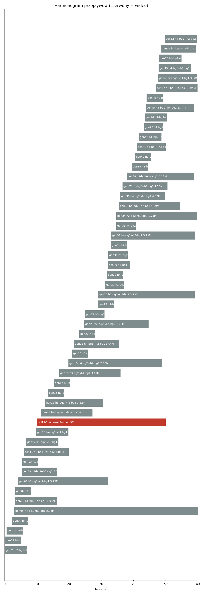
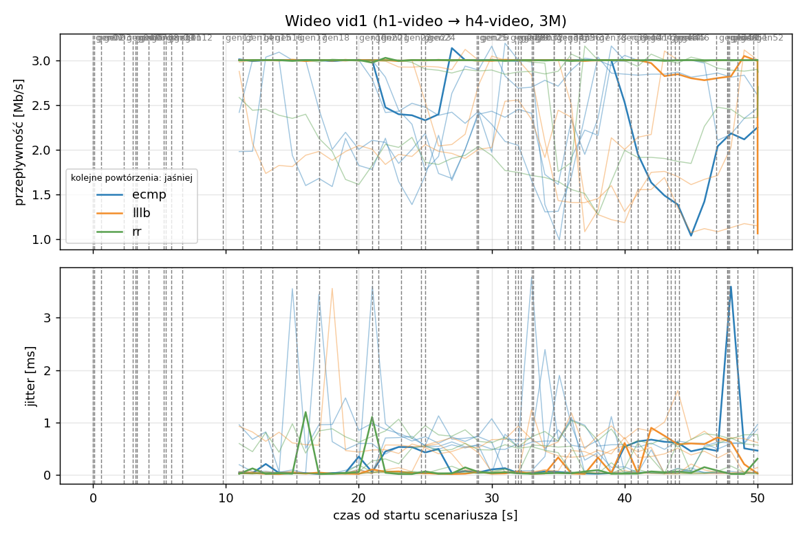
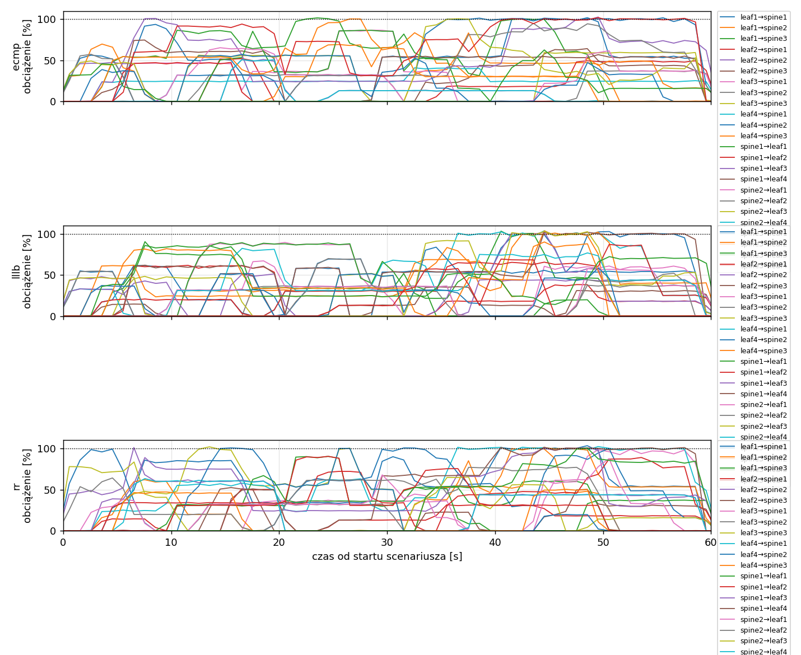
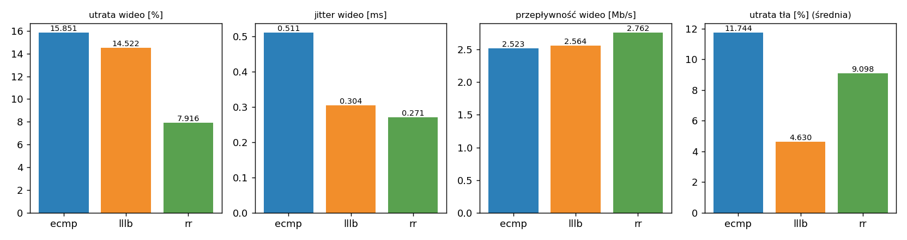

# Raport: random-ecmp-lllb-rr

Katalog: `results/random-ecmp-lllb-rr/20261030_181004`

## 1. Scenariusz

- Topologia: `sdn` (frr: `spine-leaf-3x4.clab.yml`, sdn: `sdn.clab.yaml`)
- Warianty: **ecmp** (FRR, bez kontrolera), **lllb** (POLICY=lllb), **rr** (POLICY=rr)
- Czas testu: 60 s, warmup (pomijany w statystykach, liczony od startu każdego przepływu): 5 s, powtórzeń: 5, seed: 42
- Wykonane przebiegi: ecmp/rep1, ecmp/rep2, ecmp/rep3, ecmp/rep4, ecmp/rep5, lllb/rep1, lllb/rep2, lllb/rep3, lllb/rep4, lllb/rep5, rr/rep1, rr/rep2, rr/rep3, rr/rep4, rr/rep5

Harmonogram losowego tła różni się między powtórzeniami (seed + nr powtórzenia, wspólny dla wariantów); poniżej powtórzenie 1.

| id | klasa | źródło → cel | proto | zadana [Mb/s] | DSCP | start–koniec [s] |
|---|---|---|---|---|---|---|
| gen01 | background | h2-bg1 → h3-bg2 | udp | 4.49 | – | 0–7 |
| gen02 | background | h4-bg2 → h3-bg1 | udp | 3.16 | – | 0.1–5.1 |
| gen03 | background | h4-bg1 → h2-bg2 | udp | 5.25 | – | 0.6–5.6 |
| gen04 | background | h4-bg1 → h1-bg2 | udp | 3.56 | – | 2.3–7.3 |
| gen05 | background | h4-bg1 → h3-bg1 | udp | 2.36 | – | 3–60 |
| gen06 | background | h1-bg2 → h2-bg1 | udp | 1.93 | – | 3.2–16.2 |
| gen07 | background | h2-bg1 → h3-bg1 | udp | 1.39 | – | 3.3–8.3 |
| gen08 | background | h1-bg1 → h2-bg1 | udp | 3.29 | – | 4.2–32.2 |
| gen09 | background | h3-bg2 → h2-bg1 | udp | 4.51 | – | 5.3–16.3 |
| gen10 | background | h1-bg2 → h3-bg1 | udp | 3.96 | – | 5.5–10.5 |
| gen11 | background | h2-bg1 → h4-bg2 | udp | 5.85 | – | 5.9–19.9 |
| gen12 | background | h1-bg2 → h3-bg1 | udp | 4.90 | – | 6.7–16.7 |
| gen13 | background | h4-bg1 → h1-bg1 | udp | 3.07 | – | 9.8–19.8 |
| vid1 | video | h1-video → h4-video | udp | 3.00 | 46 | 10–50 |
| gen14 | background | h3-bg2 → h1-bg2 | udp | 5.37 | – | 11.3–27.3 |
| gen15 | background | h3-bg1 → h1-bg1 | udp | 3.12 | – | 12.6–30.6 |
| gen16 | background | h2-bg1 → h1-bg1 | udp | 4.96 | – | 13.5–18.5 |
| gen17 | background | h2-bg1 → h4-bg2 | udp | 4.86 | – | 15.3–20.3 |
| gen18 | background | h3-bg2 → h1-bg1 | udp | 3.49 | – | 17–36 |
| gen19 | background | h4-bg2 → h2-bg1 | udp | 2.93 | – | 19.8–48.8 |
| gen20 | background | h1-bg2 → h4-bg2 | udp | 5.68 | – | 21–26 |
| gen21 | background | h4-bg1 → h2-bg1 | udp | 3.04 | – | 21.5–35.5 |
| gen22 | background | h4-bg1 → h2-bg1 | udp | 3.69 | – | 23.2–28.2 |
| gen23 | background | h2-bg2 → h4-bg2 | udp | 1.26 | – | 24.7–44.7 |
| gen24 | background | h3-bg1 → h1-bg2 | udp | 4.88 | – | 25–31 |
| gen25 | background | h4-bg1 → h1-bg2 | udp | 3.51 | – | 28.9–33.9 |
| gen26 | background | h1-bg1 → h4-bg1 | udp | 5.23 | – | 29–59 |
| gen27 | background | h1-bg2 → h4-bg1 | udp | 2.10 | – | 31.2–37.2 |
| gen28 | background | h4-bg1 → h1-bg2 | udp | 1.54 | – | 31.8–36.8 |
| gen29 | background | h4-bg1 → h1-bg2 | udp | 1.53 | – | 32–39 |
| gen30 | background | h1-bg2 → h3-bg1 | udp | 3.69 | – | 32.2–38.2 |
| gen31 | background | h2-bg1 → h4-bg2 | udp | 2.18 | – | 33–38 |
| gen32 | background | h4-bg2 → h3-bg2 | udp | 5.19 | – | 33.1–59.1 |
| gen33 | background | h4-bg2 → h3-bg2 | udp | 2.60 | – | 34.7–40.7 |
| gen34 | background | h2-bg2 → h3-bg2 | udp | 1.75 | – | 34.7–59.7 |
| gen35 | background | h4-bg2 → h2-bg1 | udp | 5.89 | – | 35.5–54.5 |
| gen36 | background | h4-bg2 → h3-bg1 | udp | 4.62 | – | 35.9–49.9 |
| gen37 | background | h1-bg2 → h2-bg2 | udp | 4.50 | – | 36.6–50.6 |
| gen38 | background | h2-bg1 → h4-bg1 | udp | 4.23 | – | 37.9–58.9 |
| gen39 | background | h1-bg2 → h4-bg2 | udp | 5.93 | – | 39.5–44.5 |
| gen40 | background | h1-bg1 → h3-bg1 | udp | 5.99 | – | 40.5–45.5 |
| gen41 | background | h1-bg2 → h3-bg1 | udp | 4.47 | – | 41–50 |
| gen42 | background | h1-bg2 → h3-bg1 | udp | 2.82 | – | 41.7–48.7 |
| gen43 | background | h4-bg2 → h2-bg1 | udp | 4.98 | – | 43.2–49.2 |
| gen44 | background | h4-bg2 → h1-bg2 | udp | 5.97 | – | 43.5–50.5 |
| gen45 | background | h3-bg1 → h4-bg1 | udp | 5.74 | – | 43.8–58.8 |
| gen46 | background | h2-bg1 → h1-bg2 | udp | 1.89 | – | 44.1–49.1 |
| gen47 | background | h2-bg2 → h3-bg1 | udp | 2.94 | – | 46.9–59.9 |
| gen48 | background | h3-bg1 → h1-bg1 | udp | 3.58 | – | 47.7–59.7 |
| gen49 | background | h4-bg1 → h2-bg1 | udp | 5.93 | – | 47.8–57.8 |
| gen50 | background | h4-bg1 → h1-bg1 | udp | 3.20 | – | 47.9–54.9 |
| gen51 | background | h4-bg2 → h3-bg1 | udp | 1.53 | – | 48.5–59.5 |
| gen52 | background | h4-bg2 → h2-bg2 | udp | 2.44 | – | 49.7–59.7 |

## 2. Wideo: QoS według wariantu

Wartości: średnia ± odchylenie standardowe z powtórzeń.

| przepływ | wariant | przepływność [Mb/s] | jitter [ms] | utrata [%] | RTT mediana [ms] | RTT p95 [ms] |
|---|---|---|---|---|---|---|
| vid1 | ecmp | 2.52 ± 0.22 | 0.511 ± 0.171 | 15.85 ± 7.25 | 31.714 ± 29.653 | 75.300 ± 41.959 |
| vid1 | lllb | 2.56 ± 0.51 | 0.304 ± 0.274 | 14.52 ± 16.96 | 23.431 ± 32.055 | 82.871 ± 52.886 |
| vid1 | rr | 2.76 ± 0.47 | 0.271 ± 0.268 | 7.92 ± 15.68 | 35.039 ± 52.263 | 94.673 ± 67.298 |

RTT z `ping` co 0,1 s między hostami wideo (osobny przepływ ICMP z tym samym DSCP - w SDN może iść inną ścieżką niż strumień UDP).

## 3. Ruch tła

Agregat tła w obrębie powtórzenia, potem średnia ± odchylenie standardowe po powtórzeniach (utrata = Σ utraconych / Σ wysłanych datagramów; dostarczone = Σ przepływności / Σ zadanych; przepływy trwające nie dłużej niż warmup pominięte).

| wariant | strumieni tła / powt. | dostarczone / zadane [%] | jitter [ms] | utrata [%] |
|---|---|---|---|---|
| ecmp | 40 | 87.6 ± 4.9 | 0.318 ± 0.118 | 11.74 ± 4.59 |
| lllb | 40 | 95.1 ± 2.7 | 0.244 ± 0.121 | 4.63 ± 2.99 |
| rr | 40 | 91.6 ± 4.7 | 0.291 ± 0.110 | 9.10 ± 4.63 |

## 4. Obciążenie łączy fabricu

Średnia i maksimum z próbek co 1 s w oknie 0–60 s; MLU = maksymalne obciążenie łącza; drops = pakiety odrzucone przez `tbf` na wyjściu łącza.

| wariant | rep | średnie obciążenie łączy [%] | MLU [%] | łącza > 90% | drops tbf | CPU VM śr./maks. [%] |
|---|---|---|---|---|---|---|
| ecmp | 1 | 30.7 | 102.6 | 8/24 | 28282 | 15 / 23 |
| ecmp | 2 | 37.1 | 111.3 | 16/24 | 33829 | 20 / 54 |
| ecmp | 3 | 45.7 | 105.0 | 16/24 | 48855 | 18 / 28 |
| ecmp | 4 | 31.8 | 103.9 | 12/24 | 10778 | 15 / 24 |
| ecmp | 5 | 34.9 | 107.1 | 12/24 | 28074 | 16 / 27 |
| lllb | 1 | 33.0 | 103.7 | 11/24 | 13566 | 17 / 28 |
| lllb | 2 | 40.2 | 103.3 | 19/24 | 11378 | 24 / 88 |
| lllb | 3 | 48.2 | 105.5 | 17/24 | 29003 | 21 / 43 |
| lllb | 4 | 33.1 | 101.8 | 9/24 | 927 | 16 / 27 |
| lllb | 5 | 36.7 | 101.8 | 14/24 | 11744 | 18 / 36 |
| rr | 1 | 32.8 | 103.4 | 14/24 | 14716 | 16 / 28 |
| rr | 2 | 38.4 | 104.1 | 18/24 | 25903 | 19 / 45 |
| rr | 3 | 45.8 | 104.0 | 16/24 | 47841 | 21 / 41 |
| rr | 4 | 32.6 | 103.6 | 15/24 | 6035 | 16 / 28 |
| rr | 5 | 35.5 | 104.3 | 10/24 | 17387 | 18 / 28 |

Łącza z obciążeniem > 10% (maksimum [%] / drops, powtórzenie 1):

| łącze | ecmp | lllb | rr |
|---|---|---|---|
| leaf1→spine1 | 102 / 0 | 100 / 632 | 103 / 1956 |
| leaf1→spine2 | 83 / 0 | 101 / 317 | 101 / 291 |
| leaf1→spine3 | 102 / 3597 | 103 / 271 | 90 / 0 |
| leaf2→spine1 | 52 / 0 | 62 / 0 | 51 / 0 |
| leaf2→spine2 | 51 / 0 | 51 / 0 | 101 / 7 |
| leaf2→spine3 | 75 / 0 | 52 / 0 | 52 / 0 |
| leaf3→spine1 | 87 / 0 | 89 / 0 | 99 / 0 |
| leaf3→spine2 | 38 / 0 | 38 / 0 | 33 / 0 |
| leaf3→spine3 | 60 / 0 | 52 / 0 | 102 / 69 |
| leaf4→spine1 | 41 / 0 | 104 / 4335 | 102 / 8454 |
| leaf4→spine2 | 102 / 21373 | 103 / 3205 | 101 / 871 |
| leaf4→spine3 | 83 / 0 | 104 / 1728 | 101 / 191 |
| spine1→leaf1 | 86 / 0 | 89 / 0 | 67 / 0 |
| spine1→leaf2 | 47 / 0 | 87 / 0 | 89 / 0 |
| spine1→leaf3 | 103 / 931 | 102 / 173 | 101 / 503 |
| spine1→leaf4 | 57 / 0 | 102 / 1577 | 102 / 2045 |
| spine2→leaf1 | 65 / 0 | 67 / 0 | 88 / 0 |
| spine2→leaf2 | 95 / 0 | 70 / 0 | 78 / 0 |
| spine2→leaf3 | 100 / 85 | 103 / 1328 | 84 / 0 |
| spine2→leaf4 | 51 / 0 | 82 / 0 | 63 / 0 |
| spine3→leaf1 | 57 / 0 | 59 / 0 | 101 / 225 |
| spine3→leaf2 | 100 / 0 | 90 / 0 | 50 / 0 |
| spine3→leaf3 | 63 / 0 | 90 / 0 | 101 / 104 |
| spine3→leaf4 | 102 / 2296 | 69 / 0 | 90 / 0 |

## 5. Ścieżki wybrane przez kontroler (powtórzenie 1)

Z logu kontrolera (linie `Flow`), dopasowane po piątce przepływu; ✓ = reguły widoczne w `dump-flows` na tych samych przełącznikach.

| przepływ | ecmp | lllb | rr |
|---|---|---|---|
| gen01 | ECMP (hash L4), nieobserwowana bezpośrednio | leaf2 -> spine2 -> leaf3 ✓ (loads 5% 0% 0%) | leaf2 -> spine2 -> leaf3 ✓ (loads 0% 0% 0%) |
| gen02 | ECMP (hash L4), nieobserwowana bezpośrednio | leaf4 -> spine1 -> leaf3 ✓ (loads 5% 5% 5%) | leaf4 -> spine2 -> leaf3 ✓ (loads 0% 0% 0%) |
| gen03 | ECMP (hash L4), nieobserwowana bezpośrednio | leaf4 -> spine2 -> leaf2 ✓ (loads 10% 5% 5%) | leaf4 -> spine2 -> leaf2 ✓ (loads 0% 0% 0%) |
| gen04 | ECMP (hash L4), nieobserwowana bezpośrednio | leaf4 -> spine3 -> leaf1 ✓ (loads 32% 54% 5%) | leaf4 -> spine2 -> leaf1 ✓ (loads 0% 86% 0%) |
| gen05 | ECMP (hash L4), nieobserwowana bezpośrednio | leaf4 -> spine3 -> leaf3 ✓ (loads 33% 54% 27%) | leaf4 -> spine1 -> leaf3 ✓ (loads 0% 92% 0%) |
| gen06 | ECMP (hash L4), nieobserwowana bezpośrednio | leaf1 -> spine1 -> leaf2 ✓ (loads 0% 54% 5%) | leaf1 -> spine2 -> leaf2 ✓ (loads 0% 51% 0%) |
| gen07 | ECMP (hash L4), nieobserwowana bezpośrednio | leaf2 -> spine3 -> leaf3 ✓ (loads 33% 46% 15%) | leaf2 -> spine1 -> leaf3 ✓ (loads 0% 77% 0%) |
| gen08 | ECMP (hash L4), nieobserwowana bezpośrednio | leaf1 -> spine3 -> leaf2 ✓ (loads 14% 54% 5%) | leaf1 -> spine1 -> leaf2 ✓ (loads 0% 50% 0%) |
| gen09 | ECMP (hash L4), nieobserwowana bezpośrednio | leaf3 -> spine3 -> leaf2 ✓ (loads 25% 54% 23%) | leaf3 -> spine3 -> leaf2 ✓ (loads 15% 65% 0%) |
| gen10 | ECMP (hash L4), nieobserwowana bezpośrednio | leaf1 -> spine1 -> leaf3 ✓ (loads 43% 46% 44%) | leaf1 -> spine2 -> leaf3 ✓ (loads 39% 72% 0%) |
| gen11 | ECMP (hash L4), nieobserwowana bezpośrednio | leaf2 -> spine1 -> leaf4 ✓ (loads 5% 46% 14%) | leaf2 -> spine2 -> leaf4 ✓ (loads 14% 46% 0%) |
| gen12 | ECMP (hash L4), nieobserwowana bezpośrednio | leaf1 -> spine3 -> leaf3 ✓ (loads 40% 46% 39%) | leaf1 -> spine1 -> leaf3 ✓ (loads 39% 85% 0%) |
| gen13 | ECMP (hash L4), nieobserwowana bezpośrednio | leaf4 -> spine2 -> leaf1 ✓ (loads 5% 0% 24%) | leaf4 -> spine1 -> leaf1 ✓ (loads 24% 0% 0%) |
| vid1 | ECMP (hash L4), nieobserwowana bezpośrednio | leaf1 -> spine2 -> leaf4 ✓ (loads 61% 5% 84%) | leaf1 -> spine3 -> leaf4 ✓ (loads 84% 61% 0%) |
| gen14 | ECMP (hash L4), nieobserwowana bezpośrednio | leaf3 -> spine1 -> leaf1 ✓ (loads 10% 32% 47%) | leaf3 -> spine3 -> leaf1 ✓ (loads 27% 0% 47%) |
| gen15 | ECMP (hash L4), nieobserwowana bezpośrednio | leaf3 -> spine1 -> leaf1 ✓ (loads 33% 37% 46%) | leaf3 -> spine2 -> leaf1 ✓ (loads 32% 0% 65%) |
| gen16 | ECMP (hash L4), nieobserwowana bezpośrednio | leaf2 -> spine3 -> leaf1 ✓ (loads 65% 32% 5%) | leaf2 -> spine3 -> leaf1 ✓ (loads 32% 60% 55%) |
| gen17 | ECMP (hash L4), nieobserwowana bezpośrednio | leaf2 -> spine2 -> leaf4 ✓ (loads 60% 36% 51%) | leaf2 -> spine1 -> leaf4 ✓ (loads 0% 60% 51%) |
| gen18 | ECMP (hash L4), nieobserwowana bezpośrednio | leaf3 -> spine2 -> leaf1 ✓ (loads 88% 37% 51%) | leaf3 -> spine1 -> leaf1 ✓ (loads 32% 32% 100%) |
| gen19 | ECMP (hash L4), nieobserwowana bezpośrednio | leaf4 -> spine1 -> leaf2 ✓ (loads 5% 32% 34%) | leaf4 -> spine2 -> leaf2 ✓ (loads 56% 0% 0%) |
| gen20 | ECMP (hash L4), nieobserwowana bezpośrednio | leaf1 -> spine1 -> leaf4 ✓ (loads 6% 51% 34%) | leaf1 -> spine3 -> leaf4 ✓ (loads 34% 16% 31%) |
| gen21 | ECMP (hash L4), nieobserwowana bezpośrednio | leaf4 -> spine2 -> leaf2 ✓ (loads 30% 5% 34%) | leaf4 -> spine2 -> leaf2 ✓ (loads 34% 26% 0%) |
| gen22 | ECMP (hash L4), nieobserwowana bezpośrednio | leaf4 -> spine2 -> leaf2 ✓ (loads 35% 31% 34%) | leaf4 -> spine1 -> leaf2 ✓ (loads 34% 61% 0%) |
| gen23 | ECMP (hash L4), nieobserwowana bezpośrednio | leaf2 -> spine3 -> leaf4 ✓ (loads 59% 31% 5%) | leaf2 -> spine1 -> leaf4 ✓ (loads 0% 0% 90%) |
| gen24 | ECMP (hash L4), nieobserwowana bezpośrednio | leaf3 -> spine3 -> leaf1 ✓ (loads 88% 36% 5%) | leaf3 -> spine3 -> leaf1 ✓ (loads 36% 32% 55%) |
| gen25 | ECMP (hash L4), nieobserwowana bezpośrednio | leaf4 -> spine1 -> leaf1 ✓ (loads 32% 42% 50%) | leaf4 -> spine2 -> leaf1 ✓ (loads 45% 62% 50%) |
| gen26 | ECMP (hash L4), nieobserwowana bezpośrednio | leaf1 -> spine1 -> leaf4 ✓ (loads 10% 31% 34%) | leaf1 -> spine1 -> leaf4 ✓ (loads 34% 0% 31%) |
| gen27 | ECMP (hash L4), nieobserwowana bezpośrednio | leaf1 -> spine3 -> leaf4 ✓ (loads 54% 36% 34%) | leaf1 -> spine3 -> leaf4 ✓ (loads 88% 0% 31%) |
| gen28 | ECMP (hash L4), nieobserwowana bezpośrednio | leaf4 -> spine3 -> leaf1 ✓ (loads 66% 51% 50%) | leaf4 -> spine2 -> leaf1 ✓ (loads 36% 98% 19%) |
| gen29 | ECMP (hash L4), nieobserwowana bezpośrednio | leaf4 -> spine3 -> leaf1 ✓ (loads 66% 36% 31%) | leaf4 -> spine1 -> leaf1 ✓ (loads 36% 98% 19%) |
| gen30 | ECMP (hash L4), nieobserwowana bezpośrednio | leaf1 -> spine2 -> leaf3 ✓ (loads 54% 46% 49%) | leaf1 -> spine2 -> leaf3 ✓ (loads 88% 0% 41%) |
| gen31 | ECMP (hash L4), nieobserwowana bezpośrednio | leaf2 -> spine3 -> leaf4 ✓ (loads 54% 36% 35%) | leaf2 -> spine3 -> leaf4 ✓ (loads 67% 0% 53%) |
| gen32 | ECMP (hash L4), nieobserwowana bezpośrednio | leaf4 -> spine2 -> leaf3 ✓ (loads 66% 46% 54%) | leaf4 -> spine3 -> leaf3 ✓ (loads 34% 101% 0%) |
| gen33 | ECMP (hash L4), nieobserwowana bezpośrednio | leaf4 -> spine3 -> leaf3 ✓ (loads 67% 80% 61%) | leaf4 -> spine2 -> leaf3 ✓ (loads 40% 89% 54%) |
| gen34 | ECMP (hash L4), nieobserwowana bezpośrednio | leaf2 -> spine1 -> leaf3 ✓ (loads 5% 80% 33%) | leaf2 -> spine1 -> leaf3 ✓ (loads 24% 38% 53%) |
| gen35 | ECMP (hash L4), nieobserwowana bezpośrednio | leaf4 -> spine1 -> leaf2 ✓ (loads 35% 85% 62%) | leaf4 -> spine1 -> leaf2 ✓ (loads 40% 89% 54%) |
| gen36 | ECMP (hash L4), nieobserwowana bezpośrednio | leaf4 -> spine1 -> leaf3 ✓ (loads 50% 92% 62%) | leaf4 -> spine1 -> leaf3 ✓ (loads 50% 98% 54%) |
| gen37 | ECMP (hash L4), nieobserwowana bezpośrednio | leaf1 -> spine3 -> leaf2 ✓ (loads 56% 69% 32%) | leaf1 -> spine2 -> leaf2 ✓ (loads 54% 57% 53%) |
| gen38 | ECMP (hash L4), nieobserwowana bezpośrednio | leaf2 -> spine2 -> leaf4 ✓ (loads 54% 36% 57%) | leaf2 -> spine2 -> leaf4 ✓ (loads 68% 0% 66%) |
| gen39 | ECMP (hash L4), nieobserwowana bezpośrednio | leaf1 -> spine3 -> leaf4 ✓ (loads 54% 75% 51%) | leaf1 -> spine1 -> leaf4 ✓ (loads 67% 66% 41%) |
| gen40 | ECMP (hash L4), nieobserwowana bezpośrednio | leaf1 -> spine1 -> leaf3 ✓ (loads 54% 59% 70%) | leaf1 -> spine2 -> leaf3 ✓ (loads 100% 46% 53%) |
| gen41 | ECMP (hash L4), nieobserwowana bezpośrednio | leaf1 -> spine2 -> leaf3 ✓ (loads 74% 58% 100%) | leaf1 -> spine1 -> leaf3 ✓ (loads 100% 46% 53%) |
| gen42 | ECMP (hash L4), nieobserwowana bezpośrednio | leaf1 -> spine2 -> leaf3 ✓ (loads 74% 68% 100%) | leaf1 -> spine3 -> leaf3 ✓ (loads 100% 101% 54%) |
| gen43 | ECMP (hash L4), nieobserwowana bezpośrednio | leaf4 -> spine3 -> leaf2 ✓ (loads 100% 53% 50%) | leaf4 -> spine3 -> leaf2 ✓ (loads 100% 74% 53%) |
| gen44 | ECMP (hash L4), nieobserwowana bezpośrednio | leaf4 -> spine3 -> leaf1 ✓ (loads 100% 53% 39%) | leaf4 -> spine2 -> leaf1 ✓ (loads 100% 30% 76%) |
| gen45 | ECMP (hash L4), nieobserwowana bezpośrednio | leaf3 -> spine1 -> leaf4 ✓ (loads 67% 78% 68%) | leaf3 -> spine1 -> leaf4 ✓ (loads 90% 44% 31%) |
| gen46 | ECMP (hash L4), nieobserwowana bezpośrednio | leaf2 -> spine1 -> leaf1 ✓ (loads 18% 44% 18%) | leaf2 -> spine3 -> leaf1 ✓ (loads 31% 44% 0%) |
| gen47 | ECMP (hash L4), nieobserwowana bezpośrednio | leaf2 -> spine3 -> leaf3 ✓ (loads 89% 100% 20%) | leaf2 -> spine3 -> leaf3 ✓ (loads 100% 44% 79%) |
| gen48 | ECMP (hash L4), nieobserwowana bezpośrednio | leaf3 -> spine2 -> leaf1 ✓ (loads 59% 5% 45%) | leaf3 -> spine1 -> leaf1 ✓ (loads 59% 61% 19%) |
| gen49 | ECMP (hash L4), nieobserwowana bezpośrednio | leaf4 -> spine2 -> leaf2 ✓ (loads 100% 58% 100%) | leaf4 -> spine1 -> leaf2 ✓ (loads 100% 92% 100%) |
| gen50 | ECMP (hash L4), nieobserwowana bezpośrednio | leaf4 -> spine2 -> leaf1 ✓ (loads 100% 68% 100%) | leaf4 -> spine2 -> leaf1 ✓ (loads 100% 92% 100%) |
| gen51 | ECMP (hash L4), nieobserwowana bezpośrednio | leaf4 -> spine3 -> leaf3 ✓ (loads 100% 100% 100%) | leaf4 -> spine2 -> leaf3 ✓ (loads 100% 92% 100%) |
| gen52 | ECMP (hash L4), nieobserwowana bezpośrednio | leaf4 -> spine1 -> leaf2 ✓ (loads 100% 105% 105%) | leaf4 -> spine1 -> leaf2 ✓ (loads 100% 86% 84%) |

## 6. Wnioski

<!-- WNIOSKI:START -->
1. **Ruch tła (sekcja 3): LLLB < RR < ECMP pod względem strat, w każdym z 5 powtórzeń.** Utrata
   (średnia ± sd po powtórzeniach): LLLB 4,63 ± 2,99%, RR 9,10 ± 4,63%, ECMP 11,74 ± 4,59%;
   dostarczone/zadane: 95,1% / 91,6% / 87,6%. Kolejność LLLB < RR < ECMP zachodzi w 5/5
   powtórzeń z osobna (np. rep. 2: 3,33 / 12,38 / 13,99%; rep. 4: 0,37 / 3,04 / 3,88%), mimo
   że każde powtórzenie ma inny, losowy układ ruchu. Jitter tła: 0,244 / 0,291 / 0,318 ms.
2. **Odrzucenia na `tbf` (sekcja 4), suma z 5 powtórzeń:** LLLB 66 618, RR 111 882, ECMP 149 818
   (LLLB ma 44% odrzuceń ECMP i 60% odrzuceń RR). Średnie obciążenie łączy jest przy tym
   najwyższe w LLLB (38,2% vs 37,0% RR i 36,0% ECMP), czyli LLLB przenosi nieco więcej ruchu
   przy mniejszej liczbie odrzuceń. Liczba łączy z maksimum > 90% jest podobna we wszystkich
   wariantach (średnio ok. 14,0 LLLB, 14,6 RR, 12,8 ECMP z 24), więc LLLB nie unika
   krótkotrwałych przeciążeń, tylko je skraca lub rozkłada.
3. **Wideo (sekcja 2): brak rozstrzygającej różnicy między wariantami przy tej próbie.**
   Utrata wideo: ECMP 15,85 ± 7,25%, LLLB 14,52 ± 16,96%, RR 7,92 ± 15,68%. Odchylenie
   standardowe LLLB i RR jest większe od średniej, a wyniki z poszczególnych powtórzeń
   skrajnie się różnią (LLLB: 1,07 / 10,44 / 41,22 / 0,00 / 19,88%; RR: 0,00 / 0,00 / 35,90 /
   1,26 / 2,42%; ECMP: 14,93 / 25,32 / 15,16 / 5,28 / 18,57%). Przy n = 5 różnic między
   LLLB a RR nie da się uznać za istotne (RR miał mniejszą utratę wideo w 4 z 5 powtórzeń).
4. **Wideo w ECMP traci pakiety w każdym powtórzeniu** (minimum 5,28%), podczas gdy RR miał
   0% w 2/5 powtórzeń, a LLLB w 1/5. Najcięższy układ (rep. 3: średnie obciążenie łączy
   45,7–48,2%, 29–49 tys. odrzuceń w ECMP/LLLB/RR) daje wysokie straty wideo we wszystkich
   trzech wariantach (ECMP 15,16%, RR 35,90%, LLLB 41,22%), czyli o stratach wideo decyduje
   tu głównie układ tła, a nie wybór algorytmu.
5. **Wniosek ogólny z tych danych:** w przeciążonym fabricu LLLB najlepiej chroni *ruch jako
   całość* (najmniej strat tła i odrzuceń), ale żaden z trzech wariantów nie chroni *wideo* jako
   klasy: nie rozróżniają DSCP, a utrata wideo zależy od tego, czy losowe tło trafi na jego
   łącza. Przyczyn gorszych wyników wideo w LLLB niż w RR (4/5) nie zbadano w tym raporcie.
6. **RTT (sekcja 2)** ma sd większe niż połowa średniej (np. LLLB 23,4 ± 32,1 ms) i odzwierciedla
   zapełnienie kolejek `tbf`, a nie różnice między wariantami; nie wyciągam z niego wniosków.
<!-- WNIOSKI:END -->

## 7. Wiarygodność pomiaru

**Uwagi autora analizy (ręczne):**
- 110 z zastrzeżeń poniżej to losowe przepływy trwające ≤ 5 s (nie dłuższe niż warmup): ich statystyki
  liczone są z całości. Z agregatu tła (sekcja 3) zostały wykluczone; wideo ich nie dotyczy.
- `lllb` rep. 2: CPU maszyny do 88% (średnio 24%) — wynik wideo tego przebiegu (10,44%) mógł zostać
  zniekształcony; pozostałe przebiegi mają CPU maks. ≤ 54%.
- Obciążenie jest większe, niż sugeruje średnia: przy średnim wykorzystaniu łączy 31–48% w 8–19 z 24
  łączy pojawiło się maksimum > 90%, a MLU wynosi 101–111%. To reżim przeciążenia, nie „40% obciążenia”.
- Losowy harmonogram jest wspólny dla wariantów w obrębie powtórzenia (seed 43–47), ale inny między
  powtórzeniami; powtórzenia są więc niezależnymi układami ruchu, a n = 5 jest małe (brak testu istotności).
- Wariant `rr` nie występuje w pracy; służy jako punkt odniesienia dla LLLB. Wariantu C jeszcze nie ma.
- Tabela łączy w sekcji 4 i ścieżki w sekcji 5 dotyczą powtórzenia 1.

**Automatyczne:**

- ecmp rep1, gen02: przepływ krótszy niż warmup - statystyki z całości
- ecmp rep1, gen03: przepływ krótszy niż warmup - statystyki z całości
- ecmp rep1, gen04: przepływ krótszy niż warmup - statystyki z całości
- ecmp rep1, gen07: przepływ krótszy niż warmup - statystyki z całości
- ecmp rep1, gen16: przepływ krótszy niż warmup - statystyki z całości
- ecmp rep1, gen17: przepływ krótszy niż warmup - statystyki z całości
- ecmp rep1, gen20: przepływ krótszy niż warmup - statystyki z całości
- ecmp rep1, gen22: przepływ krótszy niż warmup - statystyki z całości
- ecmp rep1, gen25: przepływ krótszy niż warmup - statystyki z całości
- ecmp rep1, gen28: przepływ krótszy niż warmup - statystyki z całości
- ecmp rep1, gen31: przepływ krótszy niż warmup - statystyki z całości
- ecmp rep1, gen39: przepływ krótszy niż warmup - statystyki z całości
- ecmp rep1, gen40: przepływ krótszy niż warmup - statystyki z całości
- ecmp rep2, gen02: przepływ krótszy niż warmup - statystyki z całości
- ecmp rep2, gen07: przepływ krótszy niż warmup - statystyki z całości
- ecmp rep2, gen12: przepływ krótszy niż warmup - statystyki z całości
- ecmp rep2, gen18: przepływ krótszy niż warmup - statystyki z całości
- ecmp rep2, gen20: przepływ krótszy niż warmup - statystyki z całości
- ecmp rep2, gen23: przepływ krótszy niż warmup - statystyki z całości
- ecmp rep2, gen27: przepływ krótszy niż warmup - statystyki z całości
- ecmp rep2, gen31: przepływ krótszy niż warmup - statystyki z całości
- ecmp rep2, gen45: przepływ krótszy niż warmup - statystyki z całości
- ecmp rep2, gen51: przepływ krótszy niż warmup - statystyki z całości
- ecmp rep2, gen54: przepływ krótszy niż warmup - statystyki z całości
- ecmp rep3, gen02: przepływ krótszy niż warmup - statystyki z całości
- ecmp rep3, gen03: przepływ krótszy niż warmup - statystyki z całości
- ecmp rep3, gen10: przepływ krótszy niż warmup - statystyki z całości
- ecmp rep3, gen11: przepływ krótszy niż warmup - statystyki z całości
- ecmp rep3, gen13: przepływ krótszy niż warmup - statystyki z całości
- ecmp rep3, gen15: przepływ krótszy niż warmup - statystyki z całości
- ecmp rep3, gen18: przepływ krótszy niż warmup - statystyki z całości
- ecmp rep3, gen30: przepływ krótszy niż warmup - statystyki z całości
- ecmp rep3, gen58: przepływ krótszy niż warmup - statystyki z całości
- ecmp rep4, gen10: przepływ krótszy niż warmup - statystyki z całości
- ecmp rep4, gen22: przepływ krótszy niż warmup - statystyki z całości
- ecmp rep4, gen25: przepływ krótszy niż warmup - statystyki z całości
- ecmp rep4, gen29: przepływ krótszy niż warmup - statystyki z całości
- ecmp rep4, gen31: przepływ krótszy niż warmup - statystyki z całości
- ecmp rep4, gen36: przepływ krótszy niż warmup - statystyki z całości
- ecmp rep4, gen40: przepływ krótszy niż warmup - statystyki z całości
- ecmp rep4, gen41: przepływ krótszy niż warmup - statystyki z całości
- ecmp rep4, gen45: przepływ krótszy niż warmup - statystyki z całości
- ecmp rep4, gen46: przepływ krótszy niż warmup - statystyki z całości
- ecmp rep4, gen49: przepływ krótszy niż warmup - statystyki z całości
- ecmp rep5, gen02: przepływ krótszy niż warmup - statystyki z całości
- ecmp rep5, gen14: przepływ krótszy niż warmup - statystyki z całości
- ecmp rep5, gen15: przepływ krótszy niż warmup - statystyki z całości
- ecmp rep5, gen21: przepływ krótszy niż warmup - statystyki z całości
- ecmp rep5, gen51: przepływ krótszy niż warmup - statystyki z całości
- ecmp rep5, gen52: przepływ krótszy niż warmup - statystyki z całości
- lllb rep1, gen04: przepływ krótszy niż warmup - statystyki z całości
- lllb rep1, gen07: przepływ krótszy niż warmup - statystyki z całości
- lllb rep1, gen16: przepływ krótszy niż warmup - statystyki z całości
- lllb rep1, gen22: przepływ krótszy niż warmup - statystyki z całości
- lllb rep1, gen28: przepływ krótszy niż warmup - statystyki z całości
- lllb rep2, gen02: przepływ krótszy niż warmup - statystyki z całości
- lllb rep2, gen12: przepływ krótszy niż warmup - statystyki z całości
- lllb rep2, gen27: przepływ krótszy niż warmup - statystyki z całości
- lllb rep2, gen31: przepływ krótszy niż warmup - statystyki z całości
- lllb rep2, gen42: przepływ krótszy niż warmup - statystyki z całości
- lllb rep2, gen45: przepływ krótszy niż warmup - statystyki z całości
- lllb rep2, gen51: przepływ krótszy niż warmup - statystyki z całości
- lllb rep2: CPU maszyny do 88% (średnio 24%) - możliwy wpływ na pomiary
- lllb rep3, gen02: przepływ krótszy niż warmup - statystyki z całości
- lllb rep3, gen03: przepływ krótszy niż warmup - statystyki z całości
- lllb rep3, gen09: przepływ krótszy niż warmup - statystyki z całości
- lllb rep3, gen11: przepływ krótszy niż warmup - statystyki z całości
- lllb rep3, gen13: przepływ krótszy niż warmup - statystyki z całości
- lllb rep3, gen30: przepływ krótszy niż warmup - statystyki z całości
- lllb rep3, gen38: przepływ krótszy niż warmup - statystyki z całości
- lllb rep3, gen50: przepływ krótszy niż warmup - statystyki z całości
- lllb rep4, gen22: przepływ krótszy niż warmup - statystyki z całości
- lllb rep4, gen29: przepływ krótszy niż warmup - statystyki z całości
- lllb rep4, gen45: przepływ krótszy niż warmup - statystyki z całości
- lllb rep4, gen49: przepływ krótszy niż warmup - statystyki z całości
- lllb rep5, gen02: przepływ krótszy niż warmup - statystyki z całości
- lllb rep5, gen14: przepływ krótszy niż warmup - statystyki z całości
- lllb rep5, gen25: przepływ krótszy niż warmup - statystyki z całości
- lllb rep5, gen30: przepływ krótszy niż warmup - statystyki z całości
- lllb rep5, gen46: przepływ krótszy niż warmup - statystyki z całości
- lllb rep5, gen52: przepływ krótszy niż warmup - statystyki z całości
- rr rep1, gen04: przepływ krótszy niż warmup - statystyki z całości
- rr rep1, gen07: przepływ krótszy niż warmup - statystyki z całości
- rr rep1, gen10: przepływ krótszy niż warmup - statystyki z całości
- rr rep1, gen17: przepływ krótszy niż warmup - statystyki z całości
- rr rep1, gen22: przepływ krótszy niż warmup - statystyki z całości
- rr rep1, gen25: przepływ krótszy niż warmup - statystyki z całości
- rr rep1, gen28: przepływ krótszy niż warmup - statystyki z całości
- rr rep2, gen02: przepływ krótszy niż warmup - statystyki z całości
- rr rep2, gen12: przepływ krótszy niż warmup - statystyki z całości
- rr rep2, gen27: przepływ krótszy niż warmup - statystyki z całości
- rr rep2, gen45: przepływ krótszy niż warmup - statystyki z całości
- rr rep2, gen51: przepływ krótszy niż warmup - statystyki z całości
- rr rep3, gen01: przepływ krótszy niż warmup - statystyki z całości
- rr rep3, gen02: przepływ krótszy niż warmup - statystyki z całości
- rr rep3, gen03: przepływ krótszy niż warmup - statystyki z całości
- rr rep3, gen10: przepływ krótszy niż warmup - statystyki z całości
- rr rep3, gen11: przepływ krótszy niż warmup - statystyki z całości
- rr rep3, gen13: przepływ krótszy niż warmup - statystyki z całości
- rr rep3, gen15: przepływ krótszy niż warmup - statystyki z całości
- rr rep3, gen30: przepływ krótszy niż warmup - statystyki z całości
- rr rep4, gen10: przepływ krótszy niż warmup - statystyki z całości
- rr rep4, gen22: przepływ krótszy niż warmup - statystyki z całości
- rr rep4, gen31: przepływ krótszy niż warmup - statystyki z całości
- rr rep4, gen36: przepływ krótszy niż warmup - statystyki z całości
- rr rep4, gen41: przepływ krótszy niż warmup - statystyki z całości
- rr rep4, gen45: przepływ krótszy niż warmup - statystyki z całości
- rr rep5, gen02: przepływ krótszy niż warmup - statystyki z całości
- rr rep5, gen25: przepływ krótszy niż warmup - statystyki z całości
- rr rep5, gen30: przepływ krótszy niż warmup - statystyki z całości
- rr rep5, gen46: przepływ krótszy niż warmup - statystyki z całości
