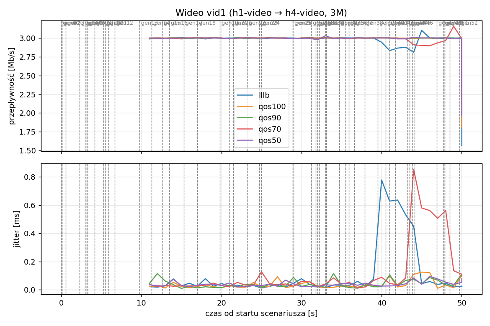
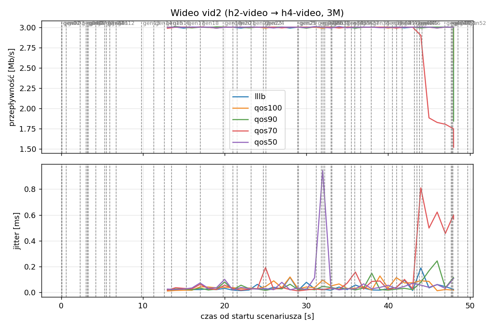
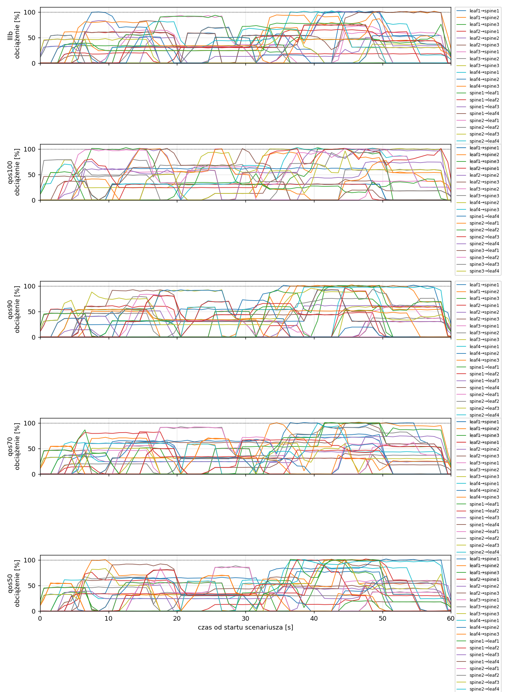
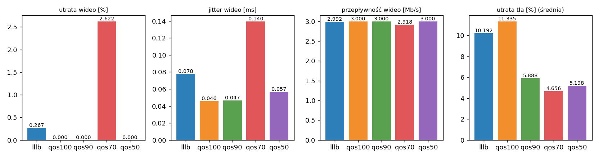

# Raport: reserve-sweep-quick

Katalog: `results/reserve-sweep-quick/20261030_233516`

## 1. Scenariusz

- Topologia: `sdn` (sdn: `sdn.clab.yaml`)
- Warianty: **lllb** (POLICY=lllb), **qos100** (POLICY=qos, RESERVE_PCT=100), **qos90** (POLICY=qos, RESERVE_PCT=90), **qos70** (POLICY=qos, RESERVE_PCT=70), **qos50** (POLICY=qos, RESERVE_PCT=50)
- Czas testu: 60 s, warmup (pomijany w statystykach, liczony od startu każdego przepływu): 5 s, powtórzeń: 1, seed: 42
- Wykonane przebiegi: lllb/rep1, qos100/rep1, qos90/rep1, qos70/rep1, qos50/rep1

Harmonogram losowego tła różni się między powtórzeniami (seed + nr powtórzenia, wspólny dla wariantów); poniżej powtórzenie 1.

| id | klasa | źródło → cel | proto | zadana [Mb/s] | DSCP | start–koniec [s] |
|---|---|---|---|---|---|---|
| gen01 | background | h2-bg1 → h3-bg2 | udp | 4.49 | – | 0–7 |
| gen02 | background | h4-bg2 → h3-bg1 | udp | 3.16 | – | 0.1–5.1 |
| gen03 | background | h4-bg1 → h2-bg2 | udp | 5.25 | – | 0.6–5.6 |
| gen04 | background | h4-bg1 → h1-bg2 | udp | 3.56 | – | 2.3–7.3 |
| gen05 | background | h4-bg1 → h3-bg1 | udp | 2.36 | – | 3–60 |
| gen06 | background | h1-bg2 → h2-bg1 | udp | 1.93 | – | 3.2–16.2 |
| gen07 | background | h2-bg1 → h3-bg1 | udp | 1.39 | – | 3.3–8.3 |
| gen08 | background | h1-bg1 → h2-bg1 | udp | 3.29 | – | 4.2–32.2 |
| gen09 | background | h3-bg2 → h2-bg1 | udp | 4.51 | – | 5.3–16.3 |
| gen10 | background | h1-bg2 → h3-bg1 | udp | 3.96 | – | 5.5–10.5 |
| gen11 | background | h2-bg1 → h4-bg2 | udp | 5.85 | – | 5.9–19.9 |
| gen12 | background | h1-bg2 → h3-bg1 | udp | 4.90 | – | 6.7–16.7 |
| gen13 | background | h4-bg1 → h1-bg1 | udp | 3.07 | – | 9.8–19.8 |
| vid1 | video | h1-video → h4-video | udp | 3.00 | 46 | 10–50 |
| gen14 | background | h3-bg2 → h1-bg2 | udp | 5.37 | – | 11.3–27.3 |
| vid2 | video | h2-video → h4-video | udp | 3.00 | 46 | 12–48 |
| gen15 | background | h3-bg1 → h1-bg1 | udp | 3.12 | – | 12.6–30.6 |
| gen16 | background | h2-bg1 → h1-bg1 | udp | 4.96 | – | 13.5–18.5 |
| gen17 | background | h2-bg1 → h4-bg2 | udp | 4.86 | – | 15.3–20.3 |
| gen18 | background | h3-bg2 → h1-bg1 | udp | 3.49 | – | 17–36 |
| gen19 | background | h4-bg2 → h2-bg1 | udp | 2.93 | – | 19.8–48.8 |
| gen20 | background | h1-bg2 → h4-bg2 | udp | 5.68 | – | 21–26 |
| gen21 | background | h4-bg1 → h2-bg1 | udp | 3.04 | – | 21.5–35.5 |
| gen22 | background | h4-bg1 → h2-bg1 | udp | 3.69 | – | 23.2–28.2 |
| gen23 | background | h2-bg2 → h4-bg2 | udp | 1.26 | – | 24.7–44.7 |
| gen24 | background | h3-bg1 → h1-bg2 | udp | 4.88 | – | 25–31 |
| gen25 | background | h4-bg1 → h1-bg2 | udp | 3.51 | – | 28.9–33.9 |
| gen26 | background | h1-bg1 → h4-bg1 | udp | 5.23 | – | 29–59 |
| gen27 | background | h1-bg2 → h4-bg1 | udp | 2.10 | – | 31.2–37.2 |
| gen28 | background | h4-bg1 → h1-bg2 | udp | 1.54 | – | 31.8–36.8 |
| gen29 | background | h4-bg1 → h1-bg2 | udp | 1.53 | – | 32–39 |
| gen30 | background | h1-bg2 → h3-bg1 | udp | 3.69 | – | 32.2–38.2 |
| gen31 | background | h2-bg1 → h4-bg2 | udp | 2.18 | – | 33–38 |
| gen32 | background | h4-bg2 → h3-bg2 | udp | 5.19 | – | 33.1–59.1 |
| gen33 | background | h4-bg2 → h3-bg2 | udp | 2.60 | – | 34.7–40.7 |
| gen34 | background | h2-bg2 → h3-bg2 | udp | 1.75 | – | 34.7–59.7 |
| gen35 | background | h4-bg2 → h2-bg1 | udp | 5.89 | – | 35.5–54.5 |
| gen36 | background | h4-bg2 → h3-bg1 | udp | 4.62 | – | 35.9–49.9 |
| gen37 | background | h1-bg2 → h2-bg2 | udp | 4.50 | – | 36.6–50.6 |
| gen38 | background | h2-bg1 → h4-bg1 | udp | 4.23 | – | 37.9–58.9 |
| gen39 | background | h1-bg2 → h4-bg2 | udp | 5.93 | – | 39.5–44.5 |
| gen40 | background | h1-bg1 → h3-bg1 | udp | 5.99 | – | 40.5–45.5 |
| gen41 | background | h1-bg2 → h3-bg1 | udp | 4.47 | – | 41–50 |
| gen42 | background | h1-bg2 → h3-bg1 | udp | 2.82 | – | 41.7–48.7 |
| gen43 | background | h4-bg2 → h2-bg1 | udp | 4.98 | – | 43.2–49.2 |
| gen44 | background | h4-bg2 → h1-bg2 | udp | 5.97 | – | 43.5–50.5 |
| gen45 | background | h3-bg1 → h4-bg1 | udp | 5.74 | – | 43.8–58.8 |
| gen46 | background | h2-bg1 → h1-bg2 | udp | 1.89 | – | 44.1–49.1 |
| gen47 | background | h2-bg2 → h3-bg1 | udp | 2.94 | – | 46.9–59.9 |
| gen48 | background | h3-bg1 → h1-bg1 | udp | 3.58 | – | 47.7–59.7 |
| gen49 | background | h4-bg1 → h2-bg1 | udp | 5.93 | – | 47.8–57.8 |
| gen50 | background | h4-bg1 → h1-bg1 | udp | 3.20 | – | 47.9–54.9 |
| gen51 | background | h4-bg2 → h3-bg1 | udp | 1.53 | – | 48.5–59.5 |
| gen52 | background | h4-bg2 → h2-bg2 | udp | 2.44 | – | 49.7–59.7 |

## 2. Wideo: QoS według wariantu

| przepływ | wariant | przepływność [Mb/s] | jitter [ms] | utrata [%] | RTT mediana [ms] | RTT p95 [ms] |
|---|---|---|---|---|---|---|
| vid1 | lllb | 2.98 | 0.115 | 0.53 | 0.033 | 118.000 |
| vid1 | qos100 | 3.00 | 0.041 | 0.00 | 0.027 | 0.047 |
| vid1 | qos90 | 3.00 | 0.042 | 0.00 | 0.030 | 59.400 |
| vid1 | qos70 | 2.99 | 0.130 | 0.22 | 0.022 | 59.100 |
| vid1 | qos50 | 3.00 | 0.041 | 0.00 | 0.029 | 58.400 |
| vid2 | lllb | 3.00 | 0.040 | 0.00 | 0.031 | 59.500 |
| vid2 | qos100 | 3.00 | 0.050 | 0.00 | 0.027 | 0.046 |
| vid2 | qos90 | 3.00 | 0.051 | 0.00 | 0.027 | 59.400 |
| vid2 | qos70 | 2.84 | 0.149 | 5.02 | 0.027 | 59.200 |
| vid2 | qos50 | 3.00 | 0.073 | 0.00 | 0.031 | 62.400 |

RTT z `ping` co 0,1 s między hostami wideo (osobny przepływ ICMP z tym samym DSCP - w SDN może iść inną ścieżką niż strumień UDP).

## 3. Ruch tła

Agregat tła w obrębie powtórzenia, potem średnia ± odchylenie standardowe po powtórzeniach (utrata = Σ utraconych / Σ wysłanych datagramów; dostarczone = Σ przepływności / Σ zadanych; przepływy trwające nie dłużej niż warmup pominięte).

| wariant | strumieni tła / powt. | dostarczone / zadane [%] | jitter [ms] | utrata [%] |
|---|---|---|---|---|
| lllb | 37 | 90.1 | 0.201 | 10.19 |
| qos100 | 37 | 86.3 | 0.262 | 11.34 |
| qos90 | 37 | 94.2 | 0.212 | 5.89 |
| qos70 | 37 | 92.6 | 0.180 | 4.66 |
| qos50 | 37 | 91.7 | 0.226 | 5.20 |

## 4. Obciążenie łączy fabricu

Średnia i maksimum z próbek co 1 s w oknie 0–60 s; MLU = maksymalne obciążenie łącza; drops = pakiety odrzucone przez `tbf` na wyjściu łącza.

| wariant | rep | średnie obciążenie łączy [%] | MLU [%] | łącza > 90% | drops tbf | CPU VM śr./maks. [%] |
|---|---|---|---|---|---|---|
| lllb | 1 | 33.6 | 102.3 | 10/24 | 19152 | 15 / 26 |
| qos100 | 1 | 33.0 | 103.2 | 13/24 | 23013 | 15 / 27 |
| qos90 | 1 | 34.7 | 102.5 | 14/24 | 12749 | 15 / 27 |
| qos70 | 1 | 34.7 | 101.7 | 10/24 | 12160 | 14 / 25 |
| qos50 | 1 | 34.7 | 102.2 | 11/24 | 12002 | 15 / 25 |

Łącza z obciążeniem > 10% (maksimum [%] / drops, powtórzenie 1):

| łącze | lllb | qos100 | qos90 | qos70 | qos50 |
|---|---|---|---|---|---|
| leaf1→spine1 | 102 / 4316 | 32 / 0 | 93 / 0 | 79 / 0 | 79 / 0 |
| leaf1→spine2 | 94 / 0 | 101 / 1234 | 102 / 0 | 101 / 732 | 102 / 926 |
| leaf1→spine3 | 52 / 0 | 103 / 1683 | 100 / 969 | 102 / 1700 | 102 / 779 |
| leaf2→spine1 | 62 / 0 | 32 / 0 | 63 / 0 | 83 / 0 | 76 / 0 |
| leaf2→spine2 | 50 / 0 | 101 / 433 | 64 / 0 | 75 / 0 | 52 / 0 |
| leaf2→spine3 | 83 / 0 | 54 / 0 | 82 / 0 | 50 / 0 | 81 / 0 |
| leaf3→spine1 | 93 / 0 | 0 / 0 | 51 / 0 | 61 / 0 | 61 / 0 |
| leaf3→spine2 | 33 / 0 | 100 / 53 | 80 / 0 | 93 / 0 | 89 / 0 |
| leaf3→spine3 | 51 / 0 | 80 / 0 | 93 / 0 | 33 / 0 | 33 / 0 |
| leaf4→spine1 | 102 / 4487 | 0 / 0 | 101 / 572 | 73 / 0 | 101 / 480 |
| leaf4→spine2 | 102 / 576 | 103 / 12794 | 102 / 5452 | 101 / 4027 | 102 / 4423 |
| leaf4→spine3 | 102 / 7107 | 103 / 4743 | 101 / 3030 | 101 / 3999 | 101 / 3508 |
| spine1→leaf1 | 94 / 0 | 0 / 0 | 63 / 0 | 52 / 0 | 57 / 0 |
| spine1→leaf2 | 66 / 0 | 0 / 0 | 70 / 0 | 82 / 0 | 102 / 585 |
| spine1→leaf3 | 102 / 1325 | 0 / 0 | 41 / 0 | 73 / 0 | 56 / 0 |
| spine1→leaf4 | 102 / 1181 | 63 / 0 | 93 / 0 | 101 / 714 | 97 / 0 |
| spine2→leaf1 | 73 / 0 | 101 / 93 | 84 / 0 | 92 / 0 | 87 / 0 |
| spine2→leaf2 | 70 / 0 | 69 / 0 | 94 / 0 | 93 / 0 | 67 / 0 |
| spine2→leaf3 | 65 / 0 | 101 / 1083 | 96 / 0 | 63 / 0 | 101 / 178 |
| spine2→leaf4 | 101 / 160 | 99 / 0 | 99 / 0 | 100 / 0 | 100 / 0 |
| spine3→leaf1 | 54 / 0 | 101 / 5 | 93 / 0 | 65 / 0 | 69 / 0 |
| spine3→leaf2 | 87 / 0 | 102 / 859 | 54 / 0 | 71 / 0 | 70 / 0 |
| spine3→leaf3 | 78 / 0 | 98 / 0 | 101 / 2726 | 101 / 988 | 101 / 1123 |
| spine3→leaf4 | 75 / 0 | 96 / 33 | 96 / 0 | 67 / 0 | 93 / 0 |

## 5. Ścieżki wybrane przez kontroler (powtórzenie 1)

Z logu kontrolera (linie `Flow`), dopasowane po piątce przepływu; ✓ = reguły widoczne w `dump-flows` na tych samych przełącznikach.

| przepływ | lllb | qos100 | qos90 | qos70 | qos50 |
|---|---|---|---|---|---|
| gen01 | leaf2 -> spine2 -> leaf3 ✓ (loads 5% 0% 0%) | leaf2 -> spine3 -> leaf3 ✓ (loads 0% 5% 0%) | leaf2 -> spine3 -> leaf3 ✓ (loads 0% 5% 0%) | leaf2 -> spine3 -> leaf3 ✓ (loads 0% 5% 0%) | leaf2 -> spine3 -> leaf3 ✓ (loads 0% 5% 0%) |
| gen02 | leaf4 -> spine1 -> leaf3 ✓ (loads 5% 5% 5%) | leaf4 -> spine3 -> leaf3 ✓ (loads 0% 10% 5%) | leaf4 -> spine2 -> leaf3 ✓ (loads 5% 5% 5%) | leaf4 -> spine2 -> leaf3 ✓ (loads 5% 5% 5%) | leaf4 -> spine2 -> leaf3 ✓ (loads 5% 5% 5%) |
| gen03 | leaf4 -> spine2 -> leaf2 ✓ (loads 10% 5% 5%) | leaf4 -> spine2 -> leaf2 ✓ (loads 0% 5% 10%) | leaf4 -> spine1 -> leaf2 ✓ (loads 0% 7% 5%) | leaf4 -> spine3 -> leaf2 ✓ (loads 5% 10% 5%) | leaf4 -> spine3 -> leaf2 ✓ (loads 5% 10% 5%) |
| gen04 | leaf4 -> spine3 -> leaf1 ✓ (loads 33% 54% 5%) | leaf4 -> spine3 -> leaf1 ✓ (loads 0% 44% 37%) | leaf4 -> spine3 -> leaf1 ✓ (loads 39% 32% 5%) | leaf4 -> spine1 -> leaf1 ✓ (loads 5% 33% 54%) | leaf4 -> spine1 -> leaf1 ✓ (loads 5% 33% 54%) |
| gen05 | leaf4 -> spine3 -> leaf3 ✓ (loads 33% 54% 24%) | leaf4 -> spine2 -> leaf3 ✓ (loads 0% 59% 79%) | leaf4 -> spine2 -> leaf3 ✓ (loads 54% 38% 46%) | leaf4 -> spine1 -> leaf3 ✓ (loads 25% 33% 54%) | leaf4 -> spine1 -> leaf3 ✓ (loads 15% 33% 54%) |
| gen06 | leaf1 -> spine1 -> leaf2 ✓ (loads 0% 54% 5%) | leaf1 -> spine3 -> leaf2 ✓ (loads 0% 54% 5%) | leaf1 -> spine3 -> leaf2 ✓ (loads 54% 5% 0%) | leaf1 -> spine2 -> leaf2 ✓ (loads 5% 0% 54%) | leaf1 -> spine2 -> leaf2 ✓ (loads 5% 0% 54%) |
| gen07 | leaf2 -> spine3 -> leaf3 ✓ (loads 33% 46% 15%) | leaf2 -> spine2 -> leaf3 ✓ (loads 0% 15% 79%) | leaf2 -> spine2 -> leaf3 ✓ (loads 10% 43% 46%) | leaf2 -> spine1 -> leaf3 ✓ (loads 15% 33% 46%) | leaf2 -> spine1 -> leaf3 ✓ (loads 5% 33% 46%) |
| gen08 | leaf1 -> spine3 -> leaf2 ✓ (loads 12% 54% 5%) | leaf1 -> spine3 -> leaf2 ✓ (loads 0% 54% 9%) | leaf1 -> spine3 -> leaf2 ✓ (loads 54% 5% 3%) | leaf1 -> spine1 -> leaf2 ✓ (loads 5% 13% 54%) | leaf1 -> spine1 -> leaf2 ✓ (loads 5% 17% 54%) |
| gen09 | leaf3 -> spine3 -> leaf2 ✓ (loads 25% 54% 21%) | leaf3 -> spine3 -> leaf2 ✓ (loads 0% 54% 32%) | leaf3 -> spine2 -> leaf2 ✓ (loads 54% 5% 24%) | leaf3 -> spine1 -> leaf2 ✓ (loads 22% 25% 54%) | leaf3 -> spine2 -> leaf2 ✓ (loads 29% 25% 54%) |
| gen10 | leaf1 -> spine1 -> leaf3 ✓ (loads 42% 46% 44%) | leaf1 -> spine2 -> leaf3 ✓ (loads 0% 44% 69%) | leaf1 -> spine1 -> leaf3 ✓ (loads 5% 64% 54%) | leaf1 -> spine3 -> leaf3 ✓ (loads 39% 48% 46%) | leaf1 -> spine2 -> leaf3 ✓ (loads 43% 42% 46%) |
| gen11 | leaf2 -> spine1 -> leaf4 ✓ (loads 5% 46% 14%) | leaf2 -> spine2 -> leaf4 ✓ (loads 0% 19% 46%) | leaf2 -> spine1 -> leaf4 ✓ (loads 5% 14% 46%) | leaf2 -> spine2 -> leaf4 ✓ (loads 14% 5% 46%) | leaf2 -> spine1 -> leaf4 ✓ (loads 14% 15% 46%) |
| gen12 | leaf1 -> spine1 -> leaf3 ✓ (loads 38% 46% 39%) | leaf1 -> spine3 -> leaf3 ✓ (loads 0% 76% 59%) | leaf1 -> spine2 -> leaf3 ✓ (loads 39% 39% 54%) | leaf1 -> spine2 -> leaf3 ✓ (loads 39% 25% 61%) | leaf1 -> spine2 -> leaf3 ✓ (loads 44% 43% 46%) |
| gen13 | leaf4 -> spine2 -> leaf1 ✓ (loads 5% 0% 24%) | leaf4 -> spine3 -> leaf1 ✓ (loads 0% 24% 5%) | leaf4 -> spine1 -> leaf1 ✓ (loads 0% 24% 5%) | leaf4 -> spine3 -> leaf1 ✓ (loads 24% 5% 0%) | leaf4 -> spine3 -> leaf1 ✓ (loads 24% 5% 0%) |
| vid1 | leaf1 -> spine2 -> leaf4 ✓ (loads 100% 5% 34%) | leaf1 -> spine1 -> leaf4 ✓ (loads 0% 75% 100%) | leaf1 -> spine1 -> leaf4 ✓ (loads 60% 60% 59%) | leaf1 -> spine1 -> leaf4 ✓ (loads 34% 70% 46%) | leaf1 -> spine1 -> leaf4 ✓ (loads 60% 100% 15%) |
| gen14 | leaf3 -> spine1 -> leaf1 ✓ (loads 10% 32% 46%) | leaf3 -> spine2 -> leaf1 ✓ (loads 5% 5% 46%) | leaf3 -> spine3 -> leaf1 ✓ (loads 22% 46% 5%) | leaf3 -> spine2 -> leaf1 ✓ (loads 47% 5% 32%) | leaf3 -> spine1 -> leaf1 ✓ (loads 5% 46% 32%) |
| vid2 | leaf2 -> spine3 -> leaf4 ✓ (loads 60% 31% 5%) | leaf2 -> spine1 -> leaf4 ✓ (loads 31% 60% 5%) | leaf2 -> spine3 -> leaf4 ✓ (loads 91% 5% 0%) | leaf2 -> spine1 -> leaf4 ✓ (loads 31% 60% 5%) | leaf2 -> spine3 -> leaf4 ✓ (loads 91% 5% 0%) |
| gen15 | leaf3 -> spine2 -> leaf1 ✓ (loads 34% 32% 46%) | leaf3 -> spine3 -> leaf1 ✓ (loads 0% 55% 51%) | leaf3 -> spine2 -> leaf1 ✓ (loads 32% 51% 55%) | leaf3 -> spine3 -> leaf1 ✓ (loads 46% 36% 32%) | leaf3 -> spine3 -> leaf1 ✓ (loads 43% 46% 37%) |
| gen16 | leaf2 -> spine3 -> leaf1 ✓ (loads 60% 39% 34%) | leaf2 -> spine2 -> leaf1 ✓ (loads 31% 60% 63%) | leaf2 -> spine2 -> leaf1 ✓ (loads 60% 29% 55%) | leaf2 -> spine1 -> leaf1 ✓ (loads 36% 60% 40%) | leaf2 -> spine2 -> leaf1 ✓ (loads 60% 5% 47%) |
| gen17 | leaf2 -> spine2 -> leaf4 ✓ (loads 60% 36% 82%) | leaf2 -> spine3 -> leaf4 ✓ (loads 62% 98% 5%) | leaf2 -> spine3 -> leaf4 ✓ (loads 91% 43% 36%) | leaf2 -> spine3 -> leaf4 ✓ (loads 82% 60% 5%) | leaf2 -> spine3 -> leaf4 ✓ (loads 91% 51% 36%) |
| gen18 | leaf3 -> spine1 -> leaf1 ✓ (loads 55% 64% 56%) | leaf3 -> spine3 -> leaf1 ✓ (loads 0% 100% 77%) | leaf3 -> spine3 -> leaf1 ✓ (loads 32% 83% 60%) | leaf3 -> spine2 -> leaf1 ✓ (loads 51% 60% 64%) | leaf3 -> spine2 -> leaf1 ✓ (loads 55% 61% 64%) |
| gen19 | leaf4 -> spine1 -> leaf2 ✓ (loads 5% 32% 34%) | leaf4 -> spine2 -> leaf2 ✓ (loads 0% 29% 34%) | leaf4 -> spine2 -> leaf2 ✓ (loads 32% 29% 34%) | leaf4 -> spine2 -> leaf2 ✓ (loads 34% 5% 32%) | leaf4 -> spine2 -> leaf2 ✓ (loads 34% 5% 32%) |
| gen20 | leaf1 -> spine1 -> leaf4 ✓ (loads 9% 55% 34%) | leaf1 -> spine2 -> leaf4 ✓ (loads 62% 33% 43%) | leaf1 -> spine2 -> leaf4 ✓ (loads 65% 5% 79%) | leaf1 -> spine2 -> leaf4 ✓ (loads 65% 6% 22%) | leaf1 -> spine2 -> leaf4 ✓ (loads 80% 5% 81%) |
| gen21 | leaf4 -> spine2 -> leaf2 ✓ (loads 30% 5% 34%) | leaf4 -> spine3 -> leaf2 ✓ (loads 0% 55% 39%) | leaf4 -> spine1 -> leaf2 ✓ (loads 5% 54% 34%) | leaf4 -> spine3 -> leaf2 ✓ (loads 34% 30% 5%) | leaf4 -> spine3 -> leaf2 ✓ (loads 34% 30% 5%) |
| gen22 | leaf4 -> spine2 -> leaf2 ✓ (loads 35% 31% 34%) | leaf4 -> spine2 -> leaf2 ✓ (loads 0% 60% 63%) | leaf4 -> spine1 -> leaf2 ✓ (loads 32% 55% 34%) | leaf4 -> spine3 -> leaf2 ✓ (loads 34% 35% 31%) | leaf4 -> spine3 -> leaf2 ✓ (loads 34% 35% 31%) |
| gen23 | leaf2 -> spine2 -> leaf4 ✓ (loads 58% 31% 36%) | leaf2 -> spine3 -> leaf4 ✓ (loads 62% 58% 5%) | leaf2 -> spine3 -> leaf4 ✓ (loads 36% 59% 31%) | leaf2 -> spine3 -> leaf4 ✓ (loads 62% 59% 5%) | leaf2 -> spine1 -> leaf4 ✓ (loads 31% 59% 36%) |
| gen24 | leaf3 -> spine3 -> leaf1 ✓ (loads 91% 32% 5%) | leaf3 -> spine2 -> leaf1 ✓ (loads 0% 60% 68%) | leaf3 -> spine1 -> leaf1 ✓ (loads 5% 32% 91%) | leaf3 -> spine1 -> leaf1 ✓ (loads 5% 91% 32%) | leaf3 -> spine2 -> leaf1 ✓ (loads 55% 36% 37%) |
| gen25 | leaf4 -> spine1 -> leaf1 ✓ (loads 41% 45% 50%) | leaf4 -> spine3 -> leaf1 ✓ (loads 0% 83% 73%) | leaf4 -> spine3 -> leaf1 ✓ (loads 64% 55% 41%) | leaf4 -> spine2 -> leaf1 ✓ (loads 50% 41% 43%) | leaf4 -> spine1 -> leaf1 ✓ (loads 29% 86% 69%) |
| gen26 | leaf1 -> spine1 -> leaf4 ✓ (loads 15% 44% 34%) | leaf1 -> spine2 -> leaf4 ✓ (loads 62% 15% 34%) | leaf1 -> spine2 -> leaf4 ✓ (loads 31% 15% 44%) | leaf1 -> spine3 -> leaf4 ✓ (loads 65% 15% 13%) | leaf1 -> spine2 -> leaf4 ✓ (loads 65% 15% 31%) |
| gen27 | leaf1 -> spine3 -> leaf4 ✓ (loads 54% 44% 39%) | leaf1 -> spine3 -> leaf4 ✓ (loads 62% 54% 49%) | leaf1 -> spine3 -> leaf4 ✓ (loads 41% 54% 44%) | leaf1 -> spine2 -> leaf4 ✓ (loads 65% 5% 67%) | leaf1 -> spine3 -> leaf4 ✓ (loads 65% 54% 36%) |
| gen28 | leaf4 -> spine2 -> leaf1 ✓ (loads 72% 46% 50%) | leaf4 -> spine2 -> leaf1 ✓ (loads 0% 60% 82%) | leaf4 -> spine2 -> leaf1 ✓ (loads 35% 59% 72%) | leaf4 -> spine3 -> leaf1 ✓ (loads 50% 72% 46%) | leaf4 -> spine3 -> leaf1 ✓ (loads 61% 82% 46%) |
| gen29 | leaf4 -> spine3 -> leaf1 ✓ (loads 72% 32% 29%) | leaf4 -> spine2 -> leaf1 ✓ (loads 0% 70% 82%) | leaf4 -> spine2 -> leaf1 ✓ (loads 35% 69% 72%) | leaf4 -> spine3 -> leaf1 ✓ (loads 24% 72% 38%) | leaf4 -> spine3 -> leaf1 ✓ (loads 61% 82% 56%) |
| gen30 | leaf1 -> spine2 -> leaf3 ✓ (loads 54% 41% 53%) | leaf1 -> spine2 -> leaf3 ✓ (loads 31% 59% 60%) | leaf1 -> spine3 -> leaf3 ✓ (loads 41% 54% 52%) | leaf1 -> spine2 -> leaf3 ✓ (loads 65% 30% 54%) | leaf1 -> spine3 -> leaf3 ✓ (loads 65% 54% 24%) |
| gen31 | leaf2 -> spine2 -> leaf4 ✓ (loads 54% 49% 53%) | leaf2 -> spine3 -> leaf4 ✓ (loads 62% 54% 40%) | leaf2 -> spine1 -> leaf4 ✓ (loads 36% 54% 66%) | leaf2 -> spine2 -> leaf4 ✓ (loads 62% 27% 67%) | leaf2 -> spine1 -> leaf4 ✓ (loads 49% 54% 50%) |
| gen32 | leaf4 -> spine3 -> leaf3 ✓ (loads 66% 52% 48%) | leaf4 -> spine2 -> leaf3 ✓ (loads 0% 77% 78%) | leaf4 -> spine3 -> leaf3 ✓ (loads 31% 69% 51%) | leaf4 -> spine3 -> leaf3 ✓ (loads 39% 66% 61%) | leaf4 -> spine2 -> leaf3 ✓ (loads 61% 35% 63%) |
| gen33 | leaf4 -> spine2 -> leaf3 ✓ (loads 67% 52% 79%) | leaf4 -> spine3 -> leaf3 ✓ (loads 0% 100% 53%) | leaf4 -> spine2 -> leaf3 ✓ (loads 31% 91% 92%) | leaf4 -> spine2 -> leaf3 ✓ (loads 34% 67% 91%) | leaf4 -> spine1 -> leaf3 ✓ (loads 59% 80% 63%) |
| gen34 | leaf2 -> spine1 -> leaf3 ✓ (loads 5% 43% 64%) | leaf2 -> spine3 -> leaf3 ✓ (loads 31% 97% 40%) | leaf2 -> spine2 -> leaf3 ✓ (loads 22% 39% 92%) | leaf2 -> spine3 -> leaf3 ✓ (loads 36% 43% 34%) | leaf2 -> spine3 -> leaf3 ✓ (loads 40% 50% 38%) |
| gen35 | leaf4 -> spine1 -> leaf2 ✓ (loads 38% 51% 94%) | leaf4 -> spine3 -> leaf2 ✓ (loads 0% 100% 56%) | leaf4 -> spine3 -> leaf2 ✓ (loads 31% 96% 58%) | leaf4 -> spine2 -> leaf2 ✓ (loads 29% 36% 100%) | leaf4 -> spine1 -> leaf2 ✓ (loads 40% 84% 63%) |
| gen36 | leaf4 -> spine1 -> leaf3 ✓ (loads 57% 65% 94%) | leaf4 -> spine3 -> leaf3 ✓ (loads 0% 100% 71%) | leaf4 -> spine2 -> leaf3 ✓ (loads 31% 96% 97%) | leaf4 -> spine1 -> leaf3 ✓ (loads 30% 75% 100%) | leaf4 -> spine3 -> leaf3 ✓ (loads 55% 84% 63%) |
| gen37 | leaf1 -> spine3 -> leaf2 ✓ (loads 59% 69% 27%) | leaf1 -> spine3 -> leaf2 ✓ (loads 31% 92% 56%) | leaf1 -> spine2 -> leaf2 ✓ (loads 31% 59% 59%) | leaf1 -> spine1 -> leaf2 ✓ (loads 41% 60% 54%) | leaf1 -> spine1 -> leaf2 ✓ (loads 38% 54% 60%) |
| gen38 | leaf2 -> spine3 -> leaf4 ✓ (loads 54% 66% 44%) | leaf2 -> spine2 -> leaf4 ✓ (loads 62% 54% 59%) | leaf2 -> spine2 -> leaf4 ✓ (loads 54% 59% 62%) | leaf2 -> spine2 -> leaf4 ✓ (loads 62% 29% 67%) | leaf2 -> spine2 -> leaf4 ✓ (loads 66% 54% 58%) |
| gen39 | leaf1 -> spine2 -> leaf4 ✓ (loads 54% 53% 72%) | leaf1 -> spine3 -> leaf4 ✓ (loads 62% 97% 51%) | leaf1 -> spine1 -> leaf4 ✓ (loads 36% 100% 44%) | leaf1 -> spine2 -> leaf4 ✓ (loads 77% 51% 67%) | leaf1 -> spine3 -> leaf4 ✓ (loads 77% 97% 36%) |
| gen40 | leaf1 -> spine1 -> leaf3 ✓ (loads 54% 58% 78%) | leaf1 -> spine2 -> leaf3 ✓ (loads 31% 77% 83%) | leaf1 -> spine3 -> leaf3 ✓ (loads 83% 100% 54%) | leaf1 -> spine2 -> leaf3 ✓ (loads 77% 29% 72%) | leaf1 -> spine2 -> leaf3 ✓ (loads 77% 59% 65%) |
| gen41 | leaf1 -> spine1 -> leaf3 ✓ (loads 76% 92% 78%) | leaf1 -> spine3 -> leaf3 ✓ (loads 31% 105% 100%) | leaf1 -> spine3 -> leaf3 ✓ (loads 83% 100% 64%) | leaf1 -> spine3 -> leaf3 ✓ (loads 77% 77% 77%) | leaf1 -> spine3 -> leaf3 ✓ (loads 77% 83% 66%) |
| gen42 | leaf1 -> spine1 -> leaf3 ✓ (loads 81% 92% 83%) | leaf1 -> spine2 -> leaf3 ✓ (loads 31% 100% 100%) | leaf1 -> spine3 -> leaf3 ✓ (loads 92% 100% 100%) | leaf1 -> spine3 -> leaf3 ✓ (loads 77% 82% 82%) | leaf1 -> spine3 -> leaf3 ✓ (loads 77% 83% 76%) |
| gen43 | leaf4 -> spine2 -> leaf2 ✓ (loads 100% 5% 78%) | leaf4 -> spine3 -> leaf2 ✓ (loads 0% 105% 100%) | leaf4 -> spine1 -> leaf2 ✓ (loads 5% 100% 100%) | leaf4 -> spine3 -> leaf2 ✓ (loads 72% 91% 58%) | leaf4 -> spine3 -> leaf2 ✓ (loads 100% 84% 53%) |
| gen44 | leaf4 -> spine2 -> leaf1 ✓ (loads 100% 15% 78%) | leaf4 -> spine2 -> leaf1 ✓ (loads 0% 105% 105%) | leaf4 -> spine1 -> leaf1 ✓ (loads 13% 100% 100%) | leaf4 -> spine3 -> leaf1 ✓ (loads 72% 91% 68%) | leaf4 -> spine3 -> leaf1 ✓ (loads 85% 84% 63%) |
| gen45 | leaf3 -> spine1 -> leaf4 ✓ (loads 28% 100% 75%) | leaf3 -> spine3 -> leaf4 ✓ (loads 62% 93% 64%) | leaf3 -> spine3 -> leaf4 ✓ (loads 92% 102% 54%) | leaf3 -> spine1 -> leaf4 ✓ (loads 67% 99% 72%) | leaf3 -> spine1 -> leaf4 ✓ (loads 64% 96% 77%) |
| gen46 | leaf2 -> spine2 -> leaf1 ✓ (loads 23% 20% 74%) | leaf2 -> spine3 -> leaf1 ✓ (loads 31% 44% 36%) | leaf2 -> spine3 -> leaf1 ✓ (loads 10% 62% 49%) | leaf2 -> spine3 -> leaf1 ✓ (loads 36% 44% 31%) | leaf2 -> spine1 -> leaf1 ✓ (loads 13% 44% 49%) |
| gen47 | leaf2 -> spine2 -> leaf3 ✓ (loads 100% 24% 78%) | leaf2 -> spine2 -> leaf3 ✓ (loads 31% 89% 92%) | leaf2 -> spine1 -> leaf3 ✓ (loads 5% 88% 100%) | leaf2 -> spine2 -> leaf3 ✓ (loads 72% 44% 100%) | leaf2 -> spine1 -> leaf3 ✓ (loads 29% 80% 100%) |
| gen48 | leaf3 -> spine3 -> leaf1 ✓ (loads 59% 71% 10%) | leaf3 -> spine2 -> leaf1 ✓ (loads 0% 44% 59%) | leaf3 -> spine2 -> leaf1 ✓ (loads 52% 5% 59%) | leaf3 -> spine2 -> leaf1 ✓ (loads 59% 5% 57%) | leaf3 -> spine2 -> leaf1 ✓ (loads 59% 5% 39%) |
| gen49 | leaf4 -> spine3 -> leaf2 ✓ (loads 100% 100% 83%) | leaf4 -> spine2 -> leaf2 ✓ (loads 0% 105% 105%) | leaf4 -> spine2 -> leaf2 ✓ (loads 100% 105% 105%) | leaf4 -> spine2 -> leaf2 ✓ (loads 72% 96% 100%) | leaf4 -> spine2 -> leaf2 ✓ (loads 100% 89% 100%) |
| gen50 | leaf4 -> spine3 -> leaf1 ✓ (loads 100% 100% 85%) | leaf4 -> spine2 -> leaf1 ✓ (loads 0% 110% 110%) | leaf4 -> spine2 -> leaf1 ✓ (loads 100% 110% 110%) | leaf4 -> spine2 -> leaf1 ✓ (loads 72% 98% 100%) | leaf4 -> spine3 -> leaf1 ✓ (loads 85% 104% 100%) |
| gen51 | leaf4 -> spine1 -> leaf3 ✓ (loads 100% 100% 100%) | leaf4 -> spine2 -> leaf3 ✓ (loads 0% 105% 105%) | leaf4 -> spine3 -> leaf3 ✓ (loads 100% 105% 105%) | leaf4 -> spine3 -> leaf3 ✓ (loads 72% 108% 105%) | leaf4 -> spine2 -> leaf3 ✓ (loads 85% 95% 100%) |
| gen52 | leaf4 -> spine3 -> leaf2 ✓ (loads 100% 105% 100%) | leaf4 -> spine3 -> leaf2 ✓ (loads 0% 105% 105%) | leaf4 -> spine2 -> leaf2 ✓ (loads 99% 100% 105%) | leaf4 -> spine3 -> leaf2 ✓ (loads 72% 105% 100%) | leaf4 -> spine2 -> leaf2 ✓ (loads 100% 100% 105%) |

## 6. Wnioski

<!-- WNIOSKI:START -->
Test kierunkowy: jedno powtórzenie (układ ruchu seed 43), więc bez miary rozrzutu.

1. **Przelew best-effort na rezerwę został usunięty:** w qos100 0 z 37 przepływów tła trafiło na ścieżkę
   przez spine1 (w poprzedniej serii z zaworem SPILL: 27 z 276). W qos90 / qos70 / qos50: 12 / 10 / 15
   przepływów (51,7 / 39,8 / 52,3 Mb/s zadanych), czyli best-effort zajmuje rezerwę przez limit udziału.
2. **Wideo w qos100 jest w pełni chronione:** 0,00% strat obu strumieni, jitter 0,041 / 0,050 ms,
   RTT mediana 0,027 / 0,027 ms i p95 0,047 / 0,046 ms. W pozostałych wariantach RTT p95 wynosi
   58–118 ms (ICMP trafia w zapełnioną kolejkę `tbf`).
3. **Pozostałe wartości R:** qos90 i qos50 bez strat wideo; qos70: vid1 0,22%, vid2 5,02%; LLLB: vid1 0,53%,
   vid2 0,00%. Różnice w tym powtórzeniu nie układają się monotonicznie względem R i wymagają kilku powtórzeń.
4. **Tło:** utrata tła: LLLB 10,19%, qos100 11,34%, qos90 5,89%, qos70 4,66%, qos50 5,20%; odrzucenia
   na `tbf`: 19 152 / 23 013 / 12 749 / 12 160 / 12 002. Niższe straty tła w qos90–qos50 niż w LLLB w tym
   jednym powtórzeniu nie mają jeszcze wyjaśnienia i nie wolno ich uogólniać.
<!-- WNIOSKI:END -->

## 7. Wiarygodność pomiaru

- lllb rep1, gen02: przepływ krótszy niż warmup - statystyki z całości
- lllb rep1, gen04: przepływ krótszy niż warmup - statystyki z całości
- lllb rep1, gen07: przepływ krótszy niż warmup - statystyki z całości
- lllb rep1, gen10: przepływ krótszy niż warmup - statystyki z całości
- lllb rep1, gen16: przepływ krótszy niż warmup - statystyki z całości
- lllb rep1, gen17: przepływ krótszy niż warmup - statystyki z całości
- lllb rep1, gen22: przepływ krótszy niż warmup - statystyki z całości
- lllb rep1, gen28: przepływ krótszy niż warmup - statystyki z całości
- lllb rep1, gen40: przepływ krótszy niż warmup - statystyki z całości
- lllb rep1, gen46: przepływ krótszy niż warmup - statystyki z całości
- qos100 rep1, gen02: przepływ krótszy niż warmup - statystyki z całości
- qos100 rep1, gen03: przepływ krótszy niż warmup - statystyki z całości
- qos100 rep1, gen04: przepływ krótszy niż warmup - statystyki z całości
- qos100 rep1, gen07: przepływ krótszy niż warmup - statystyki z całości
- qos100 rep1, gen16: przepływ krótszy niż warmup - statystyki z całości
- qos100 rep1, gen17: przepływ krótszy niż warmup - statystyki z całości
- qos100 rep1, gen22: przepływ krótszy niż warmup - statystyki z całości
- qos100 rep1, gen31: przepływ krótszy niż warmup - statystyki z całości
- qos90 rep1, gen02: przepływ krótszy niż warmup - statystyki z całości
- qos90 rep1, gen04: przepływ krótszy niż warmup - statystyki z całości
- qos90 rep1, gen07: przepływ krótszy niż warmup - statystyki z całości
- qos90 rep1, gen10: przepływ krótszy niż warmup - statystyki z całości
- qos90 rep1, gen16: przepływ krótszy niż warmup - statystyki z całości
- qos90 rep1, gen20: przepływ krótszy niż warmup - statystyki z całości
- qos90 rep1, gen22: przepływ krótszy niż warmup - statystyki z całości
- qos90 rep1, gen39: przepływ krótszy niż warmup - statystyki z całości
- qos70 rep1, gen02: przepływ krótszy niż warmup - statystyki z całości
- qos70 rep1, gen04: przepływ krótszy niż warmup - statystyki z całości
- qos70 rep1, gen07: przepływ krótszy niż warmup - statystyki z całości
- qos70 rep1, gen22: przepływ krótszy niż warmup - statystyki z całości
- qos70 rep1, gen25: przepływ krótszy niż warmup - statystyki z całości
- qos70 rep1, gen28: przepływ krótszy niż warmup - statystyki z całości
- qos70 rep1, gen31: przepływ krótszy niż warmup - statystyki z całości
- qos50 rep1, gen02: przepływ krótszy niż warmup - statystyki z całości
- qos50 rep1, gen07: przepływ krótszy niż warmup - statystyki z całości
- qos50 rep1, gen16: przepływ krótszy niż warmup - statystyki z całości
- qos50 rep1, gen17: przepływ krótszy niż warmup - statystyki z całości
- qos50 rep1, gen22: przepływ krótszy niż warmup - statystyki z całości
- qos50 rep1, gen28: przepływ krótszy niż warmup - statystyki z całości
