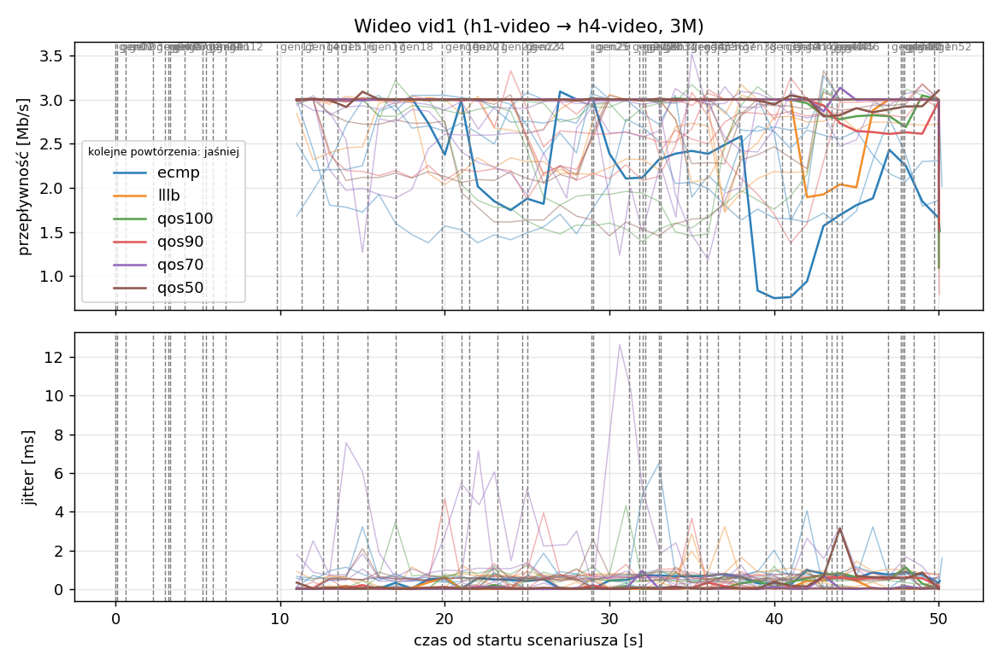
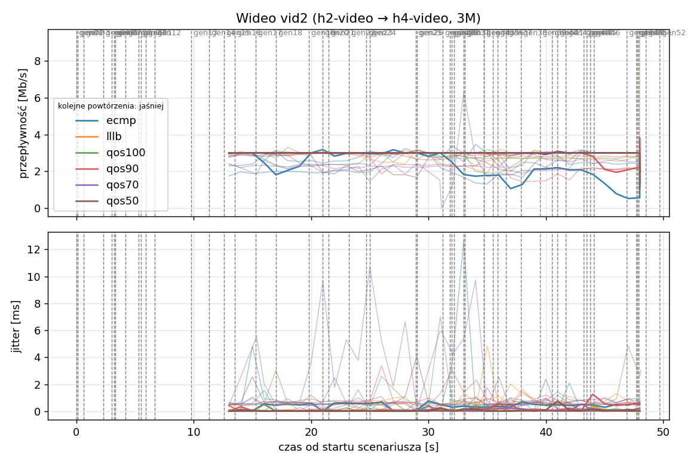
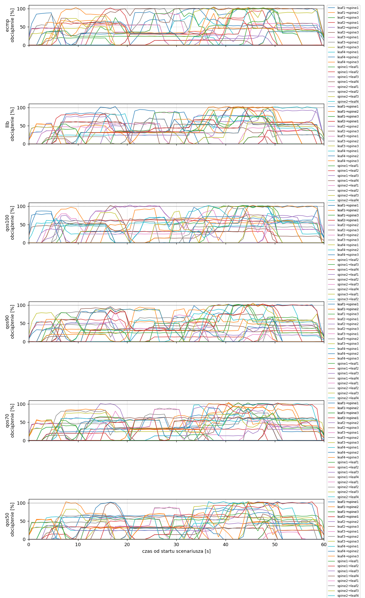
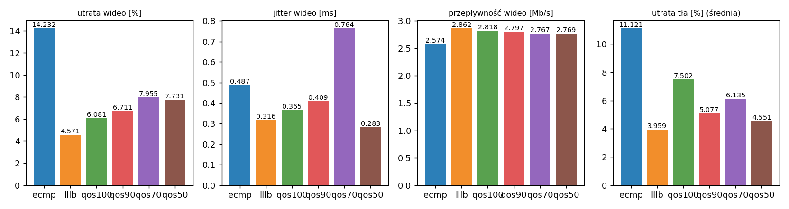

# Raport: reserve-sweep

Katalog: `results/reserve-sweep/20261030_224134`

## 1. Scenariusz

- Topologia: `sdn` (frr: `spine-leaf-3x4.clab.yml`, sdn: `sdn.clab.yaml`)
- Warianty: **ecmp** (FRR, bez kontrolera), **lllb** (POLICY=lllb), **qos100** (POLICY=qos, RESERVE_PCT=100), **qos90** (POLICY=qos, RESERVE_PCT=90), **qos70** (POLICY=qos, RESERVE_PCT=70), **qos50** (POLICY=qos, RESERVE_PCT=50)
- Czas testu: 60 s, warmup (pomijany w statystykach, liczony od startu każdego przepływu): 5 s, powtórzeń: 5, seed: 42
- Wykonane przebiegi: ecmp/rep1, ecmp/rep2, ecmp/rep3, ecmp/rep4, ecmp/rep5, lllb/rep1, lllb/rep2, lllb/rep3, lllb/rep4, lllb/rep5, qos100/rep1, qos100/rep2, qos100/rep3, qos100/rep4, qos100/rep5, qos90/rep1, qos90/rep2, qos90/rep3, qos90/rep4, qos90/rep5, qos70/rep1, qos70/rep2, qos70/rep3, qos70/rep4, qos70/rep5, qos50/rep1, qos50/rep2, qos50/rep3, qos50/rep4, qos50/rep5

Harmonogram losowego tła różni się między powtórzeniami (seed + nr powtórzenia, wspólny dla wariantów); poniżej powtórzenie 1.

| id | klasa | źródło → cel | proto | zadana [Mb/s] | DSCP | start–koniec [s] |
|---|---|---|---|---|---|---|
| gen01 | background | h2-bg1 → h3-bg2 | udp | 4.49 | – | 0–7 |
| gen02 | background | h4-bg2 → h3-bg1 | udp | 3.16 | – | 0.1–5.1 |
| gen03 | background | h4-bg1 → h2-bg2 | udp | 5.25 | – | 0.6–5.6 |
| gen04 | background | h4-bg1 → h1-bg2 | udp | 3.56 | – | 2.3–7.3 |
| gen05 | background | h4-bg1 → h3-bg1 | udp | 2.36 | – | 3–60 |
| gen06 | background | h1-bg2 → h2-bg1 | udp | 1.93 | – | 3.2–16.2 |
| gen07 | background | h2-bg1 → h3-bg1 | udp | 1.39 | – | 3.3–8.3 |
| gen08 | background | h1-bg1 → h2-bg1 | udp | 3.29 | – | 4.2–32.2 |
| gen09 | background | h3-bg2 → h2-bg1 | udp | 4.51 | – | 5.3–16.3 |
| gen10 | background | h1-bg2 → h3-bg1 | udp | 3.96 | – | 5.5–10.5 |
| gen11 | background | h2-bg1 → h4-bg2 | udp | 5.85 | – | 5.9–19.9 |
| gen12 | background | h1-bg2 → h3-bg1 | udp | 4.90 | – | 6.7–16.7 |
| gen13 | background | h4-bg1 → h1-bg1 | udp | 3.07 | – | 9.8–19.8 |
| vid1 | video | h1-video → h4-video | udp | 3.00 | 46 | 10–50 |
| gen14 | background | h3-bg2 → h1-bg2 | udp | 5.37 | – | 11.3–27.3 |
| vid2 | video | h2-video → h4-video | udp | 3.00 | 46 | 12–48 |
| gen15 | background | h3-bg1 → h1-bg1 | udp | 3.12 | – | 12.6–30.6 |
| gen16 | background | h2-bg1 → h1-bg1 | udp | 4.96 | – | 13.5–18.5 |
| gen17 | background | h2-bg1 → h4-bg2 | udp | 4.86 | – | 15.3–20.3 |
| gen18 | background | h3-bg2 → h1-bg1 | udp | 3.49 | – | 17–36 |
| gen19 | background | h4-bg2 → h2-bg1 | udp | 2.93 | – | 19.8–48.8 |
| gen20 | background | h1-bg2 → h4-bg2 | udp | 5.68 | – | 21–26 |
| gen21 | background | h4-bg1 → h2-bg1 | udp | 3.04 | – | 21.5–35.5 |
| gen22 | background | h4-bg1 → h2-bg1 | udp | 3.69 | – | 23.2–28.2 |
| gen23 | background | h2-bg2 → h4-bg2 | udp | 1.26 | – | 24.7–44.7 |
| gen24 | background | h3-bg1 → h1-bg2 | udp | 4.88 | – | 25–31 |
| gen25 | background | h4-bg1 → h1-bg2 | udp | 3.51 | – | 28.9–33.9 |
| gen26 | background | h1-bg1 → h4-bg1 | udp | 5.23 | – | 29–59 |
| gen27 | background | h1-bg2 → h4-bg1 | udp | 2.10 | – | 31.2–37.2 |
| gen28 | background | h4-bg1 → h1-bg2 | udp | 1.54 | – | 31.8–36.8 |
| gen29 | background | h4-bg1 → h1-bg2 | udp | 1.53 | – | 32–39 |
| gen30 | background | h1-bg2 → h3-bg1 | udp | 3.69 | – | 32.2–38.2 |
| gen31 | background | h2-bg1 → h4-bg2 | udp | 2.18 | – | 33–38 |
| gen32 | background | h4-bg2 → h3-bg2 | udp | 5.19 | – | 33.1–59.1 |
| gen33 | background | h4-bg2 → h3-bg2 | udp | 2.60 | – | 34.7–40.7 |
| gen34 | background | h2-bg2 → h3-bg2 | udp | 1.75 | – | 34.7–59.7 |
| gen35 | background | h4-bg2 → h2-bg1 | udp | 5.89 | – | 35.5–54.5 |
| gen36 | background | h4-bg2 → h3-bg1 | udp | 4.62 | – | 35.9–49.9 |
| gen37 | background | h1-bg2 → h2-bg2 | udp | 4.50 | – | 36.6–50.6 |
| gen38 | background | h2-bg1 → h4-bg1 | udp | 4.23 | – | 37.9–58.9 |
| gen39 | background | h1-bg2 → h4-bg2 | udp | 5.93 | – | 39.5–44.5 |
| gen40 | background | h1-bg1 → h3-bg1 | udp | 5.99 | – | 40.5–45.5 |
| gen41 | background | h1-bg2 → h3-bg1 | udp | 4.47 | – | 41–50 |
| gen42 | background | h1-bg2 → h3-bg1 | udp | 2.82 | – | 41.7–48.7 |
| gen43 | background | h4-bg2 → h2-bg1 | udp | 4.98 | – | 43.2–49.2 |
| gen44 | background | h4-bg2 → h1-bg2 | udp | 5.97 | – | 43.5–50.5 |
| gen45 | background | h3-bg1 → h4-bg1 | udp | 5.74 | – | 43.8–58.8 |
| gen46 | background | h2-bg1 → h1-bg2 | udp | 1.89 | – | 44.1–49.1 |
| gen47 | background | h2-bg2 → h3-bg1 | udp | 2.94 | – | 46.9–59.9 |
| gen48 | background | h3-bg1 → h1-bg1 | udp | 3.58 | – | 47.7–59.7 |
| gen49 | background | h4-bg1 → h2-bg1 | udp | 5.93 | – | 47.8–57.8 |
| gen50 | background | h4-bg1 → h1-bg1 | udp | 3.20 | – | 47.9–54.9 |
| gen51 | background | h4-bg2 → h3-bg1 | udp | 1.53 | – | 48.5–59.5 |
| gen52 | background | h4-bg2 → h2-bg2 | udp | 2.44 | – | 49.7–59.7 |

## 2. Wideo: QoS według wariantu

Wartości: średnia ± odchylenie standardowe z powtórzeń.

| przepływ | wariant | przepływność [Mb/s] | jitter [ms] | utrata [%] | RTT mediana [ms] | RTT p95 [ms] |
|---|---|---|---|---|---|---|
| vid1 | ecmp | 2.48 ± 0.47 | 0.555 ± 0.250 | 17.31 ± 15.79 | 23.719 ± 32.435 | 85.520 ± 48.360 |
| vid1 | lllb | 2.80 ± 0.19 | 0.343 ± 0.286 | 6.64 ± 6.23 | 2.360 ± 5.193 | 94.220 ± 52.084 |
| vid1 | qos100 | 2.73 ± 0.36 | 0.371 ± 0.123 | 8.83 ± 11.94 | 34.678 ± 31.620 | 82.860 ± 32.078 |
| vid1 | qos90 | 2.79 ± 0.16 | 0.415 ± 0.139 | 7.10 ± 5.45 | 27.871 ± 38.936 | 71.220 ± 26.151 |
| vid1 | qos70 | 2.81 ± 0.18 | 0.728 ± 0.936 | 6.61 ± 6.47 | 34.782 ± 31.726 | 79.200 ± 28.310 |
| vid1 | qos50 | 2.73 ± 0.31 | 0.300 ± 0.132 | 8.98 ± 10.27 | 23.433 ± 52.305 | 94.720 ± 32.337 |
| vid2 | ecmp | 2.67 ± 0.42 | 0.419 ± 0.251 | 11.15 ± 13.85 | 13.278 ± 25.229 | 79.400 ± 28.505 |
| vid2 | lllb | 2.92 ± 0.10 | 0.289 ± 0.159 | 2.50 ± 3.37 | 14.761 ± 24.938 | 70.080 ± 25.134 |
| vid2 | qos100 | 2.90 ± 0.13 | 0.359 ± 0.294 | 3.33 ± 4.38 | 11.473 ± 25.562 | 47.553 ± 26.547 |
| vid2 | qos90 | 2.81 ± 0.16 | 0.402 ± 0.148 | 6.32 ± 5.37 | 0.052 ± 0.020 | 71.520 ± 25.995 |
| vid2 | qos70 | 2.72 ± 0.24 | 0.799 ± 1.182 | 9.30 ± 7.91 | 23.330 ± 31.877 | 59.397 ± 41.655 |
| vid2 | qos50 | 2.81 ± 0.25 | 0.265 ± 0.222 | 6.48 ± 8.40 | 11.712 ± 26.099 | 71.005 ± 49.265 |

RTT z `ping` co 0,1 s między hostami wideo (osobny przepływ ICMP z tym samym DSCP - w SDN może iść inną ścieżką niż strumień UDP).

## 3. Ruch tła

Agregat tła w obrębie powtórzenia, potem średnia ± odchylenie standardowe po powtórzeniach (utrata = Σ utraconych / Σ wysłanych datagramów; dostarczone = Σ przepływności / Σ zadanych; przepływy trwające nie dłużej niż warmup pominięte).

| wariant | strumieni tła / powt. | dostarczone / zadane [%] | jitter [ms] | utrata [%] |
|---|---|---|---|---|
| ecmp | 40 | 89.1 ± 2.2 | 0.409 ± 0.157 | 11.12 ± 2.94 |
| lllb | 40 | 95.2 ± 3.7 | 0.241 ± 0.084 | 3.96 ± 3.07 |
| qos100 | 40 | 91.6 ± 3.2 | 0.400 ± 0.094 | 7.50 ± 2.30 |
| qos90 | 40 | 94.4 ± 3.5 | 0.306 ± 0.130 | 5.08 ± 2.73 |
| qos70 | 40 | 93.5 ± 3.0 | 0.495 ± 0.625 | 6.14 ± 2.38 |
| qos50 | 40 | 95.3 ± 2.6 | 0.208 ± 0.069 | 4.55 ± 2.27 |

## 4. Obciążenie łączy fabricu

Średnia i maksimum z próbek co 1 s w oknie 0–60 s; MLU = maksymalne obciążenie łącza; drops = pakiety odrzucone przez `tbf` na wyjściu łącza.

| wariant | rep | średnie obciążenie łączy [%] | MLU [%] | łącza > 90% | drops tbf | CPU VM śr./maks. [%] |
|---|---|---|---|---|---|---|
| ecmp | 1 | 33.1 | 104.7 | 12/24 | 29510 | 21 / 30 |
| ecmp | 2 | 39.5 | 103.9 | 18/24 | 28848 | 25 / 55 |
| ecmp | 3 | 46.4 | 105.7 | 16/24 | 49984 | 25 / 34 |
| ecmp | 4 | 32.8 | 112.4 | 13/24 | 13221 | 32 / 76 |
| ecmp | 5 | 35.8 | 112.7 | 12/24 | 25482 | 33 / 84 |
| lllb | 1 | 34.4 | 102.8 | 13/24 | 13262 | 26 / 59 |
| lllb | 2 | 42.0 | 104.7 | 15/24 | 11228 | 28 / 55 |
| lllb | 3 | 49.8 | 104.6 | 18/24 | 29512 | 32 / 60 |
| lllb | 4 | 34.4 | 109.3 | 11/24 | 1366 | 37 / 80 |
| lllb | 5 | 38.1 | 106.2 | 13/24 | 10058 | 37 / 72 |
| qos100 | 1 | 34.4 | 103.6 | 13/24 | 13883 | 28 / 50 |
| qos100 | 2 | 40.7 | 104.8 | 19/24 | 20037 | 30 / 74 |
| qos100 | 3 | 48.5 | 104.3 | 17/24 | 37328 | 30 / 49 |
| qos100 | 4 | 33.1 | 122.8 | 14/24 | 10848 | 41 / 97 |
| qos100 | 5 | 36.7 | 114.9 | 14/24 | 17821 | 47 / 97 |
| qos90 | 1 | 34.7 | 105.5 | 14/24 | 13265 | 30 / 70 |
| qos90 | 2 | 41.5 | 104.6 | 17/24 | 14870 | 28 / 51 |
| qos90 | 3 | 49.8 | 108.4 | 16/24 | 28398 | 31 / 47 |
| qos90 | 4 | 34.0 | 105.3 | 13/24 | 5484 | 36 / 74 |
| qos90 | 5 | 37.9 | 111.0 | 14/24 | 10691 | 50 / 86 |
| qos70 | 1 | 34.6 | 104.5 | 10/24 | 11400 | 28 / 54 |
| qos70 | 2 | 41.2 | 107.2 | 16/24 | 16259 | 30 / 64 |
| qos70 | 3 | 49.8 | 108.7 | 16/24 | 28460 | 31 / 68 |
| qos70 | 4 | 31.7 | 116.3 | 9/24 | 17326 | 50 / 96 |
| qos70 | 5 | 38.4 | 109.3 | 11/24 | 8710 | 27 / 57 |
| qos50 | 1 | 34.8 | 103.5 | 12/24 | 11700 | 28 / 74 |
| qos50 | 2 | 41.5 | 108.2 | 18/24 | 14541 | 30 / 58 |
| qos50 | 3 | 50.0 | 105.1 | 17/24 | 26489 | 32 / 65 |
| qos50 | 4 | 34.6 | 103.0 | 10/24 | 2493 | 26 / 45 |
| qos50 | 5 | 38.2 | 103.1 | 10/24 | 10808 | 16 / 24 |

Łącza z obciążeniem > 10% (maksimum [%] / drops, powtórzenie 1):

| łącze | ecmp | lllb | qos100 | qos90 | qos70 | qos50 |
|---|---|---|---|---|---|---|
| leaf1→spine1 | 101 / 1063 | 102 / 589 | 102 / 329 | 102 / 329 | 70 / 0 | 103 / 345 |
| leaf1→spine2 | 103 / 1066 | 102 / 1436 | 102 / 736 | 102 / 589 | 104 / 280 | 103 / 471 |
| leaf1→spine3 | 100 / 175 | 83 / 0 | 103 / 43 | 102 / 242 | 103 / 2333 | 103 / 634 |
| leaf2→spine1 | 102 / 834 | 62 / 0 | 32 / 0 | 64 / 0 | 48 / 0 | 32 / 0 |
| leaf2→spine2 | 50 / 0 | 94 / 0 | 76 / 0 | 53 / 0 | 101 / 433 | 63 / 0 |
| leaf2→spine3 | 74 / 0 | 84 / 0 | 102 / 0 | 85 / 0 | 64 / 0 | 101 / 0 |
| leaf3→spine1 | 88 / 0 | 88 / 0 | 0 / 0 | 52 / 0 | 38 / 0 | 57 / 0 |
| leaf3→spine2 | 57 / 0 | 57 / 0 | 103 / 2034 | 48 / 0 | 89 / 0 | 88 / 0 |
| leaf3→spine3 | 79 / 0 | 60 / 0 | 62 / 0 | 91 / 0 | 57 / 0 | 61 / 0 |
| leaf4→spine1 | 103 / 2240 | 102 / 6554 | 102 / 1024 | 102 / 442 | 101 / 3230 | 103 / 3936 |
| leaf4→spine2 | 101 / 3043 | 101 / 1974 | 102 / 639 | 105 / 3924 | 100 / 4299 | 104 / 3464 |
| leaf4→spine3 | 103 / 4103 | 103 / 2060 | 102 / 6298 | 105 / 3039 | 102 / 746 | 103 / 554 |
| spine1→leaf1 | 100 / 350 | 87 / 0 | 0 / 0 | 68 / 0 | 65 / 0 | 58 / 0 |
| spine1→leaf2 | 60 / 0 | 82 / 0 | 61 / 0 | 103 / 716 | 52 / 0 | 94 / 11 |
| spine1→leaf3 | 47 / 0 | 96 / 0 | 103 / 976 | 65 / 0 | 94 / 0 | 83 / 0 |
| spine1→leaf4 | 105 / 15165 | 102 / 0 | 63 / 0 | 96 / 0 | 66 / 0 | 64 / 0 |
| spine2→leaf1 | 57 / 0 | 64 / 0 | 104 / 0 | 85 / 0 | 87 / 0 | 87 / 0 |
| spine2→leaf2 | 101 / 85 | 71 / 0 | 77 / 0 | 82 / 0 | 83 / 0 | 68 / 0 |
| spine2→leaf3 | 104 / 1386 | 100 / 0 | 89 / 0 | 102 / 1832 | 77 / 0 | 100 / 0 |
| spine2→leaf4 | 23 / 0 | 83 / 0 | 102 / 0 | 102 / 0 | 89 / 79 | 102 / 22 |
| spine3→leaf1 | 65 / 0 | 103 / 587 | 87 / 0 | 94 / 0 | 58 / 0 | 102 / 601 |
| spine3→leaf2 | 68 / 0 | 101 / 62 | 81 / 0 | 62 / 0 | 94 / 0 | 70 / 0 |
| spine3→leaf3 | 102 / 0 | 93 / 0 | 91 / 0 | 102 / 699 | 92 / 0 | 71 / 0 |
| spine3→leaf4 | 74 / 0 | 98 / 0 | 103 / 1804 | 103 / 1453 | 103 / 0 | 103 / 1662 |

## 5. Ścieżki wybrane przez kontroler (powtórzenie 1)

Z logu kontrolera (linie `Flow`), dopasowane po piątce przepływu; ✓ = reguły widoczne w `dump-flows` na tych samych przełącznikach.

| przepływ | ecmp | lllb | qos100 | qos90 | qos70 | qos50 |
|---|---|---|---|---|---|---|
| gen01 | ECMP (hash L4), nieobserwowana bezpośrednio | leaf2 -> spine2 -> leaf3 ✓ (loads 5% 0% 0%) | leaf2 -> spine3 -> leaf3 ✓ (loads 0% 5% 0%) | leaf2 -> spine2 -> leaf3 ✓ (loads 0% 0% 5%) | leaf2 -> spine1 -> leaf3 ✓ (loads 0% 5% 5%) | leaf2 -> spine3 -> leaf3 ✓ (loads 0% 5% 0%) |
| gen02 | ECMP (hash L4), nieobserwowana bezpośrednio | leaf4 -> spine1 -> leaf3 ✓ (loads 5% 5% 5%) | leaf4 -> spine3 -> leaf3 ✓ (loads 0% 10% 5%) | leaf4 -> spine2 -> leaf3 ✓ (loads 5% 5% 5%) | leaf4 -> spine2 -> leaf3 ✓ (loads 5% 5% 5%) | leaf4 -> spine2 -> leaf3 ✓ (loads 5% 5% 5%) |
| gen03 | ECMP (hash L4), nieobserwowana bezpośrednio | leaf4 -> spine3 -> leaf2 ✓ (loads 13% 5% 0%) | leaf4 -> spine3 -> leaf2 ✓ (loads 0% 5% 3%) | leaf4 -> spine1 -> leaf2 ✓ (loads 5% 5% 10%) | leaf4 -> spine3 -> leaf2 ✓ (loads 5% 12% 0%) | leaf4 -> spine3 -> leaf2 ✓ (loads 5% 10% 5%) |
| gen04 | ECMP (hash L4), nieobserwowana bezpośrednio | leaf4 -> spine2 -> leaf1 ✓ (loads 32% 5% 50%) | leaf4 -> spine2 -> leaf1 ✓ (loads 0% 5% 87%) | leaf4 -> spine3 -> leaf1 ✓ (loads 54% 33% 5%) | leaf4 -> spine1 -> leaf1 ✓ (loads 5% 33% 49%) | leaf4 -> spine1 -> leaf1 ✓ (loads 5% 33% 54%) |
| gen05 | ECMP (hash L4), nieobserwowana bezpośrednio | leaf4 -> spine1 -> leaf3 ✓ (loads 38% 46% 54%) | leaf4 -> spine2 -> leaf3 ✓ (loads 0% 15% 87%) | leaf4 -> spine3 -> leaf3 ✓ (loads 54% 79% 25%) | leaf4 -> spine2 -> leaf3 ✓ (loads 46% 38% 54%) | leaf4 -> spine1 -> leaf3 ✓ (loads 24% 33% 54%) |
| gen06 | ECMP (hash L4), nieobserwowana bezpośrednio | leaf1 -> spine2 -> leaf2 ✓ (loads 5% 0% 54%) | leaf1 -> spine2 -> leaf2 ✓ (loads 0% 5% 54%) | leaf1 -> spine3 -> leaf2 ✓ (loads 54% 5% 0%) | leaf1 -> spine1 -> leaf2 ✓ (loads 0% 5% 54%) | leaf1 -> spine2 -> leaf2 ✓ (loads 5% 0% 54%) |
| gen07 | ECMP (hash L4), nieobserwowana bezpośrednio | leaf2 -> spine3 -> leaf3 ✓ (loads 43% 46% 10%) | leaf2 -> spine2 -> leaf3 ✓ (loads 0% 15% 79%) | leaf2 -> spine3 -> leaf3 ✓ (loads 10% 79% 15%) | leaf2 -> spine3 -> leaf3 ✓ (loads 46% 42% 10%) | leaf2 -> spine1 -> leaf3 ✓ (loads 15% 33% 46%) |
| gen08 | ECMP (hash L4), nieobserwowana bezpośrednio | leaf1 -> spine1 -> leaf2 ✓ (loads 5% 6% 54%) | leaf1 -> spine2 -> leaf2 ✓ (loads 0% 25% 54%) | leaf1 -> spine2 -> leaf2 ✓ (loads 54% 5% 12%) | leaf1 -> spine2 -> leaf2 ✓ (loads 6% 5% 54%) | leaf1 -> spine1 -> leaf2 ✓ (loads 5% 12% 54%) |
| gen09 | ECMP (hash L4), nieobserwowana bezpośrednio | leaf3 -> spine1 -> leaf2 ✓ (loads 16% 20% 54%) | leaf3 -> spine3 -> leaf2 ✓ (loads 0% 59% 54%) | leaf3 -> spine2 -> leaf2 ✓ (loads 54% 22% 25%) | leaf3 -> spine2 -> leaf2 ✓ (loads 20% 16% 54%) | leaf3 -> spine2 -> leaf2 ✓ (loads 24% 20% 54%) |
| gen10 | ECMP (hash L4), nieobserwowana bezpośrednio | leaf1 -> spine3 -> leaf3 ✓ (loads 57% 46% 29%) | leaf1 -> spine2 -> leaf3 ✓ (loads 0% 59% 76%) | leaf1 -> spine3 -> leaf3 ✓ (loads 10% 79% 44%) | leaf1 -> spine3 -> leaf3 ✓ (loads 46% 57% 29%) | leaf1 -> spine2 -> leaf3 ✓ (loads 44% 43% 46%) |
| gen11 | ECMP (hash L4), nieobserwowana bezpośrednio | leaf2 -> spine1 -> leaf4 ✓ (loads 5% 46% 14%) | leaf2 -> spine2 -> leaf4 ✓ (loads 0% 29% 46%) | leaf2 -> spine1 -> leaf4 ✓ (loads 5% 46% 14%) | leaf2 -> spine2 -> leaf4 ✓ (loads 46% 5% 14%) | leaf2 -> spine2 -> leaf4 ✓ (loads 14% 5% 46%) |
| gen12 | ECMP (hash L4), nieobserwowana bezpośrednio | leaf1 -> spine1 -> leaf3 ✓ (loads 39% 46% 55%) | leaf1 -> spine3 -> leaf3 ✓ (loads 0% 84% 51%) | leaf1 -> spine1 -> leaf3 ✓ (loads 5% 68% 54%) | leaf1 -> spine2 -> leaf3 ✓ (loads 46% 39% 55%) | leaf1 -> spine2 -> leaf3 ✓ (loads 39% 38% 46%) |
| gen13 | ECMP (hash L4), nieobserwowana bezpośrednio | leaf4 -> spine3 -> leaf1 ✓ (loads 24% 5% 0%) | leaf4 -> spine3 -> leaf1 ✓ (loads 0% 24% 5%) | leaf4 -> spine1 -> leaf1 ✓ (loads 0% 5% 24%) | leaf4 -> spine1 -> leaf1 ✓ (loads 0% 24% 5%) | leaf4 -> spine3 -> leaf1 ✓ (loads 24% 5% 0%) |
| vid1 | ECMP (hash L4), nieobserwowana bezpośrednio | leaf1 -> spine2 -> leaf4 ✓ (loads 84% 35% 41%) | leaf1 -> spine1 -> leaf4 ✓ (loads 0% 95% 65%) | leaf1 -> spine1 -> leaf4 ✓ (loads 60% 39% 61%) | leaf1 -> spine1 -> leaf4 ✓ (loads 35% 84% 41%) | leaf1 -> spine1 -> leaf4 ✓ (loads 34% 100% 5%) |
| gen14 | ECMP (hash L4), nieobserwowana bezpośrednio | leaf3 -> spine2 -> leaf1 ✓ (loads 46% 10% 23%) | leaf3 -> spine2 -> leaf1 ✓ (loads 0% 5% 46%) | leaf3 -> spine3 -> leaf1 ✓ (loads 37% 46% 5%) | leaf3 -> spine3 -> leaf1 ✓ (loads 28% 46% 5%) | leaf3 -> spine1 -> leaf1 ✓ (loads 10% 47% 32%) |
| vid2 | ECMP (hash L4), nieobserwowana bezpośrednio | leaf2 -> spine3 -> leaf4 ✓ (loads 60% 31% 5%) | leaf2 -> spine1 -> leaf4 ✓ (loads 31% 60% 5%) | leaf2 -> spine3 -> leaf4 ✓ (loads 91% 5% 0%) | leaf2 -> spine1 -> leaf4 ✓ (loads 31% 60% 5%) | leaf2 -> spine1 -> leaf4 ✓ (loads 31% 60% 5%) |
| gen15 | ECMP (hash L4), nieobserwowana bezpośrednio | leaf3 -> spine3 -> leaf1 ✓ (loads 47% 55% 37%) | leaf3 -> spine2 -> leaf1 ✓ (loads 0% 49% 51%) | leaf3 -> spine3 -> leaf1 ✓ (loads 32% 46% 37%) | leaf3 -> spine1 -> leaf1 ✓ (loads 37% 46% 55%) | leaf3 -> spine3 -> leaf1 ✓ (loads 34% 46% 32%) |
| gen16 | ECMP (hash L4), nieobserwowana bezpośrednio | leaf2 -> spine3 -> leaf1 ✓ (loads 60% 55% 47%) | leaf2 -> spine3 -> leaf1 ✓ (loads 31% 76% 37%) | leaf2 -> spine2 -> leaf1 ✓ (loads 60% 10% 64%) | leaf2 -> spine2 -> leaf1 ✓ (loads 42% 60% 60%) | leaf2 -> spine3 -> leaf1 ✓ (loads 56% 60% 44%) |
| gen17 | ECMP (hash L4), nieobserwowana bezpośrednio | leaf2 -> spine2 -> leaf4 ✓ (loads 60% 36% 82%) | leaf2 -> spine3 -> leaf4 ✓ (loads 62% 60% 56%) | leaf2 -> spine3 -> leaf4 ✓ (loads 91% 51% 36%) | leaf2 -> spine3 -> leaf4 ✓ (loads 62% 100% 5%) | leaf2 -> spine3 -> leaf4 ✓ (loads 62% 60% 56%) |
| gen18 | ECMP (hash L4), nieobserwowana bezpośrednio | leaf3 -> spine1 -> leaf1 ✓ (loads 40% 56% 100%) | leaf3 -> spine2 -> leaf1 ✓ (loads 0% 87% 88%) | leaf3 -> spine2 -> leaf1 ✓ (loads 32% 56% 87%) | leaf3 -> spine2 -> leaf1 ✓ (loads 64% 53% 55%) | leaf3 -> spine2 -> leaf1 ✓ (loads 55% 28% 100%) |
| gen19 | ECMP (hash L4), nieobserwowana bezpośrednio | leaf4 -> spine2 -> leaf2 ✓ (loads 34% 5% 32%) | leaf4 -> spine2 -> leaf2 ✓ (loads 0% 34% 37%) | leaf4 -> spine3 -> leaf2 ✓ (loads 32% 34% 29%) | leaf4 -> spine3 -> leaf2 ✓ (loads 32% 34% 5%) | leaf4 -> spine2 -> leaf2 ✓ (loads 34% 5% 32%) |
| gen20 | ECMP (hash L4), nieobserwowana bezpośrednio | leaf1 -> spine1 -> leaf4 ✓ (loads 34% 69% 36%) | leaf1 -> spine2 -> leaf4 ✓ (loads 62% 45% 50%) | leaf1 -> spine2 -> leaf4 ✓ (loads 38% 34% 53%) | leaf1 -> spine3 -> leaf4 ✓ (loads 62% 39% 38%) | leaf1 -> spine2 -> leaf4 ✓ (loads 65% 17% 24%) |
| gen21 | ECMP (hash L4), nieobserwowana bezpośrednio | leaf4 -> spine3 -> leaf2 ✓ (loads 32% 30% 5%) | leaf4 -> spine3 -> leaf2 ✓ (loads 0% 64% 5%) | leaf4 -> spine2 -> leaf2 ✓ (loads 10% 39% 55%) | leaf4 -> spine1 -> leaf2 ✓ (loads 13% 34% 23%) | leaf4 -> spine3 -> leaf2 ✓ (loads 34% 35% 10%) |
| gen22 | ECMP (hash L4), nieobserwowana bezpośrednio | leaf4 -> spine2 -> leaf2 ✓ (loads 36% 30% 34%) | leaf4 -> spine3 -> leaf2 ✓ (loads 0% 64% 28%) | leaf4 -> spine1 -> leaf2 ✓ (loads 5% 65% 54%) | leaf4 -> spine2 -> leaf2 ✓ (loads 31% 34% 35%) | leaf4 -> spine3 -> leaf2 ✓ (loads 34% 35% 31%) |
| gen23 | ECMP (hash L4), nieobserwowana bezpośrednio | leaf2 -> spine3 -> leaf4 ✓ (loads 58% 36% 31%) | leaf2 -> spine3 -> leaf4 ✓ (loads 62% 58% 5%) | leaf2 -> spine1 -> leaf4 ✓ (loads 31% 59% 36%) | leaf2 -> spine2 -> leaf4 ✓ (loads 62% 5% 58%) | leaf2 -> spine3 -> leaf4 ✓ (loads 62% 58% 5%) |
| gen24 | ECMP (hash L4), nieobserwowana bezpośrednio | leaf3 -> spine1 -> leaf1 ✓ (loads 36% 55% 37%) | leaf3 -> spine3 -> leaf1 ✓ (loads 0% 100% 5%) | leaf3 -> spine1 -> leaf1 ✓ (loads 5% 36% 88%) | leaf3 -> spine2 -> leaf1 ✓ (loads 32% 41% 55%) | leaf3 -> spine2 -> leaf1 ✓ (loads 55% 36% 37%) |
| gen25 | ECMP (hash L4), nieobserwowana bezpośrednio | leaf4 -> spine3 -> leaf1 ✓ (loads 86% 53% 37%) | leaf4 -> spine3 -> leaf1 ✓ (loads 0% 77% 72%) | leaf4 -> spine2 -> leaf1 ✓ (loads 50% 41% 54%) | leaf4 -> spine3 -> leaf1 ✓ (loads 32% 86% 35%) | leaf4 -> spine1 -> leaf1 ✓ (loads 29% 86% 45%) |
| gen26 | ECMP (hash L4), nieobserwowana bezpośrednio | leaf1 -> spine1 -> leaf4 ✓ (loads 39% 41% 44%) | leaf1 -> spine3 -> leaf4 ✓ (loads 62% 34% 28%) | leaf1 -> spine2 -> leaf4 ✓ (loads 44% 39% 41%) | leaf1 -> spine3 -> leaf4 ✓ (loads 62% 34% 15%) | leaf1 -> spine3 -> leaf4 ✓ (loads 65% 15% 13%) |
| gen27 | ECMP (hash L4), nieobserwowana bezpośrednio | leaf1 -> spine2 -> leaf4 ✓ (loads 88% 36% 44%) | leaf1 -> spine2 -> leaf4 ✓ (loads 62% 44% 67%) | leaf1 -> spine3 -> leaf4 ✓ (loads 44% 88% 36%) | leaf1 -> spine2 -> leaf4 ✓ (loads 62% 39% 54%) | leaf1 -> spine2 -> leaf4 ✓ (loads 65% 5% 67%) |
| gen28 | ECMP (hash L4), nieobserwowana bezpośrednio | leaf4 -> spine2 -> leaf1 ✓ (loads 57% 35% 68%) | leaf4 -> spine2 -> leaf1 ✓ (loads 0% 60% 77%) | leaf4 -> spine3 -> leaf1 ✓ (loads 50% 72% 70%) | leaf4 -> spine1 -> leaf1 ✓ (loads 36% 60% 66%) | leaf4 -> spine3 -> leaf1 ✓ (loads 61% 86% 46%) |
| gen29 | ECMP (hash L4), nieobserwowana bezpośrednio | leaf4 -> spine2 -> leaf1 ✓ (loads 57% 45% 68%) | leaf4 -> spine2 -> leaf1 ✓ (loads 0% 70% 77%) | leaf4 -> spine3 -> leaf1 ✓ (loads 7% 72% 61%) | leaf4 -> spine2 -> leaf1 ✓ (loads 41% 65% 66%) | leaf4 -> spine3 -> leaf1 ✓ (loads 60% 45% 37%) |
| gen30 | ECMP (hash L4), nieobserwowana bezpośrednio | leaf1 -> spine3 -> leaf3 ✓ (loads 88% 50% 15%) | leaf1 -> spine2 -> leaf3 ✓ (loads 31% 55% 59%) | leaf1 -> spine3 -> leaf3 ✓ (loads 31% 88% 30%) | leaf1 -> spine1 -> leaf3 ✓ (loads 41% 56% 59%) | leaf1 -> spine2 -> leaf3 ✓ (loads 65% 29% 54%) |
| gen31 | ECMP (hash L4), nieobserwowana bezpośrednio | leaf2 -> spine3 -> leaf4 ✓ (loads 54% 53% 49%) | leaf2 -> spine2 -> leaf4 ✓ (loads 62% 27% 67%) | leaf2 -> spine2 -> leaf4 ✓ (loads 44% 54% 58%) | leaf2 -> spine2 -> leaf4 ✓ (loads 62% 40% 54%) | leaf2 -> spine2 -> leaf4 ✓ (loads 62% 27% 67%) |
| gen32 | ECMP (hash L4), nieobserwowana bezpośrednio | leaf4 -> spine1 -> leaf3 ✓ (loads 39% 52% 68%) | leaf4 -> spine3 -> leaf3 ✓ (loads 0% 76% 72%) | leaf4 -> spine2 -> leaf3 ✓ (loads 10% 72% 84%) | leaf4 -> spine1 -> leaf3 ✓ (loads 43% 46% 66%) | leaf4 -> spine2 -> leaf3 ✓ (loads 61% 45% 60%) |
| gen33 | ECMP (hash L4), nieobserwowana bezpośrednio | leaf4 -> spine3 -> leaf3 ✓ (loads 78% 62% 47%) | leaf4 -> spine2 -> leaf3 ✓ (loads 0% 89% 98%) | leaf4 -> spine1 -> leaf3 ✓ (loads 5% 92% 86%) | leaf4 -> spine3 -> leaf3 ✓ (loads 100% 45% 43%) | leaf4 -> spine3 -> leaf3 ✓ (loads 61% 77% 68%) |
| gen34 | ECMP (hash L4), nieobserwowana bezpośrednio | leaf2 -> spine2 -> leaf3 ✓ (loads 78% 5% 66%) | leaf2 -> spine3 -> leaf3 ✓ (loads 31% 67% 55%) | leaf2 -> spine2 -> leaf3 ✓ (loads 13% 38% 62%) | leaf2 -> spine3 -> leaf3 ✓ (loads 91% 36% 10%) | leaf2 -> spine3 -> leaf3 ✓ (loads 31% 77% 18%) |
| gen35 | ECMP (hash L4), nieobserwowana bezpośrednio | leaf4 -> spine3 -> leaf2 ✓ (loads 78% 62% 57%) | leaf4 -> spine1 -> leaf2 ✓ (loads 0% 97% 92%) | leaf4 -> spine1 -> leaf2 ✓ (loads 10% 91% 86%) | leaf4 -> spine3 -> leaf2 ✓ (loads 100% 50% 48%) | leaf4 -> spine1 -> leaf2 ✓ (loads 32% 84% 67%) |
| gen36 | ECMP (hash L4), nieobserwowana bezpośrednio | leaf4 -> spine3 -> leaf3 ✓ (loads 78% 67% 66%) | leaf4 -> spine1 -> leaf3 ✓ (loads 15% 97% 92%) | leaf4 -> spine2 -> leaf3 ✓ (loads 51% 77% 86%) | leaf4 -> spine2 -> leaf3 ✓ (loads 99% 45% 57%) | leaf4 -> spine1 -> leaf3 ✓ (loads 51% 92% 79%) |
| gen37 | ECMP (hash L4), nieobserwowana bezpośrednio | leaf1 -> spine3 -> leaf2 ✓ (loads 54% 58% 47%) | leaf1 -> spine3 -> leaf2 ✓ (loads 46% 60% 59%) | leaf1 -> spine1 -> leaf2 ✓ (loads 36% 54% 65%) | leaf1 -> spine2 -> leaf2 ✓ (loads 69% 27% 77%) | leaf1 -> spine1 -> leaf2 ✓ (loads 41% 59% 54%) |
| gen38 | ECMP (hash L4), nieobserwowana bezpośrednio | leaf2 -> spine2 -> leaf4 ✓ (loads 54% 49% 66%) | leaf2 -> spine2 -> leaf4 ✓ (loads 62% 48% 67%) | leaf2 -> spine3 -> leaf4 ✓ (loads 44% 76% 43%) | leaf2 -> spine3 -> leaf4 ✓ (loads 62% 55% 54%) | leaf2 -> spine2 -> leaf4 ✓ (loads 62% 35% 67%) |
| gen39 | ECMP (hash L4), nieobserwowana bezpośrednio | leaf1 -> spine1 -> leaf4 ✓ (loads 59% 62% 69%) | leaf1 -> spine2 -> leaf4 ✓ (loads 62% 49% 93%) | leaf1 -> spine2 -> leaf4 ✓ (loads 77% 62% 73%) | leaf1 -> spine2 -> leaf4 ✓ (loads 62% 51% 82%) | leaf1 -> spine2 -> leaf4 ✓ (loads 77% 50% 67%) |
| gen40 | ECMP (hash L4), nieobserwowana bezpośrednio | leaf1 -> spine2 -> leaf3 ✓ (loads 78% 36% 54%) | leaf1 -> spine2 -> leaf3 ✓ (loads 46% 56% 100%) | leaf1 -> spine3 -> leaf3 ✓ (loads 77% 100% 29%) | leaf1 -> spine3 -> leaf3 ✓ (loads 53% 72% 59%) | leaf1 -> spine3 -> leaf3 ✓ (loads 77% 58% 54%) |
| gen41 | ECMP (hash L4), nieobserwowana bezpośrednio | leaf1 -> spine2 -> leaf3 ✓ (loads 100% 43% 54%) | leaf1 -> spine1 -> leaf3 ✓ (loads 45% 93% 100%) | leaf1 -> spine3 -> leaf3 ✓ (loads 77% 100% 54%) | leaf1 -> spine3 -> leaf3 ✓ (loads 54% 100% 63%) | leaf1 -> spine2 -> leaf3 ✓ (loads 77% 66% 71%) |
| gen42 | ECMP (hash L4), nieobserwowana bezpośrednio | leaf1 -> spine3 -> leaf3 ✓ (loads 100% 98% 53%) | leaf1 -> spine1 -> leaf3 ✓ (loads 55% 93% 100%) | leaf1 -> spine1 -> leaf3 ✓ (loads 77% 100% 99%) | leaf1 -> spine1 -> leaf3 ✓ (loads 58% 100% 100%) | leaf1 -> spine1 -> leaf3 ✓ (loads 77% 95% 100%) |
| gen43 | ECMP (hash L4), nieobserwowana bezpośrednio | leaf4 -> spine2 -> leaf2 ✓ (loads 78% 35% 101%) | leaf4 -> spine2 -> leaf2 ✓ (loads 100% 54% 58%) | leaf4 -> spine3 -> leaf2 ✓ (loads 100% 100% 60%) | leaf4 -> spine2 -> leaf2 ✓ (loads 54% 77% 91%) | leaf4 -> spine3 -> leaf2 ✓ (loads 100% 84% 5%) |
| gen44 | ECMP (hash L4), nieobserwowana bezpośrednio | leaf4 -> spine2 -> leaf1 ✓ (loads 78% 45% 100%) | leaf4 -> spine3 -> leaf1 ✓ (loads 100% 59% 59%) | leaf4 -> spine3 -> leaf1 ✓ (loads 61% 100% 70%) | leaf4 -> spine2 -> leaf1 ✓ (loads 54% 82% 91%) | leaf4 -> spine3 -> leaf1 ✓ (loads 100% 84% 25%) |
| gen45 | ECMP (hash L4), nieobserwowana bezpośrednio | leaf3 -> spine3 -> leaf4 ✓ (loads 100% 66% 49%) | leaf3 -> spine3 -> leaf4 ✓ (loads 65% 93% 77%) | leaf3 -> spine3 -> leaf4 ✓ (loads 54% 100% 89%) | leaf3 -> spine2 -> leaf4 ✓ (loads 72% 68% 74%) | leaf3 -> spine3 -> leaf4 ✓ (loads 70% 105% 67%) |
| gen46 | ECMP (hash L4), nieobserwowana bezpośrednio | leaf2 -> spine1 -> leaf1 ✓ (loads 5% 62% 44%) | leaf2 -> spine3 -> leaf1 ✓ (loads 31% 44% 31%) | leaf2 -> spine2 -> leaf1 ✓ (loads 13% 23% 74%) | leaf2 -> spine2 -> leaf1 ✓ (loads 31% 18% 62%) | leaf2 -> spine3 -> leaf1 ✓ (loads 36% 44% 31%) |
| gen47 | ECMP (hash L4), nieobserwowana bezpośrednio | leaf2 -> spine2 -> leaf3 ✓ (loads 78% 71% 74%) | leaf2 -> spine2 -> leaf3 ✓ (loads 100% 49% 67%) | leaf2 -> spine1 -> leaf3 ✓ (loads 32% 100% 93%) | leaf2 -> spine2 -> leaf3 ✓ (loads 83% 43% 64%) | leaf2 -> spine3 -> leaf3 ✓ (loads 81% 100% 42%) |
| gen48 | ECMP (hash L4), nieobserwowana bezpośrednio | leaf3 -> spine1 -> leaf1 ✓ (loads 24% 43% 59%) | leaf3 -> spine2 -> leaf1 ✓ (loads 0% 5% 71%) | leaf3 -> spine1 -> leaf1 ✓ (loads 5% 19% 59%) | leaf3 -> spine1 -> leaf1 ✓ (loads 0% 59% 5%) | leaf3 -> spine1 -> leaf1 ✓ (loads 5% 10% 71%) |
| gen49 | ECMP (hash L4), nieobserwowana bezpośrednio | leaf4 -> spine1 -> leaf2 ✓ (loads 83% 100% 100%) | leaf4 -> spine3 -> leaf2 ✓ (loads 105% 105% 100%) | leaf4 -> spine2 -> leaf2 ✓ (loads 100% 100% 100%) | leaf4 -> spine1 -> leaf2 ✓ (loads 58% 100% 91%) | leaf4 -> spine2 -> leaf2 ✓ (loads 100% 89% 100%) |
| gen50 | ECMP (hash L4), nieobserwowana bezpośrednio | leaf4 -> spine1 -> leaf1 ✓ (loads 93% 100% 100%) | leaf4 -> spine2 -> leaf1 ✓ (loads 105% 105% 105%) | leaf4 -> spine1 -> leaf1 ✓ (loads 71% 100% 100%) | leaf4 -> spine1 -> leaf1 ✓ (loads 73% 100% 91%) | leaf4 -> spine2 -> leaf1 ✓ (loads 100% 95% 100%) |
| gen51 | ECMP (hash L4), nieobserwowana bezpośrednio | leaf4 -> spine1 -> leaf3 ✓ (loads 97% 100% 100%) | leaf4 -> spine3 -> leaf3 ✓ (loads 99% 103% 98%) | leaf4 -> spine1 -> leaf3 ✓ (loads 66% 105% 105%) | leaf4 -> spine3 -> leaf3 ✓ (loads 93% 98% 91%) | leaf4 -> spine3 -> leaf3 ✓ (loads 100% 100% 100%) |
| gen52 | ECMP (hash L4), nieobserwowana bezpośrednio | leaf4 -> spine2 -> leaf2 ✓ (loads 100% 96% 100%) | leaf4 -> spine3 -> leaf2 ✓ (loads 105% 105% 105%) | leaf4 -> spine2 -> leaf2 ✓ (loads 104% 99% 101%) | leaf4 -> spine3 -> leaf2 ✓ (loads 100% 100% 77%) | leaf4 -> spine3 -> leaf2 ✓ (loads 100% 100% 92%) |

## 6. Wnioski

<!-- WNIOSKI:START -->
1. **Wideo (sekcja 2): rezerwa nie poprawiła ochrony względem LLLB, a zależność od R jest niemonotoniczna.**
   Średnia utrata dwóch strumieni wideo z 5 powtórzeń: ECMP 14,23%, LLLB 4,57%, qos100 6,08%, qos90 6,71%,
   qos70 7,95%, qos50 7,73%. Odchylenia standardowe wideo są porównywalne ze średnimi (np. vid1: qos100
   8,83 ± 11,94%, LLLB 6,64 ± 6,23%), a rozrzut między powtórzeniami (0,00–21,40% przy tym samym wariancie)
   przewyższa różnice między wariantami. Przy n = 5 nie można uznać różnic LLLB / qos100 / qos90 / qos70 / qos50
   za istotne. Wyraźnie gorszy jest tylko ECMP.
2. **Ruch tła (sekcja 3): kolejność utraty zgodna z oczekiwaniem co do kosztu rezerwy.** LLLB 3,96%,
   qos50 4,55%, qos90 5,08%, qos70 6,14%, qos100 7,50%, ECMP 11,12%. Odrzucenia na `tbf` (suma z 5
   powtórzeń): LLLB 65 426, qos50 66 031, qos90 72 708, qos70 82 155, qos100 99 917, ECMP 147 045.
   Największy koszt dla tła ma qos100 (ok. 1,5 raza więcej odrzuceń niż LLLB), a qos50 praktycznie
   dorównuje LLLB, czyli koszt rezerwy maleje wraz z R, jak zakładano. Zależność od R nie jest jednak monotoniczna:
   przy R malejącym 100 → 90 → 70 → 50 straty tła wynosiłyby kolejno malejąco, a qos90 (5,08%) wypada niżej
   niż qos70 (6,14%).
3. **Wyjaśnienie, dlaczego rezerwa nie chroni wideo: best-effort wchodzi na ścieżkę rezerwową przez
   „zawór” SPILL.** Kod pozwala best-effort zająć rezerwę także wtedy, gdy wszystkie pozostałe ścieżki mają
   ≥ 90% (wtedy kandydatem jest cała lista, a LLLB wybiera najmniej obciążoną, czyli zwykle rezerwę z samym
   wideo). W qos100 (R = 100%, best-effort nie powinien tam wchodzić wcale) 27 z 276 przepływów best-effort
   (10%) trafiło na ścieżkę przez spine1; w powtórzeniach 2 i 3 sumaryczna zadana przepływność best-effort
   na spine1 wynosiła 23,7 i 24,7 Mb/s, a utrata wideo 12,44% i 13,60% (rep. 4: 9,2 Mb/s i 2,74%). Najwięcej
   odrzuceń w tych powtórzeniach było na łączu leaf1→spine1 (4091 i 13 962 pakietów), czyli na uplinku
   rezerwy. Zależność nie jest idealna (rep. 1 i 5: 17–18 Mb/s best-effort i tylko 0,6–1,0% strat wideo,
   prawdopodobnie brak nakładania się w czasie), więc to mocna wskazówka, a nie dowód.
4. **Wniosek metodyczny:** ta seria mierzy „rezerwę z przelewem best-effort przy 90%”, a nie czystą
   zależność od R. Przy tak silnym przeciążeniu fabricu (MLU 105–110%) zawór otwiera się często, co
   zaciera różnice między wartościami R. Aby zmierzyć wpływ R, zawór dla best-effort powinien być
   wyłączony (best-effort przelewa się na najmniej obciążoną z pozostałych ścieżek, nigdy na rezerwę
   poza limitem R) i seria powinna zostać powtórzona.
5. **RTT (sekcja 2)** ma sd większe niż średnia (np. LLLB vid1 2,36 ± 5,19 ms, qos90 vid2 0,052 ± 0,020 ms
   przy mediany pozostałych wariantów od 11 do 35 ms) i zależy od tego, czy ICMP trafił na zapełnioną
   kolejkę `tbf`; nie wyciągam z niego wniosków.
<!-- WNIOSKI:END -->

## 7. Wiarygodność pomiaru

**Uwagi autora analizy (ręczne):**
- Większość zastrzeżeń automatycznych to losowe przepływy ≤ 5 s (statystyki z całości); z agregatu tła są wykluczone.
- CPU maszyny: qos70 do 96% (średnio 50%) i qos90 do 86% (średnio 50%) w pojedynczych powtórzeniach; w qos70
  host nie nadążył z wysłaniem 2 przepływów (4,22 z 4,83 i 3,32 z 5,06 Mb/s). Wyniki tych przebiegów
  mogą być zniekształcone; średnie CPU ok. 50% jest wyższe niż w poprzednich seriach (~15–20%), bo działają
  jednocześnie oba laby i 6 wariantów × 5 powtórzeń.
- Losowe tło jest wspólne dla wariantów w obrębie powtórzenia (seed 43–47); n = 5 jest małe (brak testu istotności).
- Tabela łączy w sekcji 4 i ścieżki w sekcji 5 dotyczą powtórzenia 1.

- ecmp rep1, gen02: przepływ krótszy niż warmup - statystyki z całości
- ecmp rep1, gen03: przepływ krótszy niż warmup - statystyki z całości
- ecmp rep1, gen04: przepływ krótszy niż warmup - statystyki z całości
- ecmp rep1, gen07: przepływ krótszy niż warmup - statystyki z całości
- ecmp rep1, gen16: przepływ krótszy niż warmup - statystyki z całości
- ecmp rep1, gen17: przepływ krótszy niż warmup - statystyki z całości
- ecmp rep1, gen25: przepływ krótszy niż warmup - statystyki z całości
- ecmp rep2, gen02: przepływ krótszy niż warmup - statystyki z całości
- ecmp rep2, gen05: przepływ krótszy niż warmup - statystyki z całości
- ecmp rep2, gen07: przepływ krótszy niż warmup - statystyki z całości
- ecmp rep2, gen12: przepływ krótszy niż warmup - statystyki z całości
- ecmp rep2, gen20: przepływ krótszy niż warmup - statystyki z całości
- ecmp rep2, gen23: przepływ krótszy niż warmup - statystyki z całości
- ecmp rep2, gen24: przepływ krótszy niż warmup - statystyki z całości
- ecmp rep2, gen27: przepływ krótszy niż warmup - statystyki z całości
- ecmp rep2, gen29: przepływ krótszy niż warmup - statystyki z całości
- ecmp rep2, gen45: przepływ krótszy niż warmup - statystyki z całości
- ecmp rep2, gen51: przepływ krótszy niż warmup - statystyki z całości
- ecmp rep2, gen54: przepływ krótszy niż warmup - statystyki z całości
- ecmp rep2, gen58: przepływ krótszy niż warmup - statystyki z całości
- ecmp rep3, gen02: przepływ krótszy niż warmup - statystyki z całości
- ecmp rep3, gen03: przepływ krótszy niż warmup - statystyki z całości
- ecmp rep3, gen09: przepływ krótszy niż warmup - statystyki z całości
- ecmp rep3, gen10: przepływ krótszy niż warmup - statystyki z całości
- ecmp rep3, gen11: przepływ krótszy niż warmup - statystyki z całości
- ecmp rep3, gen13: przepływ krótszy niż warmup - statystyki z całości
- ecmp rep3, gen15: przepływ krótszy niż warmup - statystyki z całości
- ecmp rep3, gen33: przepływ krótszy niż warmup - statystyki z całości
- ecmp rep3, gen58: przepływ krótszy niż warmup - statystyki z całości
- ecmp rep4, gen10: przepływ krótszy niż warmup - statystyki z całości
- ecmp rep4, gen25: przepływ krótszy niż warmup - statystyki z całości
- ecmp rep4, gen31: przepływ krótszy niż warmup - statystyki z całości
- ecmp rep4, gen36: przepływ krótszy niż warmup - statystyki z całości
- ecmp rep4, gen40: przepływ krótszy niż warmup - statystyki z całości
- ecmp rep4, gen41: przepływ krótszy niż warmup - statystyki z całości
- ecmp rep4, gen45: przepływ krótszy niż warmup - statystyki z całości
- ecmp rep4, gen46: przepływ krótszy niż warmup - statystyki z całości
- ecmp rep5, gen02: przepływ krótszy niż warmup - statystyki z całości
- ecmp rep5, gen25: przepływ krótszy niż warmup - statystyki z całości
- ecmp rep5, gen42: przepływ krótszy niż warmup - statystyki z całości
- ecmp rep5, gen46: przepływ krótszy niż warmup - statystyki z całości
- lllb rep1, gen02: przepływ krótszy niż warmup - statystyki z całości
- lllb rep1, gen04: przepływ krótszy niż warmup - statystyki z całości
- lllb rep1, gen07: przepływ krótszy niż warmup - statystyki z całości
- lllb rep1, gen17: przepływ krótszy niż warmup - statystyki z całości
- lllb rep1, gen20: przepływ krótszy niż warmup - statystyki z całości
- lllb rep1, gen28: przepływ krótszy niż warmup - statystyki z całości
- lllb rep1, gen31: przepływ krótszy niż warmup - statystyki z całości
- lllb rep2, gen02: przepływ krótszy niż warmup - statystyki z całości
- lllb rep2, gen12: przepływ krótszy niż warmup - statystyki z całości
- lllb rep2, gen24: przepływ krótszy niż warmup - statystyki z całości
- lllb rep2, gen27: przepływ krótszy niż warmup - statystyki z całości
- lllb rep2, gen51: przepływ krótszy niż warmup - statystyki z całości
- lllb rep3, gen03: przepływ krótszy niż warmup - statystyki z całości
- lllb rep3, gen11: przepływ krótszy niż warmup - statystyki z całości
- lllb rep3, gen13: przepływ krótszy niż warmup - statystyki z całości
- lllb rep3, gen30: przepływ krótszy niż warmup - statystyki z całości
- lllb rep3, gen38: przepływ krótszy niż warmup - statystyki z całości
- lllb rep4, gen10: przepływ krótszy niż warmup - statystyki z całości
- lllb rep4, gen40: przepływ krótszy niż warmup - statystyki z całości
- lllb rep4, gen41: przepływ krótszy niż warmup - statystyki z całości
- lllb rep4, gen45: przepływ krótszy niż warmup - statystyki z całości
- lllb rep5, gen02: przepływ krótszy niż warmup - statystyki z całości
- lllb rep5, gen03: przepływ krótszy niż warmup - statystyki z całości
- lllb rep5, gen46: przepływ krótszy niż warmup - statystyki z całości
- lllb rep5, gen54: przepływ krótszy niż warmup - statystyki z całości
- qos100 rep1, gen02: przepływ krótszy niż warmup - statystyki z całości
- qos100 rep1, gen04: przepływ krótszy niż warmup - statystyki z całości
- qos100 rep1, gen07: przepływ krótszy niż warmup - statystyki z całości
- qos100 rep1, gen10: przepływ krótszy niż warmup - statystyki z całości
- qos100 rep1, gen17: przepływ krótszy niż warmup - statystyki z całości
- qos100 rep2, gen02: przepływ krótszy niż warmup - statystyki z całości
- qos100 rep2, gen12: przepływ krótszy niż warmup - statystyki z całości
- qos100 rep2, gen31: przepływ krótszy niż warmup - statystyki z całości
- qos100 rep2, gen36: przepływ krótszy niż warmup - statystyki z całości
- qos100 rep2, gen51: przepływ krótszy niż warmup - statystyki z całości
- qos100 rep3, gen01: przepływ krótszy niż warmup - statystyki z całości
- qos100 rep3, gen02: przepływ krótszy niż warmup - statystyki z całości
- qos100 rep3, gen03: przepływ krótszy niż warmup - statystyki z całości
- qos100 rep3, gen09: przepływ krótszy niż warmup - statystyki z całości
- qos100 rep3, gen11: przepływ krótszy niż warmup - statystyki z całości
- qos100 rep3, gen15: przepływ krótszy niż warmup - statystyki z całości
- qos100 rep3, gen30: przepływ krótszy niż warmup - statystyki z całości
- qos100 rep3, gen38: przepływ krótszy niż warmup - statystyki z całości
- qos100 rep4, gen29: przepływ krótszy niż warmup - statystyki z całości
- qos100 rep4, gen45: przepływ krótszy niż warmup - statystyki z całości
- qos100 rep4: CPU maszyny do 97% (średnio 41%) - możliwy wpływ na pomiary
- qos100 rep5, gen30: przepływ krótszy niż warmup - statystyki z całości
- qos100 rep5, gen42: przepływ krótszy niż warmup - statystyki z całości
- qos100 rep5: CPU maszyny do 97% (średnio 47%) - możliwy wpływ na pomiary
- qos90 rep1, gen02: przepływ krótszy niż warmup - statystyki z całości
- qos90 rep1, gen04: przepływ krótszy niż warmup - statystyki z całości
- qos90 rep1, gen07: przepływ krótszy niż warmup - statystyki z całości
- qos90 rep1, gen10: przepływ krótszy niż warmup - statystyki z całości
- qos90 rep1, gen17: przepływ krótszy niż warmup - statystyki z całości
- qos90 rep1, gen22: przepływ krótszy niż warmup - statystyki z całości
- qos90 rep2, gen12: przepływ krótszy niż warmup - statystyki z całości
- qos90 rep2, gen20: przepływ krótszy niż warmup - statystyki z całości
- qos90 rep2, gen27: przepływ krótszy niż warmup - statystyki z całości
- qos90 rep2, gen31: przepływ krótszy niż warmup - statystyki z całości
- qos90 rep2, gen36: przepływ krótszy niż warmup - statystyki z całości
- qos90 rep2, gen42: przepływ krótszy niż warmup - statystyki z całości
- qos90 rep2, gen45: przepływ krótszy niż warmup - statystyki z całości
- qos90 rep2, gen51: przepływ krótszy niż warmup - statystyki z całości
- qos90 rep3, gen01: przepływ krótszy niż warmup - statystyki z całości
- qos90 rep3, gen02: przepływ krótszy niż warmup - statystyki z całości
- qos90 rep3, gen03: przepływ krótszy niż warmup - statystyki z całości
- qos90 rep3, gen11: przepływ krótszy niż warmup - statystyki z całości
- qos90 rep3, gen13: przepływ krótszy niż warmup - statystyki z całości
- qos90 rep3, gen15: przepływ krótszy niż warmup - statystyki z całości
- qos90 rep3, gen18: przepływ krótszy niż warmup - statystyki z całości
- qos90 rep3, gen30: przepływ krótszy niż warmup - statystyki z całości
- qos90 rep3, gen38: przepływ krótszy niż warmup - statystyki z całości
- qos90 rep4, gen28: przepływ krótszy niż warmup - statystyki z całości
- qos90 rep4, gen31: przepływ krótszy niż warmup - statystyki z całości
- qos90 rep4, gen45: przepływ krótszy niż warmup - statystyki z całości
- qos90 rep5, gen14: przepływ krótszy niż warmup - statystyki z całości
- qos90 rep5, gen21: przepływ krótszy niż warmup - statystyki z całości
- qos90 rep5, gen54: przepływ krótszy niż warmup - statystyki z całości
- qos90 rep5: CPU maszyny do 86% (średnio 50%) - możliwy wpływ na pomiary
- qos70 rep1, gen02: przepływ krótszy niż warmup - statystyki z całości
- qos70 rep1, gen07: przepływ krótszy niż warmup - statystyki z całości
- qos70 rep1, gen17: przepływ krótszy niż warmup - statystyki z całości
- qos70 rep1, gen22: przepływ krótszy niż warmup - statystyki z całości
- qos70 rep1, gen28: przepływ krótszy niż warmup - statystyki z całości
- qos70 rep1, gen31: przepływ krótszy niż warmup - statystyki z całości
- qos70 rep1, gen46: przepływ krótszy niż warmup - statystyki z całości
- qos70 rep2, gen12: przepływ krótszy niż warmup - statystyki z całości
- qos70 rep2, gen20: przepływ krótszy niż warmup - statystyki z całości
- qos70 rep2, gen31: przepływ krótszy niż warmup - statystyki z całości
- qos70 rep2, gen36: przepływ krótszy niż warmup - statystyki z całości
- qos70 rep2, gen51: przepływ krótszy niż warmup - statystyki z całości
- qos70 rep2, gen58: przepływ krótszy niż warmup - statystyki z całości
- qos70 rep3, gen02: przepływ krótszy niż warmup - statystyki z całości
- qos70 rep3, gen03: przepływ krótszy niż warmup - statystyki z całości
- qos70 rep3, gen11: przepływ krótszy niż warmup - statystyki z całości
- qos70 rep3, gen13: przepływ krótszy niż warmup - statystyki z całości
- qos70 rep3, gen15: przepływ krótszy niż warmup - statystyki z całości
- qos70 rep3, gen30: przepływ krótszy niż warmup - statystyki z całości
- qos70 rep3, gen38: przepływ krótszy niż warmup - statystyki z całości
- qos70 rep3, gen50: przepływ krótszy niż warmup - statystyki z całości
- qos70 rep4, gen25: nadawca wysłał 3.32 z 5.06 Mb/s (ograniczenie po stronie hosta?)
- qos70 rep4, gen28: nadawca wysłał 1.96 z 2.84 Mb/s (ograniczenie po stronie hosta?)
- qos70 rep4, gen31: nadawca wysłał 4.22 z 4.83 Mb/s (ograniczenie po stronie hosta?)
- qos70 rep4: CPU maszyny do 96% (średnio 50%) - możliwy wpływ na pomiary
- qos70 rep5, gen03: przepływ krótszy niż warmup - statystyki z całości
- qos70 rep5, gen42: przepływ krótszy niż warmup - statystyki z całości
- qos50 rep1, gen02: przepływ krótszy niż warmup - statystyki z całości
- qos50 rep1, gen03: przepływ krótszy niż warmup - statystyki z całości
- qos50 rep1, gen04: przepływ krótszy niż warmup - statystyki z całości
- qos50 rep1, gen07: przepływ krótszy niż warmup - statystyki z całości
- qos50 rep1, gen10: przepływ krótszy niż warmup - statystyki z całości
- qos50 rep1, gen22: przepływ krótszy niż warmup - statystyki z całości
- qos50 rep1, gen28: przepływ krótszy niż warmup - statystyki z całości
- qos50 rep2, gen02: przepływ krótszy niż warmup - statystyki z całości
- qos50 rep2, gen12: przepływ krótszy niż warmup - statystyki z całości
- qos50 rep2, gen23: przepływ krótszy niż warmup - statystyki z całości
- qos50 rep2, gen24: przepływ krótszy niż warmup - statystyki z całości
- qos50 rep2, gen31: przepływ krótszy niż warmup - statystyki z całości
- qos50 rep2, gen45: przepływ krótszy niż warmup - statystyki z całości
- qos50 rep2, gen51: przepływ krótszy niż warmup - statystyki z całości
- qos50 rep3, gen02: przepływ krótszy niż warmup - statystyki z całości
- qos50 rep3, gen03: przepływ krótszy niż warmup - statystyki z całości
- qos50 rep3, gen09: przepływ krótszy niż warmup - statystyki z całości
- qos50 rep3, gen11: przepływ krótszy niż warmup - statystyki z całości
- qos50 rep3, gen13: przepływ krótszy niż warmup - statystyki z całości
- qos50 rep3, gen15: przepływ krótszy niż warmup - statystyki z całości
- qos50 rep3, gen18: przepływ krótszy niż warmup - statystyki z całości
- qos50 rep3, gen30: przepływ krótszy niż warmup - statystyki z całości
- qos50 rep3, gen38: przepływ krótszy niż warmup - statystyki z całości
- qos50 rep4, gen28: przepływ krótszy niż warmup - statystyki z całości
- qos50 rep4, gen29: przepływ krótszy niż warmup - statystyki z całości
- qos50 rep4, gen31: przepływ krótszy niż warmup - statystyki z całości
- qos50 rep4, gen40: przepływ krótszy niż warmup - statystyki z całości
- qos50 rep4, gen41: przepływ krótszy niż warmup - statystyki z całości
- qos50 rep4, gen45: przepływ krótszy niż warmup - statystyki z całości
- qos50 rep5, gen02: przepływ krótszy niż warmup - statystyki z całości
- qos50 rep5, gen14: przepływ krótszy niż warmup - statystyki z całości
- qos50 rep5, gen21: przepływ krótszy niż warmup - statystyki z całości
- qos50 rep5, gen25: przepływ krótszy niż warmup - statystyki z całości
- qos50 rep5, gen42: przepływ krótszy niż warmup - statystyki z całości
- qos50 rep5, gen52: przepływ krótszy niż warmup - statystyki z całości
- qos50 rep5, gen54: przepływ krótszy niż warmup - statystyki z całości
