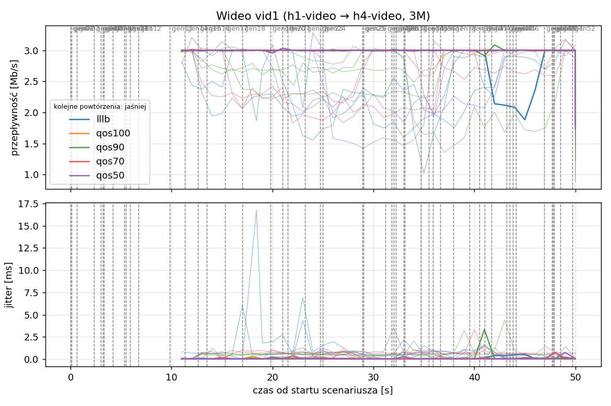
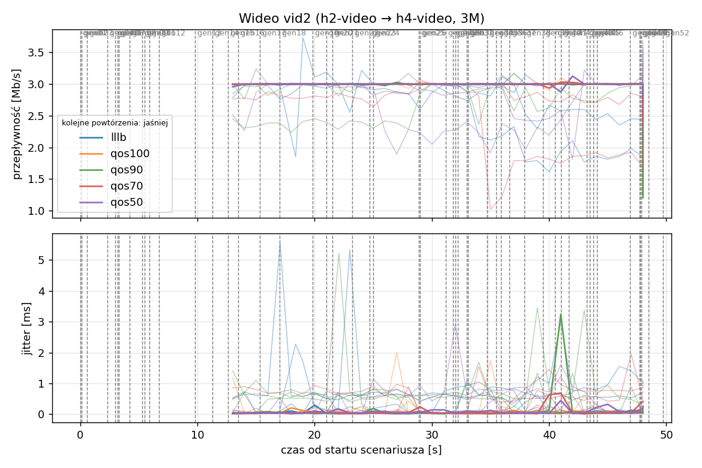
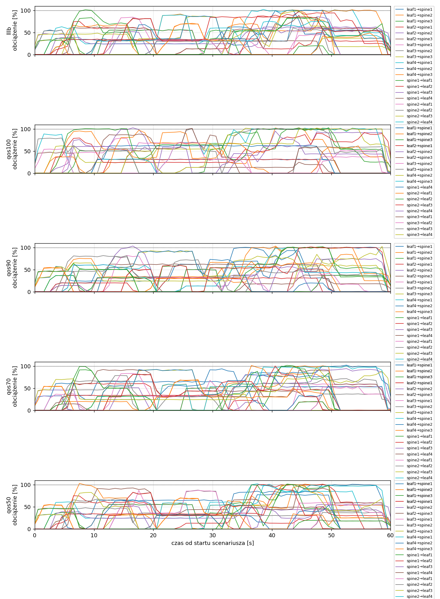
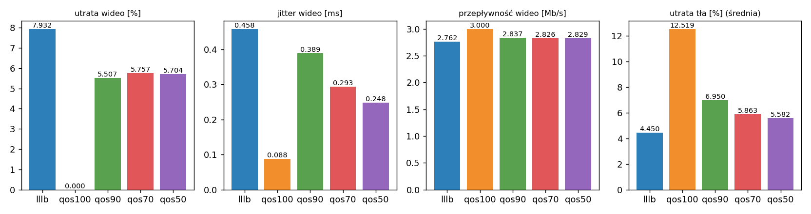

# Raport: reserve-sweep

Katalog: `results/reserve-sweep/20261101_180238`

## 1. Scenariusz

- Topologia: `sdn` (sdn: `sdn.clab.yaml`)
- Warianty: **lllb** (POLICY=lllb), **qos100** (POLICY=qos, RESERVE_PCT=100), **qos90** (POLICY=qos, RESERVE_PCT=90), **qos70** (POLICY=qos, RESERVE_PCT=70), **qos50** (POLICY=qos, RESERVE_PCT=50)
- Czas testu: 60 s, warmup (pomijany w statystykach, liczony od startu każdego przepływu): 5 s, powtórzeń: 5, seed: 42
- Wykonane przebiegi: lllb/rep1, lllb/rep2, lllb/rep3, lllb/rep4, lllb/rep5, qos100/rep1, qos100/rep2, qos100/rep3, qos100/rep4, qos100/rep5, qos90/rep1, qos90/rep2, qos90/rep3, qos90/rep4, qos90/rep5, qos70/rep1, qos70/rep2, qos70/rep3, qos70/rep4, qos70/rep5, qos50/rep1, qos50/rep2, qos50/rep3, qos50/rep4, qos50/rep5

Harmonogram losowego tła różni się między powtórzeniami (seed + nr powtórzenia, wspólny dla wariantów); poniżej powtórzenie 1.

| id | klasa | źródło → cel | proto | zadana [Mb/s] | DSCP | start–koniec [s] |
|---|---|---|---|---|---|---|
| gen01 | background | h2-bg1 → h3-bg2 | udp | 4.49 | – | 0–7 |
| gen02 | background | h4-bg2 → h3-bg1 | udp | 3.16 | – | 0.1–5.1 |
| gen03 | background | h4-bg1 → h2-bg2 | udp | 5.25 | – | 0.6–5.6 |
| gen04 | background | h4-bg1 → h1-bg2 | udp | 3.56 | – | 2.3–7.3 |
| gen05 | background | h4-bg1 → h3-bg1 | udp | 2.36 | – | 3–60 |
| gen06 | background | h1-bg2 → h2-bg1 | udp | 1.93 | – | 3.2–16.2 |
| gen07 | background | h2-bg1 → h3-bg1 | udp | 1.39 | – | 3.3–8.3 |
| gen08 | background | h1-bg1 → h2-bg1 | udp | 3.29 | – | 4.2–32.2 |
| gen09 | background | h3-bg2 → h2-bg1 | udp | 4.51 | – | 5.3–16.3 |
| gen10 | background | h1-bg2 → h3-bg1 | udp | 3.96 | – | 5.5–10.5 |
| gen11 | background | h2-bg1 → h4-bg2 | udp | 5.85 | – | 5.9–19.9 |
| gen12 | background | h1-bg2 → h3-bg1 | udp | 4.90 | – | 6.7–16.7 |
| gen13 | background | h4-bg1 → h1-bg1 | udp | 3.07 | – | 9.8–19.8 |
| vid1 | video | h1-video → h4-video | udp | 3.00 | 46 | 10–50 |
| gen14 | background | h3-bg2 → h1-bg2 | udp | 5.37 | – | 11.3–27.3 |
| vid2 | video | h2-video → h4-video | udp | 3.00 | 46 | 12–48 |
| gen15 | background | h3-bg1 → h1-bg1 | udp | 3.12 | – | 12.6–30.6 |
| gen16 | background | h2-bg1 → h1-bg1 | udp | 4.96 | – | 13.5–18.5 |
| gen17 | background | h2-bg1 → h4-bg2 | udp | 4.86 | – | 15.3–20.3 |
| gen18 | background | h3-bg2 → h1-bg1 | udp | 3.49 | – | 17–36 |
| gen19 | background | h4-bg2 → h2-bg1 | udp | 2.93 | – | 19.8–48.8 |
| gen20 | background | h1-bg2 → h4-bg2 | udp | 5.68 | – | 21–26 |
| gen21 | background | h4-bg1 → h2-bg1 | udp | 3.04 | – | 21.5–35.5 |
| gen22 | background | h4-bg1 → h2-bg1 | udp | 3.69 | – | 23.2–28.2 |
| gen23 | background | h2-bg2 → h4-bg2 | udp | 1.26 | – | 24.7–44.7 |
| gen24 | background | h3-bg1 → h1-bg2 | udp | 4.88 | – | 25–31 |
| gen25 | background | h4-bg1 → h1-bg2 | udp | 3.51 | – | 28.9–33.9 |
| gen26 | background | h1-bg1 → h4-bg1 | udp | 5.23 | – | 29–59 |
| gen27 | background | h1-bg2 → h4-bg1 | udp | 2.10 | – | 31.2–37.2 |
| gen28 | background | h4-bg1 → h1-bg2 | udp | 1.54 | – | 31.8–36.8 |
| gen29 | background | h4-bg1 → h1-bg2 | udp | 1.53 | – | 32–39 |
| gen30 | background | h1-bg2 → h3-bg1 | udp | 3.69 | – | 32.2–38.2 |
| gen31 | background | h2-bg1 → h4-bg2 | udp | 2.18 | – | 33–38 |
| gen32 | background | h4-bg2 → h3-bg2 | udp | 5.19 | – | 33.1–59.1 |
| gen33 | background | h4-bg2 → h3-bg2 | udp | 2.60 | – | 34.7–40.7 |
| gen34 | background | h2-bg2 → h3-bg2 | udp | 1.75 | – | 34.7–59.7 |
| gen35 | background | h4-bg2 → h2-bg1 | udp | 5.89 | – | 35.5–54.5 |
| gen36 | background | h4-bg2 → h3-bg1 | udp | 4.62 | – | 35.9–49.9 |
| gen37 | background | h1-bg2 → h2-bg2 | udp | 4.50 | – | 36.6–50.6 |
| gen38 | background | h2-bg1 → h4-bg1 | udp | 4.23 | – | 37.9–58.9 |
| gen39 | background | h1-bg2 → h4-bg2 | udp | 5.93 | – | 39.5–44.5 |
| gen40 | background | h1-bg1 → h3-bg1 | udp | 5.99 | – | 40.5–45.5 |
| gen41 | background | h1-bg2 → h3-bg1 | udp | 4.47 | – | 41–50 |
| gen42 | background | h1-bg2 → h3-bg1 | udp | 2.82 | – | 41.7–48.7 |
| gen43 | background | h4-bg2 → h2-bg1 | udp | 4.98 | – | 43.2–49.2 |
| gen44 | background | h4-bg2 → h1-bg2 | udp | 5.97 | – | 43.5–50.5 |
| gen45 | background | h3-bg1 → h4-bg1 | udp | 5.74 | – | 43.8–58.8 |
| gen46 | background | h2-bg1 → h1-bg2 | udp | 1.89 | – | 44.1–49.1 |
| gen47 | background | h2-bg2 → h3-bg1 | udp | 2.94 | – | 46.9–59.9 |
| gen48 | background | h3-bg1 → h1-bg1 | udp | 3.58 | – | 47.7–59.7 |
| gen49 | background | h4-bg1 → h2-bg1 | udp | 5.93 | – | 47.8–57.8 |
| gen50 | background | h4-bg1 → h1-bg1 | udp | 3.20 | – | 47.9–54.9 |
| gen51 | background | h4-bg2 → h3-bg1 | udp | 1.53 | – | 48.5–59.5 |
| gen52 | background | h4-bg2 → h2-bg2 | udp | 2.44 | – | 49.7–59.7 |

## 2. Wideo: QoS według wariantu

Wartości: średnia ± odchylenie standardowe z powtórzeń.

| przepływ | wariant | przepływność [Mb/s] | jitter [ms] | utrata [%] | RTT mediana [ms] | RTT p95 [ms] |
|---|---|---|---|---|---|---|
| vid1 | lllb | 2.68 ± 0.28 | 0.535 ± 0.528 | 10.58 ± 9.41 | 46.494 ± 48.533 | 103.120 ± 51.851 |
| vid1 | qos100 | 3.00 ± 0.00 | 0.083 ± 0.034 | 0.00 ± 0.00 | 0.030 ± 0.002 | 0.061 ± 0.015 |
| vid1 | qos90 | 2.74 ± 0.23 | 0.361 ± 0.174 | 8.65 ± 7.54 | 34.743 ± 31.689 | 47.610 ± 26.586 |
| vid1 | qos70 | 2.80 ± 0.23 | 0.327 ± 0.166 | 6.65 ± 7.61 | 23.320 ± 31.895 | 59.429 ± 42.058 |
| vid1 | qos50 | 2.77 ± 0.25 | 0.239 ± 0.226 | 7.51 ± 8.37 | 25.408 ± 49.839 | 61.336 ± 38.748 |
| vid2 | lllb | 2.84 ± 0.22 | 0.381 ± 0.258 | 5.29 ± 7.18 | 20.101 ± 27.932 | 53.683 ± 48.209 |
| vid2 | qos100 | 3.00 ± 0.00 | 0.093 ± 0.028 | 0.00 ± 0.00 | 0.028 ± 0.003 | 0.060 ± 0.010 |
| vid2 | qos90 | 2.93 ± 0.10 | 0.416 ± 0.219 | 2.36 ± 3.26 | 34.929 ± 31.865 | 51.719 ± 51.786 |
| vid2 | qos70 | 2.85 ± 0.24 | 0.260 ± 0.145 | 4.86 ± 8.09 | 23.256 ± 31.808 | 35.355 ± 52.420 |
| vid2 | qos50 | 2.88 ± 0.18 | 0.257 ± 0.211 | 3.89 ± 5.95 | 17.358 ± 25.947 | 59.690 ± 41.715 |

RTT z `ping` co 0,1 s między hostami wideo (osobny przepływ ICMP z tym samym DSCP - w SDN może iść inną ścieżką niż strumień UDP).

## 3. Ruch tła

Agregat tła w obrębie powtórzenia, potem średnia ± odchylenie standardowe po powtórzeniach (utrata = Σ utraconych / Σ wysłanych datagramów; dostarczone = Σ przepływności / Σ zadanych; przepływy trwające nie dłużej niż warmup pominięte).

| wariant | strumieni tła / powt. | dostarczone / zadane [%] | jitter [ms] | utrata [%] |
|---|---|---|---|---|
| lllb | 40 | 95.2 ± 3.9 | 0.335 ± 0.180 | 4.45 ± 3.23 |
| qos100 | 40 | 86.8 ± 5.5 | 0.358 ± 0.078 | 12.52 ± 5.91 |
| qos90 | 40 | 92.3 ± 4.9 | 0.287 ± 0.111 | 6.95 ± 4.14 |
| qos70 | 40 | 93.8 ± 3.3 | 0.218 ± 0.102 | 5.86 ± 3.36 |
| qos50 | 40 | 93.4 ± 5.4 | 0.239 ± 0.117 | 5.58 ± 4.29 |

## 4. Obciążenie łączy fabricu

Średnia i maksimum z próbek co 1 s w oknie 0–60 s; MLU = maksymalne obciążenie łącza; drops = pakiety odrzucone przez `tbf` na wyjściu łącza.

| wariant | rep | średnie obciążenie łączy [%] | MLU [%] | łącza > 90% | drops tbf | CPU VM śr./maks. [%] |
|---|---|---|---|---|---|---|
| lllb | 1 | 34.2 | 102.3 | 8/24 | 14360 | 16 / 56 |
| lllb | 2 | 41.9 | 102.7 | 16/24 | 10212 | 19 / 38 |
| lllb | 3 | 49.3 | 111.0 | 16/24 | 31990 | 32 / 96 |
| lllb | 4 | 34.1 | 124.9 | 11/24 | 1717 | 24 / 93 |
| lllb | 5 | 38.1 | 103.6 | 12/24 | 10547 | 23 / 60 |
| qos100 | 1 | 33.0 | 102.9 | 13/24 | 24397 | 15 / 30 |
| qos100 | 2 | 39.0 | 109.0 | 15/24 | 32179 | 19 / 63 |
| qos100 | 3 | 44.3 | 103.4 | 13/24 | 66139 | 19 / 31 |
| qos100 | 4 | 32.9 | 105.7 | 13/24 | 12883 | 16 / 30 |
| qos100 | 5 | 36.6 | 105.5 | 14/24 | 21425 | 20 / 43 |
| qos90 | 1 | 33.6 | 103.6 | 12/24 | 19254 | 16 / 53 |
| qos90 | 2 | 40.9 | 102.3 | 16/24 | 19871 | 16 / 28 |
| qos90 | 3 | 48.4 | 103.9 | 14/24 | 36216 | 21 / 73 |
| qos90 | 4 | 34.4 | 102.2 | 11/24 | 3804 | 16 / 42 |
| qos90 | 5 | 37.9 | 103.8 | 13/24 | 11711 | 22 / 61 |
| qos70 | 1 | 34.3 | 102.5 | 11/24 | 14056 | 15 / 35 |
| qos70 | 2 | 40.7 | 103.9 | 19/24 | 22590 | 18 / 53 |
| qos70 | 3 | 49.7 | 103.5 | 16/24 | 28073 | 18 / 28 |
| qos70 | 4 | 34.1 | 101.9 | 10/24 | 5630 | 16 / 31 |
| qos70 | 5 | 38.3 | 103.7 | 14/24 | 9634 | 18 / 33 |
| qos50 | 1 | 34.7 | 103.3 | 11/24 | 11510 | 16 / 56 |
| qos50 | 2 | 40.3 | 104.4 | 16/24 | 21582 | 18 / 37 |
| qos50 | 3 | 48.8 | 103.2 | 16/24 | 38830 | 19 / 61 |
| qos50 | 4 | 34.6 | 102.8 | 13/24 | 1242 | 15 / 25 |
| qos50 | 5 | 38.2 | 103.8 | 13/24 | 9317 | 17 / 43 |

Łącza z obciążeniem > 10% (maksimum [%] / drops, powtórzenie 1):

| łącze | lllb | qos100 | qos90 | qos70 | qos50 |
|---|---|---|---|---|---|
| leaf1→spine1 | 101 / 313 | 32 / 0 | 93 / 0 | 79 / 0 | 80 / 0 |
| leaf1→spine2 | 101 / 1516 | 103 / 3338 | 102 / 320 | 85 / 0 | 103 / 1880 |
| leaf1→spine3 | 101 / 314 | 102 / 0 | 102 / 1719 | 102 / 2146 | 102 / 137 |
| leaf2→spine1 | 75 / 0 | 32 / 0 | 32 / 0 | 62 / 0 | 75 / 0 |
| leaf2→spine2 | 63 / 0 | 103 / 453 | 104 / 445 | 95 / 0 | 53 / 0 |
| leaf2→spine3 | 83 / 0 | 52 / 0 | 52 / 0 | 82 / 0 | 83 / 0 |
| leaf3→spine1 | 61 / 0 | 0 / 0 | 51 / 0 | 60 / 0 | 60 / 0 |
| leaf3→spine2 | 33 / 0 | 79 / 0 | 80 / 0 | 79 / 0 | 88 / 0 |
| leaf3→spine3 | 87 / 0 | 101 / 52 | 93 / 0 | 92 / 0 | 33 / 0 |
| leaf4→spine1 | 102 / 5567 | 0 / 0 | 52 / 0 | 82 / 0 | 102 / 521 |
| leaf4→spine2 | 100 / 1973 | 102 / 9188 | 101 / 8489 | 103 / 7155 | 101 / 4740 |
| leaf4→spine3 | 101 / 4485 | 102 / 6025 | 104 / 5741 | 102 / 4422 | 102 / 2964 |
| spine1→leaf1 | 56 / 0 | 0 / 0 | 51 / 0 | 51 / 0 | 57 / 0 |
| spine1→leaf2 | 97 / 65 | 0 / 0 | 52 / 0 | 48 / 0 | 101 / 642 |
| spine1→leaf3 | 86 / 0 | 0 / 0 | 62 / 0 | 82 / 0 | 56 / 0 |
| spine1→leaf4 | 89 / 127 | 63 / 0 | 64 / 0 | 93 / 0 | 98 / 0 |
| spine2→leaf1 | 85 / 0 | 97 / 171 | 82 / 0 | 84 / 0 | 87 / 0 |
| spine2→leaf2 | 60 / 0 | 103 / 1496 | 82 / 0 | 72 / 0 | 68 / 0 |
| spine2→leaf3 | 99 / 0 | 92 / 0 | 103 / 53 | 98 / 0 | 100 / 489 |
| spine2→leaf4 | 90 / 0 | 95 / 0 | 101 / 502 | 101 / 0 | 100 / 0 |
| spine3→leaf1 | 87 / 0 | 101 / 0 | 93 / 0 | 93 / 0 | 65 / 0 |
| spine3→leaf2 | 70 / 0 | 70 / 0 | 85 / 0 | 68 / 0 | 70 / 0 |
| spine3→leaf3 | 84 / 0 | 102 / 1949 | 101 / 782 | 100 / 333 | 101 / 137 |
| spine3→leaf4 | 86 / 0 | 102 / 1725 | 101 / 1203 | 100 / 0 | 91 / 0 |

## 5. Ścieżki wybrane przez kontroler (powtórzenie 1)

Z logu kontrolera (linie `Flow`), dopasowane po piątce przepływu; ✓ = reguły widoczne w `dump-flows` na tych samych przełącznikach.

| przepływ | lllb | qos100 | qos90 | qos70 | qos50 |
|---|---|---|---|---|---|
| gen01 | leaf2 -> spine2 -> leaf3 ✓ (loads 5% 0% 0%) | leaf2 -> spine3 -> leaf3 ✓ (loads 0% 5% 0%) | leaf2 -> spine3 -> leaf3 ✓ (loads 0% 0% 0%) | leaf2 -> spine2 -> leaf3 ✓ (loads 0% 0% 0%) | leaf2 -> spine3 -> leaf3 ✓ (loads 0% 5% 0%) |
| gen02 | leaf4 -> spine3 -> leaf3 ✓ (loads 5% 5% 0%) | leaf4 -> spine3 -> leaf3 ✓ (loads 0% 10% 5%) | leaf4 -> spine2 -> leaf3 ✓ (loads 5% 0% 5%) | leaf4 -> spine1 -> leaf3 ✓ (loads 0% 5% 5%) | leaf4 -> spine2 -> leaf3 ✓ (loads 5% 5% 5%) |
| gen03 | leaf4 -> spine2 -> leaf2 ✓ (loads 10% 5% 5%) | leaf4 -> spine3 -> leaf2 ✓ (loads 0% 10% 5%) | leaf4 -> spine3 -> leaf2 ✓ (loads 5% 10% 5%) | leaf4 -> spine3 -> leaf2 ✓ (loads 5% 10% 5%) | leaf4 -> spine3 -> leaf2 ✓ (loads 5% 10% 5%) |
| gen04 | leaf4 -> spine1 -> leaf1 ✓ (loads 5% 54% 33%) | leaf4 -> spine2 -> leaf1 ✓ (loads 0% 5% 87%) | leaf4 -> spine1 -> leaf1 ✓ (loads 5% 32% 54%) | leaf4 -> spine2 -> leaf1 ✓ (loads 32% 5% 54%) | leaf4 -> spine1 -> leaf1 ✓ (loads 5% 33% 54%) |
| gen05 | leaf4 -> spine1 -> leaf3 ✓ (loads 15% 54% 33%) | leaf4 -> spine2 -> leaf3 ✓ (loads 0% 30% 87%) | leaf4 -> spine2 -> leaf3 ✓ (loads 10% 37% 54%) | leaf4 -> spine2 -> leaf3 ✓ (loads 32% 51% 54%) | leaf4 -> spine1 -> leaf3 ✓ (loads 32% 33% 54%) |
| gen06 | leaf1 -> spine3 -> leaf2 ✓ (loads 5% 54% 0%) | leaf1 -> spine2 -> leaf2 ✓ (loads 0% 5% 54%) | leaf1 -> spine1 -> leaf2 ✓ (loads 0% 5% 54%) | leaf1 -> spine2 -> leaf2 ✓ (loads 5% 0% 54%) | leaf1 -> spine2 -> leaf2 ✓ (loads 5% 0% 54%) |
| gen07 | leaf2 -> spine1 -> leaf3 ✓ (loads 6% 46% 32%) | leaf2 -> spine2 -> leaf3 ✓ (loads 0% 15% 79%) | leaf2 -> spine1 -> leaf3 ✓ (loads 5% 34% 46%) | leaf2 -> spine3 -> leaf3 ✓ (loads 33% 47% 10%) | leaf2 -> spine1 -> leaf3 ✓ (loads 15% 33% 46%) |
| gen08 | leaf1 -> spine1 -> leaf2 ✓ (loads 5% 54% 17%) | leaf1 -> spine2 -> leaf2 ✓ (loads 0% 21% 54%) | leaf1 -> spine2 -> leaf2 ✓ (loads 17% 5% 54%) | leaf1 -> spine1 -> leaf2 ✓ (loads 5% 17% 54%) | leaf1 -> spine1 -> leaf2 ✓ (loads 5% 17% 54%) |
| gen09 | leaf3 -> spine3 -> leaf2 ✓ (loads 29% 54% 25%) | leaf3 -> spine2 -> leaf2 ✓ (loads 0% 52% 54%) | leaf3 -> spine2 -> leaf2 ✓ (loads 20% 35% 54%) | leaf3 -> spine2 -> leaf2 ✓ (loads 30% 25% 54%) | leaf3 -> spine2 -> leaf2 ✓ (loads 27% 25% 54%) |
| gen10 | leaf1 -> spine3 -> leaf3 ✓ (loads 44% 46% 43%) | leaf1 -> spine2 -> leaf3 ✓ (loads 0% 54% 79%) | leaf1 -> spine2 -> leaf3 ✓ (loads 20% 57% 61%) | leaf1 -> spine3 -> leaf3 ✓ (loads 33% 71% 29%) | leaf1 -> spine2 -> leaf3 ✓ (loads 44% 43% 46%) |
| gen11 | leaf2 -> spine1 -> leaf4 ✓ (loads 14% 46% 15%) | leaf2 -> spine2 -> leaf4 ✓ (loads 0% 29% 46%) | leaf2 -> spine2 -> leaf4 ✓ (loads 14% 5% 56%) | leaf2 -> spine1 -> leaf4 ✓ (loads 5% 46% 24%) | leaf2 -> spine1 -> leaf4 ✓ (loads 14% 15% 46%) |
| gen12 | leaf1 -> spine3 -> leaf3 ✓ (loads 44% 46% 40%) | leaf1 -> spine3 -> leaf3 ✓ (loads 0% 74% 55%) | leaf1 -> spine3 -> leaf3 ✓ (loads 20% 57% 51%) | leaf1 -> spine3 -> leaf3 ✓ (loads 34% 71% 43%) | leaf1 -> spine2 -> leaf3 ✓ (loads 44% 42% 46%) |
| gen13 | leaf4 -> spine3 -> leaf1 ✓ (loads 24% 5% 0%) | leaf4 -> spine3 -> leaf1 ✓ (loads 0% 24% 5%) | leaf4 -> spine1 -> leaf1 ✓ (loads 0% 24% 5%) | leaf4 -> spine1 -> leaf1 ✓ (loads 0% 24% 5%) | leaf4 -> spine3 -> leaf1 ✓ (loads 24% 5% 0%) |
| vid1 | leaf1 -> spine2 -> leaf4 ✓ (loads 60% 15% 100%) | leaf1 -> spine1 -> leaf4 ✓ (loads 0% 95% 55%) | leaf1 -> spine1 -> leaf4 ✓ (loads 20% 75% 65%) | leaf1 -> spine1 -> leaf4 ✓ (loads 60% 35% 91%) | leaf1 -> spine1 -> leaf4 ✓ (loads 60% 100% 15%) |
| gen14 | leaf3 -> spine1 -> leaf1 ✓ (loads 0% 5% 44%) | leaf3 -> spine3 -> leaf1 ✓ (loads 5% 46% 37%) | leaf3 -> spine3 -> leaf1 ✓ (loads 32% 46% 5%) | leaf3 -> spine3 -> leaf1 ✓ (loads 32% 46% 5%) | leaf3 -> spine1 -> leaf1 ✓ (loads 5% 46% 32%) |
| vid2 | leaf2 -> spine3 -> leaf4 ✓ (loads 60% 31% 5%) | leaf2 -> spine1 -> leaf4 ✓ (loads 35% 60% 0%) | leaf2 -> spine1 -> leaf4 ✓ (loads 31% 60% 5%) | leaf2 -> spine3 -> leaf4 ✓ (loads 91% 5% 0%) | leaf2 -> spine3 -> leaf4 ✓ (loads 91% 5% 0%) |
| gen15 | leaf3 -> spine2 -> leaf1 ✓ (loads 43% 5% 49%) | leaf3 -> spine2 -> leaf1 ✓ (loads 0% 51% 71%) | leaf3 -> spine2 -> leaf1 ✓ (loads 32% 46% 48%) | leaf3 -> spine2 -> leaf1 ✓ (loads 32% 46% 49%) | leaf3 -> spine3 -> leaf1 ✓ (loads 41% 46% 37%) |
| gen16 | leaf2 -> spine2 -> leaf1 ✓ (loads 60% 21% 32%) | leaf2 -> spine2 -> leaf1 ✓ (loads 35% 65% 87%) | leaf2 -> spine2 -> leaf1 ✓ (loads 32% 60% 60%) | leaf2 -> spine2 -> leaf1 ✓ (loads 60% 21% 55%) | leaf2 -> spine2 -> leaf1 ✓ (loads 60% 5% 46%) |
| gen17 | leaf2 -> spine3 -> leaf4 ✓ (loads 60% 51% 36%) | leaf2 -> spine3 -> leaf4 ✓ (loads 62% 100% 5%) | leaf2 -> spine3 -> leaf4 ✓ (loads 63% 99% 5%) | leaf2 -> spine3 -> leaf4 ✓ (loads 91% 51% 36%) | leaf2 -> spine3 -> leaf4 ✓ (loads 91% 51% 36%) |
| gen18 | leaf3 -> spine3 -> leaf1 ✓ (loads 60% 83% 52%) | leaf3 -> spine2 -> leaf1 ✓ (loads 0% 81% 87%) | leaf3 -> spine3 -> leaf1 ✓ (loads 32% 80% 65%) | leaf3 -> spine3 -> leaf1 ✓ (loads 32% 83% 65%) | leaf3 -> spine2 -> leaf1 ✓ (loads 55% 61% 64%) |
| gen19 | leaf4 -> spine2 -> leaf2 ✓ (loads 34% 5% 32%) | leaf4 -> spine2 -> leaf2 ✓ (loads 0% 34% 37%) | leaf4 -> spine3 -> leaf2 ✓ (loads 32% 34% 5%) | leaf4 -> spine3 -> leaf2 ✓ (loads 34% 24% 5%) | leaf4 -> spine2 -> leaf2 ✓ (loads 34% 5% 32%) |
| gen20 | leaf1 -> spine2 -> leaf4 ✓ (loads 52% 36% 81%) | leaf1 -> spine2 -> leaf4 ✓ (loads 62% 53% 55%) | leaf1 -> spine3 -> leaf4 ✓ (loads 62% 52% 50%) | leaf1 -> spine2 -> leaf4 ✓ (loads 80% 5% 81%) | leaf1 -> spine2 -> leaf4 ✓ (loads 82% 5% 81%) |
| gen21 | leaf4 -> spine3 -> leaf2 ✓ (loads 34% 30% 5%) | leaf4 -> spine3 -> leaf2 ✓ (loads 0% 64% 5%) | leaf4 -> spine1 -> leaf2 ✓ (loads 5% 34% 30%) | leaf4 -> spine2 -> leaf2 ✓ (loads 34% 29% 30%) | leaf4 -> spine3 -> leaf2 ✓ (loads 34% 30% 5%) |
| gen22 | leaf4 -> spine3 -> leaf2 ✓ (loads 34% 35% 31%) | leaf4 -> spine3 -> leaf2 ✓ (loads 0% 64% 36%) | leaf4 -> spine2 -> leaf2 ✓ (loads 31% 34% 35%) | leaf4 -> spine3 -> leaf2 ✓ (loads 34% 55% 35%) | leaf4 -> spine3 -> leaf2 ✓ (loads 34% 35% 31%) |
| gen23 | leaf2 -> spine1 -> leaf4 ✓ (loads 5% 89% 31%) | leaf2 -> spine3 -> leaf4 ✓ (loads 62% 59% 5%) | leaf2 -> spine2 -> leaf4 ✓ (loads 62% 5% 59%) | leaf2 -> spine3 -> leaf4 ✓ (loads 36% 59% 31%) | leaf2 -> spine1 -> leaf4 ✓ (loads 31% 59% 36%) |
| gen24 | leaf3 -> spine3 -> leaf1 ✓ (loads 55% 37% 36%) | leaf3 -> spine3 -> leaf1 ✓ (loads 0% 68% 60%) | leaf3 -> spine1 -> leaf1 ✓ (loads 5% 32% 91%) | leaf3 -> spine1 -> leaf1 ✓ (loads 5% 32% 91%) | leaf3 -> spine2 -> leaf1 ✓ (loads 55% 36% 37%) |
| gen25 | leaf4 -> spine1 -> leaf1 ✓ (loads 29% 32% 86%) | leaf4 -> spine3 -> leaf1 ✓ (loads 0% 73% 70%) | leaf4 -> spine3 -> leaf1 ✓ (loads 50% 62% 50%) | leaf4 -> spine2 -> leaf1 ✓ (loads 50% 61% 68%) | leaf4 -> spine1 -> leaf1 ✓ (loads 29% 86% 69%) |
| gen26 | leaf1 -> spine3 -> leaf4 ✓ (loads 39% 36% 36%) | leaf1 -> spine3 -> leaf4 ✓ (loads 62% 34% 28%) | leaf1 -> spine3 -> leaf4 ✓ (loads 62% 34% 15%) | leaf1 -> spine2 -> leaf4 ✓ (loads 65% 15% 44%) | leaf1 -> spine2 -> leaf4 ✓ (loads 65% 15% 31%) |
| gen27 | leaf1 -> spine1 -> leaf4 ✓ (loads 34% 36% 85%) | leaf1 -> spine2 -> leaf4 ✓ (loads 62% 39% 67%) | leaf1 -> spine2 -> leaf4 ✓ (loads 62% 39% 54%) | leaf1 -> spine3 -> leaf4 ✓ (loads 65% 54% 49%) | leaf1 -> spine3 -> leaf4 ✓ (loads 65% 54% 36%) |
| gen28 | leaf4 -> spine2 -> leaf1 ✓ (loads 60% 45% 82%) | leaf4 -> spine2 -> leaf1 ✓ (loads 0% 70% 85%) | leaf4 -> spine2 -> leaf1 ✓ (loads 44% 39% 72%) | leaf4 -> spine3 -> leaf1 ✓ (loads 48% 92% 51%) | leaf4 -> spine3 -> leaf1 ✓ (loads 61% 83% 46%) |
| gen29 | leaf4 -> spine2 -> leaf1 ✓ (loads 60% 55% 82%) | leaf4 -> spine2 -> leaf1 ✓ (loads 0% 80% 85%) | leaf4 -> spine2 -> leaf1 ✓ (loads 44% 49% 72%) | leaf4 -> spine3 -> leaf1 ✓ (loads 48% 92% 61%) | leaf4 -> spine3 -> leaf1 ✓ (loads 61% 83% 56%) |
| gen30 | leaf1 -> spine2 -> leaf3 ✓ (loads 53% 41% 54%) | leaf1 -> spine3 -> leaf3 ✓ (loads 31% 57% 54%) | leaf1 -> spine1 -> leaf3 ✓ (loads 36% 54% 54%) | leaf1 -> spine3 -> leaf3 ✓ (loads 65% 54% 30%) | leaf1 -> spine3 -> leaf3 ✓ (loads 65% 54% 24%) |
| gen31 | leaf2 -> spine1 -> leaf4 ✓ (loads 32% 36% 85%) | leaf2 -> spine2 -> leaf4 ✓ (loads 62% 23% 67%) | leaf2 -> spine2 -> leaf4 ✓ (loads 62% 38% 54%) | leaf2 -> spine1 -> leaf4 ✓ (loads 36% 54% 64%) | leaf2 -> spine1 -> leaf4 ✓ (loads 49% 54% 50%) |
| gen32 | leaf4 -> spine3 -> leaf3 ✓ (loads 60% 62% 36%) | leaf4 -> spine3 -> leaf3 ✓ (loads 0% 86% 72%) | leaf4 -> spine2 -> leaf3 ✓ (loads 31% 47% 66%) | leaf4 -> spine1 -> leaf3 ✓ (loads 5% 92% 62%) | leaf4 -> spine2 -> leaf3 ✓ (loads 61% 35% 63%) |
| gen33 | leaf4 -> spine1 -> leaf3 ✓ (loads 58% 62% 83%) | leaf4 -> spine2 -> leaf3 ✓ (loads 0% 91% 98%) | leaf4 -> spine3 -> leaf3 ✓ (loads 38% 101% 63%) | leaf4 -> spine1 -> leaf3 ✓ (loads 57% 84% 62%) | leaf4 -> spine1 -> leaf3 ✓ (loads 59% 80% 63%) |
| gen34 | leaf2 -> spine2 -> leaf3 ✓ (loads 40% 38% 51%) | leaf2 -> spine2 -> leaf3 ✓ (loads 31% 39% 81%) | leaf2 -> spine3 -> leaf3 ✓ (loads 38% 72% 15%) | leaf2 -> spine2 -> leaf3 ✓ (loads 62% 29% 44%) | leaf2 -> spine3 -> leaf3 ✓ (loads 40% 50% 38%) |
| gen35 | leaf4 -> spine1 -> leaf2 ✓ (loads 45% 62% 85%) | leaf4 -> spine2 -> leaf2 ✓ (loads 0% 92% 94%) | leaf4 -> spine3 -> leaf2 ✓ (loads 31% 100% 47%) | leaf4 -> spine2 -> leaf2 ✓ (loads 64% 61% 62%) | leaf4 -> spine1 -> leaf2 ✓ (loads 40% 84% 63%) |
| gen36 | leaf4 -> spine1 -> leaf3 ✓ (loads 55% 62% 85%) | leaf4 -> spine3 -> leaf3 ✓ (loads 0% 100% 91%) | leaf4 -> spine3 -> leaf3 ✓ (loads 38% 100% 86%) | leaf4 -> spine3 -> leaf3 ✓ (loads 64% 71% 67%) | leaf4 -> spine3 -> leaf3 ✓ (loads 50% 84% 68%) |
| gen37 | leaf1 -> spine1 -> leaf2 ✓ (loads 38% 69% 54%) | leaf1 -> spine2 -> leaf2 ✓ (loads 31% 46% 92%) | leaf1 -> spine2 -> leaf2 ✓ (loads 69% 27% 61%) | leaf1 -> spine1 -> leaf2 ✓ (loads 36% 54% 60%) | leaf1 -> spine1 -> leaf2 ✓ (loads 37% 54% 60%) |
| gen38 | leaf2 -> spine2 -> leaf4 ✓ (loads 57% 36% 85%) | leaf2 -> spine2 -> leaf4 ✓ (loads 62% 49% 67%) | leaf2 -> spine2 -> leaf4 ✓ (loads 62% 57% 59%) | leaf2 -> spine2 -> leaf4 ✓ (loads 58% 54% 66%) | leaf2 -> spine2 -> leaf4 ✓ (loads 66% 54% 58%) |
| gen39 | leaf1 -> spine1 -> leaf4 ✓ (loads 51% 75% 85%) | leaf1 -> spine2 -> leaf4 ✓ (loads 62% 51% 67%) | leaf1 -> spine2 -> leaf4 ✓ (loads 62% 57% 59%) | leaf1 -> spine3 -> leaf4 ✓ (loads 77% 98% 49%) | leaf1 -> spine3 -> leaf4 ✓ (loads 77% 98% 36%) |
| gen40 | leaf1 -> spine2 -> leaf3 ✓ (loads 80% 36% 54%) | leaf1 -> spine2 -> leaf3 ✓ (loads 31% 69% 99%) | leaf1 -> spine1 -> leaf3 ✓ (loads 36% 81% 61%) | leaf1 -> spine3 -> leaf3 ✓ (loads 80% 54% 53%) | leaf1 -> spine2 -> leaf3 ✓ (loads 77% 59% 66%) |
| gen41 | leaf1 -> spine2 -> leaf3 ✓ (loads 80% 46% 54%) | leaf1 -> spine3 -> leaf3 ✓ (loads 31% 100% 100%) | leaf1 -> spine3 -> leaf3 ✓ (loads 41% 81% 66%) | leaf1 -> spine3 -> leaf3 ✓ (loads 80% 59% 58%) | leaf1 -> spine3 -> leaf3 ✓ (loads 77% 74% 66%) |
| gen42 | leaf1 -> spine3 -> leaf3 ✓ (loads 99% 67% 59%) | leaf1 -> spine2 -> leaf3 ✓ (loads 31% 100% 100%) | leaf1 -> spine3 -> leaf3 ✓ (loads 69% 94% 62%) | leaf1 -> spine2 -> leaf3 ✓ (loads 77% 59% 86%) | leaf1 -> spine2 -> leaf3 ✓ (loads 77% 74% 76%) |
| gen43 | leaf4 -> spine2 -> leaf2 ✓ (loads 100% 35% 53%) | leaf4 -> spine2 -> leaf2 ✓ (loads 0% 100% 105%) | leaf4 -> spine1 -> leaf2 ✓ (loads 5% 78% 100%) | leaf4 -> spine3 -> leaf2 ✓ (loads 54% 85% 83%) | leaf4 -> spine3 -> leaf2 ✓ (loads 100% 84% 52%) |
| gen44 | leaf4 -> spine2 -> leaf1 ✓ (loads 100% 45% 53%) | leaf4 -> spine3 -> leaf1 ✓ (loads 0% 110% 105%) | leaf4 -> spine2 -> leaf1 ✓ (loads 10% 83% 100%) | leaf4 -> spine3 -> leaf1 ✓ (loads 54% 90% 88%) | leaf4 -> spine3 -> leaf1 ✓ (loads 85% 84% 62%) |
| gen45 | leaf3 -> spine1 -> leaf4 ✓ (loads 74% 76% 95%) | leaf3 -> spine3 -> leaf4 ✓ (loads 62% 87% 82%) | leaf3 -> spine3 -> leaf4 ✓ (loads 62% 105% 61%) | leaf3 -> spine1 -> leaf4 ✓ (loads 46% 103% 85%) | leaf3 -> spine1 -> leaf4 ✓ (loads 64% 88% 87%) |
| gen46 | leaf2 -> spine1 -> leaf1 ✓ (loads 23% 67% 31%) | leaf2 -> spine3 -> leaf1 ✓ (loads 31% 62% 18%) | leaf2 -> spine3 -> leaf1 ✓ (loads 31% 57% 18%) | leaf2 -> spine1 -> leaf1 ✓ (loads 15% 62% 44%) | leaf2 -> spine1 -> leaf1 ✓ (loads 18% 44% 49%) |
| gen47 | leaf2 -> spine1 -> leaf3 ✓ (loads 58% 86% 83%) | leaf2 -> spine2 -> leaf3 ✓ (loads 31% 94% 100%) | leaf2 -> spine2 -> leaf3 ✓ (loads 31% 59% 100%) | leaf2 -> spine2 -> leaf3 ✓ (loads 53% 76% 92%) | leaf2 -> spine1 -> leaf3 ✓ (loads 29% 98% 92%) |
| gen48 | leaf3 -> spine3 -> leaf1 ✓ (loads 59% 45% 5%) | leaf3 -> spine2 -> leaf1 ✓ (loads 0% 5% 59%) | leaf3 -> spine1 -> leaf1 ✓ (loads 5% 45% 59%) | leaf3 -> spine2 -> leaf1 ✓ (loads 59% 5% 33%) | leaf3 -> spine2 -> leaf1 ✓ (loads 59% 5% 39%) |
| gen49 | leaf4 -> spine3 -> leaf2 ✓ (loads 100% 100% 58%) | leaf4 -> spine3 -> leaf2 ✓ (loads 0% 105% 105%) | leaf4 -> spine2 -> leaf2 ✓ (loads 51% 105% 105%) | leaf4 -> spine2 -> leaf2 ✓ (loads 54% 90% 100%) | leaf4 -> spine2 -> leaf2 ✓ (loads 100% 89% 100%) |
| gen50 | leaf4 -> spine3 -> leaf1 ✓ (loads 100% 100% 68%) | leaf4 -> spine2 -> leaf1 ✓ (loads 0% 100% 100%) | leaf4 -> spine2 -> leaf1 ✓ (loads 51% 110% 110%) | leaf4 -> spine2 -> leaf1 ✓ (loads 54% 100% 100%) | leaf4 -> spine2 -> leaf1 ✓ (loads 85% 89% 100%) |
| gen51 | leaf4 -> spine3 -> leaf3 ✓ (loads 100% 100% 84%) | leaf4 -> spine2 -> leaf3 ✓ (loads 0% 105% 105%) | leaf4 -> spine3 -> leaf3 ✓ (loads 51% 105% 105%) | leaf4 -> spine2 -> leaf3 ✓ (loads 54% 98% 103%) | leaf4 -> spine2 -> leaf3 ✓ (loads 85% 99% 100%) |
| gen52 | leaf4 -> spine1 -> leaf2 ✓ (loads 100% 105% 100%) | leaf4 -> spine2 -> leaf2 ✓ (loads 0% 100% 103%) | leaf4 -> spine3 -> leaf2 ✓ (loads 51% 105% 100%) | leaf4 -> spine2 -> leaf2 ✓ (loads 53% 100% 105%) | leaf4 -> spine3 -> leaf2 ✓ (loads 99% 105% 100%) |

## 6. Wnioski

<!-- WNIOSKI:START -->
Liczby wideo to średnia utrata dwóch strumieni (vid1, vid2) w powtórzeniu; tło bez przepływów ≤ warmup.

1. **Pełna rezerwa (qos100) chroni wideo całkowicie: 0,00% strat w 5/5 powtórzeń** (LLLB: 7,93 ± 6,42%,
   zakres 0,43–15,24%; w żadnym powtórzeniu LLLB nie miał 0%). Jitter wideo: qos100 0,088 ms vs LLLB 0,458 ms.
   RTT p95 (mediana z 10 pomiarów): qos100 0,06 ms vs LLLB 96,7 ms. Ochrona jest widoczna nawet w
   najcięższym układzie ruchu (rep. 3: LLLB 15,24%, qos100 0,00%).
2. **Rezerwa miękka (R < 100%) chroni wideo słabo.** qos90 5,51 ± 3,94%, qos70 5,76 ± 4,27%, qos50 5,70 ± 6,77%
   (0% w 1, 1 i 2 z 5 powtórzeń). Różnica względem LLLB (7,93 ± 6,42%) jest mniejsza niż odchylenie
   standardowe, a między R = 90 / 70 / 50 praktycznie nie ma różnic. Przyczyna widoczna w danych: best-effort
   zajmuje rezerwę (spine1) — w 5 powtórzeniach 53 / 64 / 71 przepływów (181,5 / 227,0 / 246,7 Mb/s zadanych)
   dla R = 90 / 70 / 50, a w qos100 0 przepływów.
3. **Cena pełnej rezerwy to ruch tła.** Utrata tła: qos100 12,52 ± 5,91%, qos90 6,95 ± 4,14%, qos70 5,86 ± 3,36%,
   qos50 5,58 ± 4,29%, LLLB 4,45 ± 3,23%. Odrzucenia na `tbf` (suma z 5 powtórzeń): qos100 157 023,
   qos90 90 856, qos50 82 481, qos70 79 983, LLLB 68 826 (qos100 ma ok. 2,3 razy więcej niż LLLB). Tło traci,
   bo ma do dyspozycji dwie z trzech ścieżek, a rezerwowa nie jest wykorzystywana przez best-effort.
4. **Kompromis ochrona wideo / straty tła jest więc skokowy, nie ciągły:** albo pełna rezerwa (wideo 0%, tło
   12,5%), albo praktycznie LLLB z lekką poprawą (wideo ok. 5,6%, tło 5,6–7,0%). Przy tej konstrukcji limit
   udziału best-effort na rezerwie nie daje kontroli pośredniej, ponieważ rozmiar przepływu jest nieznany w
   chwili decyzji: pojedynczy przepływ best-effort 1–6 Mb/s wchodzi na rezerwę nawet tuż przed limitem.
5. **Tło w qos50 (5,58%) nie jest gorsze niż w LLLB (4,45%)** w granicach rozrzutu (sd 3–4 pp) — przy R = 50%
   rezerwa kosztuje tło niewiele, ale też nie chroni wideo.
<!-- WNIOSKI:END -->

## 7. Wiarygodność pomiaru

**Uwagi autora analizy (ręczne):**
- Większość zastrzeżeń automatycznych to losowe przepływy ≤ 5 s (statystyki z całości); wykluczone z agregatu tła.
- CPU: lllb rep. 3 (maks. 96%) i rep. 4 (93%) — to powtórzenia o najwyższej (15,24%) i najniższej (0,43%)
  utracie wideo w LLLB, więc CPU nie tłumaczy ich różnicy w jednym kierunku; w pozostałych wariantach maks. CPU
  ≤ 73%. Bez ECMP i przy martwym labie FRR średnie CPU jest niższe niż w poprzedniej serii.
- 3 pojedyncze przepływy tła bez raportu odbiorcy (błąd iperf3 przy odbiorze wyniku: qos100 rep. 3, qos70 rep. 2);
  odrzucone z tabel przez analizę, wpływ na średnie pomijalny.
- Obciążenie jest silnym przeciążeniem (MLU 101,9–124,9%, 8–19 z 24 łączy > 90% w powtórzeniu). Wyniki dotyczą
  tego reżimu; poziomy 50/70/90% obciążenia nie były sterowane. n = 5, bez testu istotności.
- Losowe tło jest wspólne dla wariantów w obrębie powtórzenia (seed 43–47).

- lllb rep1, gen02: przepływ krótszy niż warmup - statystyki z całości
- lllb rep1, gen04: przepływ krótszy niż warmup - statystyki z całości
- lllb rep1, gen07: przepływ krótszy niż warmup - statystyki z całości
- lllb rep1, gen16: przepływ krótszy niż warmup - statystyki z całości
- lllb rep1, gen22: przepływ krótszy niż warmup - statystyki z całości
- lllb rep1, gen28: przepływ krótszy niż warmup - statystyki z całości
- lllb rep1, gen46: przepływ krótszy niż warmup - statystyki z całości
- lllb rep2, gen02: przepływ krótszy niż warmup - statystyki z całości
- lllb rep2, gen12: przepływ krótszy niż warmup - statystyki z całości
- lllb rep2, gen24: przepływ krótszy niż warmup - statystyki z całości
- lllb rep2, gen27: przepływ krótszy niż warmup - statystyki z całości
- lllb rep2, gen31: przepływ krótszy niż warmup - statystyki z całości
- lllb rep2, gen51: przepływ krótszy niż warmup - statystyki z całości
- lllb rep2, gen54: przepływ krótszy niż warmup - statystyki z całości
- lllb rep3, gen01: przepływ krótszy niż warmup - statystyki z całości
- lllb rep3, gen02: przepływ krótszy niż warmup - statystyki z całości
- lllb rep3, gen03: przepływ krótszy niż warmup - statystyki z całości
- lllb rep3, gen11: przepływ krótszy niż warmup - statystyki z całości
- lllb rep3, gen13: przepływ krótszy niż warmup - statystyki z całości
- lllb rep3, gen30: przepływ krótszy niż warmup - statystyki z całości
- lllb rep3, gen38: przepływ krótszy niż warmup - statystyki z całości
- lllb rep3, gen50: przepływ krótszy niż warmup - statystyki z całości
- lllb rep3: CPU maszyny do 96% (średnio 32%) - możliwy wpływ na pomiary
- lllb rep4, gen25: przepływ krótszy niż warmup - statystyki z całości
- lllb rep4, gen29: przepływ krótszy niż warmup - statystyki z całości
- lllb rep4, gen31: przepływ krótszy niż warmup - statystyki z całości
- lllb rep4, gen40: przepływ krótszy niż warmup - statystyki z całości
- lllb rep4, gen45: przepływ krótszy niż warmup - statystyki z całości
- lllb rep4: CPU maszyny do 93% (średnio 24%) - możliwy wpływ na pomiary
- lllb rep5, gen42: przepływ krótszy niż warmup - statystyki z całości
- lllb rep5, gen52: przepływ krótszy niż warmup - statystyki z całości
- qos100 rep1, gen02: przepływ krótszy niż warmup - statystyki z całości
- qos100 rep1, gen04: przepływ krótszy niż warmup - statystyki z całości
- qos100 rep1, gen07: przepływ krótszy niż warmup - statystyki z całości
- qos100 rep1, gen17: przepływ krótszy niż warmup - statystyki z całości
- qos100 rep1, gen20: przepływ krótszy niż warmup - statystyki z całości
- qos100 rep1, gen25: przepływ krótszy niż warmup - statystyki z całości
- qos100 rep2, gen12: przepływ krótszy niż warmup - statystyki z całości
- qos100 rep2, gen51: przepływ krótszy niż warmup - statystyki z całości
- qos100 rep3, gen01: przepływ krótszy niż warmup - statystyki z całości
- qos100 rep3, gen02: przepływ krótszy niż warmup - statystyki z całości
- qos100 rep3, gen03: przepływ krótszy niż warmup - statystyki z całości
- qos100 rep3, gen09: przepływ krótszy niż warmup - statystyki z całości
- qos100 rep3, gen11: przepływ krótszy niż warmup - statystyki z całości
- qos100 rep3, gen13: przepływ krótszy niż warmup - statystyki z całości
- qos100 rep3, gen15: przepływ krótszy niż warmup - statystyki z całości
- qos100 rep3, gen18: klient: unable to receive results: No such file or directory
- qos100 rep3, gen18: serwer: error - unable to receive results: Bad file descriptor
- qos100 rep3, gen30: przepływ krótszy niż warmup - statystyki z całości
- qos100 rep3, gen38: przepływ krótszy niż warmup - statystyki z całości
- qos100 rep3, gen58: przepływ krótszy niż warmup - statystyki z całości
- qos100 rep4, gen22: przepływ krótszy niż warmup - statystyki z całości
- qos100 rep4, gen28: przepływ krótszy niż warmup - statystyki z całości
- qos100 rep4, gen36: przepływ krótszy niż warmup - statystyki z całości
- qos100 rep4, gen40: przepływ krótszy niż warmup - statystyki z całości
- qos100 rep4, gen45: przepływ krótszy niż warmup - statystyki z całości
- qos100 rep5, gen02: przepływ krótszy niż warmup - statystyki z całości
- qos100 rep5, gen30: przepływ krótszy niż warmup - statystyki z całości
- qos90 rep1, gen02: przepływ krótszy niż warmup - statystyki z całości
- qos90 rep1, gen03: przepływ krótszy niż warmup - statystyki z całości
- qos90 rep1, gen04: przepływ krótszy niż warmup - statystyki z całości
- qos90 rep1, gen07: przepływ krótszy niż warmup - statystyki z całości
- qos90 rep1, gen16: przepływ krótszy niż warmup - statystyki z całości
- qos90 rep2, gen27: przepływ krótszy niż warmup - statystyki z całości
- qos90 rep2, gen51: przepływ krótszy niż warmup - statystyki z całości
- qos90 rep3, gen02: przepływ krótszy niż warmup - statystyki z całości
- qos90 rep3, gen03: przepływ krótszy niż warmup - statystyki z całości
- qos90 rep3, gen09: przepływ krótszy niż warmup - statystyki z całości
- qos90 rep3, gen11: przepływ krótszy niż warmup - statystyki z całości
- qos90 rep3, gen13: przepływ krótszy niż warmup - statystyki z całości
- qos90 rep3, gen18: przepływ krótszy niż warmup - statystyki z całości
- qos90 rep3, gen30: przepływ krótszy niż warmup - statystyki z całości
- qos90 rep3, gen33: przepływ krótszy niż warmup - statystyki z całości
- qos90 rep3, gen38: przepływ krótszy niż warmup - statystyki z całości
- qos90 rep3, gen50: przepływ krótszy niż warmup - statystyki z całości
- qos90 rep4, gen22: przepływ krótszy niż warmup - statystyki z całości
- qos90 rep4, gen29: przepływ krótszy niż warmup - statystyki z całości
- qos90 rep4, gen31: przepływ krótszy niż warmup - statystyki z całości
- qos90 rep4, gen45: przepływ krótszy niż warmup - statystyki z całości
- qos90 rep5, gen21: przepływ krótszy niż warmup - statystyki z całości
- qos90 rep5, gen30: przepływ krótszy niż warmup - statystyki z całości
- qos90 rep5, gen46: przepływ krótszy niż warmup - statystyki z całości
- qos90 rep5, gen52: przepływ krótszy niż warmup - statystyki z całości
- qos70 rep1, gen02: przepływ krótszy niż warmup - statystyki z całości
- qos70 rep1, gen04: przepływ krótszy niż warmup - statystyki z całości
- qos70 rep1, gen17: przepływ krótszy niż warmup - statystyki z całości
- qos70 rep1, gen22: przepływ krótszy niż warmup - statystyki z całości
- qos70 rep1, gen31: przepływ krótszy niż warmup - statystyki z całości
- qos70 rep1, gen46: przepływ krótszy niż warmup - statystyki z całości
- qos70 rep2, gen12: przepływ krótszy niż warmup - statystyki z całości
- qos70 rep2, gen23: klient: unable to receive results: No such file or directory
- qos70 rep2, gen45: przepływ krótszy niż warmup - statystyki z całości
- qos70 rep2, gen51: przepływ krótszy niż warmup - statystyki z całości
- qos70 rep2, gen54: przepływ krótszy niż warmup - statystyki z całości
- qos70 rep3, gen01: przepływ krótszy niż warmup - statystyki z całości
- qos70 rep3, gen02: przepływ krótszy niż warmup - statystyki z całości
- qos70 rep3, gen03: przepływ krótszy niż warmup - statystyki z całości
- qos70 rep3, gen11: przepływ krótszy niż warmup - statystyki z całości
- qos70 rep3, gen13: przepływ krótszy niż warmup - statystyki z całości
- qos70 rep3, gen15: przepływ krótszy niż warmup - statystyki z całości
- qos70 rep3, gen18: przepływ krótszy niż warmup - statystyki z całości
- qos70 rep3, gen30: przepływ krótszy niż warmup - statystyki z całości
- qos70 rep3, gen38: przepływ krótszy niż warmup - statystyki z całości
- qos70 rep4, gen22: przepływ krótszy niż warmup - statystyki z całości
- qos70 rep4, gen29: przepływ krótszy niż warmup - statystyki z całości
- qos70 rep4, gen45: przepływ krótszy niż warmup - statystyki z całości
- qos70 rep5, gen02: przepływ krótszy niż warmup - statystyki z całości
- qos70 rep5, gen42: przepływ krótszy niż warmup - statystyki z całości
- qos70 rep5, gen52: przepływ krótszy niż warmup - statystyki z całości
- qos50 rep1, gen02: przepływ krótszy niż warmup - statystyki z całości
- qos50 rep1, gen03: przepływ krótszy niż warmup - statystyki z całości
- qos50 rep1, gen04: przepływ krótszy niż warmup - statystyki z całości
- qos50 rep1, gen07: przepływ krótszy niż warmup - statystyki z całości
- qos50 rep1, gen10: przepływ krótszy niż warmup - statystyki z całości
- qos50 rep1, gen16: przepływ krótszy niż warmup - statystyki z całości
- qos50 rep1, gen17: przepływ krótszy niż warmup - statystyki z całości
- qos50 rep1, gen22: przepływ krótszy niż warmup - statystyki z całości
- qos50 rep1, gen25: przepływ krótszy niż warmup - statystyki z całości
- qos50 rep1, gen28: przepływ krótszy niż warmup - statystyki z całości
- qos50 rep1, gen31: przepływ krótszy niż warmup - statystyki z całości
- qos50 rep2, gen02: przepływ krótszy niż warmup - statystyki z całości
- qos50 rep2, gen12: przepływ krótszy niż warmup - statystyki z całości
- qos50 rep2, gen24: przepływ krótszy niż warmup - statystyki z całości
- qos50 rep2, gen27: przepływ krótszy niż warmup - statystyki z całości
- qos50 rep2, gen31: przepływ krótszy niż warmup - statystyki z całości
- qos50 rep2, gen35: przepływ krótszy niż warmup - statystyki z całości
- qos50 rep2, gen43: przepływ krótszy niż warmup - statystyki z całości
- qos50 rep2, gen51: przepływ krótszy niż warmup - statystyki z całości
- qos50 rep3, gen02: przepływ krótszy niż warmup - statystyki z całości
- qos50 rep3, gen03: przepływ krótszy niż warmup - statystyki z całości
- qos50 rep3, gen11: przepływ krótszy niż warmup - statystyki z całości
- qos50 rep3, gen13: przepływ krótszy niż warmup - statystyki z całości
- qos50 rep3, gen18: przepływ krótszy niż warmup - statystyki z całości
- qos50 rep3, gen30: przepływ krótszy niż warmup - statystyki z całości
- qos50 rep3, gen38: przepływ krótszy niż warmup - statystyki z całości
- qos50 rep4, gen22: przepływ krótszy niż warmup - statystyki z całości
- qos50 rep4, gen28: przepływ krótszy niż warmup - statystyki z całości
- qos50 rep4, gen29: przepływ krótszy niż warmup - statystyki z całości
- qos50 rep4, gen45: przepływ krótszy niż warmup - statystyki z całości
- qos50 rep5, gen03: przepływ krótszy niż warmup - statystyki z całości
- qos50 rep5, gen14: przepływ krótszy niż warmup - statystyki z całości
- qos50 rep5, gen25: przepływ krótszy niż warmup - statystyki z całości
- qos50 rep5, gen42: przepływ krótszy niż warmup - statystyki z całości
- qos50 rep5, gen51: przepływ krótszy niż warmup - statystyki z całości
- qos50 rep5, gen52: przepływ krótszy niż warmup - statystyki z całości
